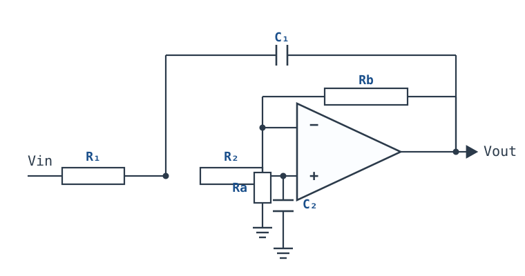
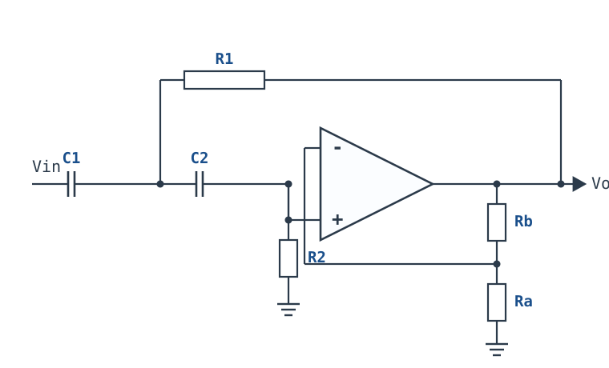

# 二阶滤波器 Sallen-Key 与 Q 值 Sallen-Key 2nd-Order Filter

## 1. 设计动机

::: motivation 为什么值得为二阶滤波器多花一只电容
一阶低通在截止频率以外只以 $-20\ \text{dB/dec}$ 滚降。把截止频率设在 1 kHz、要压掉 10 kHz 的开关噪声，一阶只把它压到 $-20\ \text{dB}$，也就是还剩十分之一；如果噪声原本比信号高 40 dB，滤完仍比信号高 20 dB。二阶低通在同样频率处以 $-40\ \text{dB/dec}$ 滚降，10 kHz 处是 $-40\ \text{dB}$，正好把 40 dB 的差距抹平。再往上，每增加一阶就多 $-20\ \text{dB/dec}$，但元件、运放和调试成本也随之一阶一阶地涨。

Sallen-Key 是二阶有源滤波里最省器件的结构之一：一只运放、两只电阻、两只电容，不用电感，输出阻抗低，直接带后级也不会被负载拖垮。它把“二阶”的两个极点做进了两节 RC 和一条从输出回到中间节点的电容通路里；这条通路是**正反馈**，专门在 $f_0$ 附近把响应“顶”起来，所以 Q 可以做到远大于无源 RC 网络的 0.5。代价是：Q 不再是“顺带得到”的参数，而是必须算准、必须留容差、必须检查稳定边界的设计变量。

不懂 Sallen-Key 的工程师通常会在三个地方摔跤。第一，把“等值 R、等值 C”当成万能公式，结果 Q 只有 0.5，通带在 $f_0$ 处已经掉了 6 dB，却以为自己做的是巴特沃斯。第二，把 Q 算得很高、把增益电阻取得很随意，换一批 1% 电阻后 Q 从 10 跑到 16，带内鼓包、时域振铃，甚至自激。第三，只看 $f_0$ 对不对，不看运放的增益带宽积和相位裕度 PM，实际响应在高频变形。本章把这三个坑都拆成可复算的数字。
:::

一阶滤波器的内容见[一阶低通与高通](first-order-filters.md)；本章只讨论二阶及二阶以上的 Sallen-Key 结构。稳定性与相位裕度的完整判据见[稳定性：伯德图、相位裕度与补偿](stability-bode.md)；Q、阻尼比与带宽的通用定义见 [RLC 电路与谐振](../basics/rlc-resonance.md)。

## 2. 定义与直观：二阶低通在做什么

### 2.1 一句话定义与三个参数

**二阶低通（second-order low-pass）**是这样一个线性网络：它的传递函数分母里 $s$ 的最高次是 2，通带内增益近似为常数，频率超过 $f_0$ 后以 $-40\ \text{dB/dec}$ 滚降。写成标准形式：

$$H(s)=\frac{K\omega_0^2}{s^2+\frac{\omega_0}{Q}s+\omega_0^2}$$

其中 $s$ 是拉普拉斯变量，单位 $\text{rad/s}$；$K$ 是通带（直流）增益，无量纲；$\omega_0=2\pi f_0$ 是自然角频率，单位 $\text{rad/s}$；$f_0$ 是自然频率，单位 $\text{Hz}$；$Q$ 是品质因数，无量纲；$\zeta=1/(2Q)$ 是阻尼比，无量纲。三个参数的分工是：

- $f_0$ 决定“拐在哪”，主要由 $R$、$C$ 的乘积决定；
- $Q$ 决定“拐得多急、拐点附近鼓不鼓”，由元件比值或增益 $K$ 决定；
- $K$ 决定通带放大量，Sallen-Key 里它同时会影响 $Q$，这是后面所有麻烦的根源。

### 2.2 电路结构：$C_1$ 是那条“正反馈”通路



把图里的节点按信号流向读一遍：

- 输入 $V_{in}$ 经 $R_1$ 到节点 A，再经 $R_2$ 到运放同相端 B；
- $C_2$ 从 B 接地，是“第二只电容”；
- $C_1$ 从 A 接到输出，把输出信号引回 A——这条通路与输入信号在 A 点同相叠加，是 Sallen-Key 的**正反馈**来源；
- 运放接成同相放大器，$V_{out}=K V_B$，$K=1+R_b/R_a$；反相端经 $R_b$ 接输出、经 $R_a$ 接地，构成运放自身的**负反馈**。

这里必须把两个“反馈”分开：运放自身的负反馈（输出经 $R_b/R_a$ 回到反相端）保证它工作在线性区，才有虚短、虚断；$C_1$ 的正反馈是滤波器网络内部的，不改变运放闭环的负反馈性质。换句话说，**虚短、虚断的前提是运放处于负反馈闭环**，Sallen-Key 满足这个前提；$C_1$ 只是让网络在 $f_0$ 附近的阻尼变小，Q 变大。把这一点记反，就会把“正反馈”误当成“运放接成了正反馈”，从而不敢用虚短，或者把稳定性判据用错地方。

### 2.3 虚短、虚断在这里怎么用

理想运放、线性区、负反馈闭环三个条件同时成立时：

- **虚断**：同相端、反相端输入电流为零，所以 $R_2$ 的电流全部流入 $C_2$，运放输入端不“吃”电流；
- **虚短**：同相端与反相端电位相等，$V_-=V_+=V_B$。$V_-$ 由输出经 $R_b/R_a$ 分压得到，$V_-=V_{out}R_a/(R_a+R_b)=V_{out}/K$，与 $V_{out}=K V_B$ 自洽。

如果运放已经进入非线性（输出撞轨、自激、上电饱和），虚短不再成立，下面的传递函数也随之失效——这是所有“算出来和示波器对不上”问题的第一检查项。

::: analogy 推秋千的相位
推秋千时，如果每次都在秋千往回摆的瞬间推，它会越荡越高；推的相位不对，或者推得太猛，秋千会翻过去。Sallen-Key 的 $C_1$ 就是那只“在正确相位推一把”的手：它把输出的一部分送回到节点 A，让 A 点在 $f_0$ 附近的电压比没有它时更高，等效于减小阻尼、抬高 Q。$K$ 越大，这只手推得越猛；$K$ 接近某个边界时，阻尼被推到零，秋千就停不下来了——这就是自激。
:::

## 3. 定量关系：$f_0$、$Q$ 与元件比值

### 3.1 节点方程与传递函数

对节点 A、B 列 KCL。设 A 点电位 $V_A$、B 点电位 $V_B$，运放同相端电流为零：

$$\frac{V_{in}-V_A}{R_1}=\frac{V_A-V_B}{R_2}+sC_1(V_A-V_{out})$$

$$\frac{V_A-V_B}{R_2}=sC_2V_B$$

又因为 $V_{out}=K V_B$，把 $V_A=V_B(1+sR_2C_2)$ 代入第一式，消去 $V_A$、$V_B$，整理得到：

$$H(s)=\frac{K}{1+s\left[C_2(R_1+R_2)+R_1C_1(1-K)\right]+s^2R_1R_2C_1C_2}$$

与标准二阶形式逐项对照：

$$\omega_0=\frac{1}{\sqrt{R_1R_2C_1C_2}},\qquad f_0=\frac{1}{2\pi\sqrt{R_1R_2C_1C_2}}$$

$$Q=\frac{\sqrt{R_1R_2C_1C_2}}{C_2(R_1+R_2)+R_1C_1(1-K)}$$

符号与单位：

| 符号 | 含义 | 单位 | 备注 |
|---|---|---|---|
| $R_1,R_2$ | 两级串联电阻 | $\Omega$ | 取值 1 k$\Omega$~100 k$\Omega$ 较常见 |
| $C_1$ | 从节点 A 到输出的反馈电容 | F | 决定正反馈强弱 |
| $C_2$ | 从同相端到地的电容 | F | 与 $R_1+R_2$ 一起决定阻尼 |
| $K$ | 同相增益，$K=1+R_b/R_a$ | 无量纲 | $K\geq1$ |
| $f_0$ | 自然频率 | Hz | 不是“$-3\ \text{dB}$ 频率”，两者只在 $Q=0.707$ 时重合 |
| $Q$ | 品质因数 | 无量纲 | 峰值与阻尼由它决定 |
| $\zeta$ | 阻尼比 | 无量纲 | $\zeta=1/(2Q)$ |

**适用条件**：理想运放、线性区、负反馈闭环、元件为线性时不变、忽略运放输入电容与输出电阻。**失效边界**：运放进入非线性、$Q$ 高到极点进入右半平面、运放 GBW 不足导致高频附加相移、电容介质随电压/温度变化。

::: advanced 进阶：完整代数
由第二式得 $V_A=V_B(1+sR_2C_2)$。第一式两边乘 $R_1$：

$$V_{in}-V_A=R_1\left[\frac{V_A-V_B}{R_2}+sC_1(V_A-KV_B)\right]$$

把 $V_A$ 代入，按 $V_B$ 合并：

$$V_{in}=V_B\left\{1+s\left[C_2(R_1+R_2)+R_1C_1(1-K)\right]+s^2R_1R_2C_1C_2\right\}$$

两边除以 $V_{in}$、再用 $V_{out}=K V_B$，即得 §3.1 的 $H(s)$。注意 $s$ 项里的 $(1-K)$：$K$ 越大，这一项越小，阻尼越小，Q 越大；当它被减到 0 时，$s$ 项消失，极点落在虚轴上，电路进入等幅振荡。
:::

### 3.2 几种常见取值下的简化式

设计时不会每次都从一般式算，先把几种常用取值的简化式背下来，再决定用哪一种。

**（a）单位增益、等值电阻：$K=1$，$R_1=R_2=R$。** 这是最容易算、Q 最稳的一种，代价是 Q 只能靠 $C_1/C_2$ 调：

$$f_0=\frac{1}{2\pi R\sqrt{C_1C_2}},\qquad Q=\frac{1}{2}\sqrt{\frac{C_1}{C_2}}$$

复算：$R_1=R_2=R$ 时，$Q=\dfrac{R\sqrt{C_1C_2}}{C_2\cdot2R}=\dfrac12\sqrt{\dfrac{C_1}{C_2}}$。

**（b）等值电阻、等值电容、增益设定 Q：$R_1=R_2=R$，$C_1=C_2=C$。** 这时 $f_0=1/(2\pi RC)$，Q 只由 $K$ 定：

$$Q=\frac{1}{3-K},\qquad K=1+\frac{R_b}{R_a}$$

巴特沃斯 $Q=1/\sqrt2=0.7071$ 对应 $3-K=\sqrt2$，即 $K=1.5858$，$R_b/R_a=0.5858$。

**（c）反相型多路反馈（MFB）。** Sallen-Key 是同相结构；需要反相输出时，可以换成 MFB。它的 $Q$ 与增益耦合更紧，元件灵敏度也不同，具体取舍见 §5.2 与 [带通与带阻滤波器](bandpass-bandstop.md)。

**（d）高通：把串联电阻换成串联电容。** 低通的信号通路是“$R_1$、$R_2$ 串联”，高通把它换成“$C_1$、$C_2$ 串联”；低通的 $C_1$（节点 A 到输出）在高通里换成 $R_1$（节点 A 到输出），低通的 $C_2$（同相端到地）换成 $R_2$（同相端到地）。对节点 A、B 列 KCL：

$$\frac{V_{in}-V_A}{1/(sC_1)}=\frac{V_A-V_B}{1/(sC_2)}+\frac{V_A-V_{out}}{R_1}$$

$$\frac{V_A-V_B}{1/(sC_2)}=\frac{V_B}{R_2}$$

再用 $V_{out}=K V_B$ 消去 $V_A$、$V_B$，整理得

$$H_{HP}(s)=\frac{Ks^2R_1R_2C_1C_2}{1+s\left[C_1R_1+C_2R_1+C_2R_2(1-K)\right]+s^2R_1R_2C_1C_2}$$

对照标准形式，$f_0$ 仍是 $1/(2\pi\sqrt{R_1R_2C_1C_2})$，Q 变成

$$Q=\frac{\sqrt{R_1R_2C_1C_2}}{R_1(C_1+C_2)+C_2R_2(1-K)}$$

等值 $R$、$C$ 时同样简化为 $Q=1/(3-K)$：$K=1.586$ 是巴特沃斯，$K=2.9$ 是 Q=10。高通在 $f_0$ 处的增益是 $KQ$，高频通带增益是 $K$；Q=0.707 时 $f_0$ 处相对高频通带为 $-3\ \text{dB}$，Q=10 时 $f_0$ 处比高频通带高 20 dB。**低通的结论（$Q=1/(3-K)$、等值时的 $K<3$ 边界、Q 的灵敏度）对高通同样成立**，只是输入输出角色互换。



取等值 $R=15.8\ \text{k}\Omega$、$C=10\ \text{nF}$、$K=2.9$：$f_0=1007\ \text{Hz}$、$Q=10$、$f_0$ 处增益 $KQ=29$（$29.2\ \text{dB}$），高频通带增益 2.9（$9.2\ \text{dB}$）。这就是[带通与带阻滤波器](bandpass-bandstop.md)里 1 kHz/Q=10 带通的**低端**那半节：它挡住 $f_0$ 以下的频率，并在 $f_0$ 处形成 Q=10 的峰。

### 3.3 $Q$ 与元件比值：两张表

**表一：单位增益、$R_1=R_2=R$ 时，$Q$ 随 $C_1/C_2$ 变化。** 用 $Q=0.5\sqrt{C_1/C_2}$ 复算：

| $C_1/C_2$ | $Q$ | 峰值（dB） | 形态 |
|---|---|---|---|
| 0.25 | 0.250 | 0 | 过阻尼，通带下垂 |
| 0.5 | 0.354 | 0 | 过阻尼 |
| 1 | 0.500 | 0 | 临界阻尼，$f_0$ 处 $-6.02\ \text{dB}$ |
| 2 | 0.707 | 0 | 巴特沃斯，最大平坦 |
| 4 | 1.000 | 1.25 | 轻微鼓包 |
| 10 | 1.581 | 4.44 | 明显鼓包 |
| 100 | 5.000 | 14.02 | 高 Q，窄峰 |
| 400 | 10.000 | 20.01 | 很高 Q，对容差敏感 |

**表二：等值 $R$、等值 $C$ 时，$Q$ 随 $K$ 变化。** 用 $Q=1/(3-K)$ 复算：

| $K$ | $1+R_b/R_a$ 示例 | $Q$ | 峰值（dB） |
|---|---|---|---|
| 1.0 | $R_b=0$ | 0.500 | 0 |
| 1.5 | $R_b/R_a=0.5$ | 0.667 | 0 |
| 1.586 | $R_b/R_a=0.586$ | 0.707 | 0 |
| 2.0 | $R_b/R_a=1$ | 1.000 | 1.25 |
| 2.5 | $R_b/R_a=1.5$ | 2.000 | 6.30 |
| 2.9 | $R_b/R_a=1.9$ | 10.000 | 20.01 |
| 2.99 | $R_b/R_a=1.99$ | 100.000 | 40.00 |

::: pitfall 等值 $R$、$C$ 时 $Q$ 不是 $1/3$
很多资料看到分母里的 $3-K$，就记成“等值时 $Q=1/3$”。这是把分母的 3 当成了 Q 的分母。实际代入 $K=1$：$3-K=2$，$Q=1/2=0.5$，不是 $0.333$。复算一遍：$K=1$、$R_1=R_2=R$、$C_1=C_2=C$ 时，$s$ 项系数是 $C(R+R)+RC(1-1)=2RC$，除以 $\sqrt{R^2C^2}=RC$，得 $1/Q=2$，所以 $Q=0.5$。

$Q=1/3$ 确实会出现，但它属于**等值 Wien 网络**（$\beta$ 的分母是 $s^2R^2C^2+3sRC+1$）或某些 MFB 拓扑，不属于这个 Sallen-Key 低通。更关键的是：在 $K\geq1$ 的 Sallen-Key 里，等值 $R$、$C$ 的 $Q=1/(3-K)$ 只能从 0.5 往上走，**根本到不了 0.333**；想用等值取值做巴特沃斯，必须把 $K$ 精确设到 1.586，而不是“等值就自然平”。

**现象**：按“等值 R、等值 C”搭好，测到 $f_0$ 处比通带低 6 dB，以为电路坏了。**原因**：单位增益时 $Q=0.5$，$f_0$ 处本来就比直流低 $20\lg(0.5)=-6.02\ \text{dB}$。**解决**：把 $C_1$ 取成 $2C_2$（单位增益巴特沃斯），或把 $K$ 设到 1.586；两种做法只能选一种，不能既等值又巴特沃斯。
:::

### 3.4 稳定边界不是永远 $K<3$

从 $Q$ 的分母看，稳定的必要条件是分母的 $s$ 项系数大于零：

$$C_2(R_1+R_2)+R_1C_1(1-K)>0$$

即

$$K<1+\frac{C_2(R_1+R_2)}{R_1C_1}$$

等值 $R$、$C$ 时右边是 $1+(R+R)/R=3$，所以“$K<3$”只是这个特例，不是普遍规律。换一组比值，边界会变：

| $R_1$ | $R_2$ | $C_1$ | $C_2$ | $K_{\max}=1+\dfrac{C_2(R_1+R_2)}{R_1C_1}$ |
|---|---|---|---|---|
| 1 k$\Omega$ | 1 k$\Omega$ | 10 nF | 10 nF | 3.0 |
| 1 k$\Omega$ | 1 k$\Omega$ | 20 nF | 10 nF | 2.0 |
| 1 k$\Omega$ | 2 k$\Omega$ | 10 nF | 10 nF | 4.0 |
| 1 k$\Omega$ | 1 k$\Omega$ | 10 nF | 22 nF | 5.4 |

这张表解释了两件事：第一，**从滤波器网络的极点看，单位增益（$K=1$）的 Sallen-Key 对任何正元件都稳定**，因为 $1<1+\text{正数}$ 恒成立；第二，**增益设定 Q 的结构把稳定性押在 $K$ 上**，$K$ 越靠近边界，Q 越高、越危险。设计高 Q 时，先算 $K_{\max}$，再让 $K$ 留出至少 10% 的余量；不要背“K<3”就到处套。

### 3.5 $Q$ 过高：峰值、峰值频率与振铃

Q 大于 $1/\sqrt2=0.7071$ 时，幅频曲线出现峰值。峰值大小和峰值频率分别是：

$$M_r=\frac{Q}{\sqrt{1-\frac{1}{4Q^2}}}\quad(Q>0.7071),\qquad f_p=f_0\sqrt{1-\frac{1}{2Q^2}}$$

复算 $Q=2$：$M_r=2/\sqrt{1-1/16}=2/\sqrt{0.9375}=2.0656$，即 $20\lg(2.0656)=6.30\ \text{dB}$；$f_p=f_0\sqrt{1-1/8}=0.9354f_0$。$Q=10$：$M_r=10/\sqrt{1-1/400}=10/\sqrt{0.9975}=10.0125$，即 $20.01\ \text{dB}$；$f_p=0.9975f_0$。

| $Q$ | $\zeta=1/(2Q)$ | 峰值 $M_r$ | 峰值 dB | $f_p/f_0$ | 阶跃过冲 $M_p$（时域） |
|---|---|---|---|---|---|
| 0.5 | 1.000 | 1.000 | 0 | — | 0 |
| 0.707 | 0.707 | 1.000 | 0 | — | 4.3% |
| 1.0 | 0.500 | 1.155 | 1.25 | 0.707 | 16.3% |
| 2.0 | 0.250 | 2.066 | 6.30 | 0.935 | 44.4% |
| 5.0 | 0.100 | 5.025 | 14.02 | 0.990 | 72.9% |
| 10.0 | 0.050 | 10.013 | 20.01 | 0.998 | 85.4% |

归一化幅频曲线（相对直流增益 $K$，横轴 $f/f_0$，数据由 $|H|=1/\sqrt{(1-x^2)^2+x^2/Q^2}$ 逐点计算）：

```echarts
{
  "tooltip": {"trigger": "axis"},
  "legend": {"data": ["Q=0.5", "Q=0.707", "Q=1", "Q=2", "Q=5", "Q=10"], "bottom": 0, "textStyle": {"fontSize": 12}},
  "grid": {"left": 58, "right": 26, "top": 26, "bottom": 62},
  "xAxis": {"type": "log", "name": "f / f0", "nameLocation": "middle", "nameGap": 30, "min": 0.1, "max": 10, "axisLabel": {"fontSize": 11}},
  "yAxis": {"type": "value", "name": "dB", "nameLocation": "middle", "nameGap": 42, "min": -42, "max": 22, "interval": 10, "axisLabel": {"fontSize": 11}},
  "series": [
    {"name": "Q=0.5", "type": "line", "smooth": true, "showSymbol": false, "lineStyle": {"width": 2.2, "color": "#8a9aa8"},
     "data": [[0.1,-0.09],[0.2,-0.34],[0.3,-0.75],[0.5,-1.94],[0.7,-3.46],[0.8,-4.3],[0.9,-5.15],[1,-6.02],[1.1,-6.89],[1.2,-7.75],[1.5,-10.24],[2,-13.98],[3,-20.0],[5,-28.3],[10,-40.09]]},
    {"name": "Q=0.707", "type": "line", "smooth": true, "showSymbol": false, "lineStyle": {"width": 2.6, "color": "#1a4f8b"},
     "data": [[0.1,0],[0.2,-0.01],[0.3,-0.04],[0.5,-0.26],[0.7,-0.93],[0.8,-1.49],[0.9,-2.19],[1,-3.01],[1.1,-3.92],[1.2,-4.88],[1.5,-7.83],[2,-12.3],[3,-19.14],[5,-27.97],[10,-40.0]]},
    {"name": "Q=1", "type": "line", "smooth": true, "showSymbol": false, "lineStyle": {"width": 2.2, "color": "#2f6d9e"},
     "data": [[0.1,0.04],[0.2,0.17],[0.3,0.37],[0.5,0.9],[0.7,1.25],[0.8,1.14],[0.9,0.73],[1,0],[1.1,-0.98],[1.2,-2.13],[1.5,-5.81],[2,-11.14],[3,-18.63],[5,-27.79],[10,-39.96]]},
    {"name": "Q=2", "type": "line", "smooth": true, "showSymbol": false, "lineStyle": {"width": 2.2, "color": "#5b8db8"},
     "data": [[0.1,0.08],[0.2,0.31],[0.3,0.7],[0.5,2.04],[0.7,4.17],[0.8,5.38],[0.9,6.22],[1,6.02],[1.1,4.6],[1.2,2.57],[1.5,-3.27],[2,-10.0],[3,-18.21],[5,-27.65],[10,-39.92]]},
    {"name": "Q=5", "type": "line", "smooth": true, "showSymbol": false, "lineStyle": {"width": 2.4, "color": "#b5642e"},
     "data": [[0.1,0.09],[0.2,0.35],[0.3,0.8],[0.5,2.42],[0.7,5.53],[0.8,8.09],[0.9,11.64],[1,13.98],[1.1,10.34],[1.2,6.0],[1.5,-2.18],[2,-9.62],[3,-18.09],[5,-27.61],[10,-39.91]]},
    {"name": "Q=10", "type": "line", "smooth": true, "showSymbol": false, "lineStyle": {"width": 2.6, "color": "#b03030"},
     "data": [[0.1,0.09],[0.2,0.35],[0.3,0.81],[0.5,2.48],[0.7,5.77],[0.8,8.66],[0.9,13.55],[1,20.0],[1.1,12.5],[1.2,6.82],[1.5,-2.0],[2,-9.56],[3,-18.07],[5,-27.61],[10,-39.91]]}
  ]
}
```

时域过冲用 $M_p=e^{-\pi\zeta/\sqrt{1-\zeta^2}}$ 复算，例如 $Q=2$、$\zeta=0.25$：$M_p=e^{-0.7854/\sqrt{0.9375}}=e^{-0.8112}=0.444$，即 44.4%。**频域峰值和时域过冲是同一组极点的两个侧面**：Q 高，频域鼓包，时域振铃；两者不能只看一个。

还要注意一个容易混的口径：**这里的“带宽”不是 $f_0/Q$**。$f_0/Q$ 是**带通/带阻**的半功率带宽定义；二阶低通的 $-3\ \text{dB}$ 频率（相对直流增益）由

$$(1-x^2)^2+\frac{x^2}{Q^2}=2,\qquad x=\frac{f_{-3\text{dB}}}{f_0}$$

解出。$Q=0.5$ 时 $x=0.6436$；$Q=0.707$ 时 $x=1.000$；$Q=1$ 时 $x=1.272$；$Q=10$ 时 $x=1.551$。低通的“拐点”随 Q 升高反而往外推，这和带通的“Q 越高带宽越窄”方向相反，别把两套口径混用。

### 3.6 $Q$ 的灵敏度：为什么高 Q 设计难

Q 对元件的敏感程度决定了“算得准”能不能变成“做得准”。用对数灵敏度

$$S_x^Q=\frac{x}{Q}\frac{\partial Q}{\partial x}$$

衡量 $x$ 变化 1% 时 Q 变化百分之几。

**增益设定 Q 的结构**：$Q=1/(3-K)$，$K=1+R_b/R_a$。对 $K$ 求导：

$$S_K^Q=\frac{K}{Q}\cdot\frac{1}{(3-K)^2}=\frac{K}{3-K}=KQ$$

这个式子很残酷：$Q=0.707$ 时 $S_K^Q=1.12$，1% 的 $K$ 误差只让 Q 变 1.1%；$Q=10$ 时 $S_K^Q=29$，1% 的 $K$ 误差让 Q 变 29%。而 $K$ 由两只电阻的比值决定，1% 电阻的比值误差最坏约 2%，折算到 $K$ 上的误差约 1.3%（$1.9\times2\%/2.9=1.31\%$）；于是 $Q=10$ 的 Q 误差约 38%，Q 范围约 7.3~16.2（§4.5 复算）。

**单位增益、等值电阻的结构**：$Q=0.5\sqrt{C_1/C_2}$，对 $C_1/C_2$ 的灵敏度是

$$S_{C_1/C_2}^Q=\frac12$$

也就是电容比值变 1%，Q 只变 0.5%。这就是为什么同样要 Q=0.707，**单位增益 + 电容比值**的方案比**等值 + 增益设定**的方案更抗容差；代价是电容比值要准，Q=10 时 $C_1/C_2=400$，比值本身不容易做得很准。

| 结构 | Q 由什么定 | 灵敏度 | Q=0.707 时 1% 误差 | Q=10 时 1% 误差 |
|---|---|---|---|---|
| 单位增益、$R_1=R_2$ | $C_1/C_2$ | $S_{C_1/C_2}^Q=1/2$ | 0.5% | 0.5% |
| 等值 $R$、$C$、增益设定 | $K=1+R_b/R_a$ | $S_K^Q=KQ$ | 1.12% | 29% |

## 4. 典型计算：10 kHz 巴特沃斯低通

### 4.1 需求与拓扑选择

**需求**：$f_0=10\ \text{kHz}$，巴特沃斯（最大平坦，$Q=1/\sqrt2=0.7071$），通带增益 1（单位增益），只用一只运放。选单位增益、$R_1=R_2=R$、用 $C_1/C_2$ 定 Q 的拓扑：它把“增益”和“Q”解耦，Q 只由电容比值定，1% 电阻不会把 Q 推跑。

### 4.2 从 Q 反推 $C_1/C_2$

由 $Q=\frac12\sqrt{C_1/C_2}$ 反解：

$$\frac{C_1}{C_2}=(2Q)^2=(2\times0.7071)^2=1.4142^2=2.000$$

取 $C_2=10\ \text{nF}$（C0G/NP0，1%），则 $C_1=20\ \text{nF}$。20 nF 不是 E12 的整数档，实用做法是**两只 10 nF 并联**：比值精确为 2.000，而且同批次、同介质，温漂一致。若改用 E12 的 22 nF，$C_1/C_2=2.2$，$Q=0.5\sqrt{2.2}=0.7416$（比目标高 4.9%），峰值约 $+0.036\ \text{dB}$，仍接近平坦，但已不是严格的巴特沃斯。

### 4.3 取 E96 电阻，算实际 $f_0$ 与 Q

由 $f_0=1/(2\pi R\sqrt{C_1C_2})$ 反解：

$$R=\frac{1}{2\pi f_0\sqrt{C_1C_2}}=\frac{1}{2\pi\times10^4\times\sqrt{20\times10^{-9}\times10\times10^{-9}}}=\frac{1}{2\pi\times10^4\times14.142\times10^{-9}}=1125.4\ \Omega$$

取 E96 的 **1.13 k$\Omega$**（1% 金属膜）。实际

$$f_0=\frac{1}{2\pi\times1130\times14.142\times10^{-9}}=9959.3\ \text{Hz}$$

相对 10 kHz 低 0.41%，在 1% 电阻的容差内。实际 Q 仍由电容比值决定：

$$Q=\frac12\sqrt{\frac{20\ \text{nF}}{10\ \text{nF}}}=0.7071$$

### 4.4 1% 容差的最坏偏差

**电阻**：两只 1.13 k$\Omega$ 的 1% 电阻，最坏情况一只 +1%、一只 $-1$%。Q 的完整式是

$$Q=\frac12\sqrt{\frac{C_1}{C_2}}\cdot\frac{2\sqrt{R_1R_2}}{R_1+R_2}$$

后一个因子在 $R_1=R_2$ 处对失配是**二阶不敏感**的：$R_1=1.01R$、$R_2=0.99R$ 时，$2\sqrt{0.9999}/2=0.999975$，Q 只从 0.70711 降到 0.70707，变化 $-0.005\%$。电阻容差主要影响 $f_0$：两只同向 +1% 时 $f_0$ 降 1.0%（9860.6 Hz），反向时只变 $+0.005\%$（9959.7 Hz）。

**电容**：C0G 1% 电容的比值最坏为 $1.01/0.99=1.0202$ 或 $0.99/1.01=0.9802$；标称 $C_1/C_2=2$，所以实际比值是 $2\times1.0202=2.0404$ 或 $2\times0.9802=1.9604$，对应

$$Q=0.5\sqrt{2.0404}=0.7142\quad\text{或}\quad Q=0.5\sqrt{1.9604}=0.7001$$

即 $+1.0\%$ 或 $-1.0\%$。峰值从 0 dB 变成 $+0.0017\ \text{dB}$（Q=0.7142）或仍为 0 dB（Q=0.7001，无峰值）。若用 5% 电容，相对比值因子是 $1.05/0.95=1.105$ 或 $0.95/1.05=0.905$，实际 $C_1/C_2=2.21$ 或 $1.81$，Q 到 0.7434 或 0.6726，峰值 $+0.040\ \text{dB}$ 或 0 dB——**峰值变化仍然很小**，因为巴特沃斯点附近峰值对 Q 是二阶不敏感的；真正明显的是 $f_0$ 和带边形状。

| 容差项 | 最坏 Q | 峰值变化 | 对应 $f_0$ 偏移 | $f_0$ 最坏偏移（另一组合） |
|---|---|---|---|---|
| 1% 电阻（反向） | 0.70707 | 0 | $+0.005\%$ | $-1.0\%$（同向） |
| 1% 电容（反向） | 0.7001~0.7142 | $0$~$+0.0017\ \text{dB}$ | $+0.005\%$ | $-1.0\%$（同向） |
| 5% 电容（反向） | 0.6726~0.7434 | $0$~$+0.040\ \text{dB}$ | $+0.125\%$ | $-5.0\%$（同向） |

这张表给出一个反直觉但重要的结论：**在这个拓扑里，1% 电阻不会把 Q 推跑**，Q 由电容比值定；想把 Q 做准，先保电容比值，而不是盲目把电阻换成 0.1%。反过来，电容同向漂移 1% 时 Q 几乎不变，但 $f_0$ 会偏 1.0%；5% 电容同向漂移时 $f_0$ 偏 5.0%。表中的 $f_0$ 偏移是单项贡献；电阻与电容同时同向偏 1% 时，两项叠加，$f_0$ 最坏偏约 2.0%（$1/(1.01\times1.01)=0.9803$）。任务书里“用 1% 电阻算 Q 的最坏偏差”如果指的是“等值 R、C + 增益设定 Q”的结构，答案会完全不同，见下一节。

### 4.5 对照：等值 $R$、$C$ + 增益设定 Q 的容差

同样 $f_0=10\ \text{kHz}$、$Q=0.7071$，换第二种拓扑：$C_1=C_2=10\ \text{nF}$，$R_1=R_2=R=1/(2\pi\times10^4\times10\ \text{nF})=1591.5\ \Omega$，取 E96 的 1.58 k$\Omega$；$K=1.5858$，取 $R_a=10\ \text{k}\Omega$、$R_b=5.86\ \text{k}\Omega$。实际 $f_0=1/(2\pi\times1580\times10\ \text{nF})=1007.3\ \text{Hz}$。

$R_b/R_a$ 的 1% 最坏比值是 $0.586\times(1.01/0.99)=0.5978$ 或 $0.586\times(0.99/1.01)=0.5745$，对应 $K=1.5978$ 或 $1.5745$，$Q=1/(3-K)=0.7132$ 或 $0.7015$。峰值 $+0.0012\ \text{dB}$ 或 0 dB——在巴特沃斯点附近仍然很小。**但把同样的 1% 电阻放到 $Q=10$（$K=2.9$）**：

$$K=2.9\pm0.038\ \Rightarrow\ Q=\frac{1}{3-K}=7.27\sim16.23$$

峰值从 20.01 dB 变成 17.25 dB 或 24.21 dB，**±3.5 dB 的变化**；带宽也从 100 Hz 变成 137 Hz 或 62 Hz。这个对照说明：**高 Q 的 Sallen-Key 不能把 Q 押在 1% 电阻的增益比上**；要么用单位增益 + 电容比值（Q 稳，但高 Q 需要大比值），要么用 0.1% 电阻/微调，要么换状态变量等 Q 与增益解耦的结构。

### 4.6 验算：通带、阻带与运放带宽

**幅频验算**（$Q=0.7071$ 的巴特沃斯）：

- $f=f_0$：$|H|=K/\sqrt2=0.7071$，相对通带 $-3.01\ \text{dB}$；
- $f=2f_0$：$|H|=1/\sqrt{1+2^4}=1/\sqrt{17}=0.2425$，$-12.30\ \text{dB}$；
- $f=10f_0$：$|H|=1/\sqrt{1+10^4}=0.0099995$，$-40.00\ \text{dB}$；
- $f=100f_0$：$-80.00\ \text{dB}$。

注意 $10f_0$ 处是 $-40.00\ \text{dB}$，不是“差不多 $-40$”：巴特沃斯的 $|H|^2=1/(1+x^4)$，$x=10$ 时 $x^4=10^4$，分母 $10001$，$|H|=0.0099995$，$20\lg=-40.0004\ \text{dB}$。

**运放带宽**：Sallen-Key 的 Q 依赖运放在 $f_0$ 处的开环增益。经验规则是 $GBW\geq100f_0$（$Q\leq1$ 时），$Q=10$ 时留到 $500f_0$ 以上并仿真确认；10 kHz、Q=0.707 选 $GBW\geq1\ \text{MHz}$ 的通用运放即可。运放自身的相位裕度 PM 要按[稳定性：伯德图、相位裕度与补偿](stability-bode.md)的方法核对，目标至少 $45^{\circ}$，通常取 $60^{\circ}$；**滤波器的 Q 和运放的 PM 不是同一个量**，前者是闭环频响的峰，后者是运放自身环路在穿越频率处的稳定余量。

::: example 10 kHz 巴特沃斯低通的最终取值
- $R_1=R_2=1.13\ \text{k}\Omega$，1% 金属膜；
- $C_2=10\ \text{nF}$，C0G/NP0，1%；
- $C_1=2\times10\ \text{nF}$ 并联，C0G/NP0，1%；
- 运放：单位增益稳定，$GBW\geq1\ \text{MHz}$，输入偏置电流在 1.13 k$\Omega$ 上产生的失调可忽略；
- 实测预期：$f_0=9.96\ \text{kHz}$，$Q=0.707$，$10f_0$ 处 $-40\ \text{dB}$；
- 若把 $C_1$ 换成 22 nF，$Q=0.742$，峰值 $+0.036\ \text{dB}$，$f_0$ 变为 $1/(2\pi\times1130\times\sqrt{22\text{n}\times10\text{n}})=1/(2\pi\times1130\times14.832\text{n})=9497\ \text{Hz}$，偏低 5.0%。
:::

## 5. 工程含义：从纸面 Q 到能用的电路

### 5.1 Q 的选择：巴特沃斯、贝塞尔、切比雪夫

| 响应 | $Q$ | 特点 | 典型用途 |
|---|---|---|---|
| 贝塞尔（Bessel） | 0.577 | 群时延最平，过冲小，过渡带最缓 | 脉冲、方波、图像 |
| 巴特沃斯（Butterworth） | 0.707 | 通带最大平坦，过渡带居中 | 通用抗混叠、测量 |
| 切比雪夫（Chebyshev） | $>0.707$ | 通带有纹波，过渡带更陡 | 对选择性要求高、允许纹波 |
| 高 Q（如 5~10） | 5~10 | 窄带、强峰值、振铃 | 窄带选频、谐振 |

巴特沃斯不是“最好”，只是“通带最平”；脉冲场合选贝塞尔，窄带选高 Q。选错响应类型，后面怎么调元件都不对。

### 5.2 元件取值与数量级

- **先定 $C$ 再算 $R$**：kHz 级取 $C=1\ \text{nF}\sim100\ \text{nF}$，$R$ 落在 1 k$\Omega$~100 k$\Omega$；MHz 级取 100 pF~1 nF。$C$ 太大，$R$ 太小、信号源负载重；$C$ 太小，$R$ 太大、偏置电流和噪声问题突出。
- **电容介质**：C0G/NP0，1% 或 5%；X7R 的电容随直流偏压和温度变化，会把 $f_0$ 和 Q 一起拖走；电解电容只适合做隔直，不适合做滤波定时。
- **电阻**：1% 金属膜；高 Q 的增益设定结构用 0.1% 或微调电位器。电阻的热噪声按 $\sqrt{4kTR\Delta f}$ 估算（$k$ 为玻尔兹曼常数，$T$ 为绝对温度，$\Delta f$ 为噪声带宽），第一级 $R$ 越大噪声越大。
- **增益电阻**：$R_a$、$R_b$ 取 10 k$\Omega$~100 k$\Omega$；太小增加运放输出负载，太大受偏置电流和输入电容影响。$R_b$ 与 $R_a$ 的比值决定 $K$，要按 E96 实际值反算 $K$ 和 $Q$，不要只写标称值。
- **运放选型**：$GBW\geq100f_0$（Q≤1）或 $500f_0$（Q=10）；单位增益稳定；输入共模范围覆盖工作点；输出摆幅满足后级；容性负载按[稳定性：伯德图、相位裕度与补偿](stability-bode.md)加隔离电阻。

### 5.3 稳定性与布局

Sallen-Key 的稳定性有两层：

1. **滤波器网络的极点**：由 §3.4 的 $K_{\max}$ 决定。$K$ 越接近边界，Q 越高，极点越靠近虚轴；到边界上，理论 Q 无穷大，实际会自激。
2. **运放自身的环路**：由 $A_{OL}$、$\beta$、$T=A_{OL}\beta$ 和 PM 决定。$C_1$ 接在输出与节点 A 之间，会把输出电容负载的一部分“看”进运放环路；$C_1$ 越大、$R_1$ 越小，高频越容易出问题。噪声增益 $1/\beta=K$ 越高，运放的闭环带宽越低，通常越稳；但 $K$ 高又推高滤波器 Q，两个方向要一起权衡。

布局上，节点 A 是高阻节点，$C_1$ 的走线要短，避免与输出大电流路径并行；$C_2$ 的地要就近回到运放的地；增益分压 $R_a$、$R_b$ 靠近反相端，减少寄生电容。高 Q 时，节点 A 的寄生电容会改变 $f_0$ 和 Q，打样后要用网络分析仪或频率扫描实测。

### 5.4 单电源、直流与噪声

- **直流增益**：直流下 $C_1$、$C_2$ 开路，$R_1$、$R_2$ 直通，$V_{out}=K V_{in}$。Sallen-Key 低通不隔直，输入直流会按 $K$ 放大；需要隔直时在输入或输出加耦合电容，但耦合电容会与输入阻抗形成额外的高通转折，要一起算。
- **单电源**：交流信号必须偏置在 $V_{cc}/2$ 附近；同相端 B 的直流电位由偏置网络设定，$R_1$、$R_2$ 会与偏置网络分压。不要直接把输入接地，否则负半周被削。
- **噪声**：$R_1$、$R_2$ 的热噪声被运放同相放大；$C_1$ 把输出噪声引回节点 A，形成频率相关的噪声增益。低噪声设计的第一级尽量用低阻值、低噪声运放，并把带宽限制在需要的范围内。
- **失调**：运放输入失调电压被 $K$ 放大；高 Q 结构的直流精度通常不是重点，但如果后级是直流耦合，要算失调预算。

## 6. 常见坑

::: pitfall 六个高频坑（现象 → 原因 → 解决）
- **现象**：按“等值 R、等值 C”搭好，$f_0$ 处比通带低 6 dB，以为滤波失败。**原因**：单位增益时 $Q=0.5$，$f_0$ 处本来就是 $-6.02\ \text{dB}$，不是巴特沃斯。**解决**：把 $C_1$ 取成 $2C_2$，或把 $K$ 设到 1.586；先确认自己要做的是哪一种响应。
- **现象**：$K$ 调到 2.9 附近，输出在 $f_0$ 上持续振荡，输入不接也有。**原因**：$3-K=0.1$，Q=10，极点非常靠近虚轴；1% 增益电阻就能把 $K$ 推到 2.938，Q 到 16，稍有寄生相移就自激。**解决**：$K$ 留 10% 余量、用 0.1% 电阻或微调；高 Q 改用 Q 与增益解耦的结构（单位增益 + 电容比值，或状态变量滤波器）。
- **现象**：Q 设计成 0.707，实测只有 0.5 左右，通带下垂。**原因**：$C_1$、$C_2$ 接反。$C_1$ 是反馈电容（A 到输出），$C_2$ 是同相端到地；接反后 $Q=0.5\sqrt{C_2/C_1}=0.354$。**解决**：按原理图核对标号，PCB 丝印把 $C_1$、$C_2$ 标清楚。
- **现象**：换了一批电容后 $f_0$ 偏 10%，Q 也变了。**原因**：用了 X7R 或电解电容，容值随直流偏压、温度变化；或者电容容差是 10%。**解决**：C0G/NP0、1%；$C_1$、$C_2$ 同批次；打样后实测 $f_0$。
- **现象**：低频响应正常，高频出现额外鼓包或振荡。**原因**：运放 GBW 不足，或 $C_1$ 把容性负载引入环路，PM 不够。**解决**：按 $GBW\geq100f_0$（Q≤1）/ $500f_0$（Q=10）选型；输出串 10~100 $\Omega$ 隔离电阻；按[稳定性：伯德图、相位裕度与补偿](stability-bode.md)核对 PM。
- **现象**：单电源供电时输出负半周被削，或直流工作点漂到轨。**原因**：同相端没有偏置到 $V_{cc}/2$，或输入直流被 $K$ 放大。**解决**：用 $R_1$、$R_2$ 之前的偏置网络或输入耦合电容把工作点定在 $V_{cc}/2$；核算 $K$ 对失调的放大。
:::

## 7. 自测题

<details><summary>Sallen-Key 低通取 R1=R2=10 kΩ、C1=20 nF、C2=10 nF、单位增益，求 f0、Q，并说明 f0 处比通带低多少 dB。</summary>

$$f_0=\frac{1}{2\pi\times10^4\times\sqrt{20\text{n}\times10\text{n}}}=\frac{1}{2\pi\times10^4\times14.142\text{n}}=1125\ \text{Hz}$$

$$Q=\frac12\sqrt{\frac{20}{10}}=0.7071$$

$f_0$ 处 $|H|=KQ=1\times0.7071$，即比通带低 $20\lg(0.7071)=-3.01\ \text{dB}$，正好是巴特沃斯的 $-3\ \text{dB}$ 点。

</details>

<details><summary>等值 R、等值 C 的 Sallen-Key 低通，单位增益时 Q 是多少？有人说 Q=1/3，错在哪里？要做巴特沃斯，K 应该取多少？</summary>

$Q=1/(3-K)$，$K=1$ 时 $Q=1/2=0.5$，不是 $1/3$。分母里的 3 是 $3-K$ 的常数项，不是 Q 的分母；$Q=1/3$ 属于等值 Wien 网络或某些 MFB 拓扑，不属于这个 Sallen-Key 低通。

巴特沃斯 $Q=1/\sqrt2=0.7071$，由 $Q=1/(3-K)$ 得 $K=3-1/Q=3-1.4142=1.5858$，即 $R_b/R_a=0.5858$。

</details>

<details><summary>设计 f0=1 kHz、Q=10 的等值 R、C Sallen-Key 低通，K 取多少？若两只增益电阻各有 1% 误差，Q 的最坏范围是多少？峰值怎么变？</summary>

$Q=1/(3-K)=10$，$K=2.9$，$R_b/R_a=1.9$。

1% 电阻的比值最坏为 $1.9\times(1.01/0.99)=1.938$ 或 $1.9\times(0.99/1.01)=1.862$，对应 $K=2.938$ 或 $2.862$：

$$Q=\frac{1}{3-2.938}=16.2,\qquad Q=\frac{1}{3-2.862}=7.25$$

峰值 $M_r=Q/\sqrt{1-1/(4Q^2)}$：$Q=16.2$ 时约 $+24.2\ \text{dB}$，$Q=7.25$ 时约 $+17.2\ \text{dB}$，变化约 $\pm3.5\ \text{dB}$。高 Q 不能押在 1% 增益电阻上。

</details>

<details><summary>单位增益、R1=R2=1.13 kΩ、C2=10 nF，要 Q=0.707，C1 取多少？取 C1=20 nF 时 f0 是多少？</summary>

$Q=\frac12\sqrt{C_1/C_2}=0.7071$，所以 $C_1/C_2=(2Q)^2=2$，$C_1=20\ \text{nF}$。

$$f_0=\frac{1}{2\pi\times1130\times\sqrt{20\text{n}\times10\text{n}}}=9959\ \text{Hz}\approx9.96\ \text{kHz}$$

</details>

<details><summary>R1=1 kΩ、R2=2 kΩ、C1=10 nF、C2=10 nF 的 Sallen-Key 低通，K 的稳定边界是多少？单位增益是否安全？</summary>

$$K_{\max}=1+\frac{C_2(R_1+R_2)}{R_1C_1}=1+\frac{10\text{n}\times3\text{k}}{1\text{k}\times10\text{n}}=1+3=4$$

$K=1$ 远小于 4，单位增益安全。但若把它接成 $K=3.9$ 的高 Q 结构，就只剩 2.5% 的余量，1% 电阻的误差就可能把它推过边界。

</details>

<details><summary>二阶低通 Q=2，峰值多少 dB？峰值频率是 f0 的几倍？对应的时域阶跃过冲大约多少？</summary>

$$M_r=\frac{2}{\sqrt{1-1/16}}=\frac{2}{\sqrt{0.9375}}=2.066\Rightarrow20\lg(2.066)=6.30\ \text{dB}$$

$$f_p=f_0\sqrt{1-1/(2Q^2)}=f_0\sqrt{1-1/8}=0.935f_0$$

$\zeta=1/(2Q)=0.25$，时域过冲

$$M_p=e^{-\pi\zeta/\sqrt{1-\zeta^2}}=e^{-0.7854/\sqrt{0.9375}}=e^{-0.8112}=44.4\%$$

频域 $+6.3\ \text{dB}$ 和时域 44% 过冲是同一组极点的两个侧面。

</details>

## 8. 参考资料

- TI, *Op Amps for Everyone*（SLOD006B），Chapter 16 *Active Filter Design Techniques*：Sallen-Key 低通/高通的节点方程、等值与增益设定 Q 的设计表。<https://www.ti.com/lit/an/slod006b/slod006b.pdf>
- TI, *Active Low-Pass Filter Design*（SLOA049B）：等元件与增益设定 Q 的取值步骤、Q 与元件比值的对照表。<https://www.ti.com/lit/an/sloa049b/sloa049b.pdf>
- Analog Devices, MT-210 *Analog Filters*（Mini Tutorial）：Sallen-Key 与多路反馈拓扑的频响、Q 与元件灵敏度的数量级。<https://www.analog.com/media/en/training-seminars/tutorials/MT-210.pdf>
- Sergio Franco, *Design with Operational Amplifiers and Analog Integrated Systems*（4th ed.），*Filter Circuits* 一章：Sallen-Key 传递函数、Q 灵敏度与高阶滤波器的级联设计。
- Sedra and Smith, *Microelectronic Circuits*（8th ed.），*Active Filters* 部分：二阶传递函数的标准形式、Sallen-Key 与双 T 网络的结构与优缺点。
