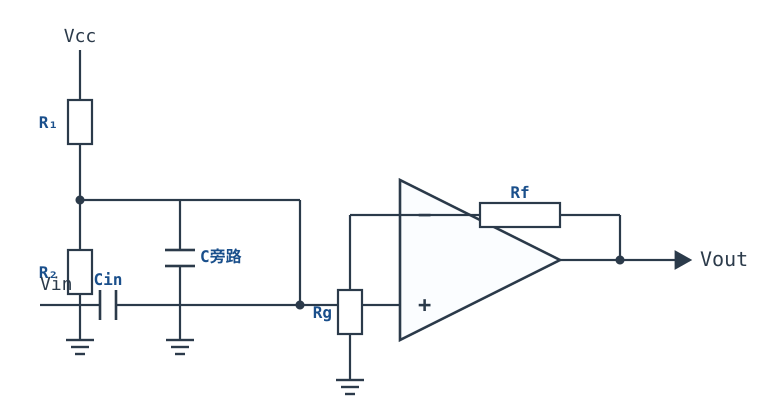
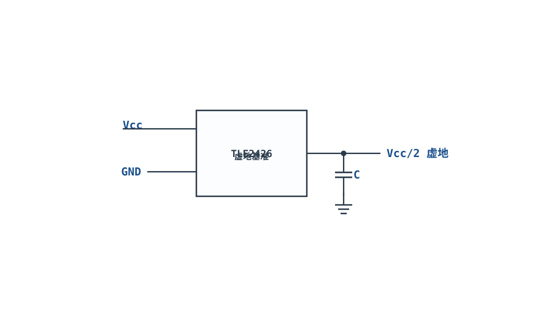
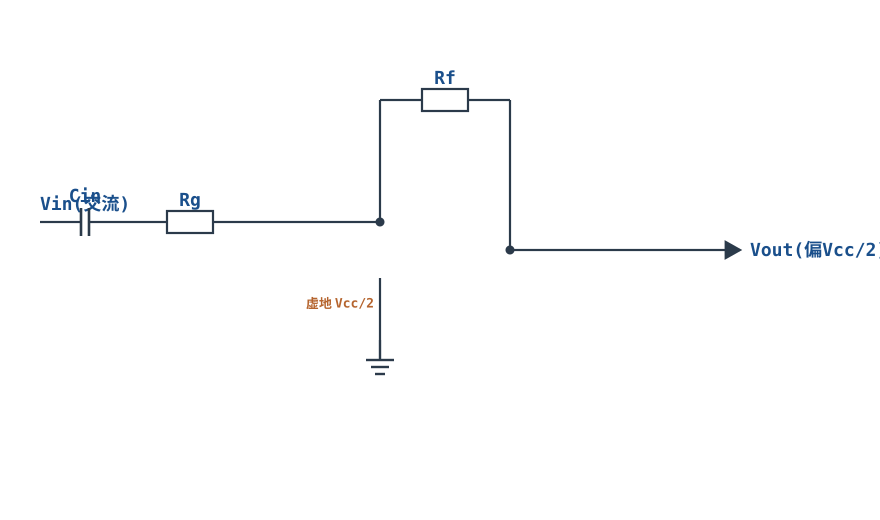
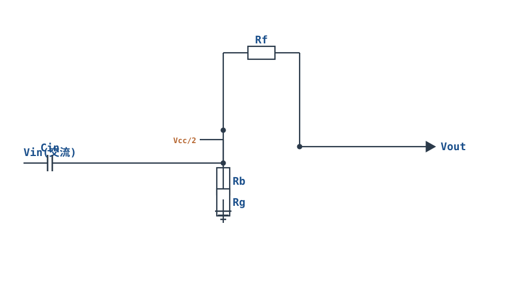
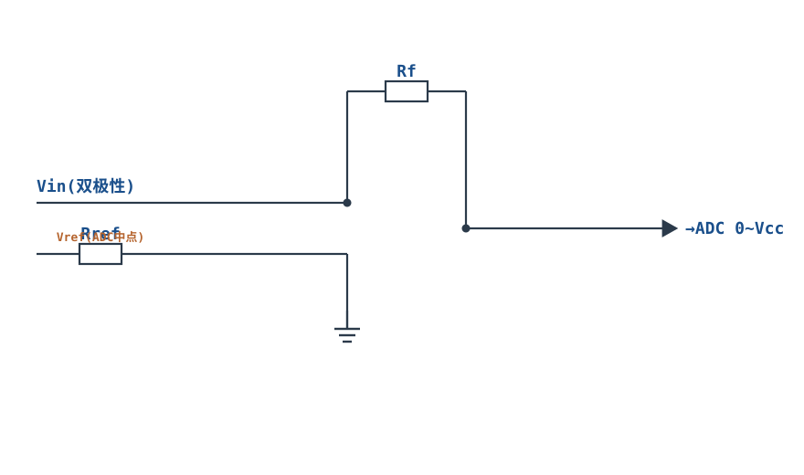

# 单电源电路与电平偏置搬移 Single-Supply Biasing & Level Shifting

## 1. 设计动机

::: motivation 为什么需要单电源偏置
便携设备、电池供电产品只有一个电源（如 3.3V 或 5V 对 0V），没有负电源。但交流信号是正负摆动的——按[反相放大器](inverting-amplifier.md)那样直接接，输出的负半周会被削平（输出最低只能到 0V）。

解决思路：**不把"地"当零电位，而是把信号的中心偏置在电源中点 Vcc/2**。这样交流信号在 0V~Vcc 之间上下摆动，负半周变成"低于 Vcc/2"、正半周变成"高于 Vcc/2"，运放就能完整放大。这就是**单电源偏置（Virtual Ground 虚地）**。
:::

## 2. 原理图

**单电源同相交流放大器**：Vcc 经相等电阻分压出 Vcc/2 作为虚地，经旁路电容滤波；输入经隔直电容耦合；反馈电阻设定增益；输出静态偏在 Vcc/2。



## 3. 静态分析（DC）

- 隔直电容 $C_{in}$ 直流开路，信号源直流进不来；
- 同相端由 $R_1=R_2$ 分压偏置在 $V_{bias}=V_{CC}/2$；
- 由虚短，输出静态 $V_{Q}=V_{CC}/2$（静态工作点居中，摆幅最大）；
- 旁路电容把 Vcc/2 节点的交流噪声滤掉，让它对交流是"地"——这就是**虚地（Virtual Ground）**。

## 4. 动态分析（AC / 瞬态）

对交流小信号，虚地节点是地电位，电路就是一个普通同相放大器：

$$G=1+\frac{R_f}{R_g},\qquad V_{out}(t)=V_{CC}/2+G\cdot V_{in,ac}(t)$$

- **截止频率**（输入高通）：$f_L=\dfrac{1}{2\pi R_{in}C_{in}}$，其中 $R_{in}$ 是偏置网络与同相端输入阻抗的并联值；
- **输出摆幅约束**：输出必须保持 $0<V_{out}<V_{CC}$（留 headroom，实际约 $0.1\text{~}V_{CC}-0.1$），否则削波；
- **电平搬移（Level Shifting）**：若需要把信号偏到任意直流电平 $V_{shift}$，只需把分压点从 Vcc/2 改成 $V_{shift}$。

输入 100mV 交流、增益 10、5V 单电源时，输出围绕 2.5V 摆动：

```echarts
{
  "tooltip": {"trigger": "axis"},
  "legend": {"data": ["Vin（交流）","Vout（围绕 2.5V）","虚地 Vcc/2"], "bottom": 0, "textStyle": {"fontSize": 12}},
  "grid": {"left": 56, "right": 24, "top": 26, "bottom": 58},
  "xAxis": {"type": "category", "name": "角度°", "data": [0,30,60,90,120,150,180,210,240,270,300,330,360], "axisLabel": {"fontSize": 11}},
  "yAxis": {"type": "value", "name": "V", "min": -0.2, "max": 4, "interval": 0.5, "axisLabel": {"fontSize": 11}},
  "series": [
    {"name": "Vin（交流）", "type": "line", "smooth": true, "showSymbol": false, "lineStyle": {"width": 2.2, "color": "#1a4f8b"},
     "data": [0,0.05,0.087,0.1,0.087,0.05,0,-0.05,-0.087,-0.1,-0.087,-0.05,0]},
    {"name": "Vout（围绕 2.5V）", "type": "line", "smooth": true, "showSymbol": false, "lineStyle": {"width": 2.6, "color": "#b5642e"},
     "data": [2.5,3.0,3.37,3.5,3.37,3.0,2.5,2.0,1.63,1.5,1.63,2.0,2.5]},
    {"name": "虚地 Vcc/2", "type": "line", "showSymbol": false, "lineStyle": {"width": 1.4, "type": "dashed", "color": "#6b7a8a"},
     "data": [2.5,2.5,2.5,2.5,2.5,2.5,2.5,2.5,2.5,2.5,2.5,2.5,2.5]}
  ]
}
```

## 5. 环路分析

- 单电源电路的负反馈结构与双电源相同，只是把参考地换成 Vcc/2。稳定性结论照搬（见[反相比例放大器](inverting-amplifier.md)与稳定性章节）。
- **关键约束变成输出摆幅**：反馈正常、增益正常，但只要输出碰到 0V 或 Vcc 就削波。设计时按 $V_Q\pm G V_{in,peak}$ 验算是否在电源范围内。
- **共模范围**：单电源运放同相端电压必须在数据手册给定的输入共模范围内；轨到轨输入（RRIO）型号才能让共模到 0V 和 Vcc。
- 旁路电容不足时，虚地节点有纹波，会被馈送到输出。

::: advanced 进阶：为什么要 Vcc/2 而不是别的值
输出静态点放在电源中点，正负摆幅余量最大：5V 电源下静态 2.5V，理论上可向上下各摆 2.5V。若偏在 1V，则只能向上摆 4V、向下摆 1V，负向先削波。选 Vcc/2 是最大化动态范围的标准做法；有特定 ADC 范围要求时再调整偏置点。
:::

## 6. 元件取值与工程权衡

- **分压电阻 R1=R2**：取 100k~1MΩ。太小功耗大；太大则偏置点被运放偏置电流拉偏、且输入阻抗高易噪。
- **旁路电容**：取 0.1µF~10µF，就近放在 Vcc/2 节点到地，滤除纹波。
- **隔直电容 $C_{in}$**：按最低工作频率算 $C=1/(2\pi R_{in}f_L)$，选 C0G/电解（注意极性）。
- **反馈电阻 Rf、Rg**：10k~100k，增益 $1+R_f/R_g$。
- **运放选型**：单电源应用选**轨到轨输入输出（RRIO）**型号，否则输出摆幅离轨还有 1~2V，浪费动态范围。
- **去耦**：Vcc 脚就近 0.1µF。

## 7. 完整设计示例

::: example 单 5V 电源放大 100mV 音频信号 10 倍
1. **需求**：电池供电 5V，放大 100mV（峰峰值 200mV）音频，增益 10，无负电源。
2. **定静态点**：$V_Q=V_{CC}/2=2.5\text{V}$。
3. **分压**：R1=R2=100kΩ，偏置出 2.5V，旁路电容 1µF。
4. **定增益**：$G=1+R_f/R_g=10$，取 $R_g=10\text{k}\Omega$、$R_f=91\text{k}\Omega$。
5. **算输入耦合电容**：偏置网络等效阻抗 $R_{in}=R_1\parallel R_2=50\text{k}\Omega$，要求 $f_L=20\text{Hz}$，$C_{in}=1/(2\pi\times50\text{k}\times20)\approx159\text{nF}$，取 220nF。
6. **验算摆幅**：输出交流峰峰值 $=10\times200\text{mV}=2\text{V}$，围绕 2.5V 摆动 1.5~3.5V，在 0~5V 内且留 headroom，不削波。
7. **选型**：RRIO 单电源运放（如 MCP6001、OPA333），Vcc 脚加 0.1µF 去耦。
:::

## 8. 仿真与实验

LTspice 单电源 5V 搭建：
- 输入 100mV、1kHz 交流，经耦合电容进同相端；
- DC 工作点分析：同相端、输出都应是 2.5V；
- 瞬态：输出围绕 2.5V 上下摆动 1V，无削波；
- 增大输入到 0.5V，观察输出碰到 0V 或 5V 时出现削波；
- 拆掉旁路电容，观察输出纹波变大。

## 扩展与变种电路

### 扩展1：有源虚地基准（TLE2426）Virtual-Ground IC

用一颗专用虚地芯片（如 TLE2426）直接输出低阻抗的 $V_{CC}/2$，比分压电阻+大电容更稳、带载能力更强。



::: example 工作原理/静态分析
芯片内部用电阻分压 + 缓冲器，输出一个低阻抗的 $V_{CC}/2$，可直接作为整个电路的交流地，带载能力远优于无源分压。
:::

取值：输出就近加 1µF~10µF 旁路；适合多运放共用一个虚地的系统。

::: pitfall 带载电流有限
虚地芯片输出电流有限（mA 级），多个负载同时拉灌电流会拉偏 $V_{CC}/2$。
:::

### 扩展2：单电源反相交流放大 SS Inverting AC

单电源下做反相交流放大：输入经隔直电容进反相端，同相端偏置在 $V_{CC}/2$，输出静态也偏在 $V_{CC}/2$。



::: example 工作原理/静态分析
对交流小信号，虚地是地：$G=-R_f/R_g$；输出直流偏在 $V_{CC}/2$，交流围绕它上下摆动。输入高通截止 $f_L=1/(2\pi R_g C_{in})$。
:::

取值：$R_g,R_f$ 取 10k~100k；$C_{in}$ 按 $f_L$ 取；选 RRIO 运放。

::: pitfall 输出摆幅双向限制
输出围绕 $V_{CC}/2$ 摆动，任一方向摆幅都不能超过 $V_{CC}/2$。增益过大时先削负向或正向。
:::

### 扩展3：单电源同相交流放大 SS Non-inverting AC

单电源同相交流放大：输入经隔直电容进同相端，偏置网络把同相端拉到 $V_{CC}/2$——输入阻抗高，适合传感器缓冲。



::: example 工作原理/静态分析
$$G=1+\frac{R_f}{R_g},\qquad V_{out}=V_{CC}/2+G\cdot V_{in,ac}$$

与反相版相比输入阻抗高，但共模电压等于信号，需在运放共模范围内。
:::

取值：偏置分压 $R_1=R_2=100\text{k}\Omega$；旁路电容 1µF。

::: pitfall 共模范围限制
同相端电压等于信号+$V_{CC}/2$，非 RRIO 运放共模到不了轨，靠近电源时失真。
:::

### 扩展4：单端 ADC 电平搬移 ADC Level-Shift

把双极性交流信号搬移到 ADC 所需的单极性范围（如 0~3.3V）——通过参考电压注入，让负半周也落在 ADC 量程内。



::: example 工作原理/静态分析
反相端对 $V_{in}$ 与 $V_{ref}$ 同时加权求和：

$$V_{out}=-\frac{R_f}{R}V_{in}+\frac{R_f}{R}V_{ref}$$

调整 $V_{ref}$ 即可把输出中心搬到 ADC 中点，使 $|V_{in}|_{max}$ 映射到 0~$V_{ADC}$ 范围。
:::

取值：$V_{ref}$ 由 ADC 基准源提供；增益与偏置需联合验算输出不超 0~$V_{CC}$。

::: pitfall 摆幅溢出
增益与偏置联合作用下，峰值输出可能超出 ADC 量程。按 $V_Q\pm G V_{in,peak}$ 验算后再定增益。
:::


## 9. 常见坑与故障现象

::: pitfall 常见坑
- **输出负半周被削平（恒为 0V）**：单电源却按双电源接、没加 Vcc/2 偏置。解决：加虚地偏置，输出静态 2.5V。
- **输出削波**：摆幅超出 0~Vcc。解决：减小增益或输入幅度，验算 $V_Q\pm G V_{in,peak}$。
- **静态点不在 2.5V**：分压电阻被偏置电流拉偏，或 R1≠R2。解决：减小分压电阻、选低偏置运放。
- **输出纹波大**：Vcc/2 旁路电容太小或太远。解决：就近加 1µF~10µF。
- **用了非轨到轨运放**：输出摆幅只能到 0.5~4.5V，动态范围浪费、容易削波。解决：选 RRIO 型号。
- **隔直电容极性接反/漏电流大**：静态点漂移。解决：按实际直流极性接电解，或用 C0G。
:::

## 10. 自测题

<details><summary>单 5V 电源放大交流信号，输出静态应偏在多少伏？为什么？</summary>

偏在 **2.5V（Vcc/2）**。这样输出上下摆动余量最大（理论上各 ±2.5V），是单电源最大化动态范围的标准做法。

</details>

<details><summary>单电源电路里"虚地"是真的接地吗？它和真正的地有什么关系？</summary>

不是真接地。它是 Vcc/2 的偏置点，经大旁路电容后对交流等效为地电位，所有交流信号都围绕它摆动。它的直流电位是 Vcc/2，不是 0V。

</details>

<details><summary>某单电源放大器输出静态 2.5V、增益 5，输入交流峰值 0.8V，会发生什么？</summary>

输出交流峰值 $=5\times0.8=4\text{V}$，围绕 2.5V 摆到 6.5V / −1.5V——超出 0~5V，**正负双向削波**。需要降低增益或输入幅度。

</details>

## 11. 参考资料

- TI, *Single-Supply Op-Amp Circuit Collection* (SLOA058)，虚地与单电源电路集
- ADI, MT-035 *Op Amp Inputs, Outputs, Single-Supply & Rail-to-Rail*
- TI, *Op Amps for Everyone* (SLOD006B)，单电源设计章节
