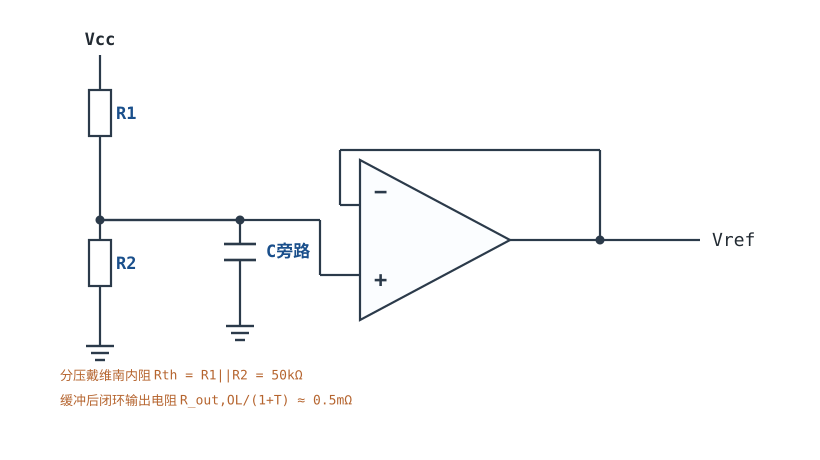
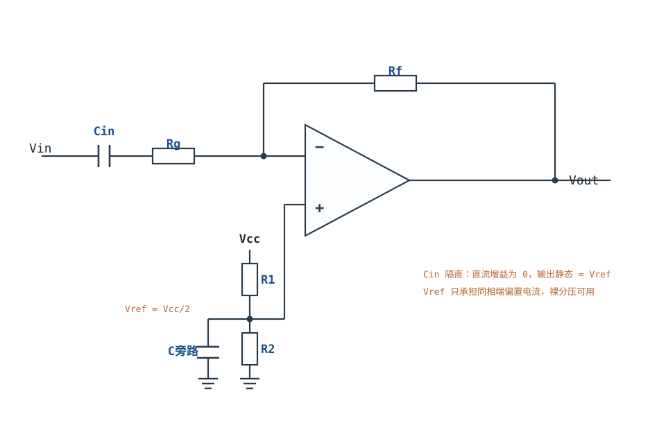
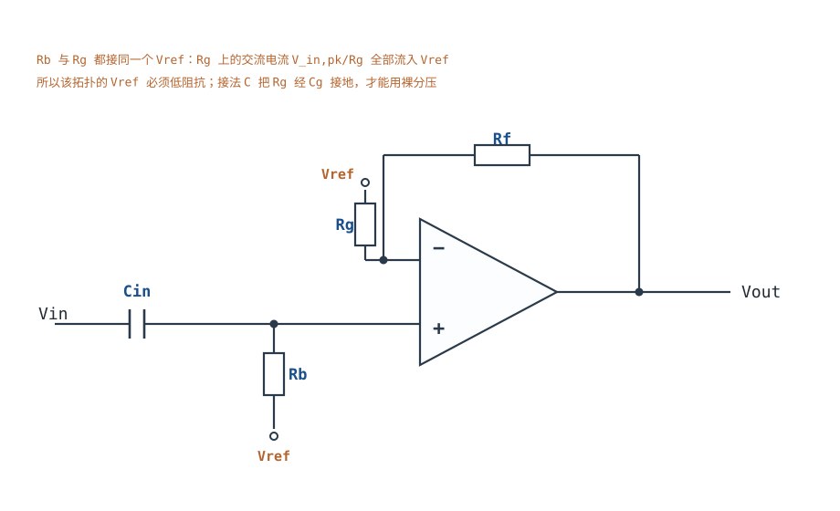

# 单电源电路与电平偏置搬移 Single-Supply Biasing & Level Shifting

单电源电路最常见的误解是："交流信号要围绕 $V_{CC}/2$ 摆动，所以把同相端偏置到 $V_{CC}/2$ 就行了。" 这句话只对了一半——**信号的中心**确实要抬到 $V_{CC}/2$，但**怎么抬**决定了电路能不能工作。同相放大的直流增益也是 $1+R_f/R_g$，把 2.5V 直接加在同相端、$R_g$ 接地，输出直流会被放大到 $2.5\times(1+R_f/R_g)$，5V 电源下立刻饱和。

正确做法只有两类：要么让**反馈网络的下端也接到参考**（$R_g$ 接 $V_{ref}$），要么让**反馈网络对直流开路**（$R_g$ 串隔直电容），使直流增益回到 1。这两类的共同前提是：**参考源必须是一个低阻抗的"交流地"**，不能是两只电阻分压的裸节点。本章把这三件事算清楚：静态点怎么定、参考阻抗要多低、摆幅和增益怎么互相约束。

相关章节：[供电轨、输出摆幅与 Rail-to-Rail](supply-rails.md)给摆幅预算的完整方法，[同相比例放大器](non-inverting-amplifier.md)给"为什么不能只抬同相端"的另一种推导，[反相比例放大器](inverting-amplifier.md)与[电压跟随器](voltage-follower.md)给拓扑基础，[V/I、I/V 转换与传感器接口](vi-iv-converter.md)与[精密整流、峰值检测与采样保持](precision-rectifier-peak-samplehold.md)给单电源下的传感器前端，[模拟开关与多路复用](analog-switch-mux.md)给多通道切换时的偏置共用问题。

**本章约定**：$V_{CC}$ 是单电源正轨（V）；$V_{ref}$ 是参考/虚地电压（V）；$V_Q$ 是输出静态工作点（V）；$G$ 是闭环增益（无量纲）；$R_1$、$R_2$ 是偏置分压电阻（$\Omega$）；$R_{th}=R_1\parallel R_2$ 是分压网络的戴维南内阻（$\Omega$）；$R_g$、$R_f$ 是反馈网络电阻（$\Omega$）；$C_{in}$ 是输入隔直电容（F）；$I_B$ 是输入偏置电流（A）；$V_{OS}$ 是输入失调电压（V）。**虚短、虚断只在负反馈闭合、输出未饱和、$|T|\gg1$ 时成立**；单电源电路最容易违反的正是"输出未饱和"这一条——静态点算错时，运放从一开始就贴在轨上。

## 1. 设计动机

::: motivation 三个真实场景
**场景一：同相端偏置 2.5V，输出直接贴到 5V。** 5V 单电源、目标增益 11（$R_f=100\text{k}\Omega$、$R_g=10\text{k}\Omega$）、同相端用两只 100kΩ 分压到 2.5V、$R_g$ 下端接地。上电后输出 5V 不动，交流信号完全看不到。复算：同相放大的直流增益也是 11，输出直流 $=2.5\times11=27.5\text{V}$，5V 电源下只能饱和到正轨。**偏置电压也被放大了 G 倍——这是单电源电路的第一号杀手。**

**场景二：$R_g$ 改接 2.5V 参考，输出失真、增益偏低。** 把 $R_g$ 下端从地改接到 2.5V 分压点，理论上输出直流等于 2.5V、交流增益仍是 11。但分压点由两只 100kΩ 电阻构成，戴维南内阻 50kΩ；输入 ±0.2V 时，$R_g$ 上的交流电流峰值 $0.2/10\text{k}=20\mu\text{A}$，流过 50kΩ 产生 $20\mu\text{A}\times50\text{k}\Omega=1\text{V}$ 的交流误差——**和信号本身一样大**。这只参考必须缓冲。

**场景三：5V 单电源、1Vpp 输入、增益 10，怎么调都削顶。** 1Vpp 放大 10 倍是 10Vpp，而 5V 单电源的可用摆幅只有约 4.8Vpp（轨到轨、轻载）。**这不是偏置问题，是摆幅预算从根上不成立**：最大可用增益 $G_{max}=4.8/1=4.8$。要么把增益降到 4，要么把输入衰减到 0.48Vpp 以下。
:::

| 你想确认 | 先算/先查 | 判据（工程经验值） |
|---|---|---|
| 静态点对不对 | 直流增益与 $V_{ref}$ | 输出静态 = $V_{ref}$（不是 $G V_{ref}$） |
| 摆幅够不够 | $V_Q\pm G V_{in,pk}$ 与 $V_{OUT,min/max}$ | 两端各留 ≥0.1V（RRO）/≥0.3V（非 RRO） |
| 增益能不能取这么大 | $G\le(V_{OUT,max}-V_{OUT,min})/(2V_{in,pk})$ | 先算 $G_{max}$ 再选电阻 |
| 参考阻抗够不够低 | $R_{th}$ 与 $R_g$ 比 | $R_{th}\le R_g/100$，否则加缓冲 |
| 耦合电容取多大 | $f_L=1/(2\pi R C)$ | $f_L\le$ 最低信号频率的 1/10 |
| 直流误差多大 | $V_{OS}G$、$I_BR_{th}G$、$V_{ref}$ 容差 | 总和 < 满量程的 1% |
| 共模越界没有 | $V_{cm}$ 与 ICMR | 两端各留 0.1~0.2V |

**不算这四笔账会摔在哪**，四个带数字的代价：

1. **把参考当理想电压源。** 50kΩ 戴维南内阻、20µA 交流电流就是 1V 误差；换成缓冲器（闭环输出阻抗约 0.5mΩ）后同样的电流只产生 $20\mu\text{A}\times0.5\text{m}\Omega=10\text{nV}$。**同样的电路，参考源的内阻差 5 个数量级，失真差 5 个数量级。**
2. **先定增益再算摆幅。** 5V、1Vpp、G=10 需要 10Vpp，超出可用 4.8Vpp 两倍多；样机上表现为"两端同时削顶"，很多人误以为是偏置不对，其实是增益取大了。
3. **忽略直流误差的放大。** $V_{OS}=5\text{mV}$、G=4 时输出偏 20mV；$I_B=100\text{nA}$ 流过 50kΩ 分压再放大 4 倍又是 20mV；1% 的 $V_{ref}$ 误差是 25mV。三项相加 65mV，对 12 位、5V ADC（1 LSB=1.22mV）是 53 个 LSB。
4. **耦合电容按"越大越好"取。** 1µF 配 50kΩ 的转折频率是 3.2Hz，看起来很好；但 1µF 电解电容的漏电流（µA 级）会在 50kΩ 上产生 mV 级偏移，而且极性接反会漏得更厉害。**耦合电容的取值要同时看转折频率、漏电和耐压。**

## 2. 定义与直观

### 2.1 "围绕 $V_{CC}/2$ 摆动"到底在说什么

这句话包含三个独立的条件，缺一个电路就不工作：

1. **直流工作点**：输出静态电压 $V_Q$ 必须落在运放的线性输出范围内，且离两条轨都有余量。
2. **交流摆幅**：$V_Q\pm G V_{in,pk}$ 必须仍在输出范围内。
3. **参考的交流阻抗**：所有"以 $V_{ref}$ 为参考"的支路，其交流电流必须能流入一个低阻抗节点，否则 $V_{ref}$ 会被信号"推着走"。

第 1 条决定"能不能放大"，第 2 条决定"能放大多少"，第 3 条决定"放大得准不准"。三者互相独立，必须分别验算——只算其中一条，另外两条会在样机上出问题。

### 2.2 参考源不是"一个电压"，是一个戴维南源

两只等值电阻从 $V_{CC}$ 分压，得到的是

$$V_{ref}=\frac{R_2}{R_1+R_2}V_{CC},\qquad R_{th}=R_1\parallel R_2=\frac{R_1R_2}{R_1+R_2}$$

符号与单位：$V_{ref}$ 是开路电压（V）；$R_{th}$ 是戴维南内阻（$\Omega$）；$R_1$、$R_2$ 是分压电阻（$\Omega$）。$R_1=R_2=100\text{k}\Omega$、$V_{CC}=5\text{V}$ 时 $V_{ref}=2.5\text{V}$、$R_{th}=50\text{k}\Omega$。

**$R_{th}$ 不是"输出电阻"这种可以忽略的小数，它是参考源的一部分。** 任何从 $V_{ref}$ 抽走的交流电流 $i_{ac}$ 都会在 $V_{ref}$ 上产生 $i_{ac}R_{th}$ 的电压波动；这个波动会跟着信号一起进入放大器，表现为增益误差、失真，严重时把反馈"顶"得失效。

旁路电容能降低高频阻抗，但不能降低直流和低频阻抗：

$$Z_{ref}(f)=R_{th}\parallel\frac{1}{j2\pi fC_{byp}}$$

在 $f\ll1/(2\pi R_{th}C_{byp})$ 的频段，$Z_{ref}\approx R_{th}$。10µF 旁路配 50kΩ，转折频率 $1/(2\pi\times50\text{k}\times10\mu)=0.32\text{Hz}$，看起来很低；但 10µF 陶瓷电容的实际容值随直流偏压下降（5V 下可能只剩 50%），转折频率翻倍，而且电容的 ESR 在 MHz 以上又让阻抗回升。**旁路电容是"高频短路"，不是"低阻抗参考"的替代品。**

### 2.3 三种正确的偏置接法

**接法 A：反相交流放大（$R_g$ 经 $C_{in}$ 接地，同相端接 $V_{ref}$）。**

直流：$C_{in}$ 开路，$R_g$ 支路没有直流电流，直流增益为 0（输出被反馈强制到 $V_{ref}$）。交流：$C_{in}$ 短路，$R_g$ 接到交流地，增益 $-R_f/R_g$。

**这个接法里 $V_{ref}$ 只承担同相端的偏置电流 $I_B$，不承担信号电流**——信号电流从 $R_g$ 经 $C_{in}$ 流回源端，不经过 $V_{ref}$。所以裸分压器就够用，这是反相拓扑在单电源下的一大优势。

**接法 B：同相交流放大，$R_g$ 接 $V_{ref}$（参考必须缓冲）。**

直流：$C_{in}$ 开路，同相端由 $R_b$ 偏置到 $V_{ref}$，直流增益 1，输出静态 $V_{ref}$。交流：增益 $1+R_f/R_g$。**但 $R_g$ 上的交流电流 $i=V_{in,pk}/R_g$ 全部流入 $V_{ref}$**，所以 $V_{ref}$ 必须是低阻抗（缓冲器或基准源），否则就是 §1 场景二的 1V 误差。

**接法 C：同相交流放大，$R_g$ 经 $C_g$ 交流接地（参考可以高阻）。**

直流：$C_g$ 开路，$R_g$ 没有直流电流，直流增益 1，输出静态 $V_{ref}$（由同相端偏置决定）。交流：$C_g$ 短路，$R_g$ 接地，增益 $1+R_f/R_g$。

**这个接法把"直流增益"和"交流增益"拆开了**：直流时反馈网络是开路，输出跟着 $V_{ref}$ 走；交流时反馈网络闭合，增益由 $R_f/R_g$ 决定。代价是多一只电容，且 $C_g$ 与 $R_g$ 形成的高通转折必须低于最低信号频率。**这是单电源同相放大最稳的接法**：$V_{ref}$ 只承担 $I_B$，裸分压器也能用；参考噪声不被 $G$ 放大。

### 2.4 交流耦合与偏置的关系

隔直电容的作用不是"隔掉直流"这么简单，它同时决定了三件事：

- **直流工作点**：电容把源端的直流和电路的偏置点隔开，两边可以独立设定。
- **高通转折**：$C_{in}$ 与它看到的电阻 $R$ 形成 $f_L=1/(2\pi RC)$；$R$ 在不同接法下不同（反相是 $R_g$，同相是 $R_b+R_s$，接法 C 的反馈支路是 $R_g$）。
- **耐压与极性**：电容两端有 $V_{ref}$ 量级的直流电压，电解电容必须按实际极性接；接反时漏电流增大、寿命缩短，甚至鼓包。

**耦合电容不能"两头都隔"**：如果输入和反馈支路都串电容，直流工作点就没有直流通路，运放的输入偏置电流会把节点慢慢充到轨。每一个输入端都必须有一条到低阻抗节点的直流通路。

::: analogy 单电源偏置像把舞台整体抬高
双电源电路里，演员（交流信号）在地面（0V）上下表演，头顶和脚下都有空间。单电源只有一个地面（0V）和一个天花板（$V_{CC}$），想把"上下"的表演搬进来，最直接的办法是把整个舞台抬到半高（$V_{CC}/2$）——演员仍然在舞台上下摆动，但脚不会穿到地板下面。

类比的边界：舞台必须**硬**（低阻抗），否则演员一跺脚舞台就塌（参考被信号推着走）；舞台的高度也必须和天花板一起算，抬得太高（偏置点太靠上）头顶就没空间了。所以"抬到半高"只是对称摆幅下的特例，非对称摆幅时要抬到摆幅中点。
:::

## 3. 定量关系

### 3.1 静态工作点：三种接法的直流增益

把三种接法的直流增益列在一起，差别一目了然：

| 接法 | 直流反馈路径 | 直流增益 | 输出静态 $V_Q$ |
|---|---|---|---|
| 错误接法：$R_g$ 接地、同相端偏置 $V_{ref}$ | $R_g$ 通地 | $1+R_f/R_g$ | $G\,V_{ref}$（通常饱和） |
| A 反相交流 | $C_{in}$ 隔断 | 0 | $V_{ref}$ |
| B 同相、$R_g$ 接 $V_{ref}$ | $R_g$ 通 $V_{ref}$ | 1 | $V_{ref}$ |
| C 同相、$R_g$ 经 $C_g$ 接地 | $C_g$ 隔断 | 1 | $V_{ref}$ |

**错误接法的定量后果**：$V_{ref}=2.5\text{V}$、$G=11$，输出直流 $=27.5\text{V}$，超过 5V 电源，运放饱和到正轨；此时负反馈名义上还闭合，但输出不再响应输入，虚短失效。

**接法 B 的直流增益为什么是 1？** 直流时 $C_{in}$ 开路，同相端电压 $V_+=V_{ref}$（$R_b$ 上无电流），虚短给出 $V_-=V_{ref}$；$R_g$ 两端电压都是 $V_{ref}$，没有电流，$R_f$ 上也没有电流，所以 $V_{out}=V_-=V_{ref}$。**直流增益为 1，不是 $1+R_f/R_g$**，因为反馈分压器的下端接的是 $V_{ref}$ 而不是地，分压比在直流下失效。

**接法 C 的直流增益也是 1**：$C_g$ 开路，$R_g$ 无电流，同理 $V_{out}=V_{ref}$。

### 3.2 输出摆幅与最大增益

输出必须满足

$$V_{OUT,min}\le V_Q\pm G V_{in,pk}\le V_{OUT,max}$$

符号与单位：$V_{OUT,min}$、$V_{OUT,max}$ 是输出可用范围（V，由供电轨和离轨压差决定）；$V_Q$ 是静态点（V）；$G$ 是闭环增益（无量纲）；$V_{in,pk}$ 是输入峰值（V）。把不等式反解，得到最大增益

$$G_{max}=\frac{\min(V_{OUT,max}-V_Q,\ V_Q-V_{OUT,min})}{V_{in,pk}}$$

对称摆幅时 $V_Q=V_{CC}/2$，$G_{max}=(V_{OUT,max}-V_{OUT,min})/(2V_{in,pk})$。5V、RRO（0.1~4.9V）、$V_{in,pk}=0.5\text{V}$：

$$G_{max}=\frac{4.9-0.1}{2\times0.5}=\frac{4.8}{1}=4.8$$

取整到 4，输出 4Vpp，静态 2.5V，摆幅 0.5~4.5V，两端各留 0.4V。**先算 $G_{max}$ 再选电阻，是单电源设计不可跳过的一步。**

### 3.3 参考源阻抗：把电流误差折算回输出

接法 B 中，$R_g$ 上的交流电流峰值是

$$i_{Rg}=\frac{V_{in,pk}}{R_g}$$

这个电流全部流入 $V_{ref}$，在 $R_{th}$ 上产生误差电压

$$\Delta V_{ref}=i_{Rg}R_{th}=\frac{V_{in,pk}R_{th}}{R_g}$$

这个误差出现在同相端，被噪声增益 $1+R_f/R_g=G$ 放大到输出：

$$\Delta V_{out}=G\frac{V_{in,pk}R_{th}}{R_g}$$

符号与单位：$i_{Rg}$ 是 $R_g$ 上的交流电流峰值（A）；$V_{in,pk}$ 是输入峰值（V）；$R_{th}$ 是参考源内阻（$\Omega$）；$G$ 是闭环增益（无量纲）；$\Delta V_{out}$ 是输出误差峰值（V）。

代入 $V_{in,pk}=0.2\text{V}$、$R_g=10\text{k}\Omega$、$R_{th}=50\text{k}\Omega$、$G=11$：

$$i_{Rg}=\frac{0.2}{10^4}=20\mu\text{A},\qquad \Delta V_{ref}=20\mu\text{A}\times5\times10^4=1.0\text{V}$$

$$\Delta V_{out}=11\times1.0=11\text{V}$$

**误差比信号还大 11 倍，电路完全不能工作。** 这与[同相比例放大器](non-inverting-amplifier.md)里的算例完全一致（那里用同样的 20µA、50kΩ 算出 1V 误差）。

把参考换成缓冲器后，闭环输出电阻 $R_{out,CL}=R_{out,OL}/(1+T)$。$R_{out,OL}=50\Omega$、$T=10^5$：

$$R_{out,CL}=\frac{50}{1+10^5}=0.5\text{m}\Omega$$

同样的 20µA 只产生 $20\mu\text{A}\times0.5\text{m}\Omega=10\text{nV}$，误差项彻底消失。

**判据**：要求参考误差小于信号的 0.1%，即 $R_{th}\le0.001R_g$。$R_g=10\text{k}\Omega$ 时 $R_{th}\le10\Omega$——裸分压器（50kΩ）差了 5000 倍，必须缓冲。

### 3.4 单电源的直流误差如何被放大

单电源电路的直流误差有四项，各自的放大倍数不同：

$$V_{err}=G\,V_{OS}+G\,I_B R_{th}+V_{ref,err}+\frac{\Delta V_{CC}}{PSRR}G$$

符号与单位：$V_{OS}$ 是输入失调电压（V）；$I_B$ 是输入偏置电流（A）；$R_{th}$ 是偏置网络戴维南内阻（$\Omega$）；$V_{ref,err}$ 是参考电压误差（V）；$\Delta V_{CC}$ 是电源纹波（V）；$PSRR$ 是电源抑制比（无量纲）。**注意第二项**：$I_B$ 流过 $R_{th}$ 产生的误差被 $G$ 放大；**第三项不被 $G$ 放大**，因为参考在反馈环内（接法 B、C 的直流增益为 1）。这正是"正确接法"和"错误接法"在误差上的第二个差别。

数值感（$V_{OS}=5\text{mV}$、$I_B=100\text{nA}$、$R_{th}=50\text{k}\Omega$、$G=4$、$V_{ref}$ 用 1% 电阻分压）：

| 误差项 | 计算 | 输出误差 |
|---|---|---|
| $V_{OS}$ | $4\times5\text{mV}$ | 20mV |
| $I_BR_{th}$ | $4\times100\text{nA}\times50\text{k}\Omega$ | 20mV |
| $V_{ref}$ 容差 | $2.5\text{V}\times1\%$ | 25mV |
| 合计（最坏） | 三项相加 | 65mV |

65mV 对 5V、12 位 ADC 是 $65/1.22=53$ 个 LSB。**单电源电路的"精度"首先取决于偏置网络，而不是运放本身。**

### 3.5 交流耦合的转折频率

三种接法的输入高通转折不同：

| 接法 | 转折频率 | 说明 |
|---|---|---|
| A 反相 | $f_L=1/(2\pi R_gC_{in})$ | 虚地让 $C_{in}$ 看到 $R_g$ |
| B 同相、$R_g$ 接 $V_{ref}$ | $f_L=1/(2\pi(R_b+R_s)C_{in})$ | $R_b$ 是偏置电阻，$R_s$ 是源内阻 |
| C 同相、$R_g$ 经 $C_g$ 接地 | $f_L=1/(2\pi R_gC_g)$（反馈支路） | 输入高通仍由 $C_{in}$ 与 $R_b$ 决定 |

代入 $R_g=10\text{k}\Omega$、$f_L=20\text{Hz}$：$C_{in}=1/(2\pi\times10^4\times20)=796\text{nF}$，取 1µF。接法 B 的 $R_b=50\text{k}\Omega$：$C_{in}=1/(2\pi\times5\times10^4\times20)=159\text{nF}$，取 220nF。

## 4. 典型计算

### 4.1 完整算例：5V 单电源、1Vpp 输入、增益 10 的可行性复核

**需求**：5V 单电源，输入 1Vpp（峰值 0.5V，中心 0V，需要电平搬移），增益 10，输出送 ADC。

**第 1 步：算所需摆幅。** 输出 10Vpp，即 $2.5\pm5\text{V}$，需要 −2.5~7.5V。5V 单电源的可用范围最多 0.1~4.9V（RRO 轻载），**差 2.5V 以上，物理上不可能**。

**第 2 步：算最大增益。**

$$G_{max}=\frac{4.9-0.1}{2\times0.5}=4.8$$

**第 3 步：给出两个可行方案。**
- 方案一：增益降到 4，输出 4Vpp，静态 2.5V，摆幅 0.5~4.5V。
- 方案二：保持增益 10，输入先衰减到 $1/2.08=0.48\text{Vpp}$（峰值 0.24V），输出 4.8Vpp；代价是输入信号被衰减 2.08 倍，信噪比下降 6.4dB。

**第 4 步：结论。** 需求本身不成立，必须先改需求。工程上优先方案一（不牺牲信噪比），并把"输入 1Vpp、增益 10"写回需求评审——**这正是"先算摆幅、再定增益"的价值**。

### 4.2 完整算例：5V 单电源、1Vpp、增益 4 的偏置设计

**需求**：接 §4.1 的方案一，增益 4，输入 1Vpp 中心 0V，输出 0.5~4.5V，下限频率 20Hz，ADC 输入范围 0~5V。

**第 1 步：选拓扑。** 输入含负值、需要电平搬移，选接法 A（反相交流）或接法 C（同相、$R_g$ 经 $C_g$ 接地）。反相拓扑的输入阻抗等于 $R_g$，对高阻源不友好；本例假设源阻抗 ≤1kΩ，选反相拓扑，$V_{ref}$ 可以用裸分压器。

**第 2 步：定静态点。** $V_Q=V_{ref}=2.5\text{V}$。

**第 3 步：定增益电阻。** $G=R_f/R_g=4$，取 $R_g=10\text{k}\Omega$、$R_f=40.2\text{k}\Omega$（E96，实际增益 4.02，误差 0.5%）。

**第 4 步：偏置分压。** $R_1=R_2=100\text{k}\Omega$，$V_{ref}=2.5\text{V}$，$R_{th}=50\text{k}\Omega$，分压电流 25µA、功耗 125µW。旁路电容 1µF，转折 $1/(2\pi\times50\text{k}\times1\mu)=3.2\text{Hz}$。

**第 5 步：输入耦合电容。** 反相拓扑 $f_L=1/(2\pi R_gC_{in})$：

$$C_{in}=\frac{1}{2\pi\times10^4\times20}=796\text{nF}$$

取 1µF（薄膜或 C0G），耐压 ≥10V（电容两端有 2.5V 直流）。

**第 6 步：验算摆幅。** 输出 $2.5\pm4\times0.5=2.5\pm2\text{V}$，即 0.5~4.5V；RRO 轻载 0.1~4.9V，两端余量 0.4V。

**第 7 步：电源容差复核。** $V_{CC}=5\times0.95=4.75\text{V}$，RRO 上限 $4.75-0.1=4.65\text{V}$，输出高端 4.5V，余量只剩 0.15V。若电源再叠加 50mV 纹波，余量 0.1V——**标称能过，量产边缘**。稳妥做法是把增益降到 3.8（$R_f=38.3\text{k}\Omega$），输出 $2.5\pm1.9=0.6\sim4.4\text{V}$，高端余量 $4.65-4.4=0.25\text{V}$。

**第 8 步：直流误差。** 按 §3.4：$V_{OS}$ 项 $4\times5\text{mV}=20\text{mV}$；$I_B$ 项 $4\times100\text{nA}\times50\text{k}\Omega=20\text{mV}$；$V_{ref}$ 1% 项 25mV；合计 65mV（53 LSB）。要压到 10mV 以内：选 $V_{OS}<0.5\text{mV}$ 的运放（2mV）、$I_B<1\text{nA}$ 的 CMOS 输入（0.2mV）、0.1% 分压电阻（2.5mV），合计约 5mV（4 LSB）。

**第 9 步：选型。** RRIO 单电源运放（GBW≥1MHz、$V_{OS}<1\text{mV}$、$I_B<1\text{nA}$），$V_{CC}$ 脚 0.1µF 去耦，$V_{ref}$ 节点 1µF 旁路。

### 4.3 完整算例：参考源阻抗的影响（与同相放大器算例对齐）

**需求**：同相拓扑、$R_g=10\text{k}\Omega$、$R_f=100\text{k}\Omega$（$G=11$）、输入 ±0.2V；比较裸分压器（$R_{th}=50\text{k}\Omega$）和缓冲器（$R_{out,CL}=0.5\text{m}\Omega$）两种参考。

**第 1 步：裸分压器。** $i_{Rg}=0.2/10\text{k}=20\mu\text{A}$：

$$\Delta V_{ref}=20\mu\text{A}\times50\text{k}\Omega=1.0\text{V},\qquad \Delta V_{out}=11\times1.0=11\text{V}$$

**第 2 步：缓冲器。** $\Delta V_{ref}=20\mu\text{A}\times0.5\text{m}\Omega=10\text{nV}$，$\Delta V_{out}=11\times10\text{nV}=110\text{nV}$——可以忽略。

**第 3 步：结论。** 同相单电源电路的参考**必须**缓冲；反相拓扑（接法 A）的参考只承担 $I_B$，裸分压器就够。**"参考要不要缓冲"取决于拓扑，不取决于"精度要求高不高"。**

### 4.4 完整算例：保持增益 10 的输入衰减方案

**需求**：接 §4.1 方案二，增益 10，输入 1Vpp 先衰减到 0.48Vpp。

**第 1 步：衰减网络。** 用两只电阻分压，衰减比 $1/2.08$：$R_a=10\text{k}\Omega$、$R_b=8.87\text{k}\Omega$（或 10k/9.09k，衰减 0.476）。分压后峰值 0.238V，输出 4.76Vpp，摆幅 0.12~4.88V——**太贴近轨了**，实际要留余量。

**第 2 步：重算。** 取衰减 0.45（10k/8.2k），输入峰值 0.225V，输出 4.5Vpp，摆幅 0.25~4.75V，余量 0.15V。仍然紧张。

**第 3 步：结论。** 在 5V 单电源上"增益 10 + 1Vpp"没有舒服的解：要么牺牲信噪比（衰减 2.2 倍），要么牺牲摆幅余量（贴轨），要么提高电源。**这就是摆幅预算的硬约束——它不是靠调偏置能绕过去的。**

## 5. 工程含义

### 5.1 三种偏置方案的对比

| 方案 | 直流增益 | 参考阻抗要求 | 输入阻抗 | 适用 |
|---|---|---|---|---|
| A 反相交流 | 0 | 低（只需 $I_B$，裸分压可用） | $R_g$ | 低阻源、需要反相 |
| B 同相、$R_g$ 接 $V_{ref}$ | 1 | **必须缓冲** | 高（$R_{icm}$） | 高阻源、参考已缓冲 |
| C 同相、$R_g$ 经 $C_g$ 接地 | 1 | 低（只需 $I_B$） | 高 | 高阻源、单电源首选 |
| 错误：$R_g$ 接地、同相端偏置 | $1+R_f/R_g$ | — | 高 | 不能用 |

### 5.2 虚地怎么产生

- **裸分压 + 旁路**：两只等值电阻（10k~1MΩ）+ 0.1~10µF。优点便宜；缺点 $R_{th}$ 大、带载能力差。只适合"参考不抽交流电流"的场合（接法 A、C）。
- **分压 + 跟随器**：加一只运放做缓冲，输出阻抗降到 $R_{out,OL}/(1+T)$（毫欧级）。成本多一只运放，换来参考可以抽任意交流电流。适合接法 B 和多参考共用。
- **专用虚地芯片**：内部集成分压 + 缓冲，输出低阻抗的 $V_{CC}/2$，带载 mA 级。优点是省事；缺点是多一个器件、输出电流有限、成本高。选型时核对输出电流与噪声。
- **基准源直接给 $V_{ref}$**：如果系统本来就有 2.5V 基准（ADC 基准），可以直接用，但要注意基准的输出电流能力和噪声；基准的噪声会被 $G$ 放大（接法 B）或不放大（接法 A、C）。

### 5.3 偏置点取 $V_{CC}/2$ 还是摆幅中点

如果输出级上下余量对称（RRO 轻载），$V_{CC}/2$ 就是摆幅中点，取它。如果上下余量不对称（非 RRO：0.6~3.5V），摆幅中点是 $(3.5+0.6)/2=2.05\text{V}$，不是 2.5V；按 2.5V 偏置会损失约 31% 的峰值。详见[供电轨、输出摆幅与 Rail-to-Rail](supply-rails.md)的算例。

### 5.4 单电源直流误差预算的检查顺序

1. **先定拓扑**：反相还是同相？参考要不要缓冲？
2. **再定静态点**：$V_{ref}$ 还是摆幅中点？
3. **算 $G_{max}$**：摆幅反推，取整留 10%~20% 余量。
4. **算参考误差**：$R_{th}$ 与 $R_g$ 比，决定要不要缓冲。
5. **算直流误差**：$V_{OS}G$、$I_BR_{th}G$、$V_{ref}$ 容差，三项相加。
6. **算交流转折**：$C_{in}$、$C_g$ 与最低频率。
7. **复核电源容差与温度**：最低电源、最高温度下的摆幅与误差。

### 5.5 什么时候模型不够用

- **输出接近轨**：$A_{OL}$ 下降、失真上升，"能摆到"不等于"能线性放大"；留 0.1~0.3V 余量。
- **输入共模接近轨**：RRI 器件的交越区有 $V_{OS}$ 跳变和失真，精密场合避开交越点。
- **容性负载**：输出串隔离电阻或加缓冲，否则 PM 下降。
- **电池供电**：电池电压从 4.2V 掉到 3.0V，偏置点和摆幅都要按末端电压重算。
- **多通道共用参考**：一个通道的交流电流会串到另一个通道的参考上，必须缓冲或各自独立偏置。

## 6. 常见坑

::: pitfall 常见坑
- **现象**：单电源同相放大上电输出直接贴正轨，输入怎么变都不响应。**原因**：同相端偏置到 $V_{CC}/2$、$R_g$ 接地，直流增益 $1+R_f/R_g$ 把偏置放大到饱和。**解决**：改接法 B（$R_g$ 接 $V_{ref}$）或接法 C（$R_g$ 经 $C_g$ 接地），让直流增益回到 1；输出静态等于 $V_{ref}$。
- **现象**：输出波形失真、增益比设计值低，输入幅度越大越明显。**原因**：参考源用裸分压器，$R_g$ 上的交流电流在 $R_{th}$ 上产生误差，把参考"推着走"。**解决**：加跟随器缓冲参考，$R_{out,CL}$ 降到毫欧级；或改用接法 A/C，让参考不承担交流电流。
- **现象**：输出两端同时削顶，怎么调偏置都不行。**原因**：增益取大了，$G V_{in,pk}$ 超过可用摆幅的一半。**解决**：先算 $G_{max}=(V_{OUT,max}-V_{OUT,min})/(2V_{in,pk})$，再选电阻；或衰减输入、提高电源。
- **现象**：静态点不是 2.5V，而是 2.3V 或 2.7V，随温度漂。**原因**：分压电阻被 $I_B$ 拉偏（$I_BR_{th}$），或 $R_1\ne R_2$、电阻容差。**解决**：减小分压电阻（但功耗增大）、选低 $I_B$ 运放、用 0.1% 电阻；必要时用基准源替代分压。
- **现象**：低频增益下降，1kHz 以下就衰减。**原因**：耦合电容太小，$f_L$ 高于最低信号频率；或接法 C 的 $C_g$ 太小。**解决**：按 $C=1/(2\pi Rf_L)$ 重算，取 2~5 倍余量；电解电容注意极性。
- **现象**：电池电量低时失真，满电正常。**原因**：偏置点仍按满电 $V_{CC}/2$ 设计，电池掉到 3.0V 时上半周没空间。**解决**：按电池末端电压重算偏置与增益；或用升压/稳压；或把偏置点改成摆幅中点。
:::

## 7. 自测题

5V 单电源、同相端偏置 2.5V、$R_f=100\text{k}\Omega$、$R_g=10\text{k}\Omega$、$R_g$ 接地，输出静态是多少？为什么？

输出直流 $=V_{ref}\times(1+R_f/R_g)=2.5\times11=27.5\text{V}$。

因为同相放大的直流增益和交流增益是同一个 $1+R_f/R_g$，偏置电压也被放大 11 倍。5V 电源下运放只能饱和到正轨（约 4.9V），交流信号完全看不到。

正确做法：$R_g$ 下端接 $V_{ref}$（接法 B），或 $R_g$ 串 $C_g$ 接地（接法 C），使直流增益为 1，输出静态等于 $V_{ref}$。

接法 B 中，$R_g=10\text{k}\Omega$、$R_{th}=50\text{k}\Omega$、输入 ±0.2V、$G=11$，参考上的交流误差是多少？换成缓冲器后呢？

$i_{Rg}=0.2/10\text{k}=20\mu\text{A}$；$\Delta V_{ref}=20\mu\text{A}\times50\text{k}\Omega=1.0\text{V}$；折算到输出 $11\times1.0=11\text{V}$——电路完全不能工作。

缓冲器闭环输出电阻 $R_{out,OL}/(1+T)=50/10^5=0.5\text{m}\Omega$；$\Delta V_{ref}=20\mu\text{A}\times0.5\text{m}\Omega=10\text{nV}$，折算到输出 110nV，可以忽略。

判据：$R_{th}\le R_g/100$，否则加缓冲。

5V 单电源、RRO（0.1~4.9V）、输入 1Vpp 中心 0V，最大可用增益是多少？增益 10 为什么不行？

$$G_{max}=\frac{4.9-0.1}{2\times0.5}=4.8$$

增益 10 需要 10Vpp 输出，即 $-2.5\sim7.5\text{V}$，远超 0.1~4.9V 的可用范围，物理上不可能。

可行方案：增益降到 4（输出 0.5~4.5V）；或保持增益 10，把输入衰减到 0.48Vpp 以下（牺牲信噪比）；或提高电源电压。

为什么反相交流放大（接法 A）的参考可以用裸分压器，而同相（接法 B）必须缓冲？

接法 A 中，$C_{in}$ 与 $R_g$ 串联，信号电流从源端经 $C_{in}$、$R_g$ 流到虚地，再由 $R_f$ 流向输出，**不经过 $V_{ref}$**；$V_{ref}$ 只承担同相端的 $I_B$（pA~nA 级），在 50kΩ 上只有 µV 级误差。

接法 B 中，$R_g$ 下端直接接 $V_{ref}$，$R_g$ 上的交流电流 $V_{in,pk}/R_g$ 全部流入 $V_{ref}$，在 $R_{th}$ 上产生 $iR_{th}$ 的误差，并被 $G$ 放大。

接法 C 用 $C_g$ 把 $R_g$ 的直流隔开，交流电流经 $C_g$ 入地，也不经过 $V_{ref}$——所以接法 C 同样可以用裸分压器。

单电源电路输出静态 2.5V、增益 4、输入峰值 0.5V，5V 电源 −5% 时还能过吗？

标称：输出 0.5~4.5V，RRO 0.1~4.9V，余量 0.4V。

电源 −5%：$V_{CC}=4.75\text{V}$，上限 $4.75-0.1=4.65\text{V}$，输出高端 4.5V，余量只剩 0.15V；若再叠加 50mV 纹波，余量 0.1V。

结论：标称能过，量产边缘。稳妥做法是把增益降到 3.8（输出 0.6~4.4V，余量 0.25V），或换更低离轨的 RRO 器件，或提高电源。

单电源电路的直流误差有哪几项？哪一项被增益放大、哪一项不被放大？

四项：$G V_{OS}$（被放大）、$G I_BR_{th}$（被放大）、$V_{ref}$ 容差（不被放大，因为参考在反馈环内，直流增益为 1）、$\Delta V_{CC}G/PSRR$（被放大）。

数值感：$V_{OS}=5\text{mV}$、$G=4$ → 20mV；$I_B=100\text{nA}$、$R_{th}=50\text{k}\Omega$、$G=4$ → 20mV；1% 的 2.5V 参考 → 25mV；合计 65mV，对 12 位、5V ADC 是 53 个 LSB。

## 8. 参考资料

- **TI, *Single-Supply Op-Amp Circuit Collection*（SLOA058）**：单电源交流耦合、虚地偏置与电平搬移的成套电路；本章 §2.3 的三种接法与 §5.2 的虚地产生方式按该文整理。<https://www.ti.com/lit/an/sloa058/sloa058.pdf>
- **Analog Devices, MT-035 *Op Amp Inputs, Outputs, Single-Supply, and Rail-to-Rail Issues***：输入共模范围、输出摆幅与单电源边界；本章 §3.2 的 $G_{max}$ 与 §5.5 的模型边界按该文口径。<https://www.analog.com/media/en/training-seminars/tutorials/MT-035.pdf>
- **Analog Devices, MT-087 *Voltage References***：基准源的输出阻抗、噪声、去耦与负载调整率；本章 §2.2、§3.3 的参考阻抗判据参照该文。<https://www.analog.com/media/en/training-seminars/tutorials/MT-087.pdf>
- **TI, *Op Amps for Everyone*（SLOD006B）**：Chapter 4 *Single-Supply Op Amp Design Techniques* 给单电源偏置、交流耦合与摆幅预算的设计流程；本章 §3.1、§5.4 的检查顺序与该章一致。<https://www.ti.com/lit/an/slod006b/slod006b.pdf>
- **TI, LM358 数据手册**：*Input Common-Mode Voltage Range* 与 *Output Voltage Swing* 表给出非轨到轨器件的典型边界；本章 §5.3 的非对称摆幅示例按该手册量级整理。<https://www.ti.com/lit/ds/symlink/lm358.pdf>
