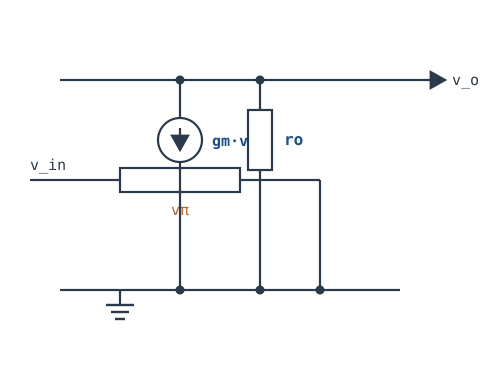
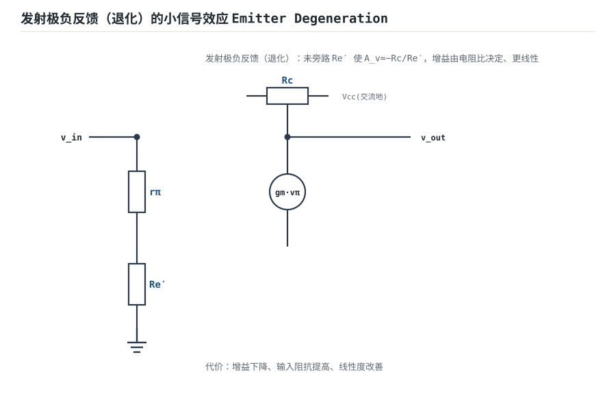
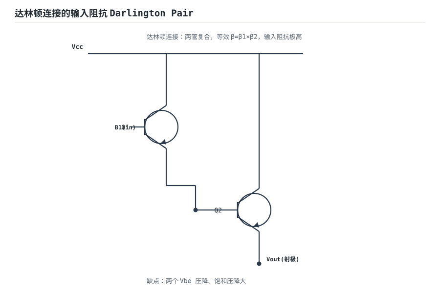

# 小信号模型与增益、输入输出阻抗 Small-Signal Model

BJT 在放大区是个非线性指数器件，但只要信号摆幅足够小，就能在静态工作点附近把它**线性化**成一个小信号等效电路。这个模型（hybrid-π，混合 π 模型）是计算增益、输入阻抗、输出阻抗和频率响应的统一语言。

## 1. 设计动机

::: motivation 为什么需要小信号模型
大信号看的是"管子会不会饱和截止"；小信号看的是"这个电路增益多少、带不带得动负载、高频会不会掉"。直接拿指数公式 $I_C=I_S e^{V_{BE}/V_T}$ 算交流又繁又乱。把它在 Q 点处线性展开，就得到电阻、受控源组成的纯电路——后面所有计算都变成欧姆定律。
:::

## 2. 原理图



::: analogy 小信号模型像"局部直线近似"
站在一条弯曲的山坡上（指数 I-V 曲线），只在脚下一步之遥看，地面就是平的。这一小段斜率就是跨导 $g_m$，这段"平地"的等效电路就是小信号模型。步子迈大（大信号），坡度变化就不能忽略，模型失效。
:::

## 3. 静态分析（DC）

小信号模型本身不含直流——它是叠在 Q 点之上的增量部分。用之前必须先完成上一章的直流分析，求出静态 $I_C$，因为模型参数全部由 Q 点决定：

$$g_m=\frac{I_C}{V_T}\approx \frac{I_C}{25\text{mV}}\quad,\quad r_\pi=\frac{\beta}{g_m}=\beta\cdot\frac{25\text{mV}}{I_C}$$

## 4. 动态分析（AC / 频响）

hybrid-π 模型的三个核心参数：

- $g_m$（跨导）：单位输入电压能产生多少输出电流，$g_m=I_C/V_T$。
- $r_\pi$：基极-发射极间小信号输入电阻，$r_\pi=\beta/g_m$。
- $r_o$：厄尔利效应决定的输出电阻，$r_o\approx V_A/I_C$（$V_A$ 为厄尔利电压）。

共射放大电压增益结论：

$$A_v=-g_m\cdot(r_o\parallel R_c\parallel R_L)$$

低频时增益平坦，高频因结电容与密勒效应滚降。下图是单极点频响（幅频）：增益在中频段平坦，过截止频率 $f_H$ 后以 −20dB/十倍频下降。

```echarts
{
  "tooltip": {"trigger": "axis"},
  "legend": {"data": ["增益幅度 dB"], "bottom": 0, "textStyle": {"fontSize": 13}},
  "grid": {"left": 56, "right": 24, "top": 26, "bottom": 56},
  "xAxis": {"type": "category", "name": "频率 Hz（对数）", "data": ["10","100","1k","10k","100k","1M","10M"], "axisLabel": {"fontSize": 11}},
  "yAxis": {"type": "value", "name": "dB", "min": -20, "max": 40, "axisLabel": {"fontSize": 11}},
  "series": [
    {"name": "增益幅度 dB", "type": "line", "smooth": true, "showSymbol": false, "lineStyle": {"width": 2.6, "color": "#1a4f8b"},
     "data": [30,30,30,29,24,14,4]}
  ]
}
```

## 5. 环路分析

共射电路在高频会因密勒倍增（$C_\mu$ 被放大 $(1+|A_v|)$ 倍）引入一个主极点，使增益以 −20dB/dec 滚降。多级级联时每一级贡献极点，极点数量增加 → 附加相移累积 → 反馈后可能自激。

- **结论**：单极点系统无条件稳定（相位最多到 −90°）；两级以上必须做频率补偿。
- 跨导 $g_m$ 与负载决定增益带宽积（GBW）：$GBW\approx g_m/2\pi C_c$。

::: advanced 进阶：密勒倍增推导
集电结电容 $C_\mu$ 跨接在输入（基极）与输出（集电极）之间，而输出反相放大了 $A_v$ 倍。从输入端看进去，$C_\mu$ 两端的等效电压摆幅是输入的 $(1+|A_v|)$ 倍，等效输入电容被放大为 $C_{in}=C_\pi+(1+|A_v|)C_\mu$。这就是为什么高增益共射放大器高频急剧恶化——一个小电容被增益放大成大电容，主极点频率大幅降低。
:::

## 6. 元件取值与工程权衡

- **工作电流决定 $g_m$**：$I_C$ 翻倍，$g_m$ 翻倍、$r_\pi$ 减半。低功耗与高增益/低噪声之间要权衡。
- **输入阻抗**：共射输入阻抗约 $r_\pi\parallel R_1\parallel R_2$；要高输入阻抗就用共集级做输入缓冲。
- **输出阻抗**：共射输出阻抗约 $r_o\parallel R_c$；要低输出阻抗就用共集级做输出缓冲。
- **$r_o$ 不是无穷大**：高精度计算负载效应时必须保留 $r_o$，否则增益算高了。

## 7. 完整设计示例

::: example 用小信号模型核算一级放大器
1. **需求**：$I_C=1mA$，$\beta=100$，$R_c=5k\Omega$，$R_L=5k\Omega$，$r_o=100k\Omega$。
2. **算参数**：$g_m=1mA/25mV=40mS$，$r_\pi=100/40mS=2.5k\Omega$。
3. **算增益**：$A_v=-g_m(r_o\parallel R_c\parallel R_L)=-40m\times(100k\parallel5k\parallel5k)\approx-40m\times2.44k=-98$。
4. **算输入阻抗**：$Z_{in}=r_\pi\parallel R_1\parallel R_2$，若 $R_1\parallel R_2=10k\Omega$，则 $Z_{in}=2.5k\parallel10k=2k\Omega$。
5. **验算**：信号源内阻 $R_s=1k\Omega$ 时，实际到达基极的信号被分压，有效增益还要再乘 $Z_{in}/(R_s+Z_{in})=2/3$。
:::

## 8. 仿真与实验

LTspice：

- 对已搭好的共射电路做 AC 扫描（1Hz~100MHz），读中频增益与 −3dB 截止频率。
- 把 $I_C$ 从 0.1mA 扫到 10mA，观察增益与带宽怎么变化（体会 $g_m$ 的作用）。
- 在输出端并一个 10pF 电容，观察高频极点前移、带宽收窄。

## 扩展与变种电路

### 扩展1：发射极负反馈（退化）的小信号效应 Emitter Degeneration

**定位**：发射极串一个未旁路电阻 $R_e'$，让增益由电阻比决定、更线性——与旁路式共射的差异是牺牲增益换线性度。



::: example 工作原理 / 静态分析
未旁路 $R_e'$ 出现在发射极回路：

$$A_v=-\frac{R_c}{r_e+R_e'}\approx -\frac{R_c}{R_e'}\quad(\text{当 }R_e'\gg r_e)$$

增益不再依赖 $I_C$ 与 $r_e$，由两颗电阻比决定，线性度大改善、输入阻抗提高。
:::

设计要点：要精确/线性增益就加 $R_e'$；代价是增益下降、输出摆幅受限。

::: pitfall 退化电阻专属坑
- **$R_e'$ 旁路电容加错**：本想留 $R_e'$ 做直流负反馈稳定 Q 点，却并了旁路电容把交流增益又拉回几百。$R_e'$ 要无旁路才起交流退化作用。
:::

### 扩展2：达林顿连接的输入阻抗 Darlington Pair

**定位**：两颗 BJT 复合，等效 $\beta=\beta_1\beta_2$，输入阻抗极高——适合高阻传感器/输入缓冲。



::: example 工作原理 / 静态分析
Q1 发射极驱动 Q2 基极，总电流增益

$$\beta_{D}\approx \beta_1\beta_2$$

输入阻抗 $Z_{in}\approx \beta_D r_\pi$ 大幅提高。代价是两个 $V_{BE}$ 压降、饱和压降大。
:::

设计要点：高阻输入级、功率达林顿管；注意 $V_{BE}=2\times0.7\text{V}$ 的偏移。

::: pitfall 达林顿专属坑
- **饱和压降过高**：复合管饱和时 $V_{CE(sat)}\approx V_{BE2}$，做开关时损耗大。功率开关改用 MOS 或加肖特基续流。
:::

## 9. 常见坑与故障现象

::: pitfall 常见坑
- **忘了先算 Q 点就套小信号公式**：$g_m,r_\pi$ 都由 $I_C$ 决定，Q 点不对，模型全错。顺序永远是先直流后交流。
- **忽略 $r_o$ 与负载**：空载算增益 −100，一带载就掉到 −50，因为 $R_L$ 与 $r_o$ 并联拉低了等效负载电阻。
- **密勒效应被忽视**：面包板上走线长、寄生电容大，带宽比仿真低一截。高频电路要按寄生电容预留。
- **把 $r_e$ 和 $r_\pi$ 混用**：$r_e=25mV/I_E$ 是发射极电阻，$r_\pi=\beta/g_m$ 是基极输入电阻，差了 $\beta$ 倍。
:::

## 10. 自测题

<details><summary>$I_C=1mA$、$\beta=100$，求 $g_m$ 和 $r_\pi$。</summary>

$g_m=I_C/25mV=40mS$；$r_\pi=\beta/g_m=100/40mS=2.5k\Omega$。
</details>

<details><summary>共射增益 $A_v=-g_m R_L'$，为什么负载越重（$R_L$ 越小）增益越低？</summary>
等效负载 $R_L'=r_o\parallel R_c\parallel R_L$，$R_L$ 越小并联后越小，$|A_v|=g_m R_L'$ 自然下降。这就是高阻抗放大级必须用射随做输出缓冲的原因。
</details>

<details><summary>密勒效应为什么会把输入电容放大 $(1+|A_v|)$ 倍？</summary>
跨接在反相放大器输入输出间的电容 $C_\mu$，两端电压摆幅是输入的 $(1+|A_v|)$ 倍，从输入端看进去等效电容变成 $(1+|A_v|)C_\mu$。高增益级因此高频极点大幅前移。
</details>

## 11. 参考资料

- Gray/Hurst/Lewis/Meyer《Analysis and Design of Analog Integrated Circuits》5e，小信号模型章
- Sedra/Smith《Microelectronic Circuits》8e，Small-Signal Operation
- [CircuitLab Ultimate Electronics Textbook](https://www.circuitlab.com/textbook/)
