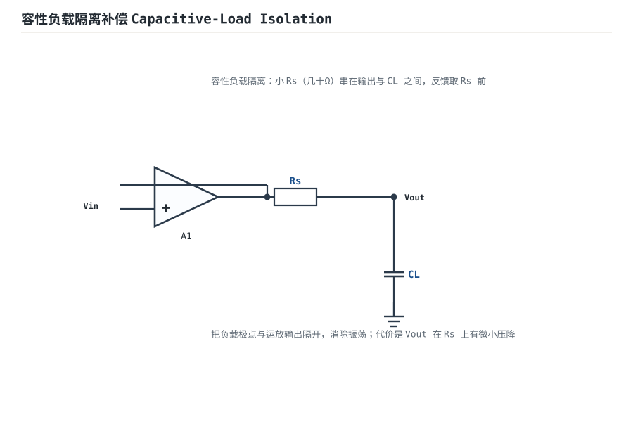
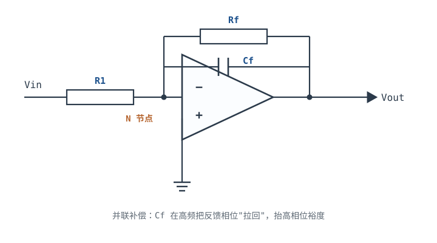
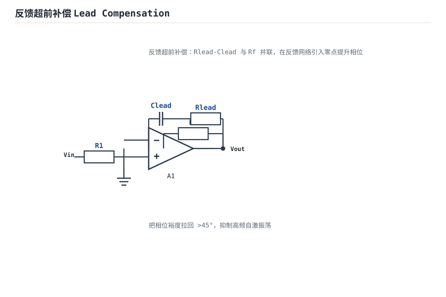
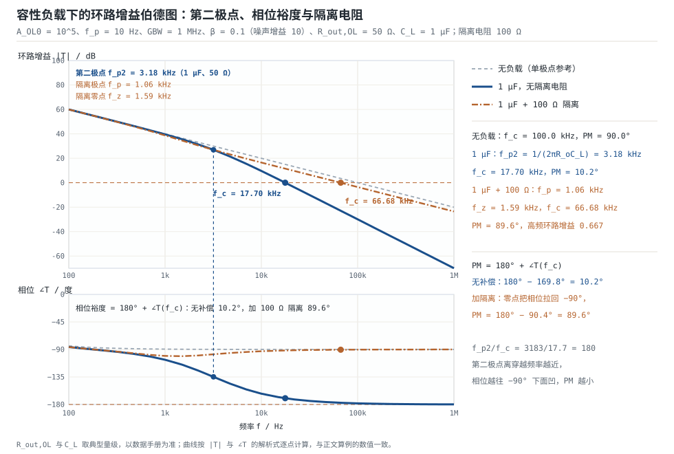

# 稳定性：伯德图、相位裕度与补偿 Stability, Bode Plots & Compensation

负反馈用多余的增益换精度、换带宽、换低输出阻抗，这笔交易在[开环、闭环增益与负反馈本质](open-loop-feedback.md)里已经记过账。但它有一个必须付的代价：**环路里每多一个极点，高频就多一份相位滞后**。滞后累积到 $180^{\circ}$ 而环路增益还大于 1 时，原本"纠错"的负反馈就变成"助推"的正反馈，电路自激。

判断这件事稳不稳，只需要一条曲线——**环路增益 $T(j\omega)=A_{OL}(j\omega)\beta(j\omega)$ 的伯德图**（Bode plot）。本章把这条曲线讲成三件事：怎么画、怎么读、怎么补。第一件是极点与零点对幅频斜率和相位的贡献；第二件是把相位裕度 PM 翻译成时域的过冲与振铃；第三件是三种补偿手段（隔离电阻、前馈电容、噪声增益）各自的原理与代价。最后用"GBW=1 MHz、增益 10、驱动 1 nF 与 1 µF 容性负载"这一组算例，把第二极点、PM 和补偿一次算到底。

**本章约定**（与整篇运放章节一致）：$A_{OL}$ 是开环增益，$\beta$ 是反馈系数（**不是**三极管的电流放大倍数），环路增益 $T=A_{OL}\beta$，噪声增益 $1/\beta$，穿越频率 $f_c$ 是 $|T|=1$ 的频率，相位裕度 $PM=180^{\circ}+\angle T(f_c)$，增益裕度 $GM=-20\lg|T(f_{180})|$。符号体系与[运放概述：符号、封装与引脚](opamp-overview.md)、[理想模型五假设与虚短、虚断](ideal-opamp.md)完全一致；拓扑如何影响 $\beta$ 见[反馈四拓扑与环路增益](feedback-topologies.md)。

## 1. 设计动机

::: motivation 三个真实场景
**场景一：跟随器驱动一条 1 nF 的电缆。** 电压跟随器（噪声增益 1）的输出端接 1 nF 电缆，运放 $R_{out,OL}=50\ \Omega$，第二极点落在 $1/(2\pi\times50\ \Omega\times1\ \text{nF})=3.18\ \text{MHz}$。因为噪声增益是 1，穿越频率被推到 958 kHz——离第二极点只有 3.3 倍，相位裕度从 90° 掉到 73°，示波器上已经能看到边沿振铃。把同样的电缆接到增益 10 的电路上，穿越频率只有 100 kHz，离第二极点 32 倍，PM 还有 88°——**同一个负载，不同的噪声增益，稳定性完全不同**。

**场景二：输出端并了一只 1 µF 的滤波电容。** 同一只运放、增益 10，第二极点降到 3.18 kHz，穿越频率 17.7 kHz 时相位已经转了 169.8°，PM 只剩 10.2°。上电后输出在 17.8 kHz 上持续振荡，幅度接近满摆幅。很多人第一反应是"电容质量不好"或"运放坏了"，实际是环路相位问题。

**场景三：换料后批次性振荡。** 原设计用 GBW=1 MHz 的运放，PM 刚好 45°；换了一颗 GBW=3 MHz 的兼容件，$f_c$ 提高 3 倍，第二极点的相位滞后增加 3 倍，PM 掉到 20° 以下。**PM 是设计余量，不是器件参数**；换任何一颗料都要重算。
:::

| 你想确认 | 先算 | 判据（工程经验值） |
|---|---|---|
| 电路稳不稳 | $PM=180^{\circ}+\angle T(f_c)$ | PM ≥ 45°，推荐 60° |
| 有没有条件稳定风险 | $GM=-20\lg\lvert T(f_{180})\rvert$ | GM ≥ 10 dB，推荐 15~20 dB |
| 时域会不会振铃 | $\zeta\approx PM/100$ 与 $M_p$ | 过冲 < 10% 对应 PM ≥ 60° |
| 闭环频响有没有尖峰 | 峰值 $1/(2\zeta\sqrt{1-\zeta^2})$ | 峰化 < 1 dB 对应 PM ≥ 55° |
| 容性负载能带多大 | $f_{p2}=1/(2\pi R_{out,OL}C_L)$ 与 $f_c$ 之比 | $f_{p2}\ge10f_c$ |
| 补偿电容取多大 | $C_f=\sqrt{C_{in}/(2\pi R_f\cdot GBW)}$ | 先算再仿真，不要拍脑袋 |

**不学稳定性会摔在哪**，四个带数字的代价：

1. **把 PM 当"器件参数"。** 同一只运放，跟随器 + 1 nF 时 PM=73°，增益 10 时 PM=88°，增益 10 + 1 µF 时 PM=10.2°。PM 是"这只器件 + 这个 $\beta$ + 这个负载"的属性。
2. **以为容性负载"加个电容就好"。** 1 nF 时 PM 还有 88°，看起来很安全；同一个电路换成 1 µF，PM 掉到 10.2°，过冲 72%。**危险的不是电容，是 $R_{out,OL}C_L$ 与 $f_c$ 的比值。**
3. **用 $1/(2\pi R_oC_L)$ 算完就放心。** 这个极点只是第二极点的一部分；闭环输出电阻 $R_{out,OL}/(1+T)$ 随频率变化，真实传函的极点位置与相位要按完整表达式算（见 §3.3）。
4. **补偿电容凭感觉取。** $C_f$ 小了 PM 不够，大了带宽损失。1 pF 的差别就能让 PM 从 65° 变到 90°（见 §4.4），必须按公式算一遍再仿真。

## 2. 定义与直观

### 2.1 稳定性只看一条曲线

闭环增益是 $A_{CL}=A_{OL}/(1+T)$，分母 $1+T$ 决定一切：$|T|\gg1$ 时 $A_{CL}\approx1/\beta$（负反馈生效）；$T=-1$ 时分母为零（自激）。所以**稳定性不是看闭环频响有没有尖峰，而是看环路增益绕不绕过 $-1$ 这个点**。伯德图把这件事拆成两条曲线：

- **幅频 $20\lg|T|$**：什么时候环路增益降到 1（0 dB）——穿越频率 $f_c$。
- **相频 $\angle T$**：在那一点相位离 $-180^{\circ}$ 还有多远——相位裕度 PM。

两条曲线必须一起看：只看幅频会漏掉相位，只看相位会漏掉"幅值还大于 1"这个前提。

### 2.2 极点与零点：幅频斜率与相位贡献

单极点环节 $1/(1+jf/f_p)$ 的贡献是固定的：

$$|H(f)|=\frac{1}{\sqrt{1+(f/f_p)^2}},\qquad \angle H(f)=-\arctan\frac{f}{f_p}$$

| $f/f_p$ | 0.1 | 0.5 | 1 | 2 | 10 |
|---|---|---|---|---|---|
| 幅值 | −0.04 dB | −1.0 dB | −3.0 dB | −7.0 dB | −20.0 dB |
| 相位 | $-5.71^{\circ}$ | $-26.57^{\circ}$ | $-45.00^{\circ}$ | $-63.43^{\circ}$ | $-84.29^{\circ}$ |

三个要点：

1. **幅频渐近线**：$f<f_p$ 平坦，$f>f_p$ 每十倍频下降 20 dB（$-20\ \text{dB/dec}$）。一个极点让斜率减 20 dB/dec，一个零点让斜率加 20 dB/dec。
2. **相位渐近**：从 $0.1f_p$ 到 $10f_p$ 两个十倍频里完成 90° 的过渡，平均 **45°/dec**。工程上常把相位画成三段折线：$0.1f_p$ 之前 0°、$10f_p$ 之后 $-90^{\circ}$、中间按 45°/dec 斜降。折线在 $f_p$ 处正好给 $-45^{\circ}$，与精确值一致。
3. **相位永远到不了 $-180^{\circ}$（单个极点）**：所以"单极点系统无条件稳定"——PM 至少 90°，GM 无穷大。真实运放有第二、第三极点，相位才会继续往下走。

零点与极点对称：零点让相位**超前**（$+\arctan(f/f_z)$），幅频斜率加 20 dB/dec。这正是后面所有补偿手段的共同原理——**用一个零点去抵消一个极点带来的相位滞后**。

### 2.3 三个频率与两个裕度

| 量 | 定义 | 物理含义 |
|---|---|---|
| $f_c$ | $\lvert T(f_c)\rvert=1$ | 环路增益降到 1 的频率，PM 在这里读 |
| $f_{180}$ | $\angle T(f_{180})=-180^{\circ}$ | 反馈变正反馈的频率，GM 在这里读 |
| $f_T$ | $\lvert A_{OL}(f_T)\rvert=1$ | 运放的单位增益频率，单极点模型下 $f_T\approx GBW$ |

$$PM=180^{\circ}+\angle T(f_c),\qquad GM=-20\lg|T(f_{180})|$$

$PM$ 的含义是"在幅值刚好降到 1 的频率上，相位离 $-180^{\circ}$ 还有多少度"；$GM$ 的含义是"在相位刚好到 $-180^{\circ}$ 的频率上，幅值还能再涨多少 dB 才会自激"。两个裕度必须同时够：只有 PM 够、GM 不够，说明幅频在 $-180^{\circ}$ 处还很高，属于条件稳定（conditionally stable）结构，上电瞬态或饱和恢复时可能直接锁死在振荡上。

数量级示例（本章统一用 $A_{OL0}=10^5$、$f_p=10\ \text{Hz}$、GBW=1 MHz 的运放）：单极点时 $f_c=100\ \text{kHz}$、$PM=90^{\circ}$、$GM=\infty$；加一个 $1\ \text{MHz}$ 的第二极点后，跟随器 $f_c=786\ \text{kHz}$、$PM=51.8^{\circ}$；再加一个 $10\ \text{MHz}$ 的第三极点，$f_{180}=3.162\ \text{MHz}$、$|T(f_{180})|=0.0909$、$GM=20.8\ \text{dB}$。

### 2.4 类比：方向盘的反应延迟

::: analogy 相位裕度是方向盘的反应余量
开车时你打方向盘，车要过一会儿才转（相位滞后）。延迟小，车随你控；延迟大到"你往左打、车过一会儿往右甩"，就会来回画龙——这就是振荡。相位裕度就是"反应延迟离致命还差多少"：PM=90° 相当于几乎无延迟，PM=45° 相当于延迟已经明显但还能开，PM=0° 就是延迟刚好等于半个周期，任何扰动都停不下来。

类比的边界：方向盘延迟是常数，而运放的相位滞后随频率变化——低频几乎不滞后，高频才累积到 $-180^{\circ}$。所以"稳不稳"取决于**滞后最大的那个频率上环路增益还有多大**，不是取决于低频表现。另一个边界：真实系统还有增益裕度问题，延迟（相位）够了但推力（幅值）太大，同样会失控。
:::

## 3. 定量关系

### 3.1 穿越频率的解析式

单极点运放接成噪声增益 $N=1/\beta$：

$$|T(f)|=\frac{A_{OL0}}{\sqrt{1+(f/f_p)^2}}\cdot\beta=\frac{GBW}{Nf}\quad(f\gg f_p)$$

令 $|T|=1$ 得 $f_c\approx GBW/N$。加上第二极点 $f_{p2}$ 后，穿越条件变成

$$\frac{GBW}{Nf_c}\cdot\frac{1}{\sqrt{1+(f_c/f_{p2})^2}}=1$$

令 $u=f_c/f_{p2}$、$N=1/\beta$，两边同乘并平方，整理成只含 $u$ 的方程：

$$\frac{f_{c0}}{u\,f_{p2}}=\sqrt{1+u^2}\ \Longrightarrow\ u^2(1+u^2)=\left(\frac{f_{c0}}{f_{p2}}\right)^2,\qquad f_{c0}=\frac{GBW}{N}$$

其中 $f_{c0}=GBW/N$ 是无第二极点时的穿越频率。**注意比值的方向**：方程右边是"$f_{c0}$ 比 $f_{p2}$"，不是反过来；$f_{p2}\gg f_{c0}$ 时右边很小，$u\approx f_{c0}/f_{p2}\ll1$，$f_c\approx f_{c0}$。解出 $u$ 后：

$$f_c=u\cdot f_{p2},\qquad PM=180^{\circ}-90^{\circ}-\arctan u=90^{\circ}-\arctan u$$

（第一个 $-90^{\circ}$ 来自主极点，$f_c\gg f_p$ 时它已经贡献满 90°。）

以 $f_{p2}=1\ \text{MHz}$、GBW=1 MHz 为例：

| 噪声增益 $N$ | $f_{c0}=GBW/N$ | $u=f_c/f_{p2}$ | $f_c$ | $\angle T$ | PM |
|---|---|---|---|---|---|
| 1（跟随器） | 1 MHz | 0.7862 | 786.2 kHz | $-128.2^{\circ}$ | $51.8^{\circ}$ |
| 10 | 100 kHz | 0.09951 | 99.51 kHz | $-95.7^{\circ}$ | $84.3^{\circ}$ |
| 100 | 10 kHz | 0.0099995 | 10.00 kHz | $-90.6^{\circ}$ | $89.4^{\circ}$ |

复算第一行：$u^2(1+u^2)=1$ → $u^2=(\sqrt{5}-1)/2=0.6180$ → $u=0.7862$；$f_c=0.7862\times10^6=786.2\ \text{kHz}$；$PM=90^{\circ}-\arctan0.7862=90^{\circ}-38.17^{\circ}=51.8^{\circ}$。第二行：$u^2(1+u^2)=(0.1)^2$ → $u^2=(\sqrt{1.04}-1)/2=0.009902$ → $u=0.09951$；$f_c=99.51\ \text{kHz}$；$PM=90^{\circ}-5.68^{\circ}=84.3^{\circ}$。

**结论**：噪声增益每降 10 倍，$f_c$ 升高 10 倍，第二极点贡献的相位滞后随之增加，PM 单调变差。这就是"跟随器最容易振荡"的定量解释——不是增益为 1 有什么魔法，而是它的 $f_c$ 最高、离第二极点最近。

### 3.2 相位裕度换算成过冲与振铃

二阶闭环系统的阶跃过冲只由阻尼比 $\zeta$ 决定：

$$M_p=\exp\left(\frac{-\pi\zeta}{\sqrt{1-\zeta^2}}\right)$$

工程上用一个极其好用的近似把 PM 和 $\zeta$ 连起来：**$\zeta\approx PM/100$（PM 用度）**。于是

| PM | $\zeta\approx PM/100$ | 过冲 $M_p$ | 闭环峰值 $1/(2\zeta\sqrt{1-\zeta^2})$ | 现象 |
|---|---|---|---|---|
| 90° | 0.90 | 0.15% | —（无峰） | 一阶响应，无过冲 |
| 75° | 0.75 | 2.8% | —（无峰） | 轻微 |
| 60° | 0.60 | 9.5% | 1.042（+0.35 dB） | 可接受，推荐目标 |
| 45° | 0.45 | 20.5% | 1.244（+1.90 dB） | 明显振铃 |
| 30° | 0.30 | 37.2% | 1.747（+4.85 dB） | 严重振铃 |
| 20° | 0.20 | 52.7% | 2.552（+8.14 dB） | 接近临界 |
| 10° | 0.10 | 72.9% | 5.025（+14.02 dB） | 濒临自激 |

复算两行：PM=45° → $\zeta=0.45$，$M_p=\exp[-3.1416\times0.45/\sqrt{1-0.2025}]=\exp(-1.4137/0.8930)=\exp(-1.5831)=20.5\%$；PM=60° → $\zeta=0.6$，$M_p=\exp[-1.8850/\sqrt{0.64}]=\exp(-2.3562)=9.48\%$。

把同样的 $\zeta$ 代进二阶阶跃响应

$$v_{out}(t)=1-\frac{e^{-\zeta\omega_nt}}{\sqrt{1-\zeta^2}}\sin\left(\omega_n\sqrt{1-\zeta^2}\,t+\arccos\zeta\right)$$

取 $\omega_n=2\pi\times100\ \text{kHz}$（同一个 $f_n$，只改 $\zeta$），就能看到 PM 在时域上的样子：

```echarts
{
  "tooltip": {"trigger": "axis"},
  "legend": {"data": ["ζ = 0.6（PM ≈ 60°）", "ζ = 0.1（PM ≈ 10°）"], "bottom": 0, "textStyle": {"fontSize": 12.5}},
  "grid": {"left": 64, "right": 24, "top": 30, "bottom": 58},
  "xAxis": {"type": "category", "name": "t / µs（阶跃后时间，f_n = 100 kHz）", "data": ["0","1","2","3","4","5","6","7","8","9","10","11","12","13","14","15","16","17","18","19","20","21","22","23","24","25","26","27","28","29","30"], "axisLabel": {"fontSize": 11, "interval": 4}},
  "yAxis": {"type": "value", "name": "归一化输出", "min": 0, "max": 1.9, "axisLabel": {"fontSize": 11}},
  "series": [
    {"name": "ζ = 0.6（PM ≈ 60°）", "type": "line", "showSymbol": false, "lineStyle": {"width": 2.6, "color": "#1a4f8b"},
     "data": [0.0, 0.151, 0.45, 0.738, 0.944, 1.056, 1.094, 1.086, 1.06, 1.031, 1.009, 0.997, 0.992, 0.991, 0.994, 0.996, 0.999, 1.0, 1.001, 1.001, 1.001, 1.0, 1.0, 1.0, 1.0, 1.0, 1.0, 1.0, 1.0, 1.0, 1.0]},
    {"name": "ζ = 0.1（PM ≈ 10°）", "type": "line", "showSymbol": false, "lineStyle": {"width": 2.6, "color": "#b5642e"},
     "data": [0.0, 0.183, 0.638, 1.169, 1.577, 1.729, 1.602, 1.274, 0.886, 0.585, 0.468, 0.557, 0.793, 1.076, 1.299, 1.387, 1.327, 1.156, 0.949, 0.785, 0.718, 0.76, 0.883, 1.033, 1.154, 1.206, 1.177, 1.088, 0.978, 0.889, 0.85]}
  ]
}
```

两条曲线的峰值分别是 1.729 与 1.094，对应过冲 $72.9\%$ 与 $9.4\%$（$\zeta=0.6$ 的理论峰值是 $9.5\%$，1 µs 的采样间隔漏掉了 6.25 µs 处的顶点）。$\zeta=0.1$ 那条在 30 µs 内振了 3 个周期，包络按 $e^{-\zeta\omega_nt}$ 缓慢衰减——**PM=10° 的电路不是"响应慢一点"，是根本不能用**。

**振铃频率**也能算。二阶系统的阻尼振荡频率 $f_d=f_n\sqrt{1-\zeta^2}$，而 $f_n$ 与 $f_c$ 的比值由 §3.2 进阶里的同一条关系给出：$x=f_c/f_n=\sqrt{\sqrt{1+4\zeta^4}-2\zeta^2}$。$\zeta=0.5$ 时 $x=0.7862$，$f_n=f_c/0.7862=1.272f_c$，$f_d=1.272\times0.866f_c=1.10f_c$。也就是说，**振铃频率大约等于穿越频率**——示波器上量到振荡频率，就能反推 $f_c$ 大概在哪、离第二极点有多近。振铃周期 $T_d=1/f_d$，包络按 $e^{-\zeta\omega_nt}$ 衰减，衰减到 5% 需要约 $3/(\zeta\omega_n)$。

::: advanced 进阶：PM 与 ζ 的精确关系（两极点模型）
令 $L(s)=\omega_n^2/[s(s+2\zeta\omega_n)]$（一个积分器加一个极点），解 $|L(j\omega_c)|=1$ 得 $x=\omega_c/\omega_n$ 满足 $x^2=\sqrt{1+4\zeta^4}-2\zeta^2$；相位 $\angle L(j\omega_c)=-90^{\circ}-\arctan[x/(2\zeta)]$，所以

$$PM=\arctan\frac{2\zeta}{\sqrt{\sqrt{1+4\zeta^4}-2\zeta^2}}$$

| $\zeta$ | 0.10 | 0.20 | 0.45 | 0.50 | 0.60 | 0.707 |
|---|---|---|---|---|---|---|
| 精确 PM | 11.4° | 22.6° | 47.6° | 51.8° | 59.2° | 65.5° |
| $\zeta=PM/100$ 反推 | 0.10 | 0.20 | 0.45 | 0.50 | 0.60 | 0.71 |

两者在 $\zeta<0.5$ 时几乎重合；$\zeta$ 较大时近似式**高估** $\zeta$、**低估**过冲（PM=51.8° 时按 PM/100 得 $\zeta=0.518$、过冲 15.1%，精确 $\zeta=0.50$、过冲 16.3%），所以按近似式做预算后过冲还要再放宽 20% 左右。工程预算按 $\zeta\approx PM/100$ 够用；写规格书时注明用的是近似式。
:::

### 3.3 容性负载：第二极点从哪来

运放的输出级不是理想电压源，它有一个开环输出电阻 $R_{out,OL}$（典型 50~500 Ω，以数据手册为准）。负载电容 $C_L$ 并在输出端，就与 $R_{out,OL}$ 构成一个一阶低通：

$$f_{p2}=\frac{1}{2\pi R_{out,OL}C_L}$$

这个极点串在**环路内部**（运放的输出要经过它才到达负载，而反馈取样点在输出端），所以它和主极点一样贡献 $-90^{\circ}$ 相位滞后，却不像主极点那样被"设计好"——它由用户接的负载决定，数据手册不知道你接了多少电容。

三个容易搞混的点：

1. **$R_{out,OL}$ 随频率变，闭环后更小。** 闭环输出电阻是 $R_{out,OL}/(1+T)$，在 $f_c$ 处 $|T|=1$，所以实际参与形成极点的是 $R_{out,OL}/2$ 量级（见[理想模型五假设与虚短、虚断](ideal-opamp.md)的输出阻抗推导）。用 $R_{out,OL}$ 算出的 $f_{p2}$ 是**保守值**（极点偏低），做预算够用。
2. **$f_{p2}$ 与 $f_c$ 的比值决定危险程度**，不是电容绝对值。判据：$f_{p2}\ge10f_c$ 时第二极点只贡献 $\arctan0.1=5.7^{\circ}$，安全；$f_{p2}=f_c$ 时贡献 45°，PM 从 90° 掉到 45°；$f_{p2}\ll f_c$ 时贡献接近 90°，PM 接近 0。
3. **临界电容**可以直接反算：要第二极点在 $f_c$ 处只贡献 45°，令 $f_{p2}=f_c$，则

$$C_{L,crit}=\frac{1}{2\pi R_{out,OL}f_c}$$

取 $R_{out,OL}=50\ \Omega$、增益 10（$f_c=100\ \text{kHz}$）：$C_{L,crit}=1/(2\pi\times50\times10^5)=31.8\ \text{nF}$。同样 $R_{out,OL}$、增益 1（$f_c=1\ \text{MHz}$）时 $C_{L,crit}=3.18\ \text{nF}$——**噪声增益越低，能带的电容越小**，这与 §3.1 的结论一致。

把不同 $C_L$ 代进去（$R_{out,OL}=50\ \Omega$、增益 10、GBW=1 MHz）：

| $C_L$ | $f_{p2}$ | $f_c$ | PM | 时域表现 |
|---|---|---|---|---|
| 1 nF | 3.18 MHz | 99.95 kHz | 88.2° | 干净 |
| 3.18 nF | 1.00 MHz | 99.51 kHz | 84.3° | 干净 |
| 10 nF | 318 kHz | 95.76 kHz | 73.3° | 轻微振铃 |
| 31.8 nF | 100 kHz | 78.64 kHz | 51.9° | 明显振铃 |
| 100 nF | 31.8 kHz | 52.12 kHz | 31.4° | 严重振铃 |
| 1 µF | 3.18 kHz | 17.70 kHz | 10.2° | 持续振荡 |
| 10 µF | 318 Hz | 5.64 kHz | 3.3° | 强振荡 |

**这张表要背下来**：$C_L$ 涨 10 倍、$f_{p2}$ 就降 10 倍，PM 不是匀速下降——$f_{p2}$ 离 $f_c$ 还远时（1 nF 到 10 nF）只掉 15°，$f_{p2}$ 逼近 $f_c$ 时掉得最狠（10 nF 到 100 nF 掉了 42°），越过 $f_c$ 之后又趋缓（100 nF 到 1 µF 掉 21°），因为 $\arctan(f_c/f_{p2})$ 在 45° 附近变化最快、接近 90° 时趋于饱和。

### 3.4 三种补偿手段的原理与代价

#### 3.4.1 隔离电阻：用电容与输出脚"脱钩"



在输出与负载电容之间串 $R_{iso}$，反馈仍取在运放输出脚（$R_{iso}$ 之前）。输出脚看到的负载变成 $R_{iso}$ 与 $C_L$ 的串联，于是环路里的加载因子从

$$\frac{1}{1+sR_{out,OL}C_L}\quad\text{变成}\quad\frac{1+sR_{iso}C_L}{1+s(R_{out,OL}+R_{iso})C_L}$$

极点降到 $f_p=1/[2\pi(R_{out,OL}+R_{iso})C_L]$（**更低**），但同时在 $f_z=1/(2\pi R_{iso}C_L)$ 造出一个零点。零点把相位"拉回"：

$$\angle=\arctan\frac{f}{f_z}-\arctan\frac{f}{f_p}\ \xrightarrow{f\gg f_z}\ 0^{\circ}$$

代价有三条，都能算出来：① 高频环路增益被压到 $R_{iso}/(R_{out,OL}+R_{iso})$，$f_c$ 跟着下降；② 负载电流在 $R_{iso}$ 上有直流压降，10 mA × 100 Ω = 1 V 的负载调整率误差；③ 负载节点多了一个 $R_{iso}C_L$ 低通，负载上看到的响应变慢。

#### 3.4.2 前馈电容：用零点抵消 $\beta$ 的极点



在 $R_f$ 上并一只 $C_f$，反馈系数变成

$$\beta(s)=\beta_0\cdot\frac{1+sR_fC_f}{1+s(R_1\parallel R_f)(C_{in}+C_f)}$$

零点 $f_z=1/(2\pi R_fC_f)$、极点 $f_p=1/[2\pi(R_1\parallel R_f)(C_{in}+C_f)]$。**因为 $R_1\parallel R_f<R_f$，所以 $f_p>f_z$，$\beta$ 在中频段提供超前相位**。当 $C_f$ 取到

$$C_f\approx C_{in}\frac{R_1}{R_1+R_f}$$

时零点与极点正好重合，$\beta$ 变成与频率无关的常数，环路的额外极点被完全抵消，PM 回到 90° 附近（§4.4 给数值）。代价：$1/\beta$ 在高频被压回 1 附近，噪声增益变大，输出噪声与带宽都上升；$C_f$ 过大时闭环频响出现尖峰。

#### 3.4.3 调整噪声增益：方向不能搞反



由 §3.1，**$f_c=GBW/N$ 随噪声增益 $N=1/\beta$ 反比变化**。所以要救稳定性，应该**提高**噪声增益：在跟随器的反馈网络里串一只小电阻（把 $N$ 从 1 抬到 2~5），$f_c$ 成比例下降，PM 立刻改善。代价是带宽成比例损失、噪声增益变大导致输出噪声变大、直流精度略降。

::: pitfall 方向反了
市面上常见一句"降低噪声增益可以改善稳定性"，这是**反的**。降低噪声增益 → $f_c$ 升高 → 离第二极点更近 → PM 更小。唯一看起来像反例的是前馈电容：它确实把高频噪声增益从 $1+R_f/R_1$ 压回 1，但那是**伴随 $\beta$ 零点带来的 +90° 相位超前**才安全的；只压噪声增益、不加零点，稳定性只会更差。
:::

### 3.5 适用条件与失效边界

1. **小信号**：PM、GM、伯德图都是小信号参数。大信号还要看压摆率、输出电流限与饱和恢复。
2. **线性区**：输出撞轨时环路被"顶住"，$T$ 的定义失效；此时不振不代表稳定，退出饱和后可能起振。
3. **$\beta$ 是实数或已知**：电阻网络在低频是实数；带电容的反馈网络（积分器、跨阻放大）必须用 $\beta(s)$。
4. **单极点主极点的近似**：$f\gg f_p$ 时 $|A_{OL}|\approx GBW/f$ 才成立；低于主极点时要按完整式子算。
5. **数据手册的 PM 有测试条件**：负载电容、增益、电源电压都写在脚注里；换条件必须重算。

## 4. 典型计算

### 4.1 算例一：GBW=1 MHz、增益 10、驱动 1 nF（任务给定参数）

**已知**：$A_{OL0}=10^5$、主极点 $f_p=10\ \text{Hz}$（GBW=1 MHz）、$R_{out,OL}=50\ \Omega$、单极点模型；接成同相增益 10，$\beta=0.1$、$1/\beta=10$；负载 $C_L=1\ \text{nF}$。求第二极点频率与 PM。

**第 1 步：第二极点。**

$$f_{p2}=\frac{1}{2\pi R_{out,OL}C_L}=\frac{1}{2\pi\times50\ \Omega\times1\times10^{-9}\ \text{F}}=3.183\times10^6\ \text{Hz}=3.18\ \text{MHz}$$

**第 2 步：穿越频率。** 无第二极点时 $f_{c0}=GBW/(1/\beta)=10^6/10=100\ \text{kHz}$。代入 §3.1 的方程：

$$u^2(1+u^2)=\left(\frac{f_{c0}}{f_{p2}}\right)^2=\left(\frac{10^5}{3.183\times10^6}\right)^2=(0.031417)^2=9.870\times10^{-4}$$

因为 $u\ll1$，$1+u^2\approx1$，所以 $u^2\approx9.870\times10^{-4}$、$u=0.031409$（精确解 $u^2=(-1+\sqrt{1+3.948\times10^{-3}})/2=9.865\times10^{-4}$，与近似值差 0.03%）。于是

$$f_c=u\cdot f_{p2}=0.031409\times3.183\times10^6=9.998\times10^4\ \text{Hz}\approx99.95\ \text{kHz}$$

交叉验证：$|A_{OL}(99.95\ \text{kHz})|=10^5/9995=10.005$，乘 $\beta=0.1$ 得 1.0005，再除以第二极点因子 $\sqrt{1+0.0314^2}=1.00049$，得 $|T|=1.0000$，自洽。

**第 3 步：相位与 PM。**

$$\angle T=-90.0^{\circ}-\arctan\frac{99.95\ \text{kHz}}{3.183\ \text{MHz}}=-90.0^{\circ}-1.80^{\circ}=-91.80^{\circ}$$

$$PM=180^{\circ}-91.80^{\circ}=88.2^{\circ}$$

**第 4 步：加 100 Ω 隔离电阻后的 PM。** 极点与零点变成

$$f_p=\frac{1}{2\pi(50+100)\times10^{-9}}=\frac{1}{2\pi\times150\times10^{-9}}=1.061\ \text{MHz}$$

$$f_z=\frac{1}{2\pi\times100\times10^{-9}}=\frac{1}{2\pi\times10^{-7}}=1.592\ \text{MHz}$$

环路加载因子在高频趋近 $f_p/f_z=1.061/1.592=0.667$。重解 $|T|=1$ 得 $f_c=99.76\ \text{kHz}$（几乎不变，因为 100 kHz 远低于 1 MHz）：

$$\angle T=-90.0^{\circ}-\arctan\frac{99.76}{1061}+\arctan\frac{99.76}{1592}=-90.0^{\circ}-5.37^{\circ}+3.59^{\circ}=-91.78^{\circ}$$

$$PM=180^{\circ}-91.78^{\circ}=88.2^{\circ}$$

**结论（必须照实说）**：这组参数**根本不难看**。1 nF 与 50 Ω 给出的第二极点在 3.18 MHz，比 $f_c$ 高 32 倍，PM 本来就有 88.2°；加隔离电阻后 PM 仍是 88.2°，几乎没有区别——因为 $f_{p2}\gg f_c$ 时隔离电阻"无事可做"。**这说明容性负载不是"有电容就振荡"，而是"极点降到 $f_c$ 附近才危险"。** 危险区长什么样，看下一个算例。

### 4.2 算例二：同一个电路换成 1 µF，PM 从 88° 掉到 10°

只把 $C_L$ 换成 $1\ \mu\text{F}$，其余不变。

**第 1 步：第二极点。**

$$f_{p2}=\frac{1}{2\pi\times50\times10^{-6}}=3.183\ \text{kHz}$$

**第 2 步：穿越频率。** 现在 $f_{p2}\ll f_{c0}=100\ \text{kHz}$，所以 $u>1$，用完整方程：

$$\frac{10^5}{f_c}=\sqrt{1+\left(\frac{f_c}{3183}\right)^2}$$

令 $x=f_c/3183$：$10^5/(3183x)=\sqrt{1+x^2}$ → $31.417/x=\sqrt{1+x^2}$ → $x^2(1+x^2)=987.0$ → $x^2=(-1+\sqrt{1+3948})/2=(-1+62.84)/2=30.92$ → $x=5.560$ → $f_c=5.560\times3183=17.70\ \text{kHz}$。

**第 3 步：相位与 PM。**

$$\angle T=-90.0^{\circ}-\arctan\frac{17.70}{3.183}=-90.0^{\circ}-79.80^{\circ}=-169.80^{\circ}$$

$$PM=180^{\circ}-169.80^{\circ}=10.2^{\circ}$$

**第 4 步：时域会怎样。** $\zeta\approx PM/100=0.102$：

$$M_p=\exp\left(\frac{-\pi\times0.102}{\sqrt{1-0.0104}}\right)=\exp\left(\frac{-0.3204}{0.9948}\right)=\exp(-0.3221)=72.4\%$$

闭环峰值 $1/(2\zeta\sqrt{1-\zeta^2})=1/(2\times0.102\times0.9948)=1/(0.2029)=4.93$，即 $+13.8\ \text{dB}$。振铃频率按 §3.2 的 $x=f_c/f_n$ 关系算：$\zeta=0.102$ 时 $x=\sqrt{\sqrt{1+4\zeta^4}-2\zeta^2}=0.9897$，$f_d=f_n\sqrt{1-\zeta^2}=(f_c/0.9897)\times0.9948=1.005f_c=17.8\ \text{kHz}$，周期 $56\ \mu\text{s}$——在示波器上一眼就能认出来。

**第 5 步：换成跟随器（$\beta=1$）会更糟。** $f_{c0}=1\ \text{MHz}$，解 $\frac{10^6}{f_c}=\sqrt{1+(f_c/3183)^2}$ 得 $f_c=56.4\ \text{kHz}$，$\angle T=-90^{\circ}-\arctan(56.4/3.183)=-90^{\circ}-86.8^{\circ}=-176.8^{\circ}$，$PM=3.2^{\circ}$——已经在自激边缘。



### 4.3 算例三：100 Ω 隔离电阻把 PM 从 10.2° 拉回 89.6°，代价是多少

**第 1 步：新的极点与零点。**

$$f_p=\frac{1}{2\pi(50+100)\times10^{-6}}=\frac{1}{2\pi\times1.5\times10^{-4}}=1.061\ \text{kHz}$$

$$f_z=\frac{1}{2\pi\times100\times10^{-6}}=\frac{1}{2\pi\times10^{-4}}=1.592\ \text{kHz}$$

**第 2 步：新的穿越频率。** 高频渐近下 $|T|$ 被乘上 $f_p/f_z=0.667$：

$$|T(f)|\approx\frac{10^5}{f}\times\frac{f_p}{f_z}=\frac{6.67\times10^4}{f}\ \Rightarrow f_c\approx66.7\ \text{kHz}$$

精确解 $f_c=66.68\ \text{kHz}$。验证：$\arctan(66.68/1.061)=89.09^{\circ}$，$\arctan(66.68/1.592)=88.63^{\circ}$。

**第 3 步：新的 PM。**

$$\angle T=-90.0^{\circ}-89.09^{\circ}+88.63^{\circ}=-90.46^{\circ},\qquad PM=180^{\circ}-90.46^{\circ}=89.6^{\circ}$$

**第 4 步：代价。** 三笔账：

1. **负载调整率**：负载电流 10 mA 流过 100 Ω → 1.0 V 的直流压降，输出电压比设定值低 1 V；这是纯误差，不在反馈环内（反馈取在 $R_{iso}$ 之前）。
2. **带宽**：$f_c$ 从 17.70 kHz 升到 66.68 kHz（变宽了，因为零点把高频环路增益拉平），但负载节点多了 $R_{iso}C_L=100\ \mu\text{s}$ 的时间常数，负载电压的建立时间变成 100 µs 量级。
3. **高频环路增益**：被压到 $R_{iso}/(R_{out,OL}+R_{iso})=100/150=0.667$（$-3.5\ \text{dB}$），高频失真抑制变差一点点。

**第 5 步：隔离电阻取多大？** 用本节第 1~3 步的式子扫一遍（$C_L=1\ \mu\text{F}$、$R_{out,OL}=50\ \Omega$）：

| $R_{iso}$ | $f_p$ | $f_z$ | $f_c$ | PM | 高频环路增益 |
|---|---|---|---|---|---|
| 0 | — | — | 17.70 kHz | 10.2° | 1.000 |
| 5 Ω | 2.894 kHz | 31.83 kHz | 18.14 kHz | 38.8° | 0.091 |
| 10 Ω | 2.653 kHz | 15.92 kHz | 20.81 kHz | 59.9° | 0.167 |
| 47 Ω | 1.641 kHz | 3.386 kHz | 48.54 kHz | 88.0° | 0.485 |
| 100 Ω | 1.061 kHz | 1.592 kHz | 66.68 kHz | 89.6° | 0.667 |
| 300 Ω | 454.7 Hz | 530.5 Hz | 85.72 kHz | 90.0° | 0.857 |
| 500 Ω | 289.4 Hz | 318.3 Hz | 90.91 kHz | 90.0° | 0.909 |

**判据是 $f_c\gg f_z$**：$R_{iso}$ 越小，$f_z=1/(2\pi R_{iso}C_L)$ 越高，零点来不及在穿越频率处把极点的相位补回来。5 Ω 时 $f_z=31.8\ \text{kHz}$ 比 $f_c=18.1\ \text{kHz}$ 还高，$\arctan(18.1/31.8)=29.6^{\circ}$ 只抵消掉 90° 里的三分之一，PM 只回到 38.8°；100 Ω 时 $f_z=1.59\ \text{kHz}$ 远低于 $f_c=66.68\ \text{kHz}$，两个 $\arctan$ 都接近 90°，几乎完全抵消。$R_{iso}$ 再大，PM 停在 90° 附近、$f_c$ 逼近 $GBW/N=100\ \text{kHz}$ 的上限，而直流压降线性增加。**工程取值 10~100 Ω 是折中，不是最优**：轻负载（电流小）可以取大一点换 PM，重负载必须取小一点保摆幅。

### 4.4 算例四：输入电容与反馈电容的零极点对消

**已知**：反相放大 $R_1=100\ \text{k}\Omega$、$R_f=1\ \text{M}\Omega$（信号增益 −10），运放输入电容与布线电容合计 $C_{in}=10\ \text{pF}$，GBW=1 MHz、$A_{OL0}=10^5$、单极点。求无补偿时的 PM，以及 $C_f$ 的取值。

**第 1 步：$\beta$ 的极点。** $R_1\parallel R_f=100\times1000/1100=90.91\ \text{k}\Omega$：

$$f_{p\beta}=\frac{1}{2\pi(R_1\parallel R_f)C_{in}}=\frac{1}{2\pi\times9.091\times10^4\times10\times10^{-12}}=175.1\ \text{kHz}$$

**第 2 步：无补偿时的 PM。** 噪声增益 $1/\beta=1+R_f/R_1=11$，$f_{c0}=10^6/11=90.9\ \text{kHz}$。解完整方程得 $f_c=82.28\ \text{kHz}$：

$$\angle T=-90.0^{\circ}-\arctan\frac{82.28}{175.1}=-90.0^{\circ}-25.2^{\circ}=-115.2^{\circ},\qquad PM=64.8^{\circ}$$

还能用，但余量已经很薄——换个 $C_{in}$ 更大的运放或更长的走线就会掉到 45° 以下。

**第 3 步：按对消条件取 $C_f$。**

$$C_f=C_{in}\frac{R_1}{R_1+R_f}=10\ \text{pF}\times\frac{100}{1100}=0.909\ \text{pF}$$

取标称值 $1\ \text{pF}$，此时

$$f_z=\frac{1}{2\pi R_fC_f}=\frac{1}{2\pi\times10^6\times10^{-12}}=159.2\ \text{kHz}$$

$$f_p=\frac{1}{2\pi(R_1\parallel R_f)(C_{in}+C_f)}=\frac{1}{2\pi\times9.091\times10^4\times11\times10^{-12}}=159.2\ \text{kHz}$$

**零点与极点都落在 159.2 kHz，完全对消**，$\beta$ 变回常数 $1/11$。环路只剩主极点：

$$\angle T=-90.0^{\circ}-\arctan\frac{90.91}{10}\approx-90.0^{\circ},\qquad PM\approx90^{\circ}$$

$$f_c=GBW\cdot\beta=10^6\times\frac{1}{11}=90.9\ \text{kHz}$$

**第 4 步：代价。** $C_f=1\ \text{pF}$ 时零极点对消，带宽回到 90.9 kHz、PM 90°，代价是高频噪声增益不再下降（噪声带宽变宽），输出噪声按 $\sqrt{90.9\ \text{kHz}/82.28\ \text{kHz}}=1.05$ 略增 5%。若 $C_f$ 取得更大（例如 2 pF），$f_p$ 移到 318 kHz、$f_z$ 移到 79.6 kHz，$\beta$ 在中频段带超前相位，PM 可以超过 90°，但闭环频响会出现尖峰——**过补偿不是更安全，是换了一种不稳定**。

## 5. 工程含义

### 5.1 相位裕度预算

设计时把 PM 当预算分配，而不是等仿真结果：

| 项目 | 占用的相位 | 说明 |
|---|---|---|
| 主极点 | 90° | 单极点运放的固有开销，已计入 PM 定义 |
| 第二极点（$f_{p2}=10f_c$） | 5.7° | 容性负载、输出级极点 |
| 第二极点（$f_{p2}=3f_c$） | 18.4° | 已经要吃 20° 预算 |
| 第二极点（$f_{p2}=f_c$） | 45° | PM 直接掉到 45° |
| 输入电容极点（$f_p=2f_c$） | 26.6° | 高阻源、大反馈电阻时常见 |
| 布局/寄生 | 5~20° | 长反馈走线、地弹、探头电容 |
| 温度与批次 | 5~10° | $g_m$、$C_{in}$、$C_L$ 都随温度变 |

目标是 PM=60°，预算就是 60° 的"额外相移"可用；上面几项加起来一旦超过 60°，就要补偿或降增益。经验值：**设计 PM 不低于 45°，推荐 60°；数据手册的典型 PM 不能当设计值用。**

### 5.2 数量级表

| 量 | 典型范围 | 备注 |
|---|---|---|
| $R_{out,OL}$ | 50~500 Ω | 双极输出级偏低，CMOS 轨到轨偏高 |
| $C_L$（PCB 寄生） | 5~50 pF | 走线、连接器、探头 |
| $C_L$（电缆） | 50~150 pF/m | 同轴电缆约 100 pF/m |
| $C_L$（滤波/去耦） | 100 nF~10 µF | 最容易出问题的量级 |
| $f_{p2}=1/(2\pi R_oC_L)$ | 300 Hz~30 MHz | 跨 5 个数量级 |
| $R_{iso}$ | 10~100 Ω | 太大损摆幅，太小无效 |
| $C_f$（反馈电容） | 0.5~20 pF | 按对消条件算，不要凭感觉 |
| PM（数据手册） | 45°~70° | 测试条件特定 |
| GM | 10~20 dB | 与 PM 一起看 |

### 5.3 测量与仿真

**仿真（LTspice / TINA / PSpice 通用步骤）**：

1. 搭闭环电路（例如同相增益 10），在输出与反馈网络之间串一个交流注入源 $V_{inj}$（直流短路、交流 1 V）。
2. 跑 `.ac dec 100 1 100Meg`，测注入源两侧电压 $V_{out}$（放大器侧）与 $V_{fb}$（反馈侧），$T=-V_{out}/V_{fb}$。
3. 在图上读 $|T|=0\ \text{dB}$ 的频率（$f_c$）与该频率的相位，$PM=180^{\circ}+\angle T$。
4. 把 $C_L$ 从 0 扫到 10 µF，画 PM 随 $C_L$ 的曲线，找 PM=45° 的临界电容。
5. 加 $R_{iso}$ 后重跑，确认 PM 回升，同时检查负载节点的直流压降与建立时间。

**实测（注入法）**：在反馈环路上串一个小电阻（10~100 Ω）作为注入点，用信号发生器经隔离变压器注入，双通道示波器测两侧电压的幅值比与相位差；或直接用网络分析仪/频率响应分析仪。要点：注入幅度 10~100 mV（保证线性），注入点选低阻节点，测前先确认直流工作点。

### 5.4 模型什么时候不够用

- **大信号**：压摆率限制、输出电流限、饱和恢复都会改变等效环路，小信号 PM 不能预测大信号行为。
- **多极点**：三极点以上的系统，PM 与 GM 要一起看，且可能出现条件稳定（PM>0 但仍会在大信号下发散）。
- **右半平面零点**：某些内部结构（或 LDO 的调整管）会带来右半平面零点，它只加相位滞后、不加幅值增益，PM 会额外恶化。
- **非线性电容**：大容量陶瓷电容（X5R/X7R）的容值随直流偏压显著下降（典型可达 −50% 甚至更多，以数据手册曲线为准），$C_L$ 的实际值可能只有标称的一半——按标称值算出来的 PM 会偏离真值，要按最坏情况取。
- **温度与老化**：电解电容 ESR 随温度变化，LDO 的 ESR 补偿窗口会漂移。

## 6. 常见坑

::: pitfall 常见坑
- **现象**：输出在几十 kHz 上持续振荡，幅度接近满摆幅，输入端加信号也不影响频率。**原因**：环路在 $f_c$ 处相位已到 $-180^{\circ}$ 且 $|T|>1$，典型触发是容性负载把第二极点压到 $f_c$ 附近（1 µF + 50 Ω → 3.18 kHz，PM 只剩 10.2°）。**解决**：先用注入法或仿真确认 $f_c$ 与 PM；串 10~100 Ω 隔离电阻（PM 回到 89.6°）、加 $C_f$、或提高噪声增益把 $f_c$ 压下来；同时核对负载电容的真实值（含直流偏压降额）。
- **现象**：以为"容性负载越大越容易振"，于是把 1 nF 换成 100 pF，结果还是振。**原因**：判据不是电容绝对值，而是 $f_{p2}=1/(2\pi R_{out,OL}C_L)$ 与 $f_c$ 的比值。同一只跟随器、同样的 100 pF：$R_{out,OL}=100\ \Omega$ 时 $f_{p2}=15.9\ \text{MHz}$（安全），$R_{out,OL}=1\ \text{k}\Omega$ 时 $f_{p2}=1.59\ \text{MHz}$，只剩 $f_c\approx1\ \text{MHz}$ 的 1.6 倍，PM 掉到 61°，边沿开始振铃。**解决**：先算 $f_{p2}/f_c$，再决定要不要补偿；换运放时把 $R_{out,OL}$ 一起核对。
- **现象**：按"降低噪声增益能改善稳定性"改了反馈网络，振荡反而更厉害。**原因**：$f_c=GBW/(1/\beta)$ 与噪声增益成反比，降噪声增益等于把 $f_c$ 推高、离第二极点更近。**解决**：方向反过来——给跟随器串小电阻提高噪声增益，或用前馈电容引入零点；两者都做时先算 PM 再动手。
- **现象**：加了隔离电阻，PM 仿真回到了 90°，但输出电压比设定值低 1 V。**原因**：反馈取在 $R_{iso}$ 之前，负载电流在 $R_{iso}$ 上的压降不在环内（10 mA × 100 Ω = 1 V）。**解决**：把反馈改到负载侧（但那样隔离失效），或减小 $R_{iso}$、降低负载电流、或在反馈网络里做直流补偿；本质是"隔离电阻用直流误差换稳定性"。
- **现象**：面包板上好好的电路，做成 PCB 后在 5 MHz 上振。**原因**：布局引入寄生电容/电感，反馈走线过长、地平面不完整，等效 $C_{in}$ 与 $R_{out}$ 都变大，PM 比仿真低 20° 以上。**解决**：缩短反馈路径、反馈电阻紧靠反相端、完整地平面、必要时在反馈电阻上并 $C_f$ 并在 PCB 上留焊盘。
- **现象**：换了一颗"更快"的运放（GBW 从 1 MHz 换到 3 MHz），原来稳定的电路开始振。**原因**：$f_c$ 提高 3 倍，第二极点的相位滞后增加 3 倍，PM 从 45° 掉到 20° 以下；同时新器件的 $R_{out,OL}$ 可能更大，$f_{p2}$ 更低。**解决**：换料必须重算 $f_c$、$f_{p2}$、PM；把 PM 当设计余量而不是器件参数。
:::

## 7. 自测题

<details><summary>某电路的环路增益在 200 kHz 处才降到 0 dB，而那一点的相位是 $-160^{\circ}$；它在 100 kHz 处的相位是 $-140^{\circ}$。PM 是多少？能不能用 100 kHz 的数据？</summary>

PM 必须用**穿越频率**（$|T|=1$ 的那个频率）的相位：

$$PM=180^{\circ}+\angle T(200\ \text{kHz})=180^{\circ}-160^{\circ}=20^{\circ}$$

这已经接近临界：$\zeta\approx0.20$，过冲 52.7%，闭环峰值 2.55（+8.1 dB）。

不能用 100 kHz 的 $-140^{\circ}$ 算出"PM=40°"——100 kHz 处 $|T|>1$，那一点不是环路的穿越点，$\pm 40^{\circ}$ 这个数没有任何物理意义。**PM 的定义永远绑定"$|T|=1$ 的那个频率"**，先找对频率再读相位。

</details>

<details><summary>PM=30° 时，二阶阶跃响应的过冲与闭环峰值各是多少？振铃频率大约是 $f_c$ 的几倍？</summary>

$\zeta\approx PM/100=0.30$：

$$M_p=\exp\left(\frac{-\pi\times0.3}{\sqrt{1-0.09}}\right)=\exp\left(\frac{-0.9425}{0.9539}\right)=\exp(-0.9880)=37.2\%$$

闭环峰值 $1/(2\zeta\sqrt{1-\zeta^2})=1/(0.6\times0.9539)=1.747$，即 $+4.85\ \text{dB}$。

振铃频率：$\zeta=0.30$ 时 $x=\sqrt{\sqrt{1+4\zeta^4}-2\zeta^2}=0.9144$，$f_n=f_c/x=1.094f_c$，$f_d=f_n\sqrt{1-\zeta^2}=1.094\times0.9539f_c=1.04f_c$。**振铃频率约等于 $f_c$**，示波器上量到振铃频率就能反推穿越频率的量级。

</details>

<details><summary>一只 GBW=1 MHz 的运放接成增益 10，$R_{out,OL}=50\ \Omega$，负载 1 nF。求第二极点、PM；再加 100 Ω 隔离电阻，PM 变成多少？这组参数说明了什么？</summary>

$$f_{p2}=\frac{1}{2\pi\times50\times1\times10^{-9}}=3.18\ \text{MHz}$$

$f_{c0}=100\ \text{kHz}$，解 $\frac{10^5}{f_c}=\sqrt{1+(f_c/3.18\times10^6)^2}$ 得 $f_c=99.95\ \text{kHz}$：

$$\angle T=-90.0^{\circ}-\arctan\frac{99.95}{3183}=-91.80^{\circ},\qquad PM=88.2^{\circ}$$

加 100 Ω：$f_p=1/(2\pi\times150\times10^{-9})=1.061\ \text{MHz}$，$f_z=1/(2\pi\times100\times10^{-9})=1.592\ \text{MHz}$，$f_c=99.76\ \text{kHz}$：

$$\angle T=-90.0^{\circ}-\arctan\frac{99.76}{1061}+\arctan\frac{99.76}{1592}=-90.0^{\circ}-5.37^{\circ}+3.59^{\circ}=-91.78^{\circ}$$

$$PM=88.2^{\circ}$$

**说明**：$f_{p2}=32f_c$ 时第二极点只贡献 1.8° 相位，隔离电阻无事可做（PM 从 88.2° 到 88.2°）。容性负载的危险程度由 $f_{p2}/f_c$ 决定：1 nF 安全，1 µF 时 $f_{p2}=3.18\ \text{kHz}$，PM 掉到 10.2°。

</details>

<details><summary>为什么 1 µF 负载加 100 Ω 隔离电阻能把 PM 从 10.2° 抬到 89.6°？代价是什么？</summary>

加 $R_{iso}$ 后环路里的加载因子从 $1/(1+sR_oC_L)$ 变成 $(1+sR_{iso}C_L)/[1+s(R_o+R_{iso})C_L]$：极点降到 $f_p=1.061\ \text{kHz}$，但多了一个零点 $f_z=1.592\ \text{kHz}$。在高频 $f\gg f_z$ 处，零点的 $+90^{\circ}$ 与极点的 $-90^{\circ}$ 相互抵消，相位回到 $-90^{\circ}$ 附近：

$$\angle T(f_c)=-90.0^{\circ}-\arctan\frac{66.68}{1.061}+\arctan\frac{66.68}{1.592}=-90.46^{\circ},\qquad PM=89.6^{\circ}$$

代价三笔：① 负载电流在 $R_{iso}$ 上的直流压降（10 mA × 100 Ω = 1 V）不在反馈环内，负载调整率变差；② 高频环路增益被压到 $R_{iso}/(R_o+R_{iso})=0.667$（$-3.5\ \text{dB}$）；③ 负载节点多了 $R_{iso}C_L=100\ \mu\text{s}$ 的时间常数，负载上的响应变慢。

</details>

<details><summary>反相放大 $R_1=100\ \text{k}\Omega$、$R_f=1\ \text{M}\Omega$、$C_{in}=10\ \text{pF}$、GBW=1 MHz。求无补偿时的 $\beta$ 极点与 PM，以及零极点对消所需的 $C_f$。</summary>

$$R_1\parallel R_f=90.91\ \text{k}\Omega,\qquad f_{p\beta}=\frac{1}{2\pi\times9.091\times10^4\times10^{-11}}=175.1\ \text{kHz}$$

噪声增益 $1/\beta=11$，$f_{c0}=90.9\ \text{kHz}$；解完整方程得 $f_c=82.28\ \text{kHz}$，$\angle T=-90^{\circ}-25.2^{\circ}=-115.2^{\circ}$，$PM=64.8^{\circ}$。

对消条件：$f_z=f_p$，即 $R_fC_f=(R_1\parallel R_f)(C_{in}+C_f)$，解得

$$C_f=C_{in}\frac{R_1}{R_1+R_f}=10\ \text{pF}\times\frac{100}{1100}=0.909\ \text{pF}$$

取 1 pF 时 $f_z=f_p=159.2\ \text{kHz}$，$\beta$ 变成常数 $1/11$，PM 回到约 90°，$f_c=90.9\ \text{kHz}$。

</details>

<details><summary>有人说"降低噪声增益可以改善稳定性"，这句话对吗？在什么情况下"降噪声增益"确实伴随稳定性变好？</summary>

**不对，方向反了。** 由 $f_c\approx GBW/(1/\beta)$，降低噪声增益（让 $1/\beta$ 变小）会把 $f_c$ 推高，第二极点的相位滞后 $-\arctan(f_c/f_{p2})$ 随之增大，PM 变小。跟随器（噪声增益 1）是最容易振荡的接法，就是这个原因。

唯一看起来像反例的是**前馈电容**：它把高频噪声增益从 $1+R_f/R_1$ 压回 1，但同时也把 $\beta$ 的零点（$+90^{\circ}$ 相位超前）引了进来。稳定性变好来自那个零点，不是来自"噪声增益变小"。只压噪声增益、不加零点，稳定性只会更差。

</details>

## 8. 参考资料

- **TI, *Op Amps for Everyone*（SLOD006B）**：*Feedback and Stability Theory* 一节给伯德判据、环路增益与相位/增益裕度；*Development of the Non-Ideal Op Amp Equations* 一节给多极点环路与容性负载的建模。本章 §2、§3.1 的判据口径与该书一致。
- **Analog Devices, MT-033 *Voltage Feedback Op Amp Gain and Bandwidth***：噪声增益与闭环带宽、增益带宽积的关系；本章 §3.1 的 $f_c=GBW/N$ 与 §3.4.3 的噪声增益讨论按该文。<https://www.analog.com/media/en/training-seminars/tutorials/MT-033.pdf>
- **Sergio Franco, *Design with Operational Amplifiers and Analog Integrated Systems*（4th ed.）**：*Stability* 一章给环路增益、相位裕度、增益裕度、主极点补偿与超前补偿的完整推导；本章 §3.2、§3.4 的补偿分类与该章一致。
- **Robert A. Pease, *Troubleshooting Analog Circuits***：振荡的现场排查方法、容性负载与布局引起自激的案例；本章 §5.3、§6 的排查顺序参考该书的实作经验。
- **Sedra & Smith, *Microelectronic Circuits*（8th ed.）**：*Frequency Response* 与 *Feedback* 两章讲极点/零点对幅频斜率与相位的贡献、稳定性判据与补偿；本章 §2.2 的相位表和 §3.5 的失效边界与该书口径一致。
- **童诗白、华成英《模拟电子技术基础》**：「放大电路中的反馈」一章讲自激振荡的幅值条件与相位条件、相位裕度与幅值裕度的定义；本章 §2.3 的判据与教材一致。
