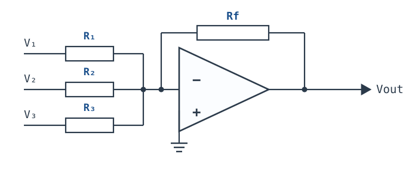
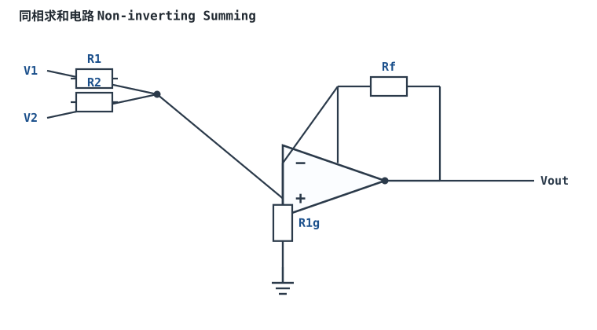
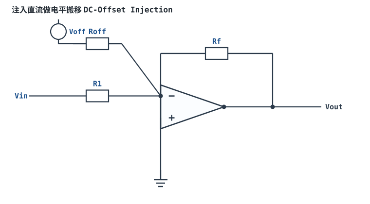

# 加法、减法运算电路 Summing & Difference Amplifier

加法器（summing amplifier）几乎是从反相放大器"免费"长出来的：反相端本来就是虚地，是一个天然的电流求和点，多接几路输入电阻，各路的 $V_k/R_k$ 就在这个节点上相加，再由 $R_f$ 转成电压。整章只需要一条 KCL，就能推出 $V_{OUT}=-\sum (R_f/R_k)V_k$。

但"免费"有一个隐含前提：**只有反相加法器才真正满足"各路互不影响"**。同相加法器看起来输入阻抗更高、输出不反相，实际上所有输入共用同一个节点，谁把电阻改一点，别人的增益就跟着变——这不是"性能差一点"，而是**权重根本无法独立设定**。这一章把两种结构的推导都做一遍，用一条闭式解把串扰写成可算的数字，再用一个"三路加权、E96 取整、算误差、算带宽、算相位裕度"的完整算例收尾。

符号沿用[运放概述：符号、封装与引脚](opamp-overview.md)与[理想模型五假设与虚短、虚断](ideal-opamp.md)：开环增益 $A_{OL}$、闭环增益 $A_{CL}$ 或 $G$、反馈系数 $\beta$（**不是**三极管的电流放大倍数）、环路增益 $T=A_{OL}\beta$、噪声增益 $1/\beta$、GBW、PM。**虚短、虚断只在负反馈成立（反馈回到反相端）、输出未饱和、$|T|\gg1$ 时才有意义**，本章每次使用前都会点明这个前提。减法器的严格电阻匹配与共模抑制见[差分放大器与电阻匹配](differential-amplifier.md)。

## 1. 设计动机

::: motivation 三个真实场景

**场景一：三路 0~1 V 传感器合成，源内阻忘了算。** 要把三路信号按等权相加成 $V_{OUT}=-(V_1+V_2+V_3)$，取 $R_f=10\ \text{k}\Omega$、三只 $R_k=10\ \text{k}\Omega$。设计上每路权重是 1。但三路传感器的输出内阻各 1 kΩ，实际权重变成 $R_f/(R_k+R_s)=10/11=0.909$，三路总增益从 3 掉到 2.727，相对误差 $-9.1\%$——比任何一只电阻的精度都大一个数量级。**反相加法器的每一路输入阻抗就是该路的 $R_k$，源内阻直接串进权重里。**

**场景二：同相加法器改一只电阻，三路全变。** 三路等权、$R_1=R_2=R_3=10\ \text{k}\Omega$、同相增益 $K=10$，此时每路增益 3.333。把 $R_2$ 从 10 kΩ 改成 10.1 kΩ（+1%），通道 1 的增益变成 3.344（+0.333%），通道 2 自己变成 3.311（$-0.667\%$）。如果 $R_2$ 直接改成 20 kΩ（+100%），通道 1 和通道 3 的增益都跳到 4.000（+20%），通道 2 掉到 2.000（$-40\%$）。**这就是串扰：不是信号串过去，是权重被改掉了。**

**场景三：单电源 5 V 下三路相加，输出被削在 0 V。** 三路各 1 V、等权相加，输出应该是 $-3\ \text{V}$；但 5 V 单电源的输出最低只能到 0 V 附近，负半周全部削平。反相加法器的输出天然是负的，单电源下必须把同相端偏置到 $V_{ref}$、输入输出交流耦合，或者注入一路直流做电平搬移（见[单电源电路与电平偏置搬移](single-supply-biasing.md)）。

:::

| 你想确认 | 先算 | 判据（工程经验值） |
|---|---|---|
| 源内阻会不会改变权重 | 每路 $R_k$ 与源内阻 $R_s$ | $R_k\ge1000R_s$ → 权重误差 ≤0.1% |
| 权重准不准 | $w_k=R_f/R_k$ 与电阻容差 | 0.1% 电阻 → 最坏 0.2% 权重误差 |
| 带宽够不够 | $1/\beta=1+R_f/R_{eq}$，$R_{eq}=\left(\sum 1/R_k\right)^{-1}$ | $f_{cl}=GBW/(1/\beta)\ge10\times$ 最高频率 |
| 相位裕度够不够 | 求和节点极点 $1/(2\pi(R_f\parallel R_{eq})C_{in})$ | 极点 ≥3 倍 $f_{cl}$ → PM ≥55° |
| 直流误差多大 | $V_{OS}(1/\beta)+I_BR_f$ | 小于满量程的 1/10 |
| 未用通道悬空会不会变 | $R_{eq}$ 是否随通道数变 | 带宽与 PM 都要按最坏连接方式重算 |
| 单电源能不能用 | 输出是否要为负 | 要负输出就加偏置或双电源 |

**不算会摔在哪**，四条带数字的代价：

1. **把源内阻当零。** $R_k=10\ \text{k}\Omega$、$R_s=1\ \text{k}\Omega$，权重从 1 掉到 0.909，误差 $-9.1\%$；三路都是这样，满量程 3 V 时误差 273 mV。
2. **用同相加法器还想独立调权重。** 改一路 100%，别的路变 20%、甚至 40%（场景二），调参过程根本不收敛。
3. **用 1% 电阻做加权。** 每路权重最坏误差 = 1% + 1% = 2%；对 $w_1=2$、$w_2=0.5$、$w_3=3$ 的加权和，三路各 1 V 时最坏输出误差 $=(2+0.5+3)\times2\%=110\ \text{mV}$，5.5 V 满量程的 2.0%。
4. **忽略噪声增益与信号权重的区别。** 三路并联后 $R_{eq}=18.13\ \text{k}\Omega$，噪声增益 $1/\beta=6.52$，既不是最大权重 3，也不是权重之和 5.5。按 3 算带宽会高估 2.2 倍。

## 2. 定义与直观

### 2.1 一句话定义：虚地节点就是求和节点

**加法器**：把若干路输入电压各经一只电阻接到同一个节点，让各路电流在该节点上按 KCL 相加，再由一只反馈电阻把"和电流"转成输出电压。

- **反相加法器**：求和节点是运放的反相端，被负反馈钳在虚地（$\approx0\ \text{V}$），输出与输入反相。
- **同相加法器**：求和节点是运放的同相端，节点电压随信号摆动，之后再被同相放大器放大 $K$ 倍。

两种结构的区别不在"能不能加"，而在**求和节点是不是被钳住**。节点被钳住，每路电流就只由自己的 $V_k$ 和 $R_k$ 决定，其他路改什么都不影响它；节点不被钳住，节点电压由所有路共同决定，每路的权重里都含着别人的电阻。

前提照例要说清：下面所有推导都假设负反馈闭合（$R_f$ 接回反相端）、输出在线性区、$|T|\gg1$。三条缺一条，$V_-\approx V_+$ 就不成立，加法关系随之失效。开环或正反馈时输出贴着电源轨，看上去"还在求和"，其实已经完全不是线性电路。

### 2.2 反相加法器：虚地让各路"看到"同一个 0 V



把三路输入都接到反相端，这个节点就是**求和节点（summing node）**。在负反馈成立、输出未饱和的前提下，反相端是虚地 $V_-\approx0\ \text{V}$，于是：

- 第 $k$ 路流进节点的电流是 $I_k=(V_k-0)/R_k=V_k/R_k$，只和本路有关；
- 由虚断 $I_-=0$，这些电流不能流进运放，只能全部流过 $R_f$；
- 流过 $R_f$ 的电流是 $\sum I_k$，在 $R_f$ 上产生压降，输出因此是 $-\sum I_kR_f$。

**"互不影响"的物理原因就在这里**：虚地把求和节点的电位钉在 0 V，每路的电压差被这个 0 V 固定住，所以第 2 路怎么变，都不会改变第 1 路两端的电压差，也就不会改变第 1 路的电流。这不是"设计得好"，而是负反馈强制出来的结构性质。

还有一个更强的结论：因为整个网络是线性的，**叠加原理严格成立**。多路同时输入时的输出，精确等于每路单独作用时输出的和；任何一路的电压都不会以"乘积项"或"交叉项"的形式出现在别的路的贡献里。第 3 节会给出保留有限 $A_{OL}$ 时的完整表达式，那里也没有交叉项。

### 2.3 同相加法器：一个节点捆住所有路



同相加法器把输入汇到**同相端**：各路经 $R_k$ 接到节点 P（$V_+$），节点 P 再经 $R_g$ 接地（也可以不接，即 $R_g\to\infty$），输出经 $R_f$、$R_a$ 分压送回反相端，构成同相放大，增益 $K=1+R_f/R_a$。

节点 P 的电压由 KCL 决定：

$$\frac{V_+-V_1}{R_1}+\frac{V_+-V_2}{R_2}+\cdots+\frac{V_+}{R_g}=0$$

整理后 $V_+$ 是各路电压的**加权平均**，权重是各自电导 $1/R_k$ 占总电导的比例。问题就出在这个"占比"上：总电导里含着所有路的 $1/R_k$，所以任何一路的电阻一变，所有权重的分母都变，**每路的增益都跟着变**。

### 2.4 类比：定压水槽与浮动水桶

::: analogy 一个被钳住的水槽，和一个浮动的桶

反相加法器像几个水龙头往一个**定压水槽**里放水：水槽的液面被伺服机构死死钳在 0，每个龙头的流量只由自己的开度（$1/R_k$）和上游水压（$V_k$）决定。你把 2 号龙头开大，1 号龙头的流量一点不变，只是总流量变大、水槽的排水口（$R_f$）水位升高。

同相加法器像一个**浮动的桶**：所有龙头共用一个水位，谁开大一点，水位就往上走，于是所有龙头的流量都变。你想让 1 号龙头多流一点，结果发现 2 号、3 号的流量也跟着动了。

类比的边界：水槽的"定压"不是天生的，是负反馈按出来的。一旦输出撞到电源轨，伺服就按不动了，液面立刻随各路流量漂走——这时"各路互不影响"瞬间失效，而且从外表看电路还在工作。**判断虚地是否有效，看的是输出有没有离开线性区，不是看反相端电压接不接近 0 V。**

:::

### 2.5 减法器与加减混合：标题里为什么有"减法"

加法器解决"相加"，减法器解决"相减"。最常用的减法电路是四电阻差分放大器：$V_2$ 经 $R_2$ 接同相端、同相端再经 $R_g$ 接地，$V_1$ 经 $R_1$ 接反相端、$R_f$ 从输出接回反相端。当 $R_1=R_2$ 且 $R_f=R_g$ 时

$$V_{OUT}=\frac{R_f}{R_1}\left(V_2-V_1\right)$$

它本质上是"同相加法器 + 反相加法器"的组合：同相端那一路被 $1+R_f/R_1$ 放大，反相端那一路被 $-R_f/R_1$ 放大，两者相减。但差分放大器的精度不取决于单只电阻的绝对值，而取决于**四只电阻的比值匹配**：任何一只偏离，CMRR 就掉下来（定量分析见[差分放大器与电阻匹配](differential-amplifier.md)）。

本章的主线仍是加法器——因为减法器的每一半都是加法器，把"哪一路放在同相端、哪一路放在反相端"想清楚，加减混合电路就不需要另记公式。

## 3. 定量关系

### 3.1 反相加法器的推导

前提：负反馈闭合（$R_f$ 回到反相端）、输出未饱和、$|T|\gg1$。于是可用虚短 $V_-=V_+=0$（同相端接地）与虚断 $I_-=0$。对反相端列 KCL：

$$\sum_{k=1}^{n}\frac{V_k-0}{R_k}+\frac{V_{OUT}-0}{R_f}=0$$

移项并乘 $R_f$：

$$V_{OUT}=-R_f\sum_{k=1}^{n}\frac{V_k}{R_k}=-\sum_{k=1}^{n}w_kV_k,\qquad w_k=\frac{R_f}{R_k}$$

符号与单位：$V_{OUT}$、$V_k$ 单位 V；$R_f$、$R_k$ 单位 Ω；权重 $w_k=R_f/R_k$ 无量纲（V/V），**本身是正数**，输出整体的负号来自"信号从 $R_k$ 进、从 $R_f$ 出"这个反相拓扑，不来自权重。这一点与反相放大器完全一致：$\beta$ 仍是正数，负反馈的判据看的是 $T=A_{OL}\beta$ 的相位，不是闭环增益的符号。

**保留有限 $A_{OL}$ 的修正式**。设 $V_-=-V_{OUT}/A_{OL}$，对反相端列 KCL 并消去 $V_-$，可整理为

$$V_{OUT}=-\frac{R_f\sum_{k=1}^{n}\dfrac{V_k}{R_k}}{1+\dfrac{1+R_f\sum_{k=1}^{n}\dfrac{1}{R_k}}{A_{OL}}}$$

这个式子值得盯着看三秒：**分母里只有各路电导之和，没有交叉项**。也就是说，有限的 $A_{OL}$ 只是把所有路的贡献一起乘上一个公共因子

$$\frac{1}{1+1/T_0},\qquad T_0=A_{OL}\beta,\qquad \beta=\frac{R_{eq}}{R_{eq}+R_f},\qquad R_{eq}=\left(\sum_{k=1}^{n}\frac{1}{R_k}\right)^{-1}$$

它让总增益小一点点，但**不会让第 2 路影响第 1 路**。第 4.2 节会把这一点算成具体数字，并与同相加法器对比。

### 3.2 权重、权重精度与"精度由电阻比值决定"

权重 $w_k=R_f/R_k$ 是两只电阻的比值，所以权重的相对误差也是两只电阻相对误差的组合：

$$\frac{\Delta w_k}{w_k}=\frac{\Delta R_f}{R_f}-\frac{\Delta R_k}{R_k},\qquad \left|\frac{\Delta w_k}{w_k}\right|_{\max}=\left|\frac{\Delta R_f}{R_f}\right|+\left|\frac{\Delta R_k}{R_k}\right|$$

- 0.1% 薄膜电阻：最坏 $0.2\%$，按均方根合成 $\sqrt{0.1^2+0.1^2}=0.141\%$。
- 1% 电阻：最坏 $2\%$，均方根 $1.41\%$。

**绝对误差要乘上权重**。权重 $w_k=3$ 的那一路，0.1% 的比值误差对应输入 1 V 时 $3\times1\ \text{V}\times0.2\%=6\ \text{mV}$ 的输出误差；权重 0.5 的那一路同样 0.2% 只有 1 mV。**所以高权重通道要优先用高精度电阻，或者干脆把权重拆成两级**（先按最大权重归一化，再用一级固定增益）。

三条实操结论：

1. **精度由比值决定，不由绝对值决定。** 同一批 0.1% 电阻的绝对值可能都偏 +0.08%，但比值仍然很准；反过来，两只 1% 电阻的绝对值都"很标准"，比值照样可能差 2%。买电阻时看的是容差与温度系数，不是标称值。
2. **E96 取整误差是系统误差，可以校准。** 例如把 $R_f=100\ \text{k}\Omega$、$w_3=3$ 取成 $R_3=33.2\ \text{k}\Omega$，实际权重是 $3.012$，多出 $+0.4\%$。这个偏差是确定的、可复现的，出厂校准能把它校掉；电阻容差是随机的，校不掉。
3. **温度跟踪比绝对值更重要。** 同一封装内的电阻网络（或同一批同一料号）温度系数接近，比值随温度的变化远小于单个电阻的变化（典型跟踪量级 5~25 ppm/°C，具体以数据手册为准）。用分立电阻做高精度加权时，最好选同一厂家、同一温度系数档位、同一封装尺寸的料号。

### 3.3 输入阻抗、噪声增益与带宽

**输入阻抗**。虚地让每一路的负载就是它自己的 $R_k$：

$$Z_{in,k}\approx R_k$$

这是反相加法器最容易被忽略的一条：**加法器的输入阻抗不是"运放的输入阻抗"，而是你选的 $R_k$**。三路权重不同，三路输入阻抗就不同——权重 3 的那一路 $R_k$ 最小、最好驱动；权重 0.5 的那一路 $R_k$ 最大、最容易被源内阻改变权重。

**噪声增益**。所有输入电阻在交流上都并在求和节点与地之间（源是低阻输出时，其输出端对交流是地），所以

$$\frac{1}{\beta}=1+\frac{R_f}{R_{eq}}=1+R_f\sum_{k=1}^{n}\frac{1}{R_k}$$

三个必须分清的量：

| 量 | 表达式 | 本例（第 4.1 节） | 决定什么 |
|---|---|---|---|
| 单路信号权重 | $w_k=R_f/R_k$ | 2、0.5、3 | 该路的信号放大倍数 |
| 权重之和 | $\sum w_k$ | 5.5 | 满量程输出 |
| 噪声增益 | $1/\beta=1+R_f/R_{eq}$ | 6.52 | 带宽、噪声、失调放大 |

**带宽按噪声增益算**：

$$f_{cl}=\frac{GBW}{1/\beta}=\frac{GBW}{1+R_f/R_{eq}}$$

注意 $R_{eq}$ 是**所有** $R_k$ 的并联。路数越多，$R_{eq}$ 越小，噪声增益越大，带宽越窄——这跟"我只用一路，权重也只有 3"的直觉相反。第 4.1 节会看到：三路全接时 $f_{cl}=1.53\ \text{MHz}$，只接一路时 $f_{cl}=3.33\ \text{MHz}$，差 2.2 倍。

**未用通道悬空会改变噪声增益**。如果某一路的信号源被拔掉，那一路的 $R_k$ 就悬空，不再参与 $R_{eq}$，噪声增益变小、$f_{cl}$ 变高，但求和节点的极点频率也跟着变，相位裕度可能明显变差（第 4.1 节给数字）。**工程做法：未用的通道把 $R_k$ 的输入端接地，而不是让它悬空。**

### 3.4 同相加法器：权重与串扰的闭式解

对节点 P 列 KCL，并记

$$R_{par}=R_g\parallel R_1\parallel\cdots\parallel R_n=\left(\frac{1}{R_g}+\sum_{k=1}^{n}\frac{1}{R_k}\right)^{-1}$$

则节点电压与各路增益为

$$V_+=R_{par}\sum_{k=1}^{n}\frac{V_k}{R_k},\qquad V_{OUT}=K V_+,\qquad A_k=\frac{\partial V_{OUT}}{\partial V_k}=K\frac{R_{par}}{R_k}$$

其中 $K=1+R_f/R_a$ 是同相放大级的增益。**每一路的增益里都含着 $R_{par}$，而 $R_{par}$ 含着所有路的电阻**——这就是串扰的数学形态。

把 $R_{par}$ 的定义代进去求偏导，得到两个干净的闭式解。改变第 $j$ 路的 $R_j$ 时：

$$\frac{\Delta A_k}{A_k}=\frac{R_{par}}{R_j}\cdot\frac{\Delta R_j}{R_j}\quad(k\neq j),\qquad \frac{\Delta A_j}{A_j}=\left(\frac{R_{par}}{R_j}-1\right)\frac{\Delta R_j}{R_j}$$

**串扰系数就是 $R_{par}/R_j$**，它恰好等于第 $j$ 路的归一化增益 $A_j/K$。三条推论：

1. **路数越多，串扰系数越小，但单路增益也同比例变小。** 等阻、$R_g\to\infty$ 时 $R_{par}=R/n$，串扰系数 $=1/n$，单路增益 $=K/n$。两者之比恒为 $1/K$，**与路数无关——加路数不能改善串扰，只能靠提高 $K$**。两路时改一路 1% 动另一路 0.5%，四路时 0.25%，但四路时每路增益也只剩 $K/4$。
2. **加重载 $R_g$ 能压串扰，但要拿增益换。** $R_g$ 减小使 $R_{par}$ 减小、串扰系数下降；可 $A_k=K R_{par}/R_k$ 同比例下降，要保持同样的输出幅度就得把 $K$ 提高同样的倍数。第 5.2 节会算：串扰降 10 倍，$K$ 要从 10 提到 100，带宽和噪声一起恶化 10 倍。
3. **改一路，自己被改得最狠。** 由第二式，$R_{par}/R_j<1$ 时，被改的那一路增益变化是负的，而且幅度比别的路大。等阻三路时 $R_{par}/R_j=1/3$：改 $R_2$ 1%，别的路 +0.333%，$R_2$ 自己 $-0.667\%$。

**输入阻抗也不高**。第 $k$ 路看到的阻抗是它自己的 $R_k$ 加上节点 P 对地的其余并联电阻：

$$Z_{in,k}=R_k+\left(R_g\parallel R_1\parallel\cdots\parallel R_{k-1}\parallel R_{k+1}\parallel\cdots\parallel R_n\right)$$

三路等阻 10 kΩ、$R_g\to\infty$ 时，$Z_{in}=10\ \text{k}\Omega+5\ \text{k}\Omega=15\ \text{k}\Omega$——只比反相加法器的 10 kΩ 高 1.5 倍，离"高输入阻抗"差得远。**同相加法器的高输入阻抗只在"单路、$R_k$ 很大"时才成立；多路共用节点时，阻抗由电阻网络决定，不由 $R_{icm}$ 决定。**

### 3.5 两种加法器的关键差异

| 项目 | 反相加法器 | 同相加法器 |
|---|---|---|
| 求和节点 | 反相端，虚地（$\approx0\ \text{V}$） | 同相端，随信号摆动 |
| 各路是否独立 | 是，叠加原理严格成立，无交叉项 | 否，改一路动全部 |
| 串扰系数 | $\approx0$（仅剩 $1/T_0$ 的公共因子） | $R_{par}/R_j$，等阻时 $1/n$ |
| 单路增益 | $R_f/R_k$（反相） | $K R_{par}/R_k$（同相） |
| 输入阻抗 | $R_k$ | $R_k+$ 其余路并联 |
| 输入端共模电压 | $\approx0$（虚地） | 等于 $V_+$，随信号变 |
| 噪声增益 | $1+R_f/R_{eq}$ | $K$ |
| 权重能否独立设定 | 能 | 不能 |
| 单电源友好度 | 差（输出为负） | 好（输出为正） |
| 元件数 | $n+1$ 只电阻 | $n+2$ 只电阻（含 $R_g$、分压） |

### 3.6 适用条件与失效边界

1. **负反馈必须回到反相端。** 接错到同相端就是正反馈，输出锁死，虚地与求和关系全部失效；这是上电前必须核对的一项。
2. **输出必须在线性区。** 反相加法器输出为负，单电源下撞 0 V 就是饱和；多路同时满幅时输出是权重之和乘以输入，最容易被忽略。
3. **$|T|\gg1$。** 低频、低噪声增益时 $T$ 很大；路数少、$R_{eq}$ 大、$R_f$ 大时 $T$ 下降，增益误差按 $1/(1+T_0)$ 增大。
4. **源内阻远小于 $R_k$。** 否则权重变成 $R_f/(R_k+R_s)$，而且每一路的偏差还不一样，等于人为制造了失配。
5. **求和节点的电容要小。** 所有 $R_k$ 并联后与 $R_f$ 一起跟 $C_{in}$ 形成极点，路数越多、$R_{eq}$ 越小极点越高；但只用少数通道时极点会显著下降，PM 要按最坏连接方式核算。
6. **同相加法器还要多看一条：输入共模范围。** $V_+$ 随信号摆动，单电源下必须落在 ICMR 内，否则输入级截止（见[同相比例放大器](non-inverting-amplifier.md)）。

## 4. 典型计算

### 4.1 完整算例：设计 $V_{OUT}=-(2V_1+0.5V_2+3V_3)$

**需求**：三路输入各 $\pm1\ \text{V}$，输出 $V_{OUT}=-(2V_1+0.5V_2+3V_3)$，满量程 $\pm5.5\ \text{V}$；双电源 $\pm15\ \text{V}$；闭环带宽不低于 100 kHz；用 E96 系列 0.1% 薄膜电阻；运放取 $A_{OL0}=10^5$、GBW=10 MHz、$C_{in}=5\ \text{pF}$、$V_{OS}=1\ \text{mV}$、$I_B=25\ \text{nA}$（典型量级，以数据手册为准）。

**第 1 步：定 $R_f$。** 取 $R_f=100\ \text{k}\Omega$（E96 有 100），这是权重公式的公共分子。$R_f$ 取大一点可以让 $R_k$ 落在"不太小"的区间，但超过几百 kΩ 后偏置电流误差与噪声开始变差。

**第 2 步：按权重反算 $R_k$。** $R_k=R_f/w_k$：

| 通道 | 目标权重 $w_k$ | 理论 $R_k$ | E96 取整 | 实际权重 $R_f/R_k$ | 权重误差 |
|---|---|---|---|---|---|
| $V_1$ | 2 | 50.0 kΩ | 49.9 kΩ | 2.0040 | $+0.200\%$ |
| $V_2$ | 0.5 | 200 kΩ | 200 kΩ | 0.5000 | $0\%$ |
| $V_3$ | 3 | 33.33 kΩ | 33.2 kΩ | 3.0120 | $+0.402\%$ |

三只电阻都取 E96、0.1%。E96 里没有 50.0 kΩ（48.7 与 51.1 之间是 49.9），也没有 33.33 kΩ（最近是 33.2），所以取整误差是必然的。**这是系统误差，可以校准**；0.1% 的容差是随机误差，校不掉。

```echarts
{
  "tooltip": {"trigger": "axis"},
  "legend": {"data": ["理想权重", "E96 实取权重"], "bottom": 0, "textStyle": {"fontSize": 12}},
  "grid": {"left": 56, "right": 24, "top": 30, "bottom": 58},
  "xAxis": {"type": "category", "name": "输入通道", "data": ["V1 (49.9kΩ)", "V2 (200kΩ)", "V3 (33.2kΩ)"], "axisLabel": {"fontSize": 11}},
  "yAxis": {"type": "value", "name": "权重 w = Rf/Rk", "min": 0, "max": 3.6, "interval": 0.5, "axisLabel": {"fontSize": 11}},
  "series": [
    {"name": "理想权重", "type": "bar", "barGap": "10%", "itemStyle": {"color": "#7f96ac"}, "data": [2, 0.5, 3]},
    {"name": "E96 实取权重", "type": "bar", "itemStyle": {"color": "#1a4f8b"}, "label": {"show": true, "position": "top", "fontSize": 11, "color": "#1a4f8b"}, "data": [2.004, 0.5, 3.012]}
  ]
}
```

**第 3 步：满量程验算。** 三路都取 1.000 V：

$$V_{OUT}=-(2.0040+0.5000+3.0120)\times1.000\ \text{V}=-5.5161\ \text{V}$$

理想值是 $-5.5000\ \text{V}$，误差 $-16.1\ \text{mV}$，相对满量程 $-0.292\%$。对 5 V/12 位 ADC（1 LSB $=1.22\ \text{mV}$）相当于 13 个 LSB——还没算电阻容差，光取整就已经超了。

**第 4 步：输入阻抗与源内阻预算。** 每路输入阻抗等于该路 $R_k$：49.9 kΩ、200 kΩ、33.2 kΩ。若源内阻 $R_s=100\ \Omega$，权重误差分别为

$$\frac{R_s}{R_1}=\frac{100}{49900}=0.200\%,\qquad \frac{R_s}{R_2}=\frac{100}{200000}=0.050\%,\qquad \frac{R_s}{R_3}=\frac{100}{33200}=0.301\%$$

**最小 $R_k$ 的那一路决定源内阻预算**：要把权重误差压到 0.1%，$R_s$ 必须满足 $R_s\le0.1\%\times33.2\ \text{k}\Omega=33\ \Omega$。源内阻 1 kΩ 时，第 3 路权重会偏 $3.0\%$——比电阻容差大 15 倍，必须加缓冲。

**第 5 步：噪声增益。** 先算 $R_{eq}$：

$$\frac{1}{R_{eq}}=\frac{1}{49.9\ \text{k}}+\frac{1}{200\ \text{k}}+\frac{1}{33.2\ \text{k}}=20.04+5.00+30.12=55.16\ \mu\text{S}$$

$$R_{eq}=\frac{1}{55.16\ \mu\text{S}}=18.13\ \text{k}\Omega,\qquad \beta=\frac{18.13}{18.13+100}=0.15347$$

$$\frac{1}{\beta}=1+\frac{R_f}{R_{eq}}=1+\frac{100}{18.13}=6.516$$

**这个 6.52 既不是最大权重 3，也不是权重之和 5.5。** 它是"所有输入电阻并联"的结果，由反馈网络对误差的放大倍数决定，与信号怎么分配无关。

**第 6 步：带宽。**

$$f_{cl}=\frac{GBW}{1/\beta}=\frac{10\ \text{MHz}}{6.516}=1.535\ \text{MHz}$$

比 100 kHz 的要求高 15 倍，满足。若误按最大权重 3 算，会得到 $f_{cl}=3.33\ \text{MHz}$，高估 2.2 倍；这个错误会让人以为 3 MHz 的运放够用，实际只够 1.5 MHz。

**第 7 步：求和节点极点与相位裕度。** 求和节点对地的交流电阻是 $R_f\parallel R_{eq}$：

$$R_f\parallel R_{eq}=\frac{100\times18.13}{100+18.13}=15.35\ \text{k}\Omega$$

$$f_p=\frac{1}{2\pi(R_f\parallel R_{eq})C_{in}}=\frac{1}{2\pi\times15350\times5\times10^{-12}}=2.074\ \text{MHz}$$

极点只有 $f_{cl}$ 的 1.35 倍，相位裕度必须实算。由 $|T|=1$ 的方程 $u^2(1+u^2)=(f_{c0}/f_p)^2$（$f_{c0}=GBW/(1/\beta)=1.535\ \text{MHz}$，推导见[稳定性：伯德图、相位裕度与补偿](stability-bode.md)）：

$$\frac{f_{c0}}{f_p}=\frac{1.535}{2.074}=0.740,\qquad u^2=\frac{-1+\sqrt{1+4\times0.740^2}}{2}=0.393$$

$$u=0.627,\qquad f_c=u f_p=1.30\ \text{MHz},\qquad PM=180^{\circ}-90^{\circ}-\arctan(0.627)=57.9^{\circ}$$

57.9° 可以接受（一般要求 ≥45°，精密场合 ≥60°），但余量已经不多。把 $C_{in}$ 换成 10 pF（长走线、多路并联焊盘会这样）：

$$f_p=\frac{1}{2\pi\times15350\times10\times10^{-12}}=1.037\ \text{MHz},\qquad u=1.031,\qquad f_c=1.069\ \text{MHz}$$

$$PM=180^{\circ}-90^{\circ}-\arctan(1.031)=44.1^{\circ}$$

掉到临界值。**这就是"多路加法器要把求和节点做小"的定量理由**：$C_{in}$ 每翻一倍，PM 掉十几度。

**第 8 步：未用通道悬空会怎样。** 只接第 1 路、另两路悬空时，$R_{eq}=49.9\ \text{k}\Omega$：

$$\frac{1}{\beta}=1+\frac{100}{49.9}=3.004,\qquad f_{c0}=\frac{10\ \text{MHz}}{3.004}=3.33\ \text{MHz}$$

$$R_f\parallel R_{eq}=33.31\ \text{k}\Omega,\qquad f_p=\frac{1}{2\pi\times33310\times5\times10^{-12}}=0.956\ \text{MHz}$$

$$u=1.738,\qquad f_c=1.66\ \text{MHz},\qquad PM=180^{\circ}-90^{\circ}-\arctan(1.738)=30.0^{\circ}$$

**带宽变宽了，稳定性却变差了**：$f_c$ 从 1.30 MHz 升到 1.66 MHz，而极点还留在 0.956 MHz，PM 从 57.9° 掉到 30.0°，示波器上能看到明显振铃。解决很简单：**未用通道的 $R_k$ 输入端接地**，让 $R_{eq}$ 保持三路并联的值。

**第 9 步：直流误差预算。** 三项主导：

| 误差源 | 折合到输入 | 输出误差 | 说明 |
|---|---|---|---|
| $V_{OS}=1\ \text{mV}$ | 1 mV | $6.52\ \text{mV}$ | 乘噪声增益 6.52 |
| $I_B=25\ \text{nA}$ | — | $I_BR_f=2.50\ \text{mV}$ | 偏置电流全部流过 $R_f$，与 $R_{eq}$ 无关 |
| 电阻容差 0.1% | 每路 0.2% | $5.5\ \text{V}\times0.2\%=11.0\ \text{mV}$ | 最坏相加，三路同向 |
| E96 取整 | 见第 2 步 | $16.1\ \text{mV}$ | 系统误差，可校准 |
| PSRR 80 dB、电源变化 50 mV | $5\ \mu\text{V}$ | $0.033\ \text{mV}$ | 可忽略 |

最坏值（容差 + $V_{OS}$ + $I_B$）$=11.0+6.52+2.50=20.0\ \text{mV}$，加取整误差 36.1 mV，占 5.5 V 满量程的 0.66%。按均方根合成（容差项 $\sqrt{3}$ 路独立：$\sqrt{(2\times0.002)^2+(0.5\times0.002)^2+(3\times0.002)^2}=7.28\ \text{mV}$）约 $\sqrt{7.28^2+6.52^2+2.50^2}=10.2\ \text{mV}$，加取整 26.3 mV。

**第 10 步：汇总。**

| 项目 | 结果 | 公式 |
|---|---|---|
| 各路权重 | 2.004 / 0.500 / 3.012 | $R_f/R_k$ |
| 满量程输出（三路各 1 V） | $-5.5161\ \text{V}$ | $-\sum w_kV_k$ |
| 取整误差 | $-16.1\ \text{mV}$（$-0.292\%$） | 与理想值比较 |
| 输入阻抗 | 49.9 / 200 / 33.2 kΩ | $R_k$ |
| 源内阻预算（≤0.1%） | 33 Ω（由第 3 路决定） | $R_s\le0.1\%R_k$ |
| 噪声增益 | 6.516 | $1+R_f/R_{eq}$ |
| 闭环带宽 | 1.535 MHz | $GBW/(1/\beta)$ |
| PM（$C_{in}=5\ \text{pF}$） | 57.9° | $180^{\circ}-90^{\circ}-\arctan u$ |
| PM（未用通道悬空） | 30.0° | 同上 |
| 直流误差（最坏 / RSS） | 20.0 / 10.2 mV | 各项合成 |

### 4.2 串扰对比算例：把一只电阻改 1%

**同相加法器**：三路等阻 $10\ \text{k}\Omega$、$R_g\to\infty$、$K=10$。$R_{par}=10/3=3.333\ \text{k}\Omega$，每路增益

$$A_k=K\frac{R_{par}}{R_k}=10\times\frac{3.333}{10}=3.333$$

改 $R_2$ 为 10.1 kΩ（+1%）。串扰系数 $R_{par}/R_2=1/3$：

$$\frac{\Delta A_1}{A_1}=\frac{1}{3}\times1\%=+0.333\%,\qquad \frac{\Delta A_2}{A_2}=\left(\frac{1}{3}-1\right)\times1\%=-0.667\%$$

直接代入验算：$\sum1/R=1/10+1/10.1+1/10=0.29901\ \text{mS}$，$A_1=10\times(0.1/0.29901)=3.3444$，$A_2=10\times(0.09901/0.29901)=3.3113$，与闭式解一致。

**反相加法器**（第 4.1 节那组）：改 $R_2$ 为 202 kΩ（+1%），$R_{eq}$ 从 18.129 kΩ 变成 18.145 kΩ，噪声增益从 6.5161 变成 6.5111，公共因子变化

$$\frac{\Delta V_{OUT}}{V_{OUT}}\approx\frac{1}{T_0}\cdot\frac{\Delta T_0}{T_0}=\frac{1}{15347}\times7.6\times10^{-4}=5.0\times10^{-8}$$

约 $0.000005\%$，比同相加法器的 0.333% 小约 **4.8 个数量级**（$3.33\times10^{-3}/5.0\times10^{-8}=6.7\times10^{4}$）。而且这 0.000005% 是**所有路一起变**，不是"通道 1 被通道 2 带偏"——从信号意义上说，反相加法器的串扰是零。

**对比表**：

| 改动 | 反相加法器 | 同相加法器 |
|---|---|---|
| $R_2$ +1% | 各路 $\approx0$（$5\times10^{-8}$） | 其余路 $+0.333\%$，自己 $-0.667\%$ |
| $R_2$ +100% | 各路 $\approx0$ | 其余路 $+20\%$，自己 $-40\%$ |

**结论**：反相加法器的"独立性"是结构性的、不随精度等级变化的；同相加法器的串扰是拓扑决定的，换更高精度的电阻只会让"设定的权重"更准，不会让各路独立。

### 4.3 权电阻求和 DAC：权重范围决定成败

把数字位的开关接到反相加法器的各路输入，第 $k$ 位用 $R_k=R_f/2^k$，输出就是

$$V_{OUT}=-R_f\sum_{k=0}^{n-1}\frac{D_k}{2^kR},\qquad D_k\in\{0,1\}$$

- 8 位时最大与最小电阻之比 $2^7=128:1$。取 $R_f=10\ \text{k}\Omega$，最小 $R_0=10\ \text{k}\Omega/2^0$ 与最大 $R_7=R_f/128=78.1\ \Omega$——注意权重越大电阻越小，所以最小电阻是 78 Ω，最大是 10 kΩ 的 128 倍即 1.28 MΩ（对应最低位）。
- **78 Ω 这一路**：开关导通电阻 $R_{on}$ 若为 20 Ω，权重误差 $20/78=26\%$，最高位直接失准。
- **1.28 MΩ 这一路**：25 nA 偏置电流在它上面产生 32 mV 的误差；热噪声 $\sqrt{4kTR}=146\ \text{nV}/\sqrt{\text{Hz}}$。
- 所以实际 DAC 用 R-2R 梯形网络（只有 $R$ 与 $2R$ 两种阻值），或用集成 DAC。**权电阻结构的价值在于原理直观，不在于工程实现。**

同一套电路换个用法就是"电平搬移"和"音频混合"：前者在某一路注入稳定直流 $V_{off}$，输出叠加一个可调偏置；后者把多路音频经各自电阻汇入虚地，$R_f$ 定总增益。两者的共同点仍是**虚地让各路独立**。

## 5. 工程含义

### 5.1 数量级表

| 量 | 典型范围 | 备注 |
|---|---|---|
| $R_f$ | $1\ \text{k}\Omega\sim1\ \text{M}\Omega$ | 甜点区 $10\ \text{k}\Omega\sim100\ \text{k}\Omega$ |
| $R_k$ | $R_f/w_k$ | 权重范围建议 ≤10:1，超过就换 R-2R 或两级 |
| 权重 | 0.1~10 | 超过 10:1 时最小 $R_k$ 太小、最大 $R_k$ 太大 |
| 输入阻抗 | $=R_k$ | 高阻源必须加缓冲 |
| 噪声增益 | $1+R_f/R_{eq}$ | 与权重无关，由并联值决定 |
| $f_{cl}$ | $GBW/(1+R_f/R_{eq})$ | 路数越多越窄 |
| 求和节点极点 | $1/(2\pi(R_f\parallel R_{eq})C_{in})$ | 要 ≥3 倍 $f_{cl}$ |
| 直流误差 | $V_{OS}(1/\beta)+I_BR_f$ | 两项量级相当 |

### 5.2 为什么同相加法器在实际中很少用

四条定量理由，按"能不能救"排序：

**（1）权重不能独立设定，这是拓扑缺陷，救不了。** 3.4 节的两个闭式解说明：改一路，其余所有路都按 $R_{par}/R_j$ 变化。多通道系统里"先调 1 路、再调 2 路、再回头发现 1 路变了"的循环，就是这条公式的现场版。反相加法器没有这个问题：$w_k=R_f/R_k$ 只含本路电阻与公共的 $R_f$。

**（2）要压串扰必须拿增益换，代价是带宽与噪声。** 目标：把三路等阻时的串扰系数从 $1/3$ 压到 $1/30$。由串扰系数 $=R_{par}/R_k$，需 $R_{par}=10\ \text{k}\Omega/30=333\ \Omega$。三路并联已是 3.333 kΩ，要再并一只 $R_g$：

$$\frac{1}{333}=\frac{1}{3333}+\frac{1}{R_g}\ \Rightarrow\ R_g=370\ \Omega$$

要保持每路增益仍是 3.333，$K$ 必须提到 $3.333/(333/10000)=100$

$$K=1+\frac{R_f}{R_a}=100\ \Rightarrow\ \frac{R_f}{R_a}=99$$

噪声增益从 10 变成 100，闭环带宽变成原来的 1/10，输出噪声按噪声增益放大 10 倍。**串扰降 10 倍，带宽和噪声各付 10 倍**——这笔账在同相加法器上永远躲不掉。

**（3）输入阻抗只高 1.5 倍，不是"无穷大"。** 3.4 节算过：三路 10 kΩ 等阻时 $Z_{in}=15\ \text{k}\Omega$，反相加法器是 10 kΩ。要真正高阻，得把 $R_k$ 提到 MΩ 级，那时偏置电流（25 nA × 1 MΩ = 25 mV）和电阻热噪声（$\sqrt{4kT\times1\ \text{M}\Omega}=129\ \text{nV}/\sqrt{\text{Hz}}$）双双恶化。**"同相加法器输入阻抗高"这句话，只在单路或 $R_k$ 很大的时候成立；多路共用节点时它是个错觉。**

**（4）共模电压随信号摆动，受 ICMR 限制。** 反相加法器的求和节点固定在 $\approx0\ \text{V}$，只要运放允许 0 V 共模，三路信号可以在任意共模下工作；同相加法器的 $V_+$ 本身就是加权平均信号，必须落在输入共模范围内，单电源下还要额外抬偏置。

所以要"多路独立加权"，选反相加法器；要"高输入阻抗"，每路先加[电压跟随器](voltage-follower.md)再进反相加法器；要"抑制共模、只取差值"，选[差分放大器](differential-amplifier.md)或[仪表放大器（三运放）](instrumentation-amplifier.md)。**同相加法器的位置很窄：单电源、输出必须为正、路数少、权重固定不需要调整。**

### 5.3 单电源与电平搬移

反相加法器的输出天然为负，5 V 单电源下必须把整个输出"抬"到 $V_{CC}/2$。最直接的作法是多注入一路稳定直流（图见下）：



$$V_{OUT}=-R_f\left(\frac{V_{in}}{R_1}+\frac{V_{off}}{R_{off}}\right)$$

要静态点等于 2.5 V（5 V 单电源的中点），取 $V_{off}=2.5\ \text{V}$（基准源，不能直接取电源分压，否则偏置随电源漂）：

$$\frac{R_f}{R_{off}}\times2.5\ \text{V}=-2.5\ \text{V}\ \Rightarrow\ R_{off}=R_f=100\ \text{k}\Omega$$

交流项仍是 $-R_f/R_1$，与偏置项互不影响——**这又一次体现了虚地的价值：注入直流不会改变交流权重**。输入输出都要交流耦合，耦合电容与 $R_1$ 形成高通，截止频率 $1/(2\pi R_1C)$ 要低于最低信号频率的 1/10。细节见[单电源电路与电平偏置搬移](single-supply-biasing.md)。

### 5.4 布局：求和节点是全板最"脏"的节点

- **求和节点走线要短。** 三只 $R_k$ 与 $R_f$ 都汇到这一点，焊盘电容、走线电容、运放 $C_{in}$ 全部叠加。第 4.1 节算过：$C_{in}$ 从 5 pF 到 10 pF，PM 从 57.9° 掉到 44.1°。多路加法器的求和节点往往比单路反相放大更长，这一点尤其要注意。
- **各路地回流分开走。** 如果三路信号源共用一段地线，第 3 路的回流电流会在地线电阻上产生压降，串进第 1 路的参考。定量：地线电阻 10 mΩ、某路回流 100 mA（大信号或容性负载时可能出现），地弹 1 mV，经权重 3 放大就是 3 mV。**这是真实存在的"模拟串扰"，与拓扑无关，只能靠布局解决。**
- **反馈电阻紧靠反相端。** $R_f$ 的一端尽量短接到求和节点，另一端靠近输出，不要从板子另一头绕回。
- **电源退耦。** 每个电源脚就近 100 nF，双电源正负各一只；退耦不良表现为输出高频毛刺，容易被误判为"运放噪声大"。

### 5.5 模型什么时候不够用

- **源内阻与 $R_k$ 可比**：权重按 $R_f/(R_k+R_s)$ 重算，每路偏差还不同。
- **通道数多、$R_{eq}$ 小**：噪声增益变大、带宽变窄，且 $T_0$ 下降使增益误差上升。
- **只用少数通道**：$R_{eq}$ 变大，$f_c$ 升高、PM 变差（第 4.1 节第 8 步）。
- **大信号**：输出电流限、压摆率、饱和恢复进入预算；多路同时满幅时输出摆幅最容易越界。
- **精密直流**：$V_{OS}$、$I_B$、电阻失配、热电偶效应全部进入预算，$V_{OS}$ 与失配通常是前两位。
- **高频接近 $f_{cl}$**：单极点模型只能给量级，第二极点与 $C_{in}$ 极点必须一起算。

## 6. 常见坑

::: pitfall 常见坑

- **现象**：三路等权加法器，某一路接上高内阻传感器后，该路输出明显变小，换低阻源立刻正常。**原因**：把加法器输入阻抗当成"运放的无穷大输入阻抗"；实际 $Z_{in,k}=R_k$，源内阻与 $R_k$ 串联分压，权重变成 $R_f/(R_k+R_s)$。**解决**：按 $R_f/(R_k+R_s)$ 重算权重；高阻源前面加跟随器；或把该路 $R_k$ 加大（同时核算噪声与偏置电流）。

- **现象**：同相加法器调 $R_2$ 想让通道 2 增益变小，结果通道 1、3 的增益一起变大，越调越乱。**原因**：所有输入共用同相端节点，$A_k=K R_{par}/R_k$，$R_{par}$ 含所有路的电阻。**解决**：需要独立权重就换反相加法器；如果必须用同相加法器，按 3.4 节的闭式解一次性联立求解，不要逐路试调。

- **现象**：用 1% 电阻搭的三路加权和，实测满量程误差 100 mV 以上，换 0.1% 电阻仍剩十几 mV。**原因**：前者的主导项是电阻容差（最坏 2% 权重误差），后者是 E96 取整误差（系统误差）。**解决**：容差问题用 0.1% 或电阻网络；取整误差用校准消除，或在设计阶段就选比值精确的 E96 组合。

- **现象**：三路加法器只接一路使用时出现振铃，三路全接反而正常。**原因**：未用通道悬空使 $R_{eq}$ 变大，噪声增益变小、$f_c$ 升高，而求和节点极点频率下降（$R_f\parallel R_{eq}$ 变大），PM 从 57.9° 掉到 30.0°。**解决**：未用通道的 $R_k$ 输入端接地，不要悬空；或按单路连接方式重算 PM 并加前馈电容。

- **现象**：单电源 5 V 供电，输入为 0 时输出卡在 0 V 附近，一加信号下半周就被削平。**原因**：反相加法器输出为负，单电源没有负摆幅；同相端又接地，静态点就是 0 V。**解决**：同相端偏置到 $V_{ref}$（典型 $V_{CC}/2$），输入输出交流耦合；或注入一路稳定直流做电平搬移（5.3 节）；或改用双电源。

- **现象**：电路在面包板上正常，做成 PCB 后噪声与串扰明显变大，某一路信号"串"到另一路。**原因**：求和节点走线变长使 $C_{in}$ 增大、PM 下降；三路共用一段地线，回流在地线电阻上形成共阻抗耦合。**解决**：缩短求和节点走线、各路地线单点汇合、必要时给高阻节点加保护环；用示波器看地线上的实际压降，而不是只看输出电压。

- **现象**：反馈电阻 $R_f$ 虚焊或错接到同相端，输出锁在电源轨，输入加信号也不动。**原因**：前者使负反馈断开，后者把负反馈变成正反馈，$V_{OUT}=A_{OL}V_{IN}/(1-A_{OL}\beta)$ 分母趋零。**解决**：先量电源脚，再用万用表确认 $R_f$ 两端连通性；核对反馈是否回到反相端；必要时先接成跟随器验证器件。

:::

## 7. 自测题

<details><summary>三路反相加法器，$R_f=100\ \text{k}\Omega$，$R_1=50\ \text{k}\Omega$、$R_2=200\ \text{k}\Omega$、$R_3=33.3\ \text{k}\Omega$，三路输入都是 0.5 V，输出是多少？如果三路源内阻都是 1 kΩ 呢？</summary>

理想情况：

$$V_{OUT}=-100\left(\frac{0.5}{50}+\frac{0.5}{200}+\frac{0.5}{33.3}\right)=-(1.000+0.250+1.502)=-2.752\ \text{V}$$

若每路源内阻 1 kΩ，权重变成 $R_f/(R_k+1\ \text{k}\Omega)$：

$$V_{OUT}=-0.5\times100\left(\frac{1}{51}+\frac{1}{201}+\frac{1}{34.3}\right)=-0.5\times100\times(0.019608+0.004975+0.029155)=-2.687\ \text{V}$$

误差 $-65\ \text{mV}$（$-2.4\%$）。**注意误差不是均匀分布的**：$R_3$ 最小、受影响最大（权重从 3.003 掉到 2.915，$-2.9\%$），$R_2$ 最大、几乎不受影响（$-0.5\%$）。三路的相对偏差不同，等于人为制造了失配。

</details>

<details><summary>为什么反相加法器各路"互不影响"，而同相加法器会互相牵连？用一句话说清物理原因，再用公式说明。</summary>

**物理原因**：反相加法器的求和节点被负反馈钳在虚地（$\approx0\ \text{V}$），每路电阻两端的电压差只由本路输入决定；同相加法器的求和节点电压由所有路共同决定，任何一路的电阻都出现在所有路权重的分母里。

**公式**：反相加法器 $w_k=R_f/R_k$，只含本路电阻与公共的 $R_f$；同相加法器 $A_k=K R_{par}/R_k$，而 $R_{par}=R_g\parallel R_1\parallel\cdots\parallel R_n$ 含所有路。改 $R_j$ 时，反相加法器只有 $w_j$ 变，同相加法器所有 $A_k$ 都按 $R_{par}/R_j$ 变化。

</details>

<details><summary>三路等阻同相加法器，$R_1=R_2=R_3=10\ \text{k}\Omega$、$K=10$、$R_g$ 开路。求每路增益、串扰系数；若把 $R_2$ 改成 10.1 kΩ，各路增益各变成多少？</summary>

$R_{par}=10/3=3.333\ \text{k}\Omega$，每路增益

$$A_k=K\frac{R_{par}}{R_k}=10\times\frac{3.333}{10}=3.333$$

串扰系数 $R_{par}/R_k=1/3$。改 $R_2$ 为 10.1 kΩ：

$$\frac{\Delta A_1}{A_1}=+\frac{1}{3}\times1\%=+0.333\%,\qquad \frac{\Delta A_2}{A_2}=\left(\frac{1}{3}-1\right)\times1\%=-0.667\%$$

即 $A_1=A_3=3.344$、$A_2=3.311$。**被改的那一路变化最大（-0.667%），而且方向与直觉相反**（把 $R_2$ 调大，$A_2$ 变小，但别的路变大）。

</details>

<details><summary>三路反相加法器的噪声增益是多少？为什么既不是最大权重 3，也不是权重之和 5.5？如果只接一路呢？</summary>

噪声增益由所有输入电阻的并联值决定：

$$\frac{1}{\beta}=1+\frac{R_f}{R_{eq}},\qquad R_{eq}=\left(\sum\frac{1}{R_k}\right)^{-1}$$

取 $R_f=100\ \text{k}\Omega$、$R_k=49.9/200/33.2\ \text{k}\Omega$，$R_{eq}=18.13\ \text{k}\Omega$，$1/\beta=1+100/18.13=6.516$。

它不是 3 也不是 5.5，因为噪声增益描述的是"反馈网络对误差的放大倍数"，误差从求和节点注入，看到的是**所有** $R_k$ 的并联，而不是某一路的权重。只接一路（其余悬空）时 $R_{eq}=49.9\ \text{k}\Omega$，$1/\beta=3.004$——所以**带宽会随"接了几路"变化**。

</details>

<details><summary>求和节点 $C_{in}=5\ \text{pF}$、$R_f=100\ \text{k}\Omega$、$R_{eq}=18.13\ \text{k}\Omega$、GBW=10 MHz。求求和节点极点、$f_c$ 与 PM；若 $C_{in}$ 变成 10 pF 呢？</summary>

$$R_f\parallel R_{eq}=15.35\ \text{k}\Omega,\qquad f_p=\frac{1}{2\pi\times15350\times5\times10^{-12}}=2.074\ \text{MHz}$$

$1/\beta=6.516$，$f_{c0}=10\ \text{MHz}/6.516=1.535\ \text{MHz}$。解 $u^2(1+u^2)=(f_{c0}/f_p)^2$：

$$\frac{f_{c0}}{f_p}=0.740,\qquad u=0.627,\qquad f_c=1.30\ \text{MHz}$$

$$PM=180^{\circ}-90^{\circ}-\arctan(0.627)=57.9^{\circ}$$

$C_{in}=10\ \text{pF}$ 时 $f_p=1.037\ \text{MHz}$，$u=1.031$，$f_c=1.069\ \text{MHz}$，$PM=44.1^{\circ}$——已经从"可以接受"掉到"临界"。**结论：求和节点的电容每翻一倍，PM 掉十几度；多路加法器的布局比单路反相放大更敏感。**

</details>

<details><summary>要把同相加法器的串扰系数从 1/3 压到 1/30，需要做什么？代价是什么？</summary>

串扰系数 $=R_{par}/R_k$，$R_k=10\ \text{k}\Omega$ 时要 $R_{par}=333\ \Omega$。三路并联已是 3.333 kΩ，需再并 $R_g$：

$$\frac{1}{333}=\frac{1}{3333}+\frac{1}{R_g}\ \Rightarrow\ R_g=370\ \Omega$$

要保持每路增益仍为 3.333，$K$ 必须提到 $3.333/(333/10000)=100$。噪声增益从 10 变 100：

- 闭环带宽变成原来的 1/10；
- 输出噪声按噪声增益放大 10 倍；
- 分压电阻 $R_a$、$R_f$ 的取值与功耗也要重算。

**结论：同相加法器的串扰每降 10 倍，就要用 10 倍增益去换，带宽与噪声同时恶化 10 倍。这就是它在实际中很少用的核心原因。**

</details>

<details><summary>用权电阻结构做 8 位 DAC，$R_f=10\ \text{k}\Omega$，最高位权重 128。最小和最大电阻各是多少？各有什么问题？</summary>

权重 $w_k=2^k$，$R_k=R_f/2^k$：

- 最高位 $k=7$：$R_7=10\ \text{k}\Omega/128=78.1\ \Omega$；
- 最低位 $k=0$：$R_0=10\ \text{k}\Omega$，但若把 $R_f$ 也按位缩放，最大电阻可达 $R_f\times128=1.28\ \text{M}\Omega$。

问题：78 Ω 与开关导通电阻（典型几十 Ω）同量级，最高位权重严重失准；1.28 MΩ 上 25 nA 偏置电流产生 32 mV 误差，热噪声 $\sqrt{4kT\times1.28\ \text{M}\Omega}=146\ \text{nV}/\sqrt{\text{Hz}}$，且与开关/PCB 的寄生电容形成慢极点。**所以工程上用 R-2R 梯形网络（只有两种阻值），或直接用集成 DAC。**

</details>

## 8. 参考资料

- **TI, *Op Amps for Everyone*（SLOD006B）**：Chapter 3 *Development of the Ideal Op Amp Equations* 给反相组态的一般 KCL 推导与多路输入求和；Chapter 6 *Development of the Non-Ideal Op Amp Equations* 给有限 $A_{OL}$ 的修正式（本章 3.1 节的分母形式与该书一致）；Chapter 17 *Circuit Board Layout Techniques* 讲求和节点与地回流。
- **Analog Devices, MT-033 *Voltage Feedback Op Amp Gain and Bandwidth***：噪声增益 $1/\beta$、闭环带宽与增益带宽积。本章 3.3 节把"多路并联后的 $R_{eq}$"代入该口径，得到 $f_{cl}=GBW/(1/\beta)$。https://www.analog.com/media/en/training-seminars/tutorials/MT-033.pdf
- **Analog Devices, MT-035 *Op Amp Inputs, Outputs, Single-Supply & Rail-to-Rail Issues***：输入共模范围、输出摆幅与单电源边界。本章 3.6 节与 5.3 节的 ICMR、偏置讨论按该文。https://www.analog.com/media/en/training-seminars/tutorials/MT-035.pdf
- **TI, *Single-Supply Op-Amp Circuit Collection*（SLOA058）**：单电源求和、偏置注入与交流耦合的成套电路；本章 5.3 节的 $V_{ref}$ 注入法与输入输出耦合按该文口径。
- **Sedra & Smith, *Microelectronic Circuits*（8th ed.）**：Chapter 2 *Operational Amplifiers*，反相组态的一般阻抗形式与加权求和（weighted summer）；本章 3.1、3.2 节的权重定义与该章一致。
- **Sergio Franco, *Design with Operational Amplifiers and Analog Integrated Systems*（4th ed.）**：Chapter 2 *Circuits with Resistive Feedback* 给求和与差分电路的输入电阻、输出电阻口径；本章 3.3 节的 $Z_{in,k}=R_k$ 与该书一致。
- **童诗白、华成英《模拟电子技术基础》**：「信号的运算和处理」给反相加法器、同相加法器与加减运算电路的教材讲法；本章的"虚地求和"与"同相端加权平均"两种讲法与该书一致。
