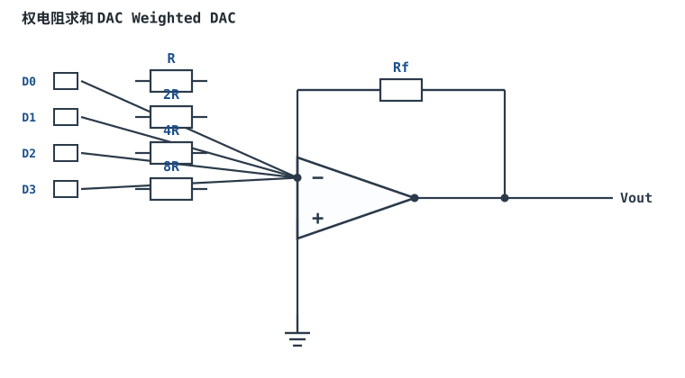
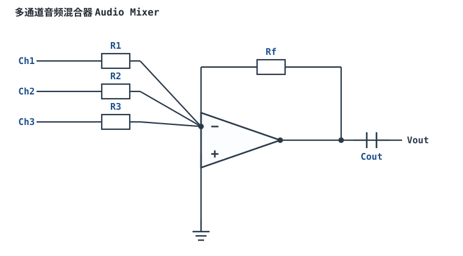

# 加法、减法运算电路 Summing & Difference Amplifier

## 1. 设计动机

::: motivation 为什么需要这个电路
在反相放大器的反相端（虚地节点）多接几路输入，每路电流在虚地相加，输出就是各路输入的加权和——这就是**加法器（Summing Amplifier）**。它是音频混音、D/A 权电流、电平叠加的基础。把一路放到同相端，就成了**减法器**。
:::

## 2. 原理图


## 3. 静态分析（DC）

反相端是虚地（≈0V），各路输入电流独立流入节点：$I_k=V_k/R_k$。由虚断，这些电流全部流过 Rf：

$$V_{out}=-R_f\left(\frac{V_1}{R_1}+\frac{V_2}{R_2}+\frac{V_3}{R_3}\right)$$

若取 $R_1=R_2=R_3=R$，则 $V_{out}=-(R_f/R)(V_1+V_2+V_3)$，即反相加法。

## 4. 动态分析（AC / 瞬态）

各路增益由各自 $R_f/R_k$ 独立设定，互不影响（因为虚地隔离）。下面是三路等权相加（Rf=R）：

```echarts
{
  "tooltip": {"trigger": "axis"},
  "legend": {"data": ["V1", "V2", "V3", "Vout=−(V1+V2+V3)"], "bottom": 0, "textStyle": {"fontSize": 11}},
  "grid": {"left": 56, "right": 24, "top": 26, "bottom": 58},
  "xAxis": {"type": "category", "data": ["t0","t1","t2","t3","t4","t5"], "axisLabel": {"fontSize": 11}},
  "yAxis": {"type": "value", "name": "电压 V", "min": -4, "max": 4, "interval": 2, "axisLabel": {"fontSize": 11}},
  "series": [
    {"name": "V1", "type": "bar", "itemStyle": {"color": "#1a4f8b"}, "data": [1,1,1,1,1,1]},
    {"name": "V2", "type": "bar", "itemStyle": {"color": "#7a5fc0"}, "data": [0.5,0.5,0.5,0.5,0.5,0.5]},
    {"name": "V3", "type": "bar", "itemStyle": {"color": "#4f9e63"}, "data": [0.5,0.5,0.5,0.5,0.5,0.5]},
    {"name": "Vout=−(V1+V2+V3)", "type": "line", "smooth": true, "lineStyle": {"width": 2.6, "color": "#b5642e"}, "data": [-2,-2,-2,-2,-2,-2]}
  ]
}
```

## 5. 环路分析

与反相放大器相同，是电压并联负反馈；噪声增益 $G_n=1+R_f/R_{eq}$（$R_{eq}$ 为各路输入电阻并联）。纯电阻反馈稳定。

::: advanced 进阶：减法器
把一路输入放到同相端、其余在反相端，即加减混合。当 $R_1=R_2$、$R_f=R_g$ 时，$V_{out}=(R_f/R_1)(V_2-V_1)$，就是 [差分放大器](differential-amplifier.md)。加法器的关键是虚地让各路互不干扰。
:::

## 6. 元件取值与工程权衡

- **各路电阻独立定权重**：$R_k=R_f/|G_k|$，权重越大 $R_k$ 越小。
- **输入阻抗**：每路输入阻抗等于该路 $R_k$，低阻抗信号源才适合反相加法。
- **Rf 取值**：同反相放大器，kΩ~百 kΩ 甜点区，避免偏置电流与噪声问题。

## 7. 完整设计示例

::: example 两路加权求和
1. **需求**：$V_{out}=-(2V_1+0.5V_2)$。
2. **选 Rf=100kΩ**。
3. **R₁=Rf/2=50kΩ**（增益 2）；**R₂=Rf/0.5=200kΩ**（增益 0.5）。
4. **验算**：$V_1=0.5V,V_2=1V\Rightarrow V_{out}=-(2\times0.5+0.5\times1)=-1.5V$。
:::

## 8. 仿真与实验

LTspice 双电源，两路直流输入接加法器，用万用表读输出验证加权和；加一路交流，观察各路是否独立叠加。

## 扩展与变种电路

### 扩展1：同相求和电路 Non-inverting Summing

多路信号在同相端节点电阻相加，再由同相放大器放大，输入阻抗高、各路不被虚地拉低。


::: example 工作原理与静态分析
- 同相端节点由 KCL：$V_+\approx \sum V_k/R_k \;/\; \sum 1/R_k$，再经同相增益 $1+R_f/R_1$。
- 输入阻抗高，但各路权重耦合在一起（不像反相虚地那样独立）。
- 关键：求和节点电流小，偏置电流要小。
:::

取值数量级：R=10k~100k；与反相加法对比：输入阻抗高但各路不独立。适用：高阻信号相加；不适用：需要独立权重的多通道混合。

::: pitfall 各路权重互相牵连
- **现象**：调一路电阻影响其他路输出。
- **原因**：同相求和节点各支路共用，不满足虚地隔离。
- **解决**：需要独立权重时改用反相加法（虚地各路独立）。
:::

### 扩展2：权电阻求和 DAC Weighted DAC

数字各位经开关接入阻值按二进制加权的电阻，在反相端求和，把数字量转成模拟电压。



::: example 工作原理与静态分析
- 第 k 位权重 $1/R_k=1/(2^k R)$，输出 $V_{out}=-R_f\sum_k D_k/R_k$，$D_k\in\{0,1\}$。
- 位数越多最大电阻越大（8 位达 128R），精度受电阻比值精度限制。
- 关键：电阻匹配决定 DAC 单调性与精度。
:::

取值数量级：R=10k、8 位最大 1.28M；与 R-2R 梯形网络对比：权电阻简单但阻值范围大。适用：简易 DAC、电平发生；不适用：高精度多位（用 R-2R 或集成 DAC）。

::: pitfall 高位电阻过大导致精度与速度问题
- **现象**：位数一多，精度下降、建立变慢。
- **原因**：最大权电阻 MΩ 级，偏置电流与寄生电容影响大。
- **解决**：改用 R-2R 梯形网络（阻值只有 R 与 2R），或选集成 DAC。
:::

### 扩展3：注入直流做电平搬移 DC-Offset Injection

在反相加法器多注入一路固定直流 Voff，输出叠加一个可调直流偏置，实现电平搬移。


::: example 工作原理与静态分析
- $V_{out}=-R_f(V_{in}/R_1+V_{off}/R_{off})$，第二项就是叠加的直流偏置。
- 调整 $R_{off}$ 或 $V_{off}$ 可平移输出静态电平，适配单电源/ADC 范围。
- 关键：Voff 要用稳定基准，否则偏置随电源漂。
:::

取值数量级：Roff 按期望偏置量计算；与"输出加直流"对比：在求和节点精确叠加。适用：单电源电平搬移、失调校准；不适用：纯交流不要直流的场合。

::: pitfall 偏置随电源电压漂移
- **现象**：输出静态电平随供电波动。
- **原因**：Voff 直接取自电源而非基准。
- **解决**：Voff 接带隙基准或精密分压，加去耦。
:::

### 扩展4：多通道音频混合器 Audio Mixer

多路音频经各自电位器/电阻汇入反相加法器，混合成一路，输出经隔直电容送后级。



::: example 工作原理与静态分析
- 各路 $V_k/R_k$ 在虚地相加：$V_{out}=-R_f\sum V_k/R_k$，各路权重由 $R_k$ 独立设定。
- 虚地隔离使各路几乎不串扰；Cout 隔直，单电源时同相端偏置 Vcc/2。
- 关键：各路输入电阻不宜过小以免信号源过载。
:::

取值数量级：Rk=10k~100k、Cout=10µF；与普通反相加法对比：加隔直与偏置适配音频。适用：多路音频混音；不适用：直流/超慢信号。

::: pitfall 某路输入电阻太小拉低信号
- **现象**：某一路接进来后信号明显变小。
- **原因**：该路 Rk 太小，高阻信号源被分压。
- **解决**：各路 Rk 取 kΩ~百 kΩ，高阻源前加缓冲。
:::

## 9. 常见坑

::: pitfall 常见坑
- **多路输入却用单电源**：反相加法输出为负，单电源被削。交流加法需双电源或加偏置。
- **某路输入电阻取得过小**：该路信号源要提供较大电流，高内阻信号源驱动不了，权重失准。
:::

## 10. 自测题

<details><summary>R₁=R₂=10kΩ，Rf=100kΩ，V₁=1V、V₂=0.5V，Vout 是多少？</summary>

$V_{out}=-R_f(V_1/R_1+V_2/R_2)=-100(1/10+0.5/10)=-100\times0.15=$ **−1.5V**。

</details>

<details><summary>为什么反相加法各路输入之间几乎不互相影响？</summary>

反相端是虚地（≈0V），各路电流 $V_k/R_k$ 只由本路电压和电阻决定，节点电位固定为 0，因此各路独立、互不串扰。

</details>

## 11. 参考资料

- Op Amps for Everyone（TI, SLOD006B），加法器/减法器章节
