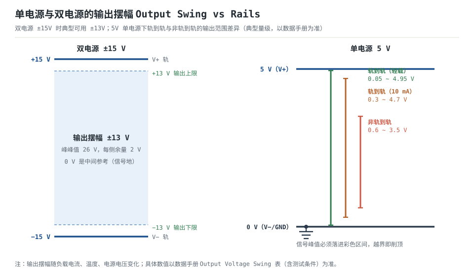
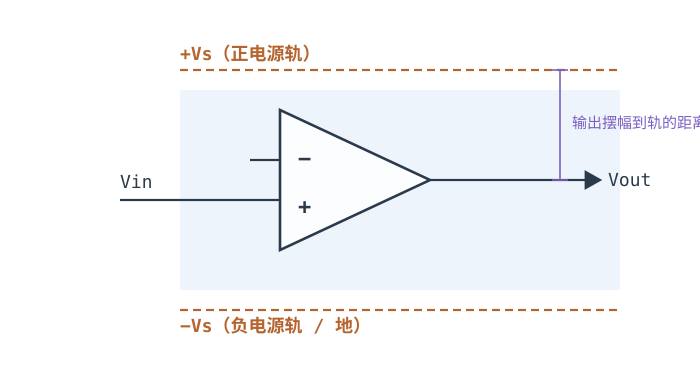
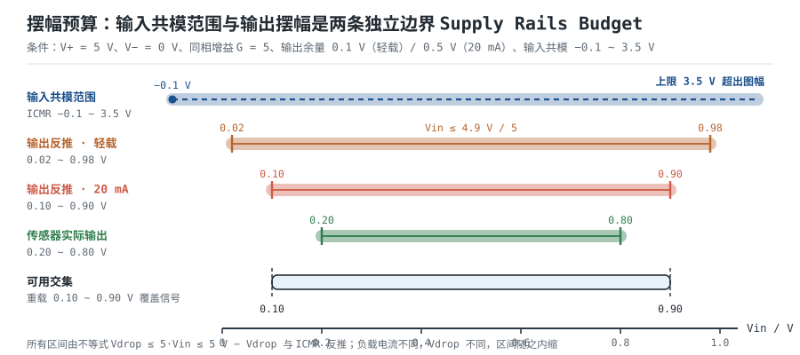
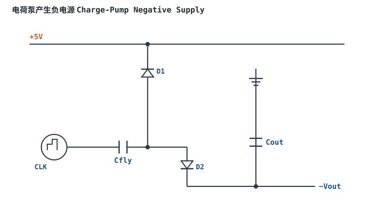

# 供电轨、输出摆幅与 Rail-to-Rail Supply Rails & Output Swing

运放被画成一个三角形，符号上通常不出现电源脚，但真实器件的输出被夹在两条供电轨之间，输入级还被一条与输出无关的**共模范围**夹住。很多"电路没错、器件也没坏"的故障，最后都落在同一个问题上：信号能不能完整地穿过这两条边界。

本章要回答的不是"这个运放能不能通电工作"，而是两个可以用不等式写出来的问题：

1. **输出侧**：在给定负载电流、温度和电源容差下，输出摆幅能否覆盖"信号 + 偏置"？
2. **输入侧**：信号的共模电平（连同信号本身）是否落在输入共模范围内？

外加一个被严重滥用的词：**轨到轨（Rail-to-Rail）**。它不是一个指标，而是三个互相独立的含义（RRI、RRO、RR），绝大多数器件只做到其中之一。

**本章约定**：$A_{OL}$ 是开环电压增益，$A_{CL}$ 或 $G$ 是闭环增益，$\beta$ 是反馈系数（**不是**三极管的电流放大倍数），$T=A_{OL}\beta$ 是环路增益，噪声增益为 $1/\beta$，$V_{OS}$ 是输入失调电压，$I_B$、$I_{OS}$ 是输入偏置电流与失调电流，CMRR、PSRR 分别用 $20\lg$ 换算 dB（电压比）。这些符号在[运放概述：符号、封装与引脚](opamp-overview.md)里已经约定，本篇各章保持一致。

## 1. 设计动机

::: motivation 三个真实场景
**场景一：5V 单电源、增益 5、非轨到轨输出，削顶削掉 16.7% 的信号。** 传感器输出 0.20~0.80V，想放大 5 倍得到 1.00~4.00V。器件输出上限离正轨 1.5V，也就是最高 3.5V。输入超过 $3.5/5=0.70$ V 的部分全部被削平：0.70~0.80V 这 0.10V 的真信号直接丢失，占输入范围 $0.10/(0.80-0.20)=16.7\%$。更糟的是削顶不是"少了 0.5V"，而是产生了三次谐波——波形从正弦变成了带平顶的怪东西。

**场景二：买了"轨到轨"，却在共模 0.5V 时锁死。** 器件标着 Rail-to-Rail，实际只是 RRO（输出到轨），输入共模范围是 −0.1~3.5V。换到另一块板上，信号共模被分压电阻抬到 3.7V，超过 3.5V 上限，输入级截止，输出直接贴到一条轨上不动了。示波器上看起来像"运放坏了"，其实是共模越界。**"轨到轨"三个字里没有说明是输入还是输出**，这是选型事故的高发区。

**场景三：20mA 负载把摆幅吃掉 0.4V。** 同一颗 RRO 器件，轻载时输出离轨 0.1V（可用 0.1~4.9V），带 20mA 时离轨变成 0.5V（可用 0.5~4.5V）。0.4V 对 5V、12 位 ADC 意味着 $0.4/(5/4096)=328$ 个 LSB 的满量程被浪费——后级 ADC 的码值永远用不满。
:::

| 你想确认 | 先算/先查 | 判据（工程经验值） |
|---|---|---|
| 输出会不会削顶 | 输出摆幅与信号范围 | 峰值离轨 ≥0.1V（RRO 轻载）、≥0.5V（重载或非 RRO） |
| 输入共模够不够 | $V_{cm}$ 与 ICMR | 信号共模连同峰值落在 ICMR 内，两端各留 0.1~0.2V |
| 交流信号要不要偏置 | 单电源还是双电源 | 单电源且信号含负值 → 必须偏置 |
| 偏置点取在哪 | 摆幅中点还是 $V_{CC}/2$ | 非对称摆幅时取摆幅中点，可多拿 30%~45% 峰值 |
| 换低电源后还能不能用 | 按最低 $V_{CC}$ 重算 | 电源容差 −5%、电池末端电压 |
| "轨到轨"到底哪一轨 | 查 RRI / RRO 两张表 | 输入、输出分别核对，不看宣传语 |

**不做摆幅预算会摔在哪**，四个带数字的代价：

1. **削顶变成谐波。** 5V 单电源、非轨到轨（可用 0.6~3.5V）、信号 $2.0\text{V}\pm1.6\text{V}$（峰值 3.6V）：顶部被削掉 0.1V，输出从正弦变成平顶波，基波幅度下降、三次谐波抬升——这不是"幅度小了 3%"，是信噪比直接崩掉。
2. **满量程用不满。** 12 位、5V 量程的 1 LSB 是 $5/4096=1.22$ mV。输出上限从 4.9V 掉到 4.5V，等于丢掉 $0.4/(1.22\times10^{-3})=328$ 个码，可用码数从 4096 降到 3768，等效位数从 12 位掉到 $\lg_2 3768=11.88$ 位。
3. **输入共模越界会让输出反相。** 共模低于 ICMR 下限时，输入差分对截止，反馈环路瞬间失效；有些器件会出现**相位反转（phase reversal）**：输入继续往下走，输出反而往正轨跑。此时任何"虚短"分析全部作废。
4. **单电源不加偏置，负半周消失。** 5V 单电源、增益 10、输入是以 0V 为中心的 $\pm0.1\text{V}$ 交流：输出需要 $-1.0\sim+1.0\text{V}$，但输出下限只有 0.1V，负半周整个被削掉，只剩正半周——波形上是"半波整流"。

## 2. 定义与直观

### 2.1 单电源与双电源：差别不在"能不能通电"

运放内部没有"地"这个端子，只有正、负两个电源脚 $V_+$、$V_-$。所谓单电源/双电源，描述的是**外部怎么给这两个脚供电**，以及**信号以谁为参考**：

- **双电源**：例如 $V_+=+15$ V、$V_-=-15$ V，0V 是中间参考。输出可以往正、往负两个方向摆，典型可用 $\pm13$ V（每侧离轨约 2V，以数据手册 Output Voltage Swing 表为准）。信号可以天然以 0V 为中心。
- **单电源**：例如 $V_+=+5$ V、$V_-=0$ V。输出只能在 0~5V 之间摆，**不可能为负**。任何含负值的交流信号都必须先"抬"到一个直流偏置上。

所以"单电源能不能用"这个问题，问法本身是错的。正确的问法是两个不等式能不能同时成立：

$$V_{EE}+V_{drop-}\le V_{OUT}\le V_{CC}-V_{drop+}$$

$$V_{ICMR-}\le V_{cm}\le V_{ICMR+}$$

其中 $V_{drop+}$、$V_{drop-}$ 是输出级离正、负轨的最小压差（V），随负载电流、温度、电源电压变化；$V_{ICMR-}$、$V_{ICMR+}$ 是输入共模范围的下、上限（V）；$V_{cm}=(V_++V_-)/2$ 是两个输入端共同的对地电平（V）。**这两条不等式互不相干**：一颗器件可以输出摆到离轨 50mV，而输入共模只允许到 $V_+-1.5$ V。把它们当成一个"轨到轨"来记，就是场景二的来源。

| 项目 | 双电源 ±15V | 单电源 5V |
|---|---|---|
| 信号参考点 | 0V（地） | 偏置点，典型 2.5V 或摆幅中点 |
| 输出可用范围 | 典型 ±13V | 0.1~4.9V（RRO 轻载）|
| 交流信号 | 可直接以 0 为中心 | 必须叠加直流偏置，或加隔直电容 |
| 输入共模 | 可跨 0V | 受 ICMR 限制，低端常到不了 0V |
| 典型失效 | 电源不对称导致削顶 | 负半周消失、共模越界锁死 |

### 2.2 "轨到轨"是三个独立含义

工程上把"轨到轨"当形容词用，但它在数据手册里对应三张不同的表、三种不同的失效方式：

| 缩写 | 全称 | 约束的是什么 | 查哪张表 | 典型代价 |
|---|---|---|---|---|
| RRI | Rail-to-Rail Input | 输入共模范围能接近两条轨 | Input Common-Mode Voltage Range | 两套差分对拼接，交越点 $V_{OS}$ 跳变、失真抬升 |
| RRO | Rail-to-Rail Output | 输出摆幅能接近两条轨 | Output Voltage Swing（必带负载条件） | 大电流下摆幅收缩，离轨几十 mV 变几百 mV |
| RR / RRIO | Rail-to-Rail Input and Output | 两者都到轨 | 上述两张表都要查 | 两套代价叠加，成本与噪声更高 |

**RRI 的真实含义是"共模范围覆盖到轨"，不是"输入信号可以任意大"。** 常见器件分三类：只能到负轨（input to $V_-$）、只能到正轨、以及两轨都到。5V 单电源下接 0.1V 附近的传感器信号，只有"到负轨"这一类才够用；标着 RRO 的器件可能输入下限就是 1.5V，信号一旦低于 1.5V 输入级就截止。

RRI 的代价要单独说：为了覆盖整个共模范围，输入级通常用**两套极性不同的差分对拼接**（NPN 对管负责高共模、PNP 对管负责低共模，或 NMOS/PMOS 互补对）。在共模电压跨过拼接点的区域，两套对管交接，会出现：

- **$V_{OS}$ 跳变**：典型几十 µV 到几 mV 量级（以数据手册的 $V_{OS}$ vs $V_{cm}$ 曲线为准），对 µV 级精密测量是致命的；
- **失真抬升**：交越点附近两套对管的增益、带宽不一致，THD 明显变大；
- **$I_B$ 随共模变化**：两套对管的偏置电流不同，高阻源上会看到随共模变化的直流误差。

所以高精度、低失真场合反而要**避开**交越区，让共模稳稳落在某一套对管的工作范围内——这时"轨到轨输入"不是优点，是可以不用的功能。

### 2.3 输出级为什么到不了轨

输出级是一对推挽管（NPN/PNP 或 NMOS/PMOS）。要让上管把输出拉到 $V_+$，它的基极/栅极必须比输出再高出一个驱动电压；这个电压由内部电路从 $V_+$ 取，取不到就只能停在下面。同理下管也留着一段 $V_{CE(sat)}$ 或 $R_{DS(on)}I_{OUT}$。

于是"离轨多少"由三件事决定：

$$V_{drop}=V_{drive,min}+R_{out,OL}I_{OUT}$$

其中 $V_{drive,min}$ 是维持管子导通所需的最小压差（V），$R_{out,OL}$ 是开环输出电阻（$\Omega$），$I_{OUT}$ 是输出电流（A）。这个式子只是量级模型，真实值必须查曲线，但它解释了两件事：**为什么非轨到轨器件离轨 1~2V**（$V_{drive,min}$ 大），**为什么重载时摆幅会掉**（$R_{out,OL}I_{OUT}$ 项变大）。

数量级（典型值，以数据手册为准）：

| 输出级 | 轻载（≤1mA）离轨 | 20mA 离轨 | 说明 |
|---|---|---|---|
| 传统双极推挽 | 1~2V | 更大，且受 $V_{CE(sat)}$ 限制 | 741、LM358 一类 |
| CMOS 轨到轨输出 | 20~100mV | 0.3~0.5V | 离轨与 $I_{OUT}$ 近似成正比 |
| 双极轨到轨输出 | 100~300mV | 0.5~0.8V | 达林顿/互补输出，压降更大 |

## 3. 定量关系

### 3.1 输出侧：摆幅预算的唯一依据

$$V_{OUT,min}=V_{EE}+V_{drop-}(I_{OUT},T),\qquad V_{OUT,max}=V_{CC}-V_{drop+}(I_{OUT},T)$$

符号与单位：$V_{CC}$、$V_{EE}$ 是正、负电源电压（V，单电源时 $V_{EE}=0$）；$V_{drop+}$、$V_{drop-}$ 是输出级离正、负轨的最小压差（V）；$I_{OUT}$ 是输出电流（A）；$T$ 是结温（°C）。**这个式子的关键在于括号里的两个自变量**：$V_{drop}$ 不是常数，它是负载电流和温度的函数，数据手册给的永远是某一个测试条件下的值。

对同相放大 $V_{OUT}=G\,V_{IN}$，把上式反解就得到"输出侧允许的输入范围"：

$$V_{IN,min}=\frac{V_{EE}+V_{drop-}}{G},\qquad V_{IN,max}=\frac{V_{CC}-V_{drop+}}{G}$$

### 3.2 输入侧：共模范围与拓扑有关

输入共模电压定义为两个输入端对地电压的平均值：

$$V_{cm}=\frac{V_+ + V_-}{2}$$

不同拓扑下 $V_{cm}$ 的来源完全不同，这是最容易被忽略的一点：

- **同相放大**：$V_+\approx V_{IN}$，虚短让 $V_-\approx V_{IN}$，所以 $V_{cm}\approx V_{IN}$。**信号本身的对地电平就是共模电平。**
- **反相放大**：$V_-\approx 0$（虚地），$V_+=0$（同相端接地），所以 $V_{cm}\approx 0$。信号再大也不改变共模——这是反相组态在单电源下处理接近 0V 信号的优势。
- **差分放大**：$V_{cm}$ 是两根输入线的平均电平，通常由前级或传感器决定，设计者只能"接受"或"搬移"。

### 3.3 单电源偏置点：取摆幅中点，不是 $V_{CC}/2$

单电源放大交流信号时，输出静态点必须选在可用摆幅的中间，才能让正、负半周同时最大化：

$$V_{bias}=\frac{V_{OUT,max}+V_{OUT,min}}{2},\qquad V_{pk}=\frac{V_{OUT,max}-V_{OUT,min}}{2}$$

符号与单位：$V_{bias}$ 是输出静态点（V）；$V_{pk}$ 是允许的最大输出峰值（V）。代入 5V、RRO 轻载（0.1~4.9V）：

$$V_{bias}=\frac{4.9+0.1}{2}=2.50\ \text{V},\qquad V_{pk}=\frac{4.9-0.1}{2}=2.40\ \text{V}$$

如果器件是非轨到轨（0.6~3.5V），摆幅中点不是 2.5V 而是

$$V_{bias}=\frac{3.5+0.6}{2}=2.05\ \text{V},\qquad V_{pk}=\frac{3.5-0.6}{2}=1.45\ \text{V}$$

若仍按习惯把偏置放在 $V_{CC}/2=2.5$ V，可用峰值只有 $\min(3.5-2.5,\ 2.5-0.6)=1.00$ V，比 1.45V 少 $1-1.00/1.45=31\%$。**"偏置到 $V_{CC}/2$"只是对称摆幅下的特例，不是定律。**

### 3.4 摆幅随负载电流收缩：只能查曲线

$V_{drop}$ 与 $I_{OUT}$ 的关系没有通用解析式，工程做法是**读 Output Voltage Swing vs Output Current 曲线**。典型形状（以数据手册为准）：

| $I_{OUT}$ | 0.1mA | 1mA | 5mA | 10mA | 20mA | 50mA |
|---|---|---|---|---|---|---|
| $V_{drop}$（CMOS RRO，典型） | 0.06V | 0.10V | 0.20V | 0.32V | 0.50V | 0.85V |

这张表说明两件事：① 电流从 1mA 到 20mA，离轨从 0.10V 涨到 0.50V，**摆幅损失扩大 5 倍**；② 想保住摆幅，就得把负载电流压下去——后级加缓冲器/跟随器，或把负载电阻从 225Ω 提到 kΩ 级。

### 3.5 电源容差与温度：用最坏值算

设计不能按标称 5V 算，要按"最低电源 + 最高温度 + 最大负载"三件事同时发生：

$$V_{CC,min}=V_{CC,nom}(1-\delta_{tol})-V_{ripple,pk}$$

其中 $\delta_{tol}$ 是电源容差（如 ±5% → 0.05），$V_{ripple,pk}$ 是电源纹波峰值（V）。5V ±5% → $5\times0.95=4.75$ V；再叠加 50mV 纹波峰值，实际可用 4.70V。温度的影响则体现在 $V_{drop}$ 上：多数器件高温时离轨略增（以曲线为准），按数据手册的高温端取值。

### 3.6 越界后的两种失效：削顶与相位反转

- **输出越界 → 削顶（clipping）**：输出撞到 $V_{OUT,max}$ 或 $V_{OUT,min}$ 后不再跟随输入，波形出现平顶。后果是谐波失真，而不是简单的幅度误差。判断依据：**输入继续变、输出不变**。
- **输入共模越界 → 输入级截止/相位反转**：$V_{cm}$ 超出 ICMR 后差分对失去工作点，反馈环路断开。轻则增益塌陷、失真暴涨，重则输出跳到相反的轨（相位反转）。判断依据：**输出方向与输入相反**，且此时"虚短"完全不成立。

**这两种失效的排查顺序不能倒**：先量输入共模（用高阻探头量两个输入端的对地电压，取平均），再量输出峰值与轨的距离。先怀疑输出、后怀疑输入，会绕远路。

## 4. 典型计算

### 4.1 完整算例：5V 单电源、G=5，可用输入范围到底是多少

**需求**：某运放用 5V 单电源，输出摆幅离轨 0.1V（轻载）/ 0.5V（带 20mA 负载）；输入共模范围 −0.1~3.5V。设计一个 $G=5$ 的同相放大，信号为 0.20~0.80V。求可用输入范围、最坏情况余量，以及是否需要偏置/虚地。

**第 1 步：输出侧边界。** 轻载时 $V_{drop+}=V_{drop-}=0.1$ V：

$$V_{OUT}\in[0.1,\ 4.9]\ \text{V}$$

重载（20mA）时 $V_{drop+}=V_{drop-}=0.5$ V：

$$V_{OUT}\in[0.5,\ 4.5]\ \text{V}$$

**第 2 步：反解到输入侧。** 同相放大 $V_{OUT}=5V_{IN}$，于是

$$V_{IN,min}=\frac{0.1}{5}=0.02\ \text{V},\qquad V_{IN,max}=\frac{4.9}{5}=0.98\ \text{V}\quad(\text{轻载})$$

$$V_{IN,min}=\frac{0.5}{5}=0.10\ \text{V},\qquad V_{IN,max}=\frac{4.5}{5}=0.90\ \text{V}\quad(\text{重载})$$

**第 3 步：输入共模边界。** 同相放大时 $V_{cm}\approx V_{IN}$，ICMR 是 −0.1~3.5V，比输出侧反推的 0.02~0.98V 宽得多。所以**本例的瓶颈是输出摆幅，不是共模范围**：

$$V_{IN}\in[\max(0.02,-0.1),\ \min(0.98,3.5)]=[0.02,\ 0.98]\ \text{V}$$

**第 4 步：信号余量。** 信号 0.20~0.80V，在轻载下：

$$0.20-0.02=0.18\ \text{V},\qquad 0.98-0.80=0.18\ \text{V}$$

两端余量都是 0.18V，可以工作。重载 20mA 下：

$$0.20-0.10=0.10\ \text{V},\qquad 0.90-0.80=0.10\ \text{V}$$

两端各剩 0.10V，仍然通过，但已经没有余量留给电源容差。

**第 5 步：电源 −5% 的最坏情况。** $V_{CC}=5\times0.95=4.75$ V，轻载上限 $4.75-0.1=4.65$ V、下限 0.1V：

$$V_{IN}\in\left[\frac{0.1}{5},\ \frac{4.65}{5}\right]=[0.02,\ 0.93]\ \text{V}$$

信号高端余量 $0.93-0.80=0.13$ V。重载（20mA）时上限 $4.75-0.5=4.25$ V、下限 0.5V：

$$V_{IN}\in\left[\frac{0.5}{5},\ \frac{4.25}{5}\right]=[0.10,\ 0.85]\ \text{V}$$

高端余量只剩 $0.85-0.80=0.05$ V。**这就是"标称能过、量产不过"的典型现场**：标称余量 0.10V，电源掉 5% 后只剩 0.05V，再叠加温度或器件分散就会削顶。

**第 6 步：要不要偏置/虚地？** 本例**不需要**，理由有三条，按顺序检查：

1. 信号共模 0.20~0.80V 落在 ICMR（−0.1~3.5V）内；
2. 输出 1.00~4.00V 落在 0.1~4.9V（轻载）与 0.5~4.5V（重载）内；
3. 信号本身是单极性的（0.20~0.80V，不含负值），不违反"输出不能为负"。

**第 7 步：什么情况下必须加虚地？** 把信号换成以 0V 为中心的交流 $\pm0.30$ V（同一传感器加了隔直电容）。此时输出需要 $-1.5\sim+1.5$ V，单电源做不到，必须把输入偏置到 $V_{bias}$ 上。约束是：

$$V_{OUT,min}=5(V_{bias}-0.30)\ge0.1\ \Rightarrow\ V_{bias}\ge\frac{0.1}{5}+0.30=0.32\ \text{V}$$

$$V_{OUT,max}=5(V_{bias}+0.30)\le4.9\ \Rightarrow\ V_{bias}\le\frac{4.9}{5}-0.30=0.68\ \text{V}$$

偏置窗口 0.32~0.68V，取中点 0.50V 即可，此时输出 $1.0\sim4.0$ V，两端各剩 0.9V。**注意信号共模此时变成 $0.5\pm0.3=0.2\sim0.8$ V，仍落在 ICMR 内**——偏置同时解决了输出侧和输入侧两个问题。

### 4.2 算例二：把偏置点从 $V_{CC}/2$ 挪到摆幅中点，多拿 45% 峰值

**已知**：5V 单电源、非轨到轨输出 0.6~3.5V，要求输出以某直流为中心的正弦尽量大。两类偏置点对比：

**方案 A：偏置取 $V_{CC}/2=2.5$ V。**

$$V_{pk,A}=\min(3.5-2.5,\ 2.5-0.6)=1.00\ \text{V}$$

**方案 B：偏置取摆幅中点 $2.05$ V。**

$$V_{pk,B}=\min(3.5-2.05,\ 2.05-0.6)=1.45\ \text{V}$$

**峰值提升**：

$$\frac{1.45-1.00}{1.00}=45\%$$

峰峰值从 2.00V 提到 2.90V。**代价是**：输出静态点不再是 2.5V，后级 ADC 或下一级的共模要跟着改；如果后级是固定的 2.5V 共模 ADC 缓冲，这个方案就要重新分配电平。所以"摆幅中点"是电气上最优，工程上要连带改后级。

### 4.3 算例三：重载、负载电阻与丢掉的 LSB

**已知**：5V 单电源 RRO 器件，输出 4.5V 时驱动 20mA 负载。求负载电阻、片内功耗、摆幅损失折合的 LSB。

**第 1 步：负载电阻。**

$$R_L=\frac{V_{OUT}}{I_{OUT}}=\frac{4.5}{0.02}=225\ \Omega$$

**第 2 步：输出级功耗。**

$$P=(V_{CC}-V_{OUT})I_{OUT}=(5-4.5)\times0.02=0.01\ \text{W}=10\ \text{mW}$$

10mW 对小封装不算大，但已经足以让结温上升几度；如果换成 50mA、输出 1V：$P=(5-1)\times0.05=0.2$ W，SOT-23-5 封装必须核对热阻。

**第 3 步：摆幅损失的 LSB 数。** 轻载上限 4.9V，重载上限 4.5V，损失 0.4V：

$$N_{LSB}=\frac{0.4}{5/4096}=\frac{0.4}{1.2207\times10^{-3}}=327.7\approx328$$

12 位 ADC 共有 4096 个码，丢 328 个码相当于损失 $328/4096=8.0\%$ 的满量程，等效位数降到 $12-\lg_2(4096/3768)=12-0.12=11.88$ 位（按可用码数 3768 计）。**这个损失比大多数运放的失调和噪声都大**，但在选型阶段几乎没人算。

### 4.4 算例四：增益定得太高，单电源就"没空间"

**已知**：同一条 0.20~0.80V 信号（共模 0.50V），希望尽量放大，但受 4.1 的边界约束。求最大可用增益。

**第 1 步：上限受输出高端限制。** 轻载 $V_{OUT,max}=4.9$ V，对应

$$G\le\frac{4.9}{0.80}=6.125$$

**第 2 步：下限受输出低端限制。** 轻载 $V_{OUT,min}=0.1$ V：

$$G\le\frac{0.1}{0.20}=0.5$$

这个式子说明"低端"根本不是限制——因为信号最低 0.20V，输出最低 $0.20G$，只要 $G\ge0.5$ 就高于 0.1V。**单极性信号在单电源里，瓶颈几乎总在高端。**

**第 3 步：重载与电源容差下的实际可取值。** 最坏情况（20mA、$V_{CC}=4.75$ V）$V_{OUT,max}=4.25$ V：

$$G\le\frac{4.25}{0.80}=5.31$$

取整到 $G=5$，输出 $1.00\sim4.00$ V，最坏情况下高端余量 $4.25-4.00=0.25$ V。**如果一开始按 $G=6$ 设计（标称 5V、轻载能过），量产就会在低温+满载+电源偏低时削顶。**

## 5. 工程含义

### 5.1 数量级表：先建立直觉，再查手册

| 供电 | 输出级 | 可用输出范围 | 每侧余量 | 典型场景 |
|---|---|---|---|---|
| ±15V | 非轨到轨 | ±13V | 约 2V | 传统双电源模拟电路、大信号 |
| ±2.5V | RRO | ±2.4V | 约 0.1V | 单电源系统的双极性前端 |
| +5V | 非轨到轨 | 0.6~3.5V | 0.6V / 1.5V | 老式单电源电路，信号居中 |
| +5V | RRO（轻载） | 0.1~4.9V | 约 0.1V | 电池供电、ADC 前级 |
| +5V | RRO（20mA） | 0.5~4.5V | 0.5V | 带负载输出，必须按曲线核 |
| +3.3V | RRO（轻载） | 0.05~3.25V | 约 0.05V | 低电压系统，余量最紧张 |

所有数字都是**典型量级**，以数据手册的 Output Voltage Swing 表为准。表的作用是让你在画原理图之前就知道"大概还剩多少"，而不是替代手册。

### 5.2 摆幅预算五步法

1. **定信号**：最小/最大输入、共模电平、是单极性还是双极性、最高频率。
2. **定增益**：用输出范围反解 $G_{max}$，取整并留 10%~20% 余量（见 §4.4）。
3. **定负载**：后级输入阻抗、负载电流，查对应电流下的 $V_{drop}$ 曲线。
4. **取最坏电源**：容差 + 纹波 + 电池末端电压，得到 $V_{CC,min}$。
5. **反算余量**：输出峰值与 $V_{OUT,max}$/$V_{OUT,min}$ 的距离，两端都要 ≥0.1V（RRO）或 ≥0.3V（非 RRO）；不满足就降增益、抬偏置、加缓冲或换器件。

### 5.3 单电源落地的四个选择

- **虚地（virtual ground）怎么产生**：两只等值电阻分压到 $V_{CC}/2$，再经一只运放跟随器缓冲。分压电阻取 kΩ 量级（太小费电、太大引入噪声与偏置电流误差），缓冲器保证虚地的交流阻抗足够低。也可以用专用的虚地发生器（如 TLE2426 一类，以数据手册为准），代价是成本与供货。
- **偏置点取在哪**：对称摆幅取 $V_{CC}/2$；非对称摆幅取 §3.3 的摆幅中点。
- **交流耦合还是直流耦合**：交流耦合（隔直电容）能切断直流电平传递，但引入高通极点 $f_p=1/(2\pi R C)$；直流耦合没有极点，但要求前后级共模匹配。
- **输出要不要缓冲**：负载电流越大，$V_{drop}$ 越大。在运放与重负载之间加一级跟随器，可以把"重载摆幅"换成"轻载摆幅"。

### 5.4 负电源从哪来：电荷泵

双电源电路搬到单电源板上，最直接的办法是**造一路负电源**。电荷泵（charge pump）用开关电容把正轨"翻转"：

- φ1 期间 $C_{fly}$ 并联在 $V_s$ 与地之间充电，稳态充到约 $V_s$；
- φ2 期间 $C_{fly}$ 被翻转串入输出回路，与 $C_{out}$ 叠加，理想输出 $-V_s$；
- 带载后受二极管正向压降与开关电阻影响，二极管整流型输出约

$$V_{out}\approx-(V_s-2V_D)$$

取 $V_s=5$ V、硅二极管 $V_D=0.7$ V：$V_{out}\approx-(5-1.4)=-3.6$ V。集成同步整流的电荷泵把 $2V_D$ 换成 MOS 压降，可以做到 $-4.8$ V 量级（以数据手册为准）。

取值数量级：$C_{fly}=1\ \mu$F、$C_{out}=10\ \mu$F；输出电流 mA 级；纹波为开关频率的充电尖峰，几十~几百 mV。**这个纹波会直接进入运放电源脚**，能压到多少取决于 PSRR——见[共模范围、CMRR 与 PSRR](cmrr-psrr.md)。不适用：负载大于几十 mA、或要求低纹波的精密基准。

### 5.5 输入共模范围与失真

RRI 器件的交越区会带来可测量的失真。给一个量级算例：某 RRI 运放在共模跨过交越点时 $V_{OS}$ 跳变 200 µV；接成 $G=10$ 的同相放大，输出端对应一个

$$200\ \mu\text{V}\times10=2\ \text{mV}$$

的台阶。如果输出信号是 1V 峰值，这个台阶是 $2\ \text{mV}/1\ \text{V}=0.2\%$ 的突变——在音频或精密测量里完全可闻/可见。**处理办法不是"换更好的运放"，而是让共模别跨交越点**：把偏置点移开、或把信号限制在一套对管的范围内。

### 5.6 模型什么时候不够用

- **负载电流大**：$V_{drop}$ 随 $I_{OUT}$ 上升，必须查曲线，线性模型失效。
- **容性负载**：输出阻抗与负载电容形成附加极点，可能振铃或自激；摆幅问题会与稳定性问题混在一起。
- **温度极端**：$V_{drop}$、$V_{OS}$、$I_B$ 都随温度变，高温端余量最小。
- **电源纹波大**：纹波会瞬时把轨"拉低"，等效于 $V_{CC}$ 变小，摆幅随纹波一起抖。
- **接近轨工作**：输入或输出离轨只有几十 mV 时，$A_{OL}$、带宽、失真都会恶化，"能摆到"不等于"能线性放大"。

## 6. 常见坑

::: pitfall 常见坑
- **现象**：按标称 5V 算好余量，量产时高温、满载、电源偏低三者同时出现就削顶。**原因**：只按标称电源与轻载查摆幅，没有按 $V_{CC,min}$、$I_{OUT,max}$、$T_{max}$ 的最坏组合重算。**解决**：按 §5.2 五步法重算，用最低电源电压与数据手册高温端的 $V_{drop}$；余量不足就降增益或加缓冲。
- **现象**：换了"轨到轨"运放，输入信号接近 0V 时输出突然跳到正轨、不再跟随。**原因**：器件只是 RRO，输入共模下限是 1.5V；共模越界后输入级截止，甚至相位反转。**解决**：分别核对 Input Common-Mode Voltage Range 与 Output Voltage Swing 两张表；共模越界就改用 RRI 器件、抬共模或改反相组态（反相时 $V_{cm}\approx0$）。
- **现象**：轻载时输出能到 4.9V，接上 20mA 负载后最高只有 4.5V，ADC 满量程用不满。**原因**：摆幅是按轻载标的，$V_{drop}$ 随负载电流上升。**解决**：按实际负载电流查 Output Voltage Swing vs Output Current 曲线，或加一级缓冲把负载电流从运放身上拿走。
- **现象**：单电源电路输出"只有正半周"，负半周被削平。**原因**：交流信号没有偏置，输出负半周没有摆幅空间；或偏置加了但取 $V_{CC}/2$，非对称摆幅下仍不够。**解决**：把输出静态点偏置到摆幅中点（§3.3），输入加隔直电容，偏置电路见[单电源电路与电平偏置搬移](single-supply-biasing.md)。
- **现象**：偏置到 $V_{CC}/2$ 后，输出峰值比预期小很多，波形两端同时削顶。**原因**：非轨到轨输出上下余量不对称（0.6V 与 1.5V），中点不在 2.5V。**解决**：按 $(V_{OUT,max}+V_{OUT,min})/2$ 重算偏置点；或换 RRO 器件把两端余量拉平。
- **现象**：电池供电设备满电正常，电量低时失真。**原因**：电池电压从 4.2V 掉到 3.0V，可用摆幅按比例收缩，而偏置点仍按 4.2V 的一半（2.1V）设计，低电量时上半周没了空间。**解决**：按电池末端电压重算摆幅与偏置，或加升压/稳压；偏置点用摆幅中点而不是固定 $V_{CC}/2$。
:::

## 7. 自测题

5V 单电源、RRO 输出（离轨 0.1V）、输入共模 −0.1~3.5V、同相增益 5，信号 0.2~0.8V。可用输入范围是多少？瓶颈在输入侧还是输出侧？

输出侧边界 $[0.1,\ 4.9]$ V 反解到输入：

$$V_{IN}\in\left[\frac{0.1}{5},\ \frac{4.9}{5}\right]=[0.02,\ 0.98]\ \text{V}$$

输入共模约束是 $[-0.1,\ 3.5]$ V，比输出侧宽得多。取交集：

$$V_{IN}\in[\max(0.02,-0.1),\ \min(0.98,3.5)]=[0.02,\ 0.98]\ \text{V}$$

**瓶颈在输出摆幅。** 信号 0.2~0.8V 落在区间内，两端余量各 $0.98-0.80=0.18$ V 与 $0.20-0.02=0.18$ V。

同一颗器件（输出 0.6~3.5V），偏置在 $V_{CC}/2=2.5$ V 与偏置在摆幅中点，最大输出峰值各是多少？

偏置 2.5V：

$$V_{pk}=\min(3.5-2.5,\ 2.5-0.6)=1.00\ \text{V}$$

偏置在摆幅中点：

$$V_{bias}=\frac{3.5+0.6}{2}=2.05\ \text{V},\qquad V_{pk}=\min(3.5-2.05,\ 2.05-0.6)=1.45\ \text{V}$$

峰值提升 $(1.45-1.00)/1.00=45\%$。原因是上下余量不对称时，$V_{CC}/2$ 不是摆幅的中点。

RRO 器件在 20mA 负载下离轨 0.5V、轻载离轨 0.1V。5V 供电、12 位 ADC 下，这个差别相当于多少个 LSB？

1 LSB $=5/4096=1.2207$ mV。

轻载可用上限 $5-0.1=4.9$ V，重载 $5-0.5=4.5$ V，差 0.4V：

$$N=\frac{0.4}{1.2207\times10^{-3}}=327.7\approx328\ \text{个 LSB}$$

相当于损失 $328/4096=8.0\%$ 的满量程。**要保住满量程，要么降低负载电流，要么按重载曲线重新分配增益。**

为什么反相组态在单电源下更容易处理接近 0V 的信号？代价是什么？

反相组态的同相端接地、反相端是虚地，两个输入端的共模电压 $V_{cm}\approx0$，与信号幅度无关。所以只要器件允许 0V 共模（哪怕是"input to $V_-$"的器件），就能处理接近 0V 的信号，不需要把共模抬到 2.5V。

代价是**输入阻抗等于 $R_1$**（见[理想模型五假设与虚短、虚断](ideal-opamp.md)），单电源低电压下 $R_1$ 不能取太大，输入阻抗通常只有几 kΩ 到几十 kΩ；此外反相组态的噪声增益是 $1+R_f/R_1$，比信号增益大 1，带宽和噪声都要按噪声增益算。

"轨到轨"的三种含义分别约束什么？如果只核对了一张表会出什么问题？

RRI 约束输入共模范围（查 Input Common-Mode Voltage Range），RRO 约束输出摆幅（查 Output Voltage Swing，必带负载条件），RR/RRIO 两者都到轨。

只核对输出表，可能买到输入共模下限 1.5V 的器件，信号共模低于 1.5V 时输入级截止、输出反相或锁死；只核对输入表，可能买到输出离轨 1.5V 的器件，信号一大就削顶。**两张表、两个方向、还要带上负载与温度条件，缺一不可。**

5V 单电源、RRO 轻载（0.1~4.9V）、$G=5$，输入是以 0V 为中心的 $\pm0.30$ V 交流。需要偏置到多大范围？取什么值？

输出必须落在 0.1~4.9V：

$$5(V_{bias}-0.30)\ge0.1\ \Rightarrow\ V_{bias}\ge0.32\ \text{V}$$

$$5(V_{bias}+0.30)\le4.9\ \Rightarrow\ V_{bias}\le0.68\ \text{V}$$

偏置窗口 0.32~0.68V，取中点 $V_{bias}=0.50$ V，输出 $1.0\sim4.0$ V，两端余量各 0.9V。

此时输入共模是 $0.50\pm0.30=0.20\sim0.80$ V，同样落在 ICMR（−0.1~3.5V）内——**偏置同时满足了输出侧和输入侧两条边界**。如果信号幅度加大到 $\pm0.45$ V，窗口变成 $[0.47,\ 0.53]$ V，只剩 0.06V，这时应当把增益降到 4（$V_{OUT}=0.6\sim4.2$ V）。

## 8. 参考资料

- **Analog Devices, MT-035 *Op Amp Inputs, Outputs, Single-Supply & Rail-to-Rail Issues***：输入共模范围、输出摆幅与"轨到轨"的真实边界，本章 §2.2 的 RRI/RRO 区分与 §3.1 的不等式按该文口径整理。<https://www.analog.com/media/en/training-seminars/tutorials/MT-035.pdf>
- **TI, *Op Amps for Everyone*（SLOD006B）**：Chapter 11 *Understanding Op Amp Parameters* 给 Output Voltage Swing、Input Common-Mode Voltage Range 的定义与测试条件；本章 §3.1、§3.4 的"参数必带条件"来自该章。<https://www.ti.com/lit/an/slod006b/slod006b.pdf>
- **TI, *Single-Supply Op-Amp Circuit Collection*（SLOA058）**：单电源交流耦合、虚地偏置与电平搬移的成套电路；本章 §5.3 的四个落地选择按该文整理。<https://www.ti.com/lit/an/sloa058/sloa058.pdf>
- **TI, LM358 数据手册**：*Output Voltage Swing* 表给出 $V_+$ 与 $R_L$ 测试条件下的摆幅，*Input Voltage Range* 表给出共模范围；本章 §2.1、§2.3 的"非轨到轨"量级参照该手册。<https://www.ti.com/lit/ds/symlink/lm358.pdf>
- **TI, OPA340 数据手册**：*Output Voltage Swing vs Output Current* 曲线与轨到轨输入共模范围，是本章 §3.4 曲线读法的实例。<https://www.ti.com/lit/ds/symlink/opa340.pdf>
- **Analog Devices, *Linear Circuit Design Handbook***：Chapter 1 *Op Amp Basics* 讲单电源供电、输出摆幅、输入共模范围与轨到轨的实现代价；本章 §2.2 的 RRI 代价与 §5.5 的交越失真与该章口径一致。
