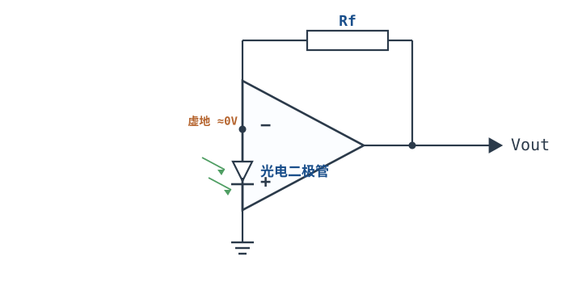
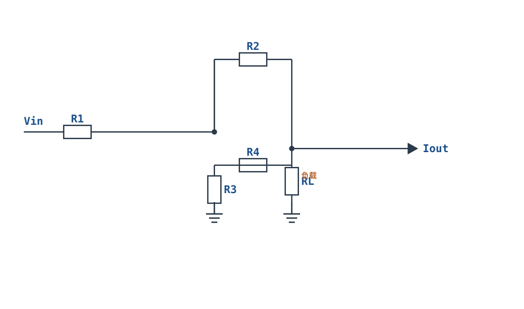
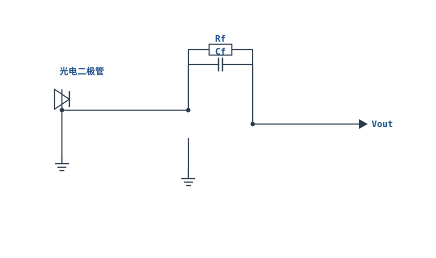
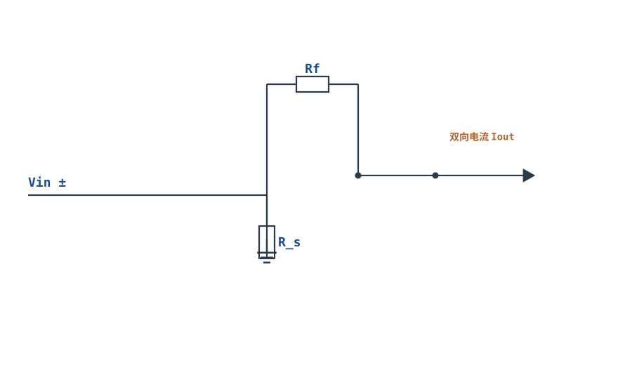
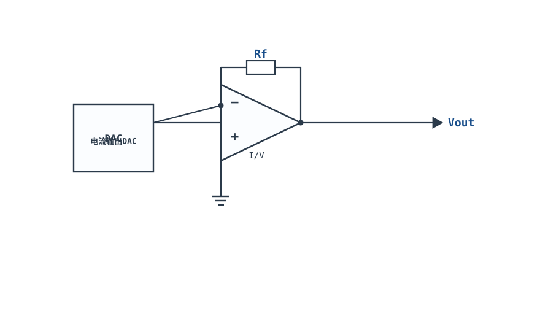

# V/I、I/V 转换与传感器接口 V/I & I/V Converters

## 1. 设计动机

::: motivation 为什么需要这两种转换
传感器世界里，输出的常常是"电流"而不是电压：光电二极管输出 µA 级光电流、压力变送器输出 4~20mA 环路电流、RTD 用恒流激励。而我们测量的 ADC 只认电压。反过来，要驱动 LED、加热丝、恒流偏置，又需要"给定一个电压、输出一个稳定电流"。

- **I/V 转换（电流转电压）**：把微弱电流变成可读电压；
- **V/I 转换（电压转电流，压控恒流源）**：让负载得到与负载电阻无关的稳定电流。
运放的虚短/虚断让这两个转换又准又稳。
:::

## 2. 原理图

**I/V 转换器（光电二极管接口）**：光电流直接灌入反相端（虚地），反馈电阻 Rf 把电流变成输出电压。



**接地负载 V/I 恒流源（Howland 型）**：输入电压经电阻网络控制负载电流，负载下端接地。

## 3. 静态分析（DC）

- **I/V**：反相端虚地，光电二极管两端电压≈0（光电二极管工作在线性零偏模式），电流 $I_{in}$ 全部流过 Rf：$V_{out}=-I_{in}R_f$。
- **V/I（浮地负载）**：负载串在反馈臂里，由虚地可知负载电流 $I_L=V_{in}/R$，与负载电阻无关（只要输出摆幅够）。
- 偏置电流直接叠加在 I/V 输出上：$V_{out}\approx -(I_{in}+I_B)R_f$，故小电流检测要选 FET 输入运放。

## 4. 动态分析（AC / 瞬态）

**I/V 传递函数**：

$$V_{out}=-I_{in}\,R_f$$

**V/I 恒流源（浮地负载）**：

$$I_L=\frac{V_{in}}{R}\quad(\text{与 }R_L\text{ 无关，受输出摆幅限制})$$

**输出摆幅约束**：负载上电压 $V_L=I_L R_L$ 必须满足 $V_{out,min}<V_L<V_{out,max}$。负载太重（$R_L$ 太大）时运放输出饱和，电流不再恒定。

I/V 输出电压随光电流线性变化（0~100µA → 0~2.5V，Rf=25kΩ）：

```echarts
{
  "tooltip": {"trigger": "axis"},
  "legend": {"data": ["Vout = -I·Rf"], "bottom": 0, "textStyle": {"fontSize": 13}},
  "grid": {"left": 56, "right": 24, "top": 26, "bottom": 50},
  "xAxis": {"type": "value", "name": "光电流 I (µA)", "min": 0, "max": 100, "axisLabel": {"fontSize": 11}},
  "yAxis": {"type": "value", "name": "Vout (V)", "min": -2.6, "max": 0, "interval": 0.65, "axisLabel": {"fontSize": 11}},
  "series": [
    {"name": "Vout = -I·Rf", "type": "line", "smooth": false, "showSymbol": true, "lineStyle": {"width": 2.6, "color": "#1a4f8b"},
     "data": [[0,0],[20,-0.5],[40,-1.0],[60,-1.5],[80,-2.0],[100,-2.5]]}
  ]
}
```

## 5. 环路分析

- I/V 是**电压并联负反馈**：输入是电流、输出是电压，跨阻增益 $R_f$。稳定性隐患是光电二极管和布线的寄生电容 $C_{in}$ 与 Rf 形成零点，引起高频峰化/振荡——常在 Rf 上并联小反馈电容 Cf 补偿。
- V/I 恒流源要求负反馈把输出电流"稳住"：负载变化引起输出电压变化，但电流被虚短约束不变。
- **Howland 泵（Howland Current Pump）**做接地负载恒流源时，电阻比值必须严格匹配，否则输出电阻不是无穷大、电流随负载漂移。

::: advanced 进阶：I/V 为什么要在 Rf 上并小电容
光电二极管结电容 + 布线电容在反相端形成到地的 $C_{in}$。它与反馈 Rf 一起在环路里引入零点，使相位裕度下降、输出出现高频尖峰甚至振荡。并联 $C_f$（pF 级）在 Rf 上，与 Rf 形成主极点，把环路压稳；代价是带宽下降 $f_{-3dB}=1/(2\pi R_f C_f)$。
:::

## 6. 元件取值与工程权衡

- **Rf 决定量程与噪声的权衡**：Rf 大灵敏度高，但同样偏置电流/电压噪声被放大得多、带宽变小。按满量程反算 $R_f=V_{out,max}/I_{max}$。
- **运放输入级**：µA/nA 级电流检测选 CMOS/FET 输入（$I_B<1\text{pA}$）；BJT 输入运放偏置电流 nA 级会淹掉小信号。
- **反馈电容 Cf**：pF~nF，补偿寄生、限制带宽；带宽需求高时再权衡。
- **恒流源采样电阻 R**：$R=V_{in}/I_{out}$。R 上压降小则功耗低，但采样灵敏度低；一般让 R 上压降在数百 mV~1V。
- **输出范围验算**：$I_{out}R_{L,max}<V_{out,swing}$，否则饱和。

## 7. 完整设计示例

::: example 光电二极管 I/V：0~100µA → 0~−2.5V
1. **需求**：光电二极管最大光电流 100µA，ADC 量程 0~2.5V。
2. **算 Rf**：$R_f=2.5\text{V}/100\mu\text{A}=25\text{k}\Omega$（取 24.9kΩ，1%）。
3. **选运放**：CMOS 输入（$I_B<1\text{pA}$），轨到轨输出，单电源 3.3V。
4. **加补偿**：光电二极管结电容约 20pF，取 $C_f=2.2\text{pF}$ 并在 Rf 上，带宽 $f_{-3dB}=1/(2\pi\times25\text{k}\times2.2\text{p})\approx2.9\text{kHz}$。
5. **验算**：100µA 时 $V_{out}=-100\mu\times25\text{k}=-2.5\text{V}$；单电源下输出为负会被削，实际把光电二极管接法反过来或加 Vcc/2 偏置。
6. **恒流源对照**：要 0~20mA 电流源驱动 LED，$R=5\text{V}/20\text{mA}=250\Omega$，负载 LED 压降 ~2V，运放需输出 ≥2V+采样压降。
:::

## 8. 仿真与实验

LTspice：
- I/V：用电流源模拟光电二极管，扫 0~100µA，测输出电压应为 −I×25k；
- 观察反相端电位≈0（虚地），确认光电二极管零偏；
- 在反相端加 20pF 电容，观察输出高频振荡，再并 2.2pF 反馈电容消除；
- V/I：改变负载电阻 100Ω~1kΩ，观察电流恒定直到输出摆幅用尽。

## 扩展与变种电路

### 扩展1：Howland 接地负载电流泵 Howland Current Pump

用四电阻的桥路让负载下端接地也能获得恒流——适合驱动接地的 LED、传感器、接地负载。



::: example 工作原理/静态分析
严格匹配电阻比（$R_2/R_1=R_4/R_3$）时，输出电流：

$$I_{out}=\frac{V_{in}}{R_1}$$

与负载 $R_L$ 无关（只要输出摆幅够用）。
:::

取值：四电阻用 0.1% 精密匹配；负载上电压 $I_{out}R_L$ 必须小于运放输出摆幅。

::: pitfall 电阻失配
比值不匹配时输出电阻不是无穷大，电流随负载漂移。必须用精密匹配电阻。
:::

### 扩展2：光电二极管跨阻放大 Photodiode TIA

光电流直接灌入反相端，反馈电阻把它转成电压——光电检测、光通信、光度计的标准前端。



::: example 工作原理/静态分析
$$V_{out}=-I_{ph}R_f$$

光电二极管工作在零偏（光伏模式），线性好、噪声低。$C_f$ 与 $R_f$ 并联补偿结电容引起的高频峰化。
:::

取值：$R_f=V_{out,max}/I_{max}$；选 CMOS/FET 输入运放（$I_B<1\text{pA}$）；$C_f$ 取 pF 级。

::: pitfall 高频振荡
光电二极管结电容与 $R_f$ 在环路引入零点，输出高频尖峰。并小 $C_f$ 补偿，代价是带宽下降。
:::

### 扩展3：双向（双极性）电流源 Bipolar Current Source

能向负载吸入或拉出双向电流——驱动需要正负电流的负载（如电化学、双向偏置、扭矩电机）。



::: example 工作原理/静态分析
$$I_{out}=\frac{V_{in}}{R_s}$$

$V_{in}$ 为正时电流一个方向，为负时反向。只要运放输出摆幅与供电允许，电流双向流动。
:::

取值：采样电阻 $R_s$ 上压降取数百 mV~1V；双电源供电。

::: pitfall 单电源做不出双向
单电源只能输出单向电流。要双向电流源必须双电源或正负供电。
:::

### 扩展4：电流输出 DAC 的 I/V 缓冲 Current-DAC I/V

电流型 DAC 输出的是电流，需经 I/V 转成电压才能送 ADC/运放——这是数模混合系统的标准接口。



::: example 工作原理/静态分析
$$V_{out}=-I_{DAC}R_f$$

反相端虚地使 DAC 输出端电位≈0（多数电流型 DAC 要求输出端接地电位），避免 $V_{out}$ 误差。
:::

取值：$R_f$ 按满量程电流与目标电压取；运放选低失调、低偏置。

::: pitfall Rf 精度决定满量程
$R_f$ 的误差直接变成输出满度误差，需用 0.1% 精密电阻，并做满度校准。
:::


## 9. 常见坑与故障现象

::: pitfall 常见坑
- **小电流测量误差大**：用了 BJT 输入运放，偏置电流 nA 级与 µA 信号同量级。解决：选 CMOS/FET 输入运放。
- **I/V 输出高频振荡/尖峰**：光电二极管寄生电容没补偿。解决：Rf 上并小 Cf。
- **恒流源电流随负载变**：Howland 电阻失配，或负载电阻太大使输出饱和。解决：严格匹配电阻、验算输出摆幅。
- **单电源下 I/V 输出被削**：光电二极管电流方向产生负输出。解决：反接二极管方向或加 Vcc/2 偏置（见单电源偏置章）。
- **Rf 取太大（MΩ 级）**：噪声和偏置问题凸显、带宽极窄。解决：在灵敏度与噪声间折中。
:::

## 10. 自测题

<details><summary>光电二极管输出 0~50µA，希望输出 0~2.5V，Rf 取多少？</summary>

$R_f=V/I=2.5\text{V}/50\mu\text{A}=$ **50kΩ**。

</details>

<details><summary>I/V 电路为什么让光电二极管工作在零偏（两端≈0V）？</summary>

因为反相端虚地，光电二极管一端接地、一端接虚地，两端电压≈0。这是光电二极管的光伏模式：线性好、噪声低、适合测量，而不是加反偏的光导模式（高速但暗电流大）。

</details>

<details><summary>V/I 恒流源驱动 500Ω 负载，要求 20mA 恒流，运放输出至少要能提供多大电压？</summary>

$V_L=I_L R_L=20\text{mA}\times500\Omega=10\text{V}$，加上采样电阻压降，运放输出摆幅至少要 >10V。供电需选 ±15V 或更高，否则电流无法维持。

</details>

## 11. 参考资料

- TI, *Op Amps for Everyone* (SLOD006B)，V/I 与 I/V 电路
- ADI, *A Designer's Guide to Instrumentation Amplifiers*，传感器接口与恒流激励
- ADI, *A Deeper Look into Difference Amplifiers*（跨阻与反馈补偿）
