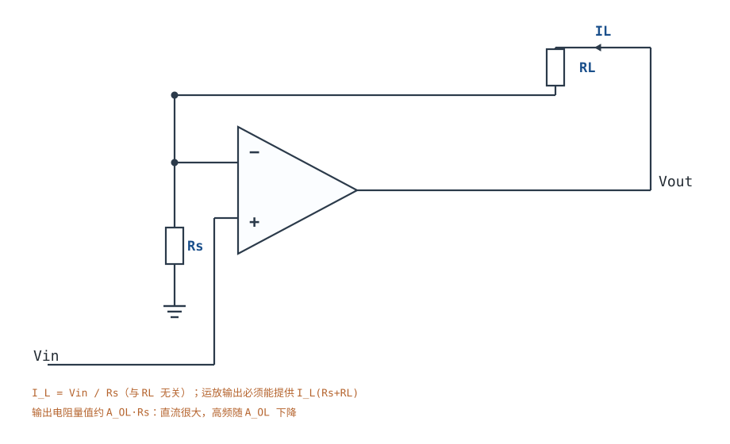
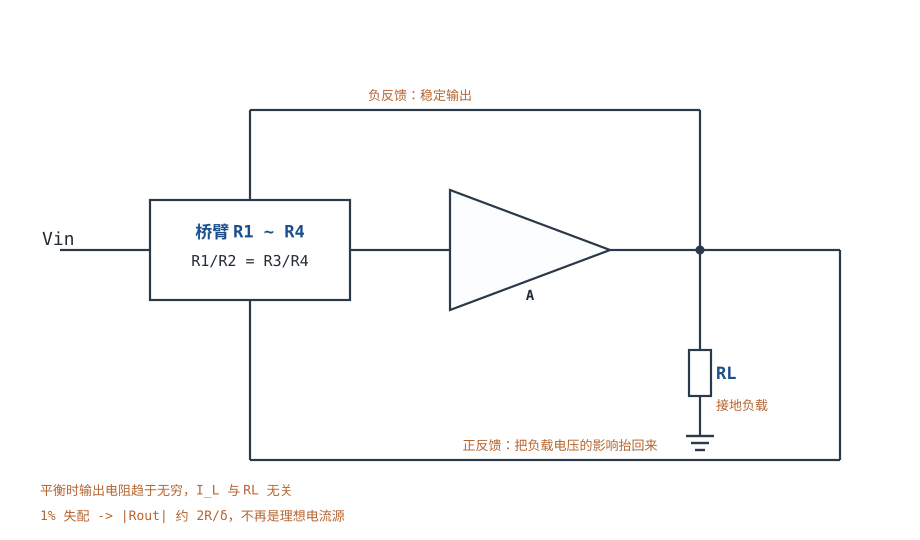
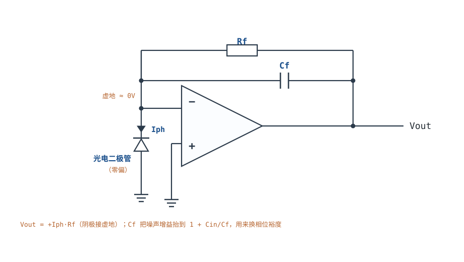

# V/I、I/V 转换与传感器接口 V/I & I/V Converters

传感器世界输出的常常是**电流**：光电二极管给出 µA 级光电流，4~20mA 变送器用环路电流传数据，RTD 用恒流激励换电压。而 ADC 只认电压。于是每个信号链都要做一次转换，方向只有两种：**I→V**（跨阻放大）或 **V→I**（压控电流源）。

这两种转换看似对偶，工程上的难点却完全不同。I→V 的难点是**稳定性**：光电二极管的结电容和反馈电阻在环路里造出零极点，稍不留神就振荡。V→I 的难点是**输出阻抗**：一个"电流源"到底是不是电流源，只取决于它的输出阻抗比负载大多少；而这个阻抗随频率下降，所以"直流是电流源、高频变成电压源"是常态。

本章把这两件事都落到可复算的数字上：先算输出阻抗如何随频率塌陷（§3.1），再算 Howland 桥的 1% 失配把无穷大输出阻抗打到多少（§3.2），然后算 100kΩ 跨阻 + 10pF 二极管电容的相位裕度（§3.4）。相关章节：[稳定性：伯德图、相位裕度与补偿](stability-bode.md)给 PM 的判据，[单电源电路与电平偏置搬移](single-supply-biasing.md)给单电源光电前置的偏置，[模拟开关与多路复用](analog-switch-mux.md)给多路光电二极管的切换，[精密整流、峰值检测与采样保持](precision-rectifier-peak-samplehold.md)给同属"环内非线性"的检波电路。

**本章约定**：$A_{OL}$ 是开环增益，$\beta$ 是反馈系数（**不是**三极管的电流放大倍数），$T=A_{OL}\beta$ 是环路增益，噪声增益 $1/\beta$，GBW 是增益带宽积，$R_f$ 是跨阻，$C_{in}$ 是反相端总电容（二极管结电容 + 运放输入电容 + 布线电容），$C_f$ 是反馈电容，$I_L$ 是负载电流，$R_s$ 是采样/检测电阻，$R_{out}$ 是电流源的输出电阻。**虚短、虚断只在负反馈闭合、输出未饱和、$|T|\gg1$ 时成立**（前提的完整推导见[理想模型五假设与虚短、虚断](ideal-opamp.md)）；本章的电流源在负载电压超出运放摆幅时会失效，跨阻级在光电二极管反激击穿或运放饱和时也不能再用虚地。

## 1. 设计动机

::: motivation 三个真实场景
**场景一：4~20mA 变送器接上 500Ω 接收电阻，电流掉了 20%。** 设计时按"理想电流源"算，$I_L=V_{in}/R_s$；实际接收端 500Ω 上的压降把运放输出顶到轨附近，环路增益塌陷，电流从 20mA 掉到 16mA。复算：20mA×500Ω=10V，加上采样电阻 3.1V，运放要输出 13.1V；5V 供电根本做不到。**电流源的第一个约束不是精度，是 Compliance（合规电压）。**

**场景二：100kΩ 跨阻的光电前置，上电就振荡。** 光电二极管结电容 10pF、运放输入电容 5pF、GBW=10MHz，反馈电阻 100kΩ。不接反馈电容时，噪声增益在 106kHz 就抬高，环路在 1.05MHz 穿越时相位已经到 −174°，PM≈5.8°，输出在 1MHz 附近持续振荡。并一只 1.5pF 反馈电容后 PM 回到 54°，振荡消失。**跨阻放大器的稳定性由"二极管电容 + 反馈电阻 + 运放 GBW"三者共同决定，缺一不可。**

**场景三：Howland 电流泵用 1% 电阻，负载从 100Ω 变到 1kΩ，电流变了 0.5%。** 四只 10kΩ、1% 电阻，桥臂失配 1%，输出电阻从"无穷大"掉到约 2MΩ；1kΩ 的负载变化对应 0.05% 的电流误差。看起来不大，但如果是 16 位系统（0.0015%），这 0.05% 就是 33 个 LSB。**"匹配电阻"不是玄学，是直接乘在输出电阻上的系数。**
:::

| 你想确认 | 先算/先查 | 判据（工程经验值） |
|---|---|---|
| 它到底是电流源还是电压源 | $\lvert R_{out}\rvert$ 与 $R_L$ 比 | $\lvert R_{out}\rvert\ge100R_L$ 才算电流源 |
| 负载电压够不够 | $I_L(R_s+R_L)$ 与运放摆幅 | 留 1~2V 余量 |
| 跨阻级稳不稳 | $C_f$、$f_z$、$f_p$、PM | PM≥45°，推荐 60° |
| 跨阻带宽够不够 | $f_{-3dB}=1/(2\pi R_fC_f)$ | ≥10 倍信号带宽 |
| 小电流测不测得准 | $I_B R_f$ 与 $I_{ph}$ 比 | $I_B\ll I_{ph,min}/100$ |
| 满量程准不准 | $R_f$ 容差与 $V_{OS}$ | 误差 < 目标精度的 1/3 |
| 长线会不会振 | 容性负载与 PM | 加隔离电阻或缓冲 |

**不算这四笔账会摔在哪**，四个带数字的代价：

1. **把"电流源"当成理想元件。** 浮地负载拓扑的输出电阻约 $A_{OL}R_s$：直流 $10^5\times156\Omega=15.6\text{M}\Omega$，10kHz 时 $A_{OL}$ 只剩 100，输出电阻掉到 15.6kΩ。负载 10kΩ 时，10kHz 的电流误差就是 $10\text{k}/15.6\text{k}=64\%$——**同一个电路，直流是电流源，10kHz 是电压源。**
2. **跨阻级不接 $C_f$。** 100kΩ、15pF、GBW=10MHz 时 PM 只有 5.8°，阶跃响应过冲接近 73%，实际上就是振荡。接 1.5pF 后 PM=54°，过冲约 13%。
3. **忽略光电二极管的结电容。** 结电容从 10pF 变到 100pF（大功率管），$C_f$ 的推荐值要增大 $\sqrt{10}=3.16$ 倍，带宽下降同样的倍数；按 10pF 设计的板子换管子就振。
4. **4~20mA 用 5V 供电。** 20mA×250Ω=5V，再加采样电阻 3.1V，需要 8.1V 以上；5V 供电时电流根本到不了 20mA，变送器"满度上不去"。

## 2. 定义与直观

### 2.1 电流源还是电压源：只看输出阻抗

一个二端网络对负载呈现什么性质，由它的**输出阻抗** $R_{out}$ 与负载 $R_L$ 的比值决定：

- $R_{out}\gg R_L$：负载变化时电流基本不变 → **电流源**；
- $R_{out}\ll R_L$：负载变化时电压基本不变 → **电压源**；
- $R_{out}\sim R_L$：两者都不是，电流和电压都随负载变。

理想电流源的 $R_{out}\to\infty$。运放构成的电流源靠负反馈"稳住"采样电阻上的电压，所以 $R_{out}$ 正比于环路增益：

$$R_{out}\approx A_{OL}\,R_s\quad(\text{浮地负载拓扑，量值})$$

符号与单位：$R_{out}$ 是输出电阻（$\Omega$）；$A_{OL}$ 是工作频率处的开环增益（无量纲）；$R_s$ 是采样电阻（$\Omega$）。**这个式子是本章最重要的一条**：它说明电流源的质量随频率线性下降，因为 $A_{OL}(f)\approx GBW/f$。代入 GBW=1MHz、$R_s=156\Omega$：

| 频率 | $A_{OL}=GBW/f$ | $\lvert R_{out}\rvert$ | 对 250Ω 负载的电流误差 |
|---|---|---|---|
| DC | $10^5$ | 15.6MΩ | 0.0016% |
| 1kHz | 1000 | 156kΩ | 0.16% |
| 10kHz | 100 | 15.6kΩ | 1.6% |
| 100kHz | 10 | 1.56kΩ | 16% |

**"电流源"是一个带频率限定的形容词。** 4~20mA 环路是直流或几 Hz 的慢信号，所以 15.6MΩ 够用；如果要传 10kHz 的模拟量，这个拓扑在 10kHz 只有 1.6% 的精度，必须换更大 GBW 的运放或降低 $R_s$（但 $R_s$ 降低会增大功耗与噪声）。

### 2.2 V→I 之一：浮地负载

**浮地负载（floating load）**是最简单的压控电流源：负载串在反馈环里，两端都不接地。电路：$V_{in}$ 接同相端；采样电阻 $R_s$ 从反相端到地；负载 $R_L$ 从运放输出到反相端。

在负反馈成立、输出未饱和的前提下用虚短：$V_-=V_+=V_{in}$。$R_s$ 上的电压就是 $V_{in}$，所以流过 $R_s$ 的电流是 $V_{in}/R_s$；虚断保证这个电流全部流过负载：

$$I_L=\frac{V_{in}}{R_s}$$

符号与单位：$I_L$ 是负载电流（A，方向从输出经负载流入反相端）；$V_{in}$ 是输入电压（V）；$R_s$ 是采样电阻（$\Omega$）。**这个式子里没有 $R_L$**——只要环路增益足够大、运放输出没有饱和，负载电阻怎么变，电流都不变。

代价是**负载不能接地**。光电二极管、LED、热电制冷器如果需要一端接地，就得用下面的接地负载方案。另一个代价是**合规电压**：运放输出必须能提供 $I_L(R_s+R_L)$，超过摆幅就饱和，电流塌陷。

### 2.3 V→I 之二：接地负载与 Howland 桥

负载一端接地时，采样电阻不能串在负载与地之间再把信号送回反相端——那样负载电流会随负载电压变。解决办法是**桥式反馈**：用四个电阻构成桥，让负载电压同时影响两个输入端，在平衡时互相抵消；负载电流只由输入电压和电阻比决定。

桥式电流泵（Howland current pump）的核心是**正反馈与负反馈的平衡**：输出端的负反馈（经 $R_3$、$R_4$）稳定电压，负载端的正反馈（经 $R_1$、$R_2$）把负载电压的影响"抬"回来。两者在

$$\frac{R_1}{R_2}=\frac{R_3}{R_4}$$

时完全抵消，输出电阻趋于无穷；失配时输出电阻变成有限值。经典结果（不同资料的电阻编号不同，按本节编号）：

$$R_{out}=\frac{R_1R_4(R_2+R_3)}{R_2R_3-R_1R_4}$$

符号与单位：$R_1$~$R_4$ 是桥臂电阻（$\Omega$）；$R_{out}$ 是输出电阻（$\Omega$）。分母为零时 $R_{out}\to\infty$，对应上面的平衡条件。这个式子的用途不是"精确计算"，而是**看清失配的代价**：分母是两只电阻乘积之差，1% 的失配就让分母从 0 变成 $0.01R^2$ 量级，输出电阻从无穷大掉到 $100R$ 量级。

**为什么负载接地反而更难？** 因为接地负载的电流不能直接流过采样电阻再回到虚地；桥式方案把"负载电流"转换成"桥臂电流差"，用四个电阻的比值来定义，代价是对电阻匹配极度敏感。工程上要么用 0.1% 薄膜电阻配对，要么用下面 §2.5 的"检测电阻 + 差分放大"方案，把匹配要求转移到差分放大器的 CMRR 上。

### 2.4 I→V：跨阻放大器

**跨阻放大器（TIA，Transimpedance Amplifier）**把电流变成电压：光电二极管（或电流型 DAC）接到反相端，反馈电阻 $R_f$ 把电流"翻译"成电压，同相端接地或接偏置。

理想情况下，反相端是虚地（$V_-\approx0$），光电二极管两端电压≈0，工作在**零偏（光伏模式）**：线性好、暗电流小，但速度受结电容限制。光电流从虚地节点经二极管流向地，运放只能通过 $R_f$ 从输出"补"这个电流，于是

$$V_{out}=+I_{ph}R_f$$

符号与单位：$V_{out}$ 是输出电压（V）；$I_{ph}$ 是光电流（A，方向从反相端经二极管流向地）；$R_f$ 是跨阻（$\Omega$）。正号对应"阴极接虚地、阳极接地、输出为正"的接法，适合单电源；把二极管反接（阳极接虚地）则输出为负，需要负电源或电平搬移——**接法决定符号，符号决定电源方案**。

**跨阻级的噪声增益不是 1。** 直流时 $C_f$ 开路、$C_{in}$ 也开路，$\beta=1$，噪声增益为 1；高频时 $C_f$ 和 $C_{in}$ 构成电容分压，噪声增益升高到 $1+C_{in}/C_f$。这个升高是稳定性的根源，也是噪声在高频被放大的原因。

### 2.5 第三种：检测电阻 + 差分放大

如果既要求负载接地、又不想被桥臂匹配绑死，可以用"检测电阻 + 差分放大"：输出经采样电阻 $R_s$ 驱动负载，差分放大器测量 $R_s$ 两端电压，与 $V_{in}$ 比较，误差经运放驱动输出。

这个方案的优点是**采样电阻直接串在负载电流路径上**，$I_L=V_{in}/R_s$ 只取决于差分放大器的增益和 $R_s$，不要求四只电阻严格配对；缺点是差分放大器本身的 CMRR、失调和带宽会限制精度，而且 $R_s$ 上的共模电压（接近负载电压）要求差分放大器有足够的共模范围。

::: analogy 电流源像一条恒流的水渠
电流源像一条水渠：水渠的流量由上游的闸门（$V_{in}$）和渠道的宽度（$R_s$）决定，下游水位（负载电压）高低不影响流量——前提是水渠没有漫堤（运放没有饱和）。输出阻抗就是"下游水位变化时流量变化的程度"：输出阻抗无穷大，水位怎么变流量都不变；输出阻抗有限，水位升高时流量会跟着变。

类比的边界：水渠的"恒流"是物理的（重力 + 堰板），电流源的"恒流"是反馈维持的；反馈有延迟（相位），高频时下游的水位变化会"绕过"闸门影响流量，输出阻抗随频率下降。所以电流源的指标必须带频率。
:::

## 3. 定量关系

### 3.1 浮地负载：电流、输出阻抗与合规电压

由 §2.2 的虚短分析，理想电流是 $I_L=V_{in}/R_s$。考虑有限 $A_{OL}$，输出电阻约 $(A_{OL}+1)R_s\approx A_{OL}R_s$（负载电压升高时电流略微下降）。电流误差可以写成

$$\frac{\Delta I_L}{I_L}\approx\frac{R_L}{\lvert R_{out}\rvert}=\frac{R_L}{A_{OL}R_s}$$

符号与单位：$\Delta I_L/I_L$ 是相对电流误差（无量纲）；$R_L$ 是负载电阻（$\Omega$）；其余同上。代入 $R_s=156\Omega$、$R_L=250\Omega$、$A_{OL}=10^5$：误差 $=250/(10^5\times156)=1.6\times10^{-5}=0.0016\%$。10kHz 时 $A_{OL}=100$，误差 $=250/(100\times156)=1.6\%$。

**合规电压**是第二个约束：

$$V_{out}=I_L(R_s+R_L)+V_{drop}$$

符号与单位：$V_{out}$ 是运放输出电压（V）；$V_{drop}$ 是运放输出级离轨的最小压差（V，轻载 0.1~0.5V，重载更大）；其余同上。20mA、$R_s=156\Omega$、$R_L=250\Omega$ 时 $V_{out}=20\text{mA}\times406\Omega=8.12\text{V}$，加 0.5V 余量需要至少 8.7V 的电源——**5V 供电做不了 250Ω 的 4~20mA 环路**。

### 3.2 桥式电流泵的失配代价

由 §2.3 的经典结果，令四只电阻标称相等为 $R$，只有 $R_4$ 偏了 $\delta$（相对值），则

$$R_4=R(1+\delta),\qquad R_{out}=\frac{R\cdot R(1+\delta)\cdot2R}{R^2-R^2(1+\delta)}=\frac{2R(1+\delta)}{-\delta}\approx-\frac{2R}{\delta}$$

符号与单位：$\delta$ 是相对失配（无量纲，1% 即 0.01）；$R$ 是标称阻值（$\Omega$）；$R_{out}$ 是输出电阻（$\Omega$，负号表示负阻）。取 $R=10\text{k}\Omega$、$\delta=0.01$：

$$\lvert R_{out}\rvert\approx\frac{2\times10^4}{0.01}=2\times10^6\Omega=2\text{M}\Omega$$

负载从 100Ω 变到 1kΩ（$\Delta R_L=900\Omega$）时，电流相对变化

$$\frac{\Delta I_L}{I_L}=\frac{\Delta R_L}{\lvert R_{out}\rvert}=\frac{900}{2\times10^6}=0.045\%$$

**结论**：1% 失配把"无穷大输出电阻"变成 2MΩ；对 1kΩ 量级的负载，0.05% 的电流误差还可以接受；对 16 位系统（0.0015%）就完全不够，必须用 0.01% 配对电阻或换检测电阻方案。注意这个误差是**负载变化引起的**，不是固定增益误差——校准满度也消不掉。

### 3.3 跨阻级的传递函数与噪声增益

跨阻级的反馈网络是 $R_f\parallel C_f$，反相端对地有 $C_{in}$（二极管结电容 + 运放输入电容 + 布线）。反馈系数

$$\beta(s)=\frac{Z_{in}}{Z_{in}+Z_f}=\frac{1+sR_fC_f}{1+sR_f(C_f+C_{in})}$$

符号与单位：$s=j2\pi f$ 是复频率；$R_f$ 是跨阻（$\Omega$）；$C_f$ 是反馈电容（F）；$C_{in}$ 是反相端总电容（F）；$\beta$ 无量纲。噪声增益 $1/\beta$ 从直流的 1 上升到高频的

$$\frac{1}{\beta_{HF}}=\frac{C_f+C_{in}}{C_f}=1+\frac{C_{in}}{C_f}$$

这个式子是跨阻级一切稳定性问题的源头：$C_{in}/C_f$ 越大，高频噪声增益越高，环路越容易在 $A_{OL}$ 下降的频段穿越。

闭环跨阻的 $-3\text{dB}$ 带宽由反馈极点决定：

$$f_{-3\text{dB}}\approx\frac{1}{2\pi R_fC_f}$$

代入 $R_f=100\text{k}\Omega$、$C_f=1.5\text{pF}$：$f_{-3\text{dB}}=1/(2\pi\times10^5\times1.5\times10^{-12})=1.06\text{MHz}$。

### 3.4 跨阻级的稳定性：两个频率与一个电容

环路增益 $T(s)=A_{OL}(s)\beta(s)$。单极点运放 $A_{OL}(s)=GBW/s$，于是

$$T(s)=\frac{GBW}{s}\cdot\frac{1+sR_fC_f}{1+sR_f(C_f+C_{in})}$$

它有两个特征频率：

$$f_z=\frac{1}{2\pi R_fC_f},\qquad f_p=\frac{1}{2\pi R_f(C_f+C_{in})}$$

$f_z$ 是 $\beta$ 的零点（噪声增益开始上升），$f_p$ 是 $\beta$ 的极点（噪声增益停止上升）。因为 $C_f<C_f+C_{in}$，恒有 $f_p<f_z$。相位裕度

$$PM=180^{\circ}-90^{\circ}+\arctan\frac{f_c}{f_z}-\arctan\frac{f_c}{f_p}=90^{\circ}+\arctan\frac{f_c}{f_z}-\arctan\frac{f_c}{f_p}$$

符号与单位：$f_c$ 是 $\lvert T\rvert=1$ 的穿越频率（Hz）；$PM$ 是相位裕度（度）；其余同上。**$C_f$ 越小，$f_z$ 越高、$f_p$ 越接近 $1/(2\pi R_fC_{in})$，相位裕度越差；$C_f\to0$ 时 $f_z\to\infty$，PM 只剩 $90^{\circ}-\arctan(f_c/f_p)$。**

工程上有一个广为使用的补偿公式（与[稳定性：伯德图、相位裕度与补偿](stability-bode.md)的口径一致）：

$$C_f=\sqrt{\frac{C_{in}}{2\pi R_f\,GBW}}$$

它把反馈极点放在 $f_p\approx\sqrt{GBW\cdot f_z}$ 附近，给出约 45°~55° 的 PM。这个式子是**起点不是终点**：实际 PM 要在 $C_f$ 取整到 E 系列值后，用完整的 $T(s)$ 复算（§4.3 会算一遍）。

### 3.5 直流误差：$V_{OS}$、$I_B$ 与 $R_f$ 容差

跨阻级的输出直流误差有三项：

$$V_{err}=V_{OS}\left(1+\frac{R_f}{R_{diode}}\right)+I_B R_f+\Delta R_f\,I_{ph}$$

符号与单位：$V_{OS}$ 是输入失调电压（V）；$R_{diode}$ 是光电二极管的等效并联电阻（$\Omega$，零偏时很大，通常可忽略）；$I_B$ 是输入偏置电流（A）；$\Delta R_f/R_f$ 是跨阻容差（无量纲）。第一项在 $R_{diode}\gg R_f$ 时就是 $V_{OS}$ 本身；第二项是 $I_B$ 在 $R_f$ 上的压降；第三项是增益误差。

数值感：$V_{OS}=50\mu\text{V}$、$I_B=1\text{pA}$、$R_f=100\text{k}\Omega$ 时，$V_{OS}$ 项 50µV、$I_B$ 项 0.1µV；若换成双极输入运放（$I_B=100\text{nA}$），$I_B$ 项变成 10mV——**比 $V_{OS}$ 大 200 倍，直接淹没 µA 级光电流**。所以跨阻级必须选 CMOS/FET 输入运放。

## 4. 典型计算

### 4.1 完整算例：0~2.5V 输入、4~20mA 输出的 V→I

**需求**：输入 0~2.5V，输出 4~20mA，负载为 4~20mA 环路的接收电阻 250Ω（一端接地，但整个变送器串在环路里，属于浮地负载场景），环路电源 24V。

**第 1 步：定传输关系。** 4~20mA 对应 0~2.5V，斜率

$$k=\frac{20-4}{2.5-0}=\frac{16\text{mA}}{2.5\text{V}}=6.4\text{mA/V}$$

截距 4mA，所以 $I_L=4\text{mA}+6.4\text{mA/V}\times V_{in}$。

**第 2 步：拆成"偏置 + 斜率"。** 用两级：第一级把输入搬移到 $V_x=V_{in}+0.625\text{V}$（0.625V 对应 4mA），第二级用浮地负载 V→I 把 $V_x$ 变成电流。

**第 3 步：算采样电阻。** 斜率要求 $1/R_s=6.4\text{mA/V}$：

$$R_s=\frac{1}{6.4\times10^{-3}}=156.25\Omega$$

取 E96 的 156Ω（0.1%），实际斜率 $1/156=6.410\text{mA/V}$，满度 $20.03\text{mA}$，误差 +0.16%。

**第 4 步：算偏置电压。** 4mA 对应 $V_{offset}=4\text{mA}\times156\Omega=0.624\text{V}$，设计取 0.625V（2.5V 基准四分压，便于用等值电阻实现）。第一级用同相求和：$V_{in}$ 经 $R_1$、0.625V 基准经 $R_2$ 接到同相端，$R_3$ 到地，取 $R_1=R_2=R_3=10\text{k}\Omega$，则同相端电压 $(V_{in}+0.625)/3$；再取反馈 $R_f=20\text{k}\Omega$、$R_g=10\text{k}\Omega$，增益 $1+20/10=3$，输出

$$V_x=3\times\frac{V_{in}+0.625}{3}=V_{in}+0.625\text{V}$$

**第 5 步：验算满度。** $V_{in}=0$：$I_L=0.625/156=4.006\text{mA}$；$V_{in}=2.5\text{V}$：$I_L=(2.5+0.625)/156=20.03\text{mA}$。两端误差都在 0.2% 以内（主要是 156Ω 取整）。

**第 6 步：合规电压。** 20mA 时采样电阻压降 $20\text{mA}\times156\Omega=3.12\text{V}$，负载压降 $20\text{mA}\times250\Omega=5.00\text{V}$，运放输出至少 8.12V，加 0.5V 余量需 8.62V。24V 环路电源有充足余量；如果误用 5V 电源，最大电流只有 $(5-0.5)/406=11.1\text{mA}$，**满度只有 55%**。

**第 7 步：功耗。** 采样电阻 $P=I^2R=(20\text{mA})^2\times156=62.4\text{mW}$，选 0.25W 电阻；运放输出级（或外接调整管）承受 $(24-8.12)\times20\text{mA}=318\text{mW}$，普通运放封装要核对热阻，通常加一只外部晶体管扩流。

**第 8 步：输出阻抗核对。** 直流 $R_{out}\approx10^5\times156=15.6\text{M}\Omega$，对 250Ω 负载误差 0.0016%；1kHz 时 $R_{out}=156\text{k}\Omega$，误差 0.16%。4~20mA 是慢信号，够用；若要叠加 HART 之类的高频通信，必须按 §2.1 的表核算。

### 4.2 完整算例：Howland 桥 1% 失配的输出误差

**需求**：四只 10kΩ、1% 电阻构成桥式电流泵，驱动 100Ω~1kΩ 的接地负载，评估失配带来的电流误差。

**第 1 步：算输出电阻。** 只有 $R_4$ 偏 +1% 时，由 §3.2：

$$\lvert R_{out}\rvert\approx\frac{2R}{\delta}=\frac{2\times10^4}{0.01}=2.0\text{M}\Omega$$

**第 2 步：算负载变化引起的电流误差。** $\Delta R_L=1000-100=900\Omega$：

$$\frac{\Delta I_L}{I_L}=\frac{900}{2.0\times10^6}=0.045\%$$

**第 3 步：换算成位数。** 对 16 位系统（满量程 65536 码），0.045% 对应 $0.00045\times65536=29.5$ 个 LSB。

**第 4 步：如果四只电阻各自随机、各 1% 容差呢？** 最坏情况是让 $R_2R_3$ 与 $R_1R_4$ 朝相反方向偏：$R_2$、$R_3$ 各 +1%，$R_1$、$R_4$ 各 −1%，则 $R_2R_3=1.0201R^2$、$R_1R_4=0.9801R^2$，分母 $=0.04R^2$，是单只偏 1% 时的 4 倍。输出电阻降到

$$\lvert R_{out}\rvert=\frac{R_1R_4(R_2+R_3)}{0.04R^2}\approx\frac{0.9801R^2\times2.01R}{0.04R^2}=49.3R=493\text{k}\Omega$$

同样 900Ω 的负载变化对应 $900/4.93\times10^5=0.183\%$，即 $0.00183\times65536=120$ 个 16 位 LSB。**要保住 0.01% 的电流精度，四只电阻要么用 0.01% 配对，要么做温度补偿，要么换检测电阻方案。**

**第 5 步：结论。** 1% 电阻的 Howland 桥只适合"电流精度 0.1% 量级、负载变化不大"的场合；精密 4~20mA 变送器普遍用"检测电阻 + 差分放大"或专用变送器芯片。

### 4.3 完整算例：100kΩ 跨阻 + 10pF 二极管电容的相位裕度

**需求**：光电二极管结电容 $C_d=10\text{pF}$，运放输入电容 3pF，布线电容 2pF，合计 $C_{in}=15\text{pF}$；$R_f=100\text{k}\Omega$；运放 GBW=10MHz（单极点近似）；要求 PM≥45°，并给出闭环带宽。

**第 1 步：不接 $C_f$ 时。** $f_p=1/(2\pi R_fC_{in})=1/(2\pi\times10^5\times15\times10^{-12})=106.1\text{kHz}$。穿越频率由 $\lvert T\rvert=1$ 解出，约 $f_c=1.05\text{MHz}$（在 $f_c$ 处 $A_{OL}=GBW/f_c=9.5$，$\lvert\beta\rvert=1/\sqrt{1+(f_c/f_p)^2}=1/9.9$，乘积 0.96）。相位

$$PM=90^{\circ}-\arctan\frac{1.05\times10^6}{1.061\times10^5}=90^{\circ}-84.2^{\circ}=5.8^{\circ}$$

**PM=5.8°，电路振荡。**

**第 2 步：按补偿公式取 $C_f$。**

$$C_f=\sqrt{\frac{15\times10^{-12}}{2\pi\times10^5\times10^7}}=\sqrt{2.39\times10^{-24}}=1.55\times10^{-12}\text{F}\approx1.5\text{pF}$$

**第 3 步：复算 $C_f=1.5\text{pF}$ 的零极点。**

$$f_z=\frac{1}{2\pi\times10^5\times1.5\times10^{-12}}=1.06\text{MHz},\qquad f_p=\frac{1}{2\pi\times10^5\times16.5\times10^{-12}}=96.5\text{kHz}$$

**第 4 步：解穿越频率。** 解 $\lvert T(f_c)\rvert=1$：

$$\frac{10^7}{f_c}\cdot\frac{\sqrt{1+(f_c/1.06\times10^6)^2}}{\sqrt{1+(f_c/9.65\times10^4)^2}}=1$$

数值解得 $f_c=1.22\text{MHz}$。相位

$$PM=90^{\circ}+\arctan\frac{1.22}{1.06}-\arctan\frac{1.22}{0.0965}=90^{\circ}+49.0^{\circ}-85.5^{\circ}=53.5^{\circ}$$

**PM=53.5°，满足 ≥45°。** 按 $\zeta\approx PM/100=0.535$ 估算阶跃过冲：

$$M_p=\exp\left(\frac{-\pi\times0.535}{\sqrt{1-0.535^2}}\right)=13.1\%$$

**第 5 步：闭环带宽与噪声增益。** $f_{-3\text{dB}}=1/(2\pi R_fC_f)=1.06\text{MHz}$；高频噪声增益 $1+C_{in}/C_f=1+15/1.5=11$（20.8dB）。

**第 6 步：加大 $C_f$ 换 PM。** 取 $C_f=2.2\text{pF}$：$f_z=723\text{kHz}$、$f_p=92.5\text{kHz}$，解得 $f_c=1.43\text{MHz}$，$PM=66.9^{\circ}$，按 $\zeta\approx PM/100=0.669$ 算过冲

$$M_p=\exp\left(\frac{-\pi\times0.669}{\sqrt{1-0.669^2}}\right)=5.9\%$$

代价是闭环带宽降到 $1/(2\pi\times10^5\times2.2\times10^{-12})=723\text{kHz}$。**PM 和带宽是同一只电容的两端，按系统要求选，不要盲目追高 PM。**

**第 7 步：验算噪声。** $R_f=100\text{k}\Omega$ 的热噪声密度 $\sqrt{4kTR_f}=\sqrt{4\times1.38\times10^{-23}\times300\times10^5}=40.7\text{nV}/\sqrt{\text{Hz}}$；在 1MHz 带宽内积分（按噪声增益 1~11 加权）约 $40.7\text{nV}\times\sqrt{10^6}\approx40.7\mu\text{V}_{\text{RMS}}$（一阶估算，实际按噪声增益曲线积分）。对 50µA 满量程、100kΩ 跨阻（5V 满度），40.7µV 约 0.0008% 满度，不是瓶颈。

### 4.4 误差预算汇总

| 误差项 | 4~20mA V→I | Howland（1%） | 100kΩ TIA |
|---|---|---|---|
| 增益/失配 | 0.16%（156Ω 取整） | 0.045%~0.18% | 0.1%（$R_f$ 0.1%） |
| 失调 | 0.1%（第一级 3×$V_{OS}$） | 取决于运放 | 50µV（0.001%） |
| 偏置电流 | 可忽略（双极输入） | 可忽略 | 0.1µV（1pA） |
| 频率/稳定性 | 10kHz 时 1.6% | 直流应用可忽略 | PM 53.5°，过冲 13% |
| 合计 | 0.3%（直流） | 0.2%（负载 100Ω~1kΩ） | 0.1% + 50µV |

## 5. 工程含义

### 5.1 拓扑选择表

| 需求 | 首选拓扑 | 关键约束 | 不适用 |
|---|---|---|---|
| 负载浮地、精度优先 | 浮地负载 V→I | 合规电压、$R_s$ 精度 | 负载必须接地 |
| 负载接地、成本优先 | Howland 桥 | 四电阻匹配 ≤0.1% | 负载变化大、精度 <0.1% |
| 负载接地、精度优先 | 检测电阻 + 差分放大 | 差分放大器 CMRR、共模范围 | 高共模电压场合 |
| µA/nA 电流测量 | 跨阻放大 | $C_f$ 补偿、$I_B$ | 需要极低噪声时选大 $R_f$ |
| 高速光通信 | 跨阻 + 反偏二极管 | 结电容、运放 GBW | 零偏模式带宽不够 |

### 5.2 元件取值的量级

- **$R_s$（V→I 采样电阻）**：按 $R_s=V_{in,max}/I_{out,max}$ 取，压降一般 0.5~3V。太小则信噪比差、失调影响大；太大则合规电压不够、功耗大。
- **$R_f$（跨阻）**：按 $R_f=V_{out,max}/I_{ph,max}$ 取。100kΩ 是 µA 级光电检测的常用值；1MΩ 以上要特别小心 $C_f$ 补偿和噪声。
- **$C_f$**：按 §3.4 的公式取，再用完整 $T(s)$ 复算 PM；典型 0.5~10pF，C0G/NP0。
- **运放（TIA）**：CMOS/FET 输入（$I_B<1\text{pA}$）、GBW 按 $f_c$ 选、输入电容要小（<5pF）。
- **运放（V→I）**：GBW 按 §2.1 的频率表选；输出电流能力要大于 $I_{L,max}$ 的 3 倍。

### 5.3 布局与保护

- **跨阻级的反相端是高性能节点**：走线要短、远离数字线、必要时加保护环；二极管的屏蔽壳接到合适电位。
- **反馈电阻与电容就近放**：$R_f$、$C_f$ 到反相端的走线每增加 1cm，就多约 0.5~1pF 的寄生电容，直接改变 PM。
- **光电二极管的偏置**：零偏模式线性好但速度慢；反偏模式速度快但暗电流大、噪声高。反偏时要用低噪声偏置电源，并在偏置线上加 RC 滤波。
- **V→I 的散热**：4~20mA 环路在高压差时功耗大，运放或外部调整管要按最坏情况算结温。
- **ESD 与浪涌**：传感器接口是外部世界的第一道门，光电二极管和长线要加 TVS/限流。

### 5.4 什么时候模型不够用

- **运放不是单极点**：GBW 近似只在 $f\gg f_{p1}$ 时成立；第二极点会让 PM 比计算值低，必须用数据手册的 A_OL 曲线复核。
- **光电二极管不是理想电流源**：结电容随反偏电压变，暗电流随温度指数上升，大信号时串联电阻也起作用。
- **负载是容性/感性**：V→I 驱动长线或电感时，输出阻抗与负载电抗形成谐振，可能自激；需要隔离电阻或缓冲。
- **多路切换**：多个光电二极管经 MUX 接入同一个 TIA 时，MUX 的 $R_{on}$ 和电容会改变 $C_{in}$，PM 随之变差，见[模拟开关与多路复用](analog-switch-mux.md)。

## 6. 常见坑

::: pitfall 常见坑
- **现象**：4~20mA 输出到 20mA 附近上不去，或者接上接收电阻后电流明显下降。**原因**：合规电压不够——$I_L(R_s+R_L)$ 超过运放摆幅，环路饱和。**解决**：按 §3.1 算 $V_{out}=I_L(R_s+R_L)+V_{drop}$，提高环路电源或降低 $R_s$/$R_L$；5V 供电做不了 250Ω 的 20mA。
- **现象**：跨阻放大器输出高频振荡，示波器上是几 MHz 的等幅波。**原因**：没有 $C_f$，$C_{in}$ 与 $R_f$ 形成的极点把 PM 压到 10° 以下。**解决**：按 $C_f=\sqrt{C_{in}/(2\pi R_fGBW)}$ 取电容，再用完整 $T(s)$ 复算 PM；$C_f$ 用 C0G，就近放。
- **现象**：小光电流（nA 级）测不准，输出有随温度漂的直流。**原因**：用了双极输入运放，$I_B=100\text{nA}$ 在 100kΩ 上产生 10mV；或 $V_{OS}$ 温漂。**解决**：换 CMOS/FET 输入运放（$I_B<1\text{pA}$）；选低 $V_{OS}$ 低温漂型号；必要时做暗电流校准。
- **现象**：Howland 电流泵的电流随负载变化，校准满度也救不回来。**原因**：桥臂电阻失配，输出电阻从无穷大降到 $2R/\delta$ 量级。**解决**：用 0.1% 或 0.01% 配对电阻；或改用检测电阻 + 差分放大；按 §3.2 算失配误差，确认是否在预算内。
- **现象**：换了一只光电二极管，跨阻级就振。**原因**：新管子的结电容更大，$C_{in}$ 变大，$f_p$ 降低，PM 变差。**解决**：按最坏 $C_{in}$ 设计 $C_f$；或把 $C_f$ 做成可调（并联焊盘），量产时按管子批次微调。
- **现象**：V→I 驱动长线时输出波形振铃/自激。**原因**：长线电容与运放输出电阻形成附加极点，PM 下降。**解决**：输出串 10~100Ω 隔离电阻；或加一级缓冲；长线两端加端接。
:::

## 7. 自测题

浮地负载 V→I 的 $R_s=156\Omega$、$R_L=250\Omega$、运放 GBW=1MHz、$A_{OL}(DC)=10^5$。直流和 10kHz 的电流误差各是多少？

直流：$\lvert R_{out}\rvert=A_{OL}R_s=10^5\times156=15.6\text{M}\Omega$，误差 $=R_L/\lvert R_{out}\rvert=250/15.6\times10^6=0.0016\%$。

10kHz：$A_{OL}=GBW/f=10^6/10^4=100$，$\lvert R_{out}\rvert=100\times156=15.6\text{k}\Omega$，误差 $=250/15.6\times10^3=1.6\%$。

同一个电路，频率升高 100 倍，误差升高 100 倍——**电流源的精度是频率的函数**。

4~20mA 变送器用 5V 供电、$R_s=156\Omega$、负载 250Ω，最大能输出多少电流？

运放输出摆幅按离轨 0.5V 算，可用 4.5V：

$$I_{max}=\frac{4.5}{R_s+R_L}=\frac{4.5}{156+250}=11.1\text{mA}$$

只有满度 20mA 的 55%。要输出 20mA，电源至少 $20\text{mA}\times406\Omega+0.5\text{V}=8.62\text{V}$，实际取 12V 或 24V。

Howland 桥四只 10kΩ 电阻，$R_4$ 偏 +1%，输出电阻大约多少？负载从 100Ω 变到 1kΩ，电流误差多少？

$$\lvert R_{out}\rvert\approx\frac{2R}{\delta}=\frac{2\times10^4}{0.01}=2\text{M}\Omega$$

$$\frac{\Delta I}{I}=\frac{900}{2\times10^6}=0.045\%$$

对 16 位系统约 29 个 LSB。若四只电阻各自随机 1%，最坏情况分母大 4 倍，输出电阻约 490kΩ，误差 0.18%（60 LSB）。

100kΩ 跨阻、$C_{in}=15\text{pF}$、GBW=10MHz，不接 $C_f$ 时 PM 是多少？按公式取 $C_f$ 后 PM 是多少？

不接 $C_f$：$f_p=1/(2\pi\times10^5\times15\times10^{-12})=106\text{kHz}$，$f_c\approx1.05\text{MHz}$，$PM=90^{\circ}-\arctan(1.05\text{M}/106\text{k})=90^{\circ}-84.2^{\circ}=5.8^{\circ}$，振荡。

按公式：

$$C_f=\sqrt{\frac{15\text{pF}}{2\pi\times10^5\times10^7}}=1.55\text{pF}\approx1.5\text{pF}$$

复算：$f_z=1.06\text{MHz}$、$f_p=96.5\text{kHz}$、$f_c=1.22\text{MHz}$，$PM=90^{\circ}+49.0^{\circ}-85.5^{\circ}=53.5^{\circ}$，过冲约 13%。

为什么跨阻级要选 CMOS/FET 输入运放？用双极输入会怎样？

跨阻级的 $I_B$ 直接流过 $R_f$，在输出上产生 $I_BR_f$ 的误差。$R_f=100\text{k}\Omega$ 时，1pA 只有 0.1µV，100nA 就是 10mV——比 µA 级光电流信号还大，而且随温度漂。

所以跨阻级要选 $I_B<1\text{pA}$ 的 CMOS/FET 输入运放；同时注意它的输入电容通常更小，对稳定性也有利。

V→I 的输出电阻为什么随频率下降？如果负载是 10kΩ，10kHz 时还能当电流源用吗？

因为输出电阻正比于环路增益 $A_{OL}(f)$，而 $A_{OL}$ 随频率按 $-20\text{dB/dec}$ 下降（单极点）。$R_{out}\approx A_{OL}(f)R_s$。

GBW=1MHz、$R_s=156\Omega$、10kHz 时 $A_{OL}=100$，$R_{out}=15.6\text{k}\Omega$。负载 10kΩ 时 $R_{out}/R_L=1.56$，电流误差约 $10\text{k}/15.6\text{k}=64\%$——**已经不是电流源了**。要驱动 10kΩ 负载到 10kHz，需要 GBW 大 100 倍的运放，或改用其他拓扑。

## 8. 参考资料

- **TI, *Op Amps for Everyone*（SLOD006B）**：Chapter 6 *Development of the Non-Ideal Op Amp Equations* 给有限 $A_{OL}$ 下闭环增益、输出阻抗与误差的推导；本章 §3.1 的 $R_{out}\approx A_{OL}R_s$ 与 §3.5 的误差分解按该章口径整理。<https://www.ti.com/lit/an/slod006b/slod006b.pdf>
- **Analog Devices, MT-033 *Voltage Feedback Op Amp Gain and Bandwidth***：噪声增益、环路增益与穿越频率的关系；本章 §3.3、§3.4 的 $1/\beta$ 与 $f_c$ 计算与该文一致。<https://www.analog.com/media/en/training-seminars/tutorials/MT-033.pdf>
- **Analog Devices, MT-058 *Effects of Feedback Capacitance on VFB and CFB Op Amps***：反馈电容对跨阻级稳定性、带宽与噪声增益的影响，本章 §3.4 的零极点模型与补偿公式按该文整理。<https://www.analog.com/media/en/training-seminars/tutorials/MT-058.pdf>
- **Jerald Graeme, *Photodiode Amplifiers: Op Amp Solutions*（McGraw-Hill）**：光电二极管跨阻放大器的噪声、带宽、稳定性与布局，本章 §2.4、§5.3 的零偏/反偏权衡与保护环做法参照该书。
- **Horowitz & Hill, *The Art of Electronics*（3rd ed.）**：电流源、电流泵与跨阻放大器相关小节；本章 §2.2、§2.3 的浮地负载与桥式电流泵拓扑与该书一致。
