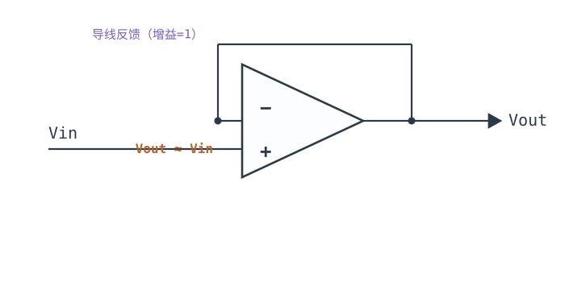
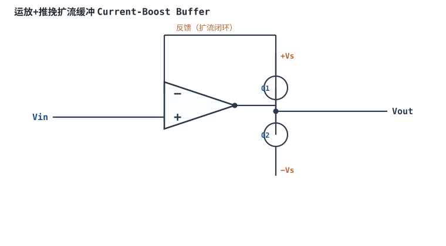
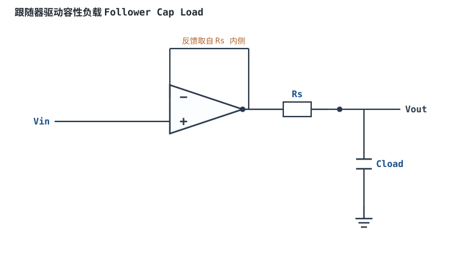
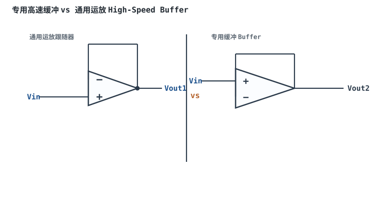
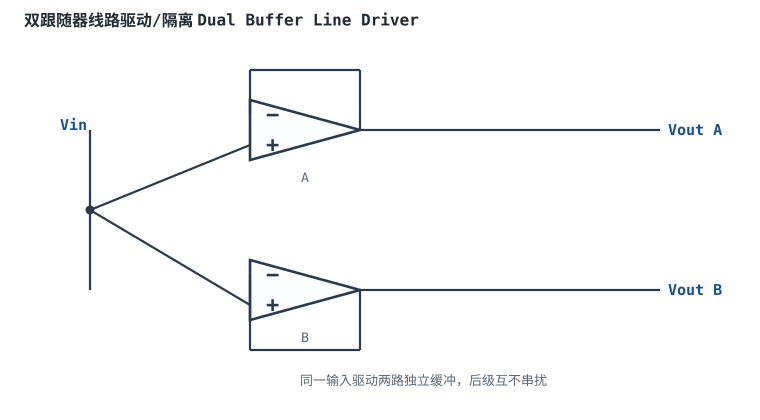

# 电压跟随器 Buffer Voltage Follower

## 1. 设计动机

::: motivation 为什么需要这个电路
有些信号源内阻很大（传感器、分压网络、压电片），直接接到负载上会被"拉低"——这就是阻抗不匹配。我们需要一个电路：**几乎不从信号源取电流（高输入阻抗），却能驱动低阻抗负载（低输出阻抗）**。

电压跟随器就是答案：它把输出用一根导线直接接回反相输入端，增益为 1，输出严格等于输入。它像一个"中继站"，不改变电压大小，只把电流驱动能力放大无数倍。
:::

## 2. 原理图



## 3. 静态分析（DC）

由虚短（负反馈存在），反相端电压等于同相端电压；而反相端直接连输出，所以：

$$V_{out}=V_+=V_{in}$$

输入端不取电流（虚断），信号源几乎零负载；输出端可以输出或吸入数 mA 电流驱动负载。静态时输出跟随输入直流电位。

## 4. 动态分析（AC / 瞬态）

传递函数 $G(s)=V_{out}/V_{in}=1$，相位差 0°（同相）。它是增益最小、输入阻抗最高的运放电路：

```echarts
{
  "tooltip": {"trigger": "axis"},
  "legend": {"data": ["Vin", "Vout"], "bottom": 0, "textStyle": {"fontSize": 13}},
  "grid": {"left": 56, "right": 24, "top": 26, "bottom": 58},
  "xAxis": {"type": "category", "name": "角度", "data": [0,30,60,90,120,150,180,210,240,270,300,330,360], "axisLabel": {"fontSize": 11}},
  "yAxis": {"type": "value", "name": "电压 V", "min": -2.4, "max": 2.4, "interval": 0.8, "axisLabel": {"fontSize": 11}},
  "series": [
    {"name": "Vin", "type": "line", "smooth": true, "showSymbol": false, "lineStyle": {"width": 2.6, "color": "#1a4f8b"},
     "data": [0,1,1.73,2,1.73,1,0,-1,-1.73,-2,-1.73,-1,0]},
    {"name": "Vout", "type": "line", "smooth": true, "showSymbol": false, "lineStyle": {"width": 2.6, "color": "#b5642e", "type": "dashed"},
     "data": [0,1,1.73,2,1.73,1,0,-1,-1.73,-2,-1.73,-1,0]}
  ]
}
```

两条曲线完全重合——这就是"跟随"。

## 5. 环路分析

这是**电压串联负反馈**（Voltage Series Feedback）：反馈系数 $\beta=1$（全部输出都送回反相端），噪声增益 $G_n=1/\beta=1$。

- 环路增益 $T(s)=A(s)\beta=A(s)$，闭环增益 $G=A/(1+A)\approx1$。
- 因为 $\beta=1$，它工作在**单位增益（Unity-Gain）**，是运放带宽最窄、对稳定性最苛刻的组态。只有"单位增益稳定（Unity-Gain Stable）"的运放才能安全做跟随器。

::: advanced 进阶：为什么跟随器最容易振荡
跟随器 β=1，环路增益最大（$T=A$），相位裕度最小。运放内部补偿正是按"单位增益下仍稳定"设计的——数据手册标 Unity-Gain Stable 即指此。若用了需要增益>5 才稳定的" decompensated"运放做跟随器，必自激，输出叠加高频方波状振荡。驱动容性负载会再引入一个极点，进一步恶化相位裕度。
:::

## 6. 元件取值与工程权衡

- **不需要电阻**：跟随器只用运放本身，反馈是导线，没有增益电阻取值问题。
- **输入阻抗**：极高（同相端，BJT 运放 MΩ~TΩ，CMOS 运放 10¹²Ω 以上），这正是缓冲的目的。
- **输出阻抗**：极低（毫欧级），可直接驱动 ADC 采样电容、长线。
- **带宽**：闭环带宽 = GBP/1 = GBP，是该运放能达到的最大闭环带宽。

## 7. 完整设计示例

::: example 高内阻传感器接 ADC
1. **需求**：传感器内阻 100kΩ，输出 0~2.5V，要送进 ADC（采样瞬间需稳定建立）。
2. **问题**：直接接 ADC，采样电容从 100kΩ 内阻取电，建立很慢、读数偏低。
3. **方案**：中间加一个 CMOS 运放接成电压跟随器。
4. **选型**：输入偏置电流 pA 级（100kΩ 上几乎无压降）、GBP≥1MHz、单位增益稳定、RRO。
5. **验算**：$V_{out}=V_{in}$，ADC 看到低阻抗驱动，采样准确。
:::

## 8. 仿真与实验

LTspice 用 `UniversalOpamp2`，信号源经 100kΩ 内阻接跟随器同相端，输出接一个模拟 ADC 采样电容（如 100pF）：观察输出能否快速跟踪输入；把运放换成未补偿模型，故意制造振荡，看输出高频毛刺。

## 扩展与变种电路

### 扩展1：运放+推挽扩流缓冲 Current-Boost Buffer

运放本身只能输出几 mA，在输出级并一对互补三极管（推挽射极跟随），把反馈点取在发射极输出上，电流能力扩到几百 mA。



::: example 工作原理与静态分析
- 运放负责闭环精度，Q1/Q2 负责提供基极/发射极电流：输出电流 $I_{out}\approx \beta\cdot I_{base}$，可达几百 mA。
- 反馈从发射极输出端引回，把三极管 $V_{be}$ 误差包进环路，输出仍 $V_{out}\approx V_{in}$。
- 关键元件：互补 NPN/PNP 对，必要时加 $V_{be}$ 偏置消除交越失真。
- 静态工作点：静态时两管微导通，交越区失真小。
:::

取值数量级：β=100 时基极几 mA 即出几百 mA；与"运放直接驱动"对比：电流大但增加交越失真与复杂度。适用：驱动扬声器、长线、LED；不适用：超精密直流（$V_{be}$ 温漂）。

::: pitfall 交越失真在零点附近出"花边"
- **现象**：小信号过零时输出出现明显失真。
- **原因**：推挽管死区，$|V_{be}|$ 小于开启电压时两管都不导通。
- **解决**：给两管基极间加 $V_{be}$ 倍增/二极管偏置使其微导通，或选带扩流的专用缓冲。
:::

### 扩展2：跟随器驱动容性负载 Follower Cap Load

跟随器直接接大电容容易振荡；在输出串一个小隔离电阻、并把反馈取在电阻内侧，可让容性负载稳定。



::: example 工作原理与静态分析
- 容性负载与运放输出阻抗形成额外极点，相位裕度下降；Rs 把负载电容与运放输出隔离开，极点后移。
- 反馈取在 Rs 内侧（运放真实输出），Rs 上压降由环路吸收，负载端电压仍跟随输入。
- 关键元件：Rs=22~100Ω，Cload 可达几十~几百 nF。
- 负载端 $V_{out}\approx V_{in}$，带宽由 Rs·Cload 与运放带宽共同决定。
:::

取值数量级：Rs=47Ω、Cload=100nF；与"直接驱动"对比：以几十 Ω 的输出阻抗换取稳定。适用：驱动 ADC 采样电容、长电缆；不适用：要求极低输出阻抗的高精度直流。

::: pitfall 直接接大电容输出出现高频振荡
- **现象**：输出叠加几 MHz 方波状毛刺，带电容才出现。
- **原因**：容性负载引入极点，单位增益下相位裕度不足。
- **解决**：串小隔离电阻，或选标称"容性负载稳定"的缓冲型号。
:::

### 扩展3：专用高速缓冲 vs 通用运放 High-Speed Buffer

专用缓冲（Buffer）内部已按单位增益补偿、带宽大、压摆率高，专做跟随；通用运放接成跟随器要查是否单位增益稳定。



::: example 工作原理与静态分析
- 两者都满足 $V_{out}=V_{in}$、$G_n=1$。
- 专用缓冲 GBP/压摆率高、输出电流大，但内部可能无低失调优化；通用运放精度高但带宽受限。
- 选型判据：跟随器工作在 β=1，必须用"Unity-Gain Stable"型号；高速 ADC 驱动选专用高速缓冲。
:::

取值数量级：专用缓冲 SR 可达几百 V/µs；与通用跟随器对比：速度快、电流大，失调/直流精度略逊。适用：ADC 驱动、视频/高速缓冲；不适用：毫伏级精密直流。

::: pitfall 用了需要增益>5 才稳定的运放做跟随器
- **现象**：输出叠加高频方波，怎么调输入都不消。
- **原因**：decompensated 运放最小闭环增益大于 1，β=1 下相位裕度为负。
- **解决**：换 Unity-Gain Stable 型号，或给它加增益电阻使闭环增益满足最小要求。
:::

### 扩展4：双跟随器线路驱动/隔离 Dual Buffer

同一高阻输入用两个跟随器分别缓冲，后级两路互不串扰，实现一路输入驱动两路负载。



::: example 工作原理与静态分析
- 两路输入并联到同一信号源，各为 $V_{out}=V_{in}$。
- 因为每路低输出阻抗独立驱动，后级一路的负载变化不会串到另一路。
- 关键：用双运放（如 OPA2xxx）保证两通道匹配；输入偏置电流几乎不取信号源电流。
:::

取值数量级：单双运放一片搞定；与"一路输出分两根线"对比：隔离了后级负载效应。适用：单信号分送 ADC+比较器、耳机分配；不适用：需要增益或反相的场合。

::: pitfall 两输出直接短接想"并联扩流"却打架
- **现象**：两跟随器输出短接后发热、波形怪。
- **原因**：两运放输出电压不可能完全相等，短接后互相灌电流。
- **解决**：要并联扩流需各串小均流电阻，或改用单路扩流缓冲；单纯隔离负载不要短接输出。
:::

## 9. 常见坑

::: pitfall 常见坑
- **驱动大电容负载振荡**：跟随器输出直接接几十 nF 电容会自激。解决：输出串小电阻（如 22~100Ω）隔离，或选"容性负载稳定"型号。
- **用了非单位增益稳定的运放**：放大倍数低的专用运放（decompensated）做跟随器必振荡，表现为输出叠加几 MHz 方波。务必选 Unity-Gain Stable。
:::

## 10. 自测题

<details><summary>电压跟随器的电压增益是多少？它的主要价值不是放大，那是什么？</summary>

增益 $=1$（单位增益）。价值是**阻抗变换**：高输入阻抗几乎不取信号源电流，低输出阻抗能驱动负载，起缓冲/隔离作用。

</details>

<details><summary>为什么不能随便拿任何运放接成跟随器？</summary>

跟随器工作在 β=1 的单位增益，相位裕度最小。只有内部已按单位增益补偿（Unity-Gain Stable）的运放才稳定；decompensated 运放需要最小闭环增益，做跟随器会自激。

</details>

## 11. 参考资料

- Op Amps for Everyone（TI, SLOD006B），电压跟随器章节
- Single-Supply Op-Amp Circuit Collection（TI, SLOA058）
