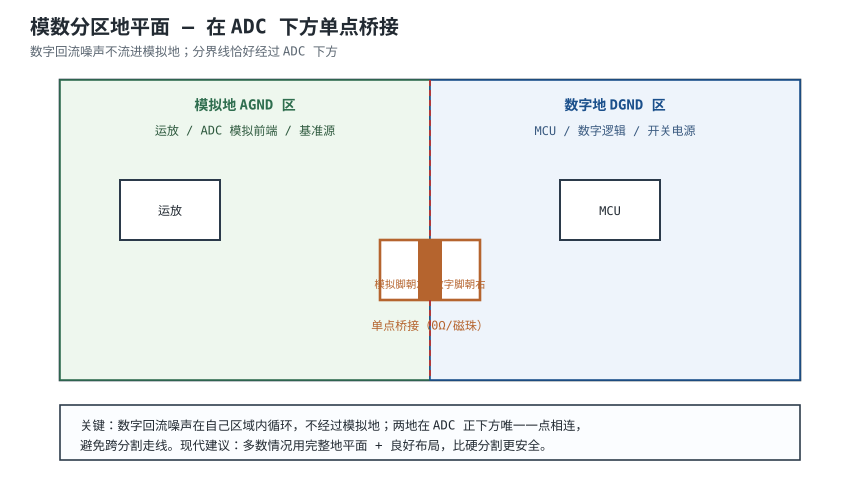
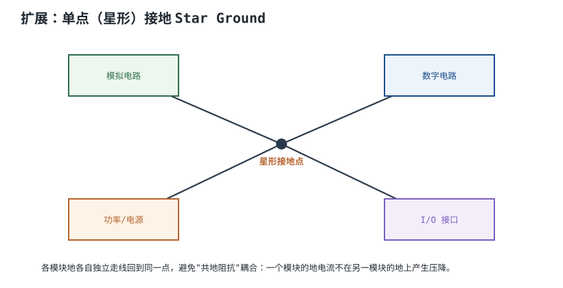
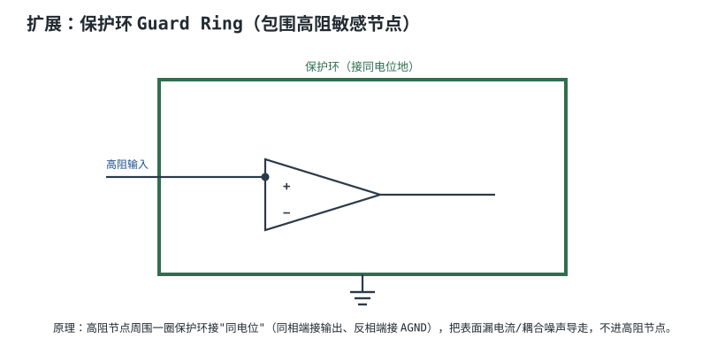
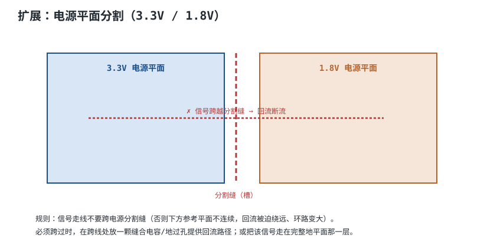

# 模拟、数字、电源分区布线 Analog / Digital / Power Partitioning

一块板子上同时有精密模拟电路（µV 级）、喧闹数字电路（MHz 方波）和大功率开关电源。三者的地电流如果共用一段导线，就会通过**共地阻抗（Common Ground Impedance）**互相干扰。分区布线就是把这三类电流的回路尽量分开。

## 1. 设计动机

::: motivation 为什么要分区地
数字门开关时瞬态电流很大，在地上产生 mV 级噪声压降。如果模拟地和数字地共用一段走线，这个噪声压降就会叠到 µV 级的模拟信号上——ADC 读数乱跳。分区的本质是：让数字回流别流进模拟地。
:::

## 2. 图示：模数地在 ADC 下方单点桥接

## 3. 机理：共地阻抗耦合

两根地线共用一段阻抗 $Z$，数字回流电流 $i_d$ 流过它，就在模拟地端产生噪声电压 $v_n=i_d Z$：

$$v_n = i_d \cdot Z_{common}$$

- 数字地电流大、变化快 → $i_d$ 大
- 地线有电感 → $Z=j\omega L$，频率越高越大
- 结果：$v_n$ 直接串进模拟前端

解决思路：让 $i_d$ 和模拟信号的地**不共用同一段 $Z$**。

## 4. 设计准则

1. **物理分区**：模拟/数字/电源在布局上分开（见[布局](placement.md)）。
2. **地平面分割线经过 ADC 下方**：ADC 模拟脚朝模拟区、数字脚朝数字区，两地在 ADC 正下方唯一一点相连（0Ω 或磁珠）。
3. **不要跨分割走线**：任何信号都不要从分割缝上方走过。
4. **现代观点**：多数低速板用**完整地平面 + 良好布局**比硬分割更安全——硬分割一旦被跨线反而更糟。

## 5. 完整设计示例

::: example STM32 + 12bit ADC 板的地处理
1. **需求**：12bit ADC 采集 mV 级传感器信号，怕数字噪声。
2. **布局**：模拟前端（运放+传感器）在左，STM32 在右。
3. **地平面**：L2 完整 GND，不分割（低速板）。
4. **ADC 下方**：模拟地与数字地在 ADC 正下方用 0Ω 单点桥接。
5. **去耦**：模拟电源脚单独磁珠 + 0.1µF 滤波。
6. **检查**：模拟信号走线下方是完整 GND，不跨任何分割。
:::

## 6. 检查与仿真

- **跨分割检查**：用 EDA 的平面检查，确认没有走线跨越分割缝。
- **单点桥接位置**：确认桥接在 ADC/混合信号芯片正下方。
- **实测**：示波器看 ADC 输入噪声，切换地处理对比。

## 扩展与变种电路

### 扩展1：单点（星形）接地 Star Ground

低频/高精度模拟里，各模块地各自独立回到同一点。

::: example 机理与定量
- 各模块地走线互不共用段，共地阻抗 $Z_{common}$ 趋近于 0。
- 低频（<1 MHz）星形地有效；高频下地线本身电感大，星形反而环路大。
- 高速数字板用完整平面地，不用星形。
:::

准则对比：

| 接地方式 | 低频 | 高频 |
|---|---|---|
| 星形/单点 | 优 | 差（地线电感大） |
| 完整平面 | 良 | 优 |

::: pitfall 高频板用星形接地
- **现象**：高频下星形地反而噪声大。
- **原因**：高频下每根地线都是电感，星点汇集处环路大。
- **解决**：高频数字板用完整地平面。
:::

### 扩展2：保护环 Guard Ring

高阻敏感节点周围一圈保护环，把漏电流导走。

::: example 机理与定量
- 高阻节点（如运放同相端，MΩ 级）周围的 PCB 表面漏电流会污染信号。
- 保护环核心规则：接与被保护节点**相同的直流电位**（让环上无电压差、无漏电流流入节点）。具体接法随电路而定：电压跟随器（Buffer）里同相端节点≈输出，环可接输出；反相放大的虚地节点则环接 AGND。不要一概而论"同相端都接输出"。
- 漏电流被保护环导走，不流入高阻节点。
- 高阻电路（光电二极管、EEG）必备。
:::

准则对比：

| 处理 | 高阻漏电流 |
|---|---|
| 无保护环 | 大（误差） |
| 保护环 | 小 |

::: pitfall 保护环接错电位
- **现象**：加了保护环反而误差变大。
- **原因**：保护环接到了错误电位，成了新的噪声源。
- **解决**：保护环接与被保护节点相同电位。
:::

### 扩展3：电源平面分割（3.3V / 1.8V）

多电压电源在同一层平面上分割成几块。

::: example 机理与定量
- 同层电源平面按电压分割：3.3V 一块、1.8V 一块，中间留缝。
- **大忌**：信号走线跨越分割缝——下方参考平面（地或电源）不连续，回流断流。
- 必须跨过时，在跨线处放缝合电容（ stitching cap ）或地过孔提供回流路径。
- 或者把该信号走在有完整地平面的另一层。
:::

准则对比：

| 走线位置 | 回流 | EMI |
|---|---|---|
| 完整平面上方 | 紧贴、短 | 低 |
| 跨分割缝 | 绕远 | 高 |

::: pitfall 高速信号跨电源分割缝
- **现象**：跨缝信号 EMI 超标、信号质量差。
- **原因**：参考平面不连续，回流绕远、环路大。
- **解决**：缝合电容/地过孔在跨线处补回流，或改走完整平面层。
:::

## 7. 常见坑与故障现象

::: pitfall 常见坑
- **为"模数分开"把地平面挖一条深槽**：高速信号跨槽，回流绕远，EMI 超标。分割要谨慎。
- **桥接点放错位置**：两地桥接放在板子边缘而不是 ADC 下方，噪声照样串。
- **模拟电源直接用数字电源**：没加磁珠/滤波，数字噪声全进模拟。
- **跨电源分割走线**：见扩展3。
:::

## 8. 自测题

什么是共地阻抗耦合？为什么数字噪声会串到模拟电路？

两地共用一段地线阻抗 $Z$，数字回流 $i_d$ 流过它产生 $v_n=i_d Z$，叠加到模拟信号上。数字电流大、变化快，$Z$ 随频率增大，所以串扰明显。分区就是避免共用这段 $Z$。

模数地为什么在 ADC 正下方单点桥接，而不是随便找个点？

ADC 是模拟与数字的边界，它的模拟脚朝模拟区、数字脚朝数字区。桥接放在它正下方，数字回流在数字区内循环，只在这一点回到模拟地，不会流过模拟前端的地。放错位置噪声照样串。

高速信号为什么不能跨电源分割缝？怎么办？

跨缝意味着下方参考平面不连续，回流被迫绕远、环路变大、辐射增加。解决：在跨线处放缝合电容/地过孔补回流，或把该信号改走完整地平面那一层。

## 9. 参考资料

- Henry W. Ott, *Electromagnetic Compatibility Engineering*, Wiley 2009
- onsemi AND8301-D EMC PCB Layout Guidelines
- TI SLVA680A ESD Protection Layout Guide
