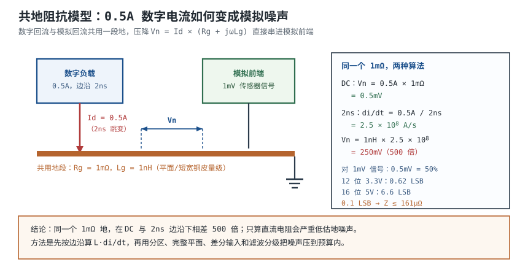

# 模拟、数字、电源分区布线 Analog / Digital / Power Partitioning

一块 100mm×80mm 的四层板上，可以同时住着三类完全不同的电流：µV 级传感器前端那几十 µA 的偏置电流、0.5A 的数字负载在 2ns 内翻转的开关电流、3A 的开关电源在 500kHz 上斩波的脉冲电流。原理图里它们都接在一根叫 GND 的横线上；PCB 上这根"横线"是一整块铜皮，有 5~20mΩ 的方阻、0.2~0.5nH/mm 的走线电感，还有几安培的电流在里面找路。

**分区布线要解决的，不是"把地分开"，而是"让每一类回流电流走它自己的路，并且在必须相交的地方只交一次、交在正确的位置"。** 这句话有两层含义：第一，"地"不是等电位的 0V，而是一个随频率和位置变化的阻抗网络；第二，真正决定噪声走向的是**回流路径**，不是原理图上画的符号。割一条缝不会自动"隔离"噪声，它只是把回流赶到了别处。

这一章先把"地不是 0V"从口号变成可以复算的阻抗，再讨论三件事：模拟/数字/功率地怎么分区、在哪里桥接；星形和平面各自在什么频率下成立；电源树与去耦怎么分层，才能让模拟电源真的"干净"。结论会有些反直觉：**多数混合信号板的正确起点是连续地平面 + 按回流分区摆放，而不是把整块地切成两块；只有在器件数据手册明确要求、或者回流确实无法分离时，才做局部桥接。** 这个结论有适用前提，第 5 节会写清楚。

## 1. 设计动机

::: motivation 三个现场
**现场一：16 位 ADC 旁边的 0.5A 数字电流。** 5V 满量程、16 位 ADC 的 1 LSB 是 $5/65536=76.3\ \mu\text{V}$。数字侧 0.5A 电流流过 1mΩ 的共地段，产生 $0.5\ \text{mV}$ 地噪声，相当于 6.6 个 LSB；对于 1mV 的传感器信号，这就是 50% 的误差。它不是"精度差一点"，而是读数直接被地噪声改写。

**现场二：星形接地用在 2ns 边沿的板上。** 星形接地的本意是避免共阻耦合，但每条支路都是一根长导线：50mm 支路约 20nH，0.1A/ns 的返回电流打出 $20\times10^{-9}\times10^{8}=2.0\ \text{V}$ 地弹。低频成立的口诀，到了高频反而变成噪声源。

**现场三：用磁珠把 AGND 和 DGND 桥起来。** 直流上两地连着，高频上被磁珠隔开；数字地的 dV/dt 就通过这个"隔开"的阻抗抬高了模拟地的电位。ADC 的模拟输入以 AGND 为参考、数字输出以 DGND 为参考，这个差值直接叠在转换结果上。**桥接元件不是"保险丝"，它是两地之间唯一的阻抗，选错就把噪声请进来。**
:::

设计前先明确你要判断哪四件事：

| 你想判断 | 先查什么 | 判据 |
|---|---|---|
| 数字噪声会不会进模拟 | 共地阻抗、回流路径 | 共地压降 $V_n=I_d Z_{common}$ 与信号量级比较 |
| 要不要分割地平面 | 最高频率/边沿速率、器件手册 | 跨分割回流电感与连续平面之比 |
| 用星形还是平面 | 上升时间、互连长度 | 互连长度与 $\lambda/20$ 比较 |
| 模拟电源怎么来 | 负载电流、PSRR、允许纹波 | 电源树与去耦层级，$Z_{target}=\Delta V/\Delta I$ |

**不懂会在哪里摔跤**，具体是这四条：

1. 把"地"当 0V，只算直流电阻，不算电感。0.5A 直流过 1mΩ 只有 0.5mV，但同样 0.5A 在 2ns 内跳变、经过 1nH，就是 250mV——两个数量级的差别。
2. 把"分割地平面"当成万能隔离。缝一割，跨缝信号的回流被迫绕行，环路面积和电感骤增，EMI 和地弹反而更差。
3. 把星形接地当普遍规则。星形只在"互连长度远小于波长、回流可以真正分开"时成立；到了 ns 边沿，每条地支路都是电感。
4. 模拟电源直接从数字电源引一条线，指望"加个磁珠就好了"。磁珠有直流压降、和电容会谐振、高频阻抗还受直流偏置影响，它不是理想隔离器。

## 2. 定义与直观：三类电流、三个"地"、一条回流路径

### 2.1 三个"地"其实是三类回流

**地（Ground）**在电子系统里通常指电路的参考导体，也是回流电流的路径。理想地的电位处处相同、阻抗为零；真实地有电阻、电感、电容耦合和天线效应，不同位置的"地"电位不同。工程上说的"模拟地 AGND""数字地 DGND""功率地 PGND"，指的不是三块互不相干的铜，而是**同一块铜（或同一叠层里的平面）上，承担不同回流电流的区域**。

| 电流类型 | 典型量级 | 频谱 | 主要耦合方式 | 对模拟前端的威胁 |
|---|---|---|---|---|
| 模拟回流 | µA~mA | DC~几十 kHz | 共阻、漏电、热电势 | 直接叠加在信号上 |
| 数字回流 | 0.1~10A | 边沿决定，可达几百 MHz | 共阻、共模、近场耦合 | 地弹、采样时刻抖动 |
| 功率回流 | 1~10A | 开关频率及其谐波 | 磁场、共模、传导 | 纹波、共模电压、EMI |

三者的量级差得很远：模拟回流是 µA~mA，数字和功率回流是 A 级，相差三到四个数量级。**分区要做的，是让 A 级的回流不要流经 mV 级信号所依赖的那一段阻抗。**

### 2.2 "地不是 0V"的定量含义

"地不是 0V"不是哲学讨论，而是 $V=IR$ 和 $V=L\,di/dt$ 的直接结果。下面这张表和[地的学问与地弹](../power/grounding.md)保持同一口径：

| 场景 | 电流/频率 | 地阻抗 | 地电压 |
|---|---|---|---|
| 2A 直流过 10mΩ 平面 | 2A DC | 10mΩ | 20mV |
| 0.5A 数字电流过 1mΩ 平面 | 0.5A DC | 1mΩ | 0.5mV |
| 1A 过 10nH 地线 | 1A，10MHz | $j0.628\ \Omega$ | 0.628V |
| 8 路输出同时开关 | 0.4A/ns | 2nH | 0.80V |
| 0.5A 过 5mΩ + 10nH | 0.5A，1MHz | $5\ \text{m}\Omega+j62.8\ \text{m}\Omega$ | 31.6mV |

**同一个"地"，在 DC、1MHz、开关边沿下可以是 mV、百 mV、V 三个量级。** 所以"地噪声有多大"这个问题，必须带上电流波形、频率和具体位置才能回答；只报一个电阻值没有意义。

### 2.3 回流路径决定噪声走向

高频回流不走"电阻最小"的路径，而走**电感最小**的路径：信号走线正下方的参考平面。信号换层、跨分割、经过连接器时，回流必须找到一条低电感的路跟过去；找不到，它就绕远，环路面积变大，辐射和串扰同时变差。**分区的本质，是设计这条回流路径，而不是在地平面上画线。**

::: analogy 三条河与一条渠
把模拟、数字、功率回流想成三条河：模拟河流量小但水质要求高，数字河流量大且忽涨忽落，功率河流量最大还带泥沙。分区相当于给它们各修河床，只在必须交汇的地方修一个可控的涵洞；而不是在平原上随便挖一条沟，让三条河都从同一个缺口挤过去。

类比的边界：水往低处流，电流往**阻抗最低**的地方流，高频还专门挑**电感最小**的路；水汇合后混合是不可逆的，电流却在每个节点按阻抗分配，地平面上的回流是分布电流，不是一条线。所以"修河床"只是直觉，真正的判据是阻抗和波长。
:::

## 3. 定量关系

### 3.1 共地阻抗：先算电阻，再算电感

一段导体的直流电阻：

$$
R=\rho\frac{l}{A}
$$

其中 $\rho$ 是电阻率，$\Omega\cdot\text{m}$（1oz 铜约 $1.72\times10^{-8}$）；$l$ 是长度，m；$A$ 是截面积，$\text{m}^2$。

以 1oz 铜（35µm）、25mm 长、2mm 宽的走线为例：

$$
R=1.72\times10^{-8}\times\frac{0.025}{2\times10^{-3}\times35\times10^{-6}}
=\frac{4.30\times10^{-10}}{7.0\times10^{-8}}=6.14\times10^{-3}\ \Omega=6.14\ \text{m}\Omega
$$

0.5A 直流电流流过它：

$$
V=IR=0.5\times6.14\times10^{-3}=3.07\ \text{mV}
$$

如果换成一块完整地平面，电流扩散开，等效电阻可以低到 1mΩ 量级；此时同样的 0.5A 只产生：

$$
V=0.5\times1\times10^{-3}=0.5\ \text{mV}
$$

**1mΩ 与 6.14mΩ 的差别，就是"平面"与"细走线"的差别**；这也是为什么模拟前端的地要尽量用平面而不是一根细线。

高频下电感占主导。地平面之上的走线电感约 0.2~0.5nH/mm，1mm 过孔约 0.7nH，50mm 地支路约 10~25nH。以 $L=10\ \text{nH}$、$I=0.5\ \text{A}$、$f=1\ \text{MHz}$ 为例：

$$
|V|=2\pi fLI=2\pi\times10^{6}\times10\times10^{-9}\times0.5=31.4\ \text{mV}
$$

同样的 0.5A，直流只有 0.5mV，1MHz 就有 31.4mV，相差 63 倍。地噪声的完整表达式是：

$$
V_n=I_d\left(R_g+j\omega L_g\right)
$$

其中 $I_d$ 是回流电流，A；$R_g$ 是共地段电阻，$\Omega$；$L_g$ 是共地段电感，H；$\omega=2\pi f$。这个式子的适用前提是"集总近似"：共地段的长度远小于波长，电流在同一时刻处处相同。到了 GHz 和长距离，必须用传输线/平面模型。

### 3.2 桥接元件：0Ω、磁珠、电容各自把什么连起来

分割之后，两地必须在某处相连，否则没有直流通路，电位会漂。桥接元件的选择，取决于你要连接的是"直流电位"还是"高频回流"：

| 桥接元件 | 直流 | 高频 | 风险 | 适用 |
|---|---|---|---|---|
| 直接铜连/宽桥 | 低阻 | 低电感 | 数字电流可能借桥回流 | 器件手册要求单点连接时的首选 |
| 0Ω 电阻 | 几十 mΩ 量级 | 约 0.5~1nH（0402） | 桥太窄、太长时电感大 | 需要留调试/改板选项时 |
| 磁珠 | 按 DCR，几十 mΩ~几 Ω | 高频高阻 | 两地之间出现共模电压 | 一般**不**用于地-地桥接 |
| 电容 | 开路 | 容抗 $1/(2\pi fC)$ | 低频不起作用，可能与平面电感谐振 | 只用于跨分割的缝合，不用于接地桥 |

用一个数字说明磁珠为什么不适合桥地：某 0603 磁珠在 100MHz 的阻抗约 600Ω（典型量级，以数据手册为准），数字地的 dV/dt 在这个阻抗上产生的压降，会原样加在模拟地与数字地之间。ADC 的模拟输入参考 AGND、数字接口参考 DGND，这个压降就是共模噪声；如果模拟前端是单端输入，它就变成了差模误差。**"用磁珠隔离数字噪声"这句话，只在磁珠后面还有滤波和独立参考时成立；把磁珠串在两个地之间，等于给噪声修了一座桥。** 整机的屏蔽、滤波与接地怎么配合，见[屏蔽、滤波与接地设计](shielding-filtering-grounding.md)。

反过来，0Ω 电阻的优势是直流低阻、高频电感小（0402 约 0.5~1nH）。仍以 0.05A/ns 的数字回流经过 0.5nH 桥为例：

$$
V=0.5\times10^{-9}\times0.05\times10^{9}=25\ \text{mV}
$$

25mV 对 12 位、3.3V 满量程的 ADC 是 $25\ \text{mV}/0.806\ \text{mV}\approx31$ 个 LSB。**桥只能解决直流/低频电位差，不能解决高频地弹**；要压高频，靠的是"数字回流根本不经过桥"，也就是分区摆放和连续平面。

### 3.3 星形还是平面：用 $\lambda/20$ 判据

星形接地的直觉是"所有电流在一点汇合，谁也不占谁的便宜"。这在 DC/低频成立：只要各支路电流不共用同一段电阻，就没有共阻耦合。但高频电流走电感最小的路径，一条 50mm 的星形支路，电感可能比整块地平面还大。

判据是电长度。边沿的最高显著频率：

$$
f_{knee}\approx\frac{0.35}{t_r}
$$

其中 $t_r$ 是上升时间，s；$f_{knee}$ 是边沿带宽，Hz。若互连长度接近或超过 $\lambda/20$，就应按分布参数/地平面处理：

$$
l\gtrsim\frac{\lambda}{20}=\frac{c}{20f_{knee}\sqrt{\varepsilon_{eff}}}
$$

其中 $c=3.0\times10^{8}\ \text{m/s}$；$\varepsilon_{eff}$ 是有效介电常数，无量纲。以 $t_r=1\ \text{ns}$、$f_{knee}=350\ \text{MHz}$、$\varepsilon_{eff}\approx4$ 为例：

$$
\lambda=\frac{3.0\times10^{8}}{350\times10^{6}\times\sqrt{4}}=0.429\ \text{m},\qquad
\frac{\lambda}{20}=21.4\ \text{mm}
$$

一块 100mm 的板早就超过这个尺度，必须用完整地平面；而 50Hz 的模拟电路波长 6000km，星形接地完全够用。**拓扑选择的第一变量是频率/边沿速率，不是"模拟/数字"这个标签。**

两种拓扑的定量对比（0.1A/ns 返回电流）：

| 拓扑 | 等效电感 | 地弹 $L\,di/dt$ | 适用 |
|---|---|---|---|
| 50mm 星形支路 | 约 20nH | 2.0V | 低频、小信号、模块间隔离 |
| 完整平面 + 8 个地过孔 | 约 0.15nH | 15mV | 高频数字、混合信号 |
| 20mm 分割缝（回流绕行） | 约 8nH | 0.8V | 应避免；见 3.4 节 |

平面那一行的 0.15nH 是这么估的：8 个 1mm 过孔每个约 0.7nH，并联 $0.7/8=0.0875\ \text{nH}$，加上平面扩散约 0.06nH，合计约 0.15nH。过孔数量、孔径、平面层间距都会改变这个值，**它是量级，不是保证值**。

### 3.4 分割的代价：跨缝回流与槽天线

把地平面切成 AGND/DGND 两块，直觉是"数字噪声不进入模拟区"。代价有三条：

1. **回流被迫绕行**：任何跨分割缝的信号，回流不能走信号正下方的地平面，只能绕到桥接点，环路面积和电感骤增。
2. **桥接点成为瓶颈**：所有跨区电流都挤过桥，桥的电感/电阻决定共模噪声。
3. **缝隙变成天线**：长缝会形成槽天线，辐射和抗扰度都变差。

用数字算：一条 20mm 的分割缝，让回流多绕 20mm，附加电感按 0.4nH/mm 估算约 8nH；0.25A/ns 的返回电流产生：

$$
V=8\times10^{-9}\times0.25\times10^{9}=2.0\ \text{V}
$$

而完整平面下，同样的电流走 8 个地过孔加平面扩散，总电感约 0.15nH：

$$
V=0.15\times10^{-9}\times0.25\times10^{9}=37.5\ \text{mV}
$$

两者差 53 倍。**如果分割缝正好在高速信号下方，分割不但没有"隔离噪声"，反而制造了更大的共模电压。**

槽天线的谐振频率可以估算：

$$
f_{slot}=\frac{c}{2L\sqrt{\varepsilon_{eff}}}
$$

其中 $L$ 是缝的最长尺寸，m。$L=20\ \text{mm}$、$\varepsilon_{eff}=4$ 时：

$$
f_{slot}=\frac{3.0\times10^{8}}{2\times0.02\times2}=3.75\times10^{9}\ \text{Hz}=3.75\ \text{GHz}
$$

$L=100\ \text{mm}$ 时降到 750MHz。**缝越长，谐振越低，越容易落在产品关心的频段里**；这也是"能用短桥就不用长缝"的定量理由。分割缝的辐射后果、槽天线与共模电流的关系，见[EMI/EMC：辐射与传导机理](emi-emc.md)。

### 3.5 电源树与去耦的层级

模拟电源的干净程度，不是靠一颗磁珠决定的，而是由**电源树**和**去耦层级**共同决定。先定目标阻抗：

$$
Z_{target}=\frac{\Delta V_{allow}}{\Delta I}
$$

其中 $\Delta V_{allow}$ 是允许的电源偏差，V；$\Delta I$ 是瞬态电流变化，A；$Z_{target}$ 是目标阻抗，$\Omega$。3.3V 电源允许 ±2%（66mV）、瞬态 0.5A 时：

$$
Z_{target}=\frac{0.066}{0.5}=0.132\ \Omega=132\ \text{m}\Omega
$$

这个目标看起来很松，但它必须**在整个关心频段内**成立，而不是只在 DC 成立。去耦按频段分三层：

| 层级 | 典型元件 | 负责频段 | 关键限制 |
|---|---|---|---|
| 体电容（bulk） | 10~100µF 陶瓷/聚合物/电解 | DC~几十 kHz | 容值、ESR、环路带宽 |
| 局部去耦 | 1~10µF 陶瓷 | 几十 kHz~几 MHz | 安装电感、ESR |
| 引脚去耦 | 0.1µF、1nF | 几 MHz~几十 MHz | ESL、过孔、焊盘 |
| 模拟电源滤波 | 磁珠 + 1µF + LDO | 取决于滤波与 PSRR | 直流压降、谐振、PSRR 随频率下降 |

体电容按电荷守恒估：

$$
C_{bulk}\ge\frac{\Delta I\Delta t}{\Delta V_{allow}}
$$

其中 $\Delta t$ 是电源环路响应时间，s。0.5A、5µs、66mV 时：

$$
C_{bulk}\ge\frac{0.5\times5\times10^{-6}}{0.066}=3.79\times10^{-5}\ \text{F}=37.9\ \mu\text{F}
$$

实际取值要同时满足 ESR 纹波、环路稳定和降额，所以常见做法是取计算值的几倍，而不是刚好 37.9µF。

单颗电容的自谐振频率：

$$
f_{SR}=\frac{1}{2\pi\sqrt{L_{ESL}C}}
$$

0.1µF、总电感 0.8nH（含封装、焊盘、过孔）时：

$$
f_{SR}=\frac{1}{2\pi\sqrt{0.8\times10^{-9}\times0.1\times10^{-6}}}=17.8\ \text{MHz}
$$

高于自谐振频率，电容呈感性，但**仍然是并联网络里的低感通路**，不是"失效"；真正的问题是安装电感太大，导致目标频段内阻抗压不下来。安装电感、反谐振与目标阻抗的完整推导见[电源完整性与去耦体系](../power/power-integrity-decoupling.md)。

模拟电源常见的"磁珠 + 电容"是一个二阶低通，转折频率：

$$
f_c=\frac{1}{2\pi\sqrt{LC}}
$$

以 $L=1\ \mu\text{H}$、$C=1\ \mu\text{F}$ 为例：

$$
f_c=\frac{1}{2\pi\sqrt{1\times10^{-6}\times1\times10^{-6}}}=159\ \text{kHz}
$$

在 1MHz，理想二阶滤波的衰减约 $40\log_{10}(10^{6}/159\times10^{3})=31.9\ \text{dB}$。但这是理想值：磁珠的阻抗随频率和直流偏置变化，电容有 ESL，PCB 有寄生参数，实际衰减通常小于这个数；**转折频率附近还可能出现谐振峰，需要靠磁珠的电阻分量或额外的 RC 阻尼压住**。

## 4. 典型计算

### 4.1 主算例：0.5A 数字电流、1mΩ 共地阻抗、1mV 模拟信号

**需求与假设**：

| 项目 | 取值 |
|---|---|
| ADC | 12 位，3.3V 满量程，单端输入 |
| 模拟信号 | 1mV 峰峰值，传感器前端 |
| 数字负载 | 0.5A，边沿 2ns |
| 共地阻抗 | 1mΩ（平面/短宽铜皮量级） |
| 关心带宽 | DC~1MHz（采样率 100kSPS 量级） |
| 目标 | 地噪声 < 0.1 LSB |

> 题面常写成"1mV 等效地阻抗"，这是单位混用：**阻抗的单位是 Ω，噪声才是 mV**。本章按 1mΩ 计算，并把对应的噪声电压单独列出。

**第一步，ADC 的 1 LSB**：

$$
V_{LSB}=\frac{V_{FS}}{2^{N}}=\frac{3.3}{2^{12}}=\frac{3.3}{4096}=8.057\times10^{-4}\ \text{V}=805.7\ \mu\text{V}
$$

0.1 LSB 的预算是 $80.6\ \mu\text{V}$。

**第二步，静态地噪声**：

$$
V_n=I_d R_g=0.5\times1\times10^{-3}=0.5\ \text{mV}
$$

相对 1mV 信号：

$$
\frac{V_n}{V_{signal}}=\frac{0.5}{1.0}=50\%,\qquad
SNR=20\log_{10}\frac{1.0}{0.5}=6.02\ \text{dB}
$$

折算成 LSB：

$$
\frac{0.5\times10^{-3}}{805.7\times10^{-6}}=0.62\ \text{LSB}
$$

**结论：静态 0.5mV 地噪声对 1mV 信号是 50% 的误差，但对 12 位 ADC 只有 0.62 LSB——它是"信号被淹没"，不是"ADC 分辨率不够"。** 对 16 位、5V 满量程的 ADC，同样是 0.5mV，却是 $0.5\ \text{mV}/76.3\ \mu\text{V}=6.6$ LSB，问题立刻变成精度问题。

**第三步，动态地噪声**。数字电流在 2ns 内跳变 0.5A：

$$
\frac{di}{dt}=\frac{0.5}{2\times10^{-9}}=2.5\times10^{8}\ \text{A/s}
$$

若共地段有 1nH（约 2~5mm 走线）：

$$
V=L\frac{di}{dt}=1\times10^{-9}\times2.5\times10^{8}=0.25\ \text{V}=250\ \text{mV}
$$

若共地段只有 0.15nH（完整平面 + 8 个地过孔）：

$$
V=0.15\times10^{-9}\times2.5\times10^{8}=37.5\ \text{mV}
$$

**250mV 与 0.5mV 相差 500 倍。** 同一个"1mΩ 地"，在静态和动态下完全是两个器件；只算直流电阻会严重低估问题。

**第四步，反推需要多低的阻抗。** 要把地噪声压到 0.1 LSB（80.6µV），静态下需要：

$$
Z\le\frac{80.6\times10^{-6}}{0.5}=1.61\times10^{-4}\ \Omega=161\ \mu\Omega
$$

动态下，若仍按 2ns 边沿，允许的电感是：

$$
L\le\frac{80.6\times10^{-6}}{2.5\times10^{8}}=3.2\times10^{-13}\ \text{H}=0.32\ \text{pH}
$$

0.32pH 在 PCB 上不可能靠一段地实现。**所以"把地做低阻"这条路在动态下走不通，必须换手段：让数字回流不经过模拟地、用差分输入抵消共模、用滤波限制带宽。**

**第五步，差分输入的收益。** 若模拟前端改成差分，地噪声以共模形式同时出现在两个输入端，被 CMRR 抑制：

$$
V_{out,n}=\frac{V_n}{10^{CMRR/20}}
$$

CMRR=80dB 时：

$$
V_{out,n}=\frac{0.5\times10^{-3}}{10^{4}}=50\ \text{nV}
$$

但这是理想值。实际 CMRR 受电阻失配限制：0.1% 的电阻失配通常只能做到 50~60dB，此时 0.5mV 共模噪声残留 $0.5\ \text{mV}/10^{2.5}\approx1.6\ \mu\text{V}$，仍低于 0.1 LSB。**差分的价值在于把"地噪声"从差模误差变成共模误差，但它要求前端匹配和共模范围都成立。**

**第六步，滤波的收益。** 在 ADC 前加一阶 RC（1kΩ + 100nF）：

$$
f_c=\frac{1}{2\pi RC}=\frac{1}{2\pi\times1000\times100\times10^{-9}}=1.59\ \text{kHz}
$$

1MHz 处的衰减：

$$
20\log_{10}\frac{10^{6}}{1.59\times10^{3}}=56.0\ \text{dB}
$$

也就是把 1MHz 的开关噪声压到约 1/630。**RC 滤波对"高频地噪声"有效，对"与信号同频的噪声"无效**——这正是第 5 节要强调的适用前提。

**第七步，结论**：

| 措施 | 对 0.5mV 静态噪声 | 对 250mV 动态噪声 | 代价 |
|---|---|---|---|
| 加大地平面（1mΩ 保持） | 无改善 | 无改善 | 无 |
| 分区 + 数字回流不经过模拟地 | 明显 | 明显 | 布局约束 |
| 0Ω 单点桥接（0.5nH） | 无改善 | 25mV 量级 | 桥的位置敏感 |
| 差分输入（CMRR 80dB） | 50nV | 2.5µV | 前端复杂度、匹配 |
| RC 滤波（1.59kHz） | 无改善（DC） | 1MHz 处 -56dB | 建立时间、源阻抗 |
| 16 位 ADC + 1mV 信号 | 6.6 LSB | 无法工作 | 需要重新分配预算 |

**没有任何单一措施能同时解决静态和动态噪声。** 正确顺序是：先用分区和平面把动态噪声从"V 级"压到"几十 mV 级"，再用差分/滤波把残留压到"µV 级"，最后才谈 ADC 的有效位数。

### 4.2 电源树核算：3.3V 模拟电源怎么来

假设板上有 12V 输入、5V/2A 数字电源、3.3V/1A 数字电源，模拟前端需要 3.3V/300mA、纹波 <1mV。

**第一步，模拟电源的来路。** 直接用 3.3V 数字电源 + 磁珠，还是单独 LDO？比较两种方案：

| 方案 | 直流压降 | 高频抑制 | 成本/面积 | 适用 |
|---|---|---|---|---|
| 数字 3.3V + 磁珠 + 1µF | 磁珠 DCR×0.3A | 磁珠阻抗 + 电容 | 低 | 负载小、纹波要求松 |
| 数字 3.3V + LDO | LDO 压差 | PSRR，随频率下降 | 中 | 纹波要求高、压差够 |
| 5V + LDO 到 3.3V | 1.7V×0.3A=0.51W | PSRR | 散热 | 5V 有余量时 |

磁珠的直流压降必须核算：某磁珠 DCR=0.5Ω（典型量级，以数据手册为准），300mA 时：

$$
V_{drop}=0.3\times0.5=0.15\ \text{V}
$$

这是 3.3V 的 4.5%，已经吃掉 LDO 或负载的余量。换成 DCR=0.15Ω 的磁珠：

$$
V_{drop}=0.3\times0.15=0.045\ \text{V}
$$

1.4%，可以接受。**"加个磁珠"之前，先算 DCR 压降和额定电流，再看高频阻抗。**

**第二步，LDO 的 PSRR 不是常数。** 某 LDO 在 1kHz 的 PSRR 约 60dB，在 1MHz 可能只有 20dB（典型量级，以数据手册曲线为准）。若数字 3.3V 上有 10mV/1MHz 的纹波：

$$
V_{out}=10\ \text{mV}\times10^{-20/20}=1.0\ \text{mV}
$$

正好用掉全部预算。**所以"LDO 能滤掉一切"是错的：低频靠 PSRR，高频要靠 LDO 输出电容、磁珠和板级去耦共同承担。**

**第三步，去耦层级。** 按 3.5 节的表，模拟前端至少要有：LDO 输出 10µF、每个电源脚 0.1µF、基准源单独 1µF + 0.1µF。0.1µF 的安装电感要控制在 1nH 以内，否则自谐振频率降到 15.9MHz 以下：

$$
f_{SR}=\frac{1}{2\pi\sqrt{1\times10^{-9}\times0.1\times10^{-6}}}=15.9\ \text{MHz}
$$

对 1MHz 的纹波影响不大，但对 20MHz 以上的数字噪声，安装电感就是决定性的。

**第四步，结论**：模拟电源的干净程度 = 电源树拓扑 × 每级滤波的转折频率 × 器件 PSRR × 布局安装电感。**任何一级缺失，后面的努力都会被前面的噪声淹没。**

### 4.3 桥接与分割的对比算例

仍用前面的板：0.25A/ns 的数字回流，比较三种地处理：

| 处理 | 回流路径电感 | 地弹 | 说明 |
|---|---|---|---|
| 完整平面，数字/模拟分区摆放 | 0.15nH | 37.5mV | 回流走信号正下方 |
| 分割 + 20mm 缝，信号不跨缝 | 8nH（数字区内绕行） | 2.0V | 数字回流被限制在数字区，但区内路径变长 |
| 分割 + 0Ω 桥（0.5nH），数字电流借桥回流 | 0.5nH | 125mV | 桥成为瓶颈，且噪声进入模拟地 |

第三种情况的地弹：

$$
V=0.5\times10^{-9}\times0.25\times10^{9}=125\ \text{mV}
$$

**注意第二行和第三行的区别**：分割本身不一定错，错在"让数字大电流借桥回流"。如果分割后数字回流完全在数字区内闭合，只有 ADC 的 AGND/DGND 在器件下方单点相连，那么桥只承担很小的电流，噪声是可控的。**判断标准不是"分没分"，而是"谁在借桥"。**

## 5. 工程含义

### 5.1 数量级速查

| 量 | 典型量级 | 说明 |
|---|---|---|
| PCB 走线电阻 | 5~20mΩ/25mm | 1oz 铜、2mm 宽 |
| 平面等效电阻 | 0.5~2mΩ | 取决于铜厚、过孔、电流路径 |
| 走线电感 | 0.2~0.5nH/mm | 地平面之上 |
| 过孔电感 | 0.5~0.8nH/个 | 1mm 长、0.3mm 直径 |
| 0Ω 电阻电感 | 0.5~1nH | 0402 封装 |
| 磁珠高频阻抗 | 几十~几百 Ω | 100MHz，随直流偏置下降 |
| 12 位 3.3V 的 1 LSB | 806µV | $3.3/4096$ |
| 16 位 5V 的 1 LSB | 76.3µV | $5/65536$ |

这些是量级，不是保证值；具体要看叠层、铜厚、过孔、连接器和电流波形。

### 5.2 布局顺序：先分区、再平面、后布线

1. **按信号流向摆放**：传感器/模拟前端在左，ADC 在中间，数字/功率在右；功率级（Buck、电机驱动）单独一角，远离模拟输入。
2. **先定地平面**：四层板优先"信号—地—电源—信号"，地平面完整；不要在高速信号下方开槽。
3. **再定电源树**：模拟电源从 LDO/滤波后的节点引，不从数字电源"就近借"；每条电源的电流路径要能一眼画出来。
4. **最后布线**：模拟信号走线短、包地、下方完整 GND；数字信号不跨分割；功率回路（输入电容—开关—电感）面积最小。
5. **过孔缝合**：地平面之间、连接器、屏蔽罩、晶振、ADC 附近多打过孔；过孔间距按最高频率的 $\lambda/20$ 量级控制。

接口保护与 ESD 泄放路径见[ESD 防护与接口保护](esd-protection.md)；摆放与走线的通用规则见[布局原则与模块化](placement.md)与[布线：线宽、载流、过孔、间距](routing.md)。

### 5.3 什么时候必须分割

分割不是默认动作。只有在下列条件之一成立时，才考虑把地平面分成两块：

- **器件数据手册明确要求**（部分 ADC、隔离器、传感器）；
- **回流确实无法分离**（例如高压/低压、隔离侧/非隔离侧）；
- **安全/安规要求**（保护地、隔离屏障，见[安全用电与触电防护](../basics/electrical-safety.md)）。

分割时遵守四条：分割线在器件下方、桥宽而短（≥3mm、长度尽量 ≤2mm）、桥两端多打过孔、**任何信号都不跨缝**。如果做不到，宁可不分割。

### 5.4 测量与验证

- **地弹测量**：用示波器"弹簧地"/同轴探针，直接测芯片地引脚与板级地之间的电压；不要用长地线鳄鱼夹，长地线本身就有几十 nH。
- **ADC 噪声**：短接输入，测码分布；分别关断数字负载/时钟，看噪声是否随数字电流变化。
- **跨分割检查**：用 EDA 的平面检查，确认没有走线跨越分割缝；桥的位置在混合信号器件正下方。
- **近场扫描**：用近场探头找辐射热点，确认分割缝没有变成槽天线。
- **对比实验**：同一块板做"分割/不分割"两个版本，测 ADC 码跳和辐射，用数据而不是口诀做决定。

## 6. 常见坑

::: pitfall 常见坑
- **为"模数分开"把地平面挖一条深槽**：现象——跨槽信号 EMI 超标、ADC 码跳变大。原因——参考平面不连续，回流绕行，20mm 缝、0.25A/ns 可产生约 2V 地弹。解决——保持地平面完整，用摆放分区；确需分割时桥要宽短、信号不跨缝。
- **用磁珠桥接 AGND/DGND**：现象——直流看着正常，ADC 噪声反而变大、共模干扰敏感。原因——磁珠在两地之间引入高频阻抗，数字地的 dV/dt 变成两地共模电压。解决——按器件手册用 0Ω 或直接铜连；磁珠只用于电源滤波，不用于地-地桥接。
- **桥接点放在板边**：现象——分割做了、桥也接了，噪声照样串。原因——数字回流到桥的路径经过模拟区，或在桥附近形成大环路。解决——桥放在 ADC/混合信号器件正下方，让数字回流在数字区内闭合。
- **星形接地用在高速板上**：现象——加了星形接地点，地弹和辐射反而更差。原因——50mm 支路约 20nH，0.1A/ns 就是 2V。解决——高速数字用完整地平面；星形只用于低频、小信号、隔离模块。
- **模拟电源直接从数字电源引**：现象——ADC 读数随数字负载波动。原因——数字电源的纹波和地噪声直接进入模拟前端，磁珠的 DCR 压降还吃掉余量。解决——独立 LDO 或"磁珠 + 滤波 + LDO"分级，核算 DCR 压降与 PSRR。
- **只算直流电阻，不算电感**：现象——按 1mΩ 算完觉得没问题，实测地弹几百 mV。原因——0.5A/2ns 的 $di/dt$ 在 1nH 上就是 250mV。解决——按边沿算 $L\,di/dt$，用完整平面、多过孔、差分和滤波组合处理。
:::

## 7. 自测题

0.5A 数字电流流过 1mΩ 共地阻抗，地噪声是多少？对 1mV 模拟信号、12 位 3.3V ADC 分别意味着什么？

$$
V_n=I_dR_g=0.5\times1\times10^{-3}=0.5\ \text{mV}
$$

对 1mV 信号是 50% 的误差，SNR 只有 $20\log_{10}(1/0.5)=6.02\ \text{dB}$；对 12 位、3.3V 满量程 ADC，1 LSB 是 806µV，0.5mV 约 0.62 LSB。对 16 位、5V 满量程 ADC，1 LSB 是 76.3µV，0.5mV 就是 6.6 LSB。**同样的地噪声，对分辨率越高的系统越致命。**

同样 0.5A，直流和 2ns 边沿下的地噪声为什么差 500 倍？

直流只看电阻：$0.5\times1\ \text{m}\Omega=0.5\ \text{mV}$。2ns 边沿看电感：$di/dt=0.5/(2\times10^{-9})=2.5\times10^{8}\ \text{A/s}$，1nH 上就是 $1\times10^{-9}\times2.5\times10^{8}=250\ \text{mV}$，正好是 500 倍。高频下地的"阻抗"从毫欧变成几十毫欧到欧姆级，所以必须按边沿算 $L\,di/dt$，不能只算直流电阻。

星形接地在什么频率下成立？用数字说明它为什么不能用在 2ns 边沿的板上。

判据是电长度：$f_{knee}=0.35/t_r$，互连长度超过 $\lambda/20$ 就应按分布参数处理。$t_r=1\ \text{ns}$、$\varepsilon_{eff}=4$ 时，$\lambda/20=21.4\ \text{mm}$，一块 100mm 的板早已超过。星形支路 50mm 约 20nH，0.1A/ns 的返回电流产生 $20\times10^{-9}\times10^{8}=2.0\ \text{V}$ 地弹；完整平面约 0.15nH，同样电流只有 15mV。**星形是低频方法，不是万能公式。**

为什么用磁珠桥接 AGND/DGND 可能比直接连更糟？

磁珠在直流上低阻、在高频上高阻，等于给两地之间加了一个随频率变化的阻抗。数字地的 dV/dt 会在这个阻抗上产生压降，形成两地之间的共模电压；ADC 的模拟输入参考 AGND、数字接口参考 DGND，这个压降就叠进转换结果。除非器件手册明确要求，桥接应用 0Ω 或直接铜连；磁珠用于电源滤波，不用于地-地桥接。

把地平面切成 AGND/DGND 两块，一定能把数字噪声隔开吗？

不一定。分割的代价是跨缝信号的回流被迫绕行：20mm 缝附加约 8nH，0.25A/ns 就是 2V，而完整平面约 0.15nH、只有 37.5mV，差 53 倍。如果数字大电流还借桥回流，桥本身又成为瓶颈。正确顺序是：先看器件手册和最高频率，再决定连续平面、分区还是局部桥；分割后必须保证没有信号跨缝、桥宽短多过孔、数字回流在数字区内闭合。

模拟电源用"3.3V 数字电源 + 磁珠 + 1µF"，需要核算哪些量？

至少四项：① 磁珠 DCR 压降，0.5Ω×0.3A=150mV，占 3.3V 的 4.5%，可能吃掉负载余量；② 磁珠高频阻抗与直流偏置的关系，偏置下阻抗会下降；③ 磁珠与 1µF 的转折频率 $f_c=1/(2\pi\sqrt{LC})=159\ \text{kHz}$，以及谐振峰是否被阻尼；④ 高频段 LDO/负载的 PSRR 与电容 ESL。只看"加了个磁珠"不够，四项都要有数字。

## 8. 参考资料

- **Henry W. Ott, *Electromagnetic Compatibility Engineering*, Wiley 2009**：Chapter 3 "Grounding" 讲单点/多点接地、共阻耦合、地环路；Chapter 11 "Digital Circuit Power Distribution" 讲电源分配与去耦。本章 2.3、3.1、3.3 的接地口径与 3.5 的电源层级参考这两章。
- **Analog Devices, MT-031 *Grounding Data Converters and Solving the Mystery of "AGND" and "DGND"***：混合信号 ADC 的 AGND/DGND 连接、分割与桥接取舍。本章 2.1、3.2、5.3 的"连续平面优先、按手册桥接"口径参考该教程。
- **Howard Johnson & Martin Graham, *High Speed Digital Design*, Prentice Hall 1993**：Ground Bounce 与 Power Systems 章节讲引线电感、同步开关噪声、回流路径。本章 3.3、4.1 的 $L\,di/dt$ 计算参考该章。
- **onsemi, AND8301-D *EMC Specifications and PCB Guidelines for SMPS Devices***：功率级布局、输入环路、地平面与开槽的影响。本章 5.2 的功率回路布局建议与该应用笔记一致。
- **IEC 61000-4-4:2012（GB/T 17626.4 等同采用）*Electromagnetic compatibility (EMC) - Part 4-4: Testing and measurement techniques - Electrical fast transient/burst immunity test***：电快速瞬变脉冲群抗扰度试验，用于验证数字开关噪声/瞬变导致复位、误码的口径；本章 5.4 的对比实验设计参考该标准的注入方式与判据。
- **Larry D. Smith & Raymond E. Anderson, "Power Distribution System Design Methodology and Capacitor Selection for Modern CMOS Technology", *IEEE Transactions on Advanced Packaging*, 1999**：目标阻抗、电容组合与反谐振的工程方法；本章 3.5 的 $Z_{target}$ 与去耦分层参考该文。

> 本章的 1mΩ、0.15nH、0.5nH、20nH 等都是典型量级，用于建立数量级判断；实际设计必须以叠层、铜厚、过孔、器件数据手册和实测为准。涉及保护地、隔离与安规的接地做法，按[安全用电与触电防护](../basics/electrical-safety.md)与相应标准由专业人员确认。
