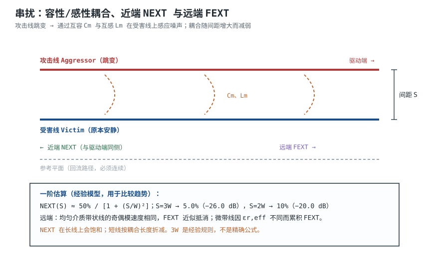

# 串扰与差分走线 Crosstalk & Differential Pair

一根本该安静的控制线，示波器上却出现 300mV 的尖峰；旁边那根 1V/ns 的高速线每次跳变，它就“抖”一下。把两根线的中心距从 2W 拉到 3W，尖峰降到 165mV；再加一条每隔 5mm 打地过孔的 guard trace，才压到能接受的水平。**串扰（Crosstalk）不是“线离得近一点”的定性问题，它有明确的耦合机理、量级和距离关系。**

对付串扰有两类手段：一是拉开间距、缩短平行长度、加保护地；二是把敏感信号做成差分对（Differential Pair），让接收端只读两线之差，把同时耦合到两线的共模噪声减掉。本章先拆容性/感性耦合与近端/远端串扰的差别，再给 3W 规则的定量算法和一个 10cm 平行线的算例，最后算差分对的阻抗、skew 与共模转换。

## 1. 设计动机

::: motivation 三个现场
**现场一：复位线被时钟“打”了一下。** 一块 3.3V 板，复位线和高频时钟平行走了 8cm，中心距只有 2W。时钟 1V/ns 跳变时，复位线上出现约 300mV 尖峰；复位输入的高电平门限是 2.0V，3.3V 摆幅只剩 1.3V 余量，尖峰叠加电源纹波后偶发误复位。把平行段缩短到 2cm、间距拉到 4W，尖峰降到 80mV 以下。

**现场二：USB 差分对“等长”了，眼图还是差。** 工程师把 P/N 都绕了蛇形，长度差控制在 5mil，但蛇形段自己平行很近，反而在差分对内引入新的串扰；同时差分对与旁边的 3.3V 电源线只隔了 1W，共模噪声把眼图抬起来。**对内等长只是差分设计的一项，间距、参考平面、蛇形自耦合都要一起看。**

**现场三：3W 规则照抄，仍然超标。** 一条 20cm 的并行总线，按 3W 布，串扰仍让误码率偏高。原因是 3W 是“中心距”不是“边到边”，而且长线的 NEXT 早已饱和；3W 只是经验起点，不是对所有叠层、所有长度都成立的保证。
:::

串扰的设计变量有四个：**间距 S、平行长度 L、受害线阻抗 $Z_v$、信号边沿 $t_r$**。只改其中一个，往往只能把噪声从“很大”降到“仍然可观”。工程上要按噪声预算分配：先算允许多少 mV，再反推间距、长度或屏蔽方式。

## 2. 定义与直观

两根靠近的走线之间存在两种耦合：

- **容性耦合（Capacitive Coupling）**：走线间的互容 $C_m$ 让攻击线的 $dv/dt$ 在受害线上注入位移电流 $i_C=C_m\,dv/dt$。
- **感性耦合（Inductive Coupling）**：走线间的互感 $L_m$ 让攻击线的 $di/dt$ 在受害线上感应电压 $v_L=L_m\,di/dt$。



**近端串扰（Near-End Crosstalk, NEXT）**在攻击线驱动端同侧观察；**远端串扰（Far-End Crosstalk, FEXT）**在负载端同侧观察。两者的形成机理不同：

- NEXT 是后向波：耦合点到近端的传播时间不同，但在长线上各点的后向波会叠加；当线足够长时，NEXT 幅度**饱和**，不再随长度增加。
- FEXT 是前向波：在均匀介质（如带状线）中，奇模与偶模传播速度相同，容性/感性前向波相互抵消，理想 FEXT 近似为零；在微带线中，奇偶模的有效介质常数不同，前向波不能完全抵消，FEXT 会随长度累积。

**“远端串扰一定比近端大”是错误说法。** 带状线的 FEXT 可以接近零；微带线的 FEXT 才明显。设计时要看叠层，不是背一句口诀。

## 3. 定量关系

### 3.1 耦合的物理量

容性耦合电流：

$$
i_C=C_m\frac{dv}{dt}
$$

其中 $C_m$ 是两线间互容，F；$dv/dt$ 是攻击线电压变化率，V/s；$i_C$ 是注入受害线的电流，A。

感性耦合电压：

$$
v_L=L_m\frac{di}{dt}
$$

其中 $L_m$ 是两线间互感，H；$di/dt$ 是攻击线电流变化率，A/s；$v_L$ 是感应电压，V。

受害线上的噪声还取决于它的端接阻抗。高阻 CMOS 输入对容性注入电流更敏感（$v=iZ$ 大），低阻端接对感性感应电压更敏感（分压后变小）。**同一根受害线，换一个端接方式，串扰量级就会变。**

### 3.2 近端串扰与间距：3W 规则的定量版本

工程上把 NEXT 写成攻击线电压的比例：

$$
NEXT=\frac{V_{ne}}{V_{aggressor}}
$$

用 dB 表示：

$$
NEXT_{dB}=20\log_{10}(NEXT)
$$

对长平行微带线，NEXT 随间距增大而下降。一个可复算的一阶模型是：

$$
NEXT(S)\approx\frac{NEXT_0}{1+(S/W)^2}
$$

其中 $S$ 是两条线的中心距，mm；$W$ 是线宽，mm；$NEXT_0$ 是 $S=0$ 时的外推值。这个模型不是场求解器，只是把“间距越大、耦合越弱”写成可算的曲线；用它标定 3W 规则：令 $S=3W$ 时 $NEXT=5\%$，则：

$$
NEXT_0=5\%\times(1+3^2)=50\%
$$

于是 1W~5W 的估算值如下（假定长线饱和、参考平面连续、微带线、$W$ 与 $h$ 同量级）：

| 中心距 | 边到边间距 | NEXT | NEXT dB | 3.3V 摆幅下的噪声 |
|---|---|---|---|---|
| 1W | 0 | 25.0% | −12.0 dB | 825 mV |
| 2W | 1W | 10.0% | −20.0 dB | 330 mV |
| 3W | 2W | 5.0% | −26.0 dB | 165 mV |
| 4W | 3W | 2.94% | −30.6 dB | 97 mV |
| 5W | 4W | 1.92% | −34.3 dB | 63 mV |

这张表有三个重要提醒：

1. **3W 指中心距**，不是边到边。中心距 3W 时，两条线的边到边间距只有 2W。若把“3W”理解成边到边，实际中心距是 4W，会过度保守、浪费板面；若把“2W 中心距”当成“2W 边到边”，则会严重低估串扰。
2. **dB 是 20log，不是 10log**。电压比 5% 对应 −26.0dB；功率比才用 10log。
3. **模型只给量级**。带状线的耦合随间距下降更快（场被上下平面约束），同样的 3W 通常比微带线更好；而短线的 NEXT 还没饱和，要乘以长度因子。

长度因子可以这样估：NEXT 在往返延迟覆盖边沿后饱和，饱和长度：

$$
L_{sat}\approx\frac{v\,t_r}{2}
$$

其中 $v$ 是传播速度，cm/ns；$t_r$ 是上升沿，ns。$t_r=1\ \text{ns}$、$v=15\ \text{cm/ns}$ 时 $L_{sat}=7.5\ \text{cm}$。平行长度 $L<L_{sat}$ 时，粗略按 $L/L_{sat}$ 折减；$L>L_{sat}$ 时用饱和值。**这个折减是线性近似，只用于早期估算，最终仍要场求解或实测。**

### 3.3 远端串扰：带状线接近零，微带线会累积

带状线的上下都是介质，奇模和偶模的场分布不同，但传播速度都由同一个 $\varepsilon_r$ 决定，所以前向容性波与感性波可以相消，理想 FEXT 近似为零。微带线一面是空气、一面是介质，奇模的场更多在空气里，偶模的场更多在介质里，两种模式的有效介质常数不同：

$$
\Delta t_{mode}=L\left(\frac{1}{v_{even}}-\frac{1}{v_{odd}}\right)
$$

其中 $L$ 是平行长度，m；$v_{even}$、$v_{odd}$ 是偶模/奇模传播速度，m/s；$\Delta t_{mode}$ 是两种模式的到达时间差，s。

取微带线典型量级 $\varepsilon_{r,eff,odd}=3.1$、$\varepsilon_{r,eff,even}=3.3$，平行长度 10cm：

$$
v_{odd}=\frac{3.00\times10^{8}}{\sqrt{3.1}}=1.70\times10^{8}\ \text{m/s}
$$

$$
v_{even}=\frac{3.00\times10^{8}}{\sqrt{3.3}}=1.65\times10^{8}\ \text{m/s}
$$

$$
\Delta t_{mode}=0.10\times\left(\frac{1}{1.65\times10^{8}}-\frac{1}{1.70\times10^{8}}\right)
=1.86\times10^{-11}\ \text{s}=18.6\ \text{ps}
$$

若边沿 $t_r=100\ \text{ps}$，模式时延差约占边沿的 18.6%，这就是微带线 FEXT 的量级；$t_r=50\ \text{ps}$ 时占 37%，更严重。**带状线没有这个速度差，所以同样 3W 下 FEXT 小得多；高速长距离链路优先把关键信号埋成带状线。**

### 3.4 差分对：共模、差模与阻抗

差分对的两根线分别走 $V_P$、$V_N$。定义：

$$
V_{cm}=\frac{V_P+V_N}{2},\qquad V_{diff}=V_P-V_N
$$

理想差分信号 $V_P=-V_N$，所以 $V_{cm}=0$、$V_{diff}=2V_P$。外部噪声同时耦合到两线时，$V_P$、$V_N$ 同相增加，$V_{diff}$ 不变，这就是差分抗共模的机理。**但前提是两线对噪声的耦合完全一致；只要有一根线离噪声源更近、或长度不同，共模就不能完全抵消。**

差分阻抗：

$$
Z_{diff}=2Z_{0o}
$$

其中 $Z_{0o}$ 是单根线在奇模（两线反相）下的阻抗，$\Omega$。弱耦合时 $Z_{0o}\approx Z_0(1-k)$，$k$ 是耦合系数，于是：

$$
Z_{diff}\approx2Z_0(1-k)
$$

这个式子常被写成“$Z_{diff}=2Z_0(1-k)$”，但它是**弱耦合近似**；$k$ 不是常数，随间距/叠层变化，强耦合时误差大。工程上以场求解器给出的 $Z_{diff}$ 为准。

以 $h=0.13\ \text{mm}$、$w=0.20\ \text{mm}$、$\varepsilon_r=4.3$ 的微带线为例，单根线：

$$
Z_0=36.41\times\ln\left(\frac{5.98\times0.13}{0.8\times0.20+0.035}\right)
=36.41\times\ln(3.99)=50.4\ \Omega
$$

取不同边到边间距 $S$，用 3.4 节的弱耦合经验式估算：

| $S$ | $S/h$ | $Z_{diff}$ | 说明 |
|---|---|---|---|
| 0.25 mm | 1.92 | 93.1 Ω | 接近 USB 2.0 的 90Ω |
| 0.30 mm | 2.31 | 95.4 Ω | 略高 |
| 0.50 mm | 3.85 | 99.5 Ω | 接近 100Ω，但耦合很弱 |


**100Ω 差分并不要求两线紧贴。** 只要单根线约 50Ω、间距足够大，$Z_{diff}\approx2Z_0\approx100\ \Omega$；紧耦合的好处是省板面、抗共模，但会把 $Z_{diff}$ 拉低，需要重新选线宽。设计时先定“紧耦合还是松耦合”，再算线宽/间距，不能反过来。

### 3.5 长度匹配：skew 如何变成共模噪声

两线长度差 $\Delta L$ 造成到达时间差：

$$
\Delta t=\frac{\Delta L}{v}
$$

其中 $\Delta L$ 是长度差，m；$v$ 是传播速度，m/s；$\Delta t$ 是 skew，s。相位误差：

$$
\Delta\varphi=360^{\circ}\cdot f\cdot\Delta t
$$

其中 $f$ 是信号频率分量，Hz；$\Delta\varphi$ 是相位误差，度。以 $v=15\ \text{cm/ns}$、$\Delta L=10\ \text{mm}$ 为例：

$$
\Delta t=\frac{0.010}{1.5\times10^{8}}=6.67\times10^{-11}\ \text{s}=66.7\ \text{ps}
$$

在 5GHz 的相位误差：

$$
\Delta\varphi=360\times5\times10^{9}\times6.67\times10^{-11}=120^{\circ}
$$

在 1GHz 是 24°。**同样的长度差，频率越高，相位误差越大；10Gbps 链路的 1mm 长度差就可能不可接受。**

skew 转成共模的比例，可用边沿斜率估算：

$$
\frac{V_{cm}}{V_{diff}}\approx\frac{\Delta t}{t_r}
$$

以 dB 表示：

$$
20\log_{10}\left(\frac{\Delta t}{t_r}\right)
$$

例如 $\Delta t=66.7\ \text{ps}$、$t_r=200\ \text{ps}$：比例 0.333，约 −9.5dB；若 $t_r=30\ \text{ps}$，比例 2.22，共模分量已经大于差分分量，眼图严重退化。

把“共模不超过差分 10%（−20dB）”作为设计目标，则：

$$
\Delta t\leq0.1t_r
$$

| 速率（示例） | $UI$ | 典型 $t_r$ | 允许 $\Delta t$ | 对应长度差（15cm/ns） |
|---|---|---|---|---|
| 1Gbps | 1 ns | 200 ps | 20 ps | 3.0 mm |
| 5Gbps | 200 ps | 70 ps | 7 ps | 1.05 mm |
| 10Gbps | 100 ps | 30 ps | 3 ps | 0.45 mm |


**“对内等长 5mil”不是 universal 的。** 5mil≈0.127mm 对应 0.85ps；对 10Gbps 的 30ps 边沿，它只占 2.8%，很保守；对更慢的 1Gbps，它又过严、浪费布线。正确做法是按 $0.1t_r$ 反推允许长度差，再取 EDA 的等长规则。

### 3.6 保护地走线（Guard Trace）

在两条敏感线之间加一条接地走线，并每隔一段打地过孔，可以把耦合场“引走”。过孔间距按最高显著频率的 $\lambda/20$ 量级：

$$
\Delta x\leq\frac{\lambda}{20}=\frac{v}{20f_{max}}
$$

其中 $v$ 是传播速度，m/s；$f_{max}$ 是最高显著频率，Hz。1GHz、$v=1.5\times10^{8}\ \text{m/s}$：

$$
\Delta x\leq\frac{1.5\times10^{8}}{20\times10^{9}}=7.5\ \text{mm}
$$

5GHz 时约 1.5mm。工程上 1GHz 取 5mm、5GHz 取 1.5mm 更容易落地。**guard trace 不打过孔就是一根浮空天线，不仅不屏蔽，还可能把噪声耦合得更远。** 另外，guard trace 离信号线太近会改变信号线的阻抗，布完要重新做阻抗检查。


实际叠层里 $W$ 与 $h$ 往往不相等，3W 只是一个以线宽为尺度的经验起点。若 $h$ 很大、线很细，同样的 3W 中心距对应的 $S/h$ 更小，串扰会更严重；反之，带状线把场约束在上下平面之间，3W 往往偏保守。**把 3W 当成起点，再用场求解器或测试条确认。**

## 4. 典型计算

### 4.1 两条 10cm 平行线：2W 与 3W 的串扰

::: example 从间距到噪声预算
**需求**：两条 10cm 平行微带线，$W=0.20\ \text{mm}$、$h=0.13\ \text{mm}$，攻击线 3.3V、$t_r=1\ \text{ns}$，受害线是高阻 CMOS 输入。分别计算中心距 2W 和 3W 的 NEXT，并判断是否超过 0.4V 噪声余量。

**第一步：饱和长度。**

$$
L_{sat}=\frac{v\,t_r}{2}=\frac{15\times1}{2}=7.5\ \text{cm}
$$

10cm > 7.5cm，NEXT 已饱和，可直接用表值。

**第二步：2W 中心距。** 边到边间距 1W，模型给 10.0%：

$$
V_{ne}=0.10\times3.3=0.330\ \text{V}=330\ \text{mV}
$$

3.3V LVCMOS 的噪声余量约 0.4V（$V_{OH,min}-V_{IH,min}$ 或 $V_{IL,max}-V_{OL,max}$），330mV 占 82.5%，**不可接受**。

**第三步：3W 中心距。** 边到边 2W，模型给 5.0%：

$$
V_{ne}=0.05\times3.3=0.165\ \text{V}=165\ \text{mV}
$$

占余量 41%，**仍偏大**，但对多数非关键信号可接受；对复位、中断、ADC 触发等敏感线，建议 4W（97mV，24%）或加 guard trace。

**第四步：缩短平行长度。** 若只能布 5cm，$L/L_{sat}=5/7.5=0.667$，3W 的 NEXT 近似：

$$
NEXT\approx0.05\times0.667=0.0333=3.33\%
$$

$$
NEXT_{dB}=20\log_{10}(0.0333)=-29.6\ \text{dB}
$$

噪声约 110mV。**缩短平行长度往往比拉开间距更有效，也更省板面。**

**结论**：10cm 平行、1ns 边沿，2W 的 330mV 超标；3W 的 165mV 只是“可接受”，不是“安全”。按噪声预算反推：若允许 100mV，3W 不够，需要 4W 或缩短到 6cm 以内。
:::

```echarts
{
  "tooltip": {"trigger": "axis"},
  "legend": {"data": ["NEXT %", "NEXT dB"], "bottom": 0, "textStyle": {"fontSize": 12}},
  "grid": {"left": 60, "right": 64, "top": 28, "bottom": 58},
  "xAxis": {"type": "category", "name": "中心距", "data": ["1W", "2W", "3W", "4W", "5W"], "axisLabel": {"fontSize": 11}},
  "yAxis": [
    {"type": "value", "name": "NEXT %", "min": 0, "max": 30, "axisLabel": {"fontSize": 11}},
    {"type": "value", "name": "NEXT dB", "min": -40, "max": -10, "axisLabel": {"fontSize": 11}}
  ],
  "series": [
    {"name": "NEXT %", "type": "line", "smooth": true, "symbol": "circle", "symbolSize": 8, "lineStyle": {"width": 2.6, "color": "#b03a3a"},
     "areaStyle": {"color": "#b03a3a", "opacity": 0.10},
     "data": [25.0, 10.0, 5.0, 2.94, 1.92]},
    {"name": "NEXT dB", "type": "line", "smooth": true, "symbol": "circle", "symbolSize": 8, "yAxisIndex": 1, "lineStyle": {"width": 2.6, "color": "#1a4f8b"},
     "data": [-12.0, -20.0, -26.0, -30.6, -34.3]}
  ]
}
```

### 4.2 100Ω 差分对与 10mm skew

::: example 从阻抗到共模
**需求**：$h=0.13\ \text{mm}$、$w=0.20\ \text{mm}$ 的微带差分对，目标 $Z_{diff}=100\ \Omega$；P/N 长度差 10mm，信号 $t_r=200\ \text{ps}$，判断共模转换。

**第一步：单根线阻抗。**

$$
Z_0=36.41\times\ln(3.99)=50.4\ \Omega
$$

**第二步：选间距。** 由表，$S=0.50\ \text{mm}$ 时 $Z_{diff}=99.5\ \Omega$，接近 100Ω。若强行把 $S$ 压到 0.25mm，$Z_{diff}$ 降到 93.1Ω，需要把线宽改细才能回到 100Ω；**紧耦合不是“更差分”，而是换了一组线宽/间距。**

**第三步：skew。** 10mm 长度差：

$$
\Delta t=\frac{0.010}{1.5\times10^{8}}=66.7\ \text{ps}
$$

**第四步：共模比例。**

$$
\frac{V_{cm}}{V_{diff}}\approx\frac{66.7}{200}=0.333
$$

$$
20\log_{10}(0.333)=-9.5\ \text{dB}
$$

共模只比差分低 9.5dB，远达不到 −20dB 的目标。**要把 10mm 压到 3mm 以内（20ps），才能到 −20dB；10Gbps、30ps 边沿则要 ≤0.45mm。**

**结论**：100Ω 差分对可以松耦合（$S=0.5\ \text{mm}$），但长度匹配必须按边沿算，不能统一写 5mil。10Gbps 链路优先紧耦合、短 stub、同层换层，并把 skew 控制在 0.5mm 以内。
:::

### 4.3 保护地过孔间距

::: example guard trace 的打孔密度
**需求**：1GHz 时钟旁边加 guard trace，最高显著频率按 1GHz 估，$v=15\ \text{cm/ns}$。

**第一步：波长。**

$$
\lambda=\frac{v}{f}=\frac{0.15\ \text{m/ns}}{1\ \text{ns}^{-1}}=0.15\ \text{m}=15\ \text{cm}
$$

**第二步：λ/20。**

$$
\Delta x\leq\frac{15}{20}=0.75\ \text{cm}=7.5\ \text{mm}
$$

**第三步：工程取值。** 取 5mm 更稳妥；5GHz 时 λ=3cm，λ/20=1.5mm，按 1.5mm 打孔。**过孔间距大于 λ/20，guard trace 在两者之间就近似浮空，屏蔽效果大幅下降。**
:::

## 5. 工程含义

### 5.1 间距、长度、层与屏蔽的取舍

| 措施 | 对 NEXT 的效果 | 对 FEXT 的效果 | 代价 |
|---|---|---|---|
| 中心距 2W→3W | 约 −6dB | 同量级下降 | 板面增加 |
| 中心距 3W→4W | 约 −4.6dB | 同量级下降 | 板面继续增加 |
| 平行长度减半 | 短线约 −6dB | 约 −6dB | 需要改拓扑 |
| 正交跨线 | 大幅下降 | 大幅下降 | 布线受限 |
| 加 guard trace | 再降 5~15dB（取决于过孔） | 降低 | 占板面、改阻抗 |
| 埋成带状线 | 下降 | 接近零（均匀介质） | 层数/成本 |
| 拉开层间距离 | 下降 | 下降 | 叠层受限 |

这张表是“方向”不是“保证值”。同样 3W，带状线和微带线、不同 $h$、不同 $t_r$ 的结果差很多；关键链路要用场求解器扫参数，不要只背规则。

### 5.2 布线顺序

1. **先布关键差分对和时钟**，确定它们的间距、参考平面和换层点；
2. **再布一般信号**，让一般信号避让关键线，而不是反过来；
3. **平行段能短则短**，无法避免时把间距拉到 3W 以上，并让平行段远离板边/连接器；
4. **跨层换参考平面时**，在过孔旁放回流地过孔，避免回流绕路；
5. **最后加 guard trace**，并检查它是否改变了被保护线的阻抗。

### 5.3 差分对布线要点

- **同层、同长度、同参考平面**：P/N 不要一个在 L1、一个在 L4，否则传播速度和回流路径不同，skew 无法靠绕线补偿。
- **对内间距恒定**：蛇形补偿段也要保持间距，蛇形自己不能变成新的耦合对。
- **避免跨分割**：差分对跨过参考平面分割时，两条线的回流都会绕路，共模噪声增大。
- **换层对称**：P/N 同时换层，过孔数量/位置对称；如果只能单边换层，要重新算 skew。
- **端接对称**：片内/片外端接都要跨接在 P/N 之间，不要分别对地。

### 5.4 验证

- **TDR/TDT**：看差分阻抗沿线的均匀性，定位过孔、连接器、跨分割；
- **VNA**：看差分插损、回损、共模抑制；
- **眼图/误码仪**：看真实链路的眼高/眼宽和 BER；
- **场求解器**：扫间距、线宽、叠层，得到 $Z_{diff}$ 和 NEXT/FEXT；
- **测试 coupon**：板厂随板做差分阻抗条，验收时测。

::: advanced 三个被简化过头的说法
**说法一：“串扰和间距平方成反比，间距加倍就降到 1/4。”** 这只在特定近场近似下成立，且没有考虑 $W/h$、耦合长度、参考平面。本文用 $NEXT_0/[1+(S/W)^2]$ 标定 3W=5%，得到 2W=10%、4W=2.94%；趋势是下降，但不是严格的 $1/S^2$。**用公式前先看假设。**

**说法二：“远端串扰随平行长度一直增大。”** 带状线在均匀介质中 FEXT 近似为零；微带线的 FEXT 随长度累积，但会被损耗、色散和端接衰减，不是无限增大。**先问叠层是不是均匀介质。**

**说法三：“差分对对内等长 5mil 就够了。”** 5mil≈0.85ps，对 1Gbps 的 200ps 边沿只占 0.4%，对 10Gbps 的 30ps 边沿占 2.8%，都算保守；但对 25Gbps 的 10ps 边沿就占 8.5%，接近预算上限。**等长容差要按 $0.1t_r$ 算，不能统一背 5mil。**
:::

## 6. 常见坑

::: pitfall 坑一：把 3W 当成边到边间距
- **现象**：按“边到边 3W”布，板面很宽松，但另一块板按“中心距 3W”布却超标；两个工程师对同一规则得出不同结果。
- **原因**：3W 规则通常指**中心到中心**；边到边 3W 对应中心距 4W，过于保守。
- **解决**：在规则里写清“中心距”；用 EDA 的 center-to-center 约束，不要用 edge-to-edge 代替。
:::

::: pitfall 坑二：长平行线只靠 3W
- **现象**：20cm 并行总线按 3W 布，仍出现误码；缩短到 8cm 后恢复。
- **原因**：NEXT 在长线上饱和，3W 只给约 5% 的耦合；20cm 的累积噪声超过噪声预算。
- **解决**：按 $L_{sat}=v t_r/2$ 判断饱和；长线用 4W、guard trace、正交跨线或改层，不能只靠 3W。
:::

::: pitfall 坑三：guard trace 不打过孔或只打一端
- **现象**：加了保护地线，串扰没降，反而在某个频点变差。
- **原因**：guard trace 浮空，变成接收/辐射天线；只打一端则形成长 stub。
- **解决**：两端接地，按 λ/20 打过孔（1GHz 约 5mm）；检查 guard trace 是否改变信号线阻抗。
:::

::: pitfall 坑四：差分对跨分割/单边换层
- **现象**：差分眼图不对称，共模噪声大，EMI 超标。
- **原因**：P/N 回流路径不同，或一条线换层、另一条没换，skew 和共模转换增大。
- **解决**：P/N 同层、同参考、同时换层；换层处加回流地过孔；跨分割时改层或加缝合电容。
:::

::: pitfall 坑五：蛇形等长自己耦合
- **现象**：等长后眼图反而变差，TDR 看到蛇形段阻抗波动。
- **原因**：蛇形段相邻走线间距太小，自己形成耦合对；拐角过密还会引入阻抗不连续。
- **解决**：蛇形段间距≥3W，减少拐角数量，必要时用圆弧；等长后重新做串扰/阻抗检查。
:::

::: pitfall 坑六：只看 NEXT，不看 FEXT
- **现象**：NEXT 测试通过，远端误码率仍高。
- **原因**：微带线 FEXT 随长度累积，而测试点只看了近端；或者连接器/过孔引入了额外的远端噪声。
- **解决**：同时评估 NEXT/FEXT；高速长线优先带状线；用 VNA 看差分插损和共模。
:::

## 7. 自测题

<details><summary>3W 规则指的是中心距还是边到边？中心距 3W 时边到边是多少？</summary>

通常指**中心到中心**。两条等宽线中心距 3W 时，边到边间距是 $3W-W=2W$。若把 3W 当边到边，实际中心距是 4W，会过度保守；若把 2W 中心距当 2W 边到边，实际中心距只有 3W，串扰会被低估。

</details>

<details><summary>用 NEXT=50%/[1+(S/W)²] 模型，2W、3W、4W 的 NEXT 和 dB 各是多少？</summary>

2W：$50/(1+4)=10\%$，$20\log_{10}0.1=-20.0\ \text{dB}$；3W：$50/(1+9)=5\%$，−26.0dB；4W：$50/(1+16)=2.94\%$，−30.6dB。3.3V 摆幅下分别约 330mV、165mV、97mV。**模型是经验拟合，不是场求解结果。**

</details>

<details><summary>为什么带状线的远端串扰接近零，而微带线会累积？</summary>

带状线上下都是均匀介质，奇模和偶模传播速度相同，前向容性波与感性波相互抵消；微带线一面空气一面介质，奇偶模的 $\varepsilon_{r,eff}$ 不同，两种模式到达时间不同，前向波不能完全抵消。10cm、$\varepsilon_{r,eff}$ 3.1/3.3 时模式时延差约 18.6ps，对 100ps 边沿就是 18.6%。

</details>

<details><summary>10mm 长度差、15cm/ns，skew 是多少？5GHz 相位误差多少？</summary>

$\Delta t=0.010/(1.5\times10^8)=66.7\ \text{ps}$；$\Delta\varphi=360\times5\times10^9\times66.7\times10^{-12}=120^{\circ}$。1GHz 时是 24°。**频率越高，同样的长度差相位误差越大。**

</details>

<details><summary>要把共模压到 −20dB，长度差应控制在多少？1Gbps 和 10Gbps 各是多少？</summary>

−20dB 对应共模/差分 10%，即 $\Delta t\leq0.1t_r$。1Gbps、$t_r=200\ \text{ps}$：$\Delta t\leq20\ \text{ps}$，对应 $20\times10^{-12}\times1.5\times10^8=3.0\ \text{mm}$。10Gbps、$t_r=30\ \text{ps}$：$\Delta t\leq3\ \text{ps}$，对应 0.45mm。**等长容差随速率收紧。**

</details>

<details><summary>1GHz 的 guard trace，地过孔间距应不大于多少？5GHz 呢？</summary>

按 $\lambda/20$：1GHz、$v=15\ \text{cm/ns}$，$\lambda=15\ \text{cm}$，$\lambda/20=7.5\ \text{mm}$，工程取 5mm；5GHz，$\lambda=3\ \text{cm}$，$\lambda/20=1.5\ \text{mm}$。**间距过大，guard trace 在过孔之间近似浮空，屏蔽失效。**

</details>

## 8. 参考资料

- Howard Johnson and Martin Graham, *High Speed Digital Design: A Handbook of Black Magic*, Prentice Hall, 1993 — Chapter 8 Crosstalk，近端/远端串扰与耦合长度。
- Eric Bogatin, *Signal and Power Integrity - Simplified*, 3rd ed., Prentice Hall, 2018 — Chapter 10 Crosstalk，互容/互感、差分对与模式转换。
- IPC-2141A, *Design Guide for High-Speed Controlled Impedance Circuit Boards*, 2004 — 差分阻抗与耦合走线。
- IPC-2221B, *Generic Standard on Printed Board Design*, 2012 — 走线间距与高速设计规则。
- USB Implementers Forum, *Universal Serial Bus Specification Revision 2.0*, 2000 — Chapter 7 Electrical，90Ω 差分阻抗。
- Henry W. Ott, *Electromagnetic Compatibility Engineering*, Wiley, 2009 — 串扰、屏蔽与保护地走线。
- Saturn PCB Design Toolkit：https://saturnpcb.com/saturn-pcb-toolkit/ — 差分阻抗与串扰估算。
- 相关章节：[信号完整性](signal-integrity.md)、[PCB 结构、层叠与板材](pcb-stackup.md)、[布线](routing.md)、[USB 与以太网物理层概览](../mcu/usb-ethernet.md)。
