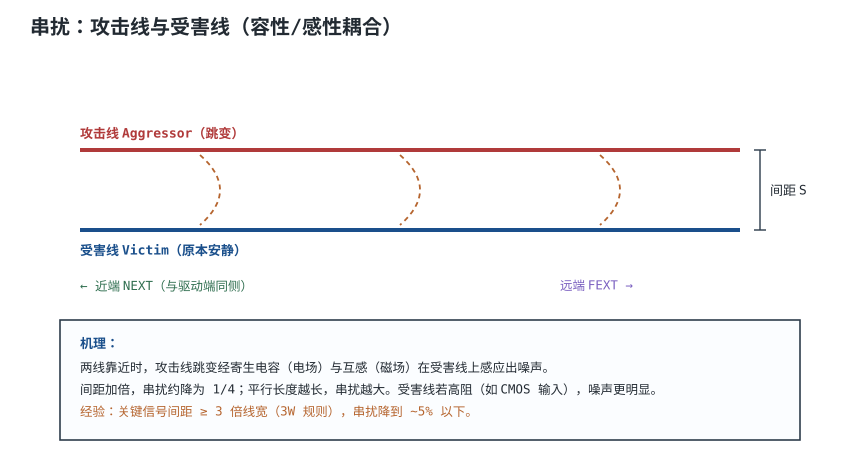
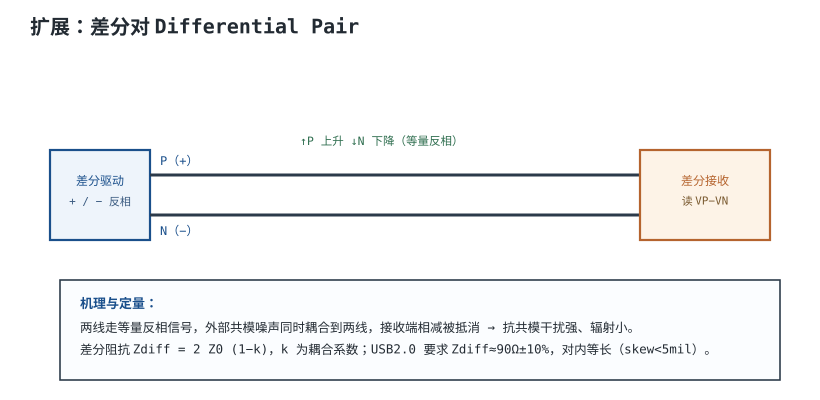
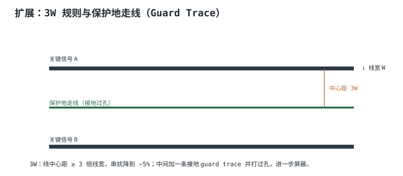
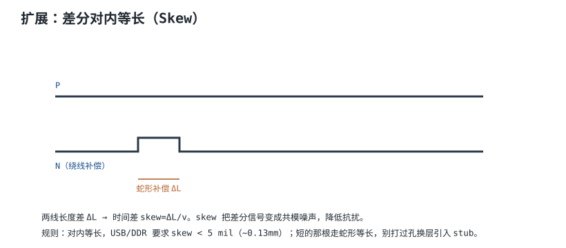

# 串扰与差分走线 Crosstalk & Differential Pair

板子上走线挤在一起，一根线跳变会通过电场和磁场"感应"到旁边的线——这就是**串扰（Crosstalk）**。对付它有两招：一是拉开间距（3W 规则），二是把敏感信号做成**差分对（Differential Pair）**，靠相减抵消共模噪声。

## 1. 设计动机

::: motivation 为什么安静的线也会跳
你有一根本该静止的控制线，示波器上却看到莫名其妙的尖峰——它旁边那根高速线每次跳变，都通过寄生电容/互感"打"了它一下。受害线若接在高阻 CMOS 输入上，这一下噪声足以误触发。
:::

## 2. 图示：攻击线与受害线



## 3. 机理与定量

两平行走线间有：
- **容性耦合 $C_m$**：电场耦合，电流 $i_C=C_m\,dv/dt$
- **感性耦合 $L_m$**：磁场耦合，电压 $v_L=L_m\,di/dt$

受害线上感应的噪声与间距、平行长度、受害线阻抗有关：

$$\text{串扰} \propto \frac{1}{S^2}\quad(\text{间距加倍，串扰约降为 }1/4)$$

- **近端串扰 NEXT**：在攻击线驱动端同侧，幅度与长度无关（饱和）。
- **远端串扰 FEXT**：在远端，随平行长度增大。
- 受害线阻抗越高（CMOS 输入），感应噪声越明显。

## 4. 设计准则：3W 规则

经验法则：**线中心距 ≥ 3 倍线宽（3W）**，串扰降到约 5% 以下。

| 间距（中心距） | 相对串扰 |
|---|---|
| 1W | 100%（基准） |
| 2W | ~25% |
| 3W | ~5% |
| 5W | ~1% |

## 5. 完整设计示例

::: example 布 USB 差分对
1. **需求**：USB 2.0 D+/D-，差分阻抗 90Ω±10%。
2. **叠层**：表层微带，到 GND h=0.13mm。
3. **线宽与间距**：用 Saturn 算，w=0.20mm、对内间距 s=0.15mm 时 Zdiff≈90Ω。
4. **等长**：P/N 长度差 <5mil，短的走蛇形补偿。
5. **远离**：与其它高速线间距 ≥3W，不跨分割。
6. **回流**：下方完整 GND，换层处配地过孔。
:::

```echarts
{
  "tooltip": {"trigger": "axis"},
  "legend": {"data": ["串扰幅度(相对)"], "bottom": 0, "textStyle": {"fontSize": 12}},
  "grid": {"left": 56, "right": 24, "top": 26, "bottom": 50},
  "xAxis": {"type": "category", "name": "中心距(倍线宽)", "data": ["1W","2W","3W","4W","5W"], "axisLabel": {"fontSize": 11}},
  "yAxis": {"type": "value", "name": "相对串扰 %", "max": 100, "axisLabel": {"fontSize": 11}},
  "series": [
    {"name": "串扰幅度(相对)", "type": "line", "smooth": true, "symbol": "circle", "symbolSize": 8, "lineStyle": {"width": 2.6, "color": "#b03a3a"},
     "areaStyle": {"color": "#b03a3a", "opacity": 0.12},
     "data": [100, 25, 6, 2, 1]}
  ]
}
```

## 6. 检查与仿真

- **串扰仿真**：用 SI 工具扫描不同间距下的受害线噪声。
- **TDR / 眼图**：差分对看眼图是否张开。
- **等长检查**：EDA 的长度比对器（length tuning）。

## 扩展与变种电路

### 扩展1：差分对 Differential Pair

两根线走等量反相信号，接收端相减。



::: example 机理与定量
- 外部共模噪声同时耦合到 P、N，接收端 $V_{in}=V_P-V_N$，共模分量相消。
- 差分阻抗 $Z_{diff}=2Z_0(1-k)$，$k$ 为两线耦合系数。
- USB 2.0 要求 $Z_{diff}\approx90\Omega\pm10\%$；以太网 100Ω；LVDS 100Ω。
- 两线紧耦合还能互相屏蔽，对外辐射也小。
:::

准则对比：

| 传输方式 | 抗共模 | 辐射 |
|---|---|---|
| 单端 | 弱 | 大 |
| 差分 | 强 | 小 |

::: pitfall 差分对两根线不等长
- **现象**：差分对误码率高、EMI 大。
- **原因**：长度差 skew 把差分信号转成共模噪声。
- **解决**：对内等长（USB skew<5mil），短线走蛇形补偿。
:::

### 扩展2：3W 规则与保护地走线

拉开间距，必要时中间加接地保护线。



::: example 机理与定量
- 3W：中心距≥3倍线宽，串扰降到 ~5%。
- guard trace：两关键信号间走一条地线，每隔几 mm 打地过孔到平面，吸收耦合。
- 代价：占板面。低速短走线不必严格 3W。
:::

准则对比：

| 间距/屏蔽 | 串扰 | 占板 |
|---|---|---|
| 1W 紧贴 | 高 | 小 |
| 3W | 低 | 中 |
| 3W + guard | 更低 | 大 |

::: pitfall guard trace 没打过孔
- **现象**：加了保护地线但串扰没降。
- **原因**：guard trace 浮空成了天线，反而耦合。
- **解决**：guard trace 每隔 1/10 波长打地过孔到平面。
:::

### 扩展3：差分对内等长（Skew）

两根差分线长度必须严格相等。



::: example 机理与定量
- 长度差 $\Delta L$ → 时间差 $skew=\Delta L/v$。
- skew 使同时到达的差分信号错开，变成共模噪声，降低抗扰、增大辐射。
- USB/DDR 要求 skew<5 mil（~0.13 mm）。
- 短的那根走蛇形（meander）补偿；不要打过孔换层引入 stub。
:::

准则对比：

| skew | 差分质量 |
|---|---|
| <5mil | 优 |
| >10mil | 差（共模大） |

::: pitfall 蛇形补偿间距太近自己耦合
- **现象**：蛇形绕线处反而出问题。
- **原因**：蛇形段自身平行近，互相串扰。
- **解决**：蛇形段间距≥3W，且只在必要处短绕。
:::

## 7. 常见坑与故障现象

::: pitfall 常见坑
- **高速线紧贴平行走长线**：串扰大，受害线误触发。拉开到 3W。
- **差分对不等长**：skew 变成共模噪声。用 EDA 长度调谐。
- **差分对跨分割**：回流不连续，差分阻抗崩坏。
- **guard trace 不打地过孔**：浮空成天线，适得其反。
:::

## 8. 自测题

<details><summary>为什么间距加倍，串扰大约降为 1/4？</summary>

串扰（容性/感性耦合）与间距平方成反比近似 $\propto 1/S^2$。间距 S 加倍，耦合大约降到 $1/4$。这就是 3W 规则能把串扰压到 5% 的原因。

</details>

<details><summary>差分对为什么抗共模干扰？差分阻抗怎么定义？</summary>

两线走反相信号，外部共模噪声同时耦合到两线，接收端 $V_P-V_N$ 把共模分量抵消。差分阻抗 $Z_{diff}=2Z_0(1-k)$，是两线间看到的阻抗；USB 要求约 90Ω。

</details>

<details><summary>差分对内 skew 是什么？为什么要控制？</summary>

skew = 两线长度差导致的到达时间差 $\Delta L/v$。skew 把原本相消的差分信号错开，转成共模噪声，降低抗扰、增大辐射。所以要对内等长（USB <5mil）。

</details>

## 9. 参考资料

- Howard Johnson, *High Speed Digital Design: A Handbook of Black Magic*
- USB 2.0 Specification（差分阻抗与 skew 要求）
- Saturn PCB Design Toolkit（差分阻抗计算）
