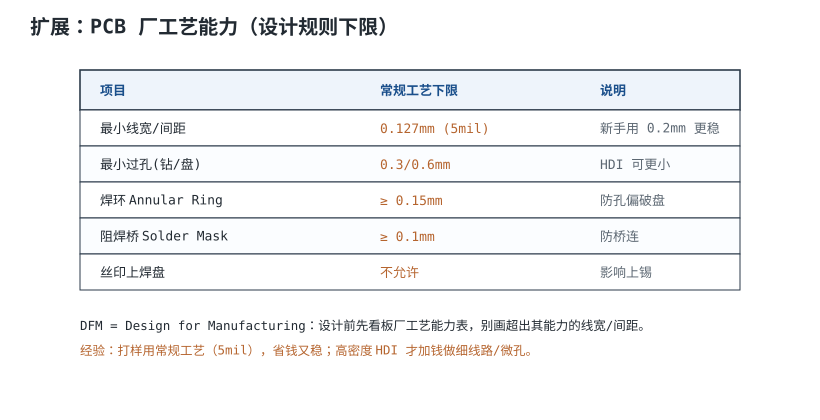
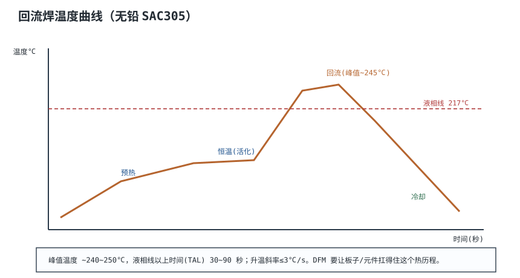
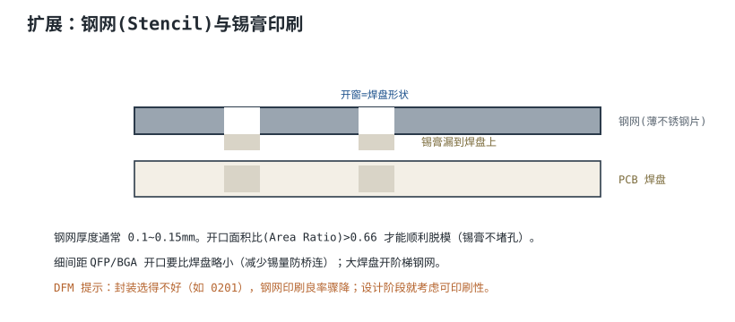

# DFM 与焊接工艺 Design for Manufacturing

一块板子“画得出来”不等于“做得出来”，更不等于“焊得稳”。0.5 mm 间距的 BGA、0.127 mm 的线宽、0.3 mm 的过孔，单看每个数字都在板厂能力表里；但把它们放在同一块板上，再加上拼板、阻焊、表面处理和回流曲线，良率可能从可控掉到需要全检/返工。**DFM（Design for Manufacturing，可制造性设计）**要做的，是让设计的分布落在工艺窗口内，而不是卡在窗口边缘。

本章先建立“工艺能力—设计余量—统计分布”的关系，再算清拼板、Mark 点、定位孔、阻焊、丝印、表面处理和钢网的具体尺寸，最后用一个 0.5 mm 间距 BGA 的板子走完整套 DFM 检查。所有尺寸都是典型量级，具体以板厂能力表和器件数据手册为准。

## 1. 设计动机

::: motivation 四个“参数都合格、板子却做不好”的现场
**现场一：线宽卡在 0.127 mm 下限。** 板厂说“最小 5 mil 能做”，设计就把所有信号线画成 0.127 mm。假设蚀刻公差 ±0.02 mm，再叠加铜厚不均、对位偏差，实际线宽落在 0.107~0.147 mm；细的那部分电阻偏大、载流不足，粗的那部分又容易和邻线短路。**“能做”是能力下限，不是设计目标。**

**现场二：0.5 mm 间距 BGA 用了喷锡。** 有铅/无铅喷锡（HASL）表面不平整，0.5 mm 焊盘上的锡面高低差可能到几十微米；贴片时锡膏厚度不均，回流后空洞和桥连同时出现。换成 ENIG 或 OSP，平整度立刻改善。

**现场三：拼板工艺边只有 2 mm。** 贴片机轨道夹持不住，板子进机时偏移几十微米，0201 元件整体贴偏；加了 5 mm 工艺边后，偏移消失。**工艺边不是“留一点边”，是设备夹持和传送的接口。**

**现场四：钢网 0.12 mm 印 0.5 mm BGA。** 0.28 mm 圆开孔的面积比只有 0.583，低于 0.66 的脱模下限；锡膏堵在孔里，印刷少锡、批量虚焊。换成 0.10 mm 钢网，面积比 0.70，良率恢复。
:::

| 你想确认 | 先查/先算 | 判据（典型量级，以板厂/器件手册为准） |
|---|---|---|
| 线宽/间距能不能做 | 板厂能力表 + 公差分布 | 设计值比能力下限大 1.5~2 倍 |
| 过孔环宽够不够 | 钻孔偏位 + 对位公差 | 最坏环宽 ≥ 0.05 mm，推荐 ≥0.10 mm |
| 阻焊桥会不会断 | 焊盘间距 − 2×开窗裕量 | 名义 ≥0.10 mm，最坏 ≥0.05 mm |
| 钢网能不能脱模 | 面积比 $AR$ | $AR\geq0.66$，细间距 ≥0.70 |
| 拼板利用率高不高 | $N A_{\mathrm{board}}/A_{\mathrm{panel}}$ | 尽量 ≥60%，同时保证工艺边 |
| 表面处理平不平 | HASL/ENIG/OSP | 0.5 mm 间距优先 ENIG 或 OSP |
| 回流会不会损伤器件 | 峰值温度、TAL、MSL | 按 J-STD-020 与焊膏手册 |

**不算会摔在哪，四个带数字的代价：**

1. **线宽按下限设计**：能力 0.127 mm、公差 ±0.02 mm，设计 0.127 mm 时约一半的线低于下限；设计 0.20 mm，最坏 0.18 mm，仍有余量。
2. **环宽只算名义值**：0.3 mm 钻孔、0.6 mm 焊盘，名义环宽 $(0.6-0.3)/2=0.15$ mm；扣掉钻孔偏位 0.05 mm 和对位 0.05 mm，最坏只剩 0.05 mm，正好卡在验收下限。
3. **0.5 mm BGA 用 0.12 mm 钢网**：0.28 mm 圆孔面积比 0.583，低于 0.66，印刷少锡；换 0.10 mm 钢网，面积比 0.70。
4. **拼板不看利用率**：80 mm × 60 mm 板在 300 mm × 300 mm 面板上 12 拼，利用率 64.0%；排成 9 拼只有 48.0%，同样订单多花 33% 的板材。

## 2. 定义与直观：DFM 是设计窗口与工艺窗口的交集

### 2.1 三个层次：能做、稳定能做、经济地做

- **能做（Capability）**：板厂在最佳条件下能做出某个最小线宽/孔径；这是能力表上的“下限”。
- **稳定能做（Process Capability）**：在批量、不同批次、不同设备状态下，仍能以可接受良率做出来；用 $C_{pk}$ 衡量。
- **经济地做（Cost）**：不需要额外加价、特殊工艺、全检或返工；这才是设计应该瞄准的区间。

DFM 不是“把规则设成板厂最小值”，而是“让设计的 nominal 值落在工艺分布的中心附近，并让公差叠加后的最坏值仍在窗口内”。这就是“设计要比工艺能力留余量”的原因。

### 2.2 设计窗口与工艺窗口

把每个尺寸看成随机变量：板厂的蚀刻、钻孔、对位、镀铜都有分布；设计的尺寸也有公差（封装、钢网、贴片）。两个分布叠加，最坏情况可能超出规格。DFM 要做三件事：

1. **识别关键尺寸**：线宽、间距、环宽、阻焊桥、钢网面积比、拼板工艺边、Mark 点；
2. **算公差叠加**：最坏情况（worst case）或统计平方根（RSS）；
3. **留余量**：把设计 nominal 值往“安全”方向移，直到最坏值仍满足判据。

**纠正一个常见理解**：DFM 不只是“设计前看板厂能力表”。能力表只告诉你下限，不告诉你分布、良率、成本和拼板/表面处理/钢网的耦合。真正的 DFM 要把“板厂能力 + 组装工艺 + 测试 + 成本”放在一张表里权衡。

## 3. 定量关系：工艺能力、余量与热历程

### 3.1 工艺能力表：先看数量级

| 项目 | 常规工艺 | 进阶工艺 | 设计建议（常规板） |
|---|---|---|---|
| 最小线宽/间距 | 0.127/0.127 mm（5/5 mil） | 0.10/0.10 mm（4/4 mil） | 0.15~0.20 mm |
| 最小机械钻孔 | 0.30 mm | 0.20 mm | 0.30 mm，孔盘 0.70 mm |
| 最小环宽 | 0.15 mm（能力） | 0.10 mm | 名义 0.20 mm |
| 阻焊桥 | 0.10 mm | 0.08 mm | 0.12 mm |
| 丝印线宽/字高 | 0.15/1.0 mm | 0.10/0.8 mm | 0.15/1.0 mm |
| 板边到铜 | 0.30 mm | 0.20 mm | 0.50 mm |
| 板厚 | 1.6 mm ±10% | ±8% | 1.6 mm |
| 铜厚 | 1 oz（35 μm） | 2 oz（70 μm） | 电源层 1 oz 起 |
| 阻抗控制 | ±10% | ±5% | 按叠层核算 |
| 翘曲 | ≤0.75% | ≤0.5% | 拼板对称铺铜 |

**这些是典型量级，具体以板厂能力表为准。** 同一家板厂的不同工艺等级（普通、加急、HDI）能力差很多；不要把“HDI 能力”当成“常规板价格”。

### 3.2 为什么要留余量：用 $C_{pk}$ 算一遍

对“最小线宽”这类单边规格，能力指数：

$$C_{pk}=\frac{\mu-LSL}{3\sigma}$$

- $\mu$：实际线宽均值（mm），近似等于设计值；
- $LSL$：规格下限，即板厂能力 0.127 mm；
- $\sigma$：线宽分布的标准差（mm），由蚀刻、曝光、铜厚等决定。

**算例**：$LSL=0.127$ mm、$\sigma=0.02$ mm。

- 设计 0.15 mm：$C_{pk}=(0.15-0.127)/(3\times0.02)=0.383$；
- 设计 0.20 mm：$C_{pk}=(0.20-0.127)/0.06=1.217$；
- 设计 0.21 mm：$C_{pk}=(0.21-0.127)/0.06=1.383$。

要把 $C_{pk}$ 做到 1.33（约 4σ），设计值至少要：

$$\mu_{\min}=LSL+4\sigma=0.127+4\times0.02=0.207\ \mathrm{mm}$$

所以“常规板信号线用 0.2 mm”不是拍脑袋，而是把 4σ 余量算进去的结果。**设计 0.127 mm 时 $C_{pk}=0$，意味着一半的线在规格下限以下。**

### 3.3 环宽：名义 0.15 mm 不等于最坏 0.15 mm

环宽（Annular Ring）是焊盘边缘到孔壁的铜环：

$$R_{\mathrm{ann}}=\frac{D_{\mathrm{pad}}-D_{\mathrm{drill}}}{2}$$

- $D_{\mathrm{pad}}$：焊盘直径（mm）；
- $D_{\mathrm{drill}}$：钻孔直径（mm）。

**算例**：$D_{\mathrm{pad}}=0.60$ mm、$D_{\mathrm{drill}}=0.30$ mm：

$$R_{\mathrm{ann}}=\frac{0.60-0.30}{2}=0.15\ \mathrm{mm}$$

但钻孔有偏位、图形有对位误差。取钻孔偏位 ±0.05 mm、对位 ±0.05 mm，最坏环宽：

$$R_{\mathrm{ann,worst}}=0.15-0.05-0.05=0.05\ \mathrm{mm}$$

这正好是 IPC-6012 等裸板验收标准中外部环宽的常见下限，**没有余量**。把焊盘加到 0.70 mm：

$$R_{\mathrm{ann}}=\frac{0.70-0.30}{2}=0.20\ \mathrm{mm},\qquad R_{\mathrm{ann,worst}}=0.20-0.10=0.10\ \mathrm{mm}$$

最坏仍有 0.10 mm。**所以 0.3/0.6 mm 的过孔“能做”，但量产设计更推荐 0.3/0.7 mm；这不是保守，是把偏位算进去。**

### 3.4 回流焊热历程：峰值、TAL 与斜率

无铅焊膏 SAC305（Sn96.5/Ag3.0/Cu0.5）的典型窗口：

- **液相线**：217 °C；
- **峰值温度**：235~245 °C（比液相线高约 20~30 °C；部分焊膏可到 250 °C，但要看器件耐温）；
- **TAL（Time Above Liquidus）**：45~90 s，细间距 BGA 常取 45~75 s；
- **升温斜率**：≤3 °C/s，防止热冲击和立碑；
- **冷却斜率**：≤6 °C/s，避免焊点晶粒粗大和应力。

板子和所有元件都要扛过这个热历程。塑料连接器、晶振、电解电容、LED 都有各自的耐温上限；MSL（Moisture Sensitivity Level，湿敏等级）器件在回流前还要按 J-STD-033 烘烤，否则水汽膨胀会爆米花（popcorn）。

**纠正一个常见口径**：把峰值写成“240~250 °C”并当作所有板子的目标是不严谨的。SAC305 的常用峰值是 235~245 °C；250 °C 对很多器件已经接近耐温上限，只有焊膏/器件手册明确允许时才用。**回流曲线以焊膏厂商和器件手册的交集为准，不是越热越可靠。**

### 3.5 钢网：面积比决定脱模

钢网开孔的锡膏要能顺利脱模，靠的是面积比（Area Ratio）：

$$AR=\frac{A_{\mathrm{aperture}}}{A_{\mathrm{wall}}}=\frac{LW}{2(L+W)t}$$

- $L$、$W$：开孔长、宽（mm）；
- $t$：钢网厚度（mm）；
- $A_{\mathrm{aperture}}$：开孔面积（mm²）；
- $A_{\mathrm{wall}}$：孔壁侧面积（mm²）。

经验判据：$AR\geq0.66$；细间距/纳米涂层可降到 0.5~0.6，但常规工艺按 0.66 设计。

**算例 1：0.5 mm 间距 BGA，0.28 mm 圆孔。**

$$A_{\mathrm{aperture}}=\frac{\pi}{4}\times0.28^2=0.06158\ \mathrm{mm^2}$$

$$A_{\mathrm{wall}}=\pi\times0.28\times0.10=0.08796\ \mathrm{mm^2}\quad(t=0.10\ \mathrm{mm})$$

$$AR=\frac{0.06158}{0.08796}=0.700$$

满足。若钢网厚 0.12 mm：

$$A_{\mathrm{wall}}=\pi\times0.28\times0.12=0.10556\ \mathrm{mm^2}$$

$$AR=\frac{0.06158}{0.10556}=0.583<0.66$$

不满足。**同一个开孔，钢网从 0.10 mm 加到 0.12 mm，面积比就从 0.70 掉到 0.583；细间距 BGA 必须用薄钢网。**

**算例 2：0402 矩形开孔 0.50 mm × 0.60 mm、钢网 0.12 mm。**

$$AR=\frac{0.50\times0.60}{2\times(0.50+0.60)\times0.12}=\frac{0.30}{0.264}=1.14$$

远高于 0.66，所以 0402 的印刷窗口比 0.5 mm BGA 宽得多。**封装越小、开孔越小、钢网越厚，面积比越危险。**

### 3.6 拼板、工艺边、Mark 点、定位孔

**拼板（Panelization）**是把多块小板拼成一张大板，方便 SMT 和设备夹持。关键尺寸：

- **工艺边（Rail）**：两侧各 5 mm，至少 3 mm；贴片机轨道夹持和传送用，不能放元件。
- **板边到铜**：≥0.50 mm；V-score 处 ≥1.0 mm，避免切板伤铜。
- **V-score**：上下各切 1/3 板厚，剩余 0.6~1.2 mm；适合矩形板，不适合异形/有连接器的边。
- **铣槽（Route）**：铣刀 1.6~2.0 mm，连接筋（Tab）3~5 mm；适合异形板，但会有毛刺和应力。
- **Mark 点（Fiducial）**：直径 1.0 mm 的裸铜圆点，阻焊开窗 2.0 mm，周围 5 mm 无铜/无丝印；全局至少 3 个，不对称布置；0.5 mm BGA 附近再加 2 个局部 Mark。
- **定位孔（Tooling Hole）**：直径 3.0 mm 的非金属化孔（NPTH），距板边 ≥5 mm，至少 2 个对角；用于测试夹具/印刷机定位。
- **拼板利用率**：

$$\eta_{\mathrm{panel}}=\frac{N A_{\mathrm{board}}}{A_{\mathrm{panel}}}$$

**算例**：板子 80 mm × 60 mm，面板 300 mm × 300 mm，工艺边 5 mm，板间间隙 2 mm。

可用区域：

$$300-2\times5=290\ \mathrm{mm}$$

排 3 列 × 4 行：

$$W=3\times80+2\times2=244\ \mathrm{mm},\qquad H=4\times60+3\times2=246\ \mathrm{mm}$$

均小于 290 mm，$N=12$。

$$\eta_{\mathrm{panel}}=\frac{12\times80\times60}{300\times300}=\frac{57600}{90000}=0.640=64.0\%$$

如果只排 3×3=9 块：

$$\eta=\frac{9\times4800}{90000}=\frac{43200}{90000}=0.480=48.0\%$$

**同样一张面板，12 拼比 9 拼多 33.3% 的板子。** 但拼板不是越多越好：板子太靠近工艺边、V-score 太密、贴片机行程不够，都会出问题。利用率要在“设备能跑、切板不裂、良率可接受”的前提下最大化。

### 3.7 表面处理：HASL、ENIG、OSP 的取舍

| 表面处理 | 典型厚度 | 平整度 | 成本 | 适用 | 主要代价 |
|---|---|---|---|---|---|
| 有铅/无铅 HASL | 1~3 μm | 差，有锡珠/高低差 | 最低 | ≥0.65 mm 间距、通孔板 | 细间距/BGA 不适用；无铅峰值高 |
| ENIG（化学镍金） | Ni 3~6 μm、Au 0.05~0.1 μm | 好 | 中高 | 0.5 mm BGA、细间距、按键 | 黑盘（black pad）、镍腐蚀、成本 |
| OSP（有机保焊膜） | 0.2~0.5 μm | 好 | 低 | 细间距、消费类、单次回流 | 怕多次回流/高温烘烤；测试点易磨损 |
| 化学银（ImAg） | 0.1~0.3 μm | 好 | 中 | 高频、细间距 | 硫化/爬行腐蚀；包装要求高 |
| 化学锡（ImSn） | 0.8~1.2 μm | 好 | 低 | 压接/免焊 | 锡须风险；多次回流退化 |
| 硬金（Hard Gold） | Ni 3~6 μm、Au 0.5~1.5 μm | 好 | 高 | 金手指、连接器 | 不能当焊接面（金脆）；成本高 |

**取舍逻辑**：

- **0.5 mm 间距 BGA**：优先 ENIG 或 OSP；不要用 HASL，平整度不够。
- **成本敏感、单次回流、无金手指**：OSP 足够；但要注意保质期（通常 6~12 个月）和多次回流后的可焊性。
- **需要打线/金手指**：ENIG 或硬金；硬金只用于接触面，不要整板。
- **高频**：化学银或 ENIG；银的导电性好，但要注意硫化。
- **通孔/大间距**：HASL 最便宜，填充通孔能力强。

**厚度不是越厚越好**：ENIG 的 Au 层用于保护镍面，焊接时金会迅速溶入焊料；金太厚会增加成本，也可能带来脆性。焊接面的金层按 IPC-4552B 控制，通常 0.05~0.1 μm；硬金是接触面，不是焊接面。

### 3.8 阻焊与丝印：小尺寸，大影响

- **阻焊类型**：LPI（液态光成像阻焊）是主流；哑光黑/绿对 AOI 对比度友好，白色容易黄变。
- **阻焊开窗**：焊盘开窗一般比铜盘大 0.05~0.10 mm（每边 0.025~0.05 mm）；开窗太小会露铜不足，太大则阻焊桥变窄。
- **阻焊桥**：相邻焊盘之间保留的阻焊宽度；常规 ≥0.10 mm，细间距 ≥0.08 mm。0.5 mm 间距 BGA 的桥宽要用“开窗 + 对位公差”算最坏值。
- **丝印**：最小线宽 0.15 mm、最小字高 1.0 mm；丝印不能上焊盘，离焊盘 ≥0.15 mm；位号方向一致，极性元件加极性标识。
- **阻焊塞孔**：过孔盖油（Type I/II）适合非焊接区；焊盘内过孔要填孔盖帽（Type VII），不要用“盖油”糊弄。

## 4. 典型计算：0.5 mm 间距 BGA 板的 DFM 全流程算例

### 4.1 项目条件

| 项目 | 数值 |
|---|---|
| 板子尺寸 | 80 mm × 60 mm |
| 层数/板厚 | 4 层，1.6 mm |
| BGA | 14 × 14，0.5 mm 间距，196 球 |
| 其他器件 | 0402 阻容、QFN、连接器 |
| 表面处理 | ENIG（Ni 3~6 μm、Au 0.05~0.1 μm） |
| 拼板 | 300 mm × 300 mm 面板，5 mm 工艺边，2 mm 间隙，12 拼 |
| 钢网 | 0.10 mm 激光切割 |
| 回流 | SAC305，峰值 235~245 °C，TAL 45~75 s |

### 4.2 第一步：BGA 焊盘与阻焊桥

取 NSMD（非阻焊定义）焊盘，铜盘 0.30 mm：

- 阻焊开窗：每边 0.02 mm，开窗 0.34 mm；
- 名义阻焊桥：$0.50-0.34=0.16$ mm；
- 对位公差 ±0.025 mm，最坏桥宽：$0.16-2\times0.025=0.11$ mm；
- 若对位公差 ±0.05 mm，最坏桥宽：$0.16-2\times0.05=0.06$ mm，低于 0.10 mm 的常规下限。

**结论**：0.30 mm 焊盘、0.02 mm 开窗裕量，要求板厂对位精度 ≤±0.025 mm；否则改用 SMD（阻焊定义）焊盘，或把开窗缩到 0.32 mm（桥宽 0.18 mm，最坏 0.08 mm 仍偏紧）。**0.5 mm 间距下，阻焊桥是最先牺牲的尺寸，必须让板厂书面确认对位能力。**

### 4.3 第二步：钢网开孔与面积比

BGA 开孔取 0.28 mm 圆，钢网 0.10 mm：

$$AR=\frac{\pi/4\times0.28^2}{\pi\times0.28\times0.10}=\frac{0.06158}{0.08796}=0.700$$

满足 0.66。若用 0.12 mm 钢网，$AR=0.583$，不满足；所以**不要为了“多给锡”把钢网加厚**。0.28 mm 开孔已经比 0.30 mm 焊盘小 0.02 mm，目的是减少锡量、降低桥连风险。

### 4.4 第三步：过孔盖油还是填孔

0.5 mm 间距下，dog-bone（狗骨）过孔放不下：

- BGA 焊盘半径 0.15 mm，过孔盘半径 0.175 mm，最小间隙 0.10 mm；
- 中心距至少 $0.15+0.175+0.10=0.425$ mm；
- 相邻焊盘中心距 0.50 mm，斜放时到最近焊盘中心 $0.50/\sqrt{2}=0.354$ mm，小于 0.425 mm。

所以只能用 **via-in-pad（焊盘内过孔）**：0.20 mm 钻孔、0.35 mm 焊盘，按 IPC-4761 Type VII 填孔并盖帽（树脂塞孔 + 电镀盖帽）。如果只做阻焊盖油（Type I/II），孔口有凹陷，回流时锡膏被吸走，X-ray 下空洞偏大。

**注意**：IPC-4761 的 Type I/II 是盖油/盖油+覆盖，适合非焊接区；Type VII 是填孔+盖帽，才是焊盘内过孔的正确工艺。**“过孔盖油”和“过孔填孔”不是一回事。**

### 4.5 第四步：拼板利用率与工艺边

按 3.6 节算例：3 列 × 4 行 = 12 拼，面板利用率 64.0%；扣除工艺边后的材料利用率：

$$\eta_{\mathrm{material}}=\frac{57600}{(244+2\times5)\times(246+2\times5)}=\frac{57600}{254\times256}=\frac{57600}{65024}=0.886=88.6\%$$

**整面板利用率 64.0%，扣除工艺边后的材料利用率 88.6%。** 两个数字都要看：前者决定每片板分摊的板材成本，后者反映拼板排布是否紧凑。

Mark 点：1.0 mm 铜点、2.0 mm 阻焊开窗、周围 5 mm 无铜；面板上 3 个全局 Mark（不对称），BGA 附近 2 个局部 Mark。定位孔：3.0 mm NPTH，距边 5 mm，两个对角。

### 4.6 第五步：表面处理与回流

ENIG：Ni 3~6 μm、Au 0.05~0.1 μm，适合 0.5 mm 间距；成本比 HASL 高，但平整度和接触电阻更好。OSP 可作为低成本替代，但要注意保质期和多次回流；HASL 不适用。

回流：SAC305，峰值 235~245 °C，TAL 45~75 s，升温 ≤3 °C/s，冷却 ≤6 °C/s；BGA 器件的 MSL 按 J-STD-020 查，超过车间寿命要按 J-STD-033 烘烤。

### 4.7 第六步：DFM 检查清单

| # | 检查项 | 规格/判据 | 结果 |
|---|---|---|---|
| 1 | 最小线宽/间距 | ≥0.15/0.15 mm（设计），能力 0.127 mm | 通过，$C_{pk}>1.2$ |
| 2 | BGA 焊盘 | 0.30 mm NSMD | 通过 |
| 3 | 阻焊开窗 | 0.34 mm，桥宽 0.16 mm | 通过，需对位 ≤±0.025 mm |
| 4 | BGA 钢网开孔 | 0.28 mm 圆，0.10 mm 钢网，$AR=0.70$ | 通过 |
| 5 | 过孔 | 0.20/0.35 mm，填孔盖帽 Type VII | 通过 |
| 6 | 拼板 | 12 拼，利用率 64.0% | 通过 |
| 7 | 工艺边 | 5 mm，板边到铜 0.5 mm | 通过 |
| 8 | Mark 点 | 1.0/2.0 mm，3 全局 + 2 局部 | 通过 |
| 9 | 定位孔 | 3.0 mm NPTH，距边 5 mm | 通过 |
| 10 | 表面处理 | ENIG Ni 3~6 μm、Au 0.05~0.1 μm | 通过 |
| 11 | 丝印 | 线宽 0.15 mm、字高 1.0 mm、不上焊盘 | 通过 |
| 12 | 回流 | 峰值 235~245 °C、TAL 45~75 s | 通过，按焊膏手册复核 |

### 4.8 结论与风险

这块板在常规工艺下可制造，但有三处风险需要书面确认：

1. **阻焊对位**：0.5 mm 间距的桥宽对 ±0.025 mm 敏感；要求板厂提供对位能力报告，首件做切片。
2. **via-in-pad 填孔**：树脂塞孔+盖帽的空洞、凹陷要控制；X-ray 抽检，必要时切片。
3. **拼板切板应力**：BGA 离 V-score 太近时，切板应力可能裂焊点；BGA 到板边 ≥3 mm，V-score 处加连接筋。

## 5. 工程含义：把 DFM 放进流程

### 5.1 设计余量速查

| 项目 | 能力下限 | 设计建议 | 理由 |
|---|---|---|---|
| 线宽/间距 | 0.127 mm | 0.15~0.20 mm | 4σ 余量，蚀刻/对位 |
| 过孔 | 0.30 mm 钻 | 0.30 mm 钻、0.70 mm 盘 | 最坏环宽 0.10 mm |
| 阻焊桥 | 0.10 mm | 0.12 mm | 对位公差 |
| 板边到铜 | 0.30 mm | 0.50 mm | 铣边/ V-score 崩边 |
| 工艺边 | 3 mm | 5 mm | 贴片机夹持 |
| 钢网面积比 | 0.66 | ≥0.70 | 脱模余量 |
| BGA 焊盘 | 依间距 | 0.5 mm 间距用 0.30 mm | 桥宽/焊接面积折中 |

### 5.2 拼板与工艺边不是“边角料”

- **工艺边**：5 mm 是常用值；板子有连接器/高元件时，工艺边要避开元件高度，必要时加“工艺边缺口”。
- **V-score vs 铣槽**：矩形板用 V-score，成本低；异形板/有金手指用铣槽；V-score 剩余厚度 0.6~1.2 mm，太薄会切裂，太厚切不开。
- **Mark 点**：全局 Mark 用板边/工艺边，局部 Mark 用 BGA 附近；Mark 点周围不能有丝印、铜箔、阻焊不均。
- **定位孔**：NPTH，不要镀铜；孔径 3.0 mm，距边 5 mm；测试夹具和印刷机都要用。
- **拼板方向**：有极性的连接器、BGA 的 pin 1 方向要一致，方便贴片和目检。

### 5.3 表面处理与阻焊的耦合

- **ENIG + 0.5 mm BGA**：平整度好，但要注意黑盘；来料检查镍层腐蚀。
- **OSP + 细间距**：平整度好、成本低，但怕多次回流和高温烘烤；下单时确认保质期。
- **HASL + 大间距**：便宜、通孔填充好；不要用于 BGA/细间距。
- **阻焊颜色**：绿色/哑黑对 AOI 友好；白色容易黄变，且对比度低；透明阻焊不适合细间距。
- **丝印**：位号不要压在焊盘/测试点上；极性标识用丝印+铜标记双保险。

### 5.4 与周边章节的关系

- 热焊盘、热过孔、铜箔面积见[热设计](thermal-design.md)；
- 焊盘尺寸、密度等级、钢网开孔见[原理图、封装与库管理](schematic-library.md)；
- Gerber/钻孔/BOM/坐标的输出与检查见[EDA 工具与工作流](eda-tools.md)；
- 线宽/载流/过孔的电气计算见[布线](routing.md)，叠层与铜厚见[叠层设计](pcb-stackup.md)。

## 6. 常见坑

::: pitfall 把能力下限当设计值
- **现象**：板厂说 5 mil 能做，设计全画 5 mil，批量后细线断路/短路。**原因**：能力下限是“能做”，不是“稳定能做”；蚀刻、对位、铜厚分布会让实际线宽低于下限。**解决**：按 $C_{pk}\geq1.33$ 留 4σ 余量，常规板用 0.15~0.20 mm；关键线宽让板厂出切片报告。
:::

::: pitfall 环宽只算名义值
- **现象**：0.3/0.6 mm 过孔，切片发现环宽只剩 0.05 mm，个别孔破盘。**原因**：只算 $(0.6-0.3)/2=0.15$ mm，没扣钻孔偏位和对位误差。**解决**：按最坏情况算，0.3 mm 钻孔配 0.7 mm 焊盘；或要求板厂提高对位精度并做首件切片。
:::

::: pitfall 细间距用错表面处理/钢网
- **现象**：0.5 mm BGA 回流后空洞多、桥连，印刷少锡。**原因**：HASL 表面不平；0.12 mm 钢网使 0.28 mm 开孔的面积比只有 0.583；锡膏无法脱模。**解决**：改用 ENIG/OSP；钢网降到 0.10 mm；开孔 0.28 mm，面积比 0.70。
:::

::: pitfall 拼板与工艺边不足
- **现象**：贴片机进板偏移、0201 整体贴偏；切板后 BGA 焊点裂。**原因**：工艺边只有 2 mm，轨道夹持不稳；BGA 离 V-score 太近，切板应力集中。**解决**：工艺边加到 5 mm；BGA 到板边 ≥3 mm；V-score 处加连接筋或改用铣槽。
:::

::: pitfall 过孔盖油当填孔
- **现象**：BGA 焊盘内过孔回流后吸锡，X-ray 空洞大。**原因**：只做阻焊盖油（Type I/II），孔口有凹陷，锡膏被毛细作用吸走。**解决**：焊盘内过孔按 IPC-4761 Type VII 填孔并盖帽；非焊接区才用盖油。
:::

::: pitfall 丝印压焊盘
- **现象**：焊盘上锡不良、虚焊，AOI 误判。**原因**：丝印线压到焊盘，阻焊/油墨挡住铜面。**解决**：丝印离焊盘 ≥0.15 mm；位号移到器件外侧；用装配图/丝印层双重检查。
:::

## 7. 自测题

板厂能力 0.127 mm、线宽分布 $\sigma=0.02$ mm，设计 0.20 mm 的 $C_{pk}$ 是多少？要做到 1.33 至少设计多宽？

$$C_{pk}=\frac{0.20-0.127}{3\times0.02}=\frac{0.073}{0.06}=1.217$$

要做到 1.33（约 4σ）：

$$\mu_{\min}=0.127+4\times0.02=0.207\ \mathrm{mm}$$

所以常规板用 0.20~0.21 mm 是合理的。

0.3 mm 钻孔、0.6 mm 焊盘，名义环宽多少？扣掉钻孔偏位 0.05 mm 和对位 0.05 mm 后最坏多少？换成 0.7 mm 焊盘呢？

名义：

$$(0.6-0.3)/2=0.15\ \mathrm{mm}$$

最坏：

$$0.15-0.05-0.05=0.05\ \mathrm{mm}$$

0.7 mm 焊盘：名义 0.20 mm，最坏 0.10 mm。**0.3/0.6 能做，但量产建议 0.3/0.7。**

0.5 mm BGA，0.28 mm 圆开孔，钢网 0.10 mm 与 0.12 mm 的面积比各多少？哪个合格？

0.10 mm：

$$AR=\frac{0.06158}{0.08796}=0.700$$

0.12 mm：

$$AR=\frac{0.06158}{0.10556}=0.583$$

前者 ≥0.66，合格；后者不合格。**细间距 BGA 用 0.10 mm 钢网。**

80 mm × 60 mm 板，300 mm × 300 mm 面板，5 mm 工艺边、2 mm 间隙，3×4 拼的利用率多少？3×3 呢？

3×4=12 拼：

$$\eta=\frac{12\times4800}{90000}=\frac{57600}{90000}=64.0\%$$

3×3=9 拼：

$$\eta=\frac{9\times4800}{90000}=48.0\%$$

12 拼多 33.3% 的板子，但要看设备和切板应力。

0.5 mm 间距 BGA 为什么不能用 dog-bone 过孔？via-in-pad 要做什么工艺？

dog-bone 需要中心距至少 $0.15+0.175+0.10=0.425$ mm；相邻 BGA 焊盘中心只有 0.50 mm，斜放到最近焊盘中心 $0.50/\sqrt{2}=0.354$ mm，小于 0.425 mm，放不下。

用 via-in-pad：0.20 mm 钻孔、0.35 mm 焊盘，按 IPC-4761 Type VII 填孔并盖帽；只盖油（Type I/II）会吸锡、空洞。

ENIG、OSP、HASL 各适合什么场景？0.5 mm BGA 为什么不选 HASL？

- ENIG：Ni 3~6 μm、Au 0.05~0.1 μm，平整，适合 0.5 mm BGA/细间距；成本中高，注意黑盘。
- OSP：0.2~0.5 μm，平整、便宜，适合细间距/单次回流；怕多次回流和高温烘烤。
- HASL：1~3 μm，便宜、通孔填充好，但表面不平，0.5 mm BGA 会出现锡厚不均、空洞/桥连。

**0.5 mm BGA 选 ENIG 或 OSP，不选 HASL。**

## 8. 参考资料

- **IPC-A-610H, *Acceptability of Electronic Assemblies***：Class 2/3 的焊点、阻焊、丝印、环宽验收判据；本章 3.3、3.8 节的“最坏环宽/阻焊桥”口径按该标准。
- **IPC-2221B, *Generic Standard on Printed Board Design*, 6 节**：设计规则、环宽、间距、载流；本章 3.1、3.3 节的工艺能力表参考该标准。
- **IPC-2222A, *Sectional Design Standard for Rigid Organic Printed Boards***：板边、拼板、工艺边、定位孔的设计要求；本章 3.6 节的拼板尺寸按该标准的方法。
- **IPC-7351B, *Generic Requirements for Surface Mount Design and Land Pattern Standard***：焊盘尺寸、密度等级、阻焊开窗；本章 4.2 节 BGA 焊盘与阻焊桥按该标准。
- **IPC-7525B, *Stencil Design Guidelines***：钢网厚度、开孔、面积比；本章 3.5 节的 $AR$ 公式与 0.66 判据按该标准。
- **IPC-4761, *Design Guide for Protection of Printed Board Via Structures***：Type I~VII 的过孔保护；本章 4.4 节“焊盘内过孔填孔盖帽 Type VII”按该标准。
- **IPC-4552B, *Specification for Electroless Nickel/Immersion Gold (ENIG) Plating for Printed Circuit Boards***：ENIG 的 Ni/Au 厚度与质量要求；本章 3.7 节的 ENIG 厚度按该标准。
- **J-STD-020E, *Moisture/Reflow Sensitivity Classification for Nonhermetic Surface Mount Devices***：MSL 与回流峰值；本章 3.4、4.6 节的热历程按该标准与焊膏手册。
