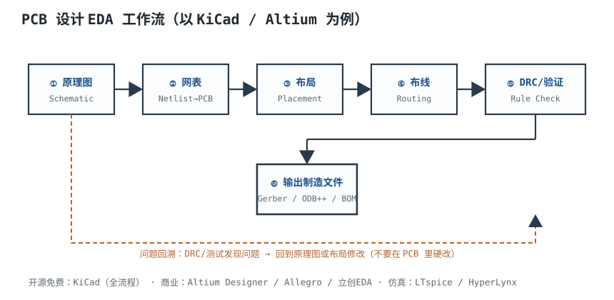
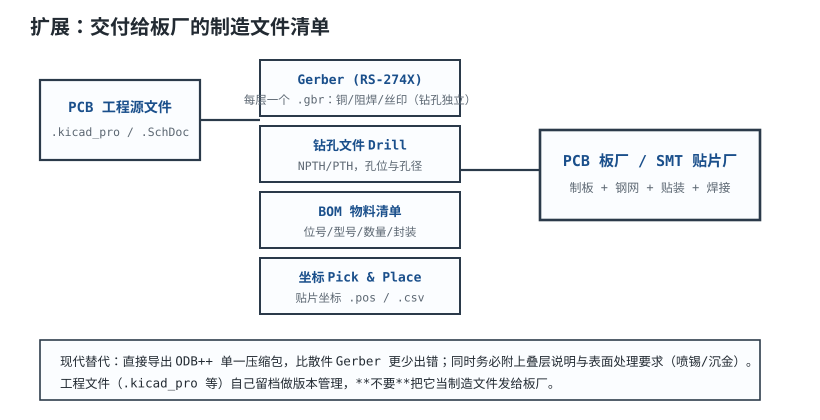

# EDA 工具：KiCad / Altium 工作流 EDA Design Flow

一块 200 个元件、796 个焊盘、约 450 个网络的四层板，靠手画不可能保证一致。EDA（Electronic Design Automation，电子设计自动化）工具把“原理图逻辑”和“PCB 物理实现”绑定，把库、规则、检查、版本和制造输出串成一条数据链。**这条链上任何一个环节靠“我记得”“我看过了”来保证，最后都会在打样或量产时变成返工。**

本章讲清楚三件事：原理图与 PCB 怎么协作、库和版本怎么管、自动化检查怎么落地；最后用一个 200 元件四层板的项目，给出检查清单和评审节点。工具以 KiCad/Altium 的通用概念为主，具体菜单和命令以所用版本为准。

## 1. 设计动机

::: motivation 四个“图很漂亮、板子不能用”的现场
**现场一：封装引脚映射反了。** 原理图符号的 Pin 1 对应封装 Pad 8，板子回来芯片第 1 脚接到第 8 脚的网络，上电即失效。原理图看起来完全正确，ERC 也不会报——因为符号和封装各自都“合法”，错的是两者的映射。

**现场二：PCB 里直接改了一根线。** 调试时在 PCB 里把两个网络短接，忘了回原理图。下一次从原理图同步，这个修改被覆盖；再改一次，又覆盖。版本越往后，图和板越不一致，最后没人知道哪一版是真的。

**现场三：库里的 0805 焊盘用了 0603 的尺寸。** 这个封装在项目里用了 20 次，20 个位置全部虚焊/立碑；返修花了几天，原因只是库里的一个尺寸。

**现场四：Gerber 少了一层。** 输出时只勾了顶层铜和阻焊，忘了底层铜；板厂按文件做出来，底层没有铜。重做一版，交期延一周。**制造输出不是“点一下导出”，是一份要逐项核对的交付物。**
:::

| 你想确认 | 先查/先跑 | 判据 |
|---|---|---|
| 逻辑有没有错 | ERC | 0 error；未连接引脚/电源冲突逐条处理 |
| 物理有没有错 | DRC | 0 error；0 未连接；0 courtyard 重叠 |
| 图和板是否一致 | 网表/ECO 比对 | 元件数、网络数、引脚映射一致 |
| 库是否可信 | 库审计 | 新封装 100% 核对；复用封装抽样 |
| 版本是否可追溯 | Git/tag/变更记录 | 每个评审节点有基线 |
| 制造文件是否完整 | 输出清单 | 层数、钻孔、BOM、坐标、叠层齐全 |
| 能不能自动化 | CI 脚本 | ERC/DRC/DFM 每次提交自动跑 |

**不算会摔在哪，四个带数字的代价：**

1. **一个封装错，20 个位置遭殃**：库里的 0805 焊盘画成 0603，20 个实例全部有风险；不是“改一个焊盘”，是 20 个焊点的返修。
2. **一次未同步的 PCB 修改**：原理图重同步后覆盖，调试记录丢失；下一版可能把已经验证过的修复又改回去。
3. **一次 Gerber 漏层**：4 层板少一层铜，整批返工/报废风险；交期和板材成本都会上升。
4. **一次没跑 DRC 的发板**：0.10 mm 间距小于板厂 0.127 mm 能力，短路/返工；DRC 跑一遍只要几分钟。

## 2. 定义与直观：逻辑源、物理实现与数据桥

### 2.1 一条数据链

EDA 工作流可以压缩成一条链：

**需求 → 符号/封装库 → 原理图 → ERC → 网表/ECO → PCB 布局 → 布线 → DRC → DFM → 制造输出 → 贴片/调试**

每一环都有输入、输出和检查点：

- **原理图（Schematic）**：逻辑源。它回答“谁和谁相连”，不回答“放在哪里”。
- **符号（Symbol）**：原理图里的图形，表达引脚名、引脚号、电源/地、功能分组。
- **封装（Footprint）**：PCB 上的焊盘、阻焊、钢网、 courtyard、3D 模型；回答“实物怎么焊”。
- **网表（Netlist）**：元件清单 + 引脚连接关系，是原理图和 PCB 之间的数据桥。
- **ECO（Engineering Change Order，工程变更单）**：把原理图的变更“有记录地”推到 PCB；反过来，PCB 的位号/门交换可以回标（back-annotate）到原理图。
- **DRC/ERC**：设计规则检查/电气规则检查；一个查物理，一个查逻辑。
- **制造输出**：Gerber、钻孔、BOM、贴片坐标、叠层/阻抗说明。



### 2.2 同步是“有方向的”，不是“任意双向”

常见说法是“现代工具实现原理图与 PCB 双向实时同步，改哪边都一样”。这句话只对了一部分：

- **逻辑变更（连线、元件、参数、封装分配）必须从原理图发起**，通过网表/ECO 推到 PCB；这是主方向。
- **物理变更（位置、走线、过孔、铜箔）留在 PCB**，一般不回写原理图；否则原理图会被布局细节污染。
- **有限回标**：位号重排、门交换、引脚交换等可以回标到原理图，但要有记录、要评审。
- **“在 PCB 里直接改网络”不是同步，是绕过 ECO**；下一次从原理图更新时会被覆盖，或者造成无法解释的差异。

**纠正一个常见说法**：不是“改任一边另一边自动更新”，而是“逻辑以原理图为准，物理以 PCB 为准，中间用 ECO/网表对齐”。把 PCB 当第二真源，版本一定会分叉。

### 2.3 库是最大的错误来源

原理图错误、布局错误、布线错误，通常能在评审或 DRC 里发现；**库错误最隐蔽**：符号和封装各自都“合法”，ERC/DRC 都可能通过，错的是两者之间的映射，或者焊盘尺寸与实物不匹配。

库错误的四种典型：

1. **引脚映射错**：符号 Pin 1 ↔ 封装 Pad 8；ERC 不查封装，DRC 不查映射。
2. **焊盘尺寸错**：0805 用 0603 焊盘，或者 QFN 热焊盘小 0.2 mm；焊接不良，但电气检查全过。
3. **极性/方向错**：二极管阴极、电解电容正极、连接器 Pin 1 反了；装配后烧板。
4. **库版本漂移**：全局库被改，老项目重新打开时封装变了；BOM 没记录库版本，无法追溯。

**结论：库不是“画图素材”，是受版本控制、要评审、要测试的设计资产。** 一个库错误的影响面等于它的实例数：用 20 次，就是 20 个风险点。

## 3. 定量关系：对象计数、评审覆盖率与交付物

### 3.1 先数对象：元件、焊盘、网络

一个项目的复杂度可以用三个数描述：

- $N_c$：元件数（placement count）；
- $N_p$：焊盘/引脚数；
- $N_n$：网络数。

**算例**：200 个元件，构成如下：

| 类型 | 数量 | 每件引脚/焊盘 | 小计 |
|---|---|---|---|
| BGA | 1 | 196 | 196 |
| QFN | 4 | 32 | 128 |
| SOIC | 8 | 8 | 64 |
| SOT-23 | 20 | 3 | 60 |
| 0402/0603 阻容 | 150 | 2 | 300 |
| 连接器 | 7 | 4（平均） | 28 |
| 晶振 | 2 | 2 | 4 |
| 电感 | 8 | 2 | 16 |
| **合计** | **200** | — | **796** |

$$N_p=196+128+64+60+300+28+4+16=796$$

网络数取约 450（含电源、地、信号；示例值）。**元件数、焊盘数、网络数是后面所有检查的“基数”**：ERC 要覆盖 450 个网络，DRC 要覆盖 796 个焊盘，BOM 要覆盖 200 个 placement。

### 3.2 评审覆盖率：新库 100%，复用库抽样

库审计不能“全部看一遍”，也不能“只看新的”。一个可执行的策略：

$$N_{\mathrm{review}}=N_{\mathrm{new}}\times100\%+N_{\mathrm{reuse}}\times s$$

- $N_{\mathrm{new}}$：本项目新做/改过的封装数；
- $N_{\mathrm{reuse}}$：复用库中的封装数；
- $s$：复用封装抽样比例，取 20%。

**算例**：200 个元件里，8 个用了新封装，192 个复用：

$$N_{\mathrm{review}}=8\times1.0+192\times0.2=8+38.4=46.4\Rightarrow47$$

$$47/200=23.5\%$$

**新封装 100% 核对，复用封装 20% 抽样，整体覆盖 23.5% 的元件。** 这不是“抽查 47 个焊盘”，而是 47 个元件的封装几何、pin 1、极性、 courtyard、3D、钢网/阻焊层都要看。对 BGA/QFN/连接器等高风险封装，抽样比例要提高到 100%。

### 3.3 原理图评审：100% 电源/地，100% 差分，抽样信号

450 个网络不可能逐根手看。按风险分层：

- **电源/地**：100% 检查。示例 60 个网络；
- **差分对**：100% 检查。示例 20 对 = 40 个网络；
- **普通信号**：抽 20%。剩余 $450-60-40=350$ 个，抽 70 个；
- **合计**：$60+40+70=170$ 个网络，占 37.8%。

$$170/450=0.378=37.8\%$$

**电源/地错一根，整板可能不工作；普通信号错一根，可能只是某个功能异常。** 评审覆盖率要按风险分配，不是平均主义。

### 3.4 制造交付物：4 层板到底要交哪些文件

以 4 层、双面贴装为例：

| 类别 | 文件 | 数量 |
|---|---|---|
| 铜层 | L1~L4 copper | 4 |
| 阻焊 | 顶层/底层 | 2 |
| 丝印 | 顶层/底层 | 2 |
| 钢网 | 顶层/底层 | 2 |
| 板框 | Outline | 1 |
| 钻孔 | PTH/NPTH | 2 |
| **Gerber/钻孔小计** | — | **13** |
| 装配 | BOM、贴片坐标、装配图 | 3 |
| 制造说明 | 叠层、阻抗、表面处理、拼板 | 4 |
| **合计** | — | **20** |

**13 个 Gerber/钻孔文件 + 3 个装配文件 + 4 个制造说明 = 20 项交付物。** 少一项都可能让板厂/贴片厂停下来问，或者按默认值做错。ODB++/IPC-2581 可以把多项打包，但“打包”不等于“检查过”；仍然要逐项核对层数、孔径、网络。



### 3.5 版本差异：diff 能看什么、不能看什么

- **文本格式（KiCad 的 `.kicad_sch`、`.kicad_pcb`）**：可以 `git diff`，能看到网络、封装、坐标的行级变化；但 diff 很吵，要配合渲染图。
- **二进制格式（Altium 的 `.PcbDoc`、`.SchDoc`）**：Git 只能存版本，不能有意义地 diff；要用导出 PDF/SVG、3D 截图、BOM diff 辅助评审。
- **可读的变更记录**：每个评审节点写“改了什么、为什么、影响哪些网络/器件”，比 diff 本身更重要。
- **基线**：每个节点打 tag，例如 `v0.1-sch`、`v0.2-place`、`v0.3-route`、`v1.0-mp`；制造文件从 tag 导出，不从工作区导出。

## 4. 典型计算：200 元件四层板项目的检查清单与评审节点

### 4.1 项目条件

| 项目 | 数值 |
|---|---|
| 元件数 | 200 |
| 焊盘/引脚 | 796 |
| 网络 | 约 450 |
| 层数/板厚 | 4 层，1.6 mm |
| 最高密度器件 | 0.5 mm 间距 BGA（196 球） |
| 电源 | 12 V、5 V、3.3 V、1.8 V |
| 接口 | USB、RS485、调试口 |
| 交付 | Gerber/钻孔、BOM、坐标、叠层、阻抗、装配图 |

### 4.2 检查清单

| # | 阶段 | 检查项 | 方法 | 通过标准 |
|---|---|---|---|---|
| 1 | 库 | 新封装 8 个 | 100% 对照数据手册 | 焊盘/引脚/极性/ courtyard 一致 |
| 2 | 库 | 复用封装 192 个 | 抽 20%（39 个） | pin 1、极性、3D 无误 |
| 3 | 原理图 | ERC | 自动 | 0 error；未连接引脚有说明 |
| 4 | 原理图 | 电源/地网络 | 100%（60 个） | 无短路、无悬空、去耦完整 |
| 5 | 原理图 | 差分对 | 100%（20 对） | 极性/配对/终端正确 |
| 6 | 原理图 | 普通信号 | 抽 20%（70 个） | 网络名/连接/上拉下拉正确 |
| 7 | PCB | 元件数与网表 | 自动比对 | 200 个元件、796 个焊盘一致 |
| 8 | PCB | DRC | 自动 | 0 error；0 未连接 |
| 9 | PCB | courtyard 重叠 | DRC/目检 | 0 处 |
| 10 | PCB | 丝印上焊盘 | DRC/目检 | 0 处 |
| 11 | PCB | 层数/叠层 | 目检 | 4 层，铜厚/介质与叠层表一致 |
| 12 | PCB | 阻抗 | field solver/板厂 | 50 Ω ±10% |
| 13 | PCB | 热 | 计算/热像 | 结温 < 上限，留 10 °C |
| 14 | 制造 | Gerber/钻孔 | 逐层核对 | 13 个文件，层名/孔径正确 |
| 15 | 制造 | BOM | 与原理图比对 | 200 placement，MPN/封装一致 |
| 16 | 制造 | 坐标 | 首件核对 | 旋转角/原点/面别正确 |
| 17 | 制造 | 叠层/阻抗/表面处理 | 文档 | 与板厂能力一致 |
| 18 | 制造 | 拼板/Mark/定位孔 | 目检 | 工艺边、Mark、NPTH 齐全 |

### 4.3 评审节点

| 节点 | 交付物 | 退出标准 | 参与人 |
|---|---|---|---|
| G0 需求 | 需求表、接口图、功耗预算 | 电源/接口/环境/成本确认 | 系统、硬件、结构 |
| G1 原理图冻结 | 原理图 PDF、ERC 报告、BOM 初稿 | ERC 0 error；关键网络评审通过 | 硬件、评审人 |
| G2 布局冻结 | 布局图、叠层、DRC 初跑 | 关键器件位置/散热/接口确认 | 硬件、Layout、结构 |
| G3 布线冻结 | PCB、DRC 报告、阻抗报告 | DRC 0 error；0 未连接；阻抗达标 | 硬件、Layout、SI |
| G4 制造放行 | Gerber/钻孔、BOM、坐标、装配图 | 20 项交付物齐全；DFM 通过 | 硬件、制造、质量 |

**五个节点，每个节点都要“有输出、有标准、有签字”。** 没有 G1 的原理图冻结，后面 Layout 改逻辑；没有 G3 的 DRC 清零，G4 的 Gerber 就是带病的。

### 4.4 版本与变更记录

- **基线**：G1 打 `v0.1-sch`，G2 打 `v0.2-place`，G3 打 `v0.3-route`，G4 打 `v1.0-mp`。
- **提交信息**：`sch: add RS485 termination`、`pcb: move BGA decoupling to bottom`，写“改什么/为什么”，不写“update”。
- **变更记录**：每个节点一份 `CHANGELOG`，列出网络/器件/封装变化、影响、验证结果。
- **制造文件来源**：从 tag 导出，不从工作区导出；导出后计算校验和，和评审记录一起归档。
- **禁止提交**：Gerber、钻孔、PDF、3D 渲染、缓存；这些是生成物，放 `.gitignore`，需要时从 tag 重新生成。

### 4.5 自动化检查脚本

以 KiCad 8 为例（具体参数以 `kicad-cli --help` 为准）：

```bash
kicad-cli sch erc -o reports/erc.rpt board.kicad_sch
kicad-cli pcb drc -o reports/drc.rpt board.kicad_pcb
kicad-cli sch export bom -o reports/bom.csv board.kicad_sch
kicad-cli pcb export pos -o reports/pos.csv board.kicad_pcb
kicad-cli pcb export gerbers -o fab/gerbers/ board.kicad_pcb
kicad-cli pcb export drill -o fab/drill/ board.kicad_pcb
```

检查逻辑：

1. `erc.rpt`、`drc.rpt` 中 error 数为 0，否则 CI 失败；
2. `bom.csv` 行数与原理图元件数一致（示例 200 placement，按 MPN 合并后行数可少）；
3. `pos.csv` 的位号集合与 BOM 一致；
4. `fab/gerbers/` 的层数与叠层表一致（4 层铜 + 2 阻焊 + 2 丝印 + 2 钢网 + 1 板框 = 11 个 Gerber；钻孔 2 个单独核对）；
5. 与上一 tag 做 BOM/网络 diff，变更项逐条评审。

**自动化不是替代评审，是把“机械可查”的部分从人脑里拿走**，让人只看差异和风险。

## 5. 工程含义：库、版本、评审、自动化

### 5.1 库管理：项目库优先，全局库只读

- **项目库**：`sym-lib-table`、`fp-lib-table` 指向项目内的符号/封装目录；随工程走，保证复现。
- **全局库**：只读；要改就复制到项目库，改完评审、打版本，不要直接改全局库。
- **命名**：`<厂商>_<型号>_<封装>`，例如 `TI_TPS62130_RNW`；不要用 `new_footprint_2`。
- **pin map**：符号引脚号 = 封装焊盘号；Pin 1 在符号、封装、3D、装配图上一致。
- **3D**：STEP 模型用于结构干涉；模型原点和方向要和封装一致。
- **DRC 规则**：线宽/间距/过孔/环宽/阻焊桥按板厂能力设置；规则文件也进版本库。
- **库审计**：新封装 100% 对照数据手册；复用封装抽样；BGA/QFN/连接器 100%。
- **库版本**：每个项目锁定一个库 commit/tag；BOM 记录库版本；库变更走 ECO。

### 5.2 版本管理：Git 管源文件，tag 管基线

- **源文件进 Git**：原理图、PCB、库、规则、BOM 源、叠层/阻抗说明；生成物不进。
- **分支**：`main` 保持可制造；功能/改版用分支；合并前跑 ERC/DRC/DFM。
- **tag**：每个评审节点一个 tag；制造文件从 tag 导出。
- **diff**：文本格式看行级 diff；二进制格式看导出图/BOM diff；不要只说“我看过了”。
- **变更记录**：谁、什么时候、改了什么、为什么、影响哪些网络/器件、怎么验证。
- **回滚**：tag + 生成物可重建；不要依赖“某台电脑上的旧文件”。

### 5.3 评审：看差异，不看“漂亮”

- **评审对象**：diff、DRC/ERC 报告、BOM 变更、关键网络、热/阻抗/EMC 风险。
- **评审人**：不能只有设计者本人；至少一位没参与该模块的硬件工程师。
- **评审记录**：问题清单、责任人、关闭状态；未关闭问题不能进下一节点。
- **红队**：让评审人专门找“最可能出错的三处”，比泛泛看一遍有效。
- **签核**：G1/G3/G4 要有签字/记录；口头“可以了”不算。

### 5.4 自动化：ERC/DRC/DFM/网表比对

- **ERC**：未连接引脚、电源引脚未驱动、输出冲突、重复位号。
- **DRC**：间距、线宽、过孔、环宽、阻焊桥、丝印上焊盘、courtyard 重叠、未连接。
- **DFM**：板边/拼板/工艺边/Mark/定位孔/表面处理/钢网面积比；见[DFM 与焊接工艺](dfm-process.md)。
- **网表比对**：原理图 vs PCB 的元件数、网络数、引脚映射；KiCad 的 Schematic Parity、Altium 的 Project Comparator。
- **BOM/AVL**：MPN、封装、DNP、替代料、生命周期。
- **制造输出**：层数、钻孔 PTH/NPTH、BOM/坐标、叠层/阻抗、装配图。
- **CI**：每次 push 跑 ERC/DRC/BOM diff；失败阻止合并；报告归档。

### 5.5 工具选择：不是信仰，是数据链

| 工具 | 性质 | 适用 | 注意 |
|---|---|---|---|
| KiCad | 开源、跨平台 | 个人/小团队/教学 | 文本格式友好，CLI 可自动化 |
| Altium Designer | 商业、Windows | 中大型企业 | 生态全，二进制文件 diff 难 |
| 立创 EDA | 在线、免费 | 快速打样/嘉立创 | 数据在云端，注意导出/备份 |
| Allegro/Cadence | 商业、高端 | 高速/大规模 | 学习曲线和成本高 |

**选工具看三件事**：库是否可控、数据是否能导出、自动化是否可接入。工具再强，库不可信、版本不可追溯，板子照样翻车。

### 5.6 与周边章节的关系

- 符号/封装/库的具体规范与 SOT-23、QFN-32 算例见[原理图、封装与库管理](schematic-library.md)；
- 制造输出、拼板、表面处理、钢网的细节见[DFM 与焊接工艺](dfm-process.md)；
- 热检查项、热过孔、结温预算见[热设计](thermal-design.md)；
- 布线规则与载流见[布线](routing.md)，叠层/阻抗见[叠层设计](pcb-stackup.md)。

## 6. 常见坑

::: pitfall 在 PCB 里直接改网络
- **现象**：调试时在 PCB 里短接/改网络，下次从原理图同步后被覆盖，或者板子与图不一致。**原因**：绕过 ECO，把 PCB 当第二真源。**解决**：逻辑变更回原理图，走 ECO；紧急飞线在 PCB 里标注“临时”，并在下一版转成正式原理图变更。
:::

::: pitfall 全局库被改坏
- **现象**：老项目重新打开，封装尺寸变了；BOM 没记录库版本，无法追溯。**原因**：直接改全局库，没有项目库和版本锁定。**解决**：项目库优先，全局库只读；库变更走 ECO、打 tag；BOM 记录库版本。
:::

::: pitfall 只跑 DRC 不看未连接/ courtyard
- **现象**：DRC 0 error，板子却有悬空网络、器件重叠。**原因**：DRC 规则没开“未连接”“courtyard 重叠”“丝印上焊盘”；或者只看 error 不看 warning。**解决**：评审前逐项开启检查；0 error + 0 unconnected + 0 courtyard 才算过。
:::

::: pitfall 制造文件漏层/混孔
- **现象**：板厂做出 4 层板少一层铜，或者 NPTH 被镀铜。**原因**：Gerber 层选错；PTH/NPTH 钻孔文件混在一起；没附叠层说明。**解决**：按 20 项交付物清单逐项核对；Gerber 层数=4 铜+2 阻焊+2 丝印+2 钢网+1 板框；钻孔分 PTH/NPTH。
:::

::: pitfall 版本管理只存二进制
- **现象**：想比较两版差异，只能打开文件“看感觉”；出了问题无法定位。**原因**：只提交二进制工程文件，没有导出图/ BOM/变更记录。**解决**：文本格式进 Git；二进制格式导出 PDF/SVG/BOM 做 diff；每个节点写 CHANGELOG。
:::

::: pitfall 评审只看 3D 效果图
- **现象**：3D 很漂亮，DRC/网络/封装映射的问题没发现。**原因**：评审对象错了；3D 只反映外形，不反映网络和焊盘。**解决**：评审 diff、ERC/DRC 报告、BOM 变更、关键网络；3D 只做结构干涉检查。
:::

## 7. 自测题

<details><summary>原理图和 PCB 的同步方向是什么？“双向实时同步”这句话哪里不准确？</summary>

逻辑以原理图为准：连线、元件、参数、封装分配通过网表/ECO 推到 PCB；物理变更（位置、走线、过孔）留在 PCB。有限回标（位号、门交换、引脚交换）可以回原理图，但要有记录。

“改任一边另一边自动更新”不准确：在 PCB 里直接改网络会绕过 ECO，下次同步被覆盖；PCB 不是第二逻辑源。

</details>

<details><summary>200 个元件、8 个新封装、192 个复用封装，复用抽样 20%，库审计覆盖多少个元件？占比多少？</summary>

$$N=8\times1.0+192\times0.2=8+38.4=46.4\Rightarrow47$$

$$47/200=23.5\%$$

新封装 100%，复用 20%；BGA/QFN/连接器提高到 100%。

</details>

<details><summary>4 层、双面贴装，Gerber/钻孔文件至少几类？加上装配和制造说明，交付物多少项？</summary>

Gerber/钻孔：4 铜 + 2 阻焊 + 2 丝印 + 2 钢网 + 1 板框 + 2 钻孔 = 13 项。

再加 BOM、坐标、装配图 3 项，叠层、阻抗、表面处理、拼板 4 项，合计 20 项。

</details>

<details><summary>为什么“库是最大的错误来源”？一个封装用 20 次，错了会怎样？</summary>

库错误（pin map、焊盘尺寸、极性）在 ERC/DRC 里可能都通过，因为符号和封装各自合法；错的是映射或几何。一个封装用 20 次，就是 20 个位置同时有风险；返修/返工按实例数放大。

</details>

<details><summary>DRC 0 error 是否等于板子没问题？还要检查什么？</summary>

不等于。还要检查：0 未连接、courtyard 重叠、丝印上焊盘、层数/叠层、阻抗、热、BOM/坐标、Gerber 层数、PTH/NPTH、拼板/Mark/定位孔。DRC 只覆盖已开启的规则。

</details>

<details><summary>文本格式和二进制格式的版本 diff 各怎么做？</summary>

文本（KiCad）：`git diff` 看行级变化，配合导出 SVG/PDF 看视觉差异。

二进制（Altium）：Git 存版本但 diff 无意义；导出 PDF/SVG、3D 截图、BOM diff，配合 CHANGELOG 评审。

</details>

## 8. 参考资料

- **KiCad 8 Documentation, *Getting Started / Schematic Editor / PCB Editor / Command Line Interface***：原理图-PCB 同步、ERC/DRC、`kicad-cli` 导出；本章 4.5 节的自动化命令按该文档，具体参数以所用版本 `--help` 为准。
- **IPC-2221B, *Generic Standard on Printed Board Design*, 6 节**：设计规则、间距、环宽、载流；本章 3.4、4.2 节的检查项参考该标准。
- **IPC-2222A, *Sectional Design Standard for Rigid Organic Printed Boards***：刚性板设计、板边/拼板/层叠；本章 4.2 节的层数/叠层检查按该标准。
- **IPC-7351B, *Generic Requirements for Surface Mount Design and Land Pattern Standard***：焊盘/ courtyard/密度等级；本章 4.2 节的封装检查按该标准。
- **IPC-2581C, *Generic Requirements for Printed Board Assembly Products Manufacturing Description Data and Transfer Methodology***：制造数据包的内容与交换；本章 3.4 节的交付物清单参考该标准。
- **Ucamco, *The Gerber Layer Format Specification (RS-274X)*, 2 至 4 节**：Gerber 层、孔径、极性；本章 3.4、4.5 节的层数/文件检查按该规范。
- **Pro Git, 2nd ed., Chapter 2 *Git Basics***：提交、分支、tag、diff；本章 5.2 节的版本管理按该书。
- **Altium Designer Documentation, *Design Rule Check* 与 *Project Comparator***：DRC 与原理图/PCB 差异比对；本章 5.4 节的网表比对参考该文档。
