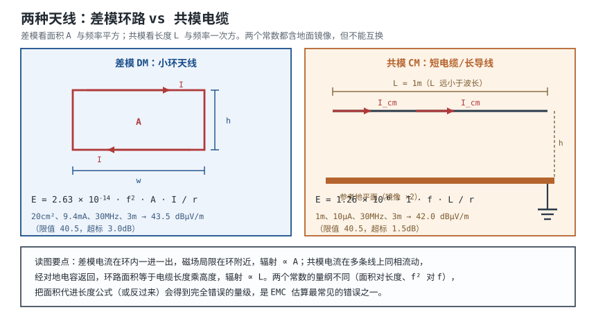

# EMI/EMC：辐射与传导机理 EMI/EMC Mechanisms

**EMC（Electromagnetic Compatibility，电磁兼容）**包含两面：设备不往外发射过多噪声（**EMI，电磁干扰发射**），以及设备能扛住外部干扰不崩（**EMS，抗扰度**）。过不了 EMC 认证，产品就不能上市；而 EMC 问题最贵的地方在于，它往往是**布局和叠层阶段就埋下的**，等到认证前才发现，改板、加屏蔽、换器件的代价远高于一开始把环路画小。

这一章要建立的是"可计算的直觉"：噪声从哪来、沿哪条路出去、出去多大、和限值差多少 dB。**辐射与传导不是两种玄学，而是两个可以写出式子的耦合路径**：差模电流在小环路里环流，像一个小环天线；共模电流在电缆上同相流动，像一根短单极天线。把电流、环路面积、频率、距离代进去，就能算出大概的场强，再和限值比。

先给结论：**在 30MHz~1GHz，大多数产品的辐射超标来自共模电流和电缆，而不是 PCB 上的差模环路；但差模环路是"源头"，把它压小，共模激励也会跟着降。** 对策的顺序是：先减环路面积和边沿速率（源头），再处理共模路径（扼流、滤波、屏蔽），最后才谈整机屏蔽。这个顺序有前提，第 5 节会写清楚。

## 1. 设计动机

::: motivation 三个现场
**现场一：输入电容离 IC 20mm 的 Buck。** 12V/3A、500kHz 的 Buck，输入电容离开关管 20mm，输入环路面积约 20cm²。按后面的式子算，30MHz 处差模辐射约 43.5 dBµV/m，而 Class B 在 3m 的限值是 40.5 dBµV/m——超标 3dB。把电容挪到紧贴输入脚、环路降到 2cm²，同一频率降到 23.5 dBµV/m，余量 17dB。**同一块板、同一颗芯片，差别只在 18mm 的摆放。**

**现场二：传导过了，辐射没过。** 差模噪声被 X 电容压住了，电源端传导测试通过；但 1m 的直流电缆上还有 10µA 的共模电流，30MHz 处辐射 42.0 dBµV/m，仍然超标。**X 电容对共模无效，共模要走扼流圈、Y 电容和屏蔽。**

**现场三：最后加屏蔽罩。** 0.1mm 铜箔对 100MHz 的材料屏蔽效能超过 200dB，但罩子上一条 10mm 的缝，把有效屏蔽效能限制在 43.5dB；如果罩子还是单点接地，它自己就成了天线。**屏蔽的短板永远在缝、在接地、在电缆，而不在材料。**
:::

设计前先明确要判断哪四件事：

| 你想判断 | 先查什么 | 判据 |
|---|---|---|
| 辐射会不会超 | 环路面积、电流、频率、距离 | $E=2.63\times10^{-14}f^2AI/r$ |
| 共模有没有份 | 电缆长度、共模电流 | $E=1.26\times10^{-6}IfL/r$ |
| 传导会不会超 | LISN 上的电压、CM/DM 分量 | $V=50\ \Omega\times I$，与限值比 |
| 该先改哪里 | 源头、路径、天线 | 先减环路和边沿，再谈屏蔽 |

**不懂会在哪里摔跤**，具体是这四条：

1. 把 dBm 当成"差了多少"的单位。dBm 是相对 1mW 的功率绝对单位；场强用 dBµV/m，两个场强之差只能用 dB。
2. 把 30MHz 以下的辐射当考核项。30MHz 以下考核的是**传导发射**（电源端、电信端），辐射限值通常从 30MHz 起；用错频段会白改一轮。
3. 只压差模，不管共模。辐射超标的主因常常是电缆共模电流，X 电容对它无效。
4. 把"加屏蔽罩"当第一手段。屏蔽是兜底，源头环路和边沿没处理好，罩子只会把问题关在盒子里，还多出谐振和缝隙。

## 2. 定义与直观：两条路径、两种电流、两个场区

### 2.1 发射与抗扰、传导与辐射

**EMI（Electromagnetic Interference，电磁干扰）**是设备对外发射的骚扰；**EMS（Electromagnetic Susceptibility/Immunity，电磁敏感度/抗扰度）**是设备承受外部骚扰的能力；两者合起来是 **EMC**。发射按传播路径分两类：

- **传导发射（Conducted Emission）**：噪声沿电源线、信号线、地线以电压/电流形式传播，考核频段通常 150kHz~30MHz，用 LISN（线路阻抗稳定网络）和接收机测量。
- **辐射发射（Radiated Emission）**：噪声以电磁场形式在空间传播，考核频段通常 30MHz~1GHz（有的产品到 6GHz），用天线在指定距离测量。

### 2.2 近场与远场：先分清测量点在哪

天线和探头测到的东西，取决于测量点到源的距离 $r$ 与波长 $\lambda$ 的关系。分界近似为：

$$
r_{far}\approx\frac{\lambda}{2\pi}=\frac{c}{2\pi f}
$$

其中 $c=3.0\times10^{8}\ \text{m/s}$；$f$ 是频率，Hz。几个关键频率：

| 频率 | 波长 $\lambda$ | 近场边界 $\lambda/2\pi$ | 3m 处属于 |
|---|---|---|---|
| 30MHz | 10m | 1.59m | 远场 |
| 100MHz | 3m | 0.477m | 远场 |
| 300MHz | 1m | 0.159m | 远场 |
| 1GHz | 0.3m | 47.7mm | 远场 |

**这条边界解释了两件事**：第一，标准的 3m/10m 测量都在远场，场强按 $1/r$ 衰减，所以距离可以换算；第二，用近场探头在板子上方几毫米扫描时，测到的是近场，电场和磁场没有固定比例，**不能用近场读数直接推算远场限值**，只能用来找热点、做相对比较。

远场的电场与磁场之比是自由空间波阻抗：

$$
\frac{|E|}{|H|}=\eta_0\approx377\ \Omega
$$

近场则取决于源的性质：高电压小电流的源（开关节点、散热片）以电场为主，波阻抗高；低电压大电流的源（电流环路、变压器漏磁）以磁场为主，波阻抗低。**这决定了屏蔽材料的选择**：电场用薄金属即可，低频磁场要高导磁材料，详见[屏蔽、滤波与接地设计](shielding-filtering-grounding.md)。

### 2.3 差模与共模：两条不同的天线

**差模（Differential Mode, DM）**电流在两条线之间一进一出，环路面积小，磁场局限在环路附近；**共模（Common Mode, CM）**电流在多条线上同相流动，经对地寄生电容返回，环路面积等于"电缆长度 × 离地高度"，天然是一根大天线。

| 项目 | 差模 DM | 共模 CM |
|---|---|---|
| 电流路径 | 线与线之间环流 | 线与地之间同相流动 |
| 等效天线 | 小环天线 | 短单极/偶极天线 |
| 环路面积 | 小（cm² 量级） | 大（m² 量级） |
| 主要频段 | 开关频率及其低次谐波 | 几十 MHz~几百 MHz |
| 抑制元件 | X 电容、差模电感、减小环路 | Y 电容、共模扼流圈、屏蔽、铁氧体 |
| 辐射占比 | 低频段可能主导 | 30MHz 以上常主导 |

::: analogy 推磨与抬桌子
差模像两个人在原地推磨：一个推、一个拉，力气在石磨内部转圈，外面只感到很小的振动。共模像两个人抬着整张桌子一起往前跑：桌子整体对地面起伏，动静传得很远。

类比的边界：推磨的"振动"是磁场，抬桌子的"动静"是电场和磁场同时向外辐射；而且共模电流不需要"人抬"，只要对地有寄生电容和 dV/dt，就会自己产生。所以不能把共模理解成"更大的差模"，它们是两种不同的激励和不同的天线。
:::

## 3. 定量关系

### 3.1 差模辐射：小环天线

一个面积为 $A$、电流为 $I$ 的小环，在远场最大辐射方向的电场：

$$
E=\frac{\eta_0 k^2 I A}{4\pi r}
=\frac{377\pi f^2 A I}{c^2 r}
=1.32\times10^{-14}\frac{f^2 A I}{r}
$$

其中 $\eta_0=120\pi\approx377\ \Omega$；$k=2\pi/\lambda$ 是波数，$\text{m}^{-1}$；$A$ 是环路面积，$\text{m}^2$；$I$ 是环路电流，A；$r$ 是测量距离，m；$E$ 是电场强度，V/m。这个式子假设 $A\ll\lambda^2$（电小环）且 $r\gg\lambda/2\pi$（远场）。

PCB 上的环路通常贴近地平面，地面的镜像使场强加倍，工程上常用：

$$
E_{DM}=2.63\times10^{-14}\frac{f^2 A I}{r}
$$

**单位**：$E_{DM}$ 为 V/m；$f$ 为 Hz；$A$ 为 $\text{m}^2$；$I$ 为 A；$r$ 为 m。换成 dBµV/m：

$$
E\ [\text{dB}\mu\text{V/m}]=20\log_{10}\frac{E\ [\text{V/m}]}{1\times10^{-6}}
$$

先做一个小算例：$A=20\ \text{cm}^2=2.0\times10^{-3}\ \text{m}^2$、$I=9.44\ \text{mA}$、$f=30\ \text{MHz}$、$r=3\ \text{m}$：

$$
E=2.63\times10^{-14}\times\frac{(3.0\times10^{7})^2\times2.0\times10^{-3}\times9.44\times10^{-3}}{3}
$$

分步代入：

$$
(3.0\times10^{7})^2=9.0\times10^{14},\qquad
2.63\times10^{-14}\times9.0\times10^{14}=23.67
$$

$$
E=\frac{23.67\times2.0\times10^{-3}\times9.44\times10^{-3}}{3}
=\frac{4.469\times10^{-4}}{3}=1.490\times10^{-4}\ \text{V/m}
$$

$$
E=20\log_{10}\frac{1.490\times10^{-4}}{1\times10^{-6}}
=20\log_{10}(149.0)=43.5\ \text{dB}\mu\text{V/m}
$$

149µV/m 看起来很小，但限值同样很小：Class B 在 10m 是 30 dBµV/m，折算到 3m 是 40.5 dBµV/m。**辐射发射考的是"比限值低多少 dB"，不是"绝对场强大不大"。**

### 3.2 共模辐射：短导线/电缆

一根长度 $L$、共模电流 $I$ 的短导线（电缆），在远场最大辐射方向：

$$
E=\frac{120\pi I L f}{c\,r}=1.26\times10^{-6}\frac{I f L}{r}
$$

其中 $I$ 是共模电流，A；$L$ 是导线长度，m；$f$ 是频率，Hz；$r$ 是距离，m；$E$ 是 V/m。推导要点：短偶极子的远场 $E=60\pi IL/(\lambda r)$，地面镜像再乘 2，得到 $120\pi IL/(\lambda r)$，代入 $\lambda=c/f$ 即上式。适用前提：$L\ll\lambda$、$r\gg\lambda/2\pi$、导线离地高度远小于波长。

算例：$I=10\ \mu\text{A}$、$L=1\ \text{m}$、$f=30\ \text{MHz}$、$r=3\ \text{m}$：

$$
E=1.26\times10^{-6}\times\frac{10\times10^{-6}\times3.0\times10^{7}\times1}{3}
=1.26\times10^{-6}\times\frac{300}{3}=1.26\times10^{-4}\ \text{V/m}
$$

$$
E=20\log_{10}\frac{1.26\times10^{-4}}{1\times10^{-6}}=20\log_{10}(126)=42.0\ \text{dB}\mu\text{V/m}
$$

**只有 10µA 的共模电流，就足以让 1m 电缆在 30MHz 超标 1.5dB。** 这就是为什么"传导过了、辐射没过"经常发生在电缆上：共模电流不需要很大，天线效率就足够。共模电流的根源通常是地电位差与地环路，机理与定量见[地的学问与地弹](../power/grounding.md)。

::: advanced 三个容易传错的式子与单位
**误用一：把 1.26×10⁻⁶ 的式子乘上"面积 A"。** 这个常数对应的是**导线长度 L**（短单极/偶极模型），单位是米；环路辐射才用面积 A 和 $f^2$（小环模型，常数 $2.63\times10^{-14}$）。把面积代进长度公式，量纲不对，数值也会差几个数量级。两个式子的共同点是都含"地面镜像 ×2"，所以常数里都有 2 的因子。

**误用二：把 dBm 当作"差了多少"。** 早先的资料里有"布局好坏差十几到二十几个 dBm""DPI 抗扰提升 10–20 dBm"的说法。dBm 是相对 1mW 的功率绝对单位，不能表示场强差或抗扰度提升；正确写法是"差十几到二十几个 dB"、"提升 10–20 dB"。场强的绝对值用 dBµV/m，两个场强之比用 dB。

**误用三：把辐射功率和电场强度的频率关系写混。** 小环的辐射功率 $P_{rad}\propto A^2I^2f^4$，远场电场 $E\propto AI f^2/r$；早先的资料的自测题答案把 $P_{rad}$ 写成 $\propto A I^2 f^2$，与正文的 $f^4$ 自相矛盾。记住：**电场 ∝ f²，功率 ∝ f⁴**，两者相差一个平方。
:::

### 3.3 频谱包络：为什么高频段会"变平"

周期性的开关电流不是单频，而是一串谐波。对振幅 $I_p$、占空比 $D$、周期 $T$、上升时间 $t_r$ 的梯形波，第 $n$ 次谐波的单边振幅：

$$
I_n=\frac{2I_p}{\pi n}\left|\sin(\pi nD)\right|\cdot
\left|\frac{\sin(\pi n t_r/T)}{\pi n t_r/T}\right|
$$

其中 $n=f/f_{sw}$ 是谐波次数；$f_{sw}=1/T$ 是开关频率，Hz；$I_p$ 是脉冲峰值电流，A。这个式子的两个因子分别给出"脉冲宽度"和"上升沿"的滚降。

包络有两个转折频率：

$$
f_1=\frac{1}{\pi DT},\qquad f_2=\frac{1}{\pi t_r}
$$

- $f<f_1$：包络近似平坦，谐波幅度约 $2I_pD$；
- $f_1<f<f_2$：按 $-20\ \text{dB/decade}$ 滚降（$1/f$）；
- $f>f_2$：按 $-40\ \text{dB/decade}$ 滚降（$1/f^2$）。

把 $f>f_2$ 的 $I_n\propto1/f^2$ 代进差模辐射 $E\propto f^2I$，得到 $E\propto f^2\cdot f^{-2}=\text{常数}$：**高频段差模辐射的包络近似"平"的，不再随频率上升。** 这解释了为什么辐射频谱在几十 MHz 以上常常是一段平台加一串尖峰，而不是一路往上爬。共模辐射 $E\propto fI$，在 $1/f^2$ 区则按 $-20\ \text{dB/decade}$ 下降。

边沿的最高显著频率仍可用熟知的近似：

$$
f_{knee}\approx\frac{0.35}{t_r}
$$

$t_r=1\ \text{ns}$ 时 $f_{knee}=350\ \text{MHz}$；$t_r=20\ \text{ns}$ 时只有 17.5MHz。**放缓边沿是压高频谐波最便宜的手段之一**，代价是开关损耗增加。

### 3.4 传导发射：LISN 上的 50Ω 与 40µA

传导发射测量把电源线接到 LISN，LISN 在射频段呈现约 50Ω 的稳定阻抗，接收机测的是这个 50Ω 上的电压。共模电流 $I_{cm}$ 在 50Ω 上的电压：

$$
V_{LISN}=50\ \Omega\times I_{cm}
$$

Class B 电源端传导限值（准峰值）在 150kHz~0.5MHz 从 66 dBµV 降到 56 dBµV，0.5~5MHz 为 56 dBµV，5~30MHz 为 60 dBµV。把 66 dBµV 换成电压：

$$
V=10^{66/20}\times1\ \mu\text{V}=1.995\times10^{-3}\ \text{V}\approx2.0\ \text{mV}
$$

对应的共模电流：

$$
I_{cm}=\frac{2.0\times10^{-3}}{50}=4.0\times10^{-5}\ \text{A}=40\ \mu\text{A}
$$

**限值对应的电流只有 40µA 量级。** 一根 1m 电缆上 1mA 的共模电流，在 150kHz 就有：

$$
V=50\times1\times10^{-3}=0.05\ \text{V},\qquad
20\log_{10}\frac{0.05}{1\times10^{-6}}=94.0\ \text{dB}\mu\text{V}
$$

比 66 dBµV 高 28dB。**辐射发射对共模电流的要求反而更紧**（详见 4.3：辐射限值对应的允许共模电流约 8.4µA，传导约 40µA 量级）；这也是为什么电源滤波器要放在机箱入口，而不是板子中间。

### 3.5 限值：CISPR 22/32 的等级与距离换算

CISPR 32（多媒体设备）取代了 CISPR 22（信息技术设备），两者的辐射限值口径基本一致，分 Class A（工业/商业环境）和 Class B（居住环境）两级。Class B 更严：

| 频段 | Class A @10m | Class B @10m | Class B @3m（按 $1/r$ 折算） |
|---|---|---|---|
| 30~230MHz | 40 dBµV/m | 30 dBµV/m | 40.5 dBµV/m |
| 230~1000MHz | 47 dBµV/m | 37 dBµV/m | 47.5 dBµV/m |

距离换算的前提是**远场、自由空间、$1/r$ 衰减**：

$$
\Delta E=20\log_{10}\frac{r_2}{r_1}
$$

从 3m 到 10m：

$$
\Delta E=20\log_{10}\frac{10}{3}=10.5\ \text{dB}
$$

所以 10m 的 30 dBµV/m 等价于 3m 的 40.5 dBµV/m。**这个折算只适用于预测试和量级判断**：正式认证要按标准规定的距离、天线高度、转台、暗室和检波方式做，3m 与 10m 的差异还包括地面反射、天线波束和场地衰减，不能只靠一个 10.5dB 抹平。

传导限值（电源端，准峰值）按 Class 分：

| 频段 | Class A | Class B |
|---|---|---|
| 0.15~0.5MHz | 79 dBµV | 66→56 dBµV |
| 0.5~5MHz | 73 dBµV | 56 dBµV |
| 5~30MHz | 73 dBµV | 60 dBµV |

这些是量级与档位，具体以 CISPR 32/22 现行版本的表格和产品类别为准。**限值随产品类别、使用环境、端口类型（电源/电信/天线）而不同，不能把一张表套到所有产品上。**

谐波电流发射另有一套标准：IEC 61000-3-2（GB/T 17625.1 等同采用）适用于每相输入电流 ≤16A 的设备，按 Class A/B/C/D 分类限制各次谐波。对一台 36W 的适配器，输入电流约：

$$
I_{in}=\frac{P}{\eta U}=\frac{36}{0.9\times230}=0.174\ \text{A}
$$

Class A 的 3 次谐波限值是 2.30A，远大于 0.174A，所以**这一项通常不是小功率适配器的瓶颈**；但设备类别判定、Class D 的按瓦数限值、以及功率因数校正的要求，要按标准现行条款和产品类别确认，不能因为"算下来不大"就跳过。

### 3.6 开关电源的 EMI 源与三条对策

开关电源是板上最强的 EMI 源，因为它同时有大的 $di/dt$ 和大的 $dv/dt$：

| 源 | 机理 | 耦合路径 | 主要对策 |
|---|---|---|---|
| 输入环路 $di/dt$ | 输入电容—开关—地之间的脉冲电流 | 差模辐射、传导 | 缩小环路、输入电容紧贴、X 电容 |
| 开关节点 $dv/dt$ | 节点对散热器/机壳的寄生电容 | 共模传导、共模辐射 | 减小节点面积、屏蔽、Y 电容、共模扼流 |
| 二极管反向恢复 | 快速电流跳变激发振铃 | 差模/共模 | 缓冲（RC/RC-D）、选软恢复二极管 |
| 变压器/电感漏磁 | 磁芯漏磁耦合到附近环路 | 磁场耦合 | 磁芯屏蔽、拉开距离、减小环路 |
| 控制/驱动 | 驱动边沿、地弹 | 传导、近场 | 栅极电阻、去耦、布局 |

**振铃频率**由寄生电感和电容决定：

$$
f_{ring}=\frac{1}{2\pi\sqrt{L_pC_p}}
$$

以 $L_p=5\ \text{nH}$、$C_p=200\ \text{pF}$ 为例：

$$
f_{ring}=\frac{1}{2\pi\sqrt{5\times10^{-9}\times200\times10^{-12}}}
=\frac{1}{2\pi\times1.0\times10^{-9}}=159\ \text{MHz}
$$

**159MHz 的振铃正好落在辐射测试频段的中段**，也是"加了缓冲就过、拆了缓冲就挂"的典型原因。缓冲电阻按特征阻抗估：

$$
R_{sn}\approx\sqrt{\frac{L_p}{C_p}}=\sqrt{\frac{5\times10^{-9}}{200\times10^{-12}}}=5.0\ \Omega
$$

缓冲电容常取开关管输出电容的 2~4 倍，本例 200pF 对应 470pF~1nF。缓冲的代价是损耗：

$$
P_{sn}\approx C_{sn}V^2f_{sw}
$$

$C_{sn}=1\ \text{nF}$、$V=12\ \text{V}$、$f_{sw}=500\ \text{kHz}$ 时：

$$
P_{sn}=1\times10^{-9}\times144\times5\times10^{5}=0.072\ \text{W}
$$

72mW 可以接受；如果开关频率更高、电压更高，这笔损耗要重新核算，并确认电阻的脉冲功率额定值。

**展频（Spread Spectrum）**把开关频率在中心值附近缓慢调制，让谐波能量摊到更宽的频带上。峰值降低的粗略估算：

$$
\Delta L\approx10\log_{10}\frac{\Delta f_{spread}}{BW_{RBW}}
$$

$f_{sw}=500\ \text{kHz}$、调制 ±5%（475~525kHz）、60 次谐波在 30MHz 附近展宽：

$$
\Delta f_{spread}=2\times0.05\times500\ \text{kHz}\times60=3.0\ \text{MHz}
$$

接收机带宽 $BW_{RBW}=120\ \text{kHz}$ 时：

$$
\Delta L\approx10\log_{10}\frac{3.0\times10^{6}}{1.2\times10^{5}}=10\log_{10}(25)=14.0\ \text{dB}
$$

**这个 14dB 是上限估算**：前提是调制足够慢、能量在展宽范围内近似均匀、且用峰值检波；准峰值/平均值检波、调制波形、接收机驻留时间都会让实际收益变小，同时展频可能恶化低频纹波和抖动。

## 4. 典型计算

### 4.1 主算例：12V/3A Buck 在 30MHz 的差模辐射

**需求与假设**：

| 项目 | 取值 |
|---|---|
| 输入 | 12V，输出 3.3V/3A |
| 开关频率 | $f_{sw}=500\ \text{kHz}$，$T=2\ \mu\text{s}$ |
| 占空比 | $D=0.42$ |
| 脉冲峰值电流 | $I_p=3\ \text{A}$ |
| 上升时间 | $t_r=20\ \text{ns}$ |
| 输入环路面积 | 整改前 $A=20\ \text{cm}^2=2.0\times10^{-3}\ \text{m}^2$ |
| 测量距离 | $r=3\ \text{m}$ |
| 判据 | CISPR 32 Class B，30~230MHz，3m 折算 40.5 dBµV/m |

**第一步，求 30MHz 对应的谐波次数**：

$$
n=\frac{f}{f_{sw}}=\frac{30\times10^{6}}{500\times10^{3}}=60
$$

**第二步，代入梯形波谐波公式**。$D=0.42$、$t_r/T=20\ \text{ns}/2\ \mu\text{s}=0.01$、$n=60$：

$$
I_{60}=\frac{2\times3}{\pi\times60}\times\left|\sin(60\pi\times0.42)\right|
\times\left|\frac{\sin(60\pi\times0.01)}{60\pi\times0.01}\right|
$$

逐项算：

$$
\frac{6}{188.5}=0.03183,\qquad
\sin(25.2\pi)=\sin(0.2\pi)=0.5878
$$

$$
60\pi\times0.01=0.6\pi=1.885,\qquad
\frac{\sin(1.885)}{1.885}=\frac{0.9511}{1.885}=0.5046
$$

$$
I_{60}=0.03183\times0.5878\times0.5046=9.44\times10^{-3}\ \text{A}=9.44\ \text{mA}
$$

同一式子逐点代入，得到整段谐波电流（$D=0.42$、$t_r/T=0.01$ 固定，只改 $n$）：

| 频率 | $n$ | $I_n$（单边振幅） | 说明 |
|---|---|---|---|
| 0.5MHz | 1 | 1.85A | 基频，接近包络 $2I_pD=2.52\ \text{A}$ |
| 1MHz | 2 | 460mA | $1/f$ 段 |
| 2MHz | 4 | 402mA | $1/f$ 段，含 $\left|\sin(\pi nD)\right|$ 起伏 |
| 5MHz | 10 | 110mA | $1/f$ 段 |
| 10MHz | 20 | 85.0mA | 接近 $f_2=1/(\pi t_r)=15.9\ \text{MHz}$ |
| 20MHz | 40 | 21.2mA | $1/f^2$ 段 |
| 30MHz | 60 | 9.44mA | 主算例取值 |

**注意这张表只是电流**：谐波电流与测量距离无关，任何频率都能算；而把电流换成场强要用远场公式，必须满足 $r\gg\lambda/2\pi$（30MHz 时 $\lambda/2\pi=1.59\ \text{m}$，3m 满足；频率更低时 3m 可能已在近场，不能直接套 3.1 节的远场式子）。

**第三步，代入差模辐射公式**：

$$
E=2.63\times10^{-14}\times\frac{(3.0\times10^{7})^2\times2.0\times10^{-3}\times9.44\times10^{-3}}{3}
$$

$$
E=2.63\times10^{-14}\times\frac{9.0\times10^{14}\times1.888\times10^{-5}}{3}
=\frac{4.469\times10^{-4}}{3}=1.490\times10^{-4}\ \text{V/m}
$$

$$
E=20\log_{10}\frac{1.490\times10^{-4}}{1\times10^{-6}}=43.5\ \text{dB}\mu\text{V/m}
$$

**第四步，与限值比较**：

$$
43.5-40.5=3.0\ \text{dB}
$$

**超标 3.0dB**（场强比约 1.41 倍）。要刚好达标，环路面积需降到：

$$
A_{allow}=A\times10^{-3.0/20}=2.0\times10^{-3}\times0.708=1.42\times10^{-3}\ \text{m}^2=14.2\ \text{cm}^2
$$

**第五步，对策一：缩小环路。** 把输入电容紧贴开关管/地，环路面积从 20cm² 降到 2cm²：

$$
E_{new}=43.5-20\log_{10}\frac{20}{2}=43.5-20.0=23.5\ \text{dB}\mu\text{V/m}
$$

余量 $40.5-23.5=17.0\ \text{dB}$。**10 倍面积差给出 20dB 改善**，这是性价比最高的一步。

**第六步，对策二：放缓边沿。** 若 $t_r$ 从 20ns 增加到 60ns，$t_r/T=0.03$：

$$
\left|\frac{\sin(60\pi\times0.03)}{60\pi\times0.03}\right|
=\left|\frac{\sin(1.8\pi)}{5.655}\right|=\frac{0.5878}{5.655}=0.1040
$$

相对原来的 0.5046：

$$
20\log_{10}\frac{0.1040}{0.5046}=-13.7\ \text{dB}
$$

新的辐射约 $43.5-13.7=29.8\ \text{dB}\mu\text{V/m}$，也达标。**代价**是开关损耗随 $t_r$ 线性增加，且 $f_{knee}=0.35/60\ \text{ns}=5.8\ \text{MHz}$ 以上谐波被压，但 30MHz 的改善来自 $1/f^2$ 段的滚降，不是无限有效；边沿慢到影响效率时就要换手段。

**第七步，对策三：展频。** 按 3.6 节估算，±5% 调制在 30MHz 可降约 14dB，从 43.5 降到约 29.5 dBµV/m。**这个数不能直接写进认证报告**，它依赖检波方式、调制率和接收机带宽，实际收益要用预测试验证。

**第八步，对策四：屏蔽开关节点。** 若把开关节点/输入环路用局部屏蔽罩罩住，屏蔽效能由缝和接地决定（见[屏蔽、滤波与接地设计](shielding-filtering-grounding.md)）；材料本身不是瓶颈，罩子的缝和接地才是。**屏蔽应排在缩小环路和放缓边沿之后**，因为它不改变源头，只改变路径。

**结论表**：

| 方案 | 30MHz 估算 | 相对限值 | 代价 |
|---|---|---|---|
| 整改前（20cm²） | 43.5 dBµV/m | +3.0 dB | — |
| 环路降到 2cm² | 23.5 dBµV/m | −17.0 dB | 布局空间 |
| 边沿 20→60ns | 29.8 dBµV/m | −10.7 dB | 开关损耗 |
| 展频 ±5% | 约 29.5 dBµV/m | −11.0 dB（估算） | 纹波/抖动、验证成本 |
| 局部屏蔽 | 取决于缝/接地 | 不确定 | 成本、装配 |

**这张表说明：先用"缩环路"把超标 3dB 变成余量 17dB，再用"缓边沿/展频"做第二道保险；屏蔽是兜底，不是第一手段。**

### 4.2 共模支路：10µA 的电缆就够超标

仍用上面的板，假设 1m 的直流输出电缆上有 $I_{cm}=10\ \mu\text{A}$ 的共模电流（开关节点 $dv/dt$ 经寄生电容耦合到电缆）。按 3.2 节：

$$
E=1.26\times10^{-6}\times\frac{10\times10^{-6}\times3.0\times10^{7}\times1}{3}=1.26\times10^{-4}\ \text{V/m}
$$

$$
E=20\log_{10}\frac{1.26\times10^{-4}}{1\times10^{-6}}=42.0\ \text{dB}\mu\text{V/m}
$$

**比 40.5 高 1.5dB。** 差模已经降到 23.5dB，但共模这一项单独就超标——**这就是"差模算完以为过了"的陷阱**。

要达标，共模电流需降到：

$$
I_{cm,allow}=10\ \mu\text{A}\times10^{-1.5/20}=10\times0.841=8.41\ \mu\text{A}
$$

看起来只需降 1.5dB，但工程上应留 6dB 以上余量，目标取 4~5µA。手段与效果：

| 手段 | 估算 | 说明 |
|---|---|---|
| 铁氧体夹（1 匝，30MHz 约 300Ω） | $20\log_{10}((150+300)/150)=9.5\ \text{dB}$ | 共模源/负载阻抗按 150Ω 估 |
| 铁氧体夹（2 匝，理想 $N^2$ 约 1200Ω） | $20\log_{10}((150+1200)/150)=19.1\ \text{dB}$ | 匝数增加会降自谐振频率，需实测 |
| 共模扼流圈 + Y 电容 | 取决于转折频率与阻抗 | 见[屏蔽、滤波与接地设计](shielding-filtering-grounding.md) |
| 电缆屏蔽（360° 端接） | 可很高，取决于端接 | 猪尾巴端接会把效能打回原点 |

**铁氧体夹的 9.5dB 不够 6dB 余量吗？** 42.0−9.5=32.5 dBµV/m，相对 40.5 还有 8.0dB 余量，够用；2 匝的 19.1dB 更稳，但要确认 30MHz 时阻抗没有因匝间电容而下降，**以数据手册的阻抗-频率曲线和实测为准**。

### 4.3 传导发射：1mA 共模电流超 28dB

若同一块板在 150kHz 有 1mA 共模电流流向 LISN：

$$
V=50\times1\times10^{-3}=0.05\ \text{V},\qquad
20\log_{10}\frac{0.05}{1\times10^{-6}}=94.0\ \text{dB}\mu\text{V}
$$

Class B 在 150kHz 的限值是 66 dBµV，超标：

$$
94.0-66=28.0\ \text{dB}
$$

允许的共模电流：

$$
I_{allow}=\frac{10^{66/20}\times10^{-6}}{50}
=\frac{1.995\times10^{-3}}{50}=3.99\times10^{-5}\ \text{A}=39.9\ \mu\text{A}
$$

**辐射发射对共模电流的预算更紧**：按 4.3 的换算，辐射限值对应的允许共模电流约 8.4µA，传导约 40µA 量级，前者还低近 5 倍（频段不同、天线效率不同，只作量级提示，不能直接比较绝对值）。

### 4.4 距离换算与测试距离的选择

预测试常用 3m 暗室，正式认证可能是 10m。按 3.5 节：

$$
\Delta E=20\log_{10}\frac{10}{3}=10.5\ \text{dB}
$$

**从 3m 读数推 10m 时减 10.5dB，从 10m 限值推 3m 限值时加 10.5dB。** 但要注意三条前提：

1. 远场：30MHz 时 $\lambda/2\pi=1.59\ \text{m}$，3m 已在远场；频率更低（如 150kHz）时 3m 是近场，$1/r$ 不成立，不能用这个换算。
2. 地面反射：3m 与 10m 的地面反射路径不同，实测差异可能偏离 10.5dB 几个 dB。
3. 天线与场地：不同天线（双锥、对数周期、喇叭）的增益和波束不同，暗室归一化方式不同。

**所以 3m 预测试的结果只能用来"排序和找热点"，不能当作认证结论。** 正式测试按 CISPR 16 系列的场地、天线和检波要求做。

## 5. 工程含义

### 5.1 数量级速查

| 量 | 典型量级 | 说明 |
|---|---|---|
| PCB 环路面积 | 1~20cm² | 输入电容到开关管的环路 |
| 差模辐射（30MHz，3m） | 20~50 dBµV/m | 取决于 A、I、边沿 |
| 电缆共模电流 | 1~100µA | 超标常见量级 |
| 共模辐射（30MHz，3m，1m 电缆） | 30~50 dBµV/m | 10µA 约 42 dBµV/m |
| 传导限值对应 CM 电流 | 40µA @150kHz | 50Ω LISN、66 dBµV |
| 开关振铃频率 | 50~300MHz | 寄生 L、C 决定 |
| 缓冲损耗 | 几十~几百 mW | $C_{sn}V^2f_{sw}$ |

这些是量级，不是保证值；具体要看拓扑、器件、布局、电缆和测试布置。

### 5.2 布局与叠层

1. **输入环路最小**：输入电容紧贴高侧开关和地，环路面积按 cm² 控制；这是性价比最高的一步。
2. **开关节点小**：高 $dv/dt$ 的铜皮面积尽量小，远离机壳、散热器、电缆出口；必要时加局部屏蔽。
3. **回流紧贴**：功率级下方完整地平面，回流不跨分割；跨分割的代价见[模拟、数字、电源分区布线](analog-digital-power-routing.md)。
4. **电缆出口滤波**：接口滤波/保护放在连接器处，别让噪声在板内走一圈再出去。
5. **晶振/时钟远离板边和接口**：时钟谐波是辐射超标的常客，包地、下方完整平面。
6. **叠层**：电源/地平面紧耦合，信号层紧邻平面；四层板的"信号—地—电源—信号"是性价比最高的起点，见[PCB 结构、层叠与板材](pcb-stackup.md)。

### 5.3 器件与对策

| 对策 | 作用点 | 关键参数 | 注意 |
|---|---|---|---|
| X 电容 | 差模 | 容值、耐压、自谐振 | 对共模无效 |
| Y 电容 | 共模 | 容值、安规认证、漏电流 | 漏电流受限，见[安全用电与触电防护](../basics/electrical-safety.md) |
| 共模扼流圈 | 共模 | 共模阻抗、额定电流、漏感 | 差模电流不能让它饱和 |
| 铁氧体磁珠/夹 | 共模/高频 | 目标频率阻抗、DCR、额定电流 | 直流偏置下降、匝数影响 SRF |
| 缓冲 RC | 振铃 | R≈√(L/C)、C≈2~4×C_oss | 损耗、电阻脉冲功率 |
| 屏蔽罩 | 辐射/抗扰 | 缝、接地、材料 | 短板在缝与接地 |
| 展频 | 谐波峰值 | 调制率、调制波形 | 纹波/抖动、检波方式 |

### 5.4 预兼容测试与标准

- **近场探头 + 频谱仪**：找热点、比较整改前后，不能直接换算远场限值。
- **电流探头**：夹电缆测共模电流，是判断"共模还是差模"的最快手段；10µA 量级需要低噪声前置或频谱仪平均。
- **LISN + 接收机/频谱仪**：测传导发射，区分 CM/DM 可用 CM/DM 分离器。
- **标准**：辐射/传导按 CISPR 32（多媒体）、CISPR 22（历史）、FCC Part 15 Subpart B（美国）；抗扰按 IEC 61000-4 系列（EFT 4-4、ESD 4-2、辐射抗扰 4-3、传导抗扰 4-6）；谐波按 IEC 61000-3-2。具体适用哪一本，取决于产品类别、销售市场和端口类型，**以认证机构与标准现行版本为准**。
- **记录**：整改前后用同一套布置、同一根电缆、同一个天线位置，否则数据不可比。

### 5.5 安全与合规前提

EMC 结论有三个前提，缺一不可：

1. **测试布置一致**：电缆长度/走向、接地、辅助设备、天线距离都会改变读数；换一根电缆可能差 10dB。
2. **样品状态一致**：负载、输入电压、温度、固件版本、风扇转速都要记录；开关电源的 EMI 随负载和输入电压变化明显。
3. **标准适用正确**：Class A/B、产品类别、端口类型、测试距离决定限值；**任何"这样改就一定能过认证"的说法都不成立**，只能给"在给定布置和样品状态下，估算余量多少 dB，需实测确认"。

涉及市电、Y 电容、保护地的安规问题（漏电流、耐压、绝缘），属于另一套判据，按[安全用电与触电防护](../basics/electrical-safety.md)和 GB 4943.1 / IEC 62368-1 的现行条款由专业人员确认；EMC 整改不能替代安规设计。

## 6. 常见坑

::: pitfall 常见坑
- **只算差模，漏掉共模**：现象——按环路面积算完觉得余量充足，实测辐射仍超标。原因——1m 电缆上 10µA 共模电流在 30MHz 就有 42.0 dBµV/m，单独就超 40.5 的限值。解决——用电流探头测电缆共模电流，先判断 DM/CM，再分别对策。
- **把 dBm 当成差值单位**：现象——报告里写"改善 15dBm""提升 20dBm"，评审打回。原因——dBm 是相对 1mW 的功率绝对单位，场强差、抗扰度提升只能用 dB。解决——场强绝对值用 dBµV/m，比值用 dB；功率绝对电平才用 dBm。
- **30MHz 以下拿辐射限值考核**：现象——低频段"辐射超标"改了半天没效果。原因——30MHz 以下考核传导发射，辐射限值通常从 30MHz 起。解决——先确认适用频段和端口，再决定测传导还是辐射。
- **输入电容离开关管太远**：现象——30MHz 附近辐射超标，加屏蔽罩也没用。原因——输入环路面积大，差模辐射 $E\propto A$；20cm² 与 2cm² 差 20dB。解决——输入电容紧贴开关管和地，环路按 cm² 控制。
- **以为加屏蔽罩能解决一切**：现象——加了罩子，辐射没降甚至更高。原因——罩子的缝、单点接地、内部谐振；材料屏蔽效能不是瓶颈。解决——先减环路和边沿，再处理缝与 360° 接地；用近场探头确认漏点。
- **忽略测试布置与电缆**：现象——实验室过、认证不过，或反过来。原因——电缆长度/走向、接地、辅助设备不同，共模电流随之变化。解决——预测试按正式布置复现，记录电缆与接地，留 6dB 以上余量。
:::

## 7. 自测题

为什么减小环路面积对降辐射最有效？用式子说明电场和功率分别与面积、频率的几次方成正比。

小环天线的远场电场 $E\propto f^2AI/r$，辐射功率 $P_{rad}\propto A^2I^2f^4$。电场与面积、电流、频率平方成正比；功率与面积平方、电流平方、频率四次方成正比。面积减半，电场降 6dB；面积降到 1/10，电场降 20dB。频率升高时电场按 $f^2$ 增长，但实际谐波幅度按 $1/f$ 或 $1/f^2$ 滚降，所以高频段包络会变平。**注意：不要把它写成 $P_{rad}\propto AI^2f^2$，那是把电场和功率的式子混了。**

12V/3A、500kHz、D=0.42、t_r=20ns 的 Buck，30MHz 的 60 次谐波电流是多少？环路 20cm²、3m 处场强多少 dBµV/m？

谐波次数 $n=30\ \text{MHz}/500\ \text{kHz}=60$。代入梯形波公式：

$$
I_{60}=\frac{2\times3}{\pi\times60}\left|\sin(60\pi\times0.42)\right|\left|\frac{\sin(0.6\pi)}{0.6\pi}\right|
=0.03183\times0.5878\times0.5046=9.44\ \text{mA}
$$

辐射：

$$
E=2.63\times10^{-14}\times\frac{(3\times10^{7})^2\times2.0\times10^{-3}\times9.44\times10^{-3}}{3}
=1.490\times10^{-4}\ \text{V/m}
$$

$$
E=20\log_{10}(149.0)=43.5\ \text{dB}\mu\text{V/m}
$$

Class B 在 3m 是 40.5 dBµV/m，超标 3.0dB。

为什么 1.26×10⁻⁶ 的式子里是长度 L，而不是面积 A？两个辐射式子分别适用什么场景？

$1.26\times10^{-6}$ 来自短偶极子/单极子模型：$E=60\pi IL/(\lambda r)$，地面镜像乘 2 得 $120\pi ILf/(cr)=1.26\times10^{-6}IfL/r$，量纲里是**长度**。小环模型才是 $E=2.63\times10^{-14}f^2AI/r$，用面积和 $f^2$。场景区分：PCB 上的电流环路用环模型（面积）；电缆、长导线、共模电流用短导线模型（长度）。把面积代进长度公式，量纲不对，数值会差几个数量级。

传导限值 66 dBµV 对应 LISN 上多少电压、多少共模电流？为什么说传导对共模电流的要求比辐射还苛刻？

$$
V=10^{66/20}\times1\ \mu\text{V}=1.995\ \text{mV},\qquad
I=\frac{1.995\times10^{-3}}{50}=39.9\ \mu\text{A}
$$

限值对应的共模电流只有约 40µA。辐射那边 10µA 的共模电流在 30MHz 就有 42.0 dBµV/m，但两者的天线效率、频段、检波方式不同，不能直接比绝对值；工程含义是：**传导和辐射都把共模电流的预算压在几十 µA 量级，共模路径必须专门处理。**

10m 的 30 dBµV/m 折算到 3m 是多少？这个换算有哪些前提？

$$
\Delta E=20\log_{10}\frac{10}{3}=10.5\ \text{dB},\qquad
30+10.5=40.5\ \text{dB}\mu\text{V/m}
$$

前提：远场（$r\gg\lambda/2\pi$，30MHz 时 1.59m，3m 满足）、自由空间 $1/r$ 衰减、地面反射与天线条件可比。低频（如 150kHz）时 3m 是近场，$1/r$ 不成立；正式认证要按标准的距离、天线、暗室和检波方式做，3m 结果只能用于预测试排序。

开关振铃 159MHz，缓冲电阻和电容怎么估？代价是什么？

振铃频率 $f_{ring}=1/(2\pi\sqrt{L_pC_p})$，$L_p=5\ \text{nH}$、$C_p=200\ \text{pF}$ 时 $f_{ring}=159\ \text{MHz}$。缓冲电阻取特征阻抗 $R\approx\sqrt{L_p/C_p}=\sqrt{5\ \text{nH}/200\ \text{pF}}=5\ \Omega$；缓冲电容取输出电容的 2~4 倍，约 470pF~1nF。代价是损耗 $P\approx C_{sn}V^2f_{sw}$，1nF、12V、500kHz 时 72mW，还要核算电阻的脉冲功率和温升。

## 8. 参考资料

- **Henry W. Ott, *Electromagnetic Compatibility Engineering*, Wiley 2009**：辐射发射与传导发射章节讲小环/短导线天线模型、共模与差模电流、限值与测量；本章 3.1、3.2、3.4 的式子与量级参考该书。
- **CISPR 32:2015+AMD1:2019 *Electromagnetic compatibility of multimedia equipment - Emission requirements*（GB/T 9254.1 等同采用）**：Class A/B 的辐射与传导发射限值、测量距离与检波方式；本章 3.5 的限值表以该标准为准，具体产品类别与端口要按现行版本核对。
- **CISPR 22:2008 *Information technology equipment - Radio disturbance characteristics - Limits and methods of measurement***：CISPR 32 的前身，限值口径可对照；老产品、老报告仍会引用。
- **IEC 61000-3-2:2018 *Electromagnetic compatibility (EMC) - Part 3-2 Limits - Limits for harmonic current emissions, equipment input current ≤16 A per phase***：谐波电流发射的类别与限值；本章 3.5 只讲适用范围与量级，具体类别判定按标准现行条款。
- **onsemi, AND8301-D *EMC Specifications and PCB Guidelines for SMPS Devices***：开关电源的 EMI 源、输入环路、缓冲与布局对策；本章 3.6、5.2 的工程建议与该应用笔记一致。应用笔记里的改善量级是特定条件下的实测，不能直接外推。
- **IEC 61000-4-4:2012（GB/T 17626.4 等同采用）*Electromagnetic compatibility (EMC) - Part 4-4 Testing and measurement techniques - Electrical fast transient/burst immunity test***：EFT 抗扰度试验的波形、等级与判据；本章 5.4 的 EMS 口径参考该标准。
- **FCC 47 CFR Part 15 Subpart B *Unintentional radiators***：美国市场的辐射与传导限值；与 CISPR 32 的限值接近但测试方法、频段起点和场地要求不同，出口美国要单独核对。

> 本章所有场强、电流、面积都是典型量级与估算，用于建立"差多少 dB"的判断；正式结论必须按适用标准、在认可实验室、用规定的布置和检波方式实测。涉及安规（Y 电容、漏电流、绝缘）的部分，按[安全用电与触电防护](../basics/electrical-safety.md)与 GB 4943.1 / IEC 62368-1 由专业人员确认。

## 相关章节

- [ESD 防护与接口保护](esd-protection.md)：ESD 是另一类 ns 级瞬态源，能量路径与辐射机理和本章的连续干扰不同，接口保护要与滤波分开设计。
- [PCB 布线](routing.md)：环路面积、回流路径与走线层切换直接决定辐射量级，本章的辐射估算要落到布线约束上。
