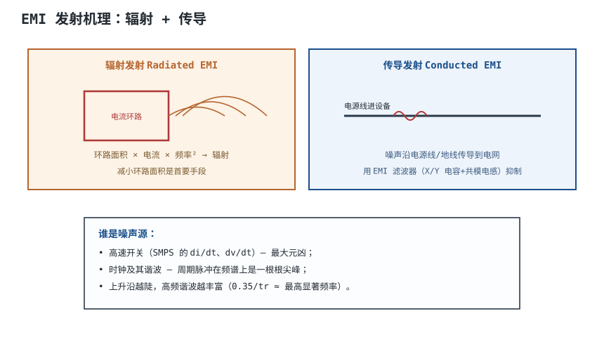
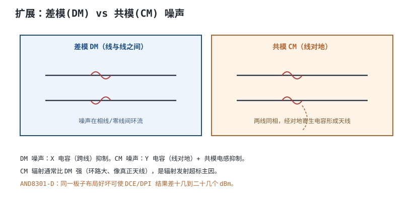
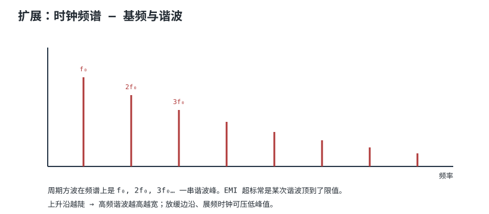
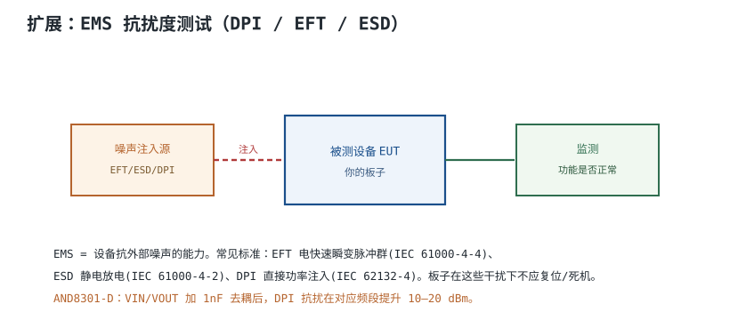

# EMI/EMC：辐射与传导机理 EMI/EMC Mechanisms

**EMC（Electromagnetic Compatibility，电磁兼容）**包含两面：设备不往外发射过多噪声（**EMI，电磁干扰**发射），以及设备能扛住外部干扰不崩（**EMS，抗扰度**）。过不了 EMC 认证，产品就不能上市。

## 1. 设计动机

::: motivation 为什么要管 EMI
同样一颗 buck 控制器，布局好坏能让辐射发射结果差十几到二十几个 dBm——往往就是认证 pass 和 fail 的区别。EMI 不是"最后加个屏蔽罩"就能解决的，它在布局叠层时就埋下了。这一章先搞清噪声从哪来、怎么出去的。
:::

## 2. 图示：辐射与传导两条路径



## 3. 机理与定量

EMI 出去的两条路径：

**辐射发射（Radiated）**：板子上的电流环路本身就是小天线。辐射功率近似

$$P_{rad} \propto A_{loop}\cdot I^2\cdot f^2$$

- $A_{loop}$：电流环路面积
- $I$：环路电流
- $f$：频率

**频率平方**意味着高频噪声辐射增长极快。**减小环路面积**是最有效的第一手段——这也是为什么回流路径要紧贴参考平面。

**传导发射（Conducted）**：噪声沿电源线/地线传导进电网，用 EMI 滤波器抑制。

**最高显著频率**：方波上升沿 $t_r$ 决定高频成分

$$f_{max}\approx \frac{0.35}{t_r}$$

上升沿 1 ns → $f_{max}\approx 350$ MHz，这就是为什么慢沿的老电路不头疼 EMC。

## 4. 设计准则

1. **最小化高 di/dt 环路面积**：SMPS 的输入电容→开关→电感环路是最大元凶。
2. **回流紧贴参考平面**：不让回流绕远。
3. **放缓不必要的快沿**：串电阻缓振铃，降高频谐波。
4. **时钟远离板边**：时钟是周期噪声，谐波尖峰容易超标。
5. **接口处滤波**：噪声想进出板子都走接口。

## 5. 完整设计示例

::: example 一块 buck 板的 EMI 排查
1. **现象**：辐射发射在 100 MHz 附近超标 10 dB。
2. **定位**：频谱仪找峰值对应开关频率谐波，怀疑输入环路。
3. **措施**：把输入大电容挪到紧贴 IC 输入脚，减小环路面积。
4. **加 1nF 高频去耦**在 VIN 脚。
5. **复测**：该频段降了 ~15 dB（AND8301-D 实测同量级），过线。
:::

```echarts
{
  "tooltip": {"trigger": "axis"},
  "legend": {"data": ["限值线", "整改前", "整改后"], "bottom": 0, "textStyle": {"fontSize": 12}},
  "grid": {"left": 60, "right": 24, "top": 26, "bottom": 50},
  "xAxis": {"type": "category", "name": "频率 MHz", "data": ["30","60","100","150","200","300","500","1000"], "axisLabel": {"fontSize": 11}},
  "yAxis": {"type": "value", "name": "dBµV/m", "axisLabel": {"fontSize": 11}},
  "series": [
    {"name": "限值线", "type": "line", "smooth": true, "showSymbol": false, "lineStyle": {"width": 2, "color": "#2f6e4f", "type": "dashed"},
     "data": [40,40,40,40,40,40,40,40]},
    {"name": "整改前", "type": "line", "smooth": true, "showSymbol": false, "lineStyle": {"width": 2.4, "color": "#b03a3a"},
     "data": [35,38,52,44,41,38,33,30]},
    {"name": "整改后", "type": "line", "smooth": true, "showSymbol": false, "lineStyle": {"width": 2.4, "color": "#1a4f8b"},
     "data": [30,32,36,34,32,30,27,25]}
  ]
}
```

## 6. 检查与仿真

- **预兼容测试**：近场探头 + 频谱仪，量产前自查。
- **环路面积审查**：找出板上最大的几个电流环路。
- **标准**：辐射 IEC/CISPR 25/32，传导 CISPR 32；EMS IEC 61000 系列。

## 扩展与变种电路

### 扩展1：差模 DM 与共模 CM 噪声

传导噪声分两种，抑制元件不同。



::: example 机理与定量
- **差模 DM**：噪声在相线与零线之间环流，环路小、辐射弱。用 **X 电容**（跨线）抑制。
- **共模 CM**：两根线同相对地噪声，经对地寄生电容形成大环路天线，**辐射强**，是辐射超标主因。用 **Y 电容**（线对地）+ **共模电感**抑制。
- CM 环路面积天然大，所以同样电压下 CM 辐射远强于 DM。
:::

准则对比：

| 噪声 | 路径 | 抑制元件 |
|---|---|---|
| DM | 线间环流 | X 电容 |
| CM | 线对地天线 | Y 电容 + 共模电感 |

::: pitfall 只加 X 电容不压共模
- **现象**：传导过了，辐射还超标。
- **原因**：辐射超标多是共模，X 电容对 CM 无效。
- **解决**：加共模电感和 Y 电容（注意 Y 电容漏电流安规限制）。
:::

### 扩展2：时钟频谱与谐波

周期时钟在频域是一串谐波尖峰。



::: example 机理与定量
- 周期方波频谱：$f_0, 2f_0, 3f_0\ldots$，每次谐波是一根窄峰。
- EMI 超标常是某次谐波刚好顶到限值。
- 上升沿越陡，高频谐波越高越宽。
- 对策：放缓边沿（串电阻）、展频时钟（Spreading Clock，把能量摊到宽频）。
:::

准则对比：

| 措施 | 谐波峰值 |
|---|---|
| 陡沿 + 固定频 | 高（窄峰） |
| 缓沿 | 降低高频 |
| 展频 | 峰值摊低 |

::: pitfall 时钟线走板边当天线
- **现象**：某频率谐波稳定超标。
- **原因**：时钟走线靠板边、环路大，像天线辐射。
- **解决**：时钟包地、远离板边、下方完整平面。
:::

### 扩展3：EMS 抗扰度测试

设备不仅要少发射，还要扛得住外部干扰。



::: example 机理与定量
- **EFT 电快速瞬变脉冲群**（IEC 61000-4-4）：模拟继电器断开的毛刺。
- **ESD 静电放电**（IEC 61000-4-2）：人手/物体静电。
- **DPI 直接功率注入**（IEC 62132-4）：射频噪声耦合进引脚。
- 板子在这些干扰下不应复位、死机、误动作。
- AND8301-D：VIN/VOUT 加 1nF 去耦，DPI 抗扰提升 10–20 dBm。
:::

准则对比：

| 测试 | 模拟 | 主要对策 |
|---|---|---|
| EFT | 开关毛刺 | 去耦、滤波 |
| ESD | 人体静电 | TVS、泄放路径 |
| DPI | 射频注入 | 去耦、地平面 |

::: pitfall 只做发射不做抗扰
- **现象**：认证时发射过了，抗扰 fail。
- **原因**：抗扰靠去耦和地，不是靠屏蔽罩。
- **解决**：设计阶段就按 EMS 要求放去耦、留 ESD 路径。
:::

## 7. 常见坑与故障现象

::: pitfall 常见坑
- **指望最后加屏蔽罩解决 EMI**：辐射根源是大环路，屏蔽只是兜底。先减环路面积。
- **共模没处理**：传导过了辐射 fail，因为辐射主要是共模。
- **大开关环路没收小**：输入电容离 IC 远，环路大，辐射爆。
- **时钟没包地**：时钟谐波是辐射超标常客。
:::

## 8. 自测题

<details><summary>为什么减小电流环路面积对降 EMI 最有效？</summary>

辐射功率 $P_{rad}\propto A_{loop}\cdot I^2\cdot f^2$。环路面积 $A_{loop}$ 直接正比于辐射。回流紧贴参考平面、输入电容贴近 IC，都在减小环路面积，是性价比最高的手段。

</details>

<details><summary>差模和共模噪声各用什么元件抑制？为什么辐射超标常是共模？</summary>

差模用 X 电容（跨线）；共模用 Y 电容 + 共模电感。共模噪声经对地寄生电容形成大环路天线，环路面积天然大，所以辐射比差模强得多，是辐射超标主因。

</details>

<details><summary>方波上升沿 1ns，最高显著频率约多少？这跟 EMI 有什么关系？</summary>

$f_{max}\approx 0.35/t_r=0.35/1\text{ns}=350$ MHz。上升沿越陡，高频谐波越丰富，EMI 越容易在高频超标。放缓边沿可压高频谐波。

</details>

## 9. 参考资料

- onsemi AND8301-D *EMC Specifications and PCB Guidelines for SMPS Devices*
- Henry W. Ott, *Electromagnetic Compatibility Engineering*, Wiley 2009
- IEC 61000-4-2（ESD）/ 61000-4-4（EFT）/ 62132-4（DPI）
