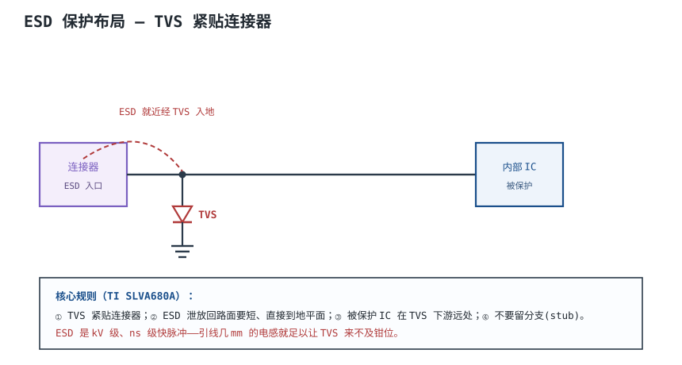
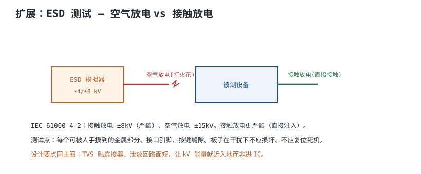
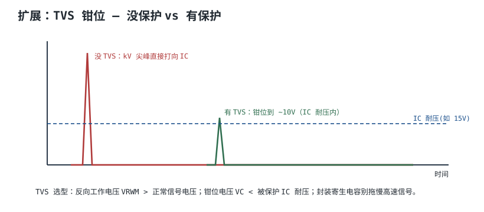
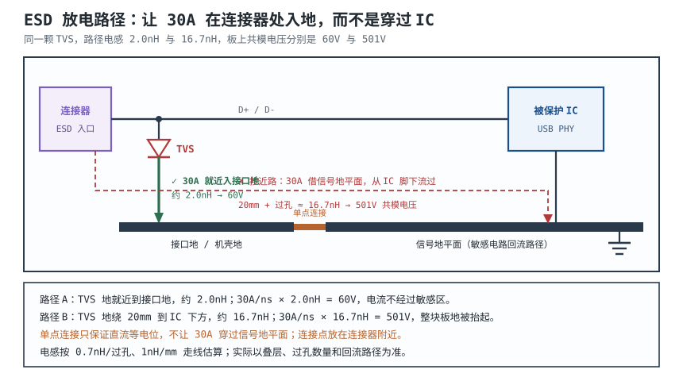

# ESD 防护与接口保护 ESD Protection & Interface Protection

人手摸一下接口，可能带上几 kV 到十几 kV 的静电，在不到 1ns 内放电，峰值电流几十安。这个能量若直接进到 IC 的 CMOS 栅极，几纳米厚的栅氧在几伏到十几伏就会击穿——板子当时可能还能工作，几天内慢慢失效。**ESD（Electrostatic Discharge，静电放电）防护，是在接口处给这个 kV 能量一个就近的泄放通道，并且保证这条通道本身不会把噪声带进板子。**

这句话的后半句常被忽略。TVS 选得再好，如果它的地要绕 20mm 才到平面，30A/ns 的电流在 16nH 上就是 501V——这个电压会加在整块板的地上，所有接口信号一起被抬起来。**ESD 防护是"器件 + 路径"两件事，路径往往比器件更难做对。**

这一章讲三件事：ESD 的模型与等级（HBM/CDM/MM/系统级）、TVS 的选型（钳位电压、结电容、响应时间）、放电路径的设计（为什么不能抄近路）。最后用一个 USB 2.0 HS 接口的完整算例，把 3pF 结电容对 480Mbps 眼图的影响算出来。

## 1. 设计动机

::: motivation 三个现场
**现场一：TVS 放在 IC 旁边。** 连接器到 TVS 有 5mm 走线（约 4nH）再加一个过孔（0.7nH），共 4.7nH。8kV 接触放电的首峰上升时间约 1ns、峰值 30A，$di/dt\approx30\ \text{A/ns}$，这段引线上的压降是 $4.7\times10^{-9}\times3\times10^{10}=141\ \text{V}$。TVS 自己钳到 12V 也没用——**IC 先看到 141V，TVS 才刚开始导通。**

**现场二：TVS 的地接到信号地平面。** TVS 的地用 20mm 走线接到 IC 下方的地平面，路径电感约 16nH，30A/ns 时压降 $16\times10^{-9}\times3\times10^{10}=480\ \text{V}$（加过孔约 501V）。这 501V 出现在连接器地与 IC 地之间，所有接口信号同时被抬成共模浪涌；**ESD 电流从 IC 脚下穿过，防护器件反而成了噪声源。**

**现场三：为省成本用 30pF 的普通 TVS 保护 USB HS。** 480Mbps 的 Nyquist 频率是 240MHz，30pF 在 45Ω 线阻抗下对 240MHz 的衰减约 7.1dB，眼图显著闭合；换成 3pF，同样频率只有 0.18dB。**结电容不是"越小越好"的口号，它有一个可以算的预算。**
:::

设计前先明确要判断哪四件事：

| 你想判断 | 先查什么 | 判据 |
|---|---|---|
| 器件本身能扛多少 | ESD 模型、等级、引脚 | HBM/CDM 等级与产线要求 |
| TVS 选哪个 | $V_{RWM}$、$V_C$、$C_j$、$R_{dyn}$ | 信号摆幅、IC 耐受、接口速率 |
| 放电路径怎么走 | 连接器、地、机壳 | $L\,di/dt$ 与回路面积 |
| 系统级能不能过 | IEC 61000-4-2 等级、判据 | 接触/空气放电与性能判据 A/B/C |

**不懂会在哪里摔跤**，具体是这四条：

1. 把 TVS 放在 IC 旁边，而不是连接器旁边。引线电感在 ns 边沿下就是几十到上百伏，钳位还没生效，IC 已经挨了第一击。
2. 把 TVS 的地接到信号地平面，让 30A 电流从敏感电路下方穿过。正确做法是先到接口地/机壳地，再单点连到信号地。
3. 高速接口用高结电容 TVS。30pF 在 240MHz 衰减 7.1dB，眼图闭合；3pF 只有 0.18dB，差别是数量级。
4. 以为"$V_C$ 小于 IC 耐压"就万事大吉。绝对最大额定值是直流/慢变判据，不是 30A/ns 的瞬态判据；真正的保护是"TVS 分流 + IC 内部 ESD 网络 + 布局"三层配合。

## 2. 定义与直观：四种模型、一条放电路径

### 2.1 静电、放电与能量

**静电（Static Electricity）**是电荷在绝缘体/人体/器件封装上的积累；**静电放电（ESD）**是这些电荷在很短时间内的突然释放。两个基本式子决定能量量级：

$$
Q=CV,\qquad E=\frac{1}{2}CV^2
$$

其中 $Q$ 是电荷，C；$C$ 是等效电容，F；$V$ 是放电前电压，V；$E$ 是储能，J。

人体模型（HBM）2kV、100pF：

$$
E=\frac{1}{2}\times100\times10^{-12}\times(2000)^2=2.0\times10^{-4}\ \text{J}=0.2\ \text{mJ}
$$

系统级（IEC 61000-4-2）8kV、150pF：

$$
E=\frac{1}{2}\times150\times10^{-12}\times(8000)^2=4.8\times10^{-3}\ \text{J}=4.8\ \text{mJ}
$$

**同样是"8kV"，系统级模型的能量是 HBM 2kV 的 24 倍。** 这解释了为什么器件能过 HBM 2kV，整机却不一定能过接触 8kV：两者的电容、电阻、波形和能量都不同。

### 2.2 四种模型：HBM、CDM、MM 与系统级

| 模型 | 等效网络 | 典型电压 | 峰值电流 | 上升时间 | 能量量级 | 用途 |
|---|---|---|---|---|---|---|
| HBM | 100pF + 1.5kΩ | 2kV（分级 250V~8kV） | 1.33A @2kV | 2~10ns | 0.2mJ | 器件级，产线默认 |
| CDM | 1~30pF + 小于 10Ω | 250V~2kV | 10~50A | 小于 1ns | µJ 级 | 封装带电，最易被低估 |
| MM | 200pF + 约 0.5~1µH | 100~400V | 数 A，振铃 | 10~30ns | µJ 级 | 历史方法，新设计少用 |
| 系统级 IEC 61000-4-2 | 150pF + 330Ω | 接触 2~8kV，空气 2~15kV | 30A @8kV | 0.7~1ns | 4.8mJ | 整机接口 |

HBM 的峰值电流就是欧姆定律：

$$
I_{peak}=\frac{V}{R}=\frac{2000}{1500}=1.33\ \text{A}
$$

CDM 的峰值电流由封装电容和回路电感决定，欠阻尼时近似：

$$
I_{peak}\approx V\sqrt{\frac{C}{L}}
$$

以 $C=10\ \text{pF}$、$V=500\ \text{V}$、$L=1\ \text{nH}$ 为例：

$$
I_{peak}\approx500\times\sqrt{\frac{10\times10^{-12}}{1\times10^{-9}}}
=500\times0.1=50\ \text{A}
$$

**CDM 的电压不高，电流却可以很大，上升时间小于 1ns**——它考验的是器件和布局的极快响应，而不是能量。MM 的回路电感约 0.5~1µH，特征阻抗 $Z_0=\sqrt{L/C}\approx60\ \Omega$，200V 时峰值约 3A，是早期"机器带电"的模型，新设计一般只作为历史数据参考。

系统级 ESD 的电流波形按电压归一化：首峰约 3.75A/kV，30ns 处约 2A/kV，60ns 处约 1A/kV。8kV 接触放电对应：

| 时间点 | 电流（8kV） | 归一化 |
|---|---|---|
| 首峰（0.7~1ns） | 30A | 3.75A/kV |
| 30ns | 16A | 2A/kV |
| 60ns | 8A | 1A/kV |

**首峰的 $di/dt$ 约 $30\ \text{A/ns}=3\times10^{10}\ \text{A/s}$**，这是后面所有引线电感计算的输入。

### 2.3 类比：水锤与泄压阀

::: analogy 水锤与泄压阀
把 ESD 想成水管里突然关阀产生的水锤：能量不大，但压力尖峰很高、传播很快。TVS 像泄压阀，正常时不通，压力一超限就打开；连接器到 TVS 的那段走线像阀门前的一小段细管——**阀门再快，水也要先流过细管才到得了阀**。

类比的边界：水锤的惯性来自水的质量，ESD 的"惯性"来自引线电感；水的压力波速是声速量级，ESD 的边沿是亚纳秒，电感效应比水管惯性剧烈得多；而且 ESD 还有电场耦合（不用碰到也能打），水路没有对应物。所以"阀门要近"只是直觉，定量判据是 $L\,di/dt$。
:::

### 2.4 系统级放电的两种方式

IEC 61000-4-2 规定两种放电方式：

- **接触放电（Contact Discharge）**：放电电极直接接触被测设备的金属部分，电流路径确定、重复性好；等级 4 为 ±8kV。
- **空气放电（Air Discharge）**：电极靠近绝缘表面，靠击穿空气间隙放电；等级 4 为 ±15kV，重复性受间隙、湿度、接近速度影响。

**"接触放电更严酷"这句话只在"同一电压"下成立。** 接触放电注入更直接，但空气放电的试验电压更高（15kV vs 8kV），而且可能通过缝隙、绝缘件、按键耦合进内部；对某些结构，空气放电反而更难通过。**哪个更严酷取决于产品结构和耦合路径，不能一概而论。** 测试要覆盖所有可被人手接触的点：接口金属、按键、缝隙、螺钉、外壳涂层下的金属。

## 3. 定量关系

### 3.1 能量、峰值功率与重复放电

ESD 的能量不大，但峰值功率很高。以 8kV 接触放电、TVS 钳位 12.5V、峰值 30A 为例：

$$
P_{peak}=V_CI_{peak}=12.5\times30=375\ \text{W}
$$

持续时间是 ns 级，平均功率很小，但**瞬时功率密度足以在微小结区产生局部热点**。器件数据手册通常给出"IEC 61000-4-2 ±8kV 接触放电，重复 N 次"的额定值，N 可能是几十到上千次，具体以数据手册为准。工程上按"产品寿命内可能遭遇的放电次数 × 安全系数"选型，而不是只看一次能不能扛。

HBM 与系统级的能量对比（3.1 节前的计算）：0.2mJ vs 4.8mJ，差 24 倍；CDM 只有 µJ 级，但 $di/dt$ 更大。**三种模型考的是三种不同的失效机理：HBM 考能量，CDM 考速度，系统级考整机路径。**

### 3.2 引线电感：为什么 TVS 必须紧贴连接器

ESD 电流流过任何一段导体，都会在电感上产生压降：

$$
V_L=L\frac{di}{dt}
$$

其中 $L$ 是放电路径的电感，H；$di/dt$ 是电流变化率，A/s；$V_L$ 是压降，V。以 $di/dt=3\times10^{10}\ \text{A/s}$ 计算几种典型布局：

| 路径 | 电感 | $V_L$ | 说明 |
|---|---|---|---|
| 过孔（1mm，0.3mm 直径） | 0.7nH | 21V | 最短的换层 |
| 过孔 + 1mm 走线 | 1.7nH | 51V | 可接受的布局 |
| 5mm 走线 + 过孔 | 4.7nH | 141V | TVS 放 IC 旁边的典型值 |
| 20mm 走线 + 过孔 | 16.7nH | 501V | TVS 地绕到板中央的后果 |
| 50mm 猪尾巴（电缆屏蔽） | 约 50nH | 1500V | 屏蔽层用长线接地 |

**这张表是 ESD 布局的全部理由。** 同样的 TVS、同样的 IC，路径从 1.7nH 变成 16.7nH，压降从 51V 变成 501V；后者已经超过大多数 IC 的绝对最大额定值，防护等于没做。

### 3.3 TVS 的钳位模型

TVS（Transient Voltage Suppressor，瞬态电压抑制器）正常时高阻，电压超过击穿电压后迅速低阻，把电压钳在 $V_C$。工程上用分段线性模型估算：

$$
V_C\approx V_{BR}+I_{PP}R_{dyn}
$$

其中 $V_{BR}$ 是击穿电压，V；$I_{PP}$ 是脉冲电流，A；$R_{dyn}$ 是动态电阻，$\Omega$。以 $V_{BR}=6.5\ \text{V}$、$R_{dyn}=0.2\ \Omega$、$I_{PP}=30\ \text{A}$ 为例：

$$
V_C\approx6.5+30\times0.2=12.5\ \text{V}
$$

IC 端实际看到的电压还要加上引线电感：

$$
V_{IC}\approx V_C+L_{path}\frac{di}{dt}
$$

以 1.7nH 路径为例：

$$
V_{IC}\approx12.5+51=63.5\ \text{V}
$$

**63.5V 远高于很多 3.3V IC 的绝对最大额定值（常见 4.6V 或 5.5V）。** 这不是说 TVS 没用，而是说"绝对最大额定值"是直流/慢变判据，不是 30A/ns 的瞬态判据；真实的保护是：TVS 把 30A 中的绝大部分旁路，IC 的片内 ESD 网络吸收残余，布局把 $L_{path}$ 压到最小。**能用 TLP（传输线脉冲）或 IEC 61000-4-2 波形标注 $V_C$ 的器件，比只给 8/20µs 数据的器件更可信**，因为 ESD 的波形比 8/20µs 快得多。

$C_j$ 与 $V_C$ 存在取舍：结电容越小，结面积越小，动态电阻通常越大。0.5pF 的器件 $R_{dyn}$ 可能是 0.5Ω 量级，30A 时 $V_C\approx6.5+15=21.5\ \text{V}$；3pF 的器件 $R_{dyn}$ 可能只有 0.2Ω，$V_C\approx12.5\ \text{V}$。**高速接口要在"低电容"和"低钳位"之间做取舍**，这也是为什么高速 ESD 器件通常是专门的工艺，而不是普通 TVS 缩小版。

### 3.4 结电容对高速信号的影响

TVS 的结电容与线阻抗构成一个低通。单极点近似：

$$
f_{-3dB}=\frac{1}{2\pi R C_j}
$$

其中 $R$ 是线阻抗（单端约 45Ω，差分 90Ω），$\Omega$；$C_j$ 是结电容，F。以 $R=45\ \Omega$、$C_j=3\ \text{pF}$ 为例：

$$
f_{-3dB}=\frac{1}{2\pi\times45\times3\times10^{-12}}=1.18\times10^{9}\ \text{Hz}=1.18\ \text{GHz}
$$

上升时间的退化：

$$
t_r'=\sqrt{t_r^2+(2.2RC_j)^2}
$$

以 USB HS 的 $t_r=500\ \text{ps}$ 为例：

$$
2.2RC_j=2.2\times45\times3\times10^{-12}=297\ \text{ps}
$$

$$
t_r'=\sqrt{(500)^2+(297)^2}=\sqrt{250000+88209}=582\ \text{ps}
$$

Nyquist 频率（480Mbps 对应 240MHz）处的衰减：

$$
|H|=\frac{1}{\sqrt{1+(2\pi fRC_j)^2}}
$$

$$
2\pi fRC_j=2\pi\times240\times10^{6}\times45\times3\times10^{-12}=0.2036
$$

$$
|H|=\frac{1}{\sqrt{1+0.2036^2}}=0.980,\qquad
20\log_{10}(0.980)=-0.18\ \text{dB}
$$

**3pF 在 240MHz 只衰减 0.18dB，上升时间从 500ps 变成 582ps——对 USB HS 通常是可以接受的。** 这和"高速口必须小于 1pF"的口号有出入；1pF 是留余量的工程习惯，不是物理门槛。真正的门槛是**总电容预算**：连接器、PCB 焊盘、走线、TVS 加在一起，再叠加 PHY 自身的容差。

对比 30pF：

$$
2.2RC_j=2.2\times45\times30\times10^{-12}=2.97\ \text{ns}
$$

$$
t_r'=\sqrt{(0.5)^2+(2.97)^2}=3.01\ \text{ns}
$$

$$
2\pi fRC_j=2.036,\qquad |H|=\frac{1}{\sqrt{1+2.036^2}}=0.441,\qquad
20\log_{10}(0.441)=-7.1\ \text{dB}
$$

**7.1dB 的 Nyquist 衰减足以让眼图显著闭合。** 三种容值的对比如下：

| $C_j$ | $f_{-3dB}$ | $t_r'$（$t_r=500\ \text{ps}$） | 240MHz 衰减 | 判断 |
|---|---|---|---|---|
| 0.5pF | 7.07GHz | 502ps | −0.005dB | 余量充足 |
| 1pF | 3.54GHz | 505ps | −0.02dB | 推荐 |
| 3pF | 1.18GHz | 582ps | −0.18dB | 通常可接受，需留总预算 |
| 30pF | 118MHz | 3.01ns | −7.1dB | 高速口不可用 |

### 3.5 放电路径与共模电压

ESD 电流从连接器进入，最终要回到"地"。这个"地"可能是机壳、保护地、信号地平面，或（塑料外壳产品）板级地加整机对环境的寄生电容。**电流走哪条路，决定了板上的哪些节点被抬起。**

设放电路径电感 $L_{path}$，电流 $i(t)$，则板上两点之间的瞬态电压差：

$$
V_{cm}(t)=L_{path}\frac{di}{dt}
$$

以 16.7nH、30A/ns 为例，$V_{cm}=501\ \text{V}$。这个电压是**共模**的：所有以板地为参考的接口信号同时被抬高 501V，IC 的输入保护结可能反向击穿；同时，这个 $di/dt$ 环路还会向外辐射，干扰附近的模拟/时钟电路。**"抄近路"的本质，是让 ESD 电流借道信号地平面，把整块板变成放电路径的一部分。**

正确的路径是：**连接器 → TVS（紧贴）→ 接口地/机壳地 → 单点连接到信号地**。接口地与信号地之间的单点连接，保证直流等电位，同时不让 30A 电流穿过信号地平面。

## 4. 典型计算

### 4.1 主算例：USB 2.0 HS 接口的 ESD 保护选型

**需求与假设**：

| 项目 | 取值 |
|---|---|
| 接口 | USB 2.0 HS，480Mbps，差分 90Ω（单端 45Ω） |
| 信号 | D+/D- 0~3.3V；VBUS 5V ±5% |
| 系统级要求 | IEC 61000-4-2 level 4：接触 ±8kV，空气 ±15kV |
| 波形 | 首峰 30A，上升 0.7~1ns，$di/dt\approx30\ \text{A/ns}$ |
| 布局 | TVS 距连接器 0.5mm，过孔 0.7nH，走线 1mm |
| 目标 | 不损坏、不复位、眼图仍满足 USB HS 模板 |

**第一步，确定工作电压与 $V_{RWM}$。** VBUS 5V ±5% 最高 5.25V，取 $V_{RWM}\ge5.5\ \text{V}$；D+/D- 信号 3.3V，取 $V_{RWM}\ge3.6\ \text{V}$。$V_{RWM}$ 低于这个值，正常信号就会让 TVS 微导通，漏电流和电容都会变差。

**第二步，确定钳位与路径。** 选一颗低电容 ESD 阵列，数据手册给出 8kV 接触放电下 $V_C\approx12\ \text{V}$（典型量级，以数据手册的测试波形为准）。布局路径：

$$
L_{path}=0.7\ \text{nH（过孔）}+1.0\ \text{nH（1mm 走线）}=1.7\ \text{nH}
$$

$$
V_L=1.7\times10^{-9}\times3\times10^{10}=51\ \text{V}
$$

IC 端看到的峰值：

$$
V_{IC}\approx V_C+V_L=12+51=63\ \text{V}
$$

**第三步，布局对比。** 如果把 TVS 放到 IC 旁边（5mm + 过孔）：

$$
L_{path}=4.7\ \text{nH},\qquad V_L=4.7\times10^{-9}\times3\times10^{10}=141\ \text{V}
$$

$$
V_{IC}\approx12+141=153\ \text{V}
$$

**同样的器件，布局差 10mm，IC 端电压从 63V 变成 153V。** 这就是"布局比选型更重要"的定量含义。

**第四步，结电容预算。** 选 $C_j=0.5\ \text{pF}$ 的器件，加上连接器/焊盘/走线约 1pF，总电容约 1.5pF：

$$
2\pi fRC=2\pi\times240\times10^{6}\times45\times1.5\times10^{-12}=0.1018
$$

$$
|H|=\frac{1}{\sqrt{1+0.1018^2}}=0.995,\qquad
20\log_{10}(0.995)=-0.045\ \text{dB}
$$

**结论：0.5pF 器件对 240MHz 的衰减只有 0.045dB，眼图几乎不受影响。** 如果换成 3pF（总 4pF）：

$$
2\pi fRC=0.2714,\qquad |H|=0.965,\qquad -0.31\ \text{dB}
$$

仍然可用，但余量变小；换成 30pF（总 31pF）：

$$
2\pi fRC=2.10,\qquad |H|=0.430,\qquad -7.3\ \text{dB}
$$

眼图会明显闭合。**这就是"3pF 能用、30pF 不能用"的定量边界。**

**第五步，TVS 的电流分担。** TVS 与 IC 的片内 ESD 网络是并联的，电流按阻抗分配。TVS 的动态电阻 $R_{dyn}$ 通常远小于 IC 内部钳位的等效电阻，所以绝大部分电流走 TVS；但**前提是 TVS 的路径电感足够小**，否则在高频边沿上 TVS 支路呈高阻，电流会转向 IC。用 1.7nH 与 16.7nH 比较：

$$
Z_{TVS}(1.7\ \text{nH})\approx2\pi fL=2\pi\times240\times10^{6}\times1.7\times10^{-9}=2.56\ \Omega
$$

$$
Z_{TVS}(16.7\ \text{nH})\approx2\pi\times240\times10^{6}\times16.7\times10^{-9}=25.2\ \Omega
$$

**在 240MHz，16.7nH 的路径阻抗是 1.7nH 的 10 倍**，TVS 的分流能力大幅下降。**所以"TVS 要近"不只是为了钳位电压，也是为了在高频边沿上保持低阻分流。**

**第六步，结论表**：

| 项目 | 选择 | 依据 |
|---|---|---|
| 器件类型 | 低电容 ESD 阵列（多通道） | USB 差分对 + VBUS 一颗搞定 |
| $V_{RWM}$ | 5.5V（VBUS）/3.6V（数据） | 高于最高工作电压 |
| $C_j$ | ≤1pF（单通道） | 240MHz 衰减 <0.1dB，留总预算 |
| $V_C$ | 尽量低，按 8kV/TLP 曲线选 | IC 端电压 = $V_C+L\,di/dt$ |
| 布局 | 距连接器 ≤1mm，地过孔 ≤0.7nH | 把 $L\,di/dt$ 压到 51V 量级 |
| 地 | 接口地/机壳地，单点连信号地 | 不让 30A 穿过信号平面 |
| 验证 | IEC 61000-4-2 level 4 + 眼图 | 系统级与信号完整性同时确认 |

### 4.2 放电路径算例：两条路，差 8 倍

同一块板，两种 TVS 地处理：

| 方案 | 路径 | 电感 | $V_{cm}$ @30A/ns | 后果 |
|---|---|---|---|---|
| A：TVS 地就近到接口地，单点连信号地 | 0.5mm + 过孔 | 约 2.0nH | 60V | 电流不经过敏感区 |
| B：TVS 地走 20mm 到 IC 下方地平面 | 20mm + 过孔 | 16.7nH | 501V | 整板地被抬起，共模浪涌 |

方案 A 的 60V 仍不是 0，但已经低于多数 IC 的瞬态耐受；方案 B 的 501V 会让所有接口信号同时承受共模冲击。**差 8.3 倍，而两者的器件、原理图完全一样。**

**"抄近路"为什么诱人？** 因为从 TVS 到最近的信号地平面往往只有几毫米，看起来"更短"；但"最短"不等于"最对"——信号地平面是敏感电路的回流路径，把 30A 引进去，等于把整块板变成天线。**正确的"近"，是到接口地/机壳地最近，而不是到信号地最近。**

### 4.3 重复放电与器件寿命

8kV 接触放电 4.8mJ/次，若产品寿命内可能遭遇 1000 次：

$$
E_{total}=1000\times4.8\times10^{-3}=4.8\ \text{J}
$$

这个总能量如果集中在一次，足以烧毁小封装 TVS；分散在 1000 次、每次 ns 级，热效应小得多，但结区仍有累积损伤。选型时看数据手册的"重复放电次数"额定值，并留 2~5 倍余量；**"能扛一次"不等于"能扛一辈子"**。

### 4.4 ESD 与浪涌、安规是两套判据

- **ESD（IEC 61000-4-2）**：150pF、330Ω、ns 级、能量 mJ 级，考的是接口和器件的快速响应。
- **浪涌（IEC 61000-4-5）**：1.2/50µs 电压波、8/20µs 电流波、能量比 ESD 大 1~3 个数量级（取决于等级），考的是 MOV/TVS 的能量吸收和保险丝/断路器的配合。
- **安规（GB 4943.1 / IEC 62368-1）**：耐压、绝缘、漏电流、接触电流，考的是人身安全，和 ESD 完全不是一套判据。

**ESD 二极管不能替代浪涌保护器，ESD 测试也不能替代安规测试。** 一个 8kV ESD 能过的接口，可能在 1kV 浪涌下烧毁；反过来，能量大的浪涌器件（MOV）结电容大、响应慢，不能直接用在 USB 数据线上。三类器件要各司其职，具体选型按接口的适用标准来。

## 5. 工程含义

### 5.1 布局规则

1. **TVS 紧贴连接器**，距离控制在 1mm 量级；先过 TVS，再进板内。
2. **泄放回路短而宽**：TVS 地用过孔直连接口地/机壳地，过孔 0.7nH 量级，优先多个并联。
3. **接口地与信号地单点连接**：连接点放在连接器附近，不让 ESD 电流穿过信号平面。
4. **不留分支（stub）**：TVS 之后到 IC 的走线不分叉，分支会在高频下成为天线。
5. **被保护 IC 在 TVS 下游**：TVS 在连接器与 IC 之间，不能反过来。
6. **差分对对称**：D+/D- 的 TVS 通道、走线长度、过孔数量尽量对称，避免破坏共模抑制。
7. **地平面完整**：TVS 下方的地平面不要开槽；接口地/信号地的单点连接处要有足够铜宽。
8. **远离敏感电路**：ESD 入口、TVS、泄放走线远离晶振、ADC、模拟前端。
9. **外壳与缝隙**：塑料外壳的缝隙、按键、螺钉都是放电路径，必要时加内部导电涂层/接地簧片。
10. **可更换/可维修**：TVS 失效后可能短路，考虑是否会影响产品功能，必要时加自恢复保险丝或串联电阻。

### 5.2 器件选型表

| 参数 | 含义 | 选型原则 | 常见坑 |
|---|---|---|---|
| $V_{RWM}$ | 反向工作电压 | 大于最高工作电压并留 5~10% | 选低了正常信号就漏电 |
| $V_{BR}$ | 击穿电压 | 略高于 $V_{RWM}$ | 与 $V_C$ 混淆 |
| $V_C$ | 钳位电压 | 按 ESD/TLP 波形看，越低越好 | 只看 8/20µs 数据 |
| $R_{dyn}$ | 动态电阻 | 越小钳位越低 | 低电容器件往往更大 |
| $C_j$ | 结电容 | 按接口速率算预算 | 只看单颗，不算总电容 |
| $I_{PP}$ | 峰值脉冲电流 | 覆盖 30A 量级 | 只看能量不看波形 |
| 通道数 | 单路/多路 | 差分对用多路对称封装 | 通道间寄生不一致 |
| 封装 | 0402/DFN/SOT | 小封装电感低，但散热/工艺要评估 | 手工焊接困难 |

### 5.3 不同接口的差异

| 接口 | 速率/电压 | 关注点 | 典型做法 |
|---|---|---|---|
| USB 2.0 HS | 480Mbps，3.3V | $C_j$ 与眼图 | ≤1pF ESD 阵列，TVS 贴连接器 |
| USB 3.x / HDMI | 5Gbps 以上 | $C_j$ 极低、阻抗连续 | 0.2~0.5pF 专用器件，注意封装寄生 |
| 以太网 | 100M/1G | 隔离变压器、共模 | TVS 放在变压器次边/连接器侧，配合共模扼流 |
| RS-485/CAN | 几 Mbps，±12V 共模 | 共模范围、浪涌 | TVS + 共模扼流 + 气体放电管（按需） |
| 音频/传感器 | 低速、高阻 | 漏电流、电容 | 低漏电 TVS，注意 $V_{RWM}$ |
| 电源输入 | 5~24V | 浪涌能量、保险丝 | TVS + 保险丝/PPTC，按浪涌标准选 |

**接口不同，判据不同**：高速看电容，长线看共模和浪涌，电源看能量和安规。不能把 USB 的选型表直接套到 RS-485 或电源口。

### 5.4 验证

- **系统级 ESD**：按 IEC 61000-4-2 打接触/空气放电，覆盖所有可接触点；记录放电位置、电压、极性、判据（A/B/C）。
- **判据**：测试中和测试后功能正常、不复位、不损坏；允许的暂时性能下降要在判据里写清楚。
- **眼图/USB-IF 测试**：高速接口加 TVS 后重测眼图和模板，确认电容预算没超标。
- **重复性**：同一位置打 10 次以上，观察是否累积失效；换样品复测，排除单板偶然性。
- **失效分析**：打坏的板子做切片/开盖，确认是 TVS 失效、IC 失效还是路径打火，别只换器件了事。

### 5.5 安全与合规前提

1. **ESD 测试不是安规测试**。耐压、绝缘、漏电流、接触电流按 GB 4943.1 / IEC 62368-1 单独做，ESD 通过不代表安规通过。
2. **ESD 防护不能替代隔离**。市电接口、医疗接口的隔离屏障按各自标准设计，TVS 只处理瞬态，不提供隔离。
3. **工厂 ESD 控制是另一套体系**。腕带 1MΩ、台垫、接地按 IEC 61340-5-1 / ANSI/ESD S20.20 执行，和板级 TVS 不是一回事；ESD 地也不能当保护地（PE）用，理由见[安全用电与触电防护](../basics/electrical-safety.md)与[地的学问与地弹](../power/grounding.md)。
4. **结论有前提**：本章的电压、电流、电容都是典型量级，具体产品的通过与否取决于结构、线缆、接地、测试布置和样品状态；**任何"这样设计一定过 8kV"的说法都不成立**，必须实测。

## 6. 常见坑

::: pitfall 常见坑
- **TVS 放 IC 旁边**：现象——ESD 打接口，IC 损坏或复位，TVS 完好。原因——5mm+过孔的 4.7nH 在 30A/ns 下产生 141V，IC 先于 TVS 承受冲击。解决——TVS 距连接器 ≤1mm，先过 TVS 再进板内。
- **TVS 地接到信号地平面**：现象——ESD 测试时整机复位、ADC 跳变，甚至别的接口也异常。原因——30A 电流经 16.7nH 产生 501V 共模电压，整块地被抬起。解决——TVS 地先到接口地/机壳地，再单点连信号地。
- **高速口用高电容 TVS**：现象——加了保护后 USB 枚举失败、眼图闭合。原因——30pF 在 240MHz 衰减 7.1dB。解决——按总电容预算选 ≤1pF 器件，加完重测眼图。
- **以为 $V_C$ 小于 IC 耐压就安全**：现象——按直流耐压选完，ESD 仍打坏 IC。原因——绝对最大额定值是直流/慢变判据，30A/ns 下还要叠加 $L\,di/dt$。解决——按 ESD/TLP 波形选器件，同时控制布局电感。
- **只测接口不测缝隙**：现象——认证时打按键缝隙/外壳接缝 fail。原因——只测了连接器，没覆盖人手会摸的部位。解决——按标准覆盖所有可接触点，内部地/屏蔽连续。
- **把 ESD 当浪涌/安规**：现象——ESD 过了，浪涌或耐压 fail。原因——三类判据的能量、波形、标准完全不同。解决——分别按 IEC 61000-4-2、IEC 61000-4-5、GB 4943.1 设计并测试。
:::

## 7. 自测题

HBM 2kV/100pF 和 IEC 61000-4-2 8kV/150pF 的能量各是多少？为什么器件过了 HBM 不代表整机过 8kV？

$$
E_{HBM}=\frac{1}{2}\times100\times10^{-12}\times(2000)^2=0.2\ \text{mJ}
$$

$$
E_{sys}=\frac{1}{2}\times150\times10^{-12}\times(8000)^2=4.8\ \text{mJ}
$$

系统级能量是 HBM 的 24 倍，而且波形更快（0.7~1ns 对 2~10ns）、峰值电流更大（30A 对 1.33A）。器件级测试只验证芯片本身，整机还要看接口、路径、结构与接地，所以两者不能互相替代。

TVS 距连接器 5mm、路径电感 4.7nH，30A/ns 的 ESD 电流在它上面产生多大压降？TVS 钳位 12V 时 IC 端看到多少？

$$
V_L=L\frac{di}{dt}=4.7\times10^{-9}\times3\times10^{10}=141\ \text{V}
$$

$$
V_{IC}\approx V_C+V_L=12+141=153\ \text{V}
$$

TVS 的钳位还没起作用，IC 先承受 141V 的引线压降。把路径缩到 1.7nH（过孔 + 1mm），压降降到 51V，IC 端约 63V。**布局决定 TVS 有没有用。**

USB 2.0 HS（480Mbps、单端 45Ω、t_r=500ps）用 3pF 和 30pF 的 TVS，240MHz 处各衰减多少？

3pF：

$$
2\pi fRC=2\pi\times240\times10^{6}\times45\times3\times10^{-12}=0.2036
$$

$$
|H|=\frac{1}{\sqrt{1+0.2036^2}}=0.980,\qquad -0.18\ \text{dB}
$$

30pF：

$$
2\pi fRC=2.036,\qquad |H|=0.441,\qquad -7.1\ \text{dB}
$$

3pF 通常可接受（上升时间 500→582ps），30pF 会让眼图显著闭合。**"高速口必须小于 1pF"是留余量的习惯，不是物理门槛；关键是总电容预算。**

为什么 TVS 的地不能直接接到 IC 下方的信号地平面？用数字说明。

因为 ESD 电流会沿这条路径流过信号地平面。20mm 走线 + 过孔约 16.7nH，30A/ns 时压降：

$$
V=16.7\times10^{-9}\times3\times10^{10}=501\ \text{V}
$$

这个 501V 是共模电压，会同时加在所有以板地为参考的接口信号上，还可能让 IC 输入保护结反向击穿。正确做法是 TVS 地先到接口地/机壳地，再单点连信号地，让 30A 电流不穿过敏感区。

CDM 的电压比 HBM 低，为什么反而可能更危险？

CDM 的电容只有几到几十 pF，能量是 µJ 级，但放电回路电感极小、上升时间小于 1ns，峰值电流可达几十 A。以 $C=10\ \text{pF}$、$V=500\ \text{V}$、$L=1\ \text{nH}$ 估算：

$$
I_{peak}\approx V\sqrt{\frac{C}{L}}=500\times0.1=50\ \text{A}
$$

极快的 $di/dt$ 让引线电感和器件响应时间成为主导，考验的是布局和片内 ESD 网络的速度，而不是能量。所以 CDM 不能因为"电压低"就忽视。

ESD、浪涌、安规三者的判据有什么不同？为什么不能互相替代？

ESD（IEC 61000-4-2）是 150pF/330Ω、ns 级、mJ 级能量，考接口和器件的快速响应；浪涌（IEC 61000-4-5）是 1.2/50µs 电压波、8/20µs 电流波，能量大 1~3 个数量级，考能量吸收和保险丝配合；安规（GB 4943.1 / IEC 62368-1）考耐压、绝缘、漏电流、接触电流，保人身安全。三者的波形、能量、失效机理都不同，ESD 二极管不能替代浪涌保护器，ESD 测试也不能替代安规测试。

## 8. 参考资料

- **IEC 61000-4-2:2008（GB/T 17626.2 等同采用）*Electromagnetic compatibility (EMC) - Part 4-2 Testing and measurement techniques - Electrostatic discharge immunity test***：系统级 ESD 的试验等级（接触 2/4/6/8kV，空气 2/4/8/15kV）、放电网络（150pF/330Ω）、波形与性能判据；本章 2.2、2.4、4.1 的等级与波形参考该标准。
- **ANSI/ESDA/JEDEC JS-001-2017 *For Electrostatic Discharge Sensitivity Testing - Human Body Model (HBM) - Device Level***：器件级 HBM 的等效网络、分级与测试方法；本章 2.2 的 HBM 参数参考该标准。
- **ANSI/ESDA/JEDEC JS-002-2018 *For Electrostatic Discharge Sensitivity Testing - Charged Device Model (CDM) - Device Level***：器件级 CDM 的等效网络、分级与测试方法；本章 2.2 的 CDM 参数参考该标准。
- **JEDEC JESD22-A115C *Electrostatic Discharge (ESD) Sensitivity Testing Machine Model (MM)***：机器模型的历史方法；本章只把它作为对照，新设计以 HBM/CDM 为主。
- **IEC 61340-5-1:2016 *Electrostatics - Part 5-1 Protection of electronic devices from electrostatic phenomena - General requirements* 与 ANSI/ESD S20.20-2021**：工厂 ESD 控制、腕带 1MΩ、台垫与接地要求；本章 5.5 的工厂口径参考这两份文件。
- **TI, SLVA680A *ESD Protection Layout Guide***：接口 TVS 的布局、泄放路径、走线规则；本章 5.1 的布局建议与该应用笔记一致。应用笔记中的具体数值是特定条件下的结果，不能直接外推。
- **IEC 61000-4-5:2014（GB/T 17626.5 等同采用）*Electromagnetic compatibility (EMC) - Part 4-5 Testing and measurement techniques - Surge immunity test***：浪涌抗扰度的波形、等级与判据；本章 4.4 用它区分 ESD 与浪涌的能量量级。
- **GB 4943.1-2022《音视频、信息技术和通信技术设备 第1部分：安全要求》（IDT IEC 62368-1:2018）**：耐压、绝缘、接触电流等安规判据；本章 5.5 的安全前提参考该标准，具体测试由专业人员执行。

> 本章的电压、电流、电感、电容都是典型量级，用于建立"差多少"的判断；实际选型以器件数据手册的 ESD/TLP 曲线和系统级实测为准。涉及安规、隔离与保护地的部分，按[安全用电与触电防护](../basics/electrical-safety.md)与相应标准由专业人员确认。

## 相关章节

- [模拟、数字、电源分区布线](analog-digital-power-routing.md)：接口地的分区与桥接决定了放电电流走哪条路，接错分区会让 TVS 形同虚设。
- [屏蔽、滤波与接地设计](shielding-filtering-grounding.md)：屏蔽与共模扼流处理的是持续干扰，ESD 处理的是瞬态；两者共用同一套机壳地，但要分别验证。
- [EMI/EMC](emi-emc.md)：ESD 的 di/dt 本身就是宽带干扰源，接口附近要同时满足抗扰度与辐射限值。
- [PCB 布线](routing.md)：TVS 到地的走线电感是钳位电压抬高的主因，布局阶段的几毫米决定了几百伏。
