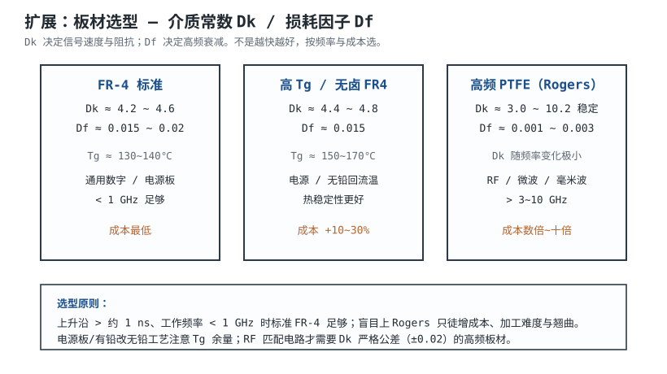

# PCB 结构、层叠与板材 PCB Structure, Stack-up & Materials

一块印制电路板（Printed Circuit Board, PCB）不是一张"画了铜线的绿板"，而是由**铜箔、玻璃布增强树脂（介质）半固化片交替压合**而成的多层"三明治"。叠层（Stack-up）怎么排、介质选什么材料，直接决定了走线阻抗、回流路径、EMI 辐射与散热——它是后续布局、布线、信号完整性设计的地基。

## 1. 原理：PCB 是怎样叠出来的

::: motivation 为什么要先懂叠层
很多人拿到板子就开始拉线，殊不知"线走在哪一层、下面是什么参考平面"在画板第一天就定死了。同样一块四层板，把 GND 放在 L2 还是 L3，回流环路面积能差几倍，辐射发射（EMI）结果可能一个过认证一个 fail。叠层是"一次定终身"的决策。
:::

一块 PCB 从内到外由三类东西交替压合：

- **铜箔层（Copper）**：传输信号、电源、地。厚度常用 0.5 oz（≈17 µm）、1 oz（≈35 µm）、2 oz（≈70 µm）；
- **介质层（Dielectric）**：半固化片（Prepreg，半固化的树脂玻璃布，压合时流动粘合）与芯板（Core，已固化的硬板）。材料主要是 FR-4 环氧玻璃布；
- **表面处理**：阻焊（Solder Mask，绿油）、丝印（Silkscreen，白字）、铜箔表面的喷锡/沉金（ENIG）等。

压合顺序（Stack-up）就是把这三者的相对位置排出来。

## 2. 图示：典型四层板叠层剖面

看图要点：**每一层信号走线下面，都要紧邻一张完整的参考平面（GND 或 PWR）**。这样信号电流从一端流到另一端时，回流电流（Return Current）会在正下方的参考平面里贴着它流回来，环路面积最小。

## 3. 定量参数：层叠关键尺寸

| 参数 | 符号 | 典型值 | 说明 |
|---|---|---|---|
| 板厚 | $h_{total}$ | 1.6 mm | 最常见；手持设备有 0.8/1.0 mm |
| 铜厚 | $t_{cu}$ | 0.5 oz=17 µm / 1 oz=35 µm | 厚铜走大电流，薄铜走细线 |
| 介质到平面距离 | $h$ | 0.1~0.3 mm | 决定微带线阻抗的主参数 |
| 介质常数 | $\varepsilon_r$ (Dk) | FR-4 ≈ 4.2~4.6 | 决定信号速度 $v=c/\sqrt{\varepsilon_r}$ |
| 损耗因子 | $\tan\delta$ (Df) | FR-4 ≈ 0.015~0.02 | 高频信号衰减大小 |

信号在介质里的传播速度近似为：

$$v \approx \frac{c}{\sqrt{\varepsilon_{r,eff}}}$$

FR-4 下 $\varepsilon_r \approx 4.3$，所以 $v \approx c/2.07$，约为光速的一半——**1 ns 只走约 15 cm**。这是后面判断"什么时候必须按传输线设计"的基准（见[信号完整性](signal-integrity.md)一章）。

## 4. 设计准则

1. **信号层必有紧邻参考平面**：L1↔L2、L4↔L3，参考平面必须完整（不要开槽、不要割裂）。
2. **电源平面与地平面相邻**：L2(GND) 与 L3(PWR) 紧贴，天然形成平面电容，等效去耦。
3. **不要把两个信号层平行紧贴**：它们之间没有完整参考面，串扰和回流都很差。
4. **板长宽比 < 5**：过长的板子地平面电感大、边缘辐射强（onsemi AND8301-D 经验）。
5. **层数与成本匹配**：控制板四层足够；高速/高 EMC 要求才上六层。

## 5. 完整设计示例

::: example 一块 STM32 控制板的四层叠层
1. **需求**：STM32 + USB + 多路 ADC，工作 <100 MHz，要求过基础 EMC。
2. **选层数**：四层，板厚 1.6 mm，1 oz 铜。
3. **叠层分配**：
   - L1 顶层：元件 + 高速信号（USB、晶振）
   - L2 内层：完整 GND 平面
   - L3 内层：PWR 平面（3.3V）
   - L4 底层：普通信号 + 少量走线
4. **核对**：USB D+/D- 在 L1，正下方是完整 L2 GND → 回流最短；3.3V 与 GND 相邻 → 平面电容去耦。
5. **验证**：把叠层参数（h=0.2mm、1oz、εr=4.3）代入 Saturn PCB Toolkit，微带线单端阻抗约 50~55 Ω，满足 USB 要求。
:::

## 6. 检查与仿真

- **叠层检查**：用 EDA 的层叠编辑器（KiCad Layer Setup / Altium Layer Stack Manager）确认每层用途、介质厚度、铜厚。
- **阻抗预计算**：在下单前把关键线（USB、以太网、DDR）的线宽-阻抗算出来（公式见[布线](routing.md)与[信号完整性](signal-integrity.md)），并把要求写进给板厂的叠层说明。
- **仿真**：高速板用 SI/PI 工具（如 Polar Si9000 类场求解器）反推给定目标阻抗（如 50 Ω）所需线宽与介质厚度。

## 扩展与变种电路

### 扩展1：六层板（内嵌带状线 Stripline）

当关键高速信号需要更低辐射、更受控的阻抗时，把它埋到两层参考平面之间，做成**带状线**。

::: example 机理与定量
- **微带线（Microstrip）**：信号在表层，一面是介质、一面暴露空气，有效 $\varepsilon_{r,eff}\approx 2.5\sim3$，阻抗易做但对外辐射大。
- **带状线（Stripline）**：信号埋在两平面之间，全在介质内，$\varepsilon_{r,eff}\approx \varepsilon_r\approx 4.3$，辐射被平面屏蔽，串扰更低。
- 同样 50 Ω：微带线宽约 0.20 mm（h=0.13 mm，含铜厚）；带状线因 $\varepsilon_r$ 大，线宽更细。
- 代价：六层板成本约为四层的 1.5~2 倍。
:::

准则对比：

| 项 | 四层（微带为主） | 六层（含带状线） |
|---|---|---|
| 高速辐射 | 一般 | 低（平面屏蔽） |
| 成本 | 基准 | 1.5~2× |
| 适用 | 低速控制 | 时钟/SerDes/DDR |

::: pitfall 两个信号层相邻成"无参考面对"
- **现象**：六层板把 L3、L5 都布成信号且平行长走线，高频串扰超标、回流绕远。
- **原因**：信号层之间没有完整参考平面，回流找不到最近路径。
- **解决**：保证每个信号层至少一侧紧邻完整平面；关键信号埋带状线。
:::

### 扩展2：板材选型 — FR-4 / 高 Tg / 高频 PTFE

叠层定了，还要选压合用的介质材料。

::: example 机理与定量
- **Dk（介质常数 $\varepsilon_r$）**：影响阻抗与传播速度；$\varepsilon_r$ 越稳定，高频匹配越好。
- **Df（损耗因子 $\tan\delta$）**：信号在介质里的衰减，频率越高越要命。FR-4 在 1~3 GHz 以上损耗明显增大。
- **Tg（玻璃化转变温度）**：板子在 Tg 以上变软、膨胀。无铅回流峰值 ~260℃，电源板/厚板要选 Tg≥150℃ 的高 Tg 料。
- 经验：上升沿 >1 ns、频率 <1 GHz，标准 FR-4 足够；RF/微波才上 Rogers 类 PTFE。
:::

准则对比：

| 板材 | Dk | Df | 适用 | 成本 |
|---|---|---|---|---|
| FR-4 标准 | 4.2~4.6 | 0.015~0.02 | 通用数字/电源 | 最低 |
| 高 Tg FR-4 | 4.4~4.8 | 0.015 | 电源/无铅工艺 | +10~30% |
| PTFE/Rogers | 3.0~10.2 稳定 | 0.001~0.003 | RF/毫米波 | 数倍~十倍 |

::: pitfall 盲目上高频板材
- **现象**：普通单片机板选了 Rogers，成本翻几倍，加工还容易翘曲。
- **原因**：把"高速"等同于"要贵板材"，没看上升沿与频率。
- **解决**：先算最高谐波频率（约 $0.35/t_r$），<1 GHz 用 FR-4；RF 匹配网络才用高频料。
:::

## 7. 常见坑与故障现象

::: pitfall 常见坑
- **把 GND 平面割裂成几块**：为了让数字地和模拟地分开，在 L2 挖一条深槽，结果高速信号跨越槽上方，回流被迫绕远，环路面积暴增、辐射超标。**正确做法见[模数电源分区](analog-digital-power-routing.md)**。
- **信号层下面不是它的参考平面**：比如 L1 走线参考 L2，但 L2 有一大块被 L3 电源分割，回流断流。设计时必须逐层确认"每条线底下是谁"。
- **板太厚/介质太厚导致阻抗做不下来**：想做 50 Ω 微带但 h 太大，线宽要做到不可能的宽度。下单前先用场求解器反推。
- **只数层数不看叠层顺序**：同样六层，"信号-GND-信号-GND-信号-信号"和"信号-GND-PWR-GND-信号-信号"性能天差地别。
:::

## 8. 自测题

为什么四层板推荐把 GND 放在 L2、PWR 放在 L3，而不是反过来？

因为顶层 L1 信号最密、最快，它正下方的 L2 必须是完整 GND，才能让高速信号回流紧贴、环路最小。若把 PWR 放 L2，电源平面常被分割，参考不完整。L2/L3 相邻（GND 贴 PWR）还顺带形成平面电容去耦。

FR-4 上信号传播速度约为光速的几分之几？1 ns 大约走多远？

$v\approx c/\sqrt{4.3}\approx c/2.07$，约光速一半；1 ns 走约 **15 cm**（更精确约 15~16 cm）。

什么时候才需要从 FR-4 换成 Rogers 类高频板材？

当最高显著谐波频率进入 ~3 GHz 以上、或 RF/微波匹配电路对 Dk 稳定性要求高时才需要。普通 <1 GHz 数字板用 FR-4 即可，盲目升级只增成本与翘曲风险。

## 9. 参考资料

- onsemi Application Note **AND8301-D** *EMC Specifications and PCB Guidelines for SMPS Devices*（叠层/分区/回流要点）
- Henry W. Ott, *Electromagnetic Compatibility Engineering*, Wiley, 2009
- Saturn PCB Design Toolkit（叠层与阻抗计算）：https://saturnpcb.com/saturn-pcb-toolkit/
- KiCad Layer Setup / Altium Layer Stack Manager 官方文档
