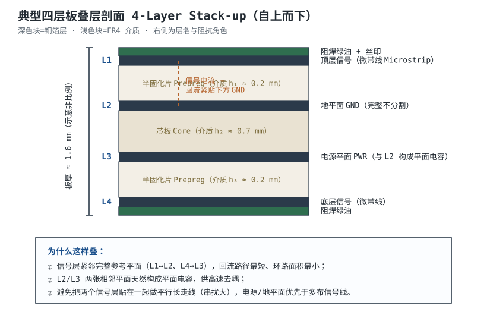
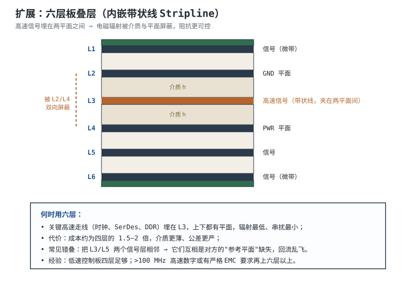

# PCB 结构、层叠与板材 PCB Structure, Stack-up & Materials

同一份原理图，交给两位工程师画板：一位把 USB 差分对放在顶层、正下方是完整地平面，另一位把同样的差分对放在顶层、正下方却被 3.3V 电源平面切成三块。两块板都能点亮，但前者的眼图张开、后者在 480Mbps 下偶发枚举失败。差别不在原理图，而在**叠层（Stack-up）**：信号走在哪一层、下面是谁、介质多厚、铜多厚。

一块印制电路板（Printed Circuit Board, PCB）不是“画了铜线的绿板”，而是铜箔、玻璃布增强树脂介质和表面处理交替压合的多层“三明治”。叠层决定了特性阻抗、回流路径、串扰、辐射和散热，是布局布线之前就要冻结的几何预算。本章把叠层从“数层数”还原成可计算的尺寸链：先给四层、六层、八层的典型分配，再用微带线/带状线公式算 50Ω 与 100Ω 的线宽与间距，最后用一块 1.6mm、εr=4.3 的四层板把数字走一遍。

## 1. 设计动机

::: motivation 三个现场
**现场一：四层板把电源放在 L2。** 某控制板为了“电源完整性好”，把 L2 做成 3.3V 整层，L3 才做地。USB 差分对在 L1，回流电流在 L2 上遇到电源分割和过孔避让，被迫绕行 8mm。按 1nH/mm 量级估算，回流路径多出约 8nH；480Mbps 信号的边沿电流在 0.3ns 内跳变 20mA，$L\,di/dt=8\times10^{-9}\times0.02/0.3\times10^{-9}\approx0.53\text{ V}$ 的地弹量级，眼图明显塌陷。把 L2/L3 对调，问题消失。**信号正下方是谁，比“有没有电源层”更重要。**

**现场二：叠层不对称，过炉后板子弓了。** 一块 1.6mm 六层板，L1/L2 之间用两张半固化片，L5/L6 之间只用一张，铜厚也不对称。无铅回流 260℃ 后板子弓曲 1.2mm，超了 IPC-6012 对贴片板的 0.75% 限值，QFN 引脚批量虚焊。**叠层不是只算电，还要算热膨胀和铜平衡。**

**现场三：以为“GND 和 PWR 相邻就有平面电容去耦”。** 一块 1cm² 的 L2/L3 平面，介质 0.2mm、εr=4.3，算出来只有 19pF；在 100MHz 的阻抗是 83.6Ω，远谈不上“低阻抗去耦”。它真正有价值的地方是高频段的低扩展电感和场约束。**把 19pF 当成去耦主力，会在低频纹波上摔跤。**
:::

叠层设计要同时回答五个问题：

| 问题 | 决定什么 | 典型选择依据 |
|---|---|---|
| 几层 | 布线密度、参考平面数量、成本 | 信号种类、BGA 引脚数、EMC 要求 |
| 每层做什么 | 阻抗、回流、屏蔽 | 高速信号靠平面，电源/地成对 |
| 介质多厚 | 阻抗、板厚、损耗 | 目标阻抗与板厂压合能力 |
| 铜多厚 | 载流、阻抗、散热 | 电流与温升，外层/内层 |
| 材料是什么 | Dk/Df、Tg、成本 | 频率、无铅工艺、可靠性 |

这五个问题里，前三个在画第一根线之前就基本锁死；后两个可以微调，但会牵动阻抗与成本。所以叠层要作为一份**给板厂的正式文件**来写，而不是在 EDA 里随手点几层。

## 2. 定义与直观

一块 PCB 的剖面由三类东西交替组成：

- **铜箔层（Copper）**：走信号、做电源/地平面。常用厚度 0.5oz≈17µm、1oz≈35µm、2oz≈70µm。注意“oz”是重量单位，折算成厚度时 1oz 铜约 35µm（1.378mil）。
- **介质层（Dielectric）**：半固化片（Prepreg，未完全固化的树脂玻璃布，压合时流动粘合）与芯板（Core，已固化的双面覆铜板）。材料以 FR-4 环氧玻璃布为主。
- **表面处理**：阻焊（Solder Mask）、丝印（Silkscreen）、焊盘表面的喷锡/沉金（ENIG）等。它们对阻抗有百分之几的影响，高频时要让板厂把阻焊厚度纳入模型。

### 2.1 参考平面与回流路径

**参考平面（Reference Plane）**是信号回流电流走的那张完整铜面，通常是 GND，也可以是 PWR。信号从驱动端流向负载端时，回流电流必须从负载端回到驱动端；在 PCB 上，它会选择**电感最小**的路径，也就是紧贴信号线正下方的那张平面。

微带线（Microstrip）是“一面介质、一面空气”的表层线；带状线（Stripline）是“上下都是介质、夹在两张平面之间”的内层线。两者的场分布不同，阻抗公式和传播速度也不同。**关键不是名字，而是“信号线到最近参考平面的距离 h”和“这张平面是否连续”。**

### 2.2 四层、六层、八层的典型分配

| 层数 | 典型叠层（自上而下） | 适合 | 主要代价 |
|---|---|---|---|
| 4 | 信号 / GND / PWR / 信号 | MCU 控制板、低速接口、成本敏感 | 只有两层内层，布线和电源分割受限 |
| 6 | 信号 / GND / 信号 / PWR / GND / 信号 | 有 DDR、USB HS、以太网、时钟 | 成本约为四层的 1.5~2 倍 |
| 8 | 信号 / GND / 信号 / GND / PWR / 信号 / GND / 信号 | 多路高速总线、FPGA、SerDes | 压合层数多、对准与翘曲控制更难 |

四层板最常见的分配是 **L1 信号、L2 GND、L3 PWR、L4 信号**。理由是 L1 通常元件最多、信号最快，正下方的 L2 必须是完整 GND；L4 的信号参考 L3，虽然 L3 是电源平面，但只要 L3 与 L2 在关心频段内低阻抗耦合，回流仍能就近流回。**如果 L4 走的是对回流极敏感的线，优先把 L3 也做成 GND，把电源挤到 L1/L4 的局部铺铜，而不是反过来。**

六层板的一种常用分配是 **L1 信号、L2 GND、L3 信号、L4 PWR、L5 GND、L6 信号**。L3 夹在 L2 与 L4 之间，可以做带状线；L1/L6 是微带线。注意 L3 的下参考是 PWR，不是 GND：这要求 L4 电源平面在 L3 信号过孔附近与 L2 地平面有低阻抗连接（去耦电容、地过孔），否则 L3 的回流会在 L4 上绕路。

八层板常见分配是 **L1 信号、L2 GND、L3 信号、L4 GND、L5 PWR、L6 信号、L7 GND、L8 信号**。它把“每个信号层至少一侧紧邻 GND”做成硬约束，适合多路 DDR/SerDes。层数越多，越要避免“两个信号层直接相邻”的叠法：它们之间没有完整参考平面，串扰和回流都会变差。

### 2.3 微带线与带状线的直观差别

微带线的电场一部分在介质里、一部分在空气里，所以**有效介质常数** $\varepsilon_{r,eff}$ 小于板材的 $\varepsilon_r$；带状线的场几乎全在介质里，$\varepsilon_{r,eff}\approx\varepsilon_r$。这带来两个直接后果：

1. 同样目标阻抗，微带线通常比带状线宽（因为空气降低了有效 Dk，场更“散”）；
2. 微带线传播更快（$\varepsilon_{r,eff}$ 小），但对外辐射也更大；带状线被两张平面夹住，辐射和串扰更低。

这两个差别会在下一节的公式里变成具体数字。

## 3. 定量关系

### 3.1 传播速度与延迟

信号在介质中的传播速度：

$$
v=\frac{c}{\sqrt{\varepsilon_{r,eff}}}
$$

其中 $c\approx3.00\times10^{8}\ \text{m/s}$ 是真空光速，$\varepsilon_{r,eff}$ 是有效相对介质常数（无量纲），$v$ 的单位是 m/s。工程上更常用 cm/ns：$v[\text{cm/ns}]=30/\sqrt{\varepsilon_{r,eff}}$。

带状线的 $\varepsilon_{r,eff}\approx\varepsilon_r$。FR-4 取 $\varepsilon_r=4.3$：

$$
v=\frac{3.00\times10^{8}}{\sqrt{4.3}}=1.45\times10^{8}\ \text{m/s}=14.5\ \text{cm/ns}
$$

微带线的 $\varepsilon_{r,eff}$ 要用近似式。对 $0.1<w/h<3$ 的常用范围：

$$
\varepsilon_{r,eff}\approx\frac{\varepsilon_r+1}{2}+\frac{\varepsilon_r-1}{2}\cdot\frac{1}{\sqrt{1+12h/w}}
$$

其中 $w$ 是线宽，$h$ 是线到参考平面的介质厚度，单位一致即可。以 $w=0.43\text{ mm}$、$h=0.25\text{ mm}$、$\varepsilon_r=4.3$ 代入：

$$
\varepsilon_{r,eff}\approx\frac{5.3}{2}+\frac{3.3}{2}\cdot\frac{1}{\sqrt{1+12\times0.25/0.43}}
=2.65+1.65\times0.354=3.23
$$

于是：

$$
v=\frac{3.00\times10^{8}}{\sqrt{3.23}}=1.67\times10^{8}\ \text{m/s}=16.7\ \text{cm/ns}
$$

一条 50mm 的微带线，单向延迟：

$$
T_d=\frac{L}{v}=\frac{0.050}{1.67\times10^{8}}=3.0\times10^{-10}\ \text{s}=0.30\ \text{ns}
$$

同样 50mm 的带状线：

$$
T_d=\frac{0.050}{1.45\times10^{8}}=3.45\times10^{-10}\ \text{s}=0.35\ \text{ns}
$$

**“1ns 走 15cm”是工程口算值，不是精确常数。** 微带线约 16.7cm/ns，带状线约 14.5cm/ns；做时序预算时要按实际叠层和 $\varepsilon_{r,eff}$ 算，不能把 15cm/ns 当成对所有层都成立。

### 3.2 微带线特征阻抗

IPC-2141A 与 IPC-2221B 常引用下面的微带线估算式（又称 IPC-D-317 近似）：

$$
Z_0\approx\frac{87}{\sqrt{\varepsilon_r+1.41}}\ln\left(\frac{5.98h}{0.8w+t}\right)
$$

其中 $Z_0$ 是特性阻抗，$\Omega$；$\varepsilon_r$ 是板材相对介质常数（无量纲）；$h$ 是介质厚度，mm；$w$ 是线宽，mm；$t$ 是铜厚，mm。适用条件是 $0.1<w/h<2.0$、$t/h<0.2$，误差量级 5%~10%；超出范围或需要精确值时，用二维场求解器或板厂阻抗测试条。

把 $h=0.25\text{ mm}$、$t=0.035\text{ mm}$、$\varepsilon_r=4.3$、$w=0.43\text{ mm}$ 代入：

$$
Z_0\approx\frac{87}{\sqrt{5.71}}\ln\left(\frac{5.98\times0.25}{0.8\times0.43+0.035}\right)
=36.41\times\ln(3.94)=36.41\times1.371=49.9\ \Omega
$$

反过来，若目标 $Z_0=50\ \Omega$，保持 $h$、$t$、$\varepsilon_r$ 不变，可解出：

$$
w=\frac{1}{0.8}\left[\frac{5.98h}{\exp\left(\frac{Z_0\sqrt{\varepsilon_r+1.41}}{87}\right)}-t\right]
=\frac{1}{0.8}\left[\frac{1.495}{3.94}-0.035\right]=0.430\ \text{mm}
$$

**铜厚不能忽略。** 若把 $t$ 当成 0，同样 $h=0.25\text{ mm}$、$Z_0=50\ \Omega$ 解出 $w\approx0.474\text{ mm}$，比含铜厚的 0.430mm 宽了 0.044mm（约 10%）。在 0.2mm 量级的细线上，这是不可忽略的偏差。

### 3.3 带状线特征阻抗

对中心导体位于两张平面正中间的带状线，常用：

$$
Z_0\approx\frac{60}{\sqrt{\varepsilon_r}}\ln\left(\frac{1.9b}{0.8w+t}\right)
$$

其中 $b$ 是两张参考平面之间的总介质厚度，mm；$w$ 是线宽，mm；$t$ 是铜厚，mm。$b=2h+t$（$h$ 为线到单侧平面的距离）时就是对称带状线。把 $b=0.435\text{ mm}$、$t=0.035\text{ mm}$、$\varepsilon_r=4.3$、目标 $50\ \Omega$ 代入：

$$
\frac{50\sqrt{4.3}}{60}=1.728
$$

$$
\exp(1.728)=5.63
$$

$$
0.8w+0.035=\frac{1.9\times0.435}{5.63}=0.147\ \text{mm}
$$

$$
w=\frac{0.147-0.035}{0.8}=0.140\ \text{mm}
$$

也就是说，在相近的介质距离下，50Ω 带状线只要约 0.14mm 宽，而 50Ω 微带线要 0.43mm。**带状线更“窄”不是因为它更好做，而是因为场全在介质里、有效 Dk 更高，同样的线宽会产生更低的阻抗。**

### 3.4 差分阻抗

差分对由两条等宽、等间距的线组成。差分阻抗 $Z_{diff}$ 是两条线之间看到的阻抗，近似等于两倍奇模阻抗 $Z_{0o}$：

$$
Z_{diff}=2Z_{0o}
$$

弱耦合（间距较大）时，$Z_{0o}\approx Z_0(1-k)$，$k$ 是耦合系数，于是：

$$
Z_{diff}\approx2Z_0(1-k)
$$

工程上常用的微带线经验式把 $k$ 写成间距的函数：

$$
Z_{diff}\approx2Z_0\left(1-0.48e^{-0.96S/h}\right)
$$

其中 $Z_0$ 是单根线（孤立时）的特性阻抗，$\Omega$；$S$ 是两条线之间的边到边间距，mm；$h$ 是介质厚度，mm。这个式子在 $0.5<S/h<3$、弱到中等耦合时误差约 10%，只适合估算；最终以场求解器和板厂阻抗测试为准。

以四层板 $h=0.25\text{ mm}$ 为例，取 $w=0.36\text{ mm}$，先算单根线：

$$
Z_0=36.41\times\ln\left(\frac{1.495}{0.8\times0.36+0.035}\right)
=36.41\times\ln(4.628)=36.41\times1.532=55.8\ \Omega
$$

再取 $S=0.40\text{ mm}$：

$$
Z_{diff}\approx2\times55.8\times\left(1-0.48e^{-0.96\times0.40/0.25}\right)
=111.6\times(1-0.48\times0.215)=111.6\times0.897=100.1\ \Omega
$$

间距变一点，阻抗变多少？同样 $w=0.36\text{ mm}$：

| 边到边间距 $S$ | $S/h$ | 指数项 | $Z_{diff}$ |
|---|---|---|---|
| 0.30 mm | 1.2 | 0.316 | 94.6 Ω |
| 0.40 mm | 1.6 | 0.215 | 100.0 Ω |
| 0.50 mm | 2.0 | 0.147 | 103.7 Ω |

**间距从 0.30mm 变到 0.50mm，差分阻抗变化约 9Ω（9%）。** 所以差分对不仅要控线宽，还要控间距；EDA 里改一条线的间距，阻抗就偏了。

### 3.5 平面电容：有，但别指望它去耦

两张平行平面构成一个平板电容：

$$
C=\varepsilon_0\varepsilon_r\frac{A}{d}
$$

其中 $\varepsilon_0=8.854\times10^{-12}\ \text{F/m}$，$\varepsilon_r$ 是介质常数，$A$ 是重叠面积，$\text{m}^2$，$d$ 是平面间距，m。取 $A=1\ \text{cm}^2=1.0\times10^{-4}\ \text{m}^2$、$d=0.2\ \text{mm}=2.0\times10^{-4}\ \text{m}$、$\varepsilon_r=4.3$：

$$
C=8.854\times10^{-12}\times4.3\times\frac{1.0\times10^{-4}}{2.0\times10^{-4}}
=1.90\times10^{-11}\ \text{F}=19.0\ \text{pF}
$$

在 100MHz 的容抗：

$$
Z_C=\frac{1}{2\pi fC}
=\frac{1}{2\pi\times10^{8}\times1.90\times10^{-11}}=83.6\ \Omega
$$

在 1GHz 才是 8.36Ω。**19pF 的平面电容在 100MHz 不是低阻抗，不能替代 0.1µF 陶瓷电容。** 它的价值在于：平面是一整张低扩展电感的导体，能把高频电流“摊开”；以及两张平面之间的场被约束在板内，减少向外辐射。把“平面电容”当成低频去耦主力，是叠层设计里最常见的概念偷换。

### 3.6 对称性与翘曲

FR-4 的平面内热膨胀系数（CTE）约 14~17ppm/K，厚度方向约 50~70ppm/K；铜的 CTE 约 17ppm/K。压合后各层 CTE 不匹配，冷却时会产生内应力。**叠层关于板厚中心对称**（铜厚、介质厚度镜像）可以把弯曲力矩抵消到最小。

IPC-6012E 对贴片板的弓曲和扭曲（bow and twist）限值通常按对角线长度的 0.75% 控制（以现行版为准）。一块 100mm×80mm 的板，对角线：

$$
D=\sqrt{100^2+80^2}=128\ \text{mm}
$$

允许的弓曲量级：

$$
0.0075\times128=0.96\ \text{mm}
$$

超过这个量级，QFN/BGA 的共面性、锡膏厚度和贴片偏移都会变差。**所以叠层设计不只是“电气对称”，还要铜面积对称、介质厚度对称、阻焊开窗尽量对称。**

## 4. 典型计算

### 4.1 四层板：1.6mm、εr=4.3 的 50Ω 与 100Ω

::: example 从板厚到线宽
**需求**：四层控制板，板厚 1.6mm，FR-4（εr=4.3），1oz 铜，L1/L4 走信号，L2 完整 GND，L3 PWR。要设计 50Ω 单端微带线和 100Ω 差分对。

**第一步：分配厚度。** 取 L1/L2 之间半固化片 0.25mm，L4/L3 之间同样 0.25mm，中间芯板 0.92mm，四面铜各 0.035mm：

$$
4\times0.035+2\times0.25+0.92=1.56\ \text{mm}
$$

两面阻焊各约 0.02mm，合计约 1.60mm。实际压合时板厂会按公差调整，关键是**把 L1 到 L2 的介质厚度 0.25mm 写进叠层说明**，因为它是 50Ω 线宽的主参数。

**第二步：50Ω 微带线。** 用 3.2 节公式，取 $h=0.25\text{ mm}$、$t=0.035\text{ mm}$、$\varepsilon_r=4.3$：

$$
Z_0=36.41\times\ln\left(\frac{5.98\times0.25}{0.8w+0.035}\right)
$$

令 $Z_0=50\ \Omega$，解得 $w=0.430\text{ mm}$。回代：

$$
Z_0=36.41\times\ln\left(\frac{1.495}{0.379}\right)
=36.41\times1.371=49.9\ \Omega
$$

**第三步：100Ω 差分对。** 取 $w=0.36\text{ mm}$、边到边 $S=0.40\text{ mm}$。单根线 $Z_0=55.8\ \Omega$，代入 3.4 节：

$$
Z_{diff}=2\times55.8\times(1-0.48e^{-1.536})
=111.6\times0.897=100.1\ \Omega
$$

**第四步：验算传播延迟。** 微带线 $\varepsilon_{r,eff}=3.23$，$v=16.7\text{ cm/ns}$。若这段线长 50mm，先统一单位成 cm：

$$
T_d=\frac{5.0\ \text{cm}}{16.7\ \text{cm/ns}}=0.30\ \text{ns}
$$

**单位先统一再代入**，是这类计算最容易出错的一步；50mm 直接除以 16.7 会得到 3.0 这个没有物理意义的数。

**结论**：这块四层板的 50Ω 微带线宽约 0.43mm；100Ω 差分对取 0.36mm 线宽、0.40mm 边到边间距。下单时把这组数写进阻抗控制说明，并要求板厂做 50Ω/100Ω 测试条。
:::

### 4.2 六层板：带状线 50Ω

::: example 把高速线埋进去
**需求**：六层板，L3 走 100MHz 时钟，要求 50Ω 带状线，L2 GND、L4 PWR，L3 到两侧平面的介质各 0.20mm，铜厚 0.035mm。

**第一步：算总间距。** 中心导体到上下平面的总介质厚度：

$$
b=2\times0.20+0.035=0.435\ \text{mm}
$$

**第二步：解线宽。** 用 3.3 节：

$$
50=\frac{60}{\sqrt{4.3}}\ln\left(\frac{1.9\times0.435}{0.8w+0.035}\right)
$$

$$
\frac{50\times2.074}{60}=1.728
$$

$$
0.8w+0.035=\frac{0.8265}{5.63}=0.147
$$

$$
w=0.140\ \text{mm}
$$

**第三步：验算。** 回代：

$$
Z_0=28.93\times\ln\left(\frac{0.8265}{0.147}\right)
=28.93\times1.727=50.0\ \Omega
$$

**结论**：同样 50Ω，L3 带状线只要 0.14mm 宽，比 L1 微带线的 0.43mm 细得多。代价是 L3 只能走内层，换层要打过孔；而每一个过孔都是阻抗不连续点（见[信号完整性](signal-integrity.md)）。
:::

### 4.3 平面电容与翘曲的验算

::: example 两个容易被忽略的数
**平面电容**：1cm² 重叠、0.2mm 介质、εr=4.3，算得 19.0pF；100MHz 容抗 83.6Ω，1GHz 容抗 8.36Ω。**结论**：它不能替代 0.1µF 去耦电容；如果板上有 100MHz 级的瞬态电流，仍要按[电源完整性与去耦体系](../power/power-integrity-decoupling.md)的方法布电容。

**翘曲**：100mm×80mm 板，对角线 128mm，IPC-6012E 的 0.75% 限值对应 0.96mm。若叠层一边 1oz、一边 0.5oz，冷却时两侧收缩不对称，实测弓曲很容易超过 1mm。**结论**：铜厚、介质厚度、阻焊开窗都要尽量镜像；不对称叠层要在压合前做热应力仿真或让板厂给翘曲数据。
:::

## 5. 工程含义

### 5.1 层数、铜厚与成本的取舍

| 项 | 四层 | 六层 | 八层 |
|---|---|---|---|
| 典型用途 | MCU、低速接口 | USB HS、以太网、DDR3 | 多路 DDR、FPGA、SerDes |
| 成本量级 | 1× | 1.5~2× | 2.5~3.5× |
| 阻抗控制 | 外层微带为主 | 可做内层带状线 | 多层带状线/屏蔽 |
| 翘曲风险 | 低 | 中 | 高（层数多、压合次数多） |

成本倍数只是量级，实际取决于板厂、订单量、层压结构和表面处理。**不要为了“看起来高级”上八层；层数应该由参考平面数量、布线密度和 EMC 要求决定。**

铜厚的选择同样要算：1oz 铜的截面是 35µm，2oz 是 70µm；同样线宽下载流翻倍，但细线蚀刻更难、最小线宽/间距会变差。电源走线按[布线](routing.md)的 IPC-2221 方法算，信号线则优先满足阻抗，不要为了“载流”把 50Ω 线随意加宽。

### 5.2 板材：FR-4、高 Tg 与高频材料

| 材料 | Dk（典型） | Df（典型） | 适用 | 成本 |
|---|---|---|---|---|
| 标准 FR-4 | 4.2~4.6 | 0.015~0.02 | 通用数字、电源、≤1GHz | 最低 |
| 高 Tg FR-4 | 4.4~4.8 | 0.015 量级 | 无铅回流、厚板、电源板 | +10%~30% |
| 高频 PTFE/碳氢 | 3.0~3.5（视型号） | 0.002~0.004 | RF、毫米波、低损耗 | 数倍~十倍 |

Dk 决定阻抗和传播速度，Df 决定损耗。**Df 的影响随频率上升**：同样的 FR-4，100MHz 下损耗可能可以接受，5GHz 下就可能把眼图吃掉。判断要不要换材料，先算最高显著频率（约 $0.35/t_r$）和走线长度，再看损耗预算；不要只看“时钟频率”一个数。

### 5.3 参考平面的连续性

叠层一旦定了，布线时必须逐条确认“这条线正下方是谁”。三条硬规则：

1. **高速信号下方必须是完整平面**，不允许开槽、挖洞、被电源分割穿越；如果必须跨分割，在跨缝处放缝合电容或改层。
2. **换层时旁边要有回流过孔**，让回流电流跟着信号一起换层；回流过孔距离信号过孔越近越好，典型 1~2mm 内。
3. **电源平面做参考时，电源与地要在过孔附近低阻抗耦合**；否则回流会在电源平面上绕路，等效电感增加。

回流电流在平面上的分布不是“整张平面均匀流”，而是集中在信号线正下方约 ±3h 的范围内；h=0.25mm 时约 ±0.75mm。**所以“平面很大”不等于“回流路径好”，关键是信号正下方那一小片是否连续。**

### 5.4 写给板厂的叠层说明

一份可执行的叠层说明至少包含：

- 层数与每层用途（信号/GND/PWR），标明哪层做阻抗控制；
- 每层铜厚（oz 或 µm）与成品铜厚公差；
- 每层介质材料、型号、厚度、Dk/Df（或让板厂按指定阻抗反推）；
- 目标阻抗与允许偏差（如 50Ω±10%、90Ω±10%），以及测试条位置；
- 叠层对称性要求、板厚公差、翘曲限值；
- 阻焊厚度、表面处理、是否允许过孔盖油/塞孔。

**不要只写“做 50Ω”。** 板厂需要知道线宽、介质厚度、铜厚和测试方法，否则“50Ω”只是一句愿望。

::: advanced 三个被简化过头的说法
**说法一：“GND 和 PWR 相邻就有平面电容去耦。”** 1cm²、0.2mm 的平面只有 19pF，100MHz 容抗 83.6Ω；它可以提供高频的场约束和低扩展电感，但不能替代陶瓷电容。低频去耦仍要看 VRM、体电容和就近电容。

**说法二：“USB 用 50Ω 单端微带线就行。”** USB 2.0 HS 的 PCB 要求是 90Ω 差分（通常 ±10%），不是 50Ω 单端。50Ω 单端只有在两线间距很大、近似独立时才对应 100Ω 差分；直接拿 50Ω 单端宣称满足 USB，是把“单端阻抗”和“差分阻抗”混为一谈。

**说法三：“微带线的有效 εr 大约 2.5~3。”** 对 FR-4、50Ω、w/h≈1.5 的微带线，Hammerstad 近似给出约 3.2；2.5~3 偏低。用错 εr,eff 会把传播延迟算快 10% 以上，时序预算就会出现系统性偏差。
:::

## 6. 常见坑

::: pitfall 坑一：GND 平面被分割，高速线跨缝
- **现象**：USB/以太网眼图闭合，辐射测试在 100~300MHz 超标；TDR 看到跨缝处阻抗尖峰。
- **原因**：信号正下方的回流路径被分割缝切断，回流被迫绕过缝隙，环路面积和电感增大。
- **解决**：高速线下方保持完整 GND；必须分割时，把信号改到不跨缝的层，或在跨缝处放缝合电容（0.01~0.1µF）并保证两侧地平面低阻抗连接。
:::

::: pitfall 坑二：信号参考的是 PWR，但 PWR 没就近去耦
- **现象**：L3 带状线换层后振铃，眼图边沿变缓；电源平面上的回流噪声耦合到其他信号。
- **原因**：L3 的下参考是 PWR，PWR 与 GND 之间只有远端一颗大电容，高频回流找不到低阻抗回路。
- **解决**：在 L3 信号过孔附近增加 PWR-GND 去耦电容和地过孔；关键高速线优先参考 GND，而不是 PWR。
:::

::: pitfall 坑三：叠层不对称，过炉后翘曲
- **现象**：板子弓曲超过 1mm，QFN 一边虚焊，贴片机吸嘴取料不稳。
- **原因**：铜厚、介质厚度或阻焊开窗不镜像，压合冷却时两侧收缩不一致。
- **解决**：叠层关于中心对称；铜面积尽量平衡；不对称设计让板厂做压合仿真，必要时用夹具过炉。
:::

::: pitfall 坑四：忽略铜厚算阻抗
- **现象**：按公式算 50Ω，板厂测试条实测 55Ω；或者线宽做出来比设计值细。
- **原因**：公式里漏掉铜厚 $t$，或用了基铜厚度而不是成品铜厚（外层还有电镀加成）。
- **解决**：把成品铜厚代入；下单时说明“成品铜厚”还是“基铜厚度”；用板厂提供的阻抗测试条验收。
:::

::: pitfall 坑五：把“层数”当成“叠层”
- **现象**：两块都是六层板，一块 DDR 稳定，一块偶发误码；对比发现一块是“信号-GND-信号-PWR-GND-信号”，另一块是“信号-GND-信号-信号-GND-信号”。
- **原因**：只数层数，没有规定每层的角色和参考关系。
- **解决**：叠层表必须写清每层用途、参考平面和阻抗控制层；两个信号层不允许直接相邻。
:::

::: pitfall 坑六：盲目上高频板材
- **现象**：普通 MCU 板换成高频 PTFE，成本翻几倍，压合还容易分层/翘曲。
- **原因**：把“高速”等同于“高 Dk 稳定性”，没有算最高显著频率和损耗预算。
- **解决**：先算 $f_{knee}\approx0.35/t_r$ 和走线损耗；1GHz 以下、几厘米长的数字线，标准 FR-4 通常够用；RF 匹配和长距离高速链路才考虑低 Df 材料。
:::

## 7. 自测题

四层板为什么常把 GND 放在 L2、PWR 放在 L3，而不是反过来？

L1 通常元件最多、信号最快，正下方的 L2 必须是完整 GND，才能让 L1 信号的回流紧贴、环路最小。若 L2 做 PWR，电源平面常被分割和过孔避让，参考不完整；L4 的信号参考 L3 时，PWR 与 GND 相邻且可去耦，回流仍可接受。L2/L3 相邻还带来低扩展电感和一定的平面电容，但不要把它当成低频去耦主力。

FR-4、εr=4.3，微带线 h=0.25mm、w=0.43mm、t=0.035mm，特性阻抗是多少？有效 εr 和传播速度呢？

$$Z_0=36.41\ln\left(\frac{5.98\times0.25}{0.8\times0.43+0.035}\right)=36.41\ln(3.94)=49.9\ \Omega$$

$$\varepsilon_{r,eff}=2.65+\frac{3.3}{2}\cdot\frac{1}{\sqrt{1+12\times0.25/0.43}}=3.23$$

$$v=\frac{3.00\times10^8}{\sqrt{3.23}}=1.67\times10^8\ \text{m/s}=16.7\ \text{cm/ns}$$

所以 50mm 线约 0.30ns 延迟。

把 h 从 0.25mm 加倍到 0.50mm，要保持 50Ω，线宽大约怎么变？

微带公式里决定阻抗的是 $h/(0.8w+t)$。若 $t$ 相对小，保持比值不变意味着 $w$ 大致随 $h$ 同比例增加：h 加倍，w 约从 0.43mm 增到 0.86mm 量级。严格值要用公式回代，且大 w/h 下近似式误差变大；实际用场求解器确认。**结论：介质越厚，50Ω 线越宽，布线越占面积。**

1cm²、0.2mm、εr=4.3 的平面电容有多大？100MHz 时能当去耦电容用吗？

$$C=8.854\times10^{-12}\times4.3\times\frac{1.0\times10^{-4}}{2.0\times10^{-4}}=19.0\ \text{pF}$$

100MHz 容抗：

$$Z_C=\frac{1}{2\pi\times10^8\times19.0\times10^{-12}}=83.6\ \Omega$$

83.6Ω 远高于目标阻抗（毫欧到欧姆量级），不能替代 0.1µF 陶瓷电容。它的价值在高频场约束和低扩展电感，不是低频储能。

为什么差分对除了线宽还要控间距？间距 0.30mm 和 0.50mm 的 100Ω 设计差多少？

差分阻抗近似式含 $e^{-0.96S/h}$，间距直接改变奇模阻抗。以 h=0.25mm、w=0.36mm 为例：S=0.30mm 时 $Z_{diff}\approx94.6\ \Omega$，S=0.40mm 时 100.0Ω，S=0.50mm 时 103.7Ω。**间距 ±0.1mm 就能让差分阻抗偏 ±5Ω 左右**，所以差分对要把线宽和间距一起写进阻抗控制要求。

叠层不对称会怎样？100mm×80mm 的板，0.75% 弓曲限值对应多少毫米？

不对称会让压合冷却时的收缩力矩不平衡，导致弓曲/扭曲；贴片时共面性变差，QFN/BGA 容易虚焊。对角线 $D=\sqrt{100^2+80^2}=128\text{ mm}$，0.75% 限值约 $0.0075\times128=0.96\text{ mm}$。超过这个量级就要改叠层或让板厂做压合仿真。

## 8. 参考资料

- IPC-2221B, *Generic Standard on Printed Board Design*, 2012 — 设计规则、电气间距、层叠与铜厚要求。
- IPC-2141A, *Design Guide for High-Speed Controlled Impedance Circuit Boards*, 2004 — 微带线/带状线阻抗公式与阻抗控制流程。
- IPC-6012E, *Qualification and Performance Specification for Rigid Printed Boards*, 2020 — 成品板验收、铜厚、弓曲/扭曲限值。
- Henry W. Ott, *Electromagnetic Compatibility Engineering*, Wiley, 2009 — PCB layout and stackup 一章，参考平面、回流与层叠。
- Howard Johnson and Martin Graham, *High Speed Digital Design: A Handbook of Black Magic*, Prentice Hall, 1993 — Chapter 4，传播速度、传输线与阻抗。
- Saturn PCB Design Toolkit：https://saturnpcb.com/saturn-pcb-toolkit/ — 阻抗、载流、过孔计算器。
- 相关章节：[信号完整性](signal-integrity.md)、[串扰与差分走线](crosstalk-differential.md)、[布线](routing.md)、[布局](placement.md)、[电源完整性与去耦体系](../power/power-integrity-decoupling.md)。
