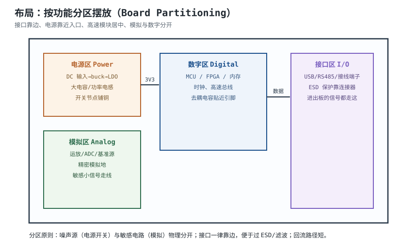
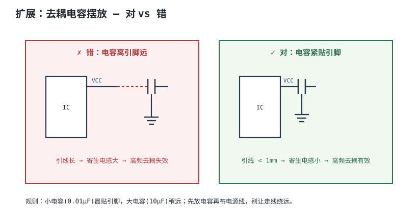
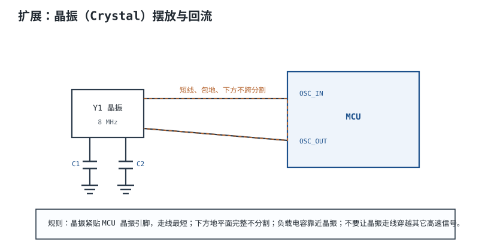

# 布局原则与模块化 Placement & Modular Partitioning

布局（Placement）就是把元件从网表里搬到板子上、定位置和方向。**布局决定了一块板子 70% 的信号完整性与 EMC 表现**——后面布线再好也救不回一个烂布局。

## 1. 设计动机

::: motivation 为什么布局这么重要
同样一块板，先摆好位置再拉线，和随手把元件摊开再拉线，结果天差地别。噪声源（开关电源）紧挨着精密模拟电路，再怎么滤波都救不回来；接口元件放在板子中间，ESD 放电要绕大半圈才能到保护器件。布局就是在"画铜线之前"先把噪声和敏感电路物理隔开。
:::

## 2. 图示：按功能分区摆放

## 3. 核心原则

- **按功能分块**：电源、数字、模拟、接口各自成区，不要交叉混放。
- **接口靠边**：USB/RS485/接线端子放板边，ESD 保护和滤波直接放在连接器处。
- **电源靠近入口**：DC 输入→buck→LDO 顺序排布，大电流环路最小。
- **高速模块居中**：时钟、高速总线放在板中心，走线短、远离边缘辐射。
- **噪声源远离敏感电路**：开关电源离 ADC/运放越远越好。

## 4. 定量参数：关键间距经验值

| 对象 | 经验间距 | 来源 |
|---|---|---|
| 大开关走线 ↔ 普通信号 | ≥ 3 mm | AND8301-D |
| 去耦电容 ↔ IC 电源脚 | < 1 mm | AND8301-D |
| 板长宽比 | < 5 | AND8301-D |
| 晶振走线 | 越短越好，包地 | 通用 |

## 5. 设计准则

1. **先大后小**：先定连接器、电源、主芯片位置，再塞被动元件。
2. **先分区后拉线**：确认分区合理了再进入布线。
3. **去耦电容先放**：每个电源脚的去耦电容紧邻引脚放，再布电源线。
4. **晶振紧贴 MCU**：晶振和负载电容放在 MCU 晶振引脚旁。
5. **I/O 方向一致**：接口元件方向一致，方便接线和结构开孔。

## 6. 完整设计示例

::: example 一块 STM32 + RS485 板的布局
1. **需求**：STM32 控制板，带 RS485 接口、buck 5V→3.3V、多路 ADC。
2. **定板框**：100×80 mm，长宽比 1.25。
3. **接口靠边**：RS485 接线端子放右侧板边，TVS 紧贴端子。
4. **电源区**：DC 输入放左上，buck→LDO 沿左边排，大电容就近。
5. **数字区**：STM32 放中央，晶振紧贴其晶振脚。
6. **模拟区**：ADC 采样电路放左下，远离 buck 开关节点。
7. **去耦**：每个 VDD 脚旁放 0.1µF 电容，<1mm。
8. **检查**：模拟区与电源区之间留有间距，RS485 走线短。
:::

## 7. 检查与仿真

- **3D 检查**：导出 3D，看元件高度干涉、连接器是否出板边。
- **DRC 前的布局评审**：线还没布完就先看分区对不对。
- **环路面积目测**：buck 高 di/dt 环路（输入电容→开关→电感→输出）是否最小。

## 扩展与变种电路

### 扩展1：去耦电容摆放 — 对 vs 错

去耦电容摆得好不好，直接决定高频去耦有没有用。

::: example 机理与定量
- 电容引线有寄生电感 $L$，阻抗 $Z=2\pi f L$，频率越高 $Z$ 越大，去耦越失效。
- 引线从 1mm 到 10mm，寄生电感约从 1 nH 涨到 5~10 nH，100 MHz 下阻抗差几倍。
- **小电容（0.01µF）最贴引脚**（高频低 ESL），**大电容（10µF）稍远**（低频储能）。
- 经验值：0.1µF 用于 <15 MHz，0.01µF 用于 >15 MHz（AND8301-D）。
:::

准则对比：

| 摆法 | 寄生电感 | 高频去耦 |
|---|---|---|
| 紧贴引脚 <1mm | 小 | 有效 |
| 引线 >5mm | 大 | 失效 |

::: pitfall 去耦电容放了但没贴紧
- **现象**：每个电源脚都放了 0.1µF，但板子纹波还是大、EMI 超标。
- **原因**：电容离引脚 1cm，引线寄生电感把高频去耦废掉。
- **解决**：先放电容再布线，电容过孔直接打在 GND 平面上。
:::

### 扩展2：晶振摆放与回流

晶振是板上最敏感也最爱辐射的电路之一。

::: example 机理与定量
- 晶振输出是高 Q 正弦，幅度小但频率高，走线长就像天线往外辐射。
- 负载电容（C1/C2）靠近晶振放，接地直接打过孔到完整 GND。
- 晶振走线下方**必须是完整地平面**，不能跨分割——否则回流绕远、环路变大。
- 不要让晶振走线穿过其它高速信号或板边。
:::

准则对比：

| 摆法 | 辐射 | 稳定性 |
|---|---|---|
| 紧贴 MCU + 完整地 | 低 | 好 |
| 远离 + 跨分割 | 高 | 易起振失败 |

::: pitfall 晶振走线下方地平面开槽
- **现象**：晶振附近 EMI 超标，或时钟有时不起振。
- **原因**：地平面在晶振走线下方被开槽，回流被迫绕远，环路面积大。
- **解决**：晶振区域下方保持完整地平面，必要时包地（guard ring）。
:::

## 8. 常见坑与故障现象

::: pitfall 常见坑
- **模拟和数字混在一起**：ADC 旁边就是开关电源，采样读数乱跳。模拟区必须远离开关噪声。
- **ESD 保护离连接器远**：TVS 放在 IC 旁边而不是连接器旁，ESD 电流绕远，保护失效。
- **去耦电容"放了但没贴紧"**：见扩展1，引线长=去耦失效。
- **晶振离 MCU 远**：走线长，辐射大、易受干扰。
:::

## 9. 自测题

为什么接口元件要放板边、ESD 保护紧贴连接器？

因为 ESD/浪涌从接口进来，保护器件必须放在**噪声入口处**，让放电电流就近泄放到地，而不是绕过大半个板子打到敏感 IC。放板边也方便结构开孔和接线。

去耦电容为什么要紧贴 IC 电源脚？引线长了会怎样？

引线有寄生电感 $L$，高频阻抗 $Z=2\pi fL$。引线越长 $L$ 越大，高频去耦阻抗越高、电容越不起作用。所以小电容必须 <1mm 贴近引脚，大电容稍远负责低频。

晶振走线下方的地平面为什么不能开槽？

回流电流会在信号线正下方的地平面流回。开槽逼回流绕远，环路面积暴增，既增大辐射又破坏晶振稳定性。晶振下方必须是完整地平面。

## 10. 参考资料

- onsemi AND8301-D *EMC Specifications and PCB Guidelines for SMPS Devices*
- Henry W. Ott, *Electromagnetic Compatibility Engineering*, Wiley 2009
- Saturn PCB Design Toolkit
