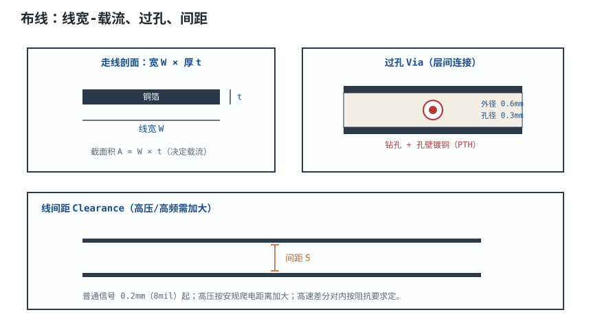
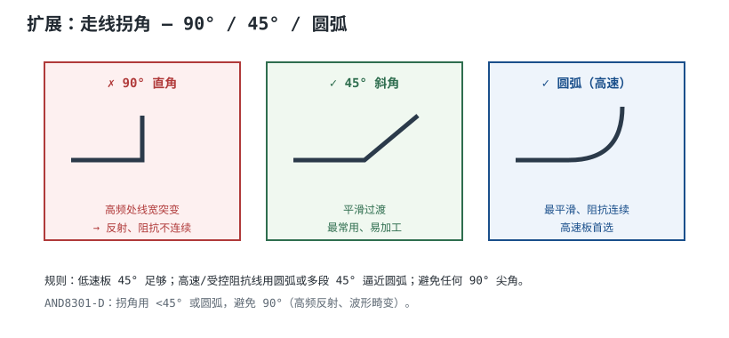
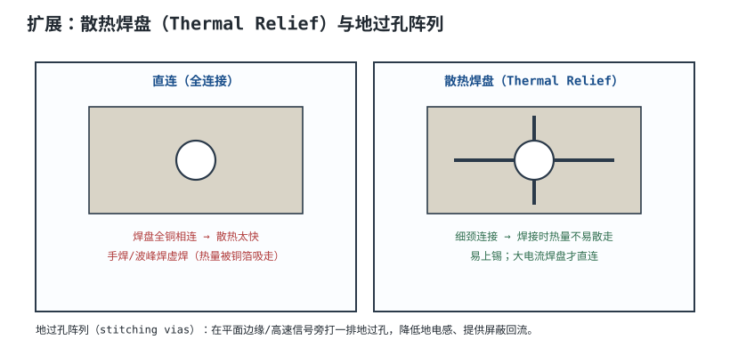

# 布线：线宽、载流、过孔、间距 PCB Routing

一根 12V/3A 的电源线，如果按信号线的习惯画 0.6mm 宽，1oz 铜、温升会到约 39℃；改成 1.5mm，温升降到 8.6℃，压降只有 49mV。反过来，一根 3.3V 的 10MHz SPI 时钟，为了“保险”画到 1mm 宽，既占板面又增加对地电容，边沿反而变慢。**布线（Routing）不是“把引脚连起来”，而是在载流、温升、压降、间距、阻抗和环路面积之间做定量取舍。**

本章回答四个问题：线要画多宽、过孔要打几个、间距留多少、拐角怎么处理。核心工具是 IPC-2221 的载流经验式和 IPC-2152 的修正方法；本章用一根 3A/12V/50mm 的电源线把线宽、温升、压降和过孔数量一次算完，再说明 220V 安规间距为什么不能直接套 IPC-2221。

## 1. 设计动机

::: motivation 三个现场
**现场一：0.6mm 走 3A，满载发烫。** 一块 12V 输入板，3A 电流只画了 0.6mm 外层线（1oz）。按 IPC-2221 估算，截面积约 32.6mil²，10℃ 温升只能过约 1.65A；实际 3A 时温升接近 39℃，压降约 123mV，长期运行后阻焊变色。**线宽不是“看起来够粗”，要按截面积和温升算。**

**现场二：一个过孔过 3A。** 工程师把 3A 电源从 L1 换到 L4，只打了一个 0.3mm 过孔。孔壁镀铜 25µm，截面积约 36.5mil²，按 IPC-2221 内层档只能过约 0.9A；3A 时孔壁温升过高，长期可能开路。改成 6 个并联过孔，每个约 0.5A，温升和压降都下来了。

**现场三：220V 间距按“3~8mm”拍脑袋。** 有人把 220V 火线/零线间距做成 2mm，认为“IPC-2221 里 300V 才 2.5mm，够了”。但 IPC-2221 是设计标准，不是安规标准；220V 市电要按 IEC 62368-1/GB 4943.1 查爬电距离，常见 3.2mm 量级，还要考虑污染度、材料组、过压类别和海拔。**把功能间距当安规间距，是拿认证和安全开玩笑。**
:::

布线约束可以分成四类：

| 约束 | 决定什么 | 主要依据 |
|---|---|---|
| 线宽/铜厚 | 载流、温升、压降、阻抗 | IPC-2221/IPC-2152、目标阻抗 |
| 间距 | 耐压、串扰、工艺 | IPC-2221、IEC 62368-1、板厂能力 |
| 过孔 | 载流、换层、阻抗不连续 | 孔壁镀铜、电流密度、SI |
| 拐角/环路 | 阻抗连续性、EMI、回流 | 叠层、回流路径、DFM |

## 2. 定义与直观

**布线（Routing）**是在布局确定的板框、分区和引脚位置之间，用铜线建立电气连接的过程。它同时受电气、热、机械和工艺四方面约束：

- **电气**：载流、压降、阻抗、串扰、回流；
- **热**：铜箔温升、散热焊盘、热过孔；
- **机械**：板边、安装孔、连接器高度；
- **工艺**：最小线宽/间距、蚀刻公差、孔环、阻焊桥。



一根走线的直流电阻：

$$
R=\rho\frac{L}{A}
$$

其中 $\rho$ 是铜的电阻率，$1.72\times10^{-8}\ \Omega\cdot\text{m}$（20℃）；$L$ 是长度，m；$A$ 是截面积，$\text{m}^2$；$R$ 是电阻，$\Omega$。截面积 $A=W\times t$，$W$ 是线宽，$t$ 是铜厚。**同样电流下，线宽加倍、电阻减半、压降减半；但载流能力不是线性翻倍，因为温升还受散热面积影响。**

## 3. 定量关系

### 3.1 IPC-2221 载流公式

IPC-2221 给出的铜箔载流经验式：

$$
I=k\cdot\Delta T^{0.44}\cdot A^{0.725}
$$

其中 $I$ 是允许电流，A；$\Delta T$ 是允许温升，℃（代入数值，不带单位）；$A$ 是铜箔截面积，$\text{mil}^2$；$k$ 是外层/内层系数：外层 $k=0.048$，内层 $k=0.024$。

这个式子的适用范围是常规 FR-4、1~3oz 铜、自然对流/中等散热条件；它是经验拟合，不是传热学精确解。IPC-2152 给出了考虑板厚、铜厚、散热条件和相邻走线的更精确方法；**关键电源设计应优先用 IPC-2152 或实测温升，IPC-2221 只做初算。**

反求所需截面积：

$$
A=\left(\frac{I}{k\cdot\Delta T^{0.44}}\right)^{1/0.725}
$$

线宽：

$$
W=\frac{A}{t}
$$

其中 $t$ 是铜厚，mil。常用换算：

| 铜厚 | µm | mil |
|---|---|---|
| 0.5 oz | 17 | 0.69 |
| 1 oz | 35 | 1.38 |
| 2 oz | 70 | 2.76 |

**注意单位：** IPC-2221 公式里的 $A$ 是 mil²，不是 mm²。1mm²=1550mil²；1oz 铜的 1mm 宽走线，截面积约 54.3mil²。单位混用是载流计算最常见的错误来源。

### 3.2 温升、压降与功耗

已知线宽和电流，反求温升：

$$
\Delta T=\left(\frac{I}{k\cdot A^{0.725}}\right)^{1/0.44}
$$

压降：

$$
V_{drop}=I\cdot R=I\cdot\rho\frac{L}{Wt}
$$

功耗：

$$
P=I^2R
$$

以 12V/3A、50mm 长、1oz 铜为例，不同线宽的结果：

| 线宽（1oz） | 截面积 mil² | 温升（10℃ 基准式） | 电阻 mΩ | 压降 mV | 功耗 mW |
|---|---|---|---|---|---|
| 0.8 mm | 43.4 | 24.2℃ | 30.7 | 92.1 | 276 |
| 1.0 mm | 54.3 | 16.7℃ | 24.6 | 73.7 | 221 |
| 1.2 mm | 65.1 | 12.4℃ | 20.5 | 61.4 | 184 |
| 1.4 mm | 76.0 | 9.61℃ | 17.6 | 52.7 | 158 |
| 1.5 mm | 81.4 | 8.58℃ | 16.4 | 49.1 | 147 |
| 2.0 mm | 108.5 | 5.34℃ | 12.3 | 36.9 | 111 |

2oz 铜的同样 3A：

| 线宽（2oz） | 截面积 mil² | 温升 | 电阻 mΩ | 压降 mV |
|---|---|---|---|---|
| 0.8 mm | 86.8 | 7.72℃ | 15.4 | 46.1 |
| 1.0 mm | 108.5 | 5.34℃ | 12.3 | 36.9 |

**读表方法**：若允许温升 10℃，1oz 需要约 1.4mm 以上（1.4mm 时 9.61℃），取 1.5mm 留余量；2oz 只需 0.8mm 左右。压降都远小于 12V 的 1%（49mV/12V=0.41%），所以这条线的瓶颈是**温升**，不是压降。

### 3.3 过孔载流

过孔的载流能力由孔壁镀铜的截面积决定：

$$
A_{barrel}\approx\pi D t_{plating}
$$

其中 $D$ 是钻孔直径，m；$t_{plating}$ 是孔壁镀铜厚度，m；$A_{barrel}$ 是孔壁截面积，$\text{m}^2$。以 $D=0.3\ \text{mm}$、$t_{plating}=25\ \mu\text{m}$ 为例：

$$
A_{barrel}=\pi\times0.3\times10^{-3}\times25\times10^{-6}
=2.36\times10^{-8}\ \text{m}^2
$$

换算成 mil²：

$$
A_{barrel}=\frac{2.36\times10^{-8}}{(2.54\times10^{-5})^2}=36.5\ \text{mil}^2
$$

用内层系数 $k=0.024$、$\Delta T=10$（数值，单位℃）：

$$
I=0.024\times10^{0.44}\times36.5^{0.725}
=0.024\times2.754\times13.57=0.898\ \text{A}
$$

**一个 0.3mm 钻孔、25µm 镀铜的通孔，10℃ 温升下约 0.9A。** 3A 至少需要 $3/0.9=3.34$ 个，工程上取 6 个（每个 0.5A，留 2 倍余量）。若镀铜只有 20µm，截面积 29.2mil²，单孔约 0.76A，3A 至少 4 个，仍建议 6 个。

过孔电阻：

$$
R_{via}=\rho\frac{l}{A_{barrel}}
=1.72\times10^{-8}\times\frac{1.6\times10^{-3}}{2.36\times10^{-8}}
=1.17\times10^{-3}\ \Omega=1.17\ \text{m}\Omega
$$

6 个并联约 0.195mΩ，3A 下压降仅 0.58mV，**直流压降不是问题，温升和电流密度才是。** 另外，过孔还有约 1nH 量级电感，高速信号换层时要考虑阻抗不连续（见[信号完整性](signal-integrity.md)）。

### 3.4 间距：IPC-2221 与安规是两套语言

IPC-2221 表 6-1 给出不同电压下的最小电气间距（clearance），按内层/外层、涂覆/非涂覆、海拔分档。外层非涂覆档的量级如下（具体以现行标准原文为准）：

| 电压（DC 或 AC 峰值） | 最小间距量级 |
|---|---|
| ≤30 V | 0.1 mm |
| 31~100 V | 0.6 mm |
| 101~150 V | 0.6 mm |
| 151~300 V | 1.25 mm |
| 301~500 V | 2.5 mm |
| >500 V | 0.005 mm/V 递增 |

这张表是**功能绝缘/电气间隙**的设计起点，不是安规认证的全部。安规还要区分：

- **电气间隙（Clearance）**：两导体在空间中的最短距离，防空气击穿；
- **爬电距离（Creepage）**：沿绝缘表面的最短距离，防表面污染漏电；
- **污染度（Pollution Degree）**、**材料组（Material Group）**、**过压类别（Overvoltage Category）**、**海拔**、**涂覆**都会改变限值。

220V 市电（250V 工作电压、污染度 2、材料组 IIIa）常见爬电距离 3.2mm 量级；如果按 IPC-2221 的 1.25mm 做，功能上也许“能工作”，但安规认证几乎不会通过。**市电、高压、隔离栅的间距必须按 IEC 62368-1、GB 4943.1 或对应产品标准查表，并做耐压/爬电试验；IPC-2221 只能作为低压功能设计的参考。**

### 3.5 拐角、环路面积与回流

**拐角**：90° 直角在转角外侧局部变宽、内侧变窄，理论上会有阻抗不连续。但实际影响常被夸大。以 0.2mm 线宽、50Ω 微带线为例，直角多出的铜面积约：

$$
A_{excess}\approx\frac{W^2}{2}=\frac{(0.2\ \text{mm})^2}{2}=0.02\ \text{mm}^2
$$

等效附加电容约 12fF（按 50Ω 微带线单位长度电容约 1.2pF/cm 估算）。在 5GHz 的容抗：

$$
Z_C=\frac{1}{2\pi\times5\times10^9\times12\times10^{-15}}=2.65\ \text{k}\Omega
$$

相对 50Ω 几乎可以忽略。**所以“90° 直角一定导致眼图闭合”是过度简化；直角的主要问题是 DFM（酸角、蚀刻不均）和不良的阻抗连续性习惯。** 高速线仍推荐 45° 或圆弧，但不必把低速板的直角当成致命错误。



**环路面积**：电流回路包围的面积越大，寄生电感越大、辐射越强。一条长 $l$、宽 $w$、距参考平面 $h$ 的走线，其回路电感可用近似式估算：

$$
L_{loop}\approx\mu_0\frac{h\,l}{w}
$$

其中 $\mu_0=4\pi\times10^{-7}\ \text{H/m}$；$h$、$l$、$w$ 单位 m。取 $h=0.2\ \text{mm}$、$l=10\ \text{mm}$、$w=1\ \text{mm}$：

$$
L_{loop}\approx4\pi\times10^{-7}\times\frac{0.2\times10^{-3}\times10\times10^{-3}}{1\times10^{-3}}
=2.51\times10^{-9}\ \text{H}=2.5\ \text{nH}
$$

若电流在 1ns 内变化 1A：

$$
V=L\frac{di}{dt}=2.5\times10^{-9}\times\frac{1}{1\times10^{-9}}=2.5\ \text{V}
$$

**2.5nH 的回路电感，在 1A/ns 下就是 2.5V 的尖峰。** 这就是开关电源输入环路、去耦电容环路、连接器回流路径要尽量小的原因。

### 3.6 布线顺序与优先级

| 优先级 | 信号 | 原因 |
|---|---|---|
| 1 | 电源/大电流回路 | 线宽、过孔、环路面积一旦布错，后面很难改 |
| 2 | 时钟、差分、高速总线 | 阻抗、等长、参考平面要求最严 |
| 3 | 模拟小信号、基准、复位 | 对噪声敏感，需要远离开关节点 |
| 4 | 一般数字 I/O | 约束较松，可最后布 |
| 5 | 测试点、丝印、调试口 | 不影响功能，但要留位置 |

先布电源不是“电源最重要”，而是**电源的线宽/过孔/环路会占据大量空间，先布可以避免后来拆线**。关键信号先布，是为了让一般信号避让，而不是反过来。

一个常见的顺序错误，是先把 MCU 到连接器的普通 I/O 全部拉通，再回头布电源和时钟；结果电源线被切得七零八落，时钟只能绕远，最后靠大量过孔和飞线补救。**正确顺序是“先定骨架、再布关键、最后填一般”**：先放连接器/电源/主芯片（布局阶段已完成），再布电源主干和高速/时钟，最后布一般 I/O。每布完一类，就检查一次回流路径和线宽，避免错误累积。

## 4. 典型计算

### 4.1 3A/12V/50mm 电源线：线宽、铜厚、温升、压降

::: example 从需求到验算
**需求**：12V/3A 连续电流，走线长 50mm，外层，允许温升 ≤10℃，压降 ≤1%（120mV），环境 25℃。

**第一步：求所需截面积。** 取 $k=0.048$、$\Delta T=10$：

$$
\Delta T^{0.44}=10^{0.44}=2.754
$$

$$
A=\left(\frac{3}{0.048\times2.754}\right)^{1/0.725}
=\left(\frac{3}{0.1322}\right)^{1.379}
=22.69^{1.379}=74.2\ \text{mil}^2
$$

**第二步：1oz 铜所需线宽。**

$$
W=\frac{74.2}{1.378}=53.8\ \text{mil}=1.37\ \text{mm}
$$

取 1.5mm（81.4mil²），回代温升：

$$
\Delta T=\left(\frac{3}{0.048\times81.4^{0.725}}\right)^{1/0.44}
=\left(\frac{3}{0.048\times24.3}\right)^{2.273}
=2.57^{2.273}=8.6\ ^{\circ}\text{C}
$$

压降：

$$
R=1.72\times10^{-8}\times\frac{0.050}{1.5\times10^{-3}\times35\times10^{-6}}
=1.64\times10^{-2}\ \Omega=16.4\ \text{m}\Omega
$$

$$
V_{drop}=3\times16.4\times10^{-3}=49.1\ \text{mV}
$$

占 12V 的 0.41%，满足 ≤1%。功耗：

$$
P=I^2R=9\times16.4\times10^{-3}=0.147\ \text{W}
$$

**第三步：2oz 方案。** 同样 74.2mil²，2oz 铜厚 2.756mil：

$$
W=\frac{74.2}{2.756}=26.9\ \text{mil}=0.684\ \text{mm}
$$

取 0.8mm（86.8mil²），温升 7.7℃，压降 46.1mV，功耗 138mW。**2oz 用更窄的线达到同样温升，但 2oz 板成本更高、细线蚀刻更难。**

**第四步：过孔数量。** 单孔 0.9A（25µm 镀铜），3A 需 3.34 个，取 6 个；6 个并联电阻约 0.195mΩ，压降 0.58mV，可忽略。

**结论**：1oz 方案选 1.5mm 线宽；2oz 方案选 0.8mm。两者温升都低于 10℃，压降远小于 1%。若要求 50% 电流余量（按 4.5A 算），1oz 需要约 2.4mm，2oz 约 1.2mm；**余量要用电流算，不要用“线宽加 50%”算。**
:::

```echarts
{
  "tooltip": {"trigger": "axis"},
  "legend": {"data": ["3A 温升"], "bottom": 0, "textStyle": {"fontSize": 12}},
  "grid": {"left": 60, "right": 24, "top": 28, "bottom": 58},
  "xAxis": {"type": "category", "name": "1oz 线宽 mm", "data": ["0.8", "1.0", "1.2", "1.4", "1.5", "2.0"], "axisLabel": {"fontSize": 11}},
  "yAxis": {"type": "value", "name": "温升 ℃", "min": 0, "max": 28, "axisLabel": {"fontSize": 11}},
  "series": [
    {"name": "3A 温升", "type": "line", "smooth": true, "symbol": "circle", "symbolSize": 8,
     "lineStyle": {"width": 2.6, "color": "#b5642e"}, "areaStyle": {"color": "#b5642e", "opacity": 0.12},
     "data": [24.2, 16.7, 12.4, 9.6, 8.6, 5.3]}
  ]
}
```

### 4.2 220V 市电间距：为什么不能只查 IPC-2221

::: example 功能间距与安规间距
**需求**：220V 市电输入，火线/零线之间、初次级之间需要留多少间距？

**第一步：IPC-2221 的功能间距。** 220V 工作电压落在 151~300V 档，外层非涂覆量级 1.25mm。这个值用于低压功能设计可以，但**它不是安规认证的爬电距离**。

**第二步：安规爬电距离。** 按 IEC 62368-1，250V 工作电压、污染度 2、材料组 IIIa，基本绝缘的爬电距离常见 3.2mm 量级；具体还要看过压类别、海拔、涂覆和绝缘类型。若按 1.25mm 做，耐压/爬电试验很可能不过。

**第三步：电气间隙。** 220V 的瞬态过压可能到 1.5~2.5kV（过压类别 II/III），电气间隙还要按峰值电压查表，并考虑海拔修正。**爬电距离和电气间隙是两个约束，取其中更严者。**

**结论**：220V 市电按 3.2mm 量级起步，初次级隔离按加强绝缘查表（可能 6mm 以上），并做耐压试验；IPC-2221 的 1.25mm 只能用于板内低压功能间距。**不要把“IPC-2221 300V 档 2.5mm”直接当成市电安规答案。**
:::

### 4.3 90° 拐角的附加电容

::: example 直角到底有多大事
**需求**：0.2mm 宽、50Ω 微带线，90° 拐角，判断 5GHz 下是否可忽略。

**第一步：附加面积。**

$$
A_{excess}\approx\frac{W^2}{2}=\frac{0.2^2}{2}=0.02\ \text{mm}^2
$$

**第二步：附加电容。** 50Ω 微带线单位长度电容约 1.2pF/cm，0.02mm² 对应的等效长度约 0.1mm：

$$
C_{excess}\approx1.2\ \text{pF/cm}\times0.01\ \text{cm}=0.012\ \text{pF}=12\ \text{fF}
$$

**第三步：5GHz 容抗。**

$$
Z_C=\frac{1}{2\pi\times5\times10^9\times12\times10^{-15}}=2.65\ \text{k}\Omega
$$

相对 50Ω 的线阻抗，12fF 的并联影响很小。**结论**：90° 直角不是 1ns 边沿的“致命反射源”；高速线用 45°/圆弧主要是为了 DFM 和阻抗连续性习惯，真正要担心的是过孔、连接器、跨分割和 stub。
:::

## 5. 工程含义

### 5.1 铜厚、温升与降额

- **1oz 是常用默认**；大电流用 2oz，但 2oz 的最小线宽/间距会变差，板厂蚀刻公差也更大。
- **内层载流约为外层的 1/2**：同样截面积，内层 $k=0.024$ 是外层 0.048 的一半。内层电源线要么加宽一倍，要么多并联过孔/铺铜。
- **温升要按最坏环境温度算**：25℃ 环境、10℃ 温升，结温/板温到 35℃；若环境 60℃，同样 10℃ 温升就是 70℃，电容寿命和阻焊可靠性都要降额。
- **IPC-2221 是初算，IPC-2152 更细**：后者考虑板厚、铜厚、散热、相邻走线；关键电源用 IPC-2152 或实测。
- **铺铜不是万能**：铺铜能增加散热和载流，但如果没有足够过孔/连接，铜皮本身也会成为热点；大电流焊盘用直连，不要用 thermal relief 的细颈。

### 5.2 过孔与 DFM

- 过孔环宽（annular ring）按板厂能力留，常见 0.15~0.25mm；孔太小、环太窄，钻孔偏移会破环。
- 大电流过孔多打并联，并在孔周围铺铜；过孔之间的间距要满足板厂最小孔距。
- 高速信号换层时，信号过孔旁放回流地过孔；过孔 stub 在数 GHz 下会谐振（见[信号完整性](signal-integrity.md)）。
- 过孔盖油/塞孔按工艺选择：盖油可防短路，但可能影响散热；大电流过孔建议开窗或塞铜。过孔密集区还要检查板厂的孔距和树脂塞孔能力，避免批量钻孔偏位。

### 5.3 间距、涂覆与安规

- **功能间距**按 IPC-2221 初算；**安规间距**按 IEC 62368-1/GB 4943.1 查表，两者不能混用。
- 涂覆（conformal coating）能提高污染度等级、减小爬电距离要求，但涂覆质量要可验证；不能只靠“刷了三防漆”就缩短间距。
- 开槽（slot）能增加爬电距离，但会削弱板子强度、影响回流；高压区开槽要同时评估安规和机械。
- 高压/低压分区时，间距要沿板面、孔壁、板边三个方向都满足；板边和安装孔附近常被忽略。

### 5.4 回流与环路

- 电源环路（输入电容→开关管→电感→输出电容）面积最小；高 $di/dt$ 环路不要与其他信号并行。
- 信号换层时回流过孔靠近信号过孔；跨分割时加缝合电容。
- 连接器、保险丝、采样电阻的引脚环路也要小；Kelvin 采样走线要单独回流。

布完线后按四项做自检：**载流**（电源线宽/过孔是否按最坏电流和温升算）、**间距**（功能间距与安规间距是否分开查）、**回流**（每条高速线正下方是否连续、换层是否有地过孔）、**DFM**（最小线宽/间距、孔环、阻焊桥是否满足板厂能力）。这四项里任何一项在打样后才发现，返工成本都远高于布线时多花十分钟核对。



::: advanced 三个被简化过头的说法
**说法一：“一个过孔能过 1A。”** 这取决于钻孔、镀铜厚度、板厚和允许温升。0.3mm 孔、25µm 镀铜、10℃ 温升约 0.9A；20µm 镀铜约 0.76A；更薄的镀铜或更高温升会不同。**先算孔壁截面积，再谈电流。**

**说法二：“90° 直角会导致高速信号反射。”** 12fF 的附加电容在 5GHz 的容抗约 2.65kΩ，相对 50Ω 很小；直角的主要问题是 DFM 和不良习惯。真正要担心的是过孔 stub、连接器、跨分割。**不要把“习惯”当成“定量结论”。**

**说法三：“220V 按 IPC-2221 查 2.5mm 就行。”** IPC-2221 是设计标准，不是安规标准；220V 市电要按 IEC 62368-1/GB 4943.1 查爬电距离和电气间隙，常见 3.2mm 量级，初次级加强绝缘可能 6mm 以上。**功能间距和安规间距是两套语言。**
:::

## 6. 常见坑

::: pitfall 坑一：内层按外层线宽算载流
- **现象**：外层 1.5mm 走 3A 温升 8.6℃，改到内层同样 1.5mm，温升超过 20℃。
- **原因**：内层散热差，IPC-2221 的 $k$ 从 0.048 降到 0.024，同样截面积允许电流约一半。
- **解决**：内层线宽加倍，或多层并联/铺铜；按内层 $k=0.024$ 重算。
:::

::: pitfall 坑二：3A 只打一个过孔
- **现象**：电源换层处过孔发烫、压降变大，长期运行后孔壁开裂。
- **原因**：0.3mm 孔、25µm 镀铜的单孔约 0.9A，3A 严重过载。
- **解决**：按 $I_{via}$ 算数量，3A 至少 4 个，工程取 6 个；孔周围铺铜，必要时用多个过孔阵列。
:::

::: pitfall 坑三：把 IPC-2221 间距当安规间距
- **现象**：220V 板按 1.25mm 布，功能正常，安规耐压/爬电试验失败。
- **原因**：IPC-2221 是功能设计标准，安规要按 IEC 62368-1/GB 4943.1 查污染度、材料组、过压类别。
- **解决**：220V 按 3.2mm 量级起步，初次级按加强绝缘查表；做耐压和爬电试验。
:::

::: pitfall 坑四：大电流焊盘用 thermal relief
- **现象**：功率器件焊盘发热，压降大，回流焊后局部虚焊。
- **原因**：thermal relief 的细颈截面积小，成了载流瓶颈。
- **解决**：大电流焊盘直连铜箔；需要可焊性时用多根短细颈或调整回流曲线，不要用标准 thermal relief。
:::

::: pitfall 坑五：线宽只按“经验表”不按铜厚
- **现象**：同样 1A，1oz 和 2oz 用同一线宽，2oz 温升偏低、1oz 偏高；或者按基铜厚度算，成品铜厚电镀后变厚。
- **原因**：载流看截面积，不看线宽；铜厚不同，同样线宽的截面积差一倍。
- **解决**：先定铜厚，再算截面积和线宽；下单时说明“成品铜厚”还是“基铜厚度”。
:::

::: pitfall 坑六：电源环路面积大
- **现象**：开关电源输入/输出纹波大，辐射超标，MOSFET 漏源尖峰高。
- **原因**：高 $di/dt$ 环路面积大，寄生电感 $L_{loop}$ 与 $di/dt$ 产生尖峰。
- **解决**：输入电容紧贴开关管/电感，缩小高 $di/dt$ 环路；功率回路不要与敏感信号并行。
:::

## 7. 自测题

<details><summary>外层 1oz、10℃ 温升、3A，按 IPC-2221 需要多宽？2oz 呢？</summary>

所需截面积：

$$A=\left(\frac{3}{0.048\times10^{0.44}}\right)^{1/0.725}=74.2\ \text{mil}^2$$

1oz（1.378mil）线宽 $W=74.2/1.378=53.8\ \text{mil}=1.37\ \text{mm}$，取 1.5mm；2oz（2.756mil）$W=74.2/2.756=26.9\ \text{mil}=0.684\ \text{mm}$，取 0.8mm。**内层要把 $k$ 换成 0.024，线宽约翻倍。**

</details>

<details><summary>3A 走 1oz、1.5mm、50mm，温升、压降、功耗各是多少？</summary>

截面积 $A=1.5\ \text{mm}\times0.035\ \text{mm}=0.0525\ \text{mm}^2=81.4\ \text{mil}^2$。温升：

$$\Delta T=\left(\frac{3}{0.048\times81.4^{0.725}}\right)^{1/0.44}=8.6\ ^{\circ}\text{C}$$

电阻：

$$R=1.72\times10^{-8}\times\frac{0.050}{0.0525\times10^{-6}}=16.4\ \text{m}\Omega$$

压降 $3\times16.4=49.1\ \text{mV}$；功耗 $9\times16.4\times10^{-3}=0.147\ \text{W}$。

</details>

<details><summary>0.3mm 钻孔、25µm 镀铜的过孔，10℃ 温升能过多大电流？3A 要几个？</summary>

孔壁截面积 $A=\pi\times0.3\times10^{-3}\times25\times10^{-6}=2.36\times10^{-8}\ \text{m}^2=36.5\ \text{mil}^2$。按内层 $k=0.024$：

$$I=0.024\times10^{0.44}\times36.5^{0.725}=0.90\ \text{A}$$

3A 需 $3/0.9=3.34$ 个，取 4 个是最低值；工程上取 6 个留余量。若镀铜 20µm，单孔约 0.76A，至少 4 个。

</details>

<details><summary>为什么 220V 不能只按 IPC-2221 的 2.5mm 做？</summary>

IPC-2221 是功能设计标准，给的是电气间隙的设计起点；安规还要看爬电距离、污染度、材料组、过压类别、海拔和绝缘类型。220V、污染度 2、材料组 IIIa 的爬电距离常见 3.2mm 量级，初次级加强绝缘可能 6mm 以上。**功能间距和安规间距是两套语言，不能互相替代。**

</details>

<details><summary>90° 直角对 0.2mm/50Ω 微带线在 5GHz 的影响有多大？</summary>

附加面积约 $W^2/2=0.02\ \text{mm}^2$，等效附加电容约 12fF；5GHz 容抗 $1/(2\pi\times5\times10^9\times12\times10^{-15})=2.65\ \text{k}\Omega$，相对 50Ω 很小。**直角不是 1ns 边沿的主要反射源；高速线用 45°/圆弧更多是 DFM 和习惯，真正要管的是过孔、连接器、跨分割。**

</details>

<details><summary>1cm 长、1mm 宽、距平面 0.2mm 的走线，回路电感约多少？1A/ns 时感应电压多少？</summary>

$$L_{loop}\approx\mu_0\frac{hl}{w}=4\pi\times10^{-7}\times\frac{0.2\times10^{-3}\times10\times10^{-3}}{1\times10^{-3}}=2.5\ \text{nH}$$

$$V=L\frac{di}{dt}=2.5\times10^{-9}\times\frac{1}{1\times10^{-9}}=2.5\ \text{V}$$

所以高 $di/dt$ 环路要尽量小，电源输入电容要紧贴开关管。

</details>

## 8. 参考资料

- IPC-2221B, *Generic Standard on Printed Board Design*, 2012 — 载流公式、表 6-1 电气间距、设计规则。
- IPC-2152, *Standard for Determining Current-Carrying Capacity in Printed Board Design*, 2009 — 铜箔载流与温升的更精确方法。
- IPC-7351C, *Generic Requirements for Surface Mount Design and Land Pattern Standard* — 焊盘、过孔环宽与布局要求。
- IPC-6012E, *Qualification and Performance Specification for Rigid Printed Boards*, 2020 — 孔壁镀铜、成品铜厚与验收。
- Henry W. Ott, *Electromagnetic Compatibility Engineering*, Wiley, 2009 — 回流路径、环路面积与 PCB 布线。
- onsemi, *AND8301-D EMC Specifications and PCB Guidelines for SMPS Devices* — 功率回路、走线与间距。
- Saturn PCB Design Toolkit：https://saturnpcb.com/saturn-pcb-toolkit/ — 载流、过孔电流与温升计算。
- 相关章节：[布局](placement.md)、[PCB 结构、层叠与板材](pcb-stackup.md)、[信号完整性](signal-integrity.md)、[串扰与差分走线](crosstalk-differential.md)、[DFM 与制程](dfm-process.md)。
