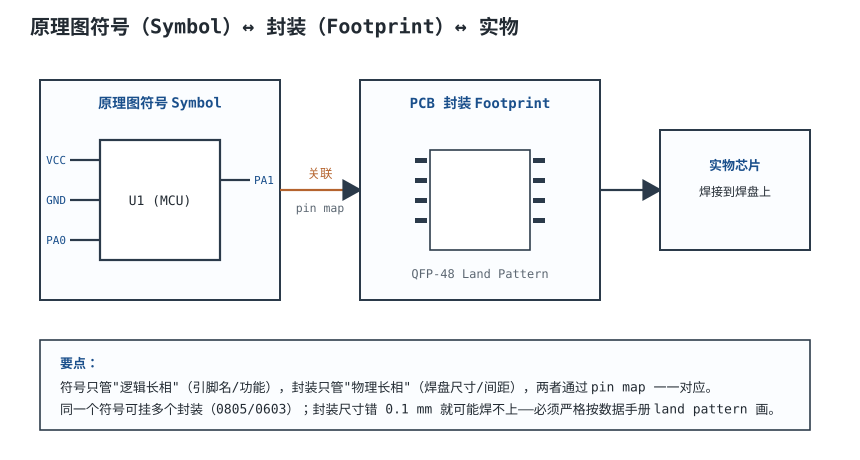
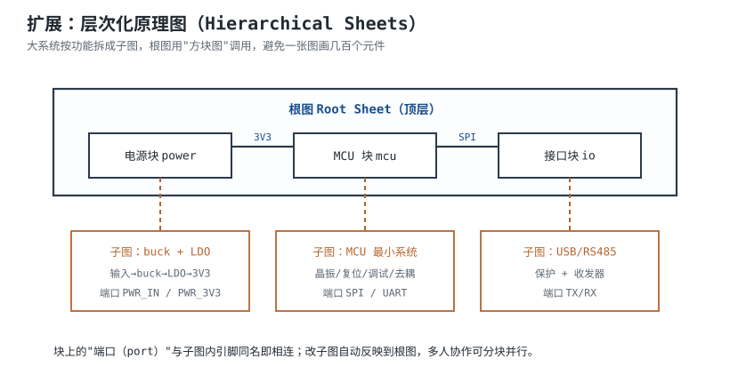

# 原理图设计、封装与库管理 Schematic Design, Footprint & Library

原理图是板子的“逻辑蓝图”，封装是板子的“物理焊盘”，库是把两者绑在一起、可复用、可追溯的资产。**库错一次，可能让整批板子返工；库对一次，后面所有项目都受益。** 行业里常说“库是最大的错误来源”，不是夸张：符号和封装各自都“合法”，ERC/DRC 都可能通过，错的是两者之间的映射，或者焊盘与实物差 0.2 mm。

本章讲符号怎么画、封装怎么算、库怎么管；最后用 SOT-23 和 QFN-32 两个封装，按 IPC-7351B 密度等级 B 把焊盘、阻焊开窗、钢网开孔完整算一遍。器件尺寸是典型量级，具体以所选器件数据手册为准。

## 1. 设计动机

::: motivation 四个“图对了、板子焊不上”的现场
**现场一：Pin 1 反了。** 符号的 Pin 1 在左上，封装的 Pad 1 在右下；原理图连线完全正确，PCB 也过了 DRC，但芯片焊上去后电源和地反接，上电烧毁。ERC 不查封装映射，DRC 不查引脚功能。

**现场二：0805 用了 0603 焊盘。** 库里的 0805 封装是早期手画的，焊盘内间距只有 0.5 mm；0805 元件放上去，两端焊端都压不到焊盘，批量立碑。一个封装在项目里用了 30 次，30 个位置全部返修。

**现场三：QFN 热焊盘小了 0.3 mm。** 热焊盘与器件裸露焊盘对不齐，回流后一侧有空洞；电气测试全过，老化时局部过热。数据手册的 land pattern 明明给了尺寸，库里的封装却是“照着印象画的”。

**现场四：全局库被改。** 有人把全局电阻库的 0603 焊盘加宽了 0.1 mm，所有老项目重新打开都变；BOM 没记录库版本，没人知道哪块板用哪版库。**库不是画图素材，是设计资产。**
:::

| 你想确认 | 先查/先算 | 判据（典型量级，以数据手册为准） |
|---|---|---|
| 符号引脚对不对 | 符号引脚号/名 vs 数据手册 | 引脚号、功能、电源方向一致 |
| 封装能不能焊 | land pattern 尺寸 | 焊盘长/宽/间距、热焊盘、1 脚 |
| 阻焊桥够不够 | 开窗 + 对位公差 | 名义 ≥0.10 mm，最坏 ≥0.05 mm |
| 钢网能不能脱模 | 面积比 $AR$ | $AR\geq0.66$ |
| 1 脚/极性是否清楚 | 丝印+铜标记+装配图 | 三处一致，反向可识别 |
| 库版本是否可追溯 | Git/tag/BOM | 每个项目锁定库版本 |
| 3D 是否干涉 | STEP + 结构 | 高度/方向/原点一致 |

**不算会摔在哪，四个带数字的代价：**

1. **一个引脚映射错**：整板功能失效，返工/换板；不是“改一根线”，是全部相关网络重查。
2. **一个焊盘差 0.2 mm**：30 个实例同时立碑/虚焊；按实例数放大返修成本。
3. **一个热焊盘小 0.3 mm**：QFN 空洞、结温升高；电气测试不一定发现，老化才暴露。
4. **一次全局库改动**：所有老项目重开都变；没有版本记录，无法定位是哪次改的。

## 2. 定义与直观：符号、封装、3D 与库

### 2.1 四个对象，各管一件事

- **符号（Symbol）**：原理图里的图形。它管“逻辑”：引脚名、引脚号、电源/地、输入/输出、功能分组。它不关心焊盘多大。
- **封装（Footprint / Land Pattern）**：PCB 上的焊盘图形。它管“物理”：铜盘、阻焊开窗、钢网开孔、courtyard、3D 模型。它不关心引脚功能。
- **Pin map**：符号引脚号 ↔ 封装焊盘号的对应关系。**这是最容易错、也最容易被忽略的一层。**
- **库（Library）**：符号、封装、3D、规则、元数据的集合；要版本控制、要评审、要测试。

### 2.2 符号是“逻辑长相”，封装是“物理长相”

同一个符号可以挂多个封装：一个电阻符号可以挂 0402、0603、0805；一个 MCU 符号可以挂 LQFP-48、QFN-48。**符号不变、封装可变，前提是 pin map 不变。**

反过来，同一个封装可以对应多个 MPN（制造商料号）：不同厂商的 0805 电阻，焊盘相同，但功率/精度/温度系数不同。BOM 里要同时记录 MPN 和封装，不能只写“0805”。

**关键认知**：

- 符号画错，原理图逻辑错，ERC 可能发现（未连接、电源冲突），但发现不了“Pin 1 对应 Pad 8”。
- 封装画错，焊接/装配错，DRC 可能发现（间距、环宽），但发现不了“焊盘比实物小 0.2 mm”。
- Pin map 错，两者都“合法”，但板子一定错；只能靠库审计和 pin map 表检查。
- 3D 错，结构干涉/装配错；DRC 完全不查，只能靠 3D 评审。

### 2.3 库是最大的错误来源

库错误的四个特征：

1. **隐蔽**：符号和封装各自合法，ERC/DRC 不一定报。
2. **放大**：一个封装用 $N$ 次，错误影响 $N$ 个位置。
3. **滞后**：常常在打样/量产/老化才暴露，返工成本高。
4. **漂移**：全局库被改、版本没记录，老项目无法复现。

所以库管理的第一原则是：**项目库优先、全局库只读、每个项目锁定库版本、新封装 100% 审计。**

## 3. 定量关系：从引脚到焊盘的尺寸链

### 3.1 焊盘尺寸的基本公式

以鸥翼引脚（gull-wing，SOT/SOIC/QFP 等）为例，焊盘长度和宽度由“引脚尺寸 + 焊点目标”决定：

$$P=F+J_{\mathrm{toe}}+J_{\mathrm{heel}}$$

$$W=b+2J_{\mathrm{side}}$$

$$G=p-W$$

$$S_{\mathrm{out}}=S+2J_{\mathrm{toe}}$$

- $P$：焊盘长度（mm），沿引脚伸出方向；
- $W$：焊盘宽度（mm），沿引脚排列方向；
- $F$：引脚接触长度（mm），数据手册给；
- $b$：引脚宽度（mm）；
- $p$：引脚间距（mm）；
- $G$：同侧相邻焊盘的内间距（mm）；
- $S$：引脚跨距（mm，外侧到外侧）；
- $S_{\mathrm{out}}$：焊盘跨距（mm）；
- $J_{\mathrm{toe}}$、$J_{\mathrm{heel}}$、$J_{\mathrm{side}}$：趾部、跟部、侧面的焊点目标（mm）。

**这些 $J$ 值不是拍脑袋**：IPC-7351B 按密度等级给出焊点目标，A 级最宽松、B 级标称、C 级最紧凑。本章算例取一组 B 级示例值（toe 0.30、heel 0.40、side 0.05 mm），用于把尺寸链算通；具体元件家族的 $J$ 值以 IPC-7351B 表格和厂商推荐为准。**不要把这组示例值当成所有封装的通用常数。**

### 3.2 密度等级 A/B/C 与 courtyard

IPC-7351B 用密度等级描述“焊盘和 courtyard 留多少余量”：

| 等级 | 含义 | courtyard 每边余量 | 适用 |
|---|---|---|---|
| A | 最宽松（Least Density） | 0.50 mm | 手工焊接、返修、高可靠 |
| B | 标称（Nominal） | 0.25 mm | 通用 SMT |
| C | 最紧凑（Most Density） | 0.10 mm | 高密度、空间受限 |

courtyard 是元件+焊盘之外的安全边界，防止相邻器件/焊盘干涉：

$$C_X=S_{\mathrm{out}}+2E,\qquad C_Y=W_{\mathrm{extent}}+2E$$

- $C_X$、$C_Y$：courtyard 的长、宽（mm）；
- $E$：每边余量（mm），A/B/C 分别取 0.50/0.25/0.10；
- $W_{\mathrm{extent}}$：焊盘/本体在宽度方向的最大外廓（mm）。

**A 级焊盘最大、courtyard 最宽，焊接/返修最容易，但占面积；C 级最省空间，但工艺窗口最窄。** 选择等级不是“越先进越好”，而是看产品：手工焊/返修多的板用 A，通用 SMT 用 B，手机/穿戴高密度用 C。

把同一套公式用在 0805 上：本体长 2.0 mm、端头接触长 0.35 mm、toe 0.35、heel 0.25，则焊盘长 $0.35+0.35+0.25=0.95$ mm、内间距 $2.0-2\times(0.35+0.25)=0.80$ mm、焊盘跨距 $2.0+2\times0.35=2.70$ mm。不同厂商的端头接触长可能在 0.30~0.50 mm 之间，内间距就会在 0.50~0.90 mm 之间变化；所以库里看到 0.8 mm 或 1.0 mm 都别惊讶，关键是和所选器件数据手册对齐。**“差 0.1 mm 就焊不上”是过度简化**：0.1 mm 的偏差不一定立刻开路，但会把焊点从合格推向可疑；0.2~0.3 mm 才更容易出现开路、桥连或立碑。工程上不能用“差一点没事”说服自己。

### 3.3 阻焊开窗与钢网开孔

阻焊开窗一般比铜盘每边大 $m$：

$$W_{\mathrm{mask}}=W+2m,\qquad P_{\mathrm{mask}}=P+2m$$

- $m$：阻焊开窗裕量（mm），常取 0.025~0.05；
- $W_{\mathrm{mask}}$、$P_{\mathrm{mask}}$：开窗宽、长（mm）。

同侧相邻开窗之间的阻焊桥：

$$B_{\mathrm{mask}}=p-W_{\mathrm{mask}}$$

- $B_{\mathrm{mask}}$：名义阻焊桥宽（mm）；
- 最坏值还要减去对位公差：$B_{\mathrm{worst}}=B_{\mathrm{mask}}-2\Delta$，$\Delta$ 是每边的对位误差（mm）。

钢网开孔的面积比：

$$AR=\frac{LW}{2(L+W)t}$$

- $L$、$W$：开孔长、宽（mm）；
- $t$：钢网厚度（mm）；
- 判据 $AR\geq0.66$（细间距建议 ≥0.70）。

### 3.4 1 脚、极性与方向

- **Pin 1 标记**：封装丝印圆点/缺口、铜层 Pin 1 焊盘形状（方形/倒角）、装配图三角标记；三处一致。
- **极性**：二极管阴极（丝印横杠/K）、电解电容正极（+）、连接器 Pin 1（三角/缺口）；符号、封装、装配图一致。
- **方向**：IC 的 Pin 1 通常在俯视左上角，逆时针编号；QFN 的 Pin 1 在左上角，丝印圆点+本体倒角。
- **镜像**：PCB 底层器件的丝印要镜像，但引脚号/焊盘号不能镜像；检查时以“顶视图”为准。

### 3.5 符号绘制规范

- **引脚分组**：电源在上、地在下方、输入在左、输出在右；模拟/数字/接口分区；相关引脚相邻。
- **电源方向**：VCC/VDD 朝上，GND/VSS 朝下；不要用“左电源右地”这种反直觉画法。
- **命名一致**：同一网络全图一个名字；`VCC`、`VDD`、`+3V3` 不要混用；低有效用上划线或 `_N` 后缀；差分用 `_P/_N`。
- **引脚号/名**：引脚号在框外，引脚名在框内；复用功能用括号或第二名称；NC 引脚明确标 NC，不要隐藏。
- **多单元**：U1A/U1B 分单元画，电源引脚单独一个单元；单元间引脚不重复。
- **隐藏电源引脚**：隐藏引脚容易让 ERC 漏掉“电源未驱动”；要么显式画出，要么用 `PWR_FLAG` 告诉 ERC 电源已驱动。
- **网格/字号**：符号栅格 2.54 mm 或 1.27 mm；引脚名/号字号不小于 1.27 mm；线宽一致。

## 4. 典型计算：SOT-23 与 QFN-32 的 B 级封装

### 4.1 计算假设

| 参数 | SOT-23 | QFN-32 |
|---|---|---|
| 本体/外廓 | 本体宽 1.4 mm，引脚跨距 2.9 mm | 本体 5 mm × 5 mm，8 边/侧 |
| 引脚间距 $p$ | 0.95 mm | 0.50 mm |
| 引脚宽 $b$ | 0.40 mm | 0.25 mm |
| 引脚接触长 $F$ | 0.50 mm | 0.30 mm |
| 热焊盘 | 无 | 3.5 mm × 3.5 mm |
| 密度等级 | B | B |
| 焊点目标 | toe 0.30、heel 0.40、side 0.05 | toe 0.30、heel 0.05、side 0.025 |
| 阻焊裕量 $m$ | 0.05 mm/边 | 0.02 mm/边 |
| 钢网厚度 | 0.12 mm | 0.10 mm |

**说明**：SOT-23 的引脚跨距、引脚宽、接触长是典型量级；QFN 的 5 mm × 5 mm、0.5 mm 间距、3.5 mm 热焊盘也是典型量级。不同厂商的同名封装可能差 0.1~0.2 mm，**必须用所选器件数据手册的 land pattern 复核**。

### 4.2 SOT-23：B 级焊盘

按 3.1 节公式：

$$P=0.50+0.30+0.40=1.20\ \mathrm{mm}$$

$$W=0.40+2\times0.05=0.50\ \mathrm{mm}$$

$$G=0.95-0.50=0.45\ \mathrm{mm}$$

$$S_{\mathrm{out}}=2.90+2\times0.30=3.50\ \mathrm{mm}$$

courtyard：

$$C_X=3.50+2\times0.25=4.00\ \mathrm{mm}$$

宽度方向焊盘外廓：

$$W_{\mathrm{extent}}=0.95+0.50=1.45\ \mathrm{mm}$$

$$C_Y=1.45+2\times0.25=1.95\ \mathrm{mm}\approx2.0\ \mathrm{mm}$$

**SOT-23 B 级结果**：焊盘 1.20 mm × 0.50 mm，同侧内间距 0.45 mm，焊盘跨距 3.50 mm，courtyard 4.00 mm × 2.00 mm。

阻焊开窗：

$$W_{\mathrm{mask}}=0.50+2\times0.05=0.60\ \mathrm{mm}$$

$$P_{\mathrm{mask}}=1.20+2\times0.05=1.30\ \mathrm{mm}$$

同侧阻焊桥：

$$B_{\mathrm{mask}}=0.95-0.60=0.35\ \mathrm{mm}$$

桥宽 0.35 mm，远大于 0.10 mm 下限，SOT-23 的阻焊桥不是瓶颈。

钢网面积比（开孔 1.20 mm × 0.50 mm，钢网 0.12 mm）：

$$AR=\frac{1.20\times0.50}{2\times(1.20+0.50)\times0.12}=\frac{0.60}{0.408}=1.47$$

远大于 0.66，脱模没问题。

**A/B/C 对比**（同一组元件尺寸，只改焊点目标）：

| 等级 | toe | heel | side | 焊盘长 mm | 焊盘宽 mm | 内间距 mm | 跨距 mm | courtyard mm |
|---|---|---|---|---|---|---|---|---|
| A | 0.40 | 0.50 | 0.10 | 1.40 | 0.60 | 0.35 | 3.70 | 4.70 × 2.55 |
| B | 0.30 | 0.40 | 0.05 | 1.20 | 0.50 | 0.45 | 3.50 | 4.00 × 1.95 |
| C | 0.20 | 0.30 | 0.00 | 1.00 | 0.40 | 0.55 | 3.30 | 3.50 × 1.60 |

**A 级焊盘比 B 级长 0.20 mm、宽 0.10 mm，courtyard 大 0.7 mm；C 级反之。** 这就是“密度等级”的代价：A 级好焊/好返修，C 级省空间但工艺窗口窄。

### 4.3 QFN-32：B 级焊盘

QFN 的引脚是底部端子（bottom termination），焊盘长度方向从本体边缘向外：

$$P=0.30+0.30+0.05=0.65\ \mathrm{mm}$$

$$W=0.25+2\times0.025=0.30\ \mathrm{mm}$$

$$G=0.50-0.30=0.20\ \mathrm{mm}$$

$$S_{\mathrm{out}}=5.00+2\times0.30=5.60\ \mathrm{mm}$$

courtyard：

$$C_X=5.60+2\times0.25=6.10\ \mathrm{mm}$$

**QFN-32 B 级结果**：焊盘 0.65 mm × 0.30 mm，内间距 0.20 mm，焊盘跨距 5.60 mm，courtyard 6.10 mm × 6.10 mm。

阻焊开窗：

$$W_{\mathrm{mask}}=0.30+2\times0.02=0.34\ \mathrm{mm}$$

$$P_{\mathrm{mask}}=0.65+2\times0.02=0.69\ \mathrm{mm}$$

同侧阻焊桥：

$$B_{\mathrm{mask}}=0.50-0.34=0.16\ \mathrm{mm}$$

名义 0.16 mm；若对位 ±0.025 mm，最坏 $0.16-0.05=0.11$ mm，仍大于 0.10 mm；若对位 ±0.05 mm，最坏 0.06 mm，偏紧。**0.5 mm 间距的 QFN 和 BGA 一样，阻焊桥是对位精度的试金石。**

钢网开孔（0.30 mm × 0.65 mm，钢网 0.10 mm）：

$$AR=\frac{0.30\times0.65}{2\times(0.30+0.65)\times0.10}=\frac{0.195}{0.190}=1.03$$

大于 0.66。若钢网 0.12 mm：

$$AR=\frac{0.195}{0.228}=0.855$$

仍大于 0.66，但余量变小；0.5 mm 间距优先 0.10 mm。

**热焊盘**：铜盘 3.5 mm × 3.5 mm，阻焊开窗 3.54 mm × 3.54 mm（每边 0.02 mm）。钢网开孔不要整块 3.5 mm × 3.5 mm，否则锡量过多、空洞大、器件漂浮。推荐 4 × 4 阵列，每个 0.65 mm × 0.65 mm，间距 0.10 mm：

$$A_{\mathrm{paste}}=16\times0.65^2=16\times0.4225=6.76\ \mathrm{mm^2}$$

$$A_{\mathrm{pad}}=3.5^2=12.25\ \mathrm{mm^2}$$

$$\text{覆盖率}=\frac{6.76}{12.25}=0.552=55.2\%$$

每个 0.65 mm 方孔的面积比（钢网 0.10 mm）：

$$AR=\frac{0.65\times0.65}{2\times(0.65+0.65)\times0.10}=\frac{0.4225}{0.260}=1.63$$

远大于 0.66。**55% 左右的锡膏覆盖率是 QFN 热焊盘的常见目标；太高容易空洞/漂浮，太低容易焊料不足。具体以 IPC-7093A 和器件手册为准。**

热焊盘下方如果要打散热过孔，按[热设计](thermal-design.md)的过孔热阻算；焊盘内过孔要按 IPC-4761 Type VII 填孔盖帽，不能只盖油。

**QFN A/C 对比**（同一组元件尺寸，只改焊点目标）：

| 等级 | toe | heel | side | 焊盘长 mm | 焊盘宽 mm | 内间距 mm | 跨距 mm | courtyard mm |
|---|---|---|---|---|---|---|---|---|
| A | 0.40 | 0.10 | 0.05 | 0.80 | 0.35 | 0.15 | 5.80 | 6.80 |
| B | 0.30 | 0.05 | 0.025 | 0.65 | 0.30 | 0.20 | 5.60 | 6.10 |
| C | 0.20 | 0.00 | 0.00 | 0.50 | 0.25 | 0.25 | 5.40 | 5.60 |

**QFN A 级的焊盘宽 0.35 mm、内间距只有 0.15 mm，阻焊桥更危险；C 级焊盘 0.25 mm，焊接面积小，空洞/虚焊风险高。** 0.5 mm 间距的 QFN 通常选 B 级，兼顾焊接面积和桥宽。

### 4.4 建库数据包与检查表

一个可复用的封装，不只是“一个 `.kicad_mod` 文件”，而是一个数据包：

| 项目 | 内容 | 检查 |
|---|---|---|
| 符号 | 引脚号/名、电源方向、分组 | 对照数据手册 pinout |
| 封装 | 焊盘、阻焊、钢网、courtyard | 对照 land pattern |
| Pin map | 符号 Pin N ↔ 焊盘 Pad N | 1:1，无错位 |
| 3D | STEP 模型、原点、方向 | 与封装/结构一致 |
| 元数据 | MPN、厂商、数据手册链接、版本 | BOM 可追溯 |
| 工艺 | 钢网厚度、开窗、热焊盘 | 与 DFM 规则一致 |
| 验证 | 首件/3D/装配图 | 评审记录 |

**建库检查的“三看”**：

1. **看数据手册**：land pattern 推荐尺寸、pin 1、极性、热焊盘；
2. **看 pin map**：符号引脚号与焊盘号一一对应，不是“看起来在左边”；
3. **看 3D/装配**：模型方向、高度、pin 1 标记与实物一致。

## 5. 工程含义：库管理与复用

### 5.1 项目库 vs 全局库

- **项目库**：`sym-lib-table`、`fp-lib-table` 指向项目内目录；随工程提交 Git；项目锁定版本。
- **全局库**：只读；需要改就复制到项目库，改完评审、打 tag，不要直接改全局库。
- **命名**：`<厂商>_<型号>_<封装>`，避免 `new_footprint_2`、`copy_of_0805`。
- **目录**：符号、封装、3D 分开；封装按厂商/系列分组；每个封装带数据手册链接。
- **版本**：语义版本或日期 tag；BOM 记录库版本；库变更走 ECO。
- **审计**：新封装 100% 对照数据手册；复用封装抽样；BGA/QFN/连接器 100%。
- **生成**：用厂商库/生成器可以提速，但生成结果必须人工复核；不要“生成了就信”。
- **同名不同物**：不同厂商的 SOT-23、QFN 可能在引脚跨距、引脚宽、热焊盘上差 0.1~0.3 mm；同名封装不能直接互换。项目库应为每个 MPN 建独立封装，或至少在元数据里记录适用 MPN 与数据手册版本；换料时重新核对 land pattern，不要只看封装名。

### 5.2 符号复用与层次化

同一个符号可以挂多个封装，但 pin map 必须一致。层次化原理图（Hierarchical Sheets）把大系统拆成子图：

- **Sheet Symbol**：根图上的方框，代表一个子电路；
- **Port**：方块上的端口，名字与子图内端口一致才相连；
- **层次化**：几百个元件拆成几个几十个元件的子图，可读性高、可并行设计；
- **代价**：端口命名/映射要严格，名字差一个字符就悬空；ERC 要检查未连接端口。

**端口命名规范**：全图统一前缀/后缀（如 `VIN_12V`、`RS485_A`），低有效用 `_N`，差分用 `_P/_N`；不要用 `P0` 和 `PA0` 这种近似名。

### 5.3 库版本与项目复用

- **库进 Git**：符号、封装、3D、规则、元数据；生成物（渲染图、缓存）不进。
- **项目锁定**：每个项目记录库 commit/tag；BOM 带库版本；换库要评审。
- **复用**：成熟封装优先复用；复用前抽查 pin map、焊盘、 courtyard、3D；不要“看起来一样”就用。
- **废弃**：旧封装标记 deprecated，不删除；老项目还能打开；新项目用新版本。
- **迁移**：换 EDA 工具时，先导库、再比对焊盘/引脚/3D，最后跑首件；不要直接信任自动转换。

### 5.4 库错误的传播与拦截

一个库错误的影响面：

$$N_{\mathrm{risk}}=N_{\mathrm{instances}}\times N_{\mathrm{boards}}$$

- $N_{\mathrm{instances}}$：该封装在单板上的实例数；
- $N_{\mathrm{boards}}$：使用该库的板数/批次数。

**算例**：一个 0805 封装在单板用 30 次，项目做 3 批，每批 100 块：

$$N_{\mathrm{risk}}=30\times3\times100=9000$$

9000 个焊点。

一个焊盘错 0.2 mm，9000 个焊点都有风险。**这就是为什么新封装要 100% 审计，复用封装也要抽样；库错误的代价按“实例数×板数”放大，不是按“一个文件”算。**

### 5.5 与周边章节的关系

- 库/封装如何进入 DRC、版本管理和评审见[EDA 工具与工作流](eda-tools.md)；
- 焊盘/阻焊/钢网的工艺窗口见[DFM 与焊接工艺](dfm-process.md)；
- 热焊盘、散热过孔、结温见[热设计](thermal-design.md)；
- 贴片封装尺寸速查见[贴片封装与 E 系列](../appendix/smd-footprints.md)。

## 6. 常见坑

::: pitfall Pin 1 与极性反了
- **现象**：芯片上电即烧，或二极管/电解电容反向。**原因**：符号 Pin 1 与封装 Pad 1 映射错；或封装镜像时把引脚号也镜像了。**解决**：建 pin map 表，1:1 核对；封装丝印、铜标记、装配图三处一致；首件用万用表/目检确认。
:::

::: pitfall 焊盘尺寸凭印象画
- **现象**：批量立碑、虚焊、桥连。**原因**：没用数据手册 land pattern；焊盘太长/太短/太宽，或阻焊开窗不对。**解决**：按 IPC-7351B 密度等级和厂商推荐算；新封装 100% 对照数据手册；首件做切片/润湿检查。
:::

::: pitfall 全局库被改
- **现象**：老项目重开，封装变了；BOM 无法追溯。**原因**：直接改全局库，没有项目库/版本锁定。**解决**：项目库优先，全局库只读；库变更走 ECO、打 tag；BOM 记录库版本。
:::

::: pitfall 热焊盘钢网整块开
- **现象**：QFN 回流后器件漂浮、空洞大、热阻高。**原因**：热焊盘钢网开成整块 3.5 mm × 3.5 mm，锡量过多，气体排不出。**解决**：4×4 阵列、覆盖率约 55%；按 IPC-7093A 控制空洞；焊盘内过孔填孔盖帽。
:::

::: pitfall courtyard 缺失/过小
- **现象**：器件贴装后与相邻器件/焊盘干涉，返修空间不够。**原因**：封装没画 courtyard，或按 C 级余量用在手工焊板。**解决**：按 A/B/C 等级加 courtyard；手工焊/返修多用 A 级；DRC 开 courtyard 重叠检查。
:::

::: pitfall 3D 模型方向错
- **现象**：结构干涉，外壳装不上；或连接器方向反。**原因**：STEP 模型原点/旋转与封装不一致。**解决**：3D 模型与封装同原点、同方向；装配图/结构评审；首件 3D 打印验证。
:::

## 7. 自测题

符号、封装、pin map 各管什么？为什么 ERC/DRC 都可能通过，板子还是错的？

符号管逻辑（引脚名/号/功能），封装管物理（焊盘/阻焊/钢网/courtyard），pin map 管两者引脚号对应。符号和封装各自合法时，ERC/DRC 不一定查映射；如果 Pin 1 对应 Pad 8，板子一定错。

SOT-23 B 级：$p=0.95$、$b=0.40$、$F=0.50$、跨距 2.9 mm，toe 0.30、heel 0.40、side 0.05。焊盘长/宽、内间距、跨距、courtyard 各多少？

$$P=0.50+0.30+0.40=1.20\ \mathrm{mm}$$

$$W=0.40+2\times0.05=0.50\ \mathrm{mm}$$

$$G=0.95-0.50=0.45\ \mathrm{mm}$$

$$S_{\mathrm{out}}=2.90+2\times0.30=3.50\ \mathrm{mm}$$

$$C_X=3.50+2\times0.25=4.00\ \mathrm{mm}$$

courtyard 约 4.00 mm × 2.00 mm。

QFN-32 B 级：0.5 mm 间距、$b=0.25$、$F=0.30$、toe 0.30、heel 0.05、side 0.025。焊盘尺寸、内间距、阻焊桥、钢网面积比各多少？

$$P=0.30+0.30+0.05=0.65\ \mathrm{mm},\qquad W=0.25+2\times0.025=0.30\ \mathrm{mm}$$

$$G=0.50-0.30=0.20\ \mathrm{mm}$$

开窗 0.34 mm，阻焊桥 $0.50-0.34=0.16$ mm；钢网 0.10 mm 时

$$AR=\frac{0.30\times0.65}{2\times0.95\times0.10}=1.03$$

大于 0.66。

QFN 热焊盘 3.5 mm × 3.5 mm，钢网 4×4 个 0.65 mm 方孔、间距 0.10 mm。锡膏覆盖率多少？每个孔面积比多少？

$$A_{\mathrm{paste}}=16\times0.65^2=6.76\ \mathrm{mm^2}$$

$$A_{\mathrm{pad}}=3.5^2=12.25\ \mathrm{mm^2}$$

$$6.76/12.25=55.2\%$$

$$AR=0.65^2/(2\times1.30\times0.10)=1.63$$

覆盖率约 55%，面积比 1.63，脱模没问题。

IPC-7351B 的密度等级 A/B/C 分别对应多大的 courtyard 余量？各适合什么场景？

A：每边 0.50 mm，最宽松，适合手工焊/返修/高可靠；B：0.25 mm，标称，通用 SMT；C：0.10 mm，最紧凑，适合高密度/空间受限。等级越小（A）焊盘越大、越好焊，但占面积。

一个 0805 封装在单板用 30 次，项目做 3 批、每批 100 块。焊盘错了会影响多少个焊点？这说明库管理要怎么做？

$$N=30\times3\times100=9000$$

9000 个焊点。

库错误按实例数×板数放大。新封装 100% 审计，复用封装抽样，BGA/QFN/连接器 100%；项目库优先、全局库只读、版本锁定。

## 8. 参考资料

- **IPC-7351B, *Generic Requirements for Surface Mount Design and Land Pattern Standard***：密度等级 A/B/C、焊盘尺寸、courtyard、阻焊/钢网；本章 3.1~3.3、4.2~4.3 节的尺寸链按该标准的方法。
- **IPC-7352, *Generic Requirements for Through-Hole Land Pattern Design and Assembly***：通孔焊盘/环宽/孔径；本章 3.1 节的“焊盘尺寸链”同样适用于通孔器件的环宽核算。
- **IPC-2221B, *Generic Standard on Printed Board Design*, 6 节**：间距、环宽、载流；本章 3.3 节阻焊桥/开窗的工艺约束参考该标准。
- **IPC-7093A, *Design and Assembly Process Implementation for Bottom Termination Components***：QFN/底部端子器件的热焊盘、钢网、空洞控制；本章 4.3 节热焊盘 55% 覆盖率和空洞控制按该标准。
- **IPC-4761, *Design Guide for Protection of Printed Board Via Structures***：焊盘内过孔的填孔/盖帽类型；本章 4.3 节“热焊盘过孔按 Type VII”按该标准。
- **KiCad Library Convention (KLC), *Symbol Library* 与 *Footprint Library* 规则**：符号栅格、引脚命名、封装层/ courtyard/3D 的组织；本章 3.5、5.1 节的符号/库规范参考该约定。
- **IEC 60617, *Graphical Symbols for Diagrams***：电气图形符号的通用规则；本章 3.5 节符号绘制的基本约定参考该标准。
- **Texas Instruments, SLUA271A, *QFN/SON PCB Attachment***：QFN 焊盘、热焊盘、钢网开孔与空洞控制；本章 4.3 节的 QFN 热焊盘/钢网算例参考该应用报告，具体以所选器件数据手册为准。
