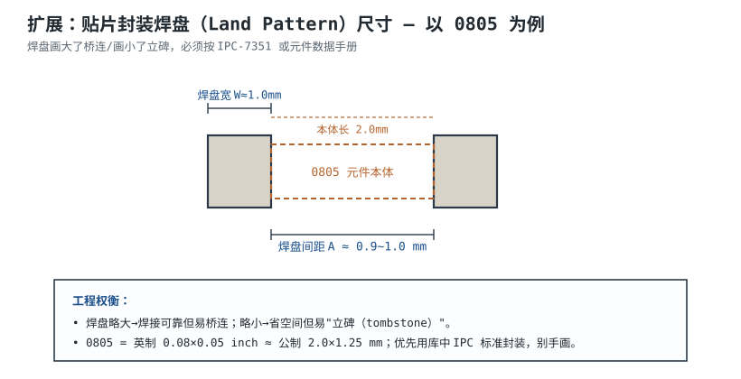

# 原理图设计、封装与库管理 Schematic Design, Footprint & Library

原理图是板子的"逻辑蓝图"。画原理图不只是连线，还要管理好**符号（Symbol）、封装（Footprint）、库（Library）**三件套——它们对不上，板子回来就焊不上。

## 1. 设计动机

::: motivation 为什么要管好库
新手最常犯的错：随手画个方块当芯片，引脚号瞎编，封装随便找个近似的。结果打样回来发现——封装尺寸差 0.2 mm 焊不上、引脚映射反了芯片烧了、同一个电阻在两张图里封装不一致。库管理就是把这些"逻辑长相"和"物理长相"固化成可复用、可追溯的资产。
:::

## 2. 图示：符号 ↔ 封装 ↔ 实物

## 3. 三个核心概念

- **符号（Symbol）**：原理图里的图形，表达引脚功能（VCC、GND、PA0…），不关心尺寸。
- **封装（Footprint / Land Pattern）**：PCB 上的焊盘图形，表达物理尺寸，决定焊不焊得上。
- **pin map**：符号上的每个引脚对应封装上的哪个焊盘（1→Pin1）。

关键认知：**符号是"画着好看+逻辑正确"，封装是"照着能焊"**。同一个符号（电阻）可以挂多个封装（0805/0603/直插）。

## 4. 定量参数：封装尺寸

| 封装 | 英制 | 公制(约) | 焊盘间距 A | 用途 |
|---|---|---|---|---|
| 0402 | 0.04×0.02 in | 1.0×0.5 mm | 0.5 mm | 高密度 |
| 0603 | 0.06×0.03 in | 1.6×0.8 mm | 0.7 mm | 常用 |
| 0805 | 0.08×0.05 in | 2.0×1.25 mm | 0.9~1.0 mm | 好焊、新手友好 |
| QFP-48 | — | 7×7 mm | 0.5 mm pitch | 中小 MCU |

焊盘尺寸过大易桥连（solder bridge），过小易**立碑（Tombstone，元件一头翘起）**。

## 5. 设计准则

1. **优先用官方/标准库**：KiCad 自带库、厂商（TI/ADI）提供的符号封装，别手画。
2. **封装严格按数据手册 Land Pattern**：差 0.1 mm 就可能焊不上。
3. **位号唯一且有意义**：U1/U2、C1/C2，按功能分块编号。
4. **电源/用地符号统一**：全局电源标志（+3V3、GND）全板一致。
5. **库版本管理**：自己改的库放进项目专属库，别改全局库（会影响别的项目）。

## 6. 完整设计示例

::: example 给一颗 MCU 建符号与封装
1. **需求**：用 STM32F103C8T6（LQFP-48，0.5 mm pitch）。
2. **符号**：从 MCU 库拖出 LQFP-48，按引脚名分组（电源、晶振、IO）。
3. **封装**：选 LQFP-48 标准封装，核对 0.5 mm pitch、中心 7×7 mm。
4. **pin map**：确认符号 Pin1 = 封装 Pin1（通常在左上角带点）。
5. **3D 模型**：挂个 STEP 模型，结构设计时能看高度干涉。
6. **存项目库**：把这个符号+封装存进本项目 `.pretty` 库，随工程走。
:::

## 7. 检查与仿真

- **ERC**：查未连接引脚、重复位号、电源短路。
- **封装核对**：把 PCB 导出 3D，和实物元件叠一起看是否对齐。
- **BOM 一致性**：原理图里每个元件都有型号、封装、位号。

## 扩展与变种电路

### 扩展1：层次化原理图（Hierarchical Sheets）

大系统一张图画不下，按功能拆成子图，根图用方块调用。

::: example 机理与定量
- **方块图（Sheet Symbol）**：根图上画个方框代表一个子电路块，块上引出"端口（Port）"。
- **子图（Child Sheet）**：端口名与子图内引脚名相同即电气相连。
- 好处：几百个元件拆成几个几十元件的子图，可读性↑，多人可分块并行。
- 例：电源块（buck+LDO）、MCU 块（最小系统）、接口块（USB/RS485）各自一张子图。
:::

准则对比：

| 方式 | 适用 | 代价 |
|---|---|---|
| 单张总图 | <50 元件 | 简单 |
| 层次化 | >100 元件/多模块 | 需管端口映射 |

::: pitfall 端口名写错导致网络没连上
- **现象**：子图里写 `PA0`，根图端口写 `P0`，看似连上实则悬空。
- **原因**：层次连接靠端口名精确匹配，大小写/拼写差一点就断。
- **解决**：用 ERC 查未连接引脚；统一命名规范。
:::

### 扩展2：贴片焊盘 Land Pattern 尺寸（0805 示例）

封装不是"画个方块就行"，焊盘尺寸有讲究。

::: example 机理与定量
- **焊盘间距 A**：对应元件两端焊端间距，过大会立碑、过小会桥连。
- **焊盘宽 W**：略宽于焊端，保证焊点成形（fillet）。
- 0805：本体 2.0×1.25 mm，标准 land pattern 间距约 0.9~1.0 mm。
- 依据：IPC-7351 标准或元件厂商推荐焊盘。
:::

准则对比：

| 焊盘 | 焊接可靠性 | 密度 |
|---|---|---|
| 略大 | 好，抗桥连余量 | 占空间 |
| IPC 标准 | 折中 | 标准 |
| 略小 | 易立碑 | 省空间 |

::: pitfall 手画封装没留钢网开口裕量
- **现象**：小批量手焊还行，量产回流后大量立碑/虚焊。
- **原因**：焊盘尺寸与锡膏印刷（钢网开口）不匹配。
- **解决**：用 IPC-7351 标准封装，让板厂按标准出钢网。
:::

## 8. 常见坑与故障现象

::: pitfall 常见坑
- **符号引脚号和封装焊盘对反**：芯片第 1 脚焊到了第 8 脚位置，逻辑全反。核对 pin1 标记（圆点/缺口）。
- **封装用错大小**：0603 焊盘贴了 0805 元件，一头悬空。BOM 里封装列必须统一。
- **全局库被改坏**：手贱改了全局电阻库，所有老项目全变。自己的修改放项目库。
- **电源标志不统一**：一张图写 +3V3，另一张写 VDD，其实该是同一网络却没连。
:::

## 9. 自测题

符号（Symbol）和封装（Footprint）各管什么？为什么不能混用？

符号管**逻辑长相**（引脚名/功能），封装管**物理长相**（焊盘尺寸/间距）。混用会导致：逻辑对但焊不上，或焊得上但引脚映射错。二者通过 pin map 对应。

0805 大约对应公制多少尺寸？焊盘画太大/太小分别有什么后果？

约 2.0×1.25 mm。焊盘太大→相邻焊盘桥连短路；太小→元件立碑（tombstone）或虚焊。应按 IPC-7351 / 数据手册推荐焊盘。

为什么大板子推荐用层次化原理图而不是一张大图？

几百个元件画一张图不可读、易错。按功能拆子图、根图用方块调用，可读性和并行效率都高；端口同名即连，改子图自动同步。

## 10. 参考资料

- KiCad 符号库（库组织与命名）：https://github.com/KiCad/kicad-symbols
- IPC-7351 Land Pattern Standard
- awesome-electronics：https://github.com/kitspace/awesome-electronics
