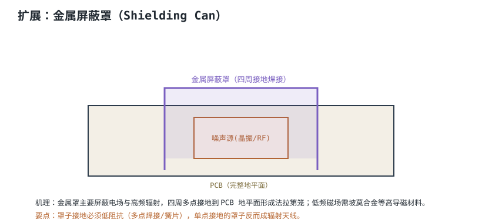

# 屏蔽、滤波与接地设计 Shielding, Filtering & Grounding

当布局和叠层做到位后，剩下的 EMI 问题靠三招兜底：**屏蔽（Shielding）**挡住辐射、**滤波（Filtering）**掐断传导路径、**接地（Grounding）**给噪声一个低阻抗泄放通道。三者协同，缺一不可。

## 1. 设计动机

::: motivation 为什么需要三道防线
噪声要么通过空间辐射出去，要么通过导线传导出去，总得有个"路"。屏蔽罩断空间路径，滤波器断导线路径，接地提供泄放通道。只上屏蔽不滤波，噪声照样沿电源线跑出去；只滤波不接地，滤波电容没地方泄放，等于没接。
:::

## 2. 图示：接口 π 型滤波

## 3. 机理与定量

### 共模电感（Common Mode Choke）

两根线同向绕在同一磁芯上：差模信号电流方向相反，磁通抵消，电感≈0，正常通过；共模噪声同相，磁通相加，呈现高阻抗阻挡。

### π 型滤波

两个 Y 电容（线对地）夹一个串联阻抗（共模电感），像 π 字。转折频率：

$$f_c \approx \frac{1}{2\pi\sqrt{L_{cm}\,C_Y}}$$

- $C_Y$ 太大漏电流超安规（Y 电容通常 nF 级）。
- $L_{cm}$ 越大抑制共模越强，但体积大、自谐振频率有限。

## 4. 设计准则

1. **滤波元件紧贴连接器**：噪声进入板子的第一站就拦住，别让它跑进板内。
2. **接地低阻抗**：滤波电容的地必须直接打过孔到完整平面，引线要短。
3. **屏蔽罩多点接地**：四周焊接到地，别单点。
4. **Y 电容漏电流**：安规限制（接触电流），不能盲目加大。

## 5. 完整设计示例

::: example RS485 接口的 EMC 处理
1. **需求**：RS485 接口要过 EFT/ESD。
2. **连接器处**：先放 TVS（ESD），再放共模电感，再放 Y 电容。
3. **顺序**：连接器 → TVS → 共模电感 → Y 电容 → 收发器 IC。
4. **地**：Y 电容地直接打过孔到完整 GND，不绕线。
5. **效果**：共模噪声在入口被电感阻挡、被 Y 电容旁路，进不了收发器。
:::

## 6. 检查与仿真

- **近场探头**：扫屏蔽罩缝隙、滤波元件前后，对比噪声。
- **传导测试**：LISN 测电源线传导噪声，看滤波器转折频率。
- **接地连续性**：确认屏蔽罩到地平面低阻抗。

## 扩展与变种电路

### 扩展1：金属屏蔽罩 Shielding Can

对顽固辐射源，加个金属罩罩住。

::: example 机理与定量
- 金属罩形成**法拉第笼**，把电场挡在内部。
- 罩子四周必须**多点低阻抗接地**到 PCB 地平面。
- 单点接地的罩子反而成了辐射天线。
- 屏蔽效能随频率升高，对磁场屏蔽差（低频磁场要高导磁材料如坡莫合金）。
:::

准则对比：

| 接地方式 | 屏蔽效果 |
|---|---|
| 多点焊接接地 | 好 |
| 单点/悬空 | 差（成天线） |

::: pitfall 屏蔽罩单点接地
- **现象**：加了罩子辐射反而更大。
- **原因**：罩子单点接地成了谐振天线。
- **解决**：四周连续焊接或簧片多点接地。
:::

### 扩展2：接地拓扑 — 单点 / 多点 / 混合

不同频率用不同接地策略。

::: example 机理与定量
- **单点接地**：各模块地回到同一点，避免共地阻抗。低频（<1MHz）有效。
- **多点接地**：各点就近接完整地平面，地电感最小。高频数字必备。
- **混合**：模拟单点、数字多点，在 ADC 处桥接。模数混合板标准做法。
- 高频下每根地线都是电感，单点环路反而大。
:::

准则对比：

| 拓扑 | 低频 | 高频 |
|---|---|---|
| 单点 | 优 | 差 |
| 多点 | — | 优 |
| 混合 | 折中 | 折中 |

::: pitfall 高频模拟还在用单点接地
- **现象**：高频下接地反而引入大电感。
- **原因**：频率高时地线电感主导，单点环路大。
- **解决**：高频就近多点接地到平面。
:::

## 7. 常见坑与故障现象

::: pitfall 常见坑
- **滤波元件放 IC 旁边而不是连接器旁**：噪声已经跑进板子才滤波，来不及。
- **Y 电容引线长**：引线电感让高频滤波失效，地必须直打过孔。
- **屏蔽罩单点接地**：反而成天线。
- **Y 电容盲目加大**：漏电流超安规（接触电流限值）。
:::

## 8. 自测题

共模电感为什么对差模信号不影响、却挡共模噪声？

两根线同向绕在同一磁芯。差模信号电流方向相反，磁通互相抵消，电感≈0 正常通过；共模噪声两线同相，磁通相加，呈现高阻抗阻挡。

滤波/保护元件为什么必须紧贴连接器？

噪声从接口进来，必须在它进入板子的第一站就拦住。放 IC 旁边，噪声已经在板内走了一路、耦合过别的信号，再滤就晚了。

屏蔽罩为什么要多点接地，单点不行吗？

高频下单点接地的罩子与地之间有电感，罩子本身成了谐振天线，反而往外辐射。多点低阻抗接地让罩子真正等电位，形成法拉第笼。

## 9. 参考资料

- Henry W. Ott, *Electromagnetic Compatibility Engineering*, Wiley 2009
- TI SLVA680A ESD Protection Layout Guide
- onsemi AND8301-D EMC PCB Layout Guidelines
