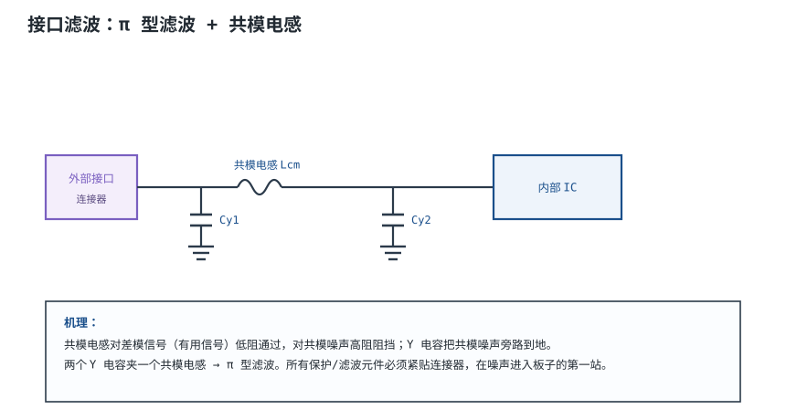
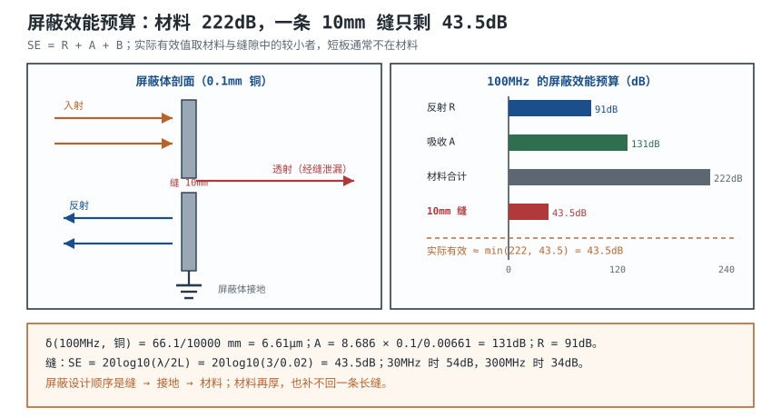
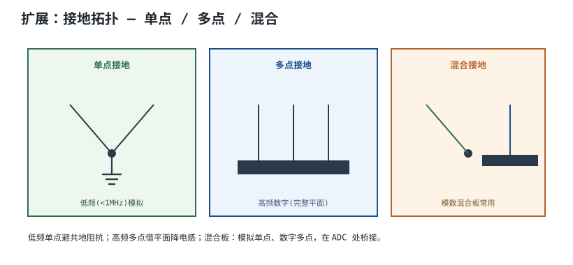

# 屏蔽、滤波与接地设计 Shielding, Filtering & Grounding

当布局和叠层做到位后，剩下的 EMI 问题通常靠三招兜底：**屏蔽（Shielding）**挡住空间辐射、**滤波（Filtering）**掐断传导路径、**接地（Grounding）**给噪声一个低阻抗泄放通道。三者不是三选一，而是一条链：屏蔽罩把噪声关在盒子里，滤波器阻止噪声沿电缆跑出去，接地则决定这两者到底有没有生效。

这条链的强度由**最弱的一环**决定。一个 0.1mm 的铜罩，材料屏蔽效能在 100MHz 可以超过 200dB，但一条 10mm 的缝就能把它限制到 43.5dB；一个设计良好的共模滤波器，如果 Y 电容的地线绕了 20mm，高频旁路就等于没接；一个"多点接地"的屏蔽罩，如果接地点的间距大于 λ/20，罩子自己就会变成天线。

这一章把三招拆成可计算的量：屏蔽效能 $SE=R+A+B$、缝隙泄漏、滤波器插入损耗、共模扼流的转折频率、Y 电容的漏电流上限、接地拓扑的 λ/20 判据。最后用一个 100MHz 时钟线缆的完整算例，算出需要多大屏蔽效能、铁氧体磁环怎么选。

先给结论：**多数产品的辐射问题，短板在电缆和缝隙，不在屏蔽材料；传导问题，短板在滤波器的接地和布局，不在电容容值。** 这个结论有适用前提，第 5 节会写清楚。

## 1. 设计动机

::: motivation 三个现场
**现场一：加了屏蔽罩，辐射反而更大。** 0.1mm 铜罩对 100MHz 的材料屏蔽效能约 222dB，但罩子上一条 10mm 的缝把有效值限制在 $20\log_{10}(3/0.02)=43.5\ \text{dB}$；罩子还是单点接地，与地平面之间的电感让它在某个频率谐振，自己变成辐射天线。**屏蔽的短板在缝和接地，不在材料。**

**现场二：Y 电容从 2.2nF 加到 10nF。** 传导噪声确实降了，但 230V/50Hz 下的漏电流从 $2\pi\times50\times2.2\times10^{-9}\times230=0.159\ \text{mA}$ 涨到 $0.723\ \text{mA}$，超过双重绝缘设备 0.25mA 量级的接触电流限值。**滤波器的容值不是越大越好，它受安规漏电流约束。**

**现场三：单点接地用在 100MHz 的电缆上。** 100MHz 在 $\varepsilon_{eff}=4$ 的板上波长 1.5m，$\lambda/20=75\ \text{mm}$；1m 的电缆、100mm 的板早就超过这个尺度，单点接地的"地"在射频上只是一段电感。**接地拓扑要按电长度选，不是按习惯选。**
:::

设计前先明确要判断哪四件事：

| 你想判断 | 先查什么 | 判据 |
|---|---|---|
| 屏蔽罩够不够 | 材料、厚度、缝、接地 | $\min(SE_{material},SE_{aperture})$ |
| 滤波器放哪、选多大 | 转折频率、漏电流、接地 | $f_c$、$I_{leak}$、插入损耗 |
| 单点还是多点接地 | 最高频率、互连长度 | $l$ 与 $\lambda/20$ 比较 |
| 电缆怎么处理 | 共模电流、屏蔽端接 | 共模扼流、360° 端接、双绞 |

**不懂会在哪里摔跤**，具体是这四条：

1. 以为"金属罩一盖就完事"。缝、孔、电缆入口才是泄漏路径；罩子不接地或单点接地，效果可能为负。
2. 以为"电容越大滤波越好"。Y 电容受漏电流限制，X 电容对共模无效，电容的 ESL 还决定高频能滤到多少。
3. 以为"单点接地最干净"。低频成立，高频下每条地线都是电感；该多点的时候单点，等于人为加大回路电感。
4. 以为"加了共模扼流圈就解决共模"。扼流圈的阻抗随频率、直流偏置、匝数变化，饱和之后等于一根导线。

## 2. 定义与直观：三种屏蔽、三类滤波、三种接地

### 2.1 三种屏蔽：电场、磁场、电磁场

**屏蔽（Shielding）**用导电或导磁材料把电磁场限制在某个区域内外。按被屏蔽的场分三类，机理完全不同：

| 类型 | 主要机理 | 材料 | 适用频率 | 失效方式 |
|---|---|---|---|---|
| 电场屏蔽 | 接地导体表面电荷抵消外场（法拉第笼） | 任何良导体，薄层即可 | 低频~高频 | 接地不良、缝隙 |
| 磁场屏蔽（低频） | 高导磁材料提供低磁阻通路，磁通绕开被保护区 | 坡莫合金、硅钢 | 50Hz~几十 kHz | 磁饱和、材料厚度不足 |
| 磁场屏蔽（高频） | 涡流产生反向磁场抵消 | 铜、铝等良导体 | 几十 kHz 以上 | 缝、孔、开孔 |
| 电磁场屏蔽 | 反射（阻抗失配）+ 吸收（导体损耗） | 铜、铝、钢 | 射频 | 缝、孔、电缆穿透 |

**关键区别**：电场屏蔽靠"接地"，磁场屏蔽靠"材料"，电磁场屏蔽靠"反射 + 吸收"。一块薄铜皮能挡电场和射频电磁场，却几乎挡不住 50Hz 磁场；坡莫合金能挡低频磁场，却贵、重、易饱和。**选材料前先问"要挡的是哪种场、什么频率"。**

### 2.2 三类滤波：低通、共模扼流、馈通

**滤波（Filtering）**让有用信号通过、把噪声旁路或阻挡。EMC 里常见三类：

- **低通滤波**：串联阻抗 + 并联电容，转折频率以上按一阶/二阶滚降。适合电源线、低速信号线。
- **共模扼流圈（Common Mode Choke）**：两根线同向绕在同一磁芯上，差模电流磁通抵消、共模电流磁通相加。对差模信号低阻，对共模噪声高阻。
- **馈通滤波器（Feed-through）**：电容直接穿在金属面板/屏蔽壁上，输入输出被金属隔开，高频旁路路径最短。适合穿过屏蔽体的电源/信号线。

三类滤波器的共同点是：**滤波效果取决于"噪声来源"和"泄放目的地"之间的阻抗关系**。串联阻抗要相对源阻抗大，并联电容要相对负载阻抗小，否则滤波器的插入损耗远低于标称值。

### 2.3 三种接地：单点、多点、混合

**接地（Grounding）**在这里指给噪声和回流提供低阻抗路径。三种基本拓扑：

| 拓扑 | 做法 | 优点 | 缺点 | 适用 |
|---|---|---|---|---|
| 单点/星形 | 各模块地线各自回到一个点 | 避免共阻耦合 | 支路长、电感大 | 低频、小信号、隔离模块 |
| 多点 | 各点就近接同一地平面 | 回流路径短、电感低 | 可能形成地环路 | 高频数字、完整平面 |
| 混合 | 模拟单点、数字多点，桥接 | 兼顾 | 桥位置敏感 | 混合信号、接口 |

判据是电长度，不是"模拟/数字"的标签：互连长度超过 $\lambda/20$ 时，必须按分布参数处理。100MHz 在 $\varepsilon_{eff}=4$ 的板上：

$$
\lambda=\frac{c}{f\sqrt{\varepsilon_{eff}}}=\frac{3.0\times10^{8}}{1.0\times10^{8}\times2}=1.5\ \text{m},\qquad
\frac{\lambda}{20}=75\ \text{mm}
$$

一块 100mm 的板已经超过 75mm，**100MHz 的接地必须多点/平面**；而 50Hz 的模拟电路波长 6000km，星形完全够用。详细的地弹、地环路与混合信号接地见[地的学问与地弹](../power/grounding.md)。

### 2.4 类比：城墙、闸门与地基

::: analogy 城墙、闸门与地基
屏蔽像城墙：墙体再厚，门（缝、孔、电缆入口）没关好，人还是进得来。滤波像护城河上的闸门：只放行有通行证的船（有用信号），把混进来的（噪声）拦下；闸门要建在城墙边，建在城里就没意义。接地像地基：地基不牢，城墙和闸门都会歪。

类比的边界：城墙挡的是人，屏蔽挡的是场，不同频率的场要用不同材料；闸门是单向的，滤波器对差模和共模的效果不同，对有用信号也有插入损耗；地基是静态的，接地是频率的函数。所以三者不能互相替代，只能配合。
:::

## 3. 定量关系

### 3.1 屏蔽效能：反射 + 吸收 + 多次反射

屏蔽效能定义为有无屏蔽体时同一点的场强之比：

$$
SE=20\log_{10}\frac{E_1}{E_2}=R+A+B
$$

其中 $E_1$ 是无屏蔽时的场强，$E_2$ 是有屏蔽时的场强，V/m；$R$ 是反射损耗，dB；$A$ 是吸收损耗，dB；$B$ 是多次反射修正项，dB（通常为负或接近 0）。

**吸收损耗**与材料厚度和趋肤深度有关：

$$
A=8.686\frac{t}{\delta}
$$

其中 $t$ 是材料厚度，m；$\delta$ 是趋肤深度，m。趋肤深度：

$$
\delta=\sqrt{\frac{2}{\omega\mu\sigma}}=\frac{66.1}{\sqrt{f\mu_r\sigma_r}}\ \text{mm}
$$

其中 $f$ 是频率，Hz；$\mu_r$ 是相对磁导率，无量纲；$\sigma_r$ 是相对铜的电导率（铜取 1，$\sigma_0=5.8\times10^{7}\ \text{S/m}$）。这个简化式的前提是良导体、$\mu_r$ 与频率无关；铁磁材料（$\mu_r$ 随频率和磁场变化）只能用量级估算。

以 0.1mm 铜、100MHz 为例：

$$
\delta=\frac{66.1}{\sqrt{1.0\times10^{8}\times1\times1}}=0.00661\ \text{mm}=6.61\ \mu\text{m}
$$

$$
A=8.686\times\frac{0.1}{0.00661}=131.4\ \text{dB}
$$

**反射损耗**由空气波阻抗与金属本征阻抗的失配决定：

$$
R=20\log_{10}\frac{\eta_0}{4|\eta_s|},\qquad
|\eta_s|=\frac{1}{\sigma\delta}
$$

其中 $\eta_0=377\ \Omega$；$|\eta_s|$ 是金属本征阻抗的模，$\Omega$。100MHz 铜：

$$
|\eta_s|=\frac{1}{5.8\times10^{7}\times6.61\times10^{-6}}=2.61\times10^{-3}\ \Omega
$$

$$
R=20\log_{10}\frac{377}{4\times2.61\times10^{-3}}=20\log_{10}(36100)=91.2\ \text{dB}
$$

材料本身的总屏蔽效能：

$$
SE_{material}=R+A+B\approx91.2+131.4+0=222.6\ \text{dB}
$$

**222dB 是一个"没有缝"的理想值**，现实中的屏蔽体远达不到——因为还有缝、孔、电缆和接地。

**多次反射项** $B$ 在吸收很小时不可忽略：

$$
B=20\log_{10}\left(1-e^{-2t/\delta}\right)
$$

当 $t\ll\delta$（薄层、低频），$B$ 是负值，实际屏蔽效能低于 $R+A$；当 $A>15\ \text{dB}$（$t>\sim1.7\delta$），$B\approx0$，可以忽略。**薄膜/导电涂层的屏蔽效能不能只算 $R+A$，必须带 $B$。**

### 3.2 缝与孔：真正的短板

屏蔽体上的缝、孔、电缆入口，本质上是"槽天线"或"偶极子"。最大尺寸为 $L$ 的缝，屏蔽效能近似：

$$
SE_{aperture}\approx20\log_{10}\frac{\lambda}{2L}
$$

其中 $\lambda$ 是工作波长，m；$L$ 是缝的最长尺寸，m。这个式子的前提是 $L<\lambda/2$、缝在屏蔽体表面、场近似均匀；它给的是量级，不是精确值。

10mm 缝在不同频率的屏蔽效能：

| 频率 | 波长 | $SE_{aperture}$ |
|---|---|---|
| 30MHz | 10m | 54.0 dB |
| 100MHz | 3m | 43.5 dB |
| 300MHz | 1m | 34.0 dB |
| 1GHz | 0.3m | 23.5 dB |

**频率越高，同样的缝漏得越多。** 这就是为什么高频产品对缝隙、螺钉间距、屏蔽罩贴合面的要求更严。

多个相同孔洞还会进一步降低屏蔽效能，近似：

$$
SE_n\approx SE_1-20\log_{10}(n)
$$

其中 $n$ 是孔洞数量。100 个孔比 1 个孔低 40dB。**散热孔阵列要用小孔密排，而不是大孔少排**；单位面积的开孔率相同，小孔密排的屏蔽效能更高。

接缝的处理同理：屏蔽罩与 PCB 地之间的贴合面要靠螺钉、导电衬垫、簧片保证连续；螺钉间距按最高频率的 $\lambda/20$ 控制。100MHz 时 $\lambda/20=150\ \text{mm}$（空气），300MHz 时 50mm；这是"电长度"上限，工程上高频屏蔽罩的螺钉/衬垫间距通常远小于它，**按更严的间距做，才不会在某个频点漏成天线。**

### 3.3 滤波器的插入损耗与共模扼流

**插入损耗（Insertion Loss, IL）**定义为滤波器插入前后负载上电压之比：

$$
IL=20\log_{10}\frac{V_1}{V_2}
$$

其中 $V_1$ 是不加滤波器时负载电压，V；$V_2$ 是加滤波器后的负载电压，V。

一个串联阻抗 $Z$ 插在源阻抗和负载阻抗都为 $Z_0$ 的系统中：

$$
IL=20\log_{10}\left(1+\frac{Z}{2Z_0}\right)
$$

以 50Ω 系统、$Z=600\ \Omega$ 为例：

$$
IL=20\log_{10}\left(1+\frac{600}{100}\right)=20\log_{10}(7)=16.9\ \text{dB}
$$

**这个式子的前提是源/负载阻抗已知且为阻性。** 实际电源的源阻抗随频率变化，负载也不一定是 50Ω，所以数据手册的插入损耗曲线通常标"50Ω/50Ω 系统"，直接套到电源线上会偏乐观。

**共模扼流圈 + Y 电容**构成一个二阶低通。转折频率：

$$
f_c=\frac{1}{2\pi\sqrt{L_{cm}\,C_{eq}}}
$$

其中 $L_{cm}$ 是共模电感（单绕组对共模呈现的电感），H；$C_{eq}$ 是 Y 电容对共模的等效并联值，F。注意：**L 线与 N 线各有一只 Y 电容到 PE，对共模是并联，所以 $C_{eq}=2C_Y$**；漏掉这个 2 会让转折频率算高约 41%（√2 倍，24.0 → 33.9 kHz）。

以 $L_{cm}=10\ \text{mH}$、$C_Y=2.2\ \text{nF}$（两只并联 $C_{eq}=4.4\ \text{nF}$）为例：

$$
f_c=\frac{1}{2\pi\sqrt{10\times10^{-3}\times4.4\times10^{-9}}}
=\frac{1}{2\pi\times6.63\times10^{-6}}=24.0\ \text{kHz}
$$

在 150kHz，二阶滤波的衰减：

$$
IL\approx40\log_{10}\frac{150}{24.0}=40\log_{10}(6.25)=31.8\ \text{dB}
$$

理想 24kHz 转折、二阶滚降，150kHz 衰减 31.8dB；1MHz 时 $40\log_{10}(41.7)=64.8\ \text{dB}$。**实际远达不到**：共模扼流的漏感、绕组间电容、Y 电容的 ESL、接地引线电感都会在高频段把衰减拉平，甚至形成新的谐振峰。**数据手册的阻抗曲线和实测，比这个理想式可靠。**

**Y 电容的漏电流**是硬约束：

$$
I_{leak}=2\pi fCV
$$

其中 $f$ 是电网频率，Hz；$C$ 是 Y 电容，F；$V$ 是电容两端电压（L-PE 约为相电压），V。230V/50Hz、2.2nF：

$$
I_{leak}=2\pi\times50\times2.2\times10^{-9}\times230=1.59\times10^{-4}\ \text{A}=0.159\ \text{mA}
$$

若接触电流限值按 0.25mA 量级控制，允许的最大单只 Y 电容：

$$
C_{max}=\frac{I_{limit}}{2\pi fV}
=\frac{0.25\times10^{-3}}{2\pi\times50\times230}=3.46\times10^{-9}\ \text{F}=3.46\ \text{nF}
$$

10nF 时：

$$
I_{leak}=2\pi\times50\times10\times10^{-9}\times230=7.23\times10^{-4}\ \text{A}=0.723\ \text{mA}
$$

**超过 0.25mA 量级近 3 倍。** 这就是"加大 Y 电容"必须先算漏电流的原因。

### 3.4 地环路与单点/多点接地的取舍

两根设备之间的信号线和地线构成一个环路，交变磁场穿过环路产生感应电压：

$$
V_{loop}=2\pi fBA\cos\theta
$$

其中 $B$ 是磁感应强度，T；$A$ 是环路面积，$\text{m}^2$；$\theta$ 是磁场与环路法线的夹角。以 $A=0.1\ \text{m}^2$、$B=1\ \mu\text{T}$、$\theta=0$ 为例：

- 50Hz：$V=2\pi\times50\times1\times10^{-6}\times0.1=31.4\ \mu\text{V}$；
- 1MHz：$V=2\pi\times10^{6}\times1\times10^{-6}\times0.1=0.628\ \text{V}$。

**同样的环路，50Hz 只有 31µV，1MHz 就有 0.628V。** 缩短环路面积、双绞、屏蔽、共模扼流圈都是围绕 $A$ 和 $f$ 做文章。

接地拓扑的选择用 $\lambda/20$ 判据：

$$
l\gtrsim\frac{\lambda}{20}=\frac{c}{20f\sqrt{\varepsilon_{eff}}}
$$

- 50Hz、$\varepsilon_{eff}=1$：$\lambda/20=300\ \text{km}$，单点接地完全够用；
- 1MHz：$\lambda/20=15\ \text{m}$，一块 100mm 的板还远小于它，单点/混合可用；
- 100MHz、$\varepsilon_{eff}=4$：$\lambda/20=75\ \text{mm}$，100mm 的板已超过，必须多点/平面；
- 1GHz、$\varepsilon_{eff}=4$：$\lambda/20=7.5\ \text{mm}$，几乎任何 PCB 都要按分布参数处理。

**单点接地的价值在低频**：避免共阻耦合、避免地环路。**多点接地的价值在高频**：回流路径短、电感低。混合接地是折中：模拟/低频部分单点，数字/高频部分多点，在 ADC 或接口处桥接。三种拓扑的实物画法见下图。

### 3.5 铁氧体磁环/磁珠的选型量

铁氧体的阻抗是频率的函数：

$$
Z(f)=R(f)+jX(f)
$$

在损耗峰附近，$Z$ 以电阻分量为主（吸收能量、转成热），这正是它比纯电感更适合抑制高频噪声的原因——纯电感会把噪声反射回去，可能在其他地方谐振；铁氧体把噪声吸收掉。

匝数对阻抗的影响近似：

$$
Z_N\approx N^2Z_1
$$

其中 $N$ 是匝数，$Z_1$ 是单匝阻抗，$\Omega$。但这个 $N^2$ 关系只在低频、忽略绕组间电容时成立；匝数增加会降低自谐振频率，高频段阻抗反而可能下降。**所以"多绕几圈"不是无脑操作，要看目标频率和数据手册曲线。**

直流偏置会让磁芯饱和、阻抗下降；额定电流、DCR、居里温度都是选型参数。电源线上的磁珠还要算直流压降和功耗：

$$
V_{drop}=IR_{DCR},\qquad P=I^2R_{DCR}
$$

以 3A、DCR=0.02Ω 为例：

$$
V_{drop}=3\times0.02=0.06\ \text{V},\qquad P=3^2\times0.02=0.18\ \text{W}
$$

60mV 压降、0.18W 功耗；如果 DCR 是 0.05Ω，功耗变成 0.45W，小封装磁珠可能过热。**磁珠不是理想器件，它首先是一个电阻。**

## 4. 典型计算

### 4.1 主算例：100MHz 时钟线缆需要多大屏蔽效能

**需求与假设**：

| 项目 | 取值 |
|---|---|
| 噪声源 | 100MHz 时钟，经接口/电缆共模耦合 |
| 电缆 | 1m，共模电流 $I_{cm}=20\ \mu\text{A}$（电流探头实测量级） |
| 测量 | 3m，CISPR 32 Class B，3m 折算限值 40.5 dBµV/m |
| 目标 | 压到限值以下并留 6dB 余量，即 ≤34.5 dBµV/m |

**第一步，算当前辐射**：

$$
E=1.26\times10^{-6}\times\frac{20\times10^{-6}\times1.0\times10^{8}\times1}{3}
=8.40\times10^{-4}\ \text{V/m}
$$

$$
E=20\log_{10}\frac{8.40\times10^{-4}}{1\times10^{-6}}=20\log_{10}(840)=58.5\ \text{dB}\mu\text{V/m}
$$

**第二步，算需要多少抑制**：

$$
58.5-40.5=18.0\ \text{dB}
$$

即需要把共模电流或场强压低 18dB 才能刚好达标；要留 6dB 余量，需要 24dB。

**第三步，共模电流的目标值**：

$$
I_{cm,allow}=20\ \mu\text{A}\times10^{-18.0/20}=20\times0.126=2.52\ \mu\text{A}
$$

**第四步，铁氧体磁环的抑制量**。共模源/负载阻抗按 150Ω 估，单匝 $Z=300\ \Omega$：

$$
IL=20\log_{10}\left(\frac{150+300}{150}\right)=20\log_{10}(3)=9.5\ \text{dB}
$$

两匝（理想 $N^2$，$Z\approx1200\ \Omega$）：

$$
IL=20\log_{10}\left(\frac{150+1200}{150}\right)=20\log_{10}(9)=19.1\ \text{dB}
$$

三匝（理想 $Z\approx2700\ \Omega$）：

$$
IL=20\log_{10}\left(\frac{150+2700}{150}\right)=20\log_{10}(19)=25.6\ \text{dB}
$$

| 方案 | 抑制量 | 剩余场强 | 相对 40.5 限值 | 结论 |
|---|---|---|---|---|
| 不加 | 0 dB | 58.5 dBµV/m | +18.0 dB | 超标 |
| 单匝磁环 | 9.5 dB | 49.0 dBµV/m | +8.5 dB | 仍超标 |
| 两匝磁环 | 19.1 dB | 39.4 dBµV/m | −1.1 dB | 勉强，余量不足 |
| 三匝磁环 | 25.6 dB | 32.9 dBµV/m | −7.6 dB | 达标，留 7.6dB |

**两匝只有 1.1dB 余量，工程上不算过；三匝才留出 7.6dB。** 但三匝会降低自谐振频率，100MHz 时实际阻抗可能达不到理想 $9Z_1$；**必须用数据手册的阻抗-频率曲线复核，最好实测共模电流。**

**第五步，屏蔽方案**。如果给电缆加屏蔽层，需要的屏蔽效能就是 18dB（不留余量）或 24dB（留 6dB）。听起来很低——0.1mm 铜箔的材料屏蔽效能超过 200dB。**但屏蔽的效果由端接决定**：屏蔽层必须 360° 端接到连接器外壳/机壳，不能用"猪尾巴"（pigtail）长线。

猪尾巴端接的代价：50mm 的接地线约 50nH，100MHz 时阻抗：

$$
|Z|=2\pi fL=2\pi\times1.0\times10^{8}\times50\times10^{-9}=31.4\ \Omega
$$

若屏蔽层上有 5mA 的共模电流流过这段猪尾巴：

$$
V=2\pi fLI=31.4\times0.005=0.157\ \text{V}
$$

**157mV 的电压直接加在电缆屏蔽层上，把屏蔽层变成了新的天线。** 屏蔽效能再高，也被这个端接毁了。**360° 端接（屏蔽层一圈压接在连接器金属壳上）才是屏蔽生效的前提。**

**第六步，结论**：

| 措施 | 抑制量 | 适用 | 代价/前提 |
|---|---|---|---|
| 三匝铁氧体磁环 | 25.6 dB（理想） | 已有电缆、后装 | 体积、重量、实际阻抗需实测 |
| 屏蔽电缆 + 360° 端接 | 可远大于 18dB | 新设计 | 连接器、成本、端接工艺 |
| 双绞 + 缩短电缆 | 取决于绞距与长度 | 差分/低速 | 对单端时钟效果有限 |
| 降低源端共模（改布局/加 Y 电容） | 10~20dB | 板级 | 需重新设计接口滤波 |

**单一措施往往不够，组合使用并留 6dB 余量才是工程做法。**

### 4.2 电源滤波器的转折频率与漏电流

某 AC-DC 电源的输入滤波器：$L_{cm}=2\times10\ \text{mH}$（每线 10mH，共模等效 10mH）、$C_Y=2.2\ \text{nF}$（L-PE、N-PE 各一只）。按 3.3 节：

$$
f_c=\frac{1}{2\pi\sqrt{10\times10^{-3}\times2\times2.2\times10^{-9}}}=24.0\ \text{kHz}
$$

150kHz 处理想衰减 31.8dB。但实际还要看：

1. **X 电容**：抑制差模，通常 0.1~1µF，对共模无效；
2. **共模扼流的漏感**：抑制差模，但也会与 X 电容谐振；
3. **Y 电容的 ESL**：高频段旁路失效；
4. **滤波器接地**：Y 电容的地必须短、直接到机壳，否则共模电流绕过滤波器。

漏电流按 3.3 节算：2.2nF 时 0.159mA；如果为了降传导加到 4.7nF：

$$
I_{leak}=2\pi\times50\times4.7\times10^{-9}\times230=0.340\ \text{mA}
$$

已经超过 0.25mA 量级。**这时不能靠加大 Y 电容，要靠加共模扼流圈、改善屏蔽、减小源端共模。**

### 4.3 屏蔽罩的缝：10mm 与 100MHz

一个 100mm×80mm 的屏蔽罩，材料 0.1mm 铜，盖子上有一条 10mm 的缝。按 3.1、3.2 节：

- 材料：$SE_{material}\approx222\ \text{dB}$；
- 缝：$SE_{aperture}=20\log_{10}(3/0.02)=43.5\ \text{dB}$；
- 实际有效值约为两者较小者：**43.5dB**。

如果把缝缩短到 5mm：

$$
SE_{aperture}=20\log_{10}\frac{3}{0.01}=20\log_{10}(300)=49.5\ \text{dB}
$$

提高 6dB。如果把缝改成 100 个 1mm 的小孔（总开孔面积相近）：

$$
SE_{aperture}=20\log_{10}\frac{3}{0.002}=63.5\ \text{dB},\qquad
SE_{100}\approx63.5-20\log_{10}(100)=23.5\ \text{dB}
$$

**孔多了反而更差**：单个小孔的屏蔽效能高，但 100 个孔的叠加把总泄漏拉低。正确做法是"小孔密排 + 控制开孔率 + 导电衬垫"，而不是简单地"多打孔"。

### 4.4 共模扼流圈的选型

共模扼流圈的三个关键参数：

| 参数 | 含义 | 选型要点 |
|---|---|---|
| 共模阻抗 $Z_{cm}(f)$ | 目标频段的阻抗 | 看曲线，不只看标称电感 |
| 额定电流 | 差模电流不饱和 | 按最大负载电流留 20~30% 余量 |
| 漏感 $L_k$ | 差模抑制 | 漏感太大会影响信号/产生差模谐振 |
| 直流电阻 | 压降与功耗 | 大电流场合要算 $I^2R$ |
| 自谐振频率 | 高频阻抗的拐点 | 目标频率应低于 SRF |

**共模扼流圈对差模信号的影响**：理想情况下差模磁通抵消，电感接近 0；实际有漏感（典型 0.5%~2%），会在差模路径上呈现一个小电感，可能和 X 电容形成谐振。**选型时要看漏感，不只是共模阻抗。**

## 5. 工程含义

### 5.1 数量级速查

| 量 | 典型量级 | 说明 |
|---|---|---|
| 铜的趋肤深度 | 6.6µm @100MHz；9.35mm @50Hz | $\delta=66.1/\sqrt{f}$ mm |
| 0.1mm 铜的吸收损耗 | 131dB @100MHz | $A=8.686t/\delta$ |
| 材料屏蔽效能 | 200dB 量级 | 无缝隙的理想值 |
| 10mm 缝的屏蔽效能 | 43.5dB @100MHz | 实际短板 |
| Y 电容漏电流 | 0.159mA @2.2nF/230V | $2\pi fCV$ |
| 共模滤波器转折 | 几十 kHz | $L_{cm}$、$C_Y$ 决定 |
| 铁氧体磁环阻抗 | 几百 Ω @100MHz | 随频率、偏置、匝数变 |
| 猪尾巴电感 | 约 1nH/mm | 50mm 约 50nH |

这些是量级，不是保证值；具体要看材料牌号、厚度、缝隙、端接和测试布置。

### 5.2 屏蔽设计清单

1. **先判断要挡哪种场**：电场/低频磁场/射频电磁场，材料不同。
2. **缝隙优先于材料**：缝的长度、数量、螺钉间距、导电衬垫，决定实际屏蔽效能。
3. **接地要连续**：屏蔽罩四周多点接地，螺钉间距 ≤λ/20；高频用导电衬垫/簧片。
4. **电缆入口是最大漏洞**：用馈通滤波器或屏蔽连接器，屏蔽层 360° 端接。
5. **开孔要小、要密、要少**：散热孔按 λ/20 控制孔径，避免长槽。
6. **避免谐振**：罩子内部加吸波材料或改变腔体尺寸，防止腔体谐振放大某个频率。
7. **不要用屏蔽罩掩盖布局问题**：先减环路、放缓边沿，再考虑屏蔽。

### 5.3 滤波器选型与布局

1. **滤波器紧贴连接器/面板**：噪声进入板子的第一站就拦，别让它跑进板内。
2. **接地要短**：Y 电容的地直接到机壳/平面，引线电感会让高频旁路失效。
3. **输入输出隔离**：滤波器的输入线和输出线不要平行走，避免跳过滤波器耦合。
4. **X 电容管差模，Y 电容管共模**：不要指望 X 电容压共模。
5. **Y 电容受漏电流限制**：先算 $2\pi fCV$，再选容值；安规认证按 GB 4943.1 / IEC 62368-1 的现行条款。
6. **共模扼流圈看阻抗曲线**：标称电感不等于目标频率的阻抗；注意漏感和饱和。
7. **馈通滤波器用于穿墙**：电源/信号穿过屏蔽体时，馈通是最短的旁路路径。

### 5.4 接地与地环路

- **低频单点**：避免共阻耦合，适合 50Hz~几百 kHz 的模拟/隔离模块。
- **高频多点**：回流路径短，适合 100MHz 以上的数字/射频。
- **混合**：模拟单点、数字多点，在 ADC/接口处桥接；桥要宽短，信号不跨缝。
- **地环路**：电缆两端都接地会形成环路，感应电压 $2\pi fBA$；用双绞、屏蔽单端接地、共模扼流圈或隔离器切断环路。
- **安全地独立**：PE、防雷、ESD 地按各自标准设计，不能与信号地混接，见[安全用电与触电防护](../basics/electrical-safety.md)。

### 5.5 测量

- **屏蔽效能**：按标准用天线在屏蔽体外部/内部测场强比；小件可用近场探头做相对比较，不能直接换算远场。
- **滤波器插入损耗**：用网络分析仪测 50Ω 系统的 $S_{21}$，注意测试夹具和接地。
- **共模电流**：电流探头夹电缆，是判断"屏蔽/滤波有没有生效"的最快手段。
- **缝隙定位**：近场探头沿缝隙扫描，找泄漏点；用铜箔临时覆盖验证。
- **接地阻抗**：毫欧表/网络分析仪测屏蔽罩到平面的阻抗，别用万用表通断档。

### 5.6 安全与合规前提

1. **Y 电容的容值受安规限制**：漏电流/接触电流的限值随设备类别（Class I/II）、标准版本、测试网络不同；本章的 0.25mA 是量级示例，具体按 GB 4943.1-2022 / IEC 62368-1 的现行条款和认证机构要求确认。
2. **屏蔽罩/机壳的接地可能涉及保护接地**：如果机壳是保护导体的一部分，接地阻抗、导体截面、连接可靠性按安规要求做，不能只用"信号地"的思路处理。
3. **EMC 结论依赖测试布置**：电缆、接地、辅助设备、天线距离都会改变结果；**任何"加了屏蔽罩/滤波器就一定过认证"的说法都不成立**，只能给估算余量并实测确认。
4. **防雷/浪涌是另一套体系**：屏蔽和滤波不能替代 SPD、隔离与防雷接地，相关设计按 IEC 62305 / GB 50057 由专业人员完成。

## 6. 常见坑

::: pitfall 常见坑
- **屏蔽罩单点接地**：现象——加了罩子辐射更大，或某个频点出现尖峰。原因——罩子与地之间的电感在高频形成高阻抗，罩子成为二次辐射体/谐振腔。解决——四周多点接地，螺钉间距 ≤λ/20，接缝用导电衬垫。
- **只算材料屏蔽效能，不算缝**：现象——按 200dB 选材料，实测只有 40dB。原因——10mm 缝在 100MHz 只有 43.5dB，材料再厚也没用。解决——先控制缝长、孔数、开孔率，再谈材料。
- **Y 电容盲目加大**：现象——传导降了，安规漏电流超限。原因——$I=2\pi fCV$，2.2nF 已 0.159mA，10nF 到 0.723mA。解决——先算漏电流上限（约 3.46nF @0.25mA/230V），用共模扼流圈和屏蔽补足。
- **滤波器放板中央**：现象——滤波器装了，辐射/传导没改善。原因——噪声已经在板内走了一圈，滤波器的输入输出还互相耦合。解决——滤波器紧贴连接器/面板，输入输出隔离。
- **电缆屏蔽用猪尾巴**：现象——换了屏蔽电缆，辐射没降。原因——50mm 猪尾巴约 50nH，100MHz 时 31.4Ω，5mA 就有 157mV 加在屏蔽层上。解决——360° 端接，或用屏蔽连接器/馈通。
- **高频还在单点接地**：现象——100MHz 以上地噪声大、辐射超标。原因——$\lambda/20=75\ \text{mm}$，100mm 的板早已超过，单点支路电感大。解决——高频多点/完整平面，低频部分再单点。
:::

## 7. 自测题

0.1mm 铜在 100MHz 的趋肤深度、吸收损耗、反射损耗各是多少？材料屏蔽效能是多少？

$$
\delta=\frac{66.1}{\sqrt{1.0\times10^{8}}}=0.00661\ \text{mm}=6.61\ \mu\text{m}
$$

$$
A=8.686\times\frac{0.1}{0.00661}=131.4\ \text{dB}
$$

$$
|\eta_s|=\frac{1}{5.8\times10^{7}\times6.61\times10^{-6}}=2.61\times10^{-3}\ \Omega
$$

$$
R=20\log_{10}\frac{377}{4\times2.61\times10^{-3}}=91.2\ \text{dB}
$$

$$
SE_{material}\approx R+A=222.6\ \text{dB}
$$

这是"没有缝"的理想值；实际屏蔽体的短板是缝、孔、电缆和接地。

一条 10mm 的缝，在 100MHz 和 1GHz 的屏蔽效能各是多少？说明了什么？

100MHz（λ=3m）：

$$
SE=20\log_{10}\frac{3}{2\times0.01}=20\log_{10}(150)=43.5\ \text{dB}
$$

1GHz（λ=0.3m）：

$$
SE=20\log_{10}\frac{0.3}{0.02}=20\log_{10}(15)=23.5\ \text{dB}
$$

同样的缝，频率升高 10 倍，屏蔽效能下降 20dB。**高频产品的缝隙、螺钉间距、开孔尺寸要求更严**；材料再厚也补不回缝的泄漏。

100MHz 时钟、1m 电缆、20µA 共模电流，3m 处场强多少？要压到 Class B 3m 限值 40.5 dBµV/m 以下需要多少 dB？

$$
E=1.26\times10^{-6}\times\frac{20\times10^{-6}\times1.0\times10^{8}\times1}{3}=8.40\times10^{-4}\ \text{V/m}
$$

$$
E=20\log_{10}(840)=58.5\ \text{dB}\mu\text{V/m}
$$

$$
58.5-40.5=18.0\ \text{dB}
$$

需要 18dB 抑制；要留 6dB 余量则需 24dB。对应的共模电流上限是 $20\ \mu\text{A}\times10^{-18/20}=2.52\ \mu\text{A}$。

两只 2.2nF 的 Y 电容、10mH 共模扼流圈，转折频率是多少？为什么不能用 10nF 的 Y 电容？

两只 Y 电容对共模是并联，$C_{eq}=4.4\ \text{nF}$：

$$
f_c=\frac{1}{2\pi\sqrt{10\times10^{-3}\times4.4\times10^{-9}}}=24.0\ \text{kHz}
$$

10nF 时漏电流：

$$
I=2\pi\times50\times10\times10^{-9}\times230=0.723\ \text{mA}
$$

超过 0.25mA 量级的接触电流限值近 3 倍。Y 电容的容值上限由漏电流决定，约 $C_{max}=0.25\ \text{mA}/(2\pi\times50\times230)=3.46\ \text{nF}$（按该限值估算，实际以安规标准条款为准）。

为什么 100MHz 的板不能只用单点接地？用 λ/20 算一下。

100MHz、$\varepsilon_{eff}=4$：

$$
\lambda=\frac{3.0\times10^{8}}{1.0\times10^{8}\times\sqrt{4}}=1.5\ \text{m},\qquad
\frac{\lambda}{20}=75\ \text{mm}
$$

一块 100mm 的板已经超过 75mm，单点接地的支路在射频上是一段电感，回流绕远、地弹和辐射都会变大。100MHz 以上应该用多点/完整地平面；单点只保留给低频、隔离或安全相关的部分。

铁氧体磁环绕 3 匝，为什么不能简单认为阻抗就是单匝的 9 倍？选型要看哪些参数？

$Z_N\approx N^2Z_1$ 只在低频、忽略绕组间电容时成立。匝数增加会增大绕组间电容、降低自谐振频率，高频段阻抗可能反而下降；直流偏置还会让磁芯饱和、阻抗下降。选型要看：目标频率的阻抗曲线、额定电流与饱和特性、DCR 与压降/功耗、居里温度、自谐振频率、安装尺寸；电源线上还要算 $I^2R$ 和温升。

## 8. 参考资料

- **Henry W. Ott, *Electromagnetic Compatibility Engineering*, Wiley 2009**：屏蔽章节讲反射/吸收/多次反射、缝隙与孔洞泄漏；滤波与接地章节讲共模扼流、Y 电容与地环路。本章 3.1~3.4 的公式与量级参考该书。
- **CISPR 32:2015+AMD1:2019 *Electromagnetic compatibility of multimedia equipment - Emission requirements*（GB/T 9254.1 等同采用）**：辐射限值、10m 测量法与 Class A/B 分级；本章 4.1 的 40.5 dBµV/m 是 10m 限值按 $1/r$ 折算到 3m 的预测试参考值，正式判定按标准距离与方法。
- **IEC 61000-4-3:2020（GB/T 17626.3 等同采用）*Electromagnetic compatibility (EMC) - Part 4-3 Testing and measurement techniques - Radiated, radio-frequency, electromagnetic field immunity test***：辐射抗扰度试验，用于验证屏蔽体/整机在外部场下的性能；本章 5.5 的屏蔽验证口径参考该标准。
- **IEC 61000-4-6:2013（GB/T 17626.6 等同采用）*Electromagnetic compatibility (EMC) - Part 4-6 Testing and measurement techniques - Immunity to conducted disturbances, induced by radio-frequency fields***：传导抗扰度试验，用于验证共模滤波与电缆处理；本章 3.3、5.3 的共模滤波口径参考该标准。
- **GB 4943.1-2022《音视频、信息技术和通信技术设备 第1部分：安全要求》（IDT IEC 62368-1:2018）**：Y 电容漏电流、接触电流、绝缘配合的安规判据；本章 3.3、5.6 的 0.25mA 量级示例仅作估算，具体限值与测试条件按该标准现行条款。
- **onsemi, AND8301-D *EMC Specifications and PCB Guidelines for SMPS Devices***：滤波元件布局、地平面、屏蔽罩接地与功率回路处理；本章 5.2、5.3 的布局建议与该应用笔记一致。
- **IEC 62305-3:2010 *Protection against lightning - Part 3 Physical damage to structures and life hazard* 与 GB 50057-2010《建筑物防雷设计规范》**：防雷接地、等电位与 SPD 的工程要求；本章 5.6 只强调"屏蔽/滤波不能替代防雷"，具体设计按这两份文件由专业人员完成。

> 本章的屏蔽效能、缝隙泄漏、插入损耗、漏电流都是量级估算，用于建立"短板在哪、差多少 dB"的判断；实际设计以材料数据、器件手册、标准条款和实测为准。涉及安规（Y 电容、漏电流、保护接地）与防雷的部分，按[安全用电与触电防护](../basics/electrical-safety.md)与相应标准由专业人员确认。

## 相关章节

- [模拟、数字、电源分区布线](analog-digital-power-routing.md)：屏蔽之前先看板内回流：板内串扰没解决，屏蔽罩只能挡住一部分。
- [EMI/EMC](emi-emc.md)：屏蔽效能要对照限值来选，本章的 SE 估算要代入上一章的辐射量级才有意义。
- [ESD 防护与接口保护](esd-protection.md)：屏蔽罩与机壳地既是屏蔽的一部分，也是 ESD 泄放路径的一部分，需一起规划。
- [PCB 布局](placement.md)：屏蔽罩的安装位、缝的走向和螺钉间距在布局阶段就要定，布线后再加往往只能补丁式处理。
