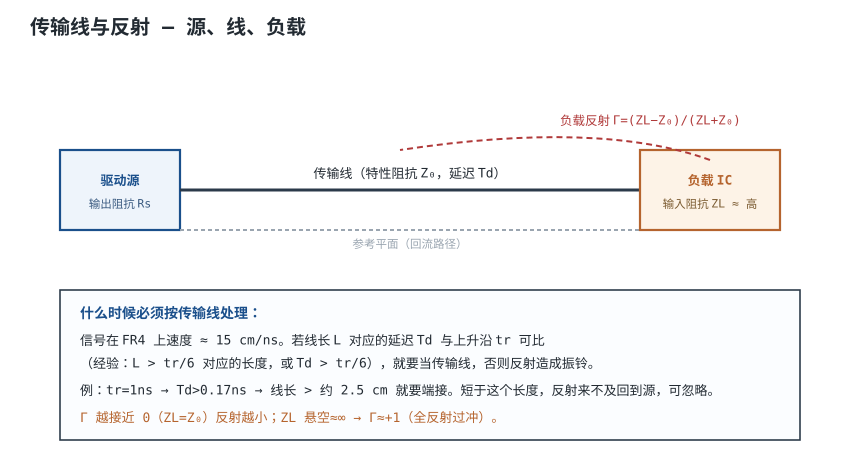
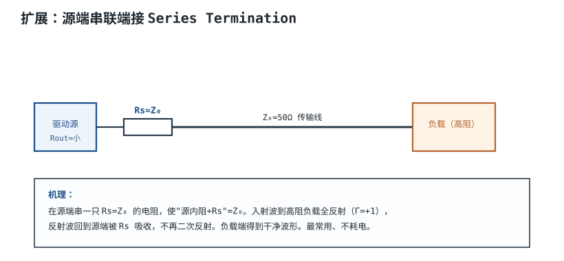
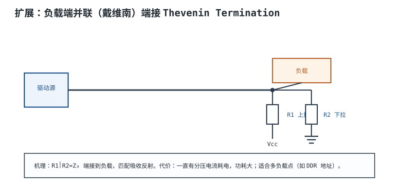
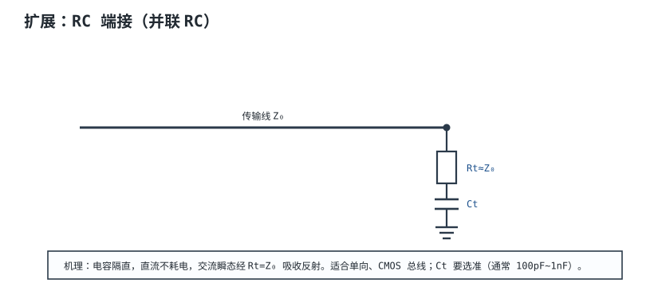

# 信号完整性：反射、阻抗匹配与端接 Signal Integrity

一个 3.3V、上升沿 2ns 的时钟，走 15cm 微带线到高阻 CMOS 输入。驱动端输出阻抗只有 10Ω，走线特性阻抗 50Ω，负载几乎开路。示波器在负载端看到第一个峰值 5.5V，随后在 1.8V 和 4.3V 之间来回跳，几个纳秒后才稳定到 3.3V。芯片没有坏，走线也没有断；问题是**走线已经不能当成一根理想导线，而是一条传输线（Transmission Line）**。

传输线上的信号以有限速度传播，每遇到阻抗不连续就有一部分能量反射。反射波回到源端、再反射、再回到负载，形成振铃（Ringing）和过冲（Overshoot）。信号完整性（Signal Integrity, SI）要回答三件事：**什么时候必须按传输线处理、反射有多大、用什么端接把它压下去。** 本章先给传输线判据的几种口径，再用反射系数和网格图算一个 100MHz 时钟的过冲，最后比较源端串联、戴维南、RC 与并联端接的取舍，并补上过孔和眼图/抖动。

## 1. 设计动机

::: motivation 三个现场
**现场一：示波器上的“鬼影”。** 一块 100MHz 时钟板，负载端波形在上升沿后出现约 200MHz 的衰减振荡。工程师先换芯片、再换探头，最后发现是 15cm 走线没有端接：驱动 10Ω、线 50Ω、负载高阻，源端反射系数 −0.67，负载端反射系数 +1，来回反射形成振铃。串一只 39Ω 电阻，波形立刻干净。

**现场二：USB 高速枚举失败。** USB 2.0 HS 的 D+/D− 是 90Ω 差分对，PCB 上却按 50Ω 单端线宽布，差分阻抗只有 70Ω 量级；再加上 ESD 器件 3pF 结电容，眼图在 480Mbps 下闭合。**“单端 50Ω”不等于“差分 90Ω”，这是两个不同的阻抗定义。**

**现场三：过孔看起来只是“打个洞”。** 一条 10Gbps 信号换层，经过一个 1.6mm 通孔。过孔电感约 1.2nH，在 5GHz 的串联阻抗约 37.7Ω，反射系数约 27%；如果连接器/背板还引入一段 10mm 的未用 stub，quarter-wave 谐振落在约 3.75GHz，正好吃掉信号的高频分量。**过孔不是“连接”，而是一个集总阻抗不连续点。**
:::

数字信号什么时候“变快”？看的是边沿，不是时钟频率。一个 100MHz 的方波，如果上升沿只有 0.5ns，它的频谱能量可以延伸到 700MHz 以上；按 100MHz 的波长判断“线很短”，会严重低估风险。**传输线判据必须用上升沿 $t_r$，不能用时钟周期。**

## 2. 定义与直观

**传输线**是由信号线和参考平面（或另一根线）构成的、具有分布电感和分布电容的导体系统。它的两个核心参数是：

- **特性阻抗（Characteristic Impedance, $Z_0$）**：信号沿线的电压与电流之比，$\Omega$。它由几何和介质决定，与线长无关（忽略损耗）。
- **传播延迟（Propagation Delay, $T_d$）**：信号从一端到另一端的时间，s 或 ns。它与线长和传播速度有关。



当信号沿传输线传播时，每一小段都有电感 $L\,dx$ 和电容 $C\,dx$；信号到达负载前，先给这些分布电容充电、在分布电感上建立电流。**特性阻抗就是这一过程表现出来的“瞬时阻抗”**，不是万用表量出来的直流电阻。用错类比（把走线当水管、把 $Z_0$ 当水阻）会在端接计算上出错。

反射的直观图像：入射波到达负载，如果负载阻抗不等于 $Z_0$，一部分能量继续进入负载，一部分按反射系数返回。返回源端的波，如果源端也不匹配，会再次反射。**振铃的幅度和衰减速度由两端的反射系数共同决定，不是只看负载。**

## 3. 定量关系

### 3.1 传输线判据：0.1λ、λ/6、tr/6 到底差多少

先给传播速度。FR-4 上工程口算取 $v\approx15\ \text{cm/ns}$；更精确地，微带线约 16.7cm/ns、带状线约 14.5cm/ns（见[PCB 结构、层叠与板材](pcb-stackup.md)）。本章用 $v=15\ \text{cm/ns}$ 做保守估算。

线长 $L$ 对应的单向延迟：

$$
T_d=\frac{L}{v}
$$

把“电长线”判据写成延迟比较：

$$
T_d>\frac{t_r}{6}
\quad\Longleftrightarrow\quad
L>\frac{v\,t_r}{6}
$$

这就是 Johnson 与 Graham 常用的 $t_r/6$ 判据。以 $t_r=1\ \text{ns}$、$v=15\ \text{cm/ns}$：

$$
L>\frac{15\times1}{6}=2.5\ \text{cm}
$$

同样 $t_r=1\ \text{ns}$，其他判据给出的长度完全不同：

| 判据 | 含义 | 代入 $t_r=1\text{ ns}$、$v=15\text{ cm/ns}$ |
|---|---|---|
| $T_d>t_r/6$ | 边沿 1/6 时间内反射已可察觉（工程保守） | $L>2.5\ \text{cm}$ |
| $T_d>t_r/4$ | 更保守的边沿判据 | $L>3.75\ \text{cm}$ |
| $T_d>t_r/2$ | 往返延迟覆盖整个边沿，振铃明显 | $L>7.5\ \text{cm}$ |
| $L>\lambda_{knee}/10$ | 最高显著频率的 1/10 波长 | $L>4.29\ \text{cm}$ |
| $L>\lambda_{knee}/6$ | 最高显著频率的 1/6 波长 | $L>7.14\ \text{cm}$ |
| $L>\lambda_{clock}/10$ | 时钟基频的 1/10 波长 | 100MHz 时 $L>15\ \text{cm}$ |

表中 $\lambda_{knee}$ 用 knee 频率 $f_{knee}\approx0.35/t_r=350\ \text{MHz}$ 计算：

$$
\lambda_{knee}=\frac{v}{f_{knee}}
=\frac{15\ \text{cm/ns}}{0.35\ \text{ns}^{-1}}=42.9\ \text{cm}
$$

于是 $\lambda_{knee}/10=4.29\ \text{cm}$、$\lambda_{knee}/6=7.14\ \text{cm}$；而 100MHz 时钟的基频波长是 1.5m，$\lambda_{clock}/10=15\ \text{cm}$。

**这些判据能差 6 倍（2.5cm 到 15cm），原因是它们回答的不是同一个问题。** $\lambda_{clock}/10$ 只保证“基频看起来不像天线”，对快速边沿太宽松；$t_r/6$ 关心反射是否在边沿期间显现；$t_r/2$ 关心振铃是否明显。工程做法是：

1. 先用 $T_d>t_r/6$ 筛出“必须按传输线分析”的线；
2. 对点到点、高阻负载的线，再用 $T_d>t_r/2$ 判断“不端接是否会产生明显振铃”；
3. 最后用 IBIS/SPICE 或 TDR 验证，不靠单一经验式拍板。

### 3.2 反射系数与网格图

负载端反射系数：

$$
\Gamma_L=\frac{Z_L-Z_0}{Z_L+Z_0}
$$

源端反射系数：

$$
\Gamma_S=\frac{R_S-Z_0}{R_S+Z_0}
$$

其中 $Z_L$ 是负载阻抗，$R_S$ 是源内阻（含驱动输出阻抗和串联电阻），$\Omega$；$Z_0$ 是线特性阻抗，$\Omega$。几个关键值：

- $Z_L=Z_0$：$\Gamma_L=0$，无反射，理想匹配；
- $Z_L\to\infty$（开路）：$\Gamma_L\to+1$，反射波与入射波同相；
- $Z_L=0$（短路）：$\Gamma_L\to-1$，反射波反相；
- $R_S=Z_0$：$\Gamma_S=0$，源端匹配，反射波回到源端被吸收。

设源电压为 $V_S$，源内阻 $R_S$，线阻抗 $Z_0$，负载开路。入射波首次到达负载的电压：

$$
V_i=\frac{V_S Z_0}{R_S+Z_0}
$$

负载开路时，负载端第一次看到的电压是 $2V_i$（入射 + 反射）。**注意：$2V_i$ 不是“最终电压”**。如果源端匹配（$R_S=Z_0$），反射波回到源端被吸收，负载最终稳定在 $V_S$；如果源端不匹配（例如 $R_S$ 很小），反射波会在两端来回反弹，形成振铃。**“$\Gamma_L=+1$ 就一定过冲到 2 倍电源电压”是错误说法；过冲的前提是源端也有失配。**

### 3.3 端接方式与取舍

| 端接 | 接法 | 阻值 | 直流功耗 | 适合拓扑 | 主要缺点 |
|---|---|---|---|---|---|
| 源端串联 | 源端串 $R_s$ | $R_s+R_{out}=Z_0$ | 近似 0（高阻负载） | 点对点 | 多负载/分支效果差 |
| 并联到 VTT | 负载端接 VTT | $R=Z_0$ | 大 | 多负载、DDR | 需要 VTT 电源 |
| 戴维南 | 上拉/下拉分压 | $R_1\parallel R_2=Z_0$ | 大 | 多负载、总线 | 静态电流大 |
| RC | 电阻串电容到地 | $R=Z_0$，$C$ 按 UI 选 | 近似 0 | 单向 CMOS | 电容取值敏感 |
| AC 并联 | 电阻串电容到地（同上） | 同上 | 近似 0 | 高速差分/单端 | 低频无端接 |



**源端串联**最常用。电阻不是“随便 22~33Ω”，而是：

$$
R_s=Z_0-R_{out}
$$

其中 $R_{out}$ 是驱动器的输出阻抗（数据手册的 $V_{OH}/I_{OH}$ 斜率或 IBIS 模型给出）。若 $Z_0=50\ \Omega$、$R_{out}=10\ \Omega$，则 $R_s=40\ \Omega$，选 E24 的 39Ω 或 E96 的 40.2Ω；若 $R_{out}=25\ \Omega$，则 $R_s=25\ \Omega$。**先查 $R_{out}$，再选电阻；不要背“22~33Ω”。**

源端串联的功耗：静态时负载高阻，电阻上几乎没有直流电流；但每次翻转要给线电容充电，动态功耗：

$$
P_{dyn}\approx C_{line}V^2f
$$

其中 $C_{line}$ 是走线电容，F；$V$ 是摆幅，V；$f$ 是翻转频率，Hz。15cm、50Ω 微带线的电容约 $T_d/Z_0=1.0\text{ ns}/50\ \Omega=20\ \text{pF}$，3.3V、100MHz 翻转：

$$
P_{dyn}\approx20\times10^{-12}\times3.3^2\times10^{8}=2.2\times10^{-2}\ \text{W}=22\ \text{mW}
$$

所以“源端串联不耗电”只对**静态**成立；高频下它的动态功耗和任何端接一样存在。

**戴维南端接**要求：

$$
R_1\parallel R_2=Z_0
$$

且分压点接近逻辑阈值中点。以 3.3V、$Z_0=50\ \Omega$、$R_1=R_2=100\ \Omega$ 为例：

$$
R_1\parallel R_2=\frac{100\times100}{100+100}=50\ \Omega
$$

静态电流：

$$
I=\frac{3.3}{100+100}=16.5\ \text{mA}
$$

单条线静态功耗：

$$
P=3.3\times16.5\times10^{-3}=54.5\ \text{mW}
$$

32 条总线就是 1.74W，**这就是 DDR 地址/命令线不能每条都挂戴维南的原因**；实际多用 VTT 并联端接或片内端接。



**RC 端接**的电阻取 $Z_0$，电容不能随便取 100pF~1nF。电容要在每个 bit 内基本充放电完，经验约束：

$$
C\leq\frac{UI}{5R}
$$

其中 $UI$ 是单位间隔（bit 时间），s；$R=Z_0$，$\Omega$。100MHz 时钟 $UI=10\ \text{ns}$、$R=50\ \Omega$：

$$
C\leq\frac{10\times10^{-9}}{5\times50}=40\ \text{pF}
$$

所以 100MHz 下应选 10~39pF 量级，而不是 1nF。1Gbps 时 $UI=1\ \text{ns}$，$C\leq4\ \text{pF}$，RC 端接几乎不可实现，应改用并联/戴维南或片内端接。**现稿写“典型 100pF~1nF”只在低速总线上成立，不能套到 100MHz 以上。**



端接不是“越强越好”。并联端接会把直流负载挂在线上，端接电阻越小、静态电流越大；源端串联虽然静态功耗低，但会增加边沿时间。选型时要把**眼图余量、功耗、元件数量、拓扑**放在一起算，而不是只看反射系数。

### 3.4 过孔：一个集总不连续点

过孔（Via）的寄生参数典型量级：

- 电感 $L_{via}\approx1\ \text{nH/mm}$（1.6mm 通孔约 1.2~1.6nH）；
- 电容 $C_{via}\approx0.3\sim0.5\ \text{pF}$（0.3mm 钻孔、1.6mm 板厚，随焊盘/反焊盘变化）。

把过孔看成串联在 50Ω 线上的阻抗 $Z_{via}=j\omega L$，反射系数近似：

$$
\Gamma_{via}\approx\frac{Z_{via}}{2Z_0+Z_{via}}
$$

取 $L=1.2\ \text{nH}$、$Z_0=50\ \Omega$：

| 频率 | $Z_L=2\pi fL$ | $|\Gamma_{via}|$ |
|---|---|---|
| 1 GHz | 7.54 Ω | 7.0% |
| 5 GHz | 37.7 Ω | 27.4% |
| 10 GHz | 75.4 Ω | 43.0% |

5GHz 时 27% 的反射已经不可忽略；10GHz 时接近一半能量被反射。**过孔在低速板上“只是个洞”，在数 GHz 上就是一个明显的阻抗台阶。**

过孔的 $L/C$ 还会形成局部特征阻抗：

$$
Z_{via}\approx\sqrt{\frac{L_{via}}{C_{via}}}
=\sqrt{\frac{1.2\times10^{-9}}{0.4\times10^{-12}}}=54.8\ \Omega
$$

偏离 50Ω 约 10%，TDR 上会看到一个短促的凸起。更麻烦的是**未用 stub**：连接器/背板、或长通孔中未用的那段孔壁，就是一段开路 stub，其 quarter-wave 谐振：

$$
f_{stub}=\frac{v}{4l_{stub}}
$$

1.6mm 板的通孔 stub 约 1.6mm，$f_{stub}\approx22.6\ \text{GHz}$；连接器/背板引入 10mm stub 时：

$$
f_{stub}=\frac{1.5\times10^{8}}{4\times0.01}=3.75\times10^{9}\ \text{Hz}=3.75\ \text{GHz}
$$

这个频率正好落在 10Gbps 信号的高能频谱里，会把眼图高频分量吃掉。解决办法是背钻（back-drill）去掉未用铜、改用盲埋孔，或把换层安排在信号末端。

### 3.5 眼图与抖动

**眼图（Eye Diagram）**是把多个 bit 的波形按 UI 叠加，用“眼睛”的张开来衡量信号质量：

- **眼高（Eye Height）**：判决门限附近的最小电压余量；
- **眼宽（Eye Width）**：水平方向的最小时间余量；
- **抖动（Jitter）**：边沿位置相对理想时刻的偏差。

总抖动常用双狄拉克（dual-Dirac）模型估算：

$$
TJ(BER)=DJ+2Q(BER)\sigma_{RJ}
$$

其中 $DJ$ 是确定性抖动峰峰值，s；$\sigma_{RJ}$ 是随机抖动 RMS 值，s；$Q(BER)$ 是高斯尾分位数，BER=$10^{-12}$ 时 $Q\approx7.03$。以 1Gbps（$UI=1\ \text{ns}$）、$DJ=100\ \text{ps}$、$\sigma_{RJ}=5\ \text{ps}$ 为例：

$$
TJ=100+2\times7.03\times5=100+70.3=170.3\ \text{ps}
$$

眼宽：

$$
W_{eye}=UI-TJ=1000-170.3=829.7\ \text{ps}
$$

同样抖动放到 10Gbps（$UI=100\ \text{ps}$）：$TJ=170.3\ \text{ps}>UI$，眼图完全闭合。**抖动绝对值不变，速率提高 10 倍，眼图就从“够用”变成“闭合”。**

眼高方面，若摆幅 800mV、噪声 RMS 10mV，按 $Q=7.03$：

$$
H_{eye}=800-2\times7.03\times10=800-140.6=659.4\ \text{mV}
$$

这是理想高斯模型下的估算；实际还要减掉码间干扰（ISI）、反射和电源噪声。

## 4. 典型计算

### 4.1 100MHz 时钟走 15cm：要不要端接

::: example 从判据到过冲
**需求**：3.3V LVCMOS 时钟，100MHz，上升沿 $t_r=2\ \text{ns}$，走线 15cm 微带线，$Z_0=50\ \Omega$，驱动输出阻抗 $R_{out}=10\ \Omega$，负载为高阻 CMOS 输入（约 1MΩ 并 3pF）。

**第一步：传播延迟。** 按 15cm/ns 口算：

$$
T_d=\frac{15\ \text{cm}}{15\ \text{cm/ns}}=1.0\ \text{ns}
$$

**第二步：判据。** $t_r/6=2/6=0.333\ \text{ns}$；$T_d=1.0\ \text{ns}>0.333\ \text{ns}$，是电长线。$t_r/2=1.0\ \text{ns}$，$T_d$ 刚好等于 $t_r/2$，振铃会明显。**结论：必须端接。**

**第三步：反射系数。** 负载近似开路：

$$
\Gamma_L=\frac{1\times10^6-50}{1\times10^6+50}\approx+0.9999\approx+1
$$

源端：

$$
\Gamma_S=\frac{10-50}{10+50}=-0.667
$$

**第四步：首次入射与峰值。** 入射波：

$$
V_i=\frac{3.3\times50}{10+50}=2.75\ \text{V}
$$

负载第一次看到的电压：

$$
V_{L,1}=2V_i=5.5\ \text{V}
$$

相对 3.3V 的过冲：

$$
\Delta V_{os}=5.5-3.3=2.2\ \text{V}\quad(67\%)
$$

后续反射（每隔 $2T_d=2\ \text{ns}$ 一次）按 $\Gamma_S\Gamma_L=-0.667$ 衰减：

| 到达负载的时刻 | 负载电压 | 相对稳态 |
|---|---|---|
| 1.0 ns | 5.50 V | +2.20 V |
| 3.0 ns | 1.83 V | −1.47 V |
| 5.0 ns | 4.28 V | +0.98 V |
| 7.0 ns | 2.65 V | −0.65 V |
| 9.0 ns | 3.74 V | +0.44 V |

5.5V 是理想化结果；真实芯片的 ESD 二极管会把电压钳在 3.6V 左右，但钳位电流和地弹仍然存在。**示波器上看到的“过冲”常被钳位削平，不等于反射能量消失。**

**第五步：源端串联端接。** 取 $R_s=39\ \Omega$（E24），总源阻抗：

$$
R_S=R_{out}+R_s=10+39=49\ \Omega
$$

源端反射系数：

$$
\Gamma_S=\frac{49-50}{49+50}=-0.010
$$

基本匹配。入射波：

$$
V_i=\frac{3.3\times50}{49+50}=1.667\ \text{V}
$$

负载首达：

$$
V_{L,1}=2\times1.667=3.33\ \text{V}
$$

与 3.3V 差 1%，没有明显振铃。串联电阻会与线电容/负载电容形成 RC，时间常数：

$$
\tau=R_s C_{load}\approx39\times(20+3)\times10^{-12}=0.90\ \text{ns}
$$

10%~90% 上升时间约 $2.2\tau\approx2.0\ \text{ns}$，与原边沿同量级，**不会把边沿拖垮，但会略微增加延迟**。

**结论**：15cm、100MHz、2ns 边沿的时钟，$T_d=1\ \text{ns}$ 已达到 $t_r/2$，应加 39Ω 源端串联；若线更长或边沿更快，优先缩短走线或改用端接拓扑。
:::

```echarts
{
  "tooltip": {"trigger": "axis"},
  "legend": {"data": ["无端接（ΓS=-0.67）", "39Ω 源端串联"], "bottom": 0, "textStyle": {"fontSize": 12}},
  "grid": {"left": 60, "right": 24, "top": 28, "bottom": 58},
  "xAxis": {"type": "category", "name": "时间 ns", "data": [0,0.5,1,1.5,2,2.5,3,3.5,4,4.5,5,5.5,6,6.5,7,7.5,8,8.5,9,9.5,10], "axisLabel": {"fontSize": 11}},
  "yAxis": {"type": "value", "name": "负载电压 V", "min": 0, "max": 6, "axisLabel": {"fontSize": 11}},
  "series": [
    {"name": "无端接（ΓS=-0.67）", "type": "line", "smooth": false, "showSymbol": false, "lineStyle": {"width": 2.4, "color": "#b03a3a"},
     "data": [0,0,5.5,5.5,5.5,5.5,1.833,1.833,1.833,1.833,4.278,4.278,4.278,4.278,2.648,2.648,2.648,2.648,3.735,3.735,3.735]},
    {"name": "39Ω 源端串联", "type": "line", "smooth": false, "showSymbol": false, "lineStyle": {"width": 2.4, "color": "#2f6e4f"},
     "data": [0,0,3.33,3.33,3.33,3.33,3.33,3.33,3.33,3.33,3.33,3.33,3.33,3.33,3.33,3.33,3.33,3.33,3.33,3.33,3.33]}
  ]
}
```

### 4.2 过孔在 5GHz 的反射

::: example 一个 1.6mm 通孔
**需求**：10Gbps 信号换层，过孔 1.6mm，估算 5GHz 的反射和 stub 谐振。

**第一步：过孔电感。** 取 $L_{via}=1.2\ \text{nH}$（1.6mm 通孔，典型量级，实际随孔径/焊盘/反焊盘变化）。

**第二步：5GHz 串联阻抗。**

$$
Z_L=2\pi fL=2\pi\times5\times10^{9}\times1.2\times10^{-9}=37.7\ \Omega
$$

**第三步：反射系数。**

$$
|\Gamma_{via}|\approx\frac{37.7}{2\times50+37.7}=0.274=27.4\%
$$

**第四步：stub 谐振。** 1.6mm 板内通孔 stub 约 1.6mm，谐振在 22.6GHz 量级；若连接器/背板引入 10mm stub：

$$
f_{stub}=\frac{1.5\times10^{8}}{4\times0.01}=3.75\ \text{GHz}
$$

**结论**：5GHz 处 27% 反射，连接器/背板 stub 谐振在 3.75GHz，两者叠加会严重吃掉 10Gbps 眼图。应背钻、改用盲埋孔，或把换层放在链路末端。**“过孔电感约 1nH”不是一句定性话，要代进频率算阻抗。**
:::

### 4.3 眼图与抖动预算

::: example 1Gbps 眼图还剩多少
**需求**：1Gbps 链路，$UI=1\ \text{ns}$，$DJ=100\ \text{ps}$，$\sigma_{RJ}=5\ \text{ps}$，摆幅 800mV，噪声 RMS 10mV，目标 BER=$10^{-12}$。

**第一步：总抖动。**

$$
TJ=100+2\times7.03\times5=170.3\ \text{ps}
$$

**第二步：眼宽。**

$$
W_{eye}=1000-170.3=829.7\ \text{ps}
$$

**第三步：眼高。**

$$
H_{eye}=800-2\times7.03\times10=659.4\ \text{mV}
$$

**第四步：换到 10Gbps。** $UI=100\ \text{ps}$，$TJ=170.3\ \text{ps}>UI$，眼宽为负，链路不可用。**同样的抖动，速率提高 10 倍就从“有余量”变成“闭合”。** 要跑 10Gbps，必须把 RJ 压到 2ps 量级、DJ 压到 30ps 以内，或用均衡/前向纠错。
:::

## 5. 工程含义

### 5.1 什么时候端接、用哪种

| 场景 | 建议 | 理由 |
|---|---|---|
| 点对点、单向、高阻负载 | 源端串联 | 成本低、静态功耗小、波形干净 |
| 多负载总线、DDR 地址/命令 | 并联到 VTT 或戴维南 | 每个负载都能吸收反射 |
| 单向 CMOS、低速 | RC 或 AC 并联 | 隔直、静态功耗低 |
| 差分、片内端接可用 | 优先片内 | 减少外部元件与 stub |
| 线长 $<t_r/6$ 对应长度 | 可不端接 | 反射来不及在边沿期间显现 |

“线长小于判据”不等于“永远安全”：如果负载电容很大、驱动很弱、或者有多条分支，反射仍可能出现在边沿上。**判据是筛子，不是保证书。**

### 5.2 拓扑与位置

- **源端串联电阻必须紧贴源端**，最好在驱动引脚 5mm 内；放在线中间会变成新的分支，端接失效。
- **并联端接放在负载端**，尽量靠近接收引脚；走线分支（stub）越短越好。
- **多负载时不要用源端串联**：串联电阻只能匹配源端，分支上的反射仍会回到主干。
- **差分对端接**：片内 100Ω 或外部 100Ω 跨接在 P/N 之间；不要分别对地端接，否则破坏差分对称性。

### 5.3 回流路径与过孔

信号完整性不只是“线宽算对”。回流电流必须紧跟信号：

- 微带线下方参考平面要完整；跨分割会让回流绕路，等效电感增加。
- 换层时在信号过孔旁放回流地过孔，距离 1~2mm 内；一个信号过孔配 1~2 个地过孔。
- 过孔 stub 在数 GHz 下会谐振；10Gbps 以上优先背钻或盲埋孔。
- 连接器、封装、ESD 器件都是阻抗不连续点，不能只算 PCB 走线。

### 5.4 测量与验证

- **TDR**：看走线阻抗是否均匀，定位过孔、连接器、跨分割处的突变；
- **VNA**：看插损/回损、S 参数，适合高频链路；
- **眼图/误码仪**：看真实摆幅、抖动、BER；
- **IBIS/SPICE**：在布线前做拓扑扫描，验证端接值和驱动能力；
- **阻抗测试条**：板厂随板做 50Ω/90Ω/100Ω coupon，验收时测。

测量时注意探头带宽和负载效应：1GHz 以上的无源探头电容可能把被测节点“压慢”，要用高阻/低电容探头或有源探头。

::: advanced 三个被简化过头的说法
**说法一：“负载开路，Γ=+1，所以电压一定到 2 倍电源。”** 只有源端也失配（例如理想电压源）时，反射波才会在两端来回叠加。源端匹配时，负载首达 $2V_i$，但最终稳定在 $V_S$，不是 2 倍 $V_S$。**先看两端反射系数，再谈过冲。**

**说法二：“线长小于 λ/10 就不用管。”** λ 用哪个频率？用时钟基频算，100MHz 的 λ/10 是 15cm；用 knee 频率算，1ns 边沿的 λ/10 只有 4.29cm。快速边沿必须用 $t_r$ 或 $f_{knee}$，不能用时钟频率。

**说法三：“源端串联端接不耗电，所以随便用。”** 静态功耗确实近似为零，但每次翻转要给线电容充电，动态功耗 $P\approx C V^2 f$；15cm/50Ω 线在 3.3V、100MHz 下约 22mW。多线并行时这笔功耗要算进预算。
:::

## 6. 常见坑

::: pitfall 坑一：只看线长，不看上升沿
- **现象**：10cm 的 SPI 时钟在 1MHz 下没事，换成 50MHz、边沿 1ns 后出现振铃和误码。
- **原因**：判据用的是 $t_r$，不是时钟频率；1ns 边沿下 2.5cm 就已经是电长线。
- **解决**：先查驱动/接收的 $t_r$，按 $T_d>t_r/6$ 筛线；对超过判据的线做端接或缩短。
:::

::: pitfall 坑二：串联电阻放在负载端或线中间
- **现象**：加了 39Ω 电阻，振铃反而更严重，或者负载波形出现台阶。
- **原因**：源端串联必须紧贴源端，放在负载端就变成负载的一部分，匹配的是错误的位置；放在线中间会引入分支。
- **解决**：电阻放在驱动引脚 5mm 内；如果只能放远处，改用负载端并联端接。
:::

::: pitfall 坑三：RC 端接电容取 1nF
- **现象**：100MHz 时钟加了 RC 端接后边沿变缓、占空比失真。
- **原因**：$C=1\ \text{nF}$、$R=50\ \Omega$ 时 $\tau=50\ \text{ns}$，远大于 10ns 的 UI，电容在一个 bit 内充不完。
- **解决**：按 $C\leq UI/(5R)$ 选，100MHz 下取 10~39pF；更高速度改用并联/戴维南或片内端接。
:::

::: pitfall 坑四：连接器/背板 stub 不 back-drill
- **现象**：10Gbps 链路眼图在 3~4GHz 附近凹陷，TDR 看到周期性阻抗峰。
- **原因**：连接器/背板或长通孔的未用 stub 形成 quarter-wave 谐振，吃掉高频分量；1.6mm 板内通孔的 stub 较短，谐振在 20GHz 以上，但连接器/背板的 10mm stub 会落到 3.75GHz。
- **解决**：背钻、盲埋孔，或把换层放在链路末端；仿真时把 stub 作为传输线建模，不要只写一个 1nH 电感。
:::

::: pitfall 坑五：只算 PCB，不算封装/连接器
- **现象**：PCB 阻抗测试条完美，整机眼图仍不达标。
- **原因**：连接器、ESD 器件、封装焊球/引线都是阻抗不连续点，且往往比 PCB 过孔更严重。
- **解决**：把连接器和封装纳入 IBIS/3D 仿真；选低电容 ESD；必要时做整链路 S 参数级联。
:::

::: pitfall 坑六：端接后不看驱动能力
- **现象**：并联端接后高电平被拉低，接收端误判。
- **原因**：50Ω 到地/到 VTT 的直流负载超过驱动器 $I_{OH}$，或分压点偏离阈值。
- **解决**：按 $V_{OH}/I_{OH}$ 核算；用戴维南分压到阈值中点，或改用高阻端接/片内端接。
:::

## 7. 自测题

<details><summary>1ns 上升沿、FR-4 上 15cm/ns，按 tr/6 判据，线长超过多少要按传输线处理？按 λknee/10 呢？</summary>

$T_d>t_r/6$ 对应 $L>v t_r/6=15\times1/6=2.5\ \text{cm}$。按 knee 频率 $f_{knee}=0.35/t_r=350\ \text{MHz}$，$\lambda_{knee}=15/0.35=42.9\ \text{cm}$，$\lambda/10=4.29\ \text{cm}$。**两个判据差约 1.7 倍**；$t_r/6$ 更保守，适合 PCB 快速筛查。

</details>

<details><summary>负载开路、源内阻 10Ω、线 50Ω、电源 3.3V，负载首次到达的电压是多少？最终稳态是多少？</summary>

入射波 $V_i=3.3\times50/(10+50)=2.75\ \text{V}$；负载开路 $\Gamma_L=+1$，首达 $2V_i=5.5\ \text{V}$。源端 $\Gamma_S=(10-50)/(10+50)=-0.667$，反射波回到源端被部分反相反射，形成振铃；最终稳态（无直流负载）是 3.3V。**5.5V 是暂态峰值，不是稳态。**

</details>

<details><summary>源端串联电阻怎么选？为什么不能背“22~33Ω”？</summary>

$R_s=Z_0-R_{out}$。若 $Z_0=50\ \Omega$、驱动输出阻抗 10Ω，则 $R_s=40\ \Omega$，选 39Ω；若驱动输出阻抗 25Ω，则选 25Ω。不同工艺/供电下 $R_{out}$ 不同，背固定值会在某些驱动上过端接或欠端接。**先查 IBIS 或数据手册的 $V_{OH}/I_{OH}$。**

</details>

<details><summary>100MHz、50Ω 的 RC 端接，电容最大取多少？为什么 1nF 不行？</summary>

按 $C\leq UI/(5R)$，$UI=10\ \text{ns}$、$R=50\ \Omega$，$C\leq40\ \text{pF}$。1nF 的时间常数 $\tau=50\ \text{ns}$，是 UI 的 5 倍，电容在一个 bit 内充不完，端接失效并拖慢边沿。**100MHz 下取 10~39pF 量级。**

</details>

<details><summary>1.6mm 通孔、1.2nH，5GHz 时反射系数约多少？10GHz 呢？</summary>

5GHz：$Z_L=2\pi\times5\times10^9\times1.2\times10^{-9}=37.7\ \Omega$，$|\Gamma|=37.7/(100+37.7)=27.4\%$。10GHz：$Z_L=75.4\ \Omega$，$|\Gamma|=75.4/(100+75.4)=43.0\%$。**频率翻倍，反射显著增加；10Gbps 以上要背钻或盲埋孔。**

</details>

<details><summary>1Gbps、DJ=100ps、σRJ=5ps、BER=1e-12，总抖动和眼宽是多少？换到 10Gbps 呢？</summary>

$TJ=DJ+2Q\sigma=100+2\times7.03\times5=170.3\ \text{ps}$；$UI=1000\ \text{ps}$，眼宽 $829.7\ \text{ps}$。10Gbps 时 $UI=100\ \text{ps}$，$TJ>UI$，眼图闭合。**抖动绝对值不变，速率提高 10 倍就会吃掉全部余量。**

</details>

## 8. 参考资料

- Howard Johnson and Martin Graham, *High Speed Digital Design: A Handbook of Black Magic*, Prentice Hall, 1993 — Chapter 4 Transmission Lines、Chapter 6 Terminations。
- Eric Bogatin, *Signal and Power Integrity - Simplified*, 3rd ed., Prentice Hall, 2018 — Chapter 7 Transmission Lines、Chapter 8 Reflections。
- IPC-2141A, *Design Guide for High-Speed Controlled Impedance Circuit Boards*, 2004 — 微带线/带状线阻抗与阻抗控制。
- IPC-2221B, *Generic Standard on Printed Board Design*, 2012 — 高速走线、过孔与设计规则。
- Texas Instruments, *SPRAAR7 USB 2.0 Board Design and Layout Guidelines* — 90Ω 差分、端接与布局。
- Saturn PCB Design Toolkit：https://saturnpcb.com/saturn-pcb-toolkit/ — 阻抗、过孔电感与端接计算。
- 相关章节：[PCB 结构、层叠与板材](pcb-stackup.md)、[串扰与差分走线](crosstalk-differential.md)、[布线](routing.md)、[布局](placement.md)、[电源完整性与去耦体系](../power/power-integrity-decoupling.md)、[USB 与以太网物理层概览](../mcu/usb-ethernet.md)。
