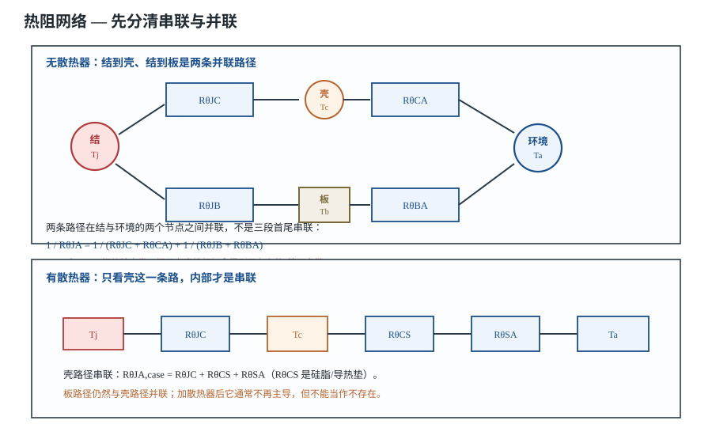
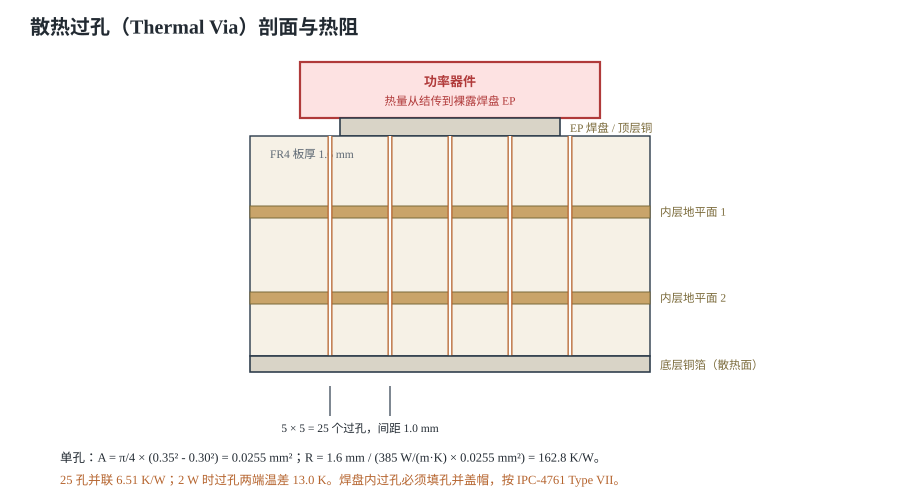

# 热设计：散热、铜箔与散热器 Thermal Design

一颗 MOS 管导通 10 A、热态导通电阻 20 mΩ，功耗就是 $10^2\times0.020=2.0$ W。这个数字看起来不大，但封装的结到环境热阻如果是 60 K/W，环境 50 °C 时结温就是 $50+2.0\times60=170$ °C，芯片要么热关断，要么在几次开关循环后烧穿。热设计要回答的不是“烫不烫”，而是：**这点功耗，能不能在最高环境温度下，把结温压到数据手册上限以下，并且留出余量。**

本章把热传导、对流、辐射三条路径拆开，给出串联与并联热阻网络的正确算法，算清热过孔、铜箔面积和 2 W MOS 在四层板上的完整案例。器件热阻、铜箔导热系数等参数是典型量级，具体以所选器件数据手册和实测为准。

## 1. 设计动机

::: motivation 为什么“2 W”也会烧
**现场一：小铜箔上的 2 W。** DPAK 封装、结到环境热阻 60 K/W，环境 50 °C，结温 170 °C；数据手册上限 125 °C。板子只跑了十几秒就热关断，客户以为“芯片坏了”，其实是铜箔面积不够。

**现场二：热过孔没塞孔。** 裸露焊盘下方打了 16 个 0.3 mm 过孔，焊接时锡膏沿孔壁吸走，X-ray 下焊盘空洞明显，热阻比设计值高出一大截；同样的板子，有的芯片温度正常，有的明显偏高。

**现场三：只看 θJA 不看测试板。** 数据手册写 θJA = 40 K/W，实际板子的铜箔只有手册测试板的三分之一，等效 θJA 变成 70 K/W。环境 25 °C、2 W 时，前者对应 $25+2\times40=105$ °C，后者对应 $25+2\times70=165$ °C；这还没算夏天机箱内的温升。

热设计不是“加个散热器”这么简单。它是一条从结到环境的**热流路径**：结→壳/板→铜箔/过孔→空气。每一段都有热阻，路径有串联也有并联；算错一段，后面全错。
:::

| 你想确认 | 先查/先算 | 判据（典型量级，以数据手册为准） |
|---|---|---|
| 结温会不会超 | $T_j=T_a+P R_{\theta JA}$ | $T_j$ 低于上限并留 10~20 °C |
| 封装够不够 | $R_{\theta JC}$、$R_{\theta JB}$ | 功率大时优先带裸露焊盘的封装 |
| 铜箔要多大 | $A=P/(h_{\mathrm{eff}}\Delta T)$ | 自然对流 $h_{\mathrm{eff}}\approx10$ W/(m²·K) |
| 要多少个热过孔 | $R_{\mathrm{via}}=L/(kA)$ | 单孔约 100~200 K/W，按并联算 |
| 走线能不能载流 | IPC-2221 或 IPC-2152 | 10 A、30 K 温升约需 3.7 mm 宽（1 oz 外层） |
| 要不要散热器 | 壳路径与板路径并联 | 板路径不够时才加，别默认加 |

**不算会摔在哪，四个带数字的代价：**

1. **把 2 W 当成“小功率”**：60 K/W 封装在 50 °C 环境下结温 170 °C，超过 125 °C 上限 45 °C；不是“有点热”，是热关断。
2. **把热阻当串联**：$2+12+20=34$ K/W 的算法漏掉了壳路径与板路径的并联关系，会把结温算高或算低，方向取决于你用了哪条路径。
3. **热过孔按“打了就行”**：16 个 0.3 mm 过孔并联约 10.2 K/W，2 W 下过孔两端就差 20.4 °C；孔数不够，铜箔再大也导不下去。
4. **铜箔面积按“整板面积”算**：内层铜不直接对流，阻焊覆盖、走线切缝、连接器开孔都会吃掉有效面积；按整板面积算，热阻会低估 30%~50%。

## 2. 定义与直观：三条路径与热阻网络

### 2.1 热像电，但只在稳态、线性化之后

把热流想成电流，把温度想成电压，把热阻想成电阻：

$$T_j=T_a+P R_{\theta JA}$$

- $T_j$：结温，芯片内部发热点的温度（°C）；
- $T_a$：环境温度（°C）；
- $P$：器件耗散功率（W）；
- $R_{\theta JA}$：结到环境的热阻（K/W，数值上与 °C/W 相同）。

这个式子的前提是**稳态**、**热阻在工作点附近近似常数**。瞬态时芯片的硅片、铜箔、封装都有热容，短脉冲下结温上升会比稳态估算慢；辐射也不是线性电阻，只有在给定温差附近线性化后才能写成 $R_{\theta}$。所以热阻是“工作点附近的等效斜率”，不是材料的固有常数。

### 2.2 三条散热路径

热量从芯片出来，最终到环境，只有三条路：

- **热传导（Conduction）**：沿着固体走。结→焊料→铜箔→过孔→内层铜，都是传导。傅里叶定律：

$$Q=kA\frac{\Delta T}{L},\qquad R_{\theta,\mathrm{cond}}=\frac{L}{kA}$$

其中 $Q$ 是热流（W）；$k$ 是导热系数（W/(m·K)）；$A$ 是垂直于热流的截面积（m²）；$L$ 是路径长度（m）；$\Delta T$ 是两端温差（K）。

- **对流（Convection）**：铜箔表面把热交给空气。牛顿冷却定律：

$$Q=hA(T_s-T_a),\qquad R_{\theta,\mathrm{conv}}=\frac{1}{hA}$$

其中 $h$ 是对流换热系数（W/(m²·K)）；$A$ 是有效换热面积（m²）；$T_s$ 是表面温度（°C）。

- **辐射（Radiation）**：所有高于绝对零度的表面都在辐射。斯特藩-玻尔兹曼定律：

$$Q=\varepsilon\sigma A\left(T_s^4-T_a^4\right)$$

其中 $\varepsilon$ 是发射率（无量纲，阻焊层约 0.9）；$\sigma=5.67\times10^{-8}$ W/(m²·K⁴) 是斯特藩常数；温度必须用开尔文（K）。

在温差不大时，辐射也可以线性化成热阻：

$$h_{\mathrm{rad}}=\varepsilon\sigma\left(T_s^2+T_a^2\right)\left(T_s+T_a\right),\qquad R_{\theta,\mathrm{rad}}=\frac{1}{h_{\mathrm{rad}}A}$$

**数量级**：$T_s=75$ °C、$T_a=25$ °C、$\varepsilon=0.9$ 时，$h_{\mathrm{rad}}\approx6.9$ W/(m²·K)；自然对流 $h$ 约 3~5 W/(m²·K)；两者合起来用 $h_{\mathrm{eff}}\approx10$ W/(m²·K) 估算是保守的。封闭外壳里空气不流通，$h_{\mathrm{eff}}$ 可能只有 5 W/(m²·K)，铜箔面积要翻倍。

### 2.3 热阻网络：结到壳、结到板是并联

这是最容易算错的一步。数据手册给了三个热阻：

- $R_{\theta JC}$：结到壳（Junction-to-Case），热量从芯片顶部/外壳走；
- $R_{\theta JB}$：结到板（Junction-to-Board），热量从引脚或裸露焊盘走到 PCB；
- $R_{\theta JA}$：结到环境（Junction-to-Ambient），是**整个系统**的热阻，不是封装单独的热阻。

从结出发，热量分成两条路：

1. **壳路径**：结→壳（$R_{\theta JC}$）→环境（$R_{\theta CA}$）；
2. **板路径**：结→板（$R_{\theta JB}$）→环境（$R_{\theta BA}$）。

两条路在“结”和“环境”两个节点之间**并联**：

$$R_{\theta JA}=\left(R_{\theta JC}+R_{\theta CA}\right)\parallel\left(R_{\theta JB}+R_{\theta BA}\right)$$

其中并联算子定义为：

$$R_1\parallel R_2=\frac{R_1R_2}{R_1+R_2}$$

- $R_{\theta CA}$：壳到环境（K/W）；无散热器时很大，通常 50~150 K/W；
- $R_{\theta BA}$：板到环境（K/W），由铜箔面积、过孔、表面处理、空气流动决定；
- 其余符号同上。

**纠正一个常见错误**：不少资料写成 $R_{\theta JA}=R_{\theta JC}+R_{\theta JB}+R_{\theta BA}$，把三条路径当成一条串联链。这个式子在物理上不成立：$R_{\theta JC}$ 和 $R_{\theta JB}$ 都从结出发，是并行的两个分支；只有“壳→散热器→环境”这一条分支内部才是串联。正确做法是先算两条分支，再并联。把三者直接相加，会凭空多出一段“结→壳→板”的热阻，估算可能偏大；如果只取其中一条分支，又会忽略另一条，估算偏小。

### 2.4 有散热器时：壳路径变成串联链

加了散热器，壳路径变成：

$$R_{\theta JA,\mathrm{case}}=R_{\theta JC}+R_{\theta CS}+R_{\theta SA}$$

- $R_{\theta CS}$：壳到散热器（Case-to-Sink），主要是导热硅脂/导热垫的热阻（K/W）；
- $R_{\theta SA}$：散热器到环境（Sink-to-Ambient），由散热器面积、齿形、风速决定（K/W）。

这时总热阻仍然是壳路径与板路径并联：

$$R_{\theta JA}=R_{\theta JA,\mathrm{case}}\parallel\left(R_{\theta JB}+R_{\theta BA}\right)$$

散热器让壳路径从“$R_{\theta JC}+R_{\theta CA}$”变成“$R_{\theta JC}+R_{\theta CS}+R_{\theta SA}$”，通常从 100 K/W 级降到 5~15 K/W 级。**散热器优化的是壳路径，不是笼统的“$R_{\theta BA}$”**；把散热器说成“降低板到环境热阻”是口径错误。

## 3. 定量关系：热阻、过孔与铜箔

### 3.1 传导：FR4 与铜差三个数量级

取 100 mm² 的传热面积、1.6 mm 的板厚：

- FR4 的导热系数 $k\approx0.25$ W/(m·K)（典型量级，随树脂含量和方向变化）：

$$R_{\theta,\mathrm{FR4}}=\frac{1.6\times10^{-3}}{0.25\times100\times10^{-6}}=\frac{1.6\times10^{-3}}{2.5\times10^{-5}}=64\ \mathrm{K/W}$$

- 铜的导热系数 $k\approx385$ W/(m·K)（电镀铜典型量级）：

$$R_{\theta,\mathrm{Cu}}=\frac{1.6\times10^{-3}}{385\times100\times10^{-6}}=\frac{1.6\times10^{-3}}{3.85\times10^{-2}}=0.0416\ \mathrm{K/W}$$

两者相差 $64/0.0416=1540$ 倍。**热量在 FR4 里几乎走不动，必须靠铜箔、过孔和金属焊盘把它“接”出来。** 这也解释了为什么裸焊盘（Exposed Pad，EP）下面要铺铜、打热过孔：不是为了好看，是为了给热流一条低阻通道。

### 3.2 对流与辐射：50 cm² 铜箔大约 20 K/W

取 $h_{\mathrm{eff}}=10$ W/(m²·K)、有效面积 $A=50$ cm² $=50\times10^{-4}=5.0\times10^{-3}$ m²：

$$R_{\theta,\mathrm{conv}}=\frac{1}{10\times5.0\times10^{-3}}=\frac{1}{0.05}=20\ \mathrm{K/W}$$

也就是说，2 W 的热流经过这块铜箔，铜箔平均比环境高：

$$\Delta T=P R_{\theta,\mathrm{conv}}=2.0\times20=40\ \mathrm{K}$$

环境 50 °C 时，铜箔约 90 °C。**这 40 K 是“板到环境”的温升，不是结温；结温还要加上结到板的热阻。**

面积减半到 25 cm²：

$$R_{\theta,\mathrm{conv}}=\frac{1}{10\times2.5\times10^{-3}}=40\ \mathrm{K/W}$$

同样 2 W，板到环境温升变成 80 K。**铜箔面积和热阻是反比关系，面积减半，热阻翻倍。**

### 3.3 热过孔：单孔一百多 K/W，靠并联

热过孔是一根镀铜的“热管”。一阶估算把孔壁看成空心铜柱：

$$R_{\mathrm{via}}=\frac{L}{k_{\mathrm{Cu}}A_{\mathrm{barrel}}}$$

$$A_{\mathrm{barrel}}=\frac{\pi}{4}\left(d_o^2-d_i^2\right),\qquad d_o=d_i+2t_{\mathrm{plating}}$$

- $L$：孔长，等于板厚（m）；
- $d_i$：钻孔直径（m）；
- $t_{\mathrm{plating}}$：孔壁镀铜厚度（m），常见 20~25 μm；
- $d_o$：镀铜后的外径（m）；
- $k_{\mathrm{Cu}}$：铜导热系数，取 385 W/(m·K)。

**算例**：板厚 1.6 mm、钻孔 0.30 mm、镀铜 25 μm。

$$d_o=0.30+2\times0.025=0.35\ \mathrm{mm}$$

$$A_{\mathrm{barrel}}=\frac{\pi}{4}\left(0.35^2-0.30^2\right)=\frac{\pi}{4}\left(0.1225-0.09\right)=0.02553\ \mathrm{mm^2}=2.553\times10^{-8}\ \mathrm{m^2}$$

$$R_{\mathrm{via}}=\frac{1.6\times10^{-3}}{385\times2.553\times10^{-8}}=\frac{1.6\times10^{-3}}{9.829\times10^{-6}}=162.8\ \mathrm{K/W}$$

这个数字比很多人想象的大：**一个 0.3 mm 的过孔，热阻和一根细电阻差不多。** 所以热焊盘下面不能只打一两个孔。$n$ 个孔并联：

$$R_{\mathrm{via},n}=\frac{R_{\mathrm{via}}}{n}$$

- 16 孔：$162.8/16=10.18$ K/W；
- 25 孔：$162.8/25=6.51$ K/W；
- 36 孔：$162.8/36=4.52$ K/W。

2 W 热流经过 25 孔，过孔两端温差：

$$\Delta T_{\mathrm{via}}=2.0\times6.51=13.0\ \mathrm{K}$$

**注意**：这是把孔壁当成完整 1.6 mm 铜柱的保守算法；如果过孔在每一层都与大面积铜平面相连，热量会在中途分流，实际热阻更低。反过来，如果孔壁镀铜偏薄、孔内有空洞、或者过孔没有连到内层铜，实际热阻会更高。工程上按 1.5~2 倍余量取孔数，并以热仿真/实测为准。

**纠正一个常见说法**：“过孔阻焊定义（mask-defined）可以防吸锡”。阻焊定义（SMD）说的是**焊盘开窗**与铜盘的关系，不是过孔防吸锡的手段。焊盘内的过孔要按 IPC-4761 做**填孔并盖帽**（Type VII，VIPPO），或者至少塞孔+阻焊覆盖；只把阻焊往孔上盖一层，焊接时锡膏仍可能沿孔壁吸走，形成空洞。热过孔如果不在焊接区，可以按 Type I/II 盖油；一旦在焊盘内，就必须按填孔工艺处理。

### 3.4 铜箔面积：散 2 W 需要多大

把铜箔看成一块等温的换热面，忽略边缘和辐射的非线性，所需有效面积：

$$A=\frac{P}{h_{\mathrm{eff}}\Delta T_{\mathrm{board}}}$$

其中 $\Delta T_{\mathrm{board}}=T_{\mathrm{board}}-T_a$ 是允许的板温升（K）。

**算例**：$P=2.0$ W，允许板温升 50 K，$h_{\mathrm{eff}}=10$ W/(m²·K)：

$$A=\frac{2.0}{10\times50}=\frac{2.0}{500}=4.0\times10^{-3}\ \mathrm{m^2}=40\ \mathrm{cm^2}$$

这是**总有效换热面积**。如果板子双面都铺铜、两面都能对流，每面 20 cm²；如果只有一面，就要 40 cm²。实际还要打折：阻焊覆盖、走线切缝、连接器开孔、安装孔、器件遮挡都会减少有效面积。按 70% 覆盖率估算，双面板需要：

$$A_{\mathrm{board}}=\frac{40}{2\times0.7}=28.6\ \mathrm{cm^2}$$

也就是约 53.5 mm × 53.5 mm 的板子。这个数量级说明：**2 W 不加散热器并非不可能，但需要一块不小的板子和连续的铜面；30 mm × 30 mm 的小板基本不够。**

### 3.5 IPC-2221 的载流—温升：算的是截面，不是散热面积

IPC-2221 给出的经验式是**载流能力**，不是“铜箔面积散热能力”：

$$A_{\mathrm{cu}}=\left(\frac{I}{k\Delta T^{0.44}}\right)^{1/0.725}$$

- $I$：允许电流（A）；
- $\Delta T$：允许温升（K 或 °C，差值相同）；
- $A_{\mathrm{cu}}$：铜箔截面积（mil²）；
- $k$：外层 $k=0.048$，内层 $k=0.024$（内层散热差）；
- 线宽 $W=A_{\mathrm{cu}}/t_{\mathrm{cu}}$，1 oz 铜 $t_{\mathrm{cu}}=1.37$ mil $=35$ μm。

**算例**：10 A、允许温升 30 K、1 oz 外层。

$$\Delta T^{0.44}=30^{0.44}=4.47$$

$$A_{\mathrm{cu}}=\left(\frac{10}{0.048\times4.47}\right)^{1/0.725}=\left(\frac{10}{0.2146}\right)^{1.379}=46.6^{1.379}=200.4\ \mathrm{mil^2}$$

$$W=\frac{200.4}{1.37}=146.3\ \mathrm{mil}=3.72\ \mathrm{mm}$$

内层 $k=0.024$，同样 10 A、30 K：

$$A_{\mathrm{cu}}=\left(\frac{10}{0.024\times4.47}\right)^{1.379}=\left(\frac{10}{0.1073}\right)^{1.379}=93.2^{1.379}=521.2\ \mathrm{mil^2}$$

$$W=\frac{521.2}{1.37}=380.5\ \mathrm{mil}=9.66\ \mathrm{mm}$$

**这就是“外层 3.7 mm、内层 9.7 mm”的来源。** 下表是 1 oz 外层、不同电流和温升的线宽，按同一公式算得，可逐项复算：

| 电流 A | 10 K 线宽 mm | 20 K 线宽 mm | 30 K 线宽 mm |
|---|---|---|---|
| 1 | 0.302 | 0.198 | 0.155 |
| 2 | 0.786 | 0.516 | 0.404 |
| 5 | 2.78 | 1.83 | 1.43 |
| 10 | 7.24 | 4.75 | 3.72 |
| 15 | 12.7 | 8.31 | 6.50 |
| 20 | 18.8 | 12.4 | 9.66 |

**纠正一个任务书/常见资料的混用**：IPC-2221 的图表横轴是“导体截面积/线宽”，纵轴是“电流”，参数是“温升”；它回答的是“多粗的线能过多大电流而不超过温升”，**不回答“多少平方厘米铜箔能散掉 2 W”**。后者要用 $A=P/(h\Delta T)$ 或热仿真。把 IPC-2221 的载流曲线当成散热面积曲线，是两类问题混为一谈。另外，IPC-2221 的载流图表已被 IPC-2152 用板厚、铜厚、热导率修正；正式设计以 IPC-2152 或厂商计算器为准，IPC-2221 只用于快速估算。

### 3.6 适用条件与失效边界

- **$R_{\theta JA}$ 是系统量**：数据手册的值对应特定测试板（JESD51-7）和Still Air（JESD51-2A）；实际铜箔、外壳、风速不同，$R_{\theta JA}$ 可能差 1.5~2 倍。
- **$R_{\theta JC}$ 的测试面**：不同厂商可能测“壳顶”或“壳底”，带散热器时要以数据手册的测试条件为准。
- **辐射发射率**：裸铜发射率很低（约 0.05），阻焊层约 0.9；计算辐射时不能把裸铜当黑体。
- **自然对流方向**：竖直板比水平板好；封闭外壳内空气不流通，$h$ 可能降到 5 W/(m²·K) 以下。
- **瞬态**：短脉冲下热容起作用，稳态热阻会高估温升；但连续开关的功率器件按稳态算。
- **热过孔有效性**：孔壁镀铜不足、孔内空洞、未连到内层铜，都会让实际热阻高于计算值；X-ray/切片验证。
- **焊接空洞**：EP 焊盘空洞会显著抬高结到板热阻；按 IPC-7093 控制钢网开孔和回流曲线。

## 4. 典型计算：从串联链到 2 W MOS 的完整算例

### 4.1 串联链算例：10 W 功放加散热器

**需求**：$P=10$ W，$T_a=40$ °C，$R_{\theta JC}=1.5$ K/W，$R_{\theta CS}=0.5$ K/W，$R_{\theta SA}=4.0$ K/W。求结温。

$$T_j=T_a+P\left(R_{\theta JC}+R_{\theta CS}+R_{\theta SA}\right)$$

$$T_j=40+10\times(1.5+0.5+4.0)=40+10\times6.0=100\ ^{\circ}\mathrm{C}$$

结果 100 °C。若上限 125 °C，余量 25 °C。这个例子是**壳路径内部的串联**；板路径仍然与它并联，只是加散热器后壳路径热阻小，板路径的分流比例下降。

**验算 $R_{\theta CS}$**：导热硅脂厚 0.1 mm、面积 100 mm²、导热系数 3 W/(m·K)：

$$R_{\theta,\mathrm{TIM}}=\frac{0.1\times10^{-3}}{3\times100\times10^{-6}}=\frac{10^{-4}}{3\times10^{-4}}=0.333\ \mathrm{K/W}$$

再加接触热阻，取 0.5 K/W 是合理量级。硅脂越厚，这一项越大；涂 0.3 mm 就变成 1.0 K/W，10 W 下多 5 °C。

### 4.2 并联网络算例：为什么不能把三段热阻相加

**需求**：$P=2$ W，$T_a=50$ °C，$R_{\theta JC}=2$ K/W，$R_{\theta CA}=100$ K/W，$R_{\theta JB}=12$ K/W，$R_{\theta BA}=20$ K/W。求结温。

先算两条分支：

$$R_{\mathrm{case}}=R_{\theta JC}+R_{\theta CA}=2+100=102\ \mathrm{K/W}$$

$$R_{\mathrm{board}}=R_{\theta JB}+R_{\theta BA}=12+20=32\ \mathrm{K/W}$$

再并联：

$$R_{\theta JA}=\frac{102\times32}{102+32}=\frac{3264}{134}=24.36\ \mathrm{K/W}$$

$$T_j=50+2\times24.36=50+48.7=98.7\ ^{\circ}\mathrm{C}$$

**如果错误地串联相加**：

$$R_{\theta JA,\mathrm{wrong}}=2+12+20=34\ \mathrm{K/W}$$

$$T_j=50+2\times34=118\ ^{\circ}\mathrm{C}$$

差了约 19 °C。更离谱的是把 $R_{\theta CA}=100$ 也塞进串联：$2+100+12+20=134$ K/W，$T_j=318$ °C，完全失真。**方向不一定总是“偏大”：如果你只用了板路径、忘了壳路径，就会偏小；如果你把壳路径的环境热阻也串进来，就会偏大。** 正确做法永远是先画网络，再串并联。

### 4.3 热过孔算例：25 孔够不够

沿用 3.3 节的单孔 162.8 K/W、板厚 1.6 mm、0.3 mm 钻孔、25 μm 镀铜。

- 12 孔：$162.8/12=13.57$ K/W；
- 16 孔：$162.8/16=10.18$ K/W；
- 25 孔：$162.8/25=6.51$ K/W；
- 36 孔：$162.8/36=4.52$ K/W。

若目标是把过孔两端温差控制在 15 K 以内、$P=2$ W：

$$R_{\mathrm{via,total}}\leq\frac{15}{2}=7.5\ \mathrm{K/W}$$

$$n\geq\frac{162.8}{7.5}=21.7\Rightarrow n=22$$

取 25 孔，实际 6.51 K/W，温差 13.0 K，满足。若只打 16 孔，温差 20.4 K，超过 15 K 的目标；若只打 9 孔，温差 36.2 K，热阻已经和铜箔对流一个量级，铜箔再大也会被过孔卡住。

### 4.4 完整算例：2 W MOS 用四层板散热

#### 4.4.1 需求与假设

| 项目 | 数值/假设 | 说明 |
|---|---|---|
| 功耗 $P$ | 2.0 W | 10 A 导通，热态 $R_{DS(on)}=20$ mΩ：$10^2\times0.020=2.0$ W |
| 环境 $T_a$ | 50 °C | 封闭机箱内 |
| 结温上限 | 125 °C | 数据手册值 |
| 设计目标 | $T_j\leq115$ °C | 留 10 °C 余量 |
| 封装 | DPAK（TO-252） | $R_{\theta JC}=2$ K/W、$R_{\theta JB}=12$ K/W（典型量级，以数据手册为准） |
| 板子 | 4 层、1.6 mm、60 mm × 60 mm | 外层 1 oz，内层 0.5 oz |
| 铜箔覆盖 | 双面 70% | 有效换热面积 50.4 cm² |
| 热过孔 | 25 个，0.3 mm 钻孔，25 μm 镀铜 | 5 × 5 阵列，1.0 mm 间距 |
| 对流系数 | $h_{\mathrm{eff}}=10$ W/(m²·K) | 自然对流+辐射，保守 |

**功耗的来历**：示例 MOS 在 25 °C 时 $R_{DS(on)}=13$ mΩ，100 °C 时约 1.5 倍，即 19.5 mΩ；10 A 导通损耗 $10^2\times0.0195=1.95$ W，加开关损耗 0.05 W，合计 2.0 W。这是示例值，实际以所选器件数据手册的 $R_{DS(on)}$-温度曲线为准。

#### 4.4.2 第一步：算板到环境的热阻

60 mm × 60 mm 板，双面 70% 铜：

$$A_{\mathrm{cu}}=2\times60\times60\times0.70=5040\ \mathrm{mm^2}=50.4\ \mathrm{cm^2}=5.04\times10^{-3}\ \mathrm{m^2}$$

$$R_{\theta BA}=\frac{1}{h_{\mathrm{eff}}A_{\mathrm{cu}}}=\frac{1}{10\times5.04\times10^{-3}}=\frac{1}{0.0504}=19.84\ \mathrm{K/W}$$

如果只算单面 25.2 cm²，$R_{\theta BA}=39.7$ K/W，几乎翻倍。**双面铺铜不是“多一点铜”，是把换热面积翻倍。**

#### 4.4.3 第二步：算热过孔

25 孔并联：

$$R_{\mathrm{via},25}=\frac{162.8}{25}=6.51\ \mathrm{K/W}$$

#### 4.4.4 第三步：算板路径与总热阻

板路径还包括结到板、扩散热阻。取扩散/收缩余量 2 K/W（连续铜面时较小，走线切缝、过孔密集区会更大）：

$$R_{\mathrm{board}}=R_{\theta JB}+R_{\mathrm{via},25}+R_{\mathrm{spread}}+R_{\theta BA}$$

$$R_{\mathrm{board}}=12+6.51+2+19.84=40.35\ \mathrm{K/W}$$

壳路径（无散热器）：

$$R_{\mathrm{case}}=R_{\theta JC}+R_{\theta CA}=2+100=102\ \mathrm{K/W}$$

总热阻：

$$R_{\theta JA}=\frac{102\times40.35}{102+40.35}=\frac{4115.7}{142.35}=28.91\ \mathrm{K/W}$$

结温：

$$T_j=50+2.0\times28.91=50+57.8=107.8\ ^{\circ}\mathrm{C}$$

**结论**：$107.8$ °C 低于设计目标 115 °C，距上限 125 °C 还有 17.2 °C。**不加散热器，在这块 60 mm × 60 mm 的四层板上可行。**

#### 4.4.5 第四步：反算所需铜面积与热孔数

**铜面积**：若要求 $T_j\leq115$ °C，则总热阻上限：

$$R_{\theta JA,\max}=\frac{115-50}{2.0}=\frac{65}{2.0}=32.5\ \mathrm{K/W}$$

壳路径 102 K/W 与板路径并联，要得到 32.5 K/W，板路径必须满足：

$$R_{\mathrm{board},\max}=\frac{1}{1/32.5-1/102}=\frac{1}{0.03077-0.00980}=\frac{1}{0.02097}=47.7\ \mathrm{K/W}$$

扣除 $R_{\theta JB}=12$、$R_{\mathrm{via}}=6.51$、扩散 2 K/W：

$$R_{\theta BA,\max}=47.7-12-6.51-2=27.2\ \mathrm{K/W}$$

$$A_{\min}=\frac{1}{10\times27.2}=3.68\times10^{-3}\ \mathrm{m^2}=36.8\ \mathrm{cm^2}$$

**至少 36.8 cm² 有效铜面积**；选 50.4 cm²，余量 37%。

**热孔数**：若要求过孔两端温差不超过 15 K：

$$n_{\min}=\frac{162.8}{15/2.0}=\frac{162.8}{7.5}=21.7\Rightarrow22$$

若只要求 $T_j\leq125$ °C（不留余量），板路径上限 59.3 K/W，过孔热阻上限：

$$R_{\mathrm{via},\max}=59.3-12-2-19.84=25.5\ \mathrm{K/W}$$

$$n_{\min}=\frac{162.8}{25.5}=6.4\Rightarrow7$$

所以：**热学最低 7 孔（125 °C 上限）、12 孔（115 °C 目标）、22 孔（过孔温差 ≤15 K）**。再考虑电流：10 A 均分到 25 孔，每孔 0.4 A；0.3 mm 过孔按 1 A 级载流估算，至少 10 孔。取三者最大值并留余量，选 **25 孔**。这就是“热孔数不是拍脑袋，是热阻、电流、工艺三者取大”的意思。

#### 4.4.6 第五步：判断不加散热器是否可行

**可行的情况**：60 mm × 60 mm 四层板、双面 70% 铜、25 个热过孔，$T_j=107.8$ °C，低于 115 °C 目标。

**不可行的情况**：同样设计放到 40 mm × 40 mm 板上，双面 70% 铜：

$$A_{\mathrm{cu}}=2\times40\times40\times0.70=2240\ \mathrm{mm^2}=22.4\ \mathrm{cm^2}$$

$$R_{\theta BA}=\frac{1}{10\times2.24\times10^{-3}}=44.64\ \mathrm{K/W}$$

$$R_{\mathrm{board}}=12+6.51+2+44.64=65.15\ \mathrm{K/W}$$

$$R_{\theta JA}=\frac{102\times65.15}{102+65.15}=\frac{6645.3}{167.15}=39.76\ \mathrm{K/W}$$

$$T_j=50+2.0\times39.76=50+79.5=129.5\ ^{\circ}\mathrm{C}$$

超过 125 °C 上限，**不可行**。要么把板子加大到 60 mm × 60 mm，要么加散热器，要么降低功耗/提高效率。

**加散热器的对比**：取 $R_{\theta CS}=1.0$ K/W、$R_{\theta SA}=8$ K/W：

$$R_{\mathrm{case}}=2+1+8=11\ \mathrm{K/W}$$

$$R_{\theta JA}=\frac{11\times65.15}{11+65.15}=\frac{716.7}{76.15}=9.41\ \mathrm{K/W}$$

$$T_j=50+2.0\times9.41=68.8\ ^{\circ}\mathrm{C}$$

散热器把结温从 129.5 °C 降到 68.8 °C，代价是体积、成本、组装工序和可靠性风险。**如果 60 mm × 60 mm 板子放得下，优先用铜箔和过孔；放不下再考虑散热器。**

#### 4.4.7 第六步：载流与工艺校验

10 A 电流在 1 oz 外层、30 K 温升下需要 3.72 mm 宽（3.5 节）。铜箔平面宽度 60 mm，看似足够，但要检查**瓶颈**：从 MOS 漏极到平面、从平面到连接器、过孔反焊盘处的有效宽度。任何一个 1 mm 宽的细颈都会成为热点。25 个过孔均分 10 A，每孔 0.4 A，低于 0.3 mm 过孔的 1 A 级估算，满足。

#### 4.4.8 第七步：迭代与验证

$R_{DS(on)}$ 随结温上升，功耗又会随温度上升。先用假设 $T_j\approx100$ °C 算 $P=2.0$ W，得到 $T_j=107.8$ °C；再用 107.8 °C 查 $R_{DS(on)}$，约 1.52 倍，$P=1.97+0.05=2.02$ W，结温 108.3 °C，与 107.8 °C 相差 0.5 °C，收敛。**如果忽略这个正反馈，用 25 °C 的 $R_{DS(on)}$ 算，$P=1.3$ W，$T_j=87.6$ °C，会低估 20 °C。**

验证步骤：

1. 热电偶贴 EP 旁边的铜箔，稳定 30 min 读板温；
2. 用 $T_j=T_a+P R_{\theta JA}$ 反算，与红外热像对照（注意发射率设置）；
3. 用数据手册的 $R_{DS(on)}$-温度曲线反算实际功耗；
4. X-ray 检查 EP 空洞，切片看孔壁镀铜；
5. 在最高环境温度、最大负载、最差风道下复测。

## 5. 工程含义：数量级、余量与失效边界

### 5.1 先有数量级，再查手册

| 项目 | 典型量级 | 备注 |
|---|---|---|
| SOT-23 结到环境 | 200~250 K/W | 无铜箔、静止空气 |
| DPAK 结到环境 | 40~60 K/W | 1 in² 铜箔，具体看板子 |
| DPAK 结到壳 | 1.5~3 K/W | 数据手册 |
| QFN 结到板 | 5~15 K/W | 带热焊盘，取决于过孔 |
| 热过孔单孔 | 100~200 K/W | 1.6 mm 板、0.3 mm 钻孔 |
| 自然对流 $h$ | 3~10 W/(m²·K) | 竖直板、开放空间 |
| 自然对流+辐射 $h_{\mathrm{eff}}$ | 10~15 W/(m²·K) | 阻焊层发射率约 0.9 |
| 导热硅脂 | 0.2~1 K/W | 1 cm²、0.1 mm 厚 |
| 1 oz 铜厚度 | 35 μm | 0.5 oz 约 17.5 μm |

**这些是典型量级，具体以数据手册和实测为准。** 不同封装、不同铜箔、不同风道能差一个数量级。

### 5.2 设计顺序

1. **定功耗**：按最高结温下的 $R_{DS(on)}$、最大电流、开关损耗算 $P$，不要用 25 °C 参数。
2. **定上限**：$T_{j,\max}$ 来自数据手册；设计目标再降 10~20 °C。
3. **定环境**：最高 $T_a$、外壳尺寸、风速、安装方向。
4. **选封装**：功率大时优先带 EP 的 DPAK/DFN/QFN；先看 $R_{\theta JC}$、$R_{\theta JB}$。
5. **算热阻预算**：$R_{\theta JA,\max}=(T_{j,\mathrm{target}}-T_a)/P$。
6. **分配路径**：壳路径（封装+散热器）与板路径（铜箔+过孔）并联；哪条便宜走哪条。
7. **定铜面积、过孔数、散热器**：按 3.4、3.3 的公式反算，留 1.5~2 倍余量。
8. **验证**：热像、热电偶、X-ray、切片；必要时热仿真。

### 5.3 什么时候假设会失效

- **数据手册的测试板不是你的板**：JESD51-7 测试板有特定铜箔面积和层数，实际板子铜少、过孔少，$R_{\theta JA}$ 会变大。
- **封闭外壳**：自然对流被挡住，$h$ 下降；夏天机箱内 60~70 °C 很常见，不能按 25 °C 室温算。
- **辐射被低估**：阻焊层发射率高，辐射在自然对流里占很大一部分；但附近有热源/遮挡时，辐射会被挡回。
- **热过孔没连到内层铜**：孔打了但内层是孤岛，热流走不通；过孔必须落在连续的铜平面上。
- **焊接空洞**：EP 焊盘的空洞会抬高结到板热阻，具体幅度取决于空洞位置、面积和分布，以 X-ray/切片实测为准；空洞大时，前面按连续焊层算的热阻会明显偏乐观。
- **瞬态与脉冲**：短脉冲下热容吸收能量，稳态公式高估温升；但重复频率高、占空比大时仍按平均功耗算稳态。
- **热 runaway**：MOS 的 $R_{DS(on)}$ 随温度上升，功耗随温度上升；如果散热设计刚好在临界点，可能进入正反馈。按 worst-case 迭代，不要只算一次。

### 5.4 与周边章节的关系

- 封装与焊盘尺寸、热焊盘开窗、钢网开孔见[原理图、封装与库管理](schematic-library.md)；
- 热过孔的塞孔/盖帽、拼板与回流工艺见[DFM 与焊接工艺](dfm-process.md)；
- 热检查项如何进入 DRC/评审清单见[EDA 工具与工作流](eda-tools.md)；
- 大电流走线的载流与铜厚见[布线](routing.md)，叠层与铜厚分配见[叠层设计](pcb-stackup.md)；
- LDO 的功耗与结温算例见[LDO 原理、选型与功耗计算](../power/ldo.md)，MOS 的导通损耗与热态电阻见[MOSFET](../components/mosfet.md)。

## 6. 常见坑

::: pitfall 三条路径不是一条链
- **现象**：按 $R_{\theta JC}+R_{\theta JB}+R_{\theta BA}$ 算出的结温忽高忽低，和实测对不上。**原因**：把结到壳、结到板两条并联路径当成串联；或者只取一条路径，忘了另一条的分流。**解决**：先画热阻网络，壳路径与板路径分别串联、再并联；用 $R_{\theta JA}=(R_{\theta JC}+R_{\theta CA})\parallel(R_{\theta JB}+R_{\theta BA})$ 复算。
:::

::: pitfall 热过孔吸锡
- **现象**：EP 焊盘 X-ray 空洞大，同样的板子有的芯片烫、有的不烫。**原因**：热过孔在焊盘内没有填孔盖帽，回流时锡膏沿孔壁吸走；或者钢网开孔太大、回流曲线不对。**解决**：按 IPC-4761 Type VII 填孔并盖帽；钢网开孔分段（例如 4×4 小孔），控制空洞；用 X-ray 抽检。
:::

::: pitfall 铜箔面积与手册热阻
- **现象**：铜箔铺了很大一块，结温还是高。**原因**：铜箔在内层、被阻焊覆盖、被走线切缝，实际有效对流面积远小于几何面积；或者过孔没连到内层铜。**解决**：按有效外露面积算 $R_{\theta BA}$，内层只当扩散层；确保过孔落在连续铜平面；双面铺铜。
- **现象**：数据手册写 $R_{\theta JA}=40$ K/W，实际却到 70 K/W。**原因**：手册测试板铜箔面积、层数、风道与实板不同；封闭外壳里 $h$ 更低。**解决**：按实际板子重算，留 1.5~2 倍余量；用热像/热电偶反算实际 $R_{\theta JA}$。
:::

::: pitfall 散热器与热敏元件
- **现象**：加了散热器，温降却不明显。**原因**：硅脂太厚、接触压力不足、散热器齿被挡住；或者壳路径不是主导路径，板路径仍然很热。**解决**：硅脂薄而均匀（0.1 mm 量级）、压紧；先确认哪条路径主导，再决定加散热器还是加铜箔。
- **现象**：电解电容放在 MOS 旁边，半年后鼓包。**原因**：电解电容寿命随温度近似按每 10 °C 减半（Arrhenius 经验法则，具体以电容手册为准），热源把局部环境温度抬高 20 °C，寿命只剩四分之一。**解决**：热敏元件远离热源，必要时加隔热槽/开窗；按实际局部温度选 105 °C 或更高规格。
:::

## 7. 自测题

10 W 功放，$R_{\theta JC}=1.5$ K/W、$R_{\theta CS}=0.5$ K/W、$R_{\theta SA}=4$ K/W，环境 40 °C。结温多少？

$$T_j=40+10\times(1.5+0.5+4.0)=40+60=100\ ^{\circ}\mathrm{C}$$

这是壳路径内部的串联。若上限 125 °C，余量 25 °C。

为什么 $R_{\theta JA}=R_{\theta JC}+R_{\theta JB}+R_{\theta BA}$ 是错的？用 $R_{\theta JC}=2$、$R_{\theta CA}=100$、$R_{\theta JB}=12$、$R_{\theta BA}=20$ K/W、2 W、50 °C 复算正确值。

$R_{\theta JC}$ 与 $R_{\theta JB}$ 都从结出发，是两条并联分支；只有壳→散热器→环境这一条内部才串联。正确值：

$$R_{\mathrm{case}}=2+100=102\ \mathrm{K/W},\qquad R_{\mathrm{board}}=12+20=32\ \mathrm{K/W}$$

$$R_{\theta JA}=\frac{102\times32}{102+32}=24.36\ \mathrm{K/W}$$

$$T_j=50+2\times24.36=98.7\ ^{\circ}\mathrm{C}$$

错误串联 $2+12+20=34$ K/W 会给 118 °C，差约 19 °C。

板厚 1.6 mm、0.3 mm 钻孔、25 μm 镀铜，单孔热阻多少？25 孔并联、2 W 下过孔温差多少？

$$A=\frac{\pi}{4}\left(0.35^2-0.30^2\right)=0.02553\ \mathrm{mm^2}$$

$$R=\frac{1.6\times10^{-3}}{385\times2.553\times10^{-8}}=162.8\ \mathrm{K/W}$$

25 孔：$162.8/25=6.51$ K/W；2 W 温差 $2\times6.51=13.0$ K。

2 W、允许板温升 50 K、$h_{\mathrm{eff}}=10$ W/(m²·K)，需要多少有效铜面积？双面 70% 覆盖时板子约多大？

$$A=\frac{2}{10\times50}=4.0\times10^{-3}\ \mathrm{m^2}=40\ \mathrm{cm^2}$$

双面 70%：$A_{\mathrm{board}}=40/(2\times0.7)=28.6$ cm²，约 53.5 mm × 53.5 mm。面积减半，热阻翻倍。

10 A、30 K 温升、1 oz 外层，按 IPC-2221 需要多宽？内层呢？

$$A=\left(\frac{10}{0.048\times30^{0.44}}\right)^{1/0.725}=200.4\ \mathrm{mil^2}$$

$$W=200.4/1.37=146.3\ \mathrm{mil}=3.72\ \mathrm{mm}$$

内层 $k=0.024$：$A=521.2$ mil²，$W=9.66$ mm。**这是载流截面，不是散热面积**；散热面积要用 $A=P/(h\Delta T)$。

2 W MOS 在 60 mm × 60 mm 四层板上结温 107.8 °C；换到 40 mm × 40 mm 板为什么变成 129.5 °C？如果加散热器呢？

40 mm × 40 mm 双面 70% 铜只有 22.4 cm²，$R_{\theta BA}=1/(10\times2.24\times10^{-3})=44.64$ K/W；板路径 $12+6.51+2+44.64=65.15$ K/W；与 102 K/W 并联得 39.76 K/W，$T_j=50+2\times39.76=129.5$ °C，超过 125 °C。

加散热器（$R_{\theta CS}=1$、$R_{\theta SA}=8$）：壳路径 11 K/W，与 65.15 K/W 并联得 9.41 K/W，$T_j=68.8$ °C。**先看板子放不放得下，再决定加不加散热器。**

## 8. 参考资料

- **IPC-2221B, *Generic Standard on Printed Board Design*, 6.2 节**：导体载流—温升经验式与图表；本章 3.5 节的 $A=(I/(k\Delta T^{0.44}))^{1/0.725}$、$k=0.048/0.024$ 按该节。IPC-2221 的图表是载流能力，不是散热面积曲线。
- **IPC-2152, *Standard for Determining Current Carrying Capacity in Printed Board Design*, 2009**：用板厚、铜厚、热导率修正载流能力；本章 3.5 节说明正式设计应以该标准或厂商计算器为准。
- **JEDEC JESD51-2A, *Integrated Circuit Thermal Test Method Environmental Conditions - Natural Convection (Still Air)***：$R_{\theta JA}$ 的静止空气测试条件；本章 2.3、3.6 节关于“手册值不等于实板值”的说明按该标准。
- **JEDEC JESD51-7, *High Effective Thermal Conductivity Test Board for Leaded Surface Mount Packages***：数据手册 $R_{\theta JA}$ 所用测试板；本章 5.3 节“测试板不是你的板”按该标准。
- **Texas Instruments, SPRA953C, *IC Package Thermal Metrics***：$R_{\theta JC}$、$R_{\theta JB}$、$R_{\theta JA}$ 的定义、测试方法与使用边界；本章 2.3 节的热阻网络口径参考该应用报告。
- **onsemi, AND9596/D, *A Quick PCB Thermal Calculation for Power Electronic Devices with Exposed Pad***：裸露焊盘器件的 PCB 热计算；本章 3.3、4.4 节的 EP/热过孔估算方法参考该应用笔记。
- **IPC-7351B, *Generic Requirements for Surface Mount Design and Land Pattern Standard***：热焊盘、钢网开窗与焊盘尺寸；本章 4.4 节的 EP 焊盘与过孔阵列布局按该标准的密度/开窗思路。
- **IPC-4761, *Design Guide for Protection of Printed Board Via Structures***：过孔盖油、塞孔、填孔、盖帽的类型划分；本章 3.3 节“焊盘内过孔按 Type VII 填孔盖帽”按该标准。
