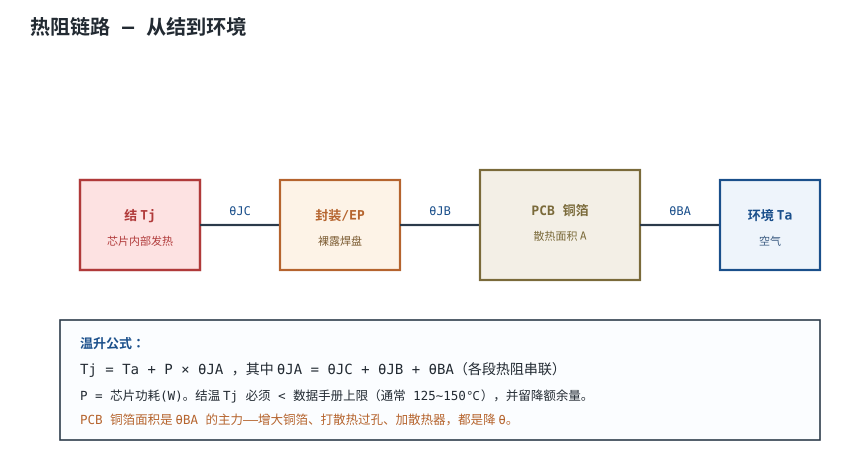
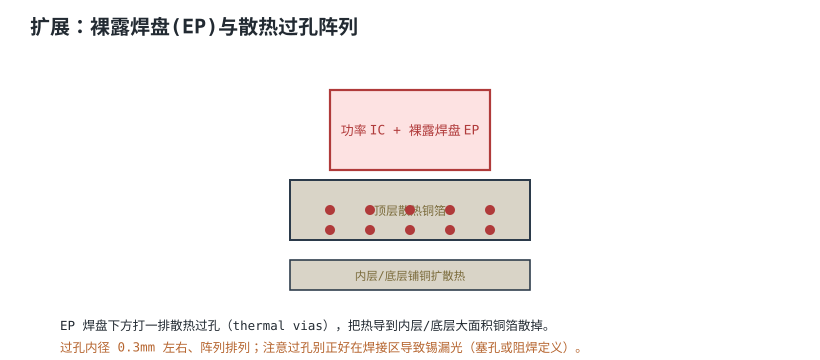
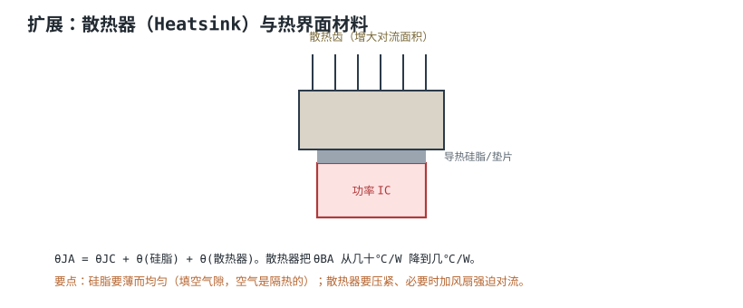

# 热设计：散热、铜箔与散热器 Thermal Design

半导体结温每升高 10℃，可靠性大约减半。一颗芯片如果在板子上没散热，结温冲到 125℃ 以上，轻则降额保护、缩短寿命，重则当场烧穿。热设计就是给功耗找一条到环境的低阻散热路。

## 1. 设计动机

::: motivation 为什么要算热
芯片数据手册给了功耗 P，但"能不能用"取决于它会不会过热。同样 1W 功耗，焊在大面积铜箔上温升降很多，焊在小块铜箔上可能就到 110℃。热设计就是把这条散热路算清楚、做出来。
:::

## 2. 图示：热阻链路



## 3. 机理与定量

热像电：温度差像电压、热流像电流、热阻像电阻。结到环境的温升：

$$T_j = T_a + P \cdot \theta_{JA}$$

总热阻串联：

$$\theta_{JA} = \theta_{JC} + \theta_{JB} + \theta_{BA}$$

- $T_j$：结温（芯片内部，必须 < 数据手册上限，通常 125~150℃）
- $T_a$：环境温度
- $P$：功耗（W）
- $\theta_{JA}$：结到环境总热阻（℃/W）
- $\theta_{JC}$：结到壳（封装本身，数据手册给）
- $\theta_{JB}$：结到板（经引脚/EP）
- $\theta_{BA}$：板到环境（靠铜箔+散热器，**设计主要优化这里**）

## 4. 完整设计示例

::: example 算一颗 LDO 够不够热
1. **需求**：LDO 耗散 P=(12V−5V)×0.5A=3.5W，环境 40℃。
2. **查热阻**：封装 θJA（无散热）=60℃/W。
3. **算结温**：Tj=40+3.5×60=250℃ → 远超 125℃，不行。
4. **加散热**：铺铜 + 散热过孔，把 θJA 降到 25℃/W。
5. **复算**：Tj=40+3.5×25=127.5℃ → 临界。
6. **再优化**：加小散热器，θJA 降到 15℃/W → Tj=40+52.5=92.5℃，留有余量，OK。
:::

```echarts
{
  "tooltip": {"trigger": "axis"},
  "legend": {"data": ["结温 Tj"], "bottom": 0, "textStyle": {"fontSize": 12}},
  "grid": {"left": 60, "right": 24, "top": 26, "bottom": 50},
  "xAxis": {"type": "category", "name": "散热措施", "data": ["无铺铜","小铜箔","大铜箔+过孔","加散热器"], "axisLabel": {"fontSize": 11}},
  "yAxis": {"type": "value", "name": "结温 ℃", "max": 260, "axisLabel": {"fontSize": 11}},
  "series": [
    {"name": "结温 Tj", "type": "bar", "barWidth": 40,
     "itemStyle": {"color": "#b03a3a"},
     "markLine": {"data": [{"yAxis": 125, "label": {"formatter": "上限125℃"}, "lineStyle": {"color": "#2f6e4f", "type": "dashed"}}]},
     "data": [250, 180, 127, 92]}
  ]
}
```

## 5. 设计准则

1. **先算 Tj**：P × θJA + Ta < 上限，留 20~30℃ 降额。
2. **功率器件下方铺大铜箔**：铜箔是免费散热器。
3. **裸露焊盘打散热过孔**：导到内层/底层铜。
4. **必要时加散热器/风扇**：自然对流不够就强迫风冷。
5. **热敏元件远离热源**：电解电容最怕热。

## 6. 检查与仿真

- **热像仪**：上电后看板子热点，验证估算。
- **θJA 估算**：onsemi AND9596-D 方法、Saturn PCB 铜箔计算器。
- **热仿真**：大功率板用 FEA 工具。

## 扩展与变种电路

### 扩展1：裸露焊盘与散热过孔阵列

现代功率 IC 带裸露焊盘（Exposed Pad, EP），直接焊到 PCB 散热铜箔。



::: example 机理与定量
- EP 直接把芯片背面的热导到 PCB 铜箔，比从引脚导热效率高几倍。
- 散热过孔（thermal vias）阵列把热从顶层导到内层/底层大面积铜。
- 过孔内径约 0.3 mm，间距 1~1.5 mm 阵列。
- 注意：过孔在焊接区会吸锡（solder wicking），要阻焊定义或塞孔。
:::

准则对比：

| 散热方式 | θJA |
|---|---|
| 引脚导热 | 高（差） |
| EP + 铜箔 + 过孔 | 低数倍 |

::: pitfall 散热过孔吸锡导致虚焊
- **现象**：EP 焊接后空洞大、虚焊。
- **原因**：过孔把锡膏吸到内层。
- **解决**：过孔阻焊定义（mask-defined）或填孔塞树脂。
:::

### 扩展2：散热器与热界面材料

铜箔还不够时，加散热器。



::: example 机理与定量
- 热阻链多了两段：硅脂 $\theta_{tim}$ + 散热器 $\theta_{hs}$。
- 散热器把 $\theta_{BA}$ 从几十℃/W 降到几℃/W。
- 硅脂作用：填芯片与散热器之间的微观空气隙（空气隔热）。要薄而均匀。
- 强迫风冷（风扇）可再降数倍。
:::

准则对比：

| 散热方式 | 典型 θBA |
|---|---|
| 自然对流铜箔 | 30~60 ℃/W |
| 散热器自然对流 | 5~15 ℃/W |
| 散热器 + 风扇 | 1~3 ℃/W |

::: pitfall 硅脂涂太厚反而隔热
- **现象**：加了散热器温降不明显。
- **原因**：硅脂涂太厚，本身成了热阻层。
- **解决**：薄薄一层、压紧，刚好填满微观空隙即可。
:::

## 7. 常见坑与故障现象

::: pitfall 常见坑
- **只看功耗不算结温**：3.5W LDO 直接上板，烧了才知道过热。先算 Tj。
- **EP 没打散热过孔**：浪费了裸露焊盘的散热能力。
- **热敏电容贴在功率器件旁边**：电解电容离热源近，寿命骤降。
- **散热过孔吸锡**：EP 焊接虚焊，见扩展1。
:::

## 8. 自测题

<details><summary>Tj = Ta + P × θJA 中，设计主要优化哪一段热阻？为什么？</summary>

主要优化 $\theta_{BA}$（板到环境）。$\theta_{JC}$ 是封装固定的、$\theta_{JB}$ 由引脚决定，而 $\theta_{BA}$ 靠铜箔、散热过孔、散热器可调空间最大——这正是 PCB 热设计的着力点。

</details>

<details><summary>一颗 IC 耗散 2W，θJA=50℃/W，环境 40℃，结温多少？上限 125℃ 够吗？</summary>

Tj = 40 + 2×50 = **140℃**，超过 125℃ 上限，不够。需要增大铜箔/加散热器把 θJA 降到 (125−40)/2 = 42.5℃/W 以下，并留余量。

</details>

<details><summary>为什么裸露焊盘(EP)下方要打散热过孔？又为什么要防吸锡？</summary>

过孔把 EP 的热导到内层/底层大面积铜，散热更好。但过孔是通孔，焊接时锡膏会被毛细作用吸到内层（吸锡），导致 EP 虚焊空洞。所以过孔要阻焊定义或塞孔。

</details>

## 9. 参考资料

- onsemi AND9596/D *A Quick PCB Thermal Calculation for Power Electronic Devices with Exposed Pad*
- Saturn PCB Design Toolkit（铜箔散热估算）
- Henry W. Ott, *Electromagnetic Compatibility Engineering*
