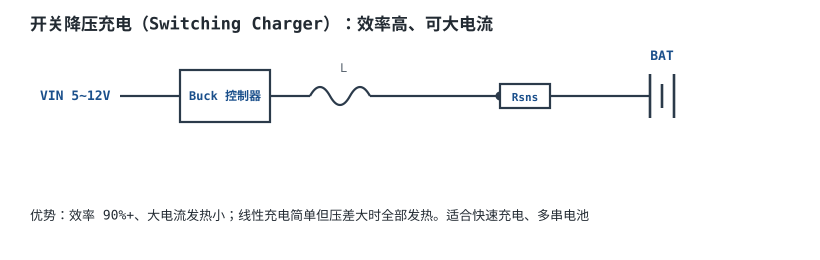
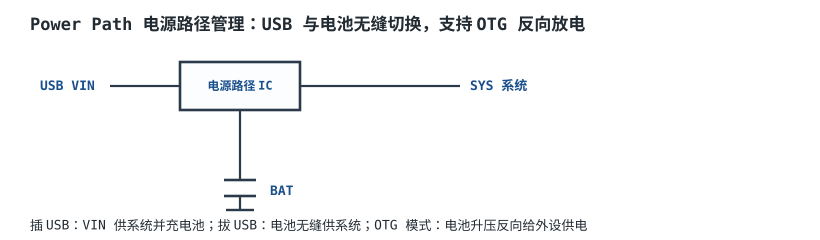

# 电池、充电管理与电量计 Battery, Charging & Fuel Gauge

便携设备的心脏是电池。锂电能量密度高，但**脾气娇嫩**：过充会起火、过放会报废、充电电流电压必须严格管控。这一章讲锂电特性、CC/CV 充电流程、充电 IC 选型，以及怎么准确告诉用户"还剩多少电"。

## 1. 设计动机

::: motivation 为什么不能直接拿个稳压电源怼电池
把锂电当普通电容、用固定电压恒压充电，轻则充不满、寿命缩短，重则过充析气、鼓包起火。锂电池对充电终止电压极其敏感：标称 4.2V 的电芯，充到 4.3V 循环寿命减半，充到 4.5V 可能热失控。

同时，电池电压（开路电压 OCV）与剩余电量（SOC）并非线性对应，用电压表"猜电量"在中间 SOC 区误差极大——这就是需要专门**充电管理 IC** 和**电量计（Fuel Gauge）**的原因。
:::

## 2. 原理图

单节锂电最常见的是线性充电 IC（如 TP4056）：USB 5V 进，电池 4.2V 出，PROG 脚一只电阻设定充电电流。


## 3. 静态分析（DC）

**单节钴酸锂（Li-ion/LiCoO2）关键电压：**

| 参数 | 典型值 | 说明 |
|---|---|---|
| 满充电压 | 4.20V/cell | 终止电压，误差要求 ±1% |
| 标称电压 | 3.6~3.7V | 放电中间平台 |
| 放电截止 | 3.0V/cell | 低于此会过放损伤 |
| 过充保护 | ~4.28V | 保护板切断充电 |
| 过放保护 | ~2.5V | 保护板切断放电 |

充电由两段组成：**恒流（CC, Constant Current）**段以恒定大电流充，电压逐渐上升；到 4.2V 后转入**恒压（CV, Constant Voltage）**段，保持 4.2V，电流自然衰减，直到降到 C/10 判为充满。

以一节 2000mAh 电池、1A（0.5C）充电为例：CC 段约 1.5~2 小时充到 ~75% SOC、电压升到 4.2V；之后 CV 段涓流补满剩余容量。

## 4. 动态分析（AC / 瞬态）

CC/CV 充电曲线：电流先平（CC）后衰减（CV），电压先升后钳在 4.2V。

```echarts
{
  "tooltip": {"trigger": "axis"},
  "legend": {"data": ["电池电压 Vbat (V)", "充电电流 I (A)"], "bottom": 0, "textStyle": {"fontSize": 13}},
  "grid": {"left": 56, "right": 60, "top": 26, "bottom": 56},
  "xAxis": {"type": "category", "name": "时间 h", "data": ["0","0.5","1","1.5","2","2.5","3","3.5"], "axisLabel": {"fontSize": 11}},
  "yAxis": [
    {"type": "value", "name": "电压 V", "min": 3.0, "max": 4.4, "axisLabel": {"fontSize": 11}},
    {"type": "value", "name": "电流 A", "min": 0, "max": 1.2, "axisLabel": {"fontSize": 11}}
  ],
  "series": [
    {"name": "电池电压 Vbat (V)", "type": "line", "smooth": true, "showSymbol": false, "lineStyle": {"width": 2.6, "color": "#1a4f8b"},
     "data": [3.3,3.7,4.0,4.15,4.2,4.2,4.2,4.2]},
    {"name": "充电电流 I (A)", "type": "line", "step": "end", "showSymbol": false, "yAxisIndex": 1, "lineStyle": {"width": 2.2, "color": "#b5642e"},
     "data": [1.0,1.0,1.0,1.0,0.8,0.45,0.25,0.12]}
  ]
}
```

前 2 小时恒流 1A（橙线平），电压升到 4.2V；之后转 CV，电流衰减到 C/10=0.2A 左右判满。

## 5. 环路分析

充电 IC 内部其实是两个闭环：CC 环（采样电流，恒流控制）和 CV 环（采样电池电压，恒压控制）。两个环按电池状态自动切换——CC 优先，电压到 4.2V 时 CV 接管。对设计者而言，重点是**精度**：4.2V 终止电压误差每多 1%，充入容量差几个百分点，循环寿命也受影响，故选 ±1% 基准的充电 IC。

::: advanced 进阶：充电电流设定与损耗
线性充电 IC（如 TP4056）PROG 电阻设定电流：

$$I_{chg}\approx\frac{1200}{R_{prog}(k\Omega)}\quad(\text{单位 mA}\to\text{A})$$

要充 1A：$R_{prog}=1200/1000=1.2\text{k}\Omega$（取 1.2kΩ，1%）。

**线性充电的功耗**全部降在 IC 内部：$P_d=(V_{IN}-V_{BAT})I_{chg}$。USB 5V、电池 3.7V、1A 时 $P_d=(5-3.7)\times1=1.3\text{W}$，必须注意散热；压差大或电流大时改用开关充电（Buck），效率 90%+。
:::

## 6. 元件取值与工程权衡

- **充电电流**：一般 0.5C~1C（2000mAh 电池即 1~2A）。大电流充得快但发热大、寿命短；小电流温和但慢。
- **PROG/检测电阻**：按目标电流算，取 1% 精度；功率要够（$I^2R$）。
- **NTC 测温**：锂电要求 0~45°C 充电，IC 经 NTC 检测电池温度，过温暂停充电。
- **电压精度**：终止电压选 ±1% 以内的 IC。

## 7. 完整设计示例

::: example 用 TP4056 给 2000mAh 锂电 1A 充电
1. **需求**：USB 5V 输入，单节 3.7V/2000mAh 锂电，充电电流 1A。
2. **选 IC**：TP4056（线性 CC/CV，4.2V 固定）。
3. **设电流**：$I_{chg}=1200/R_{prog}=1\text{A}\Rightarrow R_{prog}=1.2\text{k}\Omega$。
4. **散热**：压差 1.3V×1A=1.3W，PCB 多铺铜散热，必要时降电流。
5. **保护**：另配 DW01+8205A 保护板防过充过放。
6. **验证**：示波器看充电曲线——CC 段电流 1A、电压升到 4.2V 后转 CV 衰减，符合上图。
:::

## 8. 仿真与实验

实际调试：用电子负载模拟电池（恒压模式从 3.5V 调到 4.2V），串电流表观察——确认低电压段恒流 1A、到 4.2V 自动转恒流衰减。用示波器测 BAT 电压纹波与温度：若 IC 发烫严重，说明线性压差损耗过大，改开关充电。

## 扩展与变种电路

### 扩展1：开关降压充电 Switching Charger

线性充电压差大时全部发热，用 Buck 拓扑做充电，效率 90%+，可大电流快速充。



::: example 工作原理
- 本质是一个输出电压/电流受控的同步 Buck，输出接电池。
- 大电流（>1A）或输入压差大时，线性充电耗散几瓦发烫，开关充电只损耗零点几瓦。
:::

取值对比：线性充电简单便宜、无需电感；开关充电效率高、发热小但电路复杂。适用：快充、多串电池；不适用：小电流、极简单产品。

::: pitfall 开关充电电感取小导致饱和
- **现象**：充电电流上不去、IC 过流保护。
- **原因**：电感饱和电流小于峰值充电电流。
- **解决**：选饱和电流 > 峰值电流的电感。
:::

### 扩展2：电量计 Fuel Gauge（库仑计）

纯电压法估电量在中间 SOC 误差大；库仑计用检测电阻累计进出电量。


::: example 工作原理
- $Q=\int I\,dt$，累计充入/放出的 mAh，结合电池电压估算 SOC。
- 库仑计精度高，但需定期满充校准、补偿自放电与库仑效率（充入≠可放出）。
:::

取值对比：电压法（开路电压查 OCV 表）简单但中间段误差 10%+；库仑计准但成本高、需校准。适用：电量指示要求准的手机/平板；不适用：低成本玩具。

::: pitfall 库仑计长期不校准导致 SOC 漂移
- **现象**：电量百分比越用越不准，最后跳变。
- **原因**：累计误差、自放电、库仑效率未补偿。
- **解决**：定期满充到 4.2V 校准，或选带算法（如 Impedance Track）的电量计。
:::

### 扩展3：电池保护板 Protection Circuit

每块锂电都要有过充/过放/过流保护，靠保护 IC + 双 MOSFET。


::: example 工作原理
- 过充（~4.28V）切断充电 MOS；过放（~2.5V）切断放电 MOS；过流/短路快速关断。
- 双 MOS 背靠背，确保充电、放电两个方向都能切断。
:::

取值对比：保护板是安全必需，成本几毛；省略保护板 = 安全隐患。适用：所有锂电组；不适用：绝不可省略。

::: pitfall 保护板 MOS 体二极管导致无法反向放电
- **现象**：保护关断后仍有漏电流/反向导通。
- **原因**：双 MOS 体二极管方向接反。
- **解决**：按规格书背靠背正确配置。
:::

### 扩展4：电源路径管理 Power Path

插 USB 时优先给系统供电、同时涓流充电电池；拔电无缝切到电池，还支持 OTG 反向放电。



::: example 工作原理
- 内置理想二极管/负载开关，USB 在线时系统走 USB，电池只在充电；拔电瞬间电池接管。
- OTG 模式把电池升压反向输出给外接设备。
:::

取值对比：无电源路径时插拔 USB 系统可能掉电；电源路径无缝。适用：手机/便携设备；不适用：一直插电的设备。

::: pitfall 插拔 USB 瞬间系统掉电
- **现象**：插/拔 USB 时 MCU 复位。
- **原因**：电池与 USB 切换有间隙，系统电压跌落。
- **解决**：选带 Power Path 的充电 IC，切换无缝。
:::

## 9. 常见坑与故障现象

::: pitfall 常见坑
- **充电 IC 发烫严重**：线性充电压差 $(V_{IN}-V_{BAT})\times I$ 全部发热。USB 5V 充 3.7V/1A 已 1.3W。解决：降充电电流、铺铜散热，或改开关充电。
- **电池充到 4.3V 以上**：终止电压精度不够，长期过充鼓包。解决：选 ±1% 基准充电 IC，不要用普通 LDO 当充电器。
- **电量显示中间段跳变**：纯电压法估 SOC 在 3.6~3.9V 平台区几乎不变，误判。解决：用库仑计电量计。
- **忘记加保护板**：过充/过放无保护，有起火风险。解决：每节锂电必配 DW01 类保护。
:::

## 10. 自测题

<details><summary>单节锂电的满充电压、标称电压、放电截止电压各是多少？</summary>
满充 **4.20V/cell**，标称 **3.6~3.7V**，放电截止 **3.0V/cell**。过充到 4.3V 以上会损伤寿命甚至起火。
</details>

<details><summary>用 TP4056 想得到 1A 充电电流，Rprog 取多大？</summary>
$I_{chg}=1200/R_{prog}$，$1=1200/R_{prog}\Rightarrow R_{prog}=1.2\text{k}\Omega$。
</details>

<details><summary>CC/CV 充电为什么不能全程恒流充到满？</summary>
电池满充时电压已达 4.2V，继续恒流会过充。CC 段恒流充到 4.2V 后必须转 CV 恒压，让电流自然衰减，既充满又不过充。
</details>

<details><summary>为什么纯电压法估电量不准？库仑计怎么改善？</summary>
锂电 OCV-SOC 曲线在中间 SOC 段很平坦，电压几乎不变，无法区分 40% 和 60%。库仑计直接累计进出电量 $\int I\,dt$，准确度高得多。
</details>

## 11. 参考资料

- TI Battery Management System Training（CC/CV 与电量计）
- Analog Devices (Linear Technology) 充电 IC 设计笔记
- Sanjaya Maniktala, *Switching Power Supplies A–Z*——充电拓扑与效率
