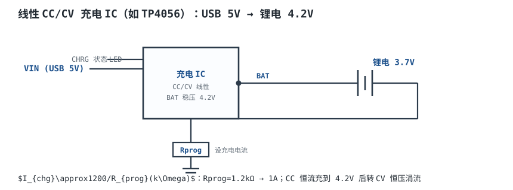
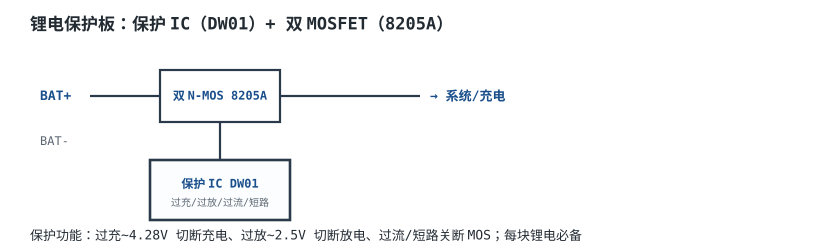
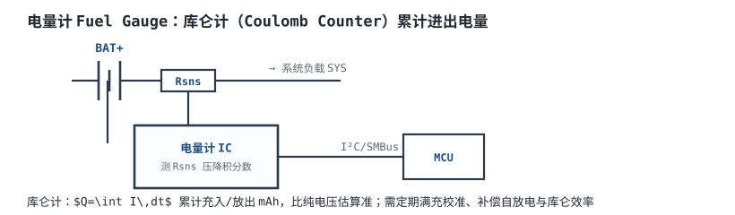

# 电池、充电管理与电量计 Battery, Charging & Fuel Gauge

便携设备的心脏是电池。锂离子电池能量密度高，但**对电压、电流、温度都敏感**：过充会析锂、鼓包甚至热失控；过放会铜溶解、容量永久损失；充电电流过大或温度不对，寿命迅速下降。它不是一个“接上 5V 就能充”的电容，而是一个需要**充电管理 IC、保护电路、电量计**三者配合的电化学系统。

本章讲单节锂电的 CC/CV 充电曲线、终止条件、充电电流与温升、过充/过放/过流/温度保护、库仑计与电压法电量计，以及 USB 供电协商（BC1.2 与 PD）的硬件层要点。最后用一节 18650（3.7V/2.6Ah）在 5V/1A 下充电的完整算例，把 CC 电流、充电时间、CV 阶段和充电 IC 功耗一次算完。

**安全前提**：本章只讨论单节、带保护板的锂离子电池；电芯的充电电压、电流、温度窗口必须以**电芯数据手册**为准。保护板不是“可选件”，充电 IC 也不能替代保护板。充电器的输入电源指标见[电源指标：纹波、效率、调整率与时序](power-specs.md)；线性充电的压差与散热和[线性电源：变压、整流、滤波](linear-supply.md)同源；LDO 的静态电流、PSRR 与待机计算见[LDO 原理、选型与功耗计算](ldo.md)。

## 1. 设计动机

::: motivation 四个“电池没炸，但产品废了”的现场
**现场一：5V/1A 线性充电，IC 烫到降流。** 单节 18650、3.0V 馈电时，线性充电 IC 的耗散 $(5-3.0)\times1=2$ W；SOP-8 的结到环境热阻约 160°C/W，温升 320°C，芯片只能靠热调节把电流往下折。用户看到的是“充了一晚上还没满”，不是“芯片很热”。

**现场二：用 5V/1A 的 USB 2.0 口充 1A。** USB 2.0 标准下行端口（SDP）只保证 500mA；充电器如果按 1A 拉电流，端口电压被拉低，主机可能直接限流或断开。**5V/1A 不是“插上 USB 就有”，要先确认端口类型与协商结果。**

**现场三：电量显示从 40% 跳到 60%。** 纯电压法在 3.6~3.9V 的平台区几乎分不清 40% 和 60%；负载一撤，电压回弹，电量跟着跳。库仑计能解决，但不校准又会慢慢漂移。

**现场四：保护板省了。** 充电 IC 的终止电压精度 ±1%，4.2V 的 ±1% 是 ±42mV；再叠加温度漂移，长期可能充到 4.25V 以上。没有独立保护板，电芯就在“慢性过充”中循环，几个月后鼓包。**保护板是最后一道机械/电气防线，不能用软件替代。**
:::

| 你想确认 | 先查/先算 | 判据（工程经验值，具体以电芯/器件手册为准） |
|---|---|---|
| 充电电流多大 | 电芯的 $C$ 率与温度 | 0.5C~1C 常见，不超过电芯允许值 |
| 多久能充满 | CC 容量 + CV 尾电流 | 2.6Ah/1A 约 3~3.5h |
| 充电 IC 会不会过热 | $P_d=(V_{IN}-V_{BAT})I$ | $T_j\le125^{\circ}\text{C}$，留 20°C |
| 终止电压准不准 | 充电 IC 的 $V_{BAT}$ 精度 | ±1% 以内，4.2V 即 ±42mV |
| 保护阈值够不够 | 过充/过放/过流/温度 | 过充 4.25~4.3V，过放 2.4~2.5V |
| 电量计准不准 | 电压法还是库仑计 | 电压法中间段误差 10%~20% |
| USB 口能给多少 | SDP/DCP/CDP/Type-C/PD | SDP 500mA，DCP 1.5A，PD 按档位 |
| 能不能用 9V 快充 | 充电器拓扑 | 线性充电器不能用高压，开关充电器才行 |

**不做充电管理的代价，可以量化成四个数：**

1. **过热降流**：2W 在 SOP-8 上是 320°C 温升，芯片热调节把 1A 折到 0.5A，充电时间翻倍。
2. **过充**：4.2V + 1% 误差 + 50mV 温度漂移 = 4.30V，长期循环寿命可能减半（典型量级，以电芯数据为准）。
3. **电量跳变**：电压法在平台区 10%~20% 的误差，用户看到 40% 直接跳 60%。
4. **USB 限流**：SDP 500mA 的端口被拉 1A，电压跌到 4.5V 以下，充电 IC 反复重启。

## 2. 定义与直观

### 2.1 电池的五个基本量

| 量 | 典型值（单节 Li-ion） | 说明 |
|---|---|---|
| 标称电压 | 3.6~3.7V | 放电平台，不是满充电压 |
| 满充电压 | 4.20V | 终止电压，精度要求 ±1% |
| 放电截止 | 3.0V | 低于此会加速老化，保护板约 2.4~2.5V 切断 |
| 容量 | 2.6Ah（18650 示例） | 以 0.2C 放电测得的安时数 |
| 能量 | $3.7\times2.6=9.62$ Wh | 标称电压乘容量，用于续航估算 |

**容量不是常数**：放电电流越大、温度越低，可用容量越小；标称 2.6Ah 在 1C、0°C 下可能只放出 2.0Ah 左右。电芯数据手册会给出不同倍率、不同温度的放电曲线。

**内阻（Internal Resistance，$R_{int}$）**是另一个关键量：新鲜 18650 约 20~50mΩ，老化后上升。充电时端电压是

$$V_{bat}=OCV(SOC)+I_{chg}R_{int}$$

其中 $V_{bat}$ 是端电压（V）；$OCV(SOC)$ 是当前荷电状态下的开路电压（V）；$I_{chg}$ 是充电电流（A）；$R_{int}$ 是内阻（$\Omega$）。**同样的 SOC，充电电流越大，端电压越高，越早撞到 4.2V 转 CV。** 这就是大电流充“看起来快、实际没充满”的原因。

### 2.2 CC/CV 两个阶段



图中 PROG 公式只写了 1200 与 kΩ，没写电流单位，容易混。正确口径有两条：$I_{CHG}$ 用 A、$R_{PROG}$ 用 $\Omega$ 时，$I_{CHG}=1200/R_{PROG}$；$I_{CHG}$ 用 mA、$R_{PROG}$ 用 k$\Omega$ 时，也写成 $I_{CHG}=1200/R_{PROG}$。两条数值一致（1.2kΩ 都对应 1A），但电流单位必须写在公式旁边。

锂离子电池的标准充电流程是 **恒流（CC，Constant Current）→ 恒压（CV，Constant Voltage）**：

1. **预充（Precharge）**：电池低于约 3.0V 时，先用 C/10 左右的小电流充到 3.0V，避免深放电电芯大电流析锂。不是所有充电 IC 都有独立预充阶段，但好的充电器应该有。
2. **恒流（CC）**：以设定电流 $I_{CC}$ 充电，端电压随 SOC 上升。CC 段通常充入 60%~80% 的容量。
3. **恒压（CV）**：端电压到 4.2V 后，充电器保持 4.2V，电流自然衰减。当电流降到终止电流（通常 C/10 或 C/20）时判满，终止充电。
4. **再充（Recharge）**：充满后如果电压掉到约 4.05~4.10V，充电器重新启动一个充电周期；不是“一直涓流”。
5. **温度窗口**：典型充电温度 0~45°C；低于 0°C 充电会析锂，高于 45°C 会加速老化。NTC 就是用来把充电器限制在这个窗口内的。

**为什么不能全程恒流？** 电池到 4.2V 后，如果继续灌 1A，端电压会继续上升，正极脱锂过度、电解液氧化、析锂，轻则容量衰减，重则热失控。CV 阶段就是“把电压钉在 4.2V，让电流自己降下来”。

### 2.3 充电曲线

```echarts
{
  "tooltip": {"trigger": "axis"},
  "legend": {"data": ["电池电压 Vbat (V)", "充电电流 I (A)"], "bottom": 0, "textStyle": {"fontSize": 13}},
  "grid": {"left": 56, "right": 60, "top": 26, "bottom": 56},
  "xAxis": {"type": "category", "name": "时间 h", "data": ["0","0.5","1","1.5","1.82","2.1","2.4","2.7","3.0","3.24","3.4"], "axisLabel": {"fontSize": 11}},
  "yAxis": [
    {"type": "value", "name": "电压 V", "min": 2.8, "max": 4.4, "axisLabel": {"fontSize": 11}},
    {"type": "value", "name": "电流 A", "min": 0, "max": 1.2, "axisLabel": {"fontSize": 11}}
  ],
  "series": [
    {"name": "电池电压 Vbat (V)", "type": "line", "smooth": true, "showSymbol": false, "lineStyle": {"width": 2.6, "color": "#1a4f8b"},
     "data": [3.0,3.55,3.85,4.05,4.2,4.2,4.2,4.2,4.2,4.2,4.15]},
    {"name": "充电电流 I (A)", "type": "line", "step": "end", "showSymbol": false, "yAxisIndex": 1, "lineStyle": {"width": 2.2, "color": "#b5642e"},
     "data": [1.0,1.0,1.0,1.0,1.0,0.77,0.58,0.43,0.33,0.26,0.0]}
  ]
}
```

上图的横轴是示意时间轴：CC 段到 1.82h，电流保持 1A；1.82h 后转 CV，电流按指数衰减，3.24h 降到 0.26A（C/10）判满。电压在 CC 段从 3.0V 升到 4.2V，CV 段钉在 4.2V。**实际曲线受电芯、温度、内阻、充电器调节方式影响，形状会变，但“先恒流、后恒压、尾电流判满”的结构不变。**

### 2.4 保护：最后一道防线



单节锂电保护板通常由**保护 IC + 双 N-MOS** 组成，串在电芯与外部回路之间：

| 保护 | 典型阈值 | 动作 | 恢复 |
|---|---|---|---|
| 过充 | 4.25~4.30V | 关断充电 MOS | 电压降到约 4.1V 恢复 |
| 过放 | 2.4~2.5V | 关断放电 MOS | 充电到约 3.0V 恢复 |
| 过流/短路 | 2~5A（按型号） | 快速关断双 MOS | 移除负载后恢复 |
| 温度 | 按 NTC 或 IC 内部 | 暂停充放电 | 温度回到窗口 |

**双 MOS 背靠背**：充电 MOS 和放电 MOS 的体二极管方向相反，保证两个方向都能切断。只用一个 MOS 的话，关断后体二极管仍会导通，保护失效。

**保护板不是充电器**：它只在异常时切断，不控制 CC/CV；充电器仍然要负责电压/电流精度。反过来，充电器也不能替代保护板：充电 IC 失效（比如调整管击穿）时，保护板是最后一道机械/电气防线。

### 2.5 电量计：库仑计与电压法



**电压法（OCV 法）**：测电池开路电压，查 OCV-SOC 表。优点是无额外器件、成本低；缺点是：

- 锂电的 OCV-SOC 曲线在 3.6~3.9V 的平台区非常平坦，40% 和 60% 的电压差可能只有十几毫伏；
- 有负载时端电压被内阻压降拉低，必须等静置；
- 温度、老化、 hysteresis 都会改变曲线；
- 中间段误差典型 10%~20%。

**库仑计（Coulomb Counter）**：在电池回路串一个检测电阻 $R_{sns}$，测压降并积分：

$$Q=\int I\,dt,\qquad SOC(t)=SOC_0-\frac{1}{Q_{nom}}\int_0^t I(\tau)\,d\tau$$

其中 $Q$ 是累计电荷（C 或 Ah）；$I$ 是电流（A，放电为正）；$Q_{nom}$ 是额定容量（Ah）；$SOC_0$ 是初始荷电状态。优点是动态响应快、中间段准；缺点是：

- 需要初始 SOC（通常靠 OCV 或满充校准）；
- 电流检测的失调会累积：10µV 失调、10mΩ 电阻就是 1mA 的等效电流，1000 小时累积 1Ah；
- 自放电、库仑效率（充入不等于可放出）、温度、老化都要补偿；
- 成本高，需要校准。

**阻抗跟踪（Impedance Track）** 一类算法把 OCV、内阻、温度、老化模型结合起来，不需要定期满充校准，但需要电芯建模，开发和产线校准成本更高。

### 2.6 USB 供电协商：5V/1A 不是天上掉下来的

USB 端口的电流能力差很多，充电器必须知道“这个口能给多少”：

| 端口类型 | 典型电流 | 功率（5V） | 硬件识别 |
|---|---|---|---|
| USB 2.0 SDP | 500mA | 2.5W | D+/D- 为数据线，枚举后限流 |
| USB 3.x SDP | 900mA | 4.5W | 同上，SuperSpeed 端口 |
| BC1.2 DCP | 1.5A | 7.5W | D+ 与 D- 短接 |
| BC1.2 CDP | 1.5A | 7.5W | 充电同时枚举，D+/D- 有握手 |
| Type-C 默认 | 500mA/900mA/1.5A/3A | 2.5~15W | CC 上 Rp/Rd 广告 |
| USB PD | 5V/3A、9V/3A、15V/3A、20V/5A | 15~100W | CC 上的 BMC 协商 |

**硬件层要点：**

- **BC1.2 DCP**：把 D+ 与 D- 短接，充电器识别为专用充电口，可拉 1.5A；但只能用于**充电专用**，不能同时枚举数据。
- **BC1.2 CDP**：D+/D- 上做握手，既能枚举又能 1.5A；需要充电 IC 支持 CDP 检测，不能简单短接。
- **Type-C sink**：CC1、CC2 各接一只 5.1kΩ 下拉（Rd）到地，源端才会在 VBUS 上给 5V；**不要用 5.1k 以外的阻值**，也不要只接一路 CC（除非板上做了两路合并）。
- **PD**：需要 PD 控制器在 CC 上做 BMC 编码，协商 5V/9V/15V/20V；VBUS 要经过 MOSFET 开关、软启动、放电电阻、ESD 保护。**PD 不是“把 9V 直接灌进充电器”**，充电器必须支持对应输入电压。
- **线缆与连接器**：5V/1A 时线阻 0.2Ω 就有 200mV 压降；大电流要用粗线、低接触电阻连接器，并做 VBUS 过压/欠压/反接保护。
- **输入电容与浪涌**：插拔瞬间 VBUS 有振铃和浪涌，充电 IC 输入端要加 TVS、电容和限流；热插拔时还可能反灌，需要反向保护。

::: analogy 电池不是电容，充电不是“灌水”
电容可以“电压到了就停”，电池不行：它的端电压由 OCV 和 $IR$ 共同决定，充电到 4.2V 只说明“端电压到了”，不代表“化学上满了”；必须靠 CV 段让电流自然衰减，再用尾电流判满。

水缸的类比：CC 像固定流量的水龙头，CV 像“水位到 4.2 米就关小阀门，保持水位，等水流细到 C/10 再关”。保护板像溢流阀和防干阀；电量计像水表，但水表会因漏水（自放电）和计量误差慢慢偏。

类比的边界：水缸的水位可以直接测，电池的 SOC 不能直接测；水不会因为充电温度不对而析出金属，锂电会。
:::

## 3. 定量关系

### 3.1 容量、C-rate 与 CC 时间

**C 率（C-rate）**：

$$C\text{-rate}=\frac{I}{Q_{nom}}$$

其中 $I$ 是充放电电流（A）；$Q_{nom}$ 是额定容量（Ah）；C-rate 的单位是 1/h（常写作“C”）。例如 2.6Ah 电池、1A 充电：

$$C\text{-rate}=\frac{1}{2.6}=0.385\text{C}$$

CC 段时间：

$$t_{CC}=\frac{Q_{CC}}{I_{CC}}$$

其中 $Q_{CC}$ 是 CC 段充入的容量（Ah）；$I_{CC}$ 是恒流电流（A）；$t_{CC}$ 单位 h。若 CC 段充入 70% 的 2.6Ah：

$$Q_{CC}=0.7\times2.6=1.82\ \text{Ah},\qquad t_{CC}=\frac{1.82}{1}=1.82\ \text{h}$$

**CC 段占多少容量不是常数**：内阻大、电流大、温度低，CC 段占比会变小，CV 段变长。70% 是典型假设，实际以电芯充放电曲线为准。

### 3.2 CC 转 CV 的条件

充电器在端电压达到 4.2V 时从 CC 转 CV。由 2.1 的端电压式：

$$V_{bat}=OCV(SOC)+I_{CC}R_{int}=4.2\ \text{V}$$

**算一遍**：$I_{CC}=1$ A、$R_{int}=100$ m$\Omega$，则 $I_{CC}R_{int}=0.1$ V。转 CV 时：

$$OCV=4.2-0.1=4.1\ \text{V}$$

也就是说，**端电压到 4.2V 时，电芯的真实 OCV 只有 4.1V，SOC 还没到 100%**；剩下的容量要在 CV 段慢慢充进去。内阻越大、电流越大，这个差越大，CV 段越长。

### 3.3 CV 阶段的指数模型

CV 段电流近似指数衰减：

$$I(t)=I_0e^{-t/\tau}$$

其中 $I_0$ 是 CV 段起始电流（A）；$\tau$ 是时间常数（h）；$t$ 是 CV 段开始后的时间（h）。CV 段充入的电荷：

$$Q_{CV}=I_0\tau\left(1-e^{-t/\tau}\right)$$

终止条件 $I(t)=I_{term}$：

$$t_{CV}=\tau\ln\frac{I_0}{I_{term}}$$

由 $Q_{CV}$ 反解时间常数：

$$\tau=\frac{Q_{CV}}{I_0\left(1-I_{term}/I_0\right)}$$

**算一遍**：$I_0=1$ A、$I_{term}=0.26$ A（C/10）、$Q_{CV}=0.78$ Ah。

$$\tau=\frac{0.78}{1\times(1-0.26)}=\frac{0.78}{0.74}=1.054\ \text{h}$$

$$t_{CV}=1.054\times\ln\frac{1}{0.26}=1.054\times1.347=1.42\ \text{h}$$

CV 段 1.42h，充入 0.78Ah。**指数模型是近似**：实际 CV 电流受充电器环路、电芯极化、温度影响，尾段可能更慢；工程上按实测曲线修正。

### 3.4 充电 IC 的功耗

**线性充电器**：调整管串在输入与电池之间，功耗：

$$P_d=(V_{IN}-V_{BAT})I_{CHG}+V_{IN}I_Q$$

其中 $V_{IN}$ 是输入电压（V）；$V_{BAT}$ 是电池电压（V）；$I_{CHG}$ 是充电电流（A）；$I_Q$ 是 IC 静态电流（A）。**最坏情况在电池电压最低时**，不是 3.7V 标称点。

**开关充电器**：输入功率经 Buck 变换，损耗：

$$P_{loss}=P_{in}(1-\eta_{chg})$$

其中 $P_{in}=V_{IN}I_{IN}$ 是输入功率（W）；$\eta_{chg}$ 是充电器效率。5V/1A 输入、90% 效率，损耗 0.5W；而线性方案在 3.0V 电池时是 2W。

结温：

$$T_j=T_a+P_dR_{\theta ja}$$

**算一遍**：$V_{IN}=5.25$ V、$V_{BAT}=3.0$ V、$I_{CHG}=1$ A。

$$P_d=(5.25-3.0)\times1=2.25\ \text{W}$$

SOP-8 的 $R_{\theta ja}=160^{\circ}\text{C/W}$：

$$T_j=25+2.25\times160=385^{\circ}\text{C}$$

远超 125°C，芯片只能靠热调节降流。DFN 带焊盘 $R_{\theta ja}=50^{\circ}\text{C/W}$：

$$T_j=25+2.25\times50=137.5^{\circ}\text{C}$$

仍然超过 125°C；45°C 环境更差。允许的最大功耗：

$$P_{d,max}=\frac{125-45}{50}=1.6\ \text{W}$$

对应最大充电电流：

$$I_{max}=\frac{1.6}{5.25-3.0}=0.711\ \text{A}$$

**在 45°C 环境、5.25V 输入、3.0V 电池的最坏点上，DFN 线性充电器也只能连续给约 0.7A。** 要 1A 连续，必须用开关充电器或更好的散热。

### 3.5 保护阈值与迟滞

保护 IC 的阈值不是“一个点”，而是“阈值 + 迟滞 + 延时”：

- **过充**：4.25~4.30V 关断充电 MOS；电压降到约 4.1V 恢复。迟滞防止在阈值附近反复开关。
- **过放**：2.4~2.5V 关断放电 MOS；充电到约 3.0V 恢复。
- **过流/短路**：检测 MOS 上的压降或检流电阻，阈值按型号 2~5A；短路时延时通常 µs~ms 级。
- **温度**：NTC 分压送进保护 IC 或充电 IC，典型充电窗口 0~45°C，放电 -20~60°C；不同电芯不同，以数据手册为准。

**延时**很重要：负载插拔的瞬态电流可能超过阈值，延时可以避免误触发；但延时太长，短路时 MOSFET 可能先损坏。具体延时以保护 IC 数据手册为准。

### 3.6 电量计的误差

**库仑计**的误差来源：

1. **失调**：$V_{os}$ 折算成电流 $I_{os}=V_{os}/R_{sns}$；10µV/10mΩ=1mA，1000h 累积 1Ah。
2. **增益**：检测电阻公差、放大器增益误差，典型 0.5%~1%。
3. **自放电**：电池每月 2%~3%，库仑计如果不补偿，SOC 会偏高。
4. **库仑效率**：充入 1Ah 不一定能放出 1Ah，尤其低温、大电流。
5. **初始 SOC**：开机时不知道真实 SOC，只能靠 OCV 查表或上次保存值。

**电压法**的误差主要来自 OCV-SOC 平台：3.6~3.9V 之间，SOC 变化 20% 可能只对应几十毫伏，负载压降和温度漂移很容易把它淹没。

**算一遍**：$R_{sns}=10$ m$\Omega$、$V_{os}=10\,\mu$V。

$$I_{os}=\frac{10\ \mu\text{V}}{10\ \text{m}\Omega}=1\ \text{mA}$$

1000 小时：

$$Q_{err}=1\ \text{mA}\times1000\ \text{h}=1\ \text{Ah}$$

占 2.6Ah 的：

$$\frac{1}{2.6}=38.5\%$$

**1mA 的失调，1000 小时就能让 2.6Ah 电池的 SOC 偏 38.5%。** 所以库仑计必须做失调校准、满充校准和自放电补偿。

### 3.7 USB 的功率与电流

$$P=VI$$

| 档位 | 电压 | 电流 | 功率 |
|---|---|---|---|
| SDP | 5V | 0.5A | 2.5W |
| DCP/CDP | 5V | 1.5A | 7.5W |
| Type-C 5V/3A | 5V | 3A | 15W |
| PD 9V/3A | 9V | 3A | 27W |
| PD 15V/3A | 15V | 3A | 45W |
| PD 20V/5A | 20V | 5A | 100W |

**对线性充电器，输入电压越高越糟**：9V 输入、3.7V 电池、1A 充电，耗散 $(9-3.7)\times1=5.3$ W；5V 输入只有 1.3W。**PD 高压只对开关充电器有意义**；线性充电器应优先 5V 档，并限制电流。

**5V/1A 充电需要什么口？** SDP 只有 500mA，不够；至少 DCP/CDP（1.5A）或 Type-C 5V/1.5A 以上。若用 Type-C，CC 上两只 5.1kΩ Rd 是“拿到 5V”的前提；实际可用电流还要看源端 Rp 广告。

### 3.8 适用条件与失效边界

- **温度**：充电 0~45°C、放电 -20~60°C 是典型窗口；超出要暂停，不能只靠软件提示。
- **电芯一致性**：单节没有均衡问题；多节串联必须做均衡与每节过压保护。
- **充电器精度**：终止电压 ±1%、电流 ±5% 是常见要求；用普通 LDO 当充电器，精度和终止逻辑都不够。
- **保护板**：必须与电芯匹配，过流阈值不能高于电芯允许值；双 MOS 的体二极管方向要正确。
- **电量计**：库仑计需要校准；电压法只适合对精度要求不高的场合。
- **USB**：不同端口能力不同；不要假设“USB 就是 5V/1A”。
- **老化**：内阻上升、容量下降，充电时间变长、CV 段变长；电量计要能补偿。

## 4. 典型计算

### 4.1 18650（3.7V/2.6Ah）用 5V/1A 充电

**需求与假设**：

| 项目 | 数值/假设 |
|---|---|
| 电芯 | 单节 18650，标称 3.7V，容量 2.6Ah，满充 4.2V，截止 3.0V |
| 输入 | 5V/1A（DCP 或 Type-C 5V/1.5A 以上） |
| 充电器 | 线性 CC/CV，$I_{CHG}=1$ A，$I_{term}=0.26$ A（C/10） |
| CC 段容量 | 假设 70%，即 1.82Ah |
| 环境 | 25°C，目标 $T_j\le125^{\circ}\text{C}$ |
| 保护 | DW01A + 8205A 保护板 |
| 电量计 | 10mΩ 检流电阻，库仑计 |

**第 1 步：C 率。**

$$C\text{-rate}=\frac{1}{2.6}=0.385\text{C}$$

低于 0.5C，属于温和充电；多数 18650 允许 0.5C~1C，具体以电芯数据手册为准。

**第 2 步：CC 电流。** 5V/1A 源，线性充电器的输入电流约等于充电电流加静态电流；按 1A 设计，实际取 0.95~1A 留余量。如果插的是 SDP（500mA），只能按 0.5A 充，时间约翻倍。

以 TP4056 类线性充电 IC 为例，PROG 引脚电阻设定充电电流：

$$I_{CHG}=\frac{1200\ \text{V}}{R_{PROG}}$$

其中 $I_{CHG}$ 单位 A；$R_{PROG}$ 单位 $\Omega$；1A 对应 $1200/1=1200\,\Omega=1.2$ k$\Omega$。等效常数 1200V 是器件内部基准与增益的折算值，不同型号不同，以数据手册为准。若用 k$\Omega$ 表示电阻，则 $I_{CHG}(\text{mA})=1200/R_{PROG}(\text{k}\Omega)$，两式数值一致。**这个电流还要受输入源限流约束**：SDP 只能给 500mA，PROG 设 1A 也拉不出来。

**第 3 步：CC 时间。**

$$Q_{CC}=0.7\times2.6=1.82\ \text{Ah}$$

$$t_{CC}=\frac{1.82}{1}=1.82\ \text{h}$$

**第 4 步：CV 阶段。** 剩余容量：

$$Q_{CV}=2.6-1.82=0.78\ \text{Ah}$$

时间常数：

$$\tau=\frac{0.78}{1\times(1-0.26)}=1.054\ \text{h}$$

CV 时间：

$$t_{CV}=1.054\times\ln\frac{1}{0.26}=1.054\times1.347=1.42\ \text{h}$$

**第 5 步：总充电时间。**

$$t_{total}=1.82+1.42=3.24\ \text{h}$$

加 10% 余量（预充、温度折流、尾电流判定）：

$$t_{total}\approx3.24\times1.1=3.56\ \text{h}$$

**约 3.5 小时充满**。如果只有 SDP 500mA，CC 段时间翻倍到 3.64h，CV 段也变长，总时间约 5.5~6h。

**第 6 步：充电 IC 功耗。** 最坏在电池 3.0V、输入 5.25V（USB +5%）：

$$P_d=(5.25-3.0)\times1=2.25\ \text{W}$$

典型 3.7V、5V：

$$P_d=(5-3.7)\times1=1.3\ \text{W}$$

接近满充 4.2V、5V：

$$P_d=(5-4.2)\times1=0.8\ \text{W}$$

**第 7 步：结温与降流。** SOP-8（160°C/W）：

$$T_j=25+2.25\times160=385^{\circ}\text{C}$$

不可行；TP4056 这类线性充电 IC 会在结温约 120°C 时热调节，把电流往下折（具体阈值以数据手册为准）。DFN（50°C/W）：

$$T_j=25+2.25\times50=137.5^{\circ}\text{C}$$

仍超 125°C。45°C 环境、允许 125°C：

$$P_{d,max}=\frac{125-45}{50}=1.6\ \text{W}$$

$$I_{max}=\frac{1.6}{5.25-3.0}=0.711\ \text{A}$$

**结论：5V 线性充电、1A 连续，在 45°C 环境里做不到；要么把电流降到 0.7A，要么改开关充电器。**

**第 8 步：保护板。** DW01A 过充约 4.25~4.30V 切断充电 MOS，过放约 2.4~2.5V 切断放电 MOS，过流按型号 2~5A；双 MOS 背靠背，两个方向都能切断。NTC 贴在电芯表面，充电窗口 0~45°C（典型，以电芯数据手册为准）。**保护板不能省。**

**第 9 步：电量计。** 10mΩ 检流电阻，1A 时压降 10mV；10µV 失调相当于 1mA，1000h 累积 1Ah，占 2.6Ah 的 38.5%。要定期满充校准，或选带阻抗跟踪的算法。

**第 10 步：USB 口。** 5V/1A 需要 DCP/CDP（1.5A）或 Type-C 5V/1.5A 以上；SDP 只有 500mA，不能按 1A 拉。Type-C 做 sink 时，CC1/CC2 各接 5.1kΩ Rd 到地；PD 协商需要 PD 控制器，不能只靠电阻。

**设计汇总**：

| 项目 | 数值 | 验算 |
|---|---|---|
| CC 电流 | 1A（0.385C） | 低于 0.5C，温和 |
| CC 时间 | 1.82h | 1.82Ah/1A |
| CV 时间 | 1.42h | 指数模型，尾电流 0.26A |
| 总时间 | 约 3.56h | 加 10% 余量 |
| 最坏功耗 | 2.25W | 5.25V/3.0V/1A |
| 线性充电可行性 | 45°C 环境最多 0.71A | DFN 50°C/W |
| 保护 | 过充 4.25~4.3V、过放 2.4~2.5V | DW01A 类 |
| 电量计误差 | 1mA 失调/1000h=38.5% | 10mΩ、10µV |

### 4.2 换 5V/2A 开关充电

同样 2.6Ah 电芯，用 Buck 开关充电器，输入 5V/2A、效率 90%，充电电流 2A（0.77C）：

- 输入功率 $5\times2=10$ W；
- 按 90% 效率，输出能力 $10\times0.9=9$ W；
- 4.2V 时理论电流 $9/4.2=2.14$ A，受充电器限流取 2A，实际输出 $4.2\times2=8.4$ W；
- 输入功率约 $8.4/0.9=9.33$ W，损耗约 $9.33-8.4=0.93$ W；具体以充电器效率曲线为准；
- CC 段容量仍按 70% 估算，$Q_{CC}=1.82$ Ah，2A 时 $t_{CC}=0.91$ h；CV 段时间也缩短，总时间约 1.6~2h；
- 开关充电器的损耗主要在建波、电感和控制，不在调整管；DFN 50°C/W、0.93W 损耗，温升 $0.93\times50=46.5^{\circ}\text{C}$，25°C 环境结温约 71.5°C，比线性方案低得多。

**代价**：电感、输入/输出电容、EMI、布局复杂度、成本。**收益**：大电流、宽输入、发热小。5V/1A 以下、成本敏感的产品可以用线性；1A 以上或 9V/12V 输入，优先开关充电。

### 4.3 USB PD 9V 能不能用

PD 9V/2A 是 18W。对**开关充电器**，输入 18W、效率 90%，输出 16.2W；4.2V 时充电电流约 $16.2/4.2=3.86$ A，对 2.6Ah 电芯是 1.48C，可能超过电芯允许的充电倍率，必须查电芯数据手册。

对**线性充电器**，9V 输入、3.7V 电池、1A：

$$P_d=(9-3.7)\times1=5.3\ \text{W}$$

是 5V 方案的 4 倍，SOP-8 直接热关断。**所以 PD 高压只对开关充电器有意义；线性充电器应优先 5V 档，并在 PD 协商中拒绝高压。**

## 5. 工程含义

### 5.1 数量级：先有直觉，再查手册

| 项目 | 典型值 | 说明 |
|---|---|---|
| 单节满充 | 4.20V | ±1% 精度 |
| 标称 | 3.6~3.7V | 放电平台 |
| 放电截止 | 3.0V | 保护板 2.4~2.5V 切断 |
| 充电电流 | 0.5C~1C | 2.6Ah 即 1.3~2.6A |
| 终止电流 | C/10~C/20 | 2.6Ah 即 0.13~0.26A |
| 充电时间 | 2~4h | 取决于电流、CV 尾 |
| 充电温度 | 0~45°C | 典型，以电芯为准 |
| 保护过充 | 4.25~4.3V | 独立保护板 |
| 电量计误差 | 电压法 10%~20%，库仑计 2%~5% | 需校准 |

**这些是典型量级，具体以电芯、充电 IC、保护 IC 的数据手册为准。**

### 5.2 选型顺序

1. **定电芯**：化学体系、容量、最大充电倍率、温度窗口、循环寿命。
2. **定充电电流**：0.5C~1C，兼顾时间与温升；大电流先查电芯允许值。
3. **定拓扑**：5V/1A 以下、成本敏感用线性；1A 以上、9V/12V 输入用开关。
4. **算热**：最坏 $V_{IN}$、最低 $V_{BAT}$、最大 $I_{CHG}$，算 $T_j$；线性充电器尤其要看热调节点。
5. **定保护**：过充/过放/过流/温度，独立保护板 + NTC。
6. **定电量计**：电压法、库仑计、阻抗跟踪，按精度和成本选。
7. **定 USB**：SDP/DCP/CDP/Type-C/PD，按整机功率与成本选；硬件上做好 CC、VBUS、ESD、反灌。

### 5.3 安全与认证

- **电芯认证**：UN 38.3 运输测试、IEC 62133-2 安全、IEEE 1725（手机电池）等；整机认证还要看 IEC 62368-1。
- **保护板**：必须与电芯匹配，过流阈值不能高于电芯允许值；双 MOS 背靠背，体二极管方向正确。
- **NTC**：贴在电芯表面，不能贴在 PCB 上；充电窗口 0~45°C，超出暂停。
- **结构**：电芯固定、防刺穿、防挤压；外壳阻燃；排气空间。
- **软件**：不能只靠软件过充保护；软件可以记录、告警、降流，但硬件保护必须独立。

### 5.4 布局与测试

- **检流电阻**：开尔文接法，四线到电量计；走线对称，远离电感和开关节点。
- **BAT 电容**：充电 IC 的 BAT 引脚就近放 1~10µF，稳定环路；电池线要短、粗。
- **热焊盘**：DFN/QFN 的裸露焊盘焊到铺铜，过孔阵列；线性充电器的热设计决定能不能满电流。
- **NTC**：靠近电芯，引线远离功率回路；NTC 分压电阻按 IC 要求选。
- **测试**：电子负载模拟电池（恒压模式从 3.0V 调到 4.2V），串电流表看 CC/CV；热电偶测 IC 和电芯温度；保护板逐项触发；电量计做满充/满放校准。

## 6. 常见坑

::: pitfall 常见坑
- **现象**：插 USB 2.0 口，充电电流上不去、端口电压跌。**原因**：SDP 只保证 500mA，充电器按 1A 拉，主机限流或断开。**解决**：先识别端口类型；SDP 降到 500mA，DCP/CDP 或 Type-C 5V/1.5A 以上再拉 1A；BC1.2 检测要按规范做，不能只短接 D+/D- 冒充 DCP。
- **现象**：线性充电 IC 烫、充电时间越充越长。**原因**：最坏功耗在电池 3.0V、输入 5.25V，$(5.25-3.0)\times1=2.25$W；SOP-8 的 160°C/W 直接热调节。**解决**：按最坏点算 $T_j$；降电流到 0.7A 以下、加铺铜/散热焊盘，或改开关充电器。
- **现象**：电池鼓包、循环寿命短。**原因**：终止电压精度不够（普通 LDO 当充电器），或没有独立保护板；4.2V + 1% + 温漂可能到 4.3V。**解决**：用 ±1% 的专用充电 IC；每节电芯配保护板；NTC 限制温度；不要用恒压源直接充锂电。
- **现象**：电量百分比越用越不准，最后跳变。**原因**：库仑计失调累积、自放电未补偿、长期不满充校准；1mA 失调 1000h 就是 1Ah。**解决**：定期满充校准；选带阻抗跟踪的算法；做失调与温度补偿。
- **现象**：保护板关断后仍有漏电/反向导通。**原因**：双 MOS 体二极管方向接错，或只用一个 MOS；关断后体二极管仍导通。**解决**：按规格书背靠背配置双 N-MOS；验证充电、放电两个方向的关断。
- **现象**：低温或高温充电，电池寿命骤降。**原因**：NTC 没贴在电芯上、没接、或分压电阻选错，充电器不知道真实温度。**解决**：NTC 贴电芯表面；按 IC 要求选分压；0°C 以下、45°C 以上暂停充电（以电芯手册为准）。
- **现象**：Type-C 口插上没反应，或只能 500mA。**原因**：CC1/CC2 没接 5.1kΩ Rd，或只接一路；源端检测不到 sink，不给 VBUS 或只给默认电流。**解决**：CC1、CC2 各接 5.1kΩ 到地；需要 PD 就加 PD 控制器；VBUS 加 ESD、软启动、放电电阻。
:::

## 7. 自测题

<details><summary>2.6Ah 电池、1A 充电，C 率是多少？CC 段按 70% 容量算，CC 时间多少？</summary>

$$C\text{-rate}=\frac{1}{2.6}=0.385\text{C}$$

$$Q_{CC}=0.7\times2.6=1.82\ \text{Ah}$$

$$t_{CC}=\frac{1.82}{1}=1.82\ \text{h}$$

0.385C 低于 0.5C，属于温和充电；CC 段约 1.82 小时。

</details>

<details><summary>CV 段起始 1A、终止 0.26A、剩余容量 0.78Ah。时间常数、CV 时间、总充电时间各多少？</summary>

$$\tau=\frac{0.78}{1\times(1-0.26)}=1.054\ \text{h}$$

$$t_{CV}=1.054\times\ln\frac{1}{0.26}=1.054\times1.347=1.42\ \text{h}$$

$$t_{total}=1.82+1.42=3.24\ \text{h}$$

加 10% 余量约 3.56h。**CV 段不是“涓流几分钟”，而是 1.4 小时量级。**

</details>

<details><summary>5V 线性充电、1A、电池 3.0V/3.7V/4.2V，功耗各多少？为什么最坏在 3.0V？</summary>

3.0V：

$$P_d=(5-3.0)\times1=2.0\ \text{W}$$

3.7V：

$$P_d=(5-3.7)\times1=1.3\ \text{W}$$

4.2V：

$$P_d=(5-4.2)\times1=0.8\ \text{W}$$

最坏在电池电压最低时，因为调整管压差最大。若输入 +5%（5.25V），3.0V 时是 2.25W。**热设计要按 2.25W，不是 1.3W。**

</details>

<details><summary>USB SDP、DCP、Type-C 5V/3A、PD 9V/3A 的功率各多少？5V/1A 充电至少需要哪种口？</summary>

SDP：$5\times0.5=2.5$W。

DCP/CDP：$5\times1.5=7.5$W。

Type-C 5V/3A：$5\times3=15$W。

PD 9V/3A：$9\times3=27$W。

5V/1A 需要 5W，SDP 的 2.5W 不够；至少 DCP/CDP（7.5W）或 Type-C 5V/1.5A 以上。**“USB 口”不是一个统一的 5V/1A 源。**

</details>

<details><summary>10mΩ 检流电阻、10µV 失调，等效电流多少？1000 小时累积多少 Ah？占 2.6Ah 多少？</summary>

$$I_{os}=\frac{10\ \mu\text{V}}{10\ \text{m}\Omega}=1\ \text{mA}$$

$$Q_{err}=1\ \text{mA}\times1000\ \text{h}=1\ \text{Ah}$$

$$\frac{1}{2.6}=38.5\%$$

**1mA 的失调就能让 SOC 偏 38.5%**，所以库仑计必须校准失调、定期满充。

</details>

<details><summary>保护板的过充、过放阈值各是多少？为什么要迟滞？双 MOS 为什么要背靠背？</summary>

过充典型 4.25~4.30V 切断充电，降到约 4.1V 恢复；过放典型 2.4~2.5V 切断放电，充到约 3.0V 恢复。

迟滞防止电压在阈值附近波动时保护板反复开关，导致 MOS 发热、系统抖动。

双 MOS 背靠背是因为每个 N-MOS 都有体二极管；只用一个 MOS，关断后体二极管仍会导通，充电或放电方向切不断。背靠背让两个方向的体二极管相对，两个方向都能真正关断。

</details>

<details><summary>为什么 CC/CV 不能全程恒流到满？PD 9V 给线性充电器会怎样？</summary>

全程恒流会在电池到 4.2V 后继续灌电流，端电压继续上升，导致过充、析锂、热失控；CV 段把电压钉在 4.2V，让电流自然衰减，尾电流到 C/10 判满。

PD 9V 给线性充电器：$(9-3.7)\times1=5.3$W，是 5V 方案的 4 倍，SOP-8 直接热关断。**PD 高压只对开关充电器有意义；线性充电器应拒绝高压档。**

</details>

## 8. 参考资料

- **USB Implementers Forum, *Battery Charging Specification Revision 1.2*（2011）**：SDP/DCP/CDP 的电流能力、D+/D- 检测与握手；本章 2.6 与 3.7 的 USB 电流表按该规范。<https://www.usb.org/document-library/battery-charging-v12-spec-and-adopters-agreement>
- **USB Implementers Forum, *USB Power Delivery Specification Revision 3.1***：固定 PDO、CC 协商与功率规则；本章 2.6、3.7、4.3 的 PD 档位按该规范。<https://www.usb.org/document-library/usb-power-delivery>
- **IEC 62133-2:2017** *Secondary cells and batteries containing alkaline or other non-acid electrolytes — Safety requirements for portable sealed secondary lithium cells — Part 2: Lithium systems*：电芯与电池组的安全要求；本章的安规与认证部分按该标准。
- **IEEE 1725-2021** *Standard for Rechargeable Batteries for Cellular Telephones*：电芯、电池组与充电系统的安全与可靠性；本章的整机安全思路参照该标准。
- **UN *Manual of Tests and Criteria*, Part III, subsection 38.3**：锂电池运输安全测试（高度模拟、热循环、振动、冲击、短路等）；本章的运输认证部分按该节。
- **Nanjing Top Power ASIC, TP4056 数据手册**：PROG 引脚电流设定式、热调节与终止电压；本章的线性充电算例按该手册（具体参数以数据手册为准）。
- **Fortune Semiconductor, DW01A 数据手册**：过充/过放/过流阈值、延时与恢复条件；本章的保护阈值按该手册（具体型号以数据手册为准）。
- **Battery University, BU-409 *Charging Lithium-Ion***：CC/CV、终止电流、充电温度窗口与寿命；本章 2.2、2.3 的工程口径参考该文。<https://batteryuniversity.com/article/bu-409-charging-lithium-ion>
- **TI, *Battery Management System Training***：CC/CV 充电、电量计与保护的系统讲法；本章 2.5、3.6 的电量计分类参照该培训材料。
- **Sanjaya Maniktala, *Switching Power Supplies A–Z*, 2nd ed.**：开关充电拓扑、效率与电感设计；本章 4.2 的开关充电对比参考该书。
