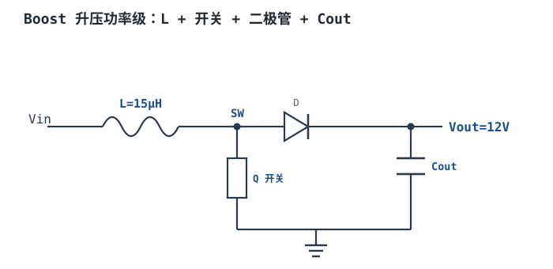
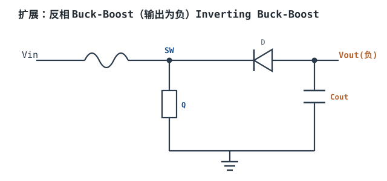
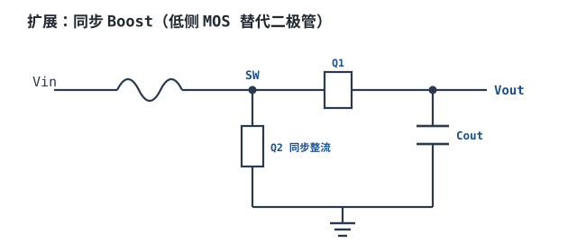
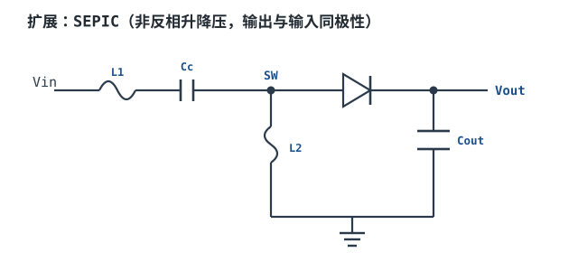
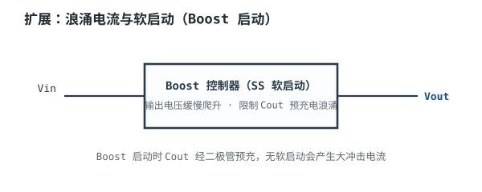
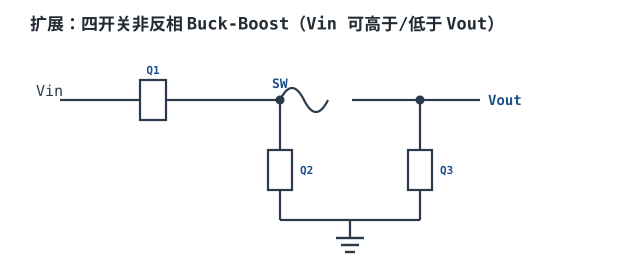

# Boost 升压与 Buck-Boost Boost Converter & Inverting Topology

## 1. 设计动机

::: motivation 为什么需要升压
锂电池 3.7V、USB 5V 常常低于负载需要的电压：LED 背光要 12V、电机要 12V、运算放大器要 ±12V。**Boost（升压变换器）**能把较低输入变成较高输出；当输入电压可能忽高忽低、时而高于时而低于目标（如锂电池 3.0~4.2V 要固定 3.3V），就要用 **Buck-Boost（升降压）**。它们与 Buck 共用同一套"开关+电感"方法论，只是能量流动方向不同。
:::

## 2. 原理图



电感先在 Q 开通时储能，Q 关断时电感感应出高压，经二极管把电荷泵到输出。因为电感两端在开关时叠加了输入电压，输出必然高于输入。

## 3. 静态分析（DC）

CCM 稳态下：

- **Boost 输出关系（理想）**：$V_{out}=V_{in}/(1-D)$；考虑效率 $D=1-V_{in}\eta/V_{out}$。
- **电感平均电流**：$I_L=I_{out}\cdot V_{out}/(\eta V_{in})$（输入侧电流，比输出大）。
- **开关管应力**：关断时承受电压 = $V_{out(max)}$；峰值电流 $I_{SW(peak)}=I_L+\Delta I_L/2$。
- **二极管应力**：反向电压 = $V_{out}$；平均电流 ≈ $I_{out}$。

## 4. 动态分析（AC / 瞬态）

Q 开通时电感电流上升，Q 关断时电感经二极管给 Cout 和负载供电。注意 Boost 的二极管只在 $(1-D)$ 时间导通，Cout 在 D 时间单独供负载，所以输出纹波比 Buck 更受电容充电电荷控制。

```echarts
{
  "tooltip": {"trigger": "axis"},
  "legend": {"data": ["SW 节点", "电感电流 IL", "输出纹波"], "bottom": 0, "textStyle": {"fontSize": 12}},
  "grid": {"left": 60, "right": 60, "top": 26, "bottom": 56},
  "xAxis": {"type": "category", "name": "µs", "data": [0,1,2,3,4,5,6,7], "axisLabel": {"fontSize": 11}},
  "yAxis": [
    {"type": "value", "name": "V", "min": 0, "max": 13, "axisLabel": {"fontSize": 11}},
    {"type": "value", "name": "IL A", "min": 1.1, "max": 1.6, "axisLabel": {"fontSize": 11}}
  ],
  "series": [
    {"name": "SW 节点", "type": "line", "step": "end", "showSymbol": false, "lineStyle": {"width": 2.4, "color": "#b5642e"},
     "data": [0, 0, 0, 0, 0, 12, 12, 12]},
    {"name": "电感电流 IL", "type": "line", "showSymbol": false, "yAxisIndex": 1, "lineStyle": {"width": 2.4, "color": "#1a4f8b"},
     "data": [1.20, 1.28, 1.36, 1.44, 1.52, 1.54, 1.40, 1.26]}
  ]
}
```

## 5. 环路分析

Boost 与 Buck 一样是电压/电流模式负反馈，但功率级传递函数不同：CCM Boost 的控制-输出传递函数在右半平面有个零点（RHP zero），限制了可用带宽。

- 结论：Boost 环路带宽不能取太高（RHP 零点带来额外相位滞后），通常比 Buck 慢；负载瞬态恢复比 Buck 软。
- 输出阻抗由 Cout 的充电电荷决定，重载纹波大。

::: advanced 进阶：CCM 伏秒平衡与 RHP 零点
**伏秒平衡**：Q 开通 $D T$ 时电感电压 = $V_{in}$；Q 关断 $(1-D)T$ 时电感电压 = $V_{in}-V_{out}$。伏秒相消：
$V_{in}D+(V_{in}-V_{out})(1-D)=0\Rightarrow V_{out}=V_{in}/(1-D)$。
**电感纹波**：$\Delta I_L=V_{in}D T/L=V_{in}D/(f_s L)$。
**输出纹波**：开通期二极管不导通，Cout 独供负载，$\Delta V_{out}=I_{out}D/(f_s C_{out})$。
**RHP 零点**：CCM Boost/Buck-Boost 的控制-传递函数含右半平面零点 $f_{z,RHP}=(1-D)^2 R/(2\pi L)$，它在提供增益提升的同时相位反而滞后，迫使环路带宽必须低于 $f_{z,RHP}/3$，这是 Boost 瞬态比 Buck 慢的根本原因。
:::

## 6. 元件取值与工程权衡

- **占空比极限**：Boost D 不宜接近 1（如 >0.85），否则 RHP 零点过低、效率崩、二极管导通时间太短。
- **电感 L**：取 $\Delta I_L=(0.2\sim0.4)I_L$，L 小则峰值电流大、开关应力高。
- **输出电容**：Boost 纹波 = $I_{out}D/(f_s C)$，比 Buck 更吃 Cout；要大低 ESR 电容。
- **二极管**：优先肖特基（低 VF）；同步整流可进一步提效。

## 7. 完整设计示例

::: example 5V→12V/0.5A Boost 完整设计（CCM）
1. **需求**：Vin=5V（范围 4.5~5.5V），Vout=12V，Iout=0.5A，fs=500kHz，η=0.9。
2. **算占空比**：$D=1-V_{in}\eta/V_{out}=1-5\times0.9/12=0.625$。
3. **算输入/电感平均电流**：$I_L=I_{out}V_{out}/(\eta V_{in})=0.5\times12/(0.9\times5)=1.33A$。
4. **定纹波电流**：取 $\Delta I_L=0.3\times I_L\approx0.4A$。
5. **算电感**：$L=V_{in}D/(\Delta I_L f_s)=5\times0.625/(0.4\times500k)\approx15.6\mu H$，取 **15µH**。
6. **验算纹波**：$\Delta I_L=5\times0.625/(500k\times15\mu H)\approx0.42A$。
7. **峰值开关电流**：$I_{SW(peak)}=1.33+0.42/2\approx1.54A$，选电感饱和电流 ≥2A。
8. **输出电容**：$\Delta V_{out}=I_{out}D/(f_s C)$，目标 120mV，$C=0.5\times0.625/(500k\times0.12)\approx5.2\mu F$，计入 ESR 与 DC bias，取 **22µF X5R**。
9. **二极管**：平均电流 ≈0.5A，反压 >12V，选肖特基（VF=0.5V），$P_D=0.25W$。
10. **效率**：Pout=6W，Poc=Pout/η=6.67W，输入功率 6W，损耗约 0.67W。
:::

## 8. 仿真与实验

LTspice 搭 Boost：

- `.tran 200u`：观察 SW 节点、电感电流三角波、输出纹波；
- 扫负载从 0.1A→0.5A：看输出纹波随 D、电流变化；
- 把 Vin 从 5V 降到 4.5V：看 D 增大、输出能否维持；
- 断开二极管模型，验证 RHP 零点对瞬态的影响（环路补偿处）。

## 扩展与变种电路

### 扩展1：反相 Buck-Boost（输出为负）Inverting Buck-Boost

电感接在开关与二极管之间，输出电压极性与输入相反、幅度 $|V_{out}|=D/(1-D)V_{in}$。常用它从正电源产生负电压。



::: example 工作原理与静态
- Q 开通：电感直接跨在 Vin 上储能；Q 关断：电感经二极管向 Cout 放电，把输出拉成负压。
- $|V_{out}|=D/(1-D)\cdot V_{in}$，D=0.5 时输出 = −Vin。
- 输入/输出均断续供电，纹波大；开关管承受电压 = $V_{in}+|V_{out}|$。
:::

```echarts
{
  "tooltip": {"trigger": "axis"},
  "legend": {"data": ["|Vout| 随占空比"], "bottom": 0, "textStyle": {"fontSize": 12}},
  "grid": {"left": 60, "right": 30, "top": 26, "bottom": 50},
  "xAxis": {"type": "category", "name": "D", "data": ["0.3", "0.4", "0.5", "0.6", "0.7"], "axisLabel": {"fontSize": 11}},
  "yAxis": {"type": "value", "name": "|Vout|/Vin", "min": 0, "max": 2.6, "axisLabel": {"fontSize": 11}},
  "series": [
    {"name": "|Vout| 随占空比", "type": "line", "showSymbol": false, "lineStyle": {"width": 2.4, "color": "#1a4f8b"},
     "data": [0.43, 0.67, 1.0, 1.5, 2.33]}
  ]
}
```

取值对比：反相 Buck-Boost 对比 Boost：输出反极性、可升压也可降压（Vin 高于或低于 |Vout| 都行），但输入输出纹波大、RHP 零点。适用：产生负电源；不适用：需要同极性大电流。

::: pitfall 开关管电压应力被低估
- **现象**：MOS 击穿。
- **原因**：管子承受 $V_{in}+|V_{out}|$，不是单值。
- **解决**：按 $V_{in(max)}+|V_{out}|$ 选 MOS 耐压并留量。
:::

### 扩展2：同步 Boost（低侧 MOS 替代二极管）Synchronous Boost

把输出整流二极管换成同步 MOS，消除肖特基 0.5V 压降，尤其在大升压比时提升明显。



::: example 工作原理与静态
- 输出整流位置用同步 MOS，导通压降 = $I\cdot R_{DSon}$（几十 mV）替代二极管 VF。
- 本例二极管损 0.25W → 同步后约 $0.5^2\times0.05=0.0125W$，效率提升数点。
- 轻载需二极管仿真模式防止倒灌。
:::

取值对比：同步 Boost 对比异步：效率高，但需栅驱动、死区。升压比越大、电流越大越值得用同步。

::: pitfall 同步管体二极管导通致反向损耗
- **现象**：效率不如预期。
- **原因**：死区期间体二极管导通，恢复损耗大。
- **解决**：优化死区时间、选低 Qrr MOS。
:::

### 扩展3：SEPIC（非反相升降压）Single-Ended Primary-Inductor Converter

用两只电感（可耦合）加一只串联耦合电容，输出与输入同极性，且 Vin 可高于或低于 Vout。



::: example 工作原理与静态
- 输出同极性，$V_{out}=D/(1-D)V_{in}$（与反相 Buck-Boost 同关系但输出为正）。
- 输入侧 L1 使输入电流连续，纹波小；适合电池供电（防止输入大纹波）。
- 需要两只电感 + 一只耦合电容，元件多。
:::

取值对比：SEPIC 对比反相 Buck-Boost：输出同极性、输入纹波小；但元件多、效率略低。适用：电池电压跨越目标值、要求同极性；不适用：成本敏感。

::: pitfall 耦合电容电压应力
- **现象**：Cc 击穿。
- **原因**：Cc 承受 ≈ Vin 的电压，纹波电流大。
- **解决**：选耐压 > Vin、纹波电流额定足够的薄膜/陶瓷电容。
:::

### 扩展4：浪涌电流与软启动 Inrush & Soft-Start

Boost 启动时输出 Cout 经二极管预充，若不缓启动，输入会看到很大浪涌电流；软启动让输出缓慢爬升。



::: example 工作原理与静态
- 启动瞬间 Cout 未充电，二极管直通，输入电流尖峰。
- 软启动（SS）让占空比/输出电压斜升，$I_{inrush}=C_{out}dV/dt$ 受控。
- 静态：稳态后正常工作。
:::

取值对比：软启动对比硬启动：浪涌小、不触发输入过流；代价：启动时间长。

::: pitfall 启动浪涌触发前级限流
- **现象**：一上电就把 USB/前级拉保护。
- **原因**：Cout 预充浪涌过大。
- **解决**：用带软启动的控制器、限制 dV/dt，或前级加限流。
:::

### 扩展5：四开关非反相 Buck-Boost 4-Switch Buck-Boost

用四只 MOS 组成两个半桥，Vin 高于 Vout 时工作在 Buck、低于时工作在 Boost，输出始终同极性、平滑过渡。



::: example 工作原理与静态
- Vin > Vout：左半桥做 Buck；Vin < Vout：右半桥做 Boost；过渡区两桥混合。
- 输出同极性、连续，适合锂电池（3.0~4.2V→固定 3.3V）。
- 用 4 只 MOS 换宽输入范围与高效率。
:::

取值对比：四开关 Buck-Boost 对比 SEPIC：效率高、同极性、宽范围；但 4 只 MOS 控制复杂。适用：电池宽压输入稳压；不适用：简单固定升压。

::: pitfall 模式切换区输出波动
- **现象**：Vin 接近 Vout 时输出抖动。
- **原因**：Buck/Boost 模式切换边界控制不佳。
- **解决**：选模式切换平滑的专用 4-switch 控制器。
:::

## 9. 常见坑与故障现象

::: pitfall 常见坑
- **Boost 不能空载稳压**：CCM Boost 空载时占空比极小，输出易过冲；轻载需进入 PFM/断续模式或加假负载。
- **输入电容纹波电流被忽视**：Boost 输入电感电流连续但开关节点电流脉动，输入电容 RMS 电流大，要选纹波电流额定足够的。
- **输出二极管反压选低**：二极管反压 = Vout，选接近值在瞬态过冲下会击穿，留量到 1.5~2 倍。
- **RHP 零点致环路振荡**：Boost 补偿带宽取太高会振荡，必须按 RHP 零点留余量。
:::

## 10. 自测题

<details><summary>Boost：Vin=5V、Vout=12V、理想效率，占空比 D 是多少？</summary>

理想 $D=1-V_{in}/V_{out}=1-5/12=0.583$。计入 η=0.9 工程取 $D=1-5\times0.9/12=0.625$。

</details>

<details><summary>为什么 CCM Boost 的环路带宽比 Buck 慢？</summary>

因为 Boost/Buck-Boost 的控制-输出传递函数含右半平面零点（RHP zero），它在提增益的同时相位反而滞后。环路带宽必须远低于 RHP 零点频率，否则相位裕度不足而振荡，所以 Boost 瞬态恢复天生比 Buck 慢。

</details>

<details><summary>反相 Buck-Boost：开关管关断时承受的电压是多少？（Vin=5V，|Vout|=12V）</summary>

开关管承受 $V_{in}+|V_{out}|=5+12=17V$，不是单一值。选 MOS 耐压要按这个总和留量（建议 ≥30V）。

</details>

## 11. 参考资料

- Erickson & Maksimovic, *Fundamentals of Power Electronics*, 2nd ed.（Boost/Buck-Boost 建模与 RHP 零点）
- Maniktala, *Switching Power Supplies A–Z*, 2nd ed.
- [TI SLVA477A — Buck Power Stage](https://www.ti.com/lit/an/slva477a/slva477a.pdf)（纹波/电感方法学可迁移）
