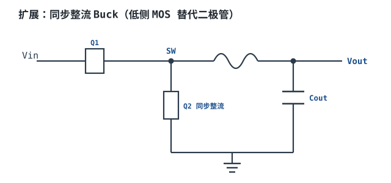
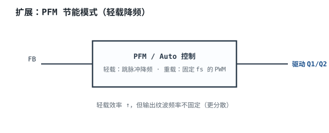
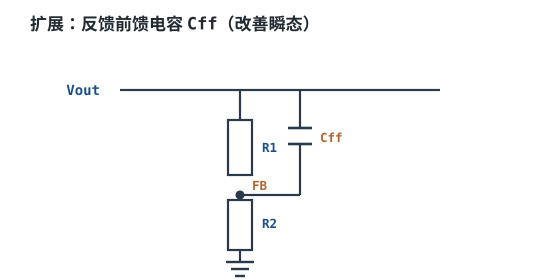
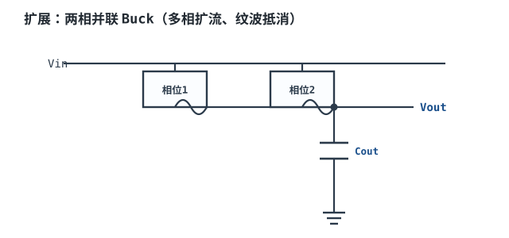

# 开关电源原理与 Buck 降压 Switch-Mode Power Supply & Buck Converter

把 12V 变成 5V，最直接的办法是串一只电阻或一只线性调整管。线性调整管的代价写在教科书第一页：输出电流全部流过调整管，管压降 7V，效率上限就是 $V_{out}/V_{in}=5/12=41.7\%$，剩下的 58.3% 全部变成热。3A 输出时这 21W 的热要把 TO-220 烧红。

**开关电源（Switch-Mode Power Supply, SMPS）**换了一条路：让功率管只在"全开"和"全关"两个状态停留，导通时压降接近零，关断时电流接近零，两种状态的瞬时功耗都小。真正要付的代价是：输出不再是干净的直流，而是叠加了开关频率纹波的直流；电流波形变成了三角波；还多了一个必须闭合的反馈环路。**Buck（降压变换器）**是这条路上最基础的一级，也是理解 Boost、Buck-Boost、反激、多相、POL 的共同起点。

这一章的主线是：先用伏秒平衡把"占空比"这件事算清楚，再由纹波比反推电感、由纹波电流反推电容，然后把这级的损耗拆成导通、开关、栅极、电荷四项与 [MOSFET 章](../components/mosfet.md) 对齐，最后用 12V→5V/3A/500kHz 走一遍完整设计，算到电感饱和电流、电容 RMS 电流、MOS 结温和效率。

## 1. 设计动机

::: motivation 为什么工程师必须自己会算 Buck
买一颗现成的 Buck 芯片，照数据手册的推荐电路搭，多数时候能出电压。但只要出现下面任意一条，推荐电路就不够用了：输入电压范围比手册的典型值宽；输出电流或纹波要求与手册不同；电感、电容要换封装或被成本压着换型号；板子空间逼着把开关频率提上去。

这时如果不会算，就只能靠试。试的代价很具体：电感量够了但饱和电流不够，满载一瞬间电感饱和、电流尖峰打穿开关管；输出电容按标称 22µF 选，实际偏置下只剩 10µF，纹波翻倍；开关损耗没算，MOS 结温悄悄超过 125°C，量产批次开始批量失效。**这三类故障都不会在轻载测试台上暴露，只有算过的人才会在原理图阶段就把它们挡住。**
:::

Buck 要回答的问题可以排成一张清单，本章按这张清单推进：

| 要回答的问题 | 决定什么 | 算错后的现象 |
|---|---|---|
| 占空比 $D$ 是多少，最坏情况在哪 | 控制器的最低压差、最大占空比限制 | 低压输入时掉出稳压 |
| 电感取多少 µH、饱和电流取多大 | 体积、成本、峰值电流 | 重载啸叫、电流尖峰、烧管 |
| 输入、输出电容各承受多大 RMS 电流 | 电容封装、颗数、品牌 | 电容鼓包、纹波超标 |
| 损耗分到哪几项、结温多少 | 散热、封装、效率指标 | 满载过热降额、效率不达标 |
| 轻载时用什么模式 | 待机功耗、纹波频谱 | 电池续航差、射频受扰 |

## 2. 定义与直观

### 2.1 一句话定义

**Buck 是一个用开关把输入电压"切碎"、再用 LC 低通滤回直流的降压电路；输出电压等于输入电压乘以开关导通时间占整个周期的比例。**

这句话里有两个必须分开的东西：

- **开关（switching）**决定"能量什么时候送进来"。它把连续的输入功率切成一段段能量包，包的大小由导通时间控制。
- **滤波（filtering）**决定"送进来之后长什么样"。电感把方波电压变成三角波电流，电容把三角波电流变成带小纹波的直流电压。

只做开关不做滤波，输出是方波；只做滤波不做开关，输出等于输入。两者缺一不可。

### 2.2 原理图与三个能量元件


图里四个元件各管一件事，缺一个都不能工作：

- **Q1（高侧开关）**：把 $V_{in}$ 接到 SW 节点的闸门。它导通时 SW 被拉到 $V_{in}$，关断时 SW 悬空。
- **D（续流二极管）**：Q1 关断后 SW 悬空，电感电流不能突变，二极管立刻导通，给电流一条"从地经二极管到电感"的回路。没有它，SW 节点电压会被电感感应出的尖峰顶到击穿。
- **L（电感）**：把方波电压积分成三角波电流。它决定纹波电流的大小，也决定能量缓冲的容量。
- **$C_{out}$（输出电容）**：把三角波电流积分成电压。它决定输出纹波，也决定负载阶跃时电压能撑多久。

图中电感标 22µH，那是 [电感与磁珠](../components/inductors-ferrite-beads.md) 里同一工况的对照设计点（纹波比只有 8.8%）；本章 §4.1 按 30% 纹波比重算，得到 6.8µH。**两个值都"能用"，差别在体积与瞬态——这正是选型要权衡的地方。**

::: analogy 类比：高位水箱与飞轮
把 Buck 想成一个从高位水箱（$V_{in}$）给低位水箱（$V_{out}$）补水的水路。Q1 是一只快速开合的阀门：开着时水从高处冲下来，关着时水路断开。电感的角色像**飞轮**——水冲下来时它把能量存成转速，阀门一关，飞轮靠惯性继续推水，所以出水不会断流。电容则像**低位水箱的水面**：飞轮推来的水先倒进这个箱子，箱子的截面积（容量）越大，水面起伏越小。

这个类比能解释三件事，但有三个边界要记住：

1. **水面只能低于高水位。** Buck 只能降压。想升压要换 Boost，见 [Boost 与 Buck-Boost](boost-buckboost.md)。
2. **飞轮有转速上限。** 电感有饱和电流，超过就失去储能能力，类比里的"飞轮打滑"。
3. **水不会自己停。** 输出需要反馈环把水面高度测回来、反过来调阀门的开合比例。开环的 Buck 只会输出一个由占空比固定的电压。环路怎么补，见 [控制模式与环路补偿](smps-control-loop.md)。
:::

### 2.3 三种导通模式

电感电流在每个开关周期里的形状，把 Buck 分成三种工作模式：

| 模式 | 电感电流 | 判据（本章符号） | 什么时候出现 |
|---|---|---|---|
| CCM 连续导通 | 始终 $>0$，三角波 | $I_{out}>\Delta I_L/2$ | 重载、大电感 |
| BCM 临界导通 | 谷点刚好触零 | $I_{out}=\Delta I_L/2$ | 设计上的分界点 |
| DCM 断续导通 | 有一段停在零 | $I_{out}<\Delta I_L/2$ | 轻载、小电感、PFM 模式 |

CCM 下输出与占空比是**线性**关系 $V_{out}=DV_{in}$；DCM 下变成**非线性**，同样的占空比会给出更高的输出电压。很多"轻载时输出电压偏高"的现象，根源就在这里。

## 3. 定量关系

### 3.1 伏秒平衡与占空比

**伏秒平衡（Volt-Second Balance）**是分析所有开关变换器的第一把钥匙：稳态下一个开关周期内，电感两端电压对时间的积分必须为零。不成立的话，电感电流一周内会净增或净减，就不是稳态。

写出一个周期两段的伏秒积：

$$(V_{in}-V_{out})\cdot DT_{sw}+(-V_{out})\cdot(1-D)T_{sw}=0$$

其中 $V_{in}$ 是输入电压（V），$V_{out}$ 是输出电压（V），$D$ 是占空比（无量纲，0~1），$T_{sw}=1/f_{sw}$ 是开关周期（s）。把式子展开、约掉 $T_{sw}$：

$$V_{in}D-V_{out}D-V_{out}+V_{out}D=0\quad\Longrightarrow\quad V_{out}=D\,V_{in}$$

这个式子有三个前提，违反任一条就不再成立：**电感电流连续**（CCM）、**二极管正向压降忽略**、**开关管导通压降忽略**。把后两项折成一个等效效率 $\eta$，工程上常用

$$D\approx\frac{V_{out}}{\eta V_{in}}$$

$\eta$ 是无量纲的效率。这个式子是**保守估算**：它把所有损耗都折成串联压降，会略微高估占空比（§4.1 会看到，实际 $D$ 比这个估算低约 4%）。高估在这里是好事——按更小的 $(1-D)$ 去选电感和算峰值电流，结果偏安全。

占空比的**最坏情况在最低输入电压**。12V 输入、5V 输出的 Buck，输入允许跌到 10.8V 时：

$$D_{max}=\frac{5}{0.9\times10.8}=0.514$$

控制器必须能在这个占空比下正常工作（多数集成开关的最小压差、最大占空比限制都在这附近），否则低压输入时会掉出稳压。

### 3.2 电感纹波与电感量

高侧开关导通期间，电感承受 $V_{in}-V_{out}$，持续 $DT_{sw}$，电流线性上升。由 $V_L=L\cdot\mathrm{d}i/\mathrm{d}t$：

$$\Delta I_L=\frac{(V_{in}-V_{out})\,D}{f_{sw}L}=\frac{V_{out}(1-D)}{f_{sw}L}$$

后一个等号用了 $V_{out}=DV_{in}$。$\Delta I_L$ 是纹波电流的峰峰值（A），$L$ 是电感量（H），$f_{sw}$ 是开关频率（Hz）。反解电感量：

$$L=\frac{V_{out}(V_{in}-V_{out})}{\Delta I_L\,f_{sw}\,V_{in}}$$

**纹波比（ripple ratio）**定义为 $r=\Delta I_L/I_{out}$，工程取值 0.2~0.4，常用 0.3。取值的道理是两条相反的趋势：

- $r$ 小 → 峰值电流低、输出纹波小、磁芯损耗小，但电感量大、体积大、DCR 大、负载阶跃时电流爬升慢。
- $r$ 大 → 电感小、瞬态快，但峰值电流与 RMS 电流都高，MOS 与电感的应力同步上升。

电感的两个额定电流必须分别核对，它们约束的是不同的物理量：

$$I_{pk}=I_{out}+\frac{\Delta I_L}{2},\qquad I_{L,rms}=\sqrt{I_{out}^2+\frac{\Delta I_L^2}{12}}$$

$I_{pk}$ 约束**饱和电流** $I_{sat}$（磁学极限），$I_{L,rms}$ 约束**温升电流** $I_{rms,rated}$（热学极限）。工程降额：

$$I_{sat}\geq\frac{I_{pk}}{0.8}$$

分母 0.8 表示留 20% 余量。**为什么必须降额**：铁氧体在高温下饱和磁感应强度下降，数据手册的 $I_{sat}$ 通常在 20~25°C 测；一颗标 5A 的电感在 100°C 时可能只剩 4A。余量就是为这段温度差准备的。电感的详细定义差异见 [电感与磁珠](../components/inductors-ferrite-beads.md)。

### 3.3 CCM/DCM 判据与 DCM 增益

令 $\Delta I_L/2=I_{out}$ 解出临界电流，就得到 CCM 与 DCM 的分界线：

$$I_{out,crit}=\frac{\Delta I_L}{2}=\frac{V_{out}(1-D)}{2f_{sw}L}$$

输出电流高于它才是 CCM。低于它，电感电流在周期末段会停在零，二极管提前关断，进入 DCM。

DCM 下的电压比不再是 $D$，而是

$$M=\frac{V_{out}}{V_{in}}=\frac{2}{1+\sqrt{1+\dfrac{4K}{D^2}}},\qquad K=\frac{2Lf_{sw}}{R}$$

$R=V_{out}/I_{out}$ 是负载电阻（$\Omega$），$K$ 是无量纲的"归一化电感"。这个式子在边界处必须退化回 $M=D$，可以当作验算：代入 $K=1-D$（边界条件）得

$$M=\frac{2}{1+\sqrt{1+\dfrac{4(1-D)}{D^2}}}=\frac{2}{1+\dfrac{2-D}{D}}=\frac{2}{2/D}=D\quad\checkmark$$

**工程含义**：DCM 的 $M$ 总是高于同占空比的 CCM 值。所以负载从重变轻时，若控制器不减小占空比，输出电压会往上飘；反过来，轻载下突加重载，占空比要"补"上去，瞬态跌落比 CCM 深。这也是为什么很多芯片在轻载进出 DCM 时会有一个输出电压的小台阶。

### 3.4 电容的 RMS 电流：$\sqrt{D(1-D)}$ 是怎么来的

输入电容不是"滤一下就行"，它每天承受的是**方波脉冲电流**，必须按 RMS 电流选，否则 ESR 发热会把电容烤干。

先看电流波形：输入电源只在 $DT_{sw}$ 期间给电感供电，其余时间电流为零。对输入电容来说，它要补上这段"缺口"。设电感电流为 $i_L(t)$、平均值 $I_L=I_{out}$，则电容电流

$$i_C(t)=\begin{cases}i_L(t)-DI_L, & 0<t<DT_{sw}\\ -DI_L, & DT_{sw}<t<T_{sw}\end{cases}$$

后一段的 $-DI_L$ 来自平均电流守恒：输入平均电流是 $DI_L$，而实际只在导通段流入，其余段由电容倒灌。

对两段分别求均方值再按时间加权：

$$I_{C,rms}^2=D\left[I_L^2(1-D)^2+\frac{\Delta I_L^2}{12}\right]+(1-D)D^2I_L^2$$

其中三角波的均方值用了 $\langle i_L^2\rangle=I_L^2+\Delta I_L^2/12$（三角波方差是峰峰值的平方除以 12）。把含 $I_L^2$ 的项合并：

$$D(1-D)^2I_L^2+D^2(1-D)I_L^2=D(1-D)I_L^2\left[(1-D)+D\right]=D(1-D)I_L^2$$

于是

$$I_{C,in,rms}=\sqrt{D(1-D)I_{out}^2+\frac{D\,\Delta I_L^2}{12}}$$

**第一项就是 $\sqrt{D(1-D)}$ 的来历**：它是"方波脉冲的面积占比"直接算出来的均方根。当纹波可以忽略时，式子退化成教科书里最常见的形式

$$I_{C,in,rms}\approx I_{out}\sqrt{D(1-D)}$$

这个式子在 $D=0.5$ 时取最大值 $0.5I_{out}$，在 $D$ 接近 0 或 1 时趋于零。所以**同样的输出电流下，占空比接近 50% 的 Buck 输入电容压力最大**，12V→5V（$D=0.42$）刚好在不利区间。

输出电容的情况完全不同：电感电流的直流分量直接流向负载，电容只承担三角波纹波，所以

$$I_{C,out,rms}=\frac{\Delta I_L}{\sqrt{12}}$$

用峰值电流给 $\Delta I_L$ 定义，$\sqrt{12}=3.464$。对比一下典型值：$I_{out}=3$A、$\Delta I_L=0.9$A、$D=0.42$ 时，输入电容 1.47A，输出电容只有 0.26A，**差了 5.6 倍**。这就是为什么 Buck 的输入电容通常比输出电容更热、更容易失效。

### 3.5 损耗分解：导通、开关、栅极、电荷

效率和结温必须按项算，不能拍一个"约 90%"。沿用 [MOSFET 章](../components/mosfet.md) 的分项口径，同步 Buck 的两个管子各算四项，再补死区与驱动：

| 损耗项 | 公式 | 物理来源 | 与频率的关系 |
|---|---|---|---|
| 导通损耗 | $P_{cond}=I_{rms}^2R_{DS(on)}(T_j)$ | 沟道电阻 | 无关 |
| 开关（交叠）损耗 | $P_{sw}=\frac12V_{DS}I_D(t_r+t_f)f_{sw}$ | 电压电流同时不为零 | 正比 |
| 输出电荷损耗 | $P_{oss}=\frac12Q_{oss}V_{DS}f_{sw}$ | 每次开关给 $C_{oss}$ 充放电 | 正比 |
| 栅极驱动损耗 | $P_g=Q_gV_{GS}f_{sw}$ | 搬运栅极电荷 | 正比 |
| 体二极管反向恢复 | $P_{rr}=Q_{rr}V_{DS}f_{sw}$ | 低边体二极管抽走存储电荷 | 正比 |
| 死区体二极管导通 | $P_{dead}=V_FI_{out}\cdot2t_d f_{sw}$ | 死区期间电流走体二极管 | 正比 |

符号：$I_{rms}$ 是该管在导通期间的实际有效值电流（A）；$R_{DS(on)}(T_j)$ 是结温 $T_j$ 下的导通电阻（$\Omega$）；$V_{DS}$ 是关断时承受的电压（V）；$t_r,t_f$ 是上升、下降时间（s）；$Q_{oss}$ 是输出电荷（C）；$Q_g$ 是总栅极电荷（C）；$V_{GS}$ 是驱动电压（V）；$Q_{rr}$ 是反向恢复电荷（C）；$V_F$ 是体二极管正向压降（V）；$t_d$ 是单侧死区时间（s）。

三项只与频率成正比、三项与负载电流有关，这个结构决定了两条工程结论：

1. **轻载必须降频。** 开关相关的四项基本与 $I_{out}$ 无关，轻载时它们占绝对主导，固定频率 PWM 的效率会塌到个位数（§4.2 给数）。
2. **高频必须换小电荷的管子。** 同工艺下 $R_{DS(on)}$ 与 $Q_g$ 相互矛盾，选用优值 $R_{DS(on)}\times Q_g$ 筛选是唯一可量化的比较方式（见 [MOSFET 章](../components/mosfet.md) 的 FOM 一节）。

高边与低边的分工不同，不能套同一套参数：

- **高边**：导通时间占 $D$，每次开通都要硬扛整个 $V_{in}$，交叠损耗与 $Q_{oss}$ 是主角，应选低 $Q_g$、低 $Q_{oss}$ 的管子，$R_{DS(on)}$ 可适当放宽。
- **低边**：导通时间占 $1-D$，是导通损耗的主角；开通发生在体二极管已经导通之后，$V_{DS}$ 只有约 0.8V，交叠损耗小，但它的体二极管 $Q_{rr}$ 会在高边开通瞬间以 $V_{in}$ 折算成损耗。低边应选低 $R_{DS(on)}$、低 $Q_{rr}$。

### 3.6 适用条件与失效边界

上面每一条式子都有边界，越界后误差可以大到失去意义：

- 伏秒平衡给出的 $V_{out}=DV_{in}$ 只在 CCM 且忽略寄生时成立。DCM 下改用 §3.3 的 $M$ 式；寄生压降显著时用 $D=V_{out}/(\eta V_{in})$ 做保守估算。
- 纹波公式假设 $L$ 是常数。电流接近 $I_{sat}$ 后 $L$ 随电流跌落，实际纹波比算出来的大，会正反馈加速饱和。
- $\Delta I_L$ 的三角波假设在 $D>0.9$ 或极短导通时间下不成立，此时还要考虑最小导通时间与驱动延迟。
- 电容容量必须用**偏置后的有效容量**，不能用标称值。MLCC 的直流偏置降额是这一章最常见的算术陷阱，详见 [功率元件选型](power-component-selection.md)。
- 所有损耗式都忽略了 PCB 铜箔、焊点、电感交流电阻（趋肤与邻近效应）带来的附加项，高频设计要另加 20%~40% 的修正。

## 4. 典型计算

### 4.1 算例一：12V→5V/3A/500kHz 完整设计

::: example 从需求到结温的完整走法
**第 0 步 · 需求表。** $V_{in}=12$V（范围 10.8~13.2V），$V_{out}=5$V，$I_{out}=3$A，$f_{sw}=500$kHz，目标效率 ≥ 92%，输出纹波 ≤ 30mV，环境 40°C。

**第 1 步 · 占空比。** 标称点 $D=5/12=0.4167$；最低输入点 $D_{max}=5/(0.9\times10.8)=0.514$（按 $\eta=0.9$ 保守估）。

**第 2 步 · 纹波比与电感量。** 取 $r=0.3$：

$$\Delta I_L=0.3\times3=0.9\ \text{A}$$

$$L=\frac{5\times(12-5)}{0.9\times5\times10^{5}\times12}=6.48\ \mu\text{H}\ \Rightarrow\ \text{取标准值 }6.8\ \mu\text{H}$$

**第 3 步 · 验算纹波。**

$$\Delta I_L(12\text{V})=\frac{5\times(1-0.4167)}{5\times10^{5}\times6.8\times10^{-6}}=\frac{2.917}{3.4}=0.858\ \text{A}\ (28.6\%)$$

最坏点在**最高输入** 13.2V（占空比最小、关断时间最长）：

$$\Delta I_L(13.2\text{V})=\frac{5\times(1-0.3788)}{5\times10^{5}\times6.8\times10^{-6}}=0.913\ \text{A}\ (30.5\%)$$

**第 4 步 · 电流应力与饱和余量。**

$$I_{pk}=3+\frac{0.913}{2}=3.46\ \text{A},\qquad I_{L,rms}=\sqrt{3^2+\frac{0.913^2}{12}}=3.01\ \text{A}$$

$$I_{sat}\geq\frac{3.46}{0.8}=4.32\ \text{A}$$

选 **6.8µH / $I_{sat}\geq6$A / $I_{rms,rated}\geq5$A / DCR ≤ 25mΩ / 屏蔽型**（典型量级，以具体型号数据手册为准）。饱和余量 $3.46/6=57.7\%$，留得比 20% 更宽，是为了覆盖高温下 $I_{sat}$ 的跌落。

**第 5 步 · 输入电容 RMS 电流。**

$$I_{C,in,rms}=\sqrt{0.4167\times0.5833\times3^2+\frac{0.4167\times0.913^2}{12}}=\sqrt{2.188+0.029}=1.49\ \text{A}$$

在 25V 耐压下选低 ESR 陶瓷。单颗 10µF/25V 1210 的纹波电流额定通常只有 1~1.5A（随频率与温度变化，以手册为准），所以**至少要两颗并联**，同时把 ESR 再减半。

**第 6 步 · 输出电容。** 目标纹波 30mV，先只算容性分量：

$$C_{out}\geq\frac{\Delta I_L}{8f_{sw}\Delta V_{out}}=\frac{0.913}{8\times5\times10^{5}\times0.03}=7.6\ \mu\text{F}$$

选 **2×22µF/16V X5R 1210**（标称 44µF）。5V 偏置下按典型直流偏置曲线保留约 70%，有效 30.8µF：

$$\Delta V_{c}=\frac{0.913}{8\times5\times10^{5}\times30.8\times10^{-6}}=\frac{0.913}{123.2}=7.4\ \text{mV}$$

ESR 分量：两颗陶瓷并联约 2.5mΩ，$\Delta V_{esr}=0.913\times0.0025=2.3$mV。合计约 9.7mV，离 30mV 有 3 倍余量，这个余量是留给偏置曲线不确定性与老化的。

**第 7 步 · MOS 损耗分解。** 选 30V 级 DFN 双管：高边 $R_{DS(on)}=12$mΩ、$Q_g=12$nC、$Q_{oss}=8$nC、$t_r=10$ns、$t_f=8$ns；低边 $R_{DS(on)}=8$mΩ、$Q_g=18$nC、$Q_{oss}=12$nC、$Q_{rr}=20$nC（均为 25°C 典型量级）。按 100°C 取 $R_{DS(on)}\times1.5$，驱动 5V，死区 20ns：

| 项目 | 代入 | 结果 |
|---|---|---|
| 高边导通 | $(0.4167\times(3^2+0.913^2/12))\times(0.012\times1.5)$ | 0.068 W |
| 高边交叠 | $0.5\times12\times3\times18\times10^{-9}\times5\times10^{5}$ | 0.162 W |
| 高边 $Q_{oss}$ | $0.5\times8\times10^{-9}\times12\times5\times10^{5}$ | 0.024 W |
| 体二极管 $Q_{rr}$ | $20\times10^{-9}\times12\times5\times10^{5}$ | 0.120 W |
| 高边栅极 | $12\times10^{-9}\times5\times5\times10^{5}$ | 0.030 W |
| 低边导通 | $(0.5833\times(3^2+0.913^2/12))\times(0.008\times1.5)$ | 0.064 W |
| 低边 $Q_{oss}$ | $0.5\times12\times10^{-9}\times12\times5\times10^{5}$ | 0.036 W |
| 低边栅极 | $18\times10^{-9}\times5\times5\times10^{5}$ | 0.045 W |
| 死区体二极管 | $0.8\times3\times2\times20\times10^{-9}\times5\times10^{5}$ | 0.048 W |
| **MOS 合计** | | **0.597 W** |

高边的导通有效值电流按 $I_{rms,HS}=\sqrt{D(I_{out}^2+\Delta I_L^2/12)}=1.94$A 算，低边按 $I_{rms,LS}=\sqrt{(1-D)(\cdots)}=2.30$A 算。

**第 8 步 · 其余损耗与总效率。** 电感铜损用**热态 DCR**（25°C 25mΩ，100°C 乘 1.295 得 32.4mΩ）：

$$P_{DCR}=3.01^2\times0.0324=0.294\ \text{W}$$

输入电容 ESR 损 $1.49^2\times0.003=0.007$W，输出电容 ESR 损 $0.274^2\times0.0025<0.001$W，控制器静态与驱动自耗约 0.02W。

$$P_{loss}=0.597+0.294+0.007+0.020=0.918\ \text{W}$$

$$\eta=\frac{15}{15+0.918}=94.2\%$$

这个值高于 92% 的目标，说明设计有余量；实际板子会因电感磁芯损耗、PCB 铜损、开关振铃再低 1~2 个百分点，**落在 92%~93% 是正常结果**。

**第 9 步 · 结温。** 高边承担 $0.068+0.162+0.024+0.120+0.030=0.404$W，加上一半死区约 0.428W；3×3 DFN 在 1 平方英寸铜箔上的 $R_{\theta ja}$ 约 60 K/W（典型量级，以封装手册为准）：

$$T_j=40+0.428\times60=65.7\ ^\circ\text{C}$$

此时 $R_{DS(on)}$ 的真实倍率是 $1+0.0067\times(65.7-25)=1.27$，比假设的 1.5 小，所以上表偏保守——按 1.27 重算高边导通损为 0.058W，$T_j$ 回落到 65.1°C，一次迭代就收敛。低边承担约 0.169W，$T_j=40+0.169\times60=50.1\ ^\circ\text{C}$。

**第 10 步 · 反馈分压。** 基准 0.8V，支路电流取 10µA：$R_2=0.8/10\mu\text{A}=80$k（取 80.6k，1%），$R_1=80.6\text{k}\times(5/0.8-1)=423$k（取 422k）。验算 $0.8\times(1+422/80.6)=4.99$V $\checkmark$。环路补偿怎么配，见 [控制模式与环路补偿](smps-control-loop.md)。
:::

### 4.2 算例二：轻载为什么必须降频

同一条电源在 $I_{out}=10$mA 时的两种做法，效率差 4~5 倍。

**做法 A：强制 PWM，固定 500kHz。** 输出功率 $P_{out}=5\times0.01=0.05$W。导通损耗与 DCR 铜损随电流平方跌到可忽略（$0.01^2\times0.0324\approx3\mu$W），但有一批损耗**与负载几乎无关**：

$$P_{fixed}=0.024+0.036+0.030+0.045+0.007+0.020=0.162\ \text{W}$$

（依次是高边 $Q_{oss}$、低边 $Q_{oss}$、两组栅极电荷、电容 ESR、控制器静态。）

更关键的是：强制 PWM 为了保住"固定频率、连续导通"，会让电感电流在零附近来回（允许负电流），**纹波 ±0.45A 不会因为负载轻而变小**。于是开关的交叠损耗与体二极管反向恢复都按这 0.45A 算，而不是按 10mA 算：

$$P_{comm}\approx0.5\times12\times0.45\times18\times10^{-9}\times5\times10^{5}+0.036=0.024+0.036=0.060\ \text{W}$$

$$\eta_A\approx\frac{0.05}{0.05+0.162+0.060}=18.4\%$$

**这就是强制 PWM 在 10mA 附近效率只有 20% 左右的原因**——不是算错，是 0.22W 的固定开销摊在 0.05W 的输出上。

**做法 B：PFM / Auto 模式。** 轻载时跳过大部分周期，有效开关频率从 500kHz 降到约 5kHz（降 100 倍）。每次脉冲要搬运的能量 $E=P_{out}/f_{PFM}=0.05/5000=10\ \mu$J，对应的峰值电流

$$I_{pk}=\sqrt{\frac{2E}{L}}=\sqrt{\frac{2\times10\times10^{-6}}{6.8\times10^{-6}}}=1.72\ \text{A}$$

单脉冲的损耗按这个电流算，再乘 5000 次/秒：交叠 $0.5\times12\times1.72\times18\text{n}\times5000=0.93$mW，$Q_{oss}$ 与栅极约 1.35mW，$Q_{rr}$ 1.2mW，导通与 DCR 约 0.5mW，控制器低静态电流约 0.4mW，合计约 4.4mW：

$$\eta_B\approx\frac{0.05}{0.05+0.0044}=92\%$$

模型给出 92%，实测通常在 80%~88%——差额来自每个脉冲的额外损耗与驱动电路的静态电流。**但 18.5% 与 92% 的量级差是确定的。**

**这个例子说明一件事：轻载效率不是靠"省导通损耗"省出来的，导通损耗在轻载本来就没多少；它靠的是少开关。**

PFM 的代价写在输出波形上：纹波频率不再固定，而是随负载变化，频谱是一堆分散的谱线。射频接收机、高精度 ADC 附近的电源通常要禁用 PFM，改用强制 PWM 或后级 LDO。

```echarts
{
  "tooltip": {"trigger": "axis"},
  "legend": {"data": ["强制 PWM", "PFM / Auto"], "bottom": 0, "textStyle": {"fontSize": 12}},
  "grid": {"left": 62, "right": 30, "top": 28, "bottom": 52},
  "xAxis": {"type": "category", "name": "负载电流 A", "data": ["0.01", "0.03", "0.1", "0.3", "1.0", "3.0"], "axisLabel": {"fontSize": 11}},
  "yAxis": {"type": "value", "name": "效率 %", "min": 0, "max": 100, "axisLabel": {"fontSize": 11}},
  "series": [
    {"name": "强制 PWM", "type": "line", "showSymbol": true, "lineStyle": {"width": 2.4, "color": "#b5642e"},
     "data": [19, 42, 70, 87, 91, 94]},
    {"name": "PFM / Auto", "type": "line", "showSymbol": true, "lineStyle": {"width": 2.4, "color": "#1a4f8b"},
     "data": [88, 90, 92, 93, 93.5, 94]}
  ]
}
```

两条曲线的形状比绝对值更重要：**强制 PWM 从 94% 一路掉到 19%，PFM 在轻载段基本平坦。** 0.01A 的点与上面的 18.5% 对应；PFM 段取实测典型值，模型给出的上限约 92%。

### 4.3 算例三：同步整流换来的效率

把 §4.1 的低边 MOS 换成肖特基二极管（$V_F=0.5$V），其余不变：

$$P_D=I_{out}(1-D)V_F=3\times0.5833\times0.5=0.875\ \text{W}$$

对比同步方案里低边那一组损耗（导通 0.064 + $Q_{oss}$ 0.036 + 栅极 0.045 + 死区 0.048 = 0.193W），异步方案多出 0.682W；同时省掉了体二极管反向恢复的 0.120W。净增

$$\Delta P=0.875-0.193-0.120=0.562\ \text{W}$$

$$\eta_{async}=\frac{15}{15+0.918+0.562}=91.0\%$$

同步整流换来 3.2 个百分点。这个差在 3A 时值 0.56W，在 5V/0.5A 的小电源上就微不足道——**同步整流值不值得，要看输出电流与 $V_F$ 的乘积，而不是看拓扑先不先进**。二极管的选型细节见 [二极管：整流、快恢复、肖特基](../components/diodes.md)。

## 5. 工程含义

### 5.1 数量级：拿到需求先估三件事

不用精确计算就能估出量级，这一步能挡掉大部分选型方向错误：

| 量 | 数量级关系 | 12V→5V/3A/500kHz 的实例 |
|---|---|---|
| 占空比 | $V_{out}/V_{in}$ | 0.42 |
| 电感量 | $\dfrac{V_{out}(V_{in}-V_{out})}{rI_{out}f_{sw}V_{in}}$ | 6.8µH |
| 电感峰值电流 | $I_{out}(1+r/2)$ | 3.46A |
| 输入电容 RMS | $I_{out}\sqrt{D(1-D)}$ | 1.49A |
| 输出电容 RMS | $rI_{out}/\sqrt{12}$ | 0.26A |
| 高边导通占比 | $D$ | 42% |
| 开关损耗占比（500kHz） | $\propto f_{sw}$ | 约 2/3 的 MOS 损耗 |

经验值：**500kHz 以下，导通损耗通常是主角；500kHz 以上，开关相关损耗迅速接管。** 这条分界不是常数——它随 $V_{in}$ 上升而下移。24V 输入时，硬开关的交叠损耗是 12V 时的两倍，§4.1 里 0.16W 的交叠损耗会变成 0.32W，此时要么降频，要么换低 $Q_g$ 的管子，要么加缓冲/软开关。

### 5.2 假设什么时候失效

本章的模型在四种场合会明显偏离实测，遇到时要换工具而不是硬套公式：

1. **占空比接近极限。** $D>0.9$ 或 $D<0.1$ 时，最小导通/关断时间、驱动传输延迟、自举电容补充时间都会变成限制因素，公式给出的 $D$ 已经不可实现。
2. **电感接近饱和。** $L$ 随电流跌落，纹波增大，峰值更高，形成正反馈。此时的"稳态"其实是一个电流失控过程，只能靠限流保护兜住。
3. **陶瓷电容占比很高。** 输出阻抗在几百 kHz 到几 MHz 之间由电容的 ESL 与 PCB 过孔电感决定，$1/(8fC)$ 模型已经失效，需要看阻抗曲线。
4. **多相或强耦合。** 各相电流的纹波会互相抵消，输入电容的 RMS 电流不再由单相 $D(1-D)$ 决定，要按相数重算（见 §5.3）。

### 5.3 拓扑变种与什么时候换它

Buck 的五个常见变种，各自解决一个具体问题：

**同步整流（低边换成 MOS）。** 用几十 mΩ 的沟道电阻替代 0.5V 的二极管压降，3A 时省 0.56W（§4.3）。代价是需要互补驱动、死区控制，且轻载时必须能进入二极管仿真或 PFM，否则低边会把电容里的电荷倒灌回地。



**自举驱动（高边用 N-MOS）。** N-MOS 的 $R_{DS(on)}$ 只有同尺寸 P-MOS 的 1/3 左右，但它的栅极必须比源极（SW 节点）高出一个驱动电压，而 SW 在 0~$V_{in}$ 之间摆动。自举电容 $C_{boot}$ 跨在 BST 与 SW 之间，低边导通时由 $V_{in}$ 经自举二极管充电，高边导通时把整个栅驱动"抬"上去：

$$V_{GS,HS}=V_{Cboot}\approx V_{in}-V_{F,Dboot}-V_{drop}$$

其中 $V_{F,Dboot}$ 是自举二极管正向压降（V），$V_{drop}$ 是驱动电路与电荷分享造成的跌落（V）。$C_{boot}$ 的取值按允许跌落反推：

$$C_{boot}\geq\frac{Q_g}{\Delta V_{boot}}$$

$Q_g$ 是高边管总栅极电荷（C），$\Delta V_{boot}$ 是允许的驱动电压跌落（V）。取 $Q_g=12$nC、$\Delta V_{boot}=0.2$V，得 $C_{boot}\geq60$nF，工程取 100nF。


**PFM / Auto 模式（轻载降频）。** 重载固定频率保低纹波，轻载跳脉冲保效率（§4.2）。选型时要看芯片在什么负载点切换模式，切换点附近常有一段效率凹坑与输出纹波突变。



**前馈电容 $C_{ff}$（与上分压电阻并联）。** 在高频段旁路 $R_1$，相当于随频率提高反馈系数，引入一个零点

$$f_z=\frac{1}{2\pi R_1C_{ff}}$$

$R_1$ 是上分压电阻（$\Omega$），$C_{ff}$ 是前馈电容（F）。$R_1=422$k、$C_{ff}=22$pF 时 $f_z=17.1$kHz，正好补在 LC 双极点附近，能明显改善负载阶跃的恢复时间。前提是这颗芯片是**外部补偿**型；内部固定补偿的芯片乱加 $C_{ff}$ 会把相位裕度吃掉。



**多相并联。** $N$ 相交错 $360^\circ/N$，输出电流均分，等效纹波频率乘 $N$，输入电容的 RMS 电流因相位抵消而显著下降。$N$ 相时输入电容电流的近似式是

$$I_{C,in,rms}\approx I_{out}\sqrt{\frac{D(1-D)}{N}}$$

这个式子是**保守上限**：它假设各相的电流脉冲完全不重叠。实际交错后脉冲互相抵消，$D$ 落在 $1/N$ 的整数倍附近时抵消最彻底，实测值会低于这个上限；$D$ 偏离时抵消变差，就要按实际波形重算。



### 5.4 布线与测试：算完之后还有一半

原理图算对，布局错照样失败。Buck 有三个高 di/dt 环路，面积必须压到最小：

- **输入环路**：$C_{in}$ 正极 → 高边漏极 → 高边源极 → SW → 低边漏极 → 低边源极 → $C_{in}$ 负极。这个环路里电流在每周期内从零跳到 $I_{pk}$，面积越大辐射越强。
- **输出环路**：SW → 电感 → $C_{out}$ → 地。相对温和，但电感与电容之间的走线电感会与 $C_{out}$ 形成附加谐振。
- **栅极环路**：驱动器 → 栅极 → 源极。要短、要宽，且不要与 SW 节点平行走线。

具体做法（开尔文连接、地平面分割、过孔阵列、snubber 位置）见 [EMI/EMC 与布局](../pcb/emi-emc.md)。

测试上有一条容易漏：**纹波必须用弹簧地环测，不能用示波器探头的地夹**。地夹形成的环路会耦合开关磁通，测出来的"纹波"里有很大一部分是探头拾取的近场噪声，数值可能比真实纹波大 3~5 倍。

## 6. 常见坑

::: pitfall 电感只看了 µH，没看饱和电流
- **现象**：满载或启动瞬间电感发出"吱"声，输入电流出现尖峰，开关管在几毫秒内过热，严重时直接击穿。
- **原因**：$I_{sat}$ 选得比 $I_{pk}$ 低。电感一饱和，$L$ 骤降到初始值的百分之几十，同样的伏秒积产生更大的 $\Delta I$，峰值进一步升高，形成正反馈；同时磁芯损耗与铜损一起暴涨。
- **解决**：按 $I_{sat}\geq I_{pk}/0.8$ 选，并且用高温下的 $I_{sat}$（通常比 25°C 低 20% 左右）复核；启动与短路这两种瞬态要单独看电流限值点。本章 12V→5V/3A 的 $I_{pk}=3.46$A，就要选 $I_{sat}\geq4.32$A 的料，工程上直接上 6A 级。
:::

::: pitfall 输出电容按标称容量算纹波
- **现象**：仿真或样机实测的输出纹波是设计值的 2 倍以上，加大电容也没明显改善。
- **原因**：X5R/X7R 的钛酸钡介质有直流偏置效应，标称 22µF/16V 的电容在 5V 偏置下常常只剩 60%~80%，在接近额定电压时更差。用标称值代入 $1/(8fC)$ 必然低估纹波。
- **解决**：按厂商的 DC bias 曲线取"工作点有效容量"再算；多颗并联既分摊偏置降额，又降低 ESR；把纹波预算的 1/3 留给容量不确定性。详见 [功率元件选型](power-component-selection.md)。
:::

::: pitfall 输入电容只按容量选，不管 RMS 电流
- **现象**：电源工作几十分钟后输入电容外壳发烫、容量衰减，长期使用后鼓包或开裂。
- **原因**：Buck 的输入电容承受的是方波脉冲电流，RMS 值按 $I_{out}\sqrt{D(1-D)}$ 估算，本例 1.49A。很多 0603/0805 小尺寸 MLCC 的纹波电流额定只有 0.3~0.6A，超额定后 ESR 发热加速介质老化。
- **解决**：把 RMS 电流当第一筛选条件，按"额定值 ≥ 1.5×实际值"留量；选 1210 或更大封装、多颗并联；必要时在输入端加 π 型滤波，把脉冲电流限制在陶瓷电容组内部。
:::

::: pitfall 把"效率 90%"当成常数
- **现象**：数据手册写 90%，实测满载只有 88%，轻载只有 60%，被判定为"器件不良"。
- **原因**：效率是负载、输入电压、温度的函数。导通损耗随 $I^2$ 变，开关损耗随 $f_{sw}$、$V_{in}$ 变，轻载时后者的占比接近 100%。单点效率不能代表整条曲线。
- **解决**：在目标工况的**四角**（最低/最高输入 × 轻载/满载）分别算或测；轻载效率用 PFM 模式的数据；把效率指标写进测试规范时同时写清测试点。
:::

::: pitfall 高 di/dt 环路面积过大
- **现象**：SW 节点振铃严重，峰值电压超过 MOS 耐压；辐射测试在 30~300MHz 超标；邻近的模拟电路出现同步于开关频率的干扰。
- **原因**：$C_{in}$ 到高边漏极、低边源极到地的回路面积大，寄生电感在 $di/dt$ 上产生 $L\cdot di/dt$ 尖峰，同时形成环路天线向外辐射。
- **解决**：$C_{in}$ 紧贴半桥，用最短最宽的铜皮连接；SW 节点铜皮只做到"够载流"为止，不要铺大；高边与低边的源极各自开尔文回驱动地；必要时加 RC snubber 并把 snubber 的回流路径直接压在低边源极上。
:::

## 7. 自测题

<details><summary>$V_{in}=12$V、$V_{out}=5$V，忽略损耗时占空比多少？若效率 90%、输入跌到 10.8V，占空比又是多少？</summary>

理想值 $D=V_{out}/V_{in}=5/12=0.4167$。考虑效率与最低输入：$D=5/(0.9\times10.8)=0.514$。后者是控制器必须支持的**最大**占空比，选芯片时要按它核对最大占空比与最小压差指标。

</details>

<details><summary>纹波比为什么常取 0.3？把它改成 0.15 或 0.6，分别付出什么代价？</summary>

$r=0.3$ 是在"电感体积/成本"与"峰值电流/瞬态速度"之间的折中。改成 0.15：电感量翻倍，体积、DCR、成本上升，负载阶跃时电流爬升慢；但峰值电流从 $1.15I_{out}$ 降到 $1.075I_{out}$，MOS 应力下降。改成 0.6：电感量减半、瞬态快，但峰值到 $1.3I_{out}$，$I_{sat}$ 与 MOS 峰值电流都要跟着放大，输出纹波也翻倍，往往要加电容补回来。

</details>

<details><summary>用 $I_{out}\sqrt{D(1-D)}$ 算输入电容 RMS 电流，这个式子的假设是什么？什么情况下会明显偏小？</summary>

假设纹波电流相对直流可以忽略（$\Delta I_L\ll I_{out}$），此时电容电流就是一个幅度为 $I_{out}$、占空比为 $D$ 的方波，均方根就是 $I_{out}\sqrt{D(1-D)}$。当纹波比大于 0.3 时，要补上 $\sqrt{D\,\Delta I_L^2/12}$ 这一项，否则会低估。此外它假设输入源阻抗为零；实际前级有走线电感时，脉冲电流有一部分由前级电容提供，本级的 RMS 会略低。

</details>

<details><summary>$I_{out}=3$A、$\Delta I_L=0.913$A，电感峰值电流与有效值各是多少？选 $I_{sat}=4$A 的电感行不行？</summary>

$I_{pk}=3+0.913/2=3.46$A；$I_{L,rms}=\sqrt{3^2+0.913^2/12}=3.01$A。按 20% 降额要求 $I_{sat}\geq3.46/0.8=4.32$A，4A 的电感**不满足**（即使不降额，3.46/4=86.5%，只剩 13.5% 余量，高温下 $I_{sat}$ 再跌 20% 就饱和）。

</details>

<details><summary>为什么轻载时要降频？用本章的损耗分项说明，并算出 10mA 负载下强制 PWM 的效率。</summary>

六个损耗项里，交叠、$Q_{oss}$、栅极、$Q_{rr}$、死区五项都与 $f_{sw}$ 成正比；其中 $Q_{oss}$ 与栅极两项与负载完全无关，交叠与 $Q_{rr}$ 在强制 PWM 下按固定的纹波电流（±0.45A）算而不是按负载电流算。10mA 时输出只有 0.05W，而与负载无关的那部分仍有 0.162W，交叠与 $Q_{rr}$ 还有 0.060W，$\eta=0.05/(0.05+0.222)=18.4\%$。降频 100 倍后按单脉冲重算，固定项降到 0.0044W，效率回到 92% 量级（实测 80%~88%）。

</details>

<details><summary>同样输出 5V/3A，同步 Buck 比异步 Buck 效率高多少？什么情况下不值得用同步？</summary>

按本章算例，异步方案多耗 0.562W，效率从 94.2% 降到 91.1%，差 3.1 个百分点。当 $I_{out}(1-D)V_F$ 与低边同步损耗的差额很小时（小电流、低 $V_F$ 肖特基、高占空比），同步带来的收益不足以抵消驱动复杂度、死区控制与轻载倒灌的风险，此时异步更划算。

</details>

<details><summary>为什么示波器直接用地夹测输出纹波，读数可能偏大 3~5 倍？</summary>

探头地夹与探头针形成一个大环路，开关节点的 $di/dt$ 与 $dV/dt$ 通过这个环路耦合进测量回路，拾取的是近场噪声而不是输出纹波。正确做法是用弹簧地环（或同轴探头）把环路面积压到最小，并在探头尖端就近取地，同时把带宽限制在 20MHz。

</details>

## 8. 参考资料

- **TI SLVA477A** *Basic Calculation of a Buck Converter's Power Stage*：占空比、电感纹波、输出电容与输入电容 RMS 电流的工程式；本章 §3.1~§3.4 与 §4.1 的式子与该文对齐。<https://www.ti.com/lit/an/slva477a/slva477a.pdf>
- **Erickson & Maksimovic** *Fundamentals of Power Electronics*（2nd ed.）：稳态伏秒平衡、CCM/DCM 边界与 DCM 增益 $M$ 的推导；本章 §3.1~§3.3 的严格形式取自该书的稳态分析。
- **Sanjaya Maniktala** *Switching Power Supplies A–Z*（2nd ed.）：纹波比取值、损耗分项与轻载模式的工程讲法；本章 §3.5、§5.1 的口径与它一致。
- **ADI AN-149** *Modeling and Loop Compensation Design of Switching-Mode Power Supplies*：电压模式 Buck 的控制-输出传递函数与 LC 双极点；本章 §5.2 引用的环路结论见该文。<https://www.analog.com/media/en/technical-documentation/application-notes/an149fa.pdf>
- **TI SLVA630A** *Loop Response Considerations in Peak Current Mode Buck Converter Design*：峰值电流模式的功率级简化、穿越频率经验值与补偿网络取值。
- **Vishay AN608** *Power MOSFET Basics — Understanding Gate Charge and Using It to Assess Switching Performance*：栅极电荷、米勒平台与交叠损耗的推导；本章 §3.5 的 $P_{sw}$、$P_g$ 口径取自该文。
- **Murata 与 TDK 功率电感产品资料**：`Characteristics` 表中的 $I_{sat}$、$I_{rms,rated}$ 定义差异与 L–I 曲线；本章 §3.2 的降额规则按该类资料整理。
- **TI SNVA021（AN-1149）** *Layout Guidelines for Switching Power Supplies*：高 di/dt 环路面积、输入电容摆放与地平面处理；本章 §5.4 的布局要点与它一致。
