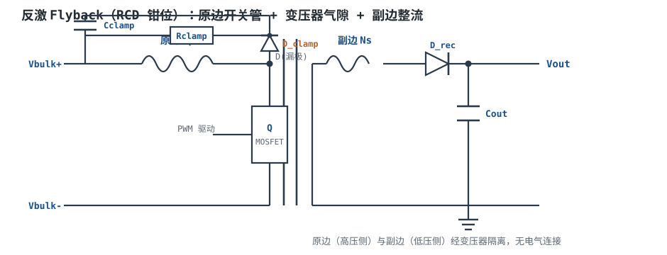
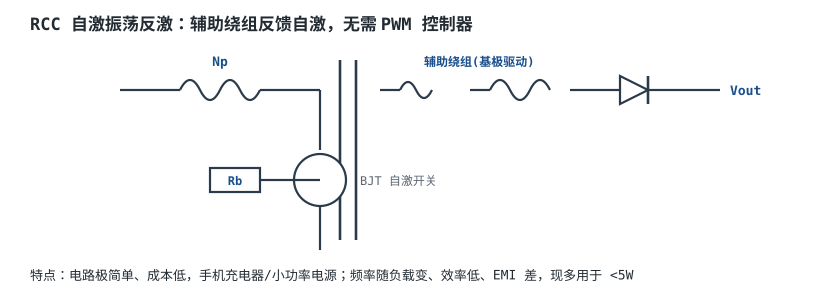
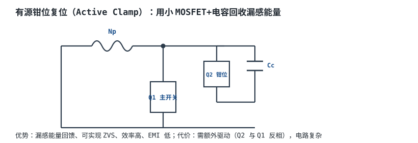
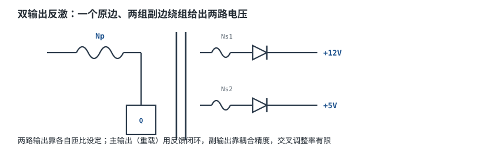

# 反激 Flyback 等隔离电源简介

前面的 Buck/Boost 都是**非隔离**的——输入和输出共地。但很多场合（接市电的电源、医疗器械、工业接口）要求**输入与输出之间没有直接电气连接**，靠变压器的磁场耦合传能量。**反激（Flyback）**是结构最简单、成本最低的隔离拓扑，小功率电源（手机充电器、适配器、闭路电源）几乎都是它。

## 1. 设计动机

::: motivation 为什么需要隔离与反激
接市电的设备若输出地与电网地直连，一旦绝缘击穿，220V 会顺着输出窜到用户手里——致命。安规要求初/次级之间有"一道墙"，这就是**电气隔离（Galvanic Isolation）**。

实现隔离最自然的办法是变压器。反激在变压器原边串一个开关管：开关导通时，原边把能量存进变压器气隙（副边二极管反偏，不给负载供能）；开关关断时，原边能量通过副边二极管释放给输出。**它本质是"带变压器的 Buck-Boost"**，输出电压极性反相，且天然隔离。
:::

## 2. 原理图



## 3. 静态分析（DC）

反激稳态由**伏秒平衡（Volt-Second Balance）**决定：一个周期内绕组上正负伏秒积相等。

- 导通期（Q 开）：原边承受 $V_{bulk}$，电感电流上升；
- 关断期（Q 关）：原边绕组反接，电压钳在 $-(V_{out}+V_f)\cdot n$，其中 $n=N_p/N_s$ 为匝比，$V_f$ 为副边整流管压降。

**反射电压（Reflected Output Voltage）** $V_{OR}=n(V_{out}+V_f)$。由伏秒平衡推出占空比：

$$D=\frac{V_{OR}}{V_{bulk}+V_{OR}}$$

以通用输入 $90\sim265\text{VAC}$、输出 $12\text{V}/2\text{A}$（24W）为例：

- 整流后母线 $V_{bulk}\approx100\text{V}$（最低线、扣纹波）~ $375\text{V}$（$265\times1.414$）；
- 取最大占空比 $D_{max}=0.45$（在最低输入时）；
- $V_{OR}=\dfrac{D_{max}}{1-D_{max}}V_{bulk,min}=\dfrac{0.45}{0.55}\times100=81.8\text{V}$；
- 匝比 $n=\dfrac{N_p}{N_s}=\dfrac{V_{OR}}{V_{out}+V_f}=\dfrac{81.8}{12+0.7}=6.44\approx6.5$，即 $N_p:N_s\approx6.5:1$。

**开关管电压应力**（关键选型依据）：关断瞬间漏极被钳在母线电压之上一个钳位电压 $V_{clamp}$（$V_{clamp}\approx1.3\times V_{OR}\approx106\text{V}$，见 §5 RCD 钳位）：

$$V_{ds,max}=V_{bulk,max}+V_{clamp}\approx375+106=481\text{V}$$

故选 **650V** MOSFET（留足降额）。

## 4. 动态分析（AC / 瞬态）

- **CCM（连续导通模式）**：重载时原边电感电流在每个周期末不归零，始终大于零。功率级出现**右半平面零点 RHPZ（Right-Half-Plane Zero）**，它在提供增益的同时带来相位滞后，限制了可用的环路带宽——CCM 反激不能把穿越频率做高。
- **DCM（断续导通模式）**：轻载时电流每周期归零。无 RHPZ、补偿简单，但峰值电流大、磁芯损耗高。小功率（<30W）常故意工作在 DCM。

```echarts
{
  "tooltip": {"trigger": "axis"},
  "legend": {"data": ["CCM 原边电流", "DCM 原边电流"], "bottom": 0, "textStyle": {"fontSize": 13}},
  "grid": {"left": 56, "right": 24, "top": 26, "bottom": 50},
  "xAxis": {"type": "category", "name": "时间", "data": ["0","t1","t2","t3","t4","t5","t6"], "axisLabel": {"fontSize": 11}},
  "yAxis": {"type": "value", "name": "I_pri", "axisLabel": {"fontSize": 11}},
  "series": [
    {"name": "CCM 原边电流", "type": "line", "step": "end", "showSymbol": false, "lineStyle": {"width": 2.6, "color": "#1a4f8b"},
     "data": [1.0,2.6,1.0,2.6,1.0,2.6,1.0]},
    {"name": "DCM 原边电流", "type": "line", "step": "end", "showSymbol": false, "lineStyle": {"width": 2.2, "color": "#b5642e"},
     "data": [0,2.8,0,0,2.8,0,0]}
  ]
}
```

CCM（蓝）电流始终>0；DCM（橙）每个周期降到 0 并停顿一段时间。

## 5. 环路分析

反激的功率级传递函数与负载模式强相关：DCM 近似单极点、易补偿；CCM 因 RHPZ 相位滞后大，**穿越频率通常只能取 $f_{sw}/10$ 左右**。隔离输出的反馈必须经**光耦（Optocoupler）**把副边电压信号传回原边控制器，光耦自身又引入一个极点和相位滞后，进一步压缩带宽。补偿网络多为 Type II。

::: advanced 进阶：RCD 钳位与漏感能量
变压器原、副边并非全耦合，存在**漏感 $L_{leak}$（Leakage Inductance）**。开关关断瞬间，漏感电流无处可去，会在漏极打出一个远高于 $V_{bulk}+V_{OR}$ 的尖峰，轻则超过 MOSFET 耐压击穿，重则产生强烈振铃与 EMI。

**RCD 钳位**：漏极经二极管 $D_{clamp}$ 接到由 $R_{clamp}$、$C_{clamp}$ 组成的钳位网络，把尖峰能量消耗在电阻上。钳位电压取 $V_{clamp}\approx1.3\times V_{OR}=1.3\times82\approx106\text{V}$：
- $C_{clamp}$ 要足够大，使开关周期内钳位电压波动小（数 µF）；
- $R_{clamp}$ 按漏感能量损耗选：$P_{clamp}\approx\dfrac{1}{2}L_{leak}I_{pk}^{2}f_{sw}\dfrac{V_{clamp}}{V_{clamp}-V_{OR}}$，功率从零点几 W 到几 W；
- 钳位电压越高，漏感能量回馈越少、损耗越大，但 MOSFET 应力越小——在耐压与效率间折中。
:::

## 6. 元件取值与工程权衡

- **匝比 $n$**：决定占空比、MOSFET 与副边二极管应力。$n$ 越大，$V_{OR}$ 越高、MOSFET 应力越大，但副边二极管反向电压越低。
- **MOSFET**：$V_{ds}$ 额定要大于 $V_{bulk,max}+V_{clamp}$（$V_{clamp}\approx1.3\times V_{OR}\approx106\text{V}$），留 20% 降额；通用输入选 650V。
- **副边整流管**：低压大输出用肖特基（$V_f$ 小），高压输出用快恢复二极管；反向耐压要大于 $V_{bulk,max}/n+V_{out}$。
- **RCD 钳位**：钳位电压 $V_{clamp}$ 取 $1.2\sim1.5\times V_{OR}$，是 MOSFET 应力与效率的折中。

## 7. 完整设计示例

::: example 24W 适配器反激设计
1. **需求**：90~265VAC 输入，12V/2A 输出。
2. **母线**：$V_{bulk,min}=100\text{V}$，$V_{bulk,max}=375\text{V}$。
3. **占空比/匝比**：$D_{max}=0.45$，$V_{OR}=82\text{V}$，$n=6.5:1$。
4. **开关管**：$V_{ds,max}=375+106\approx481\text{V}$ → 选 650V MOSFET。
5. **钳位**：$V_{clamp}\approx106\text{V}$，$C_{clamp}=2.2\mu\text{F}$。取典型漏感 $L_{leak}=20\mu\text{H}$、原边峰值电流 $I_{pk}=1.2\text{A}$、$f_{sw}=65\text{kHz}$。钳位电阻耗散须计入漏感能量的循环反射因子 $V_{clamp}/(V_{clamp}-V_{OR})$：
   $$P_{clamp}=\tfrac12 L_{leak}I_{pk}^{2}f_{sw}\cdot\frac{V_{clamp}}{V_{clamp}-V_{OR}}=0.94\text{W}\times\frac{106}{106-82}\approx4.1\text{W}$$
   $$R_{clamp}=\frac{V_{clamp}^{2}}{P_{clamp}}=\frac{106^{2}}{4.1}\approx2.7\text{k}\Omega\quad(\text{取 }2.7\text{k}\Omega/5\text{W})$$
   注：因 $V_{clamp}(106\text{V})$ 仅比 $V_{OR}(82\text{V})$ 高 24V，反射因子达 4.4，钳位损耗偏大；实际若嫌 $R_{clamp}$ 过热，可适当抬高 $V_{clamp}$（如 130V）压低反射因子，但 MOSFET 应力随之上升。
6. **副边**：$V_f\approx0.7\text{V}$ 肖特基，反向耐压 $>V_{bulk,max}/n+V_{out}\approx70\text{V}$，选 100V。
:::

## 8. 仿真与实验

LTspice 中建反激模型（理想变压器 + 气隙电感 $L_m$ 并联漏感 $L_{leak}$），重点观察：漏极电压波形在关断瞬间的尖峰与振铃是否被 RCD 钳在 $V_{bulk}+V_{clamp}$ 以内。实测用示波器高压差分探头测漏极——若尖峰顶到接近 MOSFET 耐压，加大 $C_{clamp}$ 或降低 $V_{clamp}$；若钳位电阻发烫严重，说明 $V_{clamp}$ 取得过低、钳位损耗过大。

## 扩展与变种电路

### 扩展1：RCC 自激反激 RCC Flyback

不用专用 PWM 控制器，靠辅助绕组给 BJT 基极反馈自激振荡，电路极简。



::: example 工作原理
- 上电后启动电阻给基极提供初始电流，BJT 导通后辅助绕组感应电压正反馈维持振荡。
- 频率随负载/输入变化，非固定频率；靠光耦反馈调占空比稳压。
:::

取值对比：RCC 零件少、成本最低；固定频率反激需控制器但性能好。适用：<5W 廉价充电器；不适用：要求固定频率、低 EMI 的场合。

::: pitfall RCC 轻载频率飘到音频
- **现象**：轻载时变压器发出可闻"吱吱"声。
- **原因**：自激频率随负载下降，跌入音频段。
- **解决**：加假负载或改用固定频率 PWM 控制器。
:::

### 扩展2：有源钳位复位 Active Clamp

用一只小 MOSFET 加钳位电容替代 RCD，把漏感能量回馈回母线，并实现主管 ZVS。



::: example 工作原理
- Q2 与 Q1 反相驱动，关断时漏感能量存入 $C_c$ 并回馈。
- 可实现主管零电压开通（ZVS），开关损耗与 EMI 大幅下降，频率可做高。
:::

取值对比：有源钳位效率高、EMI 好，但需浮动栅极驱动；RCD 简单但耗散漏感能量。适用：中大功率、高效率；不适用：极低成本产品。

::: pitfall Q2 驱动与 Q1 死区设错导致直通
- **现象**：钳位管发热、效率骤降。
- **原因**：两管驱动未留死区或时序反了。
- **解决**：严格按 IC 推荐的互补驱动时序与死区设计。
:::

### 扩展3：副边同步整流 Synchronous Rectification

低压大电流输出时，用导通电阻极低的 MOSFET 替代肖特基二极管，消除 $V_f$ 损耗。


::: example 工作原理
- 肖特基 $V_f\approx0.5\text{V}$，2A 时损耗 1W；SR MOSFET $R_{ds(on)}\approx10\text{m}\Omega$，损耗 $I^2R=0.04\text{W}$。
- SR 控制器检测绕组电压、在续流期间开通 MOSFET。
:::

取值对比：SR 在 $V_{out}$ 低（如 5V/3.3V）、电流大时效率提升明显；高压输出 $V_f$ 损耗占比小，SR 不划算。适用：低压大电流；不适用：高压小电流。

::: pitfall SR 开通过晚/过早造成反向导通
- **现象**：SR 管发热、效率低甚至炸机。
- **原因**：SR 控制器检测/驱动延时不当，在电流过零时未及时关断，导致双向导通。
- **解决**：选带精确准位的 SR 控制器，按绕组参数调死区。
:::

### 扩展4：辅助供电绕组 Auxiliary Winding

变压器再加一个低压绕组，整流后给控制器自己供电（Vcc），免去外挂小电源。


::: example 工作原理
- 上电瞬间 $R_{start}$ 从 $V_{bulk}$ 取小电流建立 Vcc；起振后辅助绕组接管供电。
- $R_{start}$ 只在启动时耗散，运行时功耗极小。
:::

取值对比：辅助绕组供电省掉辅助电源；但输出电压变化会反映到 Vcc（需稳压）。适用：自供电控制器；不适用：Vcc 纹波要求极高。

::: pitfall 启动电阻 Rstart 功耗过大
- **现象**：Rstart 长期发烫、效率低。
- **原因**：起振后 Rstart 仍跨在 375V 母线上持续耗电。
- **解决**：辅助绕组电压要足够接管 Vcc，Rstart 取大阻值（MΩ 级）仅作启动。
:::

### 扩展5：双输出反激 Dual Output

一个变压器带两组副边绕组，同时给出两路电压。



::: example 工作原理
- 两路电压由各自匝比设定：$V_{out1}\approx\dfrac{n_1}{n}V_{OR}$，$V_{out2}$ 同理。
- 只有主输出（通常重载那路）接入反馈闭环，副输出靠磁耦合跟随。
:::

取值对比：双输出省一个变压器，但交叉调整率（一路加载影响另一路）有限。适用：多路低压辅助电源；不适用：多路都需高精度稳压。

::: pitfall 副输出空载电压飘高
- **现象**：主输出满载、副输出空载时，副路电压远超标称。
- **原因**：能量都从主路走，副路耦合差、且无负载稳压。
- **解决**：副路加假负载或改用独立稳压 LDO。
:::

## 9. 常见坑与故障现象

::: pitfall 常见坑
- **漏极尖峰击穿 MOSFET**：漏感未被 RCD 良好吸收，关断尖峰顶过 $V_{ds}$ 额定。现象：上电瞬间或带载时炸管。解决：加大 $C_{clamp}$、降低 $V_{clamp}$、缩短漏极回路布线。
- **通用输入按最低线选占空比导致高压应力算错**：若只按 220V 设计，漏算低压 90V 时 $D$ 变大、$V_{OR}$ 与 $V_{ds}$ 应力全部重算。解决：按 $V_{bulk,min}$ 定匝比、按 $V_{bulk,max}$ 选耐压。
- **CCM 反激环路振荡**：RHPZ 使带宽做不高，补偿太激进就振荡。解决：把穿越频率压到 $f_{sw}/10$ 附近，保守补偿。
- **副边二极管反向耐压不足**：低压输出选了低压二极管，高压输入时反向尖峰击穿。解决：按 $V_{bulk,max}/n+V_{out}$ 留足裕量。
:::

## 10. 自测题

<details><summary>反激为什么本质上是"带变压器的 Buck-Boost"？</summary>
它在开关导通时把能量存入电感（变压器气隙）、关断时才释放给负载，输入与输出无直通通路，电压关系与 Buck-Boost 同构；变压器只是在传递能量的同时提供了隔离。
</details>

<details><summary>$V_{bulk}=100\text{V}$、$D_{max}=0.45$，反射电压 $V_{OR}$ 是多少？</summary>
$V_{OR}=\dfrac{D}{1-D}V_{bulk}=\dfrac{0.45}{0.55}\times100=81.8\text{V}$。
</details>

<details><summary>为什么通用输入反激的 MOSFET 通常选 650V 而不是 400V？</summary>
高压母线 $V_{bulk,max}=265\times1.414\approx375\text{V}$，再加 RCD 钳位电压 $V_{clamp}\approx106\text{V}$，应力已达约 $375+106=481\text{V}$；400V 不够，需 650V 并留降额。
</details>

<details><summary>CCM 反激为什么不能把环路带宽做高？</summary>
CCM 反激功率级存在右半平面零点（RHPZ），它带来相位滞后却不减增益，穿越频率过高时相位裕度被吃光而振荡，故带宽受限。
</details>

## 11. 参考资料

- Pressman/Billings/Morey, *Switching Power Supply Design* (3rd ed.)——反激变压器与 RCD 设计
- Sanjaya Maniktala, *Switching Power Supplies A–Z* (2nd ed.)——匝比与钳位工程计算
- Erickson & Maksimovic, *Fundamentals of Power Electronics*——RHPZ 与平均建模
