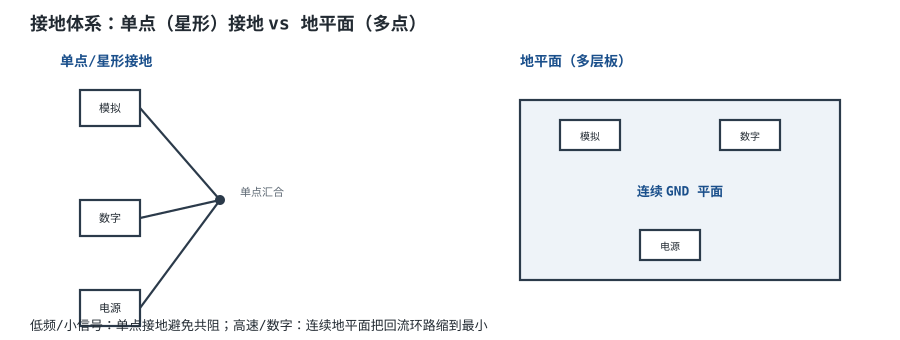
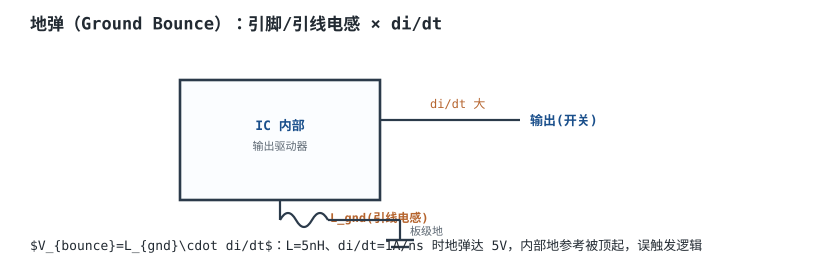
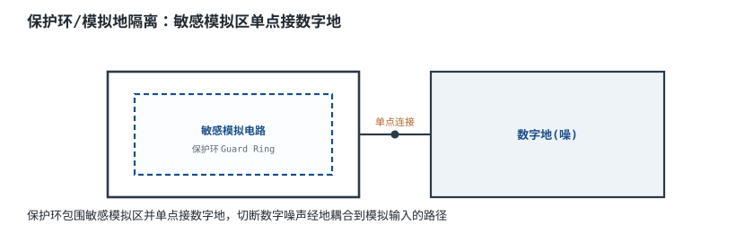

# 地的学问与地弹 Grounding & Ground Bounce

"地"看似是 0V 的参考点，实际上它有电阻、有电感、有电流流过。数字电路翻转时，成百上千条信号线同时开关，地线上的短暂电压尖峰会让逻辑误判——这就是**地弹（Ground Bounce）**。这一章讲接地体系与地弹机理。

## 1. 设计动机

::: motivation 为什么"地"不是 0V
你以为所有"地"都等电位，实际上导线/平面都有毫欧电阻和纳亨电感。当电源大电流或数字大电流流过地线时，$V=IR$ 和 $V=L\,di/dt$ 会让不同地方的"地"差出几十毫伏甚至几伏。

对精密模拟电路，几 mV 的地偏移就是噪声；对数字电路，同步开关瞬间的地弹可能让输入门限误判。**接地设计的本质，就是控制回流路径的面积与阻抗。**
:::

## 2. 原理图

两种接地策略：低频/小信号用**单点星形接地**避免共阻耦合；高速/数字用**连续地平面**把回流环路缩到最小。



## 3. 静态分析（DC）

- **共阻耦合（Common Impedance Coupling）**：两个模块共用一段地线，A 的电流在公共地阻 $R_g$ 上产生压降，串进 B 的参考地。$V_{noise}=I_A\cdot R_g$。
- 低频时地线阻抗主要是电阻，单点接地最干净；高频时地线电感占主导，地平面比细线好得多。
- 模拟地（AGND）与数字地（DGND）通常在**一个点**汇合（星地点），避免数字大电流污染模拟参考。

## 4. 动态分析（AC / 瞬态）

**地弹**：芯片输出翻转时，瞬间电流经引脚/键合线电感 $L_{gnd}$ 流回板级地，产生电压尖峰：

$$V_{bounce}=L_{gnd}\frac{di}{dt}$$

代入典型值：引脚+键合线总电感 $L_{gnd}=5\text{nH}$，一条输出在 1ns 内从 0 跳到 1A（$di/dt=1\text{A/ns}=10^9\text{A/s}$）：

$$V_{bounce}=5\times10^{-9}\times10^9=5\text{V}$$

一次开关就能把芯片内部地参考顶起 5V——这就是为什么现代逻辑门会莫名其妙误触发。多条输出同时开关（SSN, Simultaneous Switching Noise）时叠加更严重。

```echarts
{
  "tooltip": {"trigger": "axis"},
  "legend": {"data": ["输出电流 i", "地弹电压 Vbounce"], "bottom": 0, "textStyle": {"fontSize": 13}},
  "grid": {"left": 56, "right": 60, "top": 26, "bottom": 56},
  "xAxis": {"type": "category", "name": "时间 ns", "data": ["0","1","2","3","4","5","6","7"], "axisLabel": {"fontSize": 11}},
  "yAxis": [
    {"type": "value", "name": "A", "min": 0, "max": 1.2, "axisLabel": {"fontSize": 11}},
    {"type": "value", "name": "V", "min": -1, "max": 6, "axisLabel": {"fontSize": 11}}
  ],
  "series": [
    {"name": "输出电流 i", "type": "line", "smooth": true, "showSymbol": false, "lineStyle": {"width": 2.6, "color": "#1a4f8b"},
     "data": [0,0.2,0.9,1.0,1.0,1.0,1.0,1.0]},
    {"name": "地弹电压 Vbounce", "type": "line", "smooth": true, "showSymbol": false, "yAxisIndex": 1, "lineStyle": {"width": 2.2, "color": "#b5642e"},
     "data": [0,5,1,0,0,0,0,0]}
  ]
}
```

电流快速上升沿（1ns 内到 1A）瞬间打出 ~5V 地弹尖峰。

## 5. 环路分析

接地不是反馈环路，但地弹本质是回流路径的电感谐振。抑制手段都是围绕"减小回流电感与环路面积"：

- 多层板用**完整地平面**，让回流电流紧贴信号正下方流回，环路面积最小；
- 地平面**不要开槽**——slot 会逼回流绕远，环路面积骤增；
- 每个电源引脚就近放去耦电容，提供本地电荷池（详见下一章）。

::: advanced 进阶：回流路径与地弹定量
高速信号的回流电流不走路程最短，而走**电感最小**的路径——即紧贴信号线正下方的地平面区域。若信号下方地平面被过孔/开槽切断，回流被迫绕远，环路面积 $A$ 增大，感应噪声 $V\propto\mu_0\,A\,di/dt$ 增大，同时 EMI 辐射增强。

地弹随开关速率 $di/dt$ 线性增长： slower edge（加串阻/缓驱）能显著降地弹，但会牺牲建立时间。现代 FPGA 用多组地引脚、裸露焊盘（EP）直接降低 $L_{gnd}$。
:::

## 6. 元件取值与工程权衡

- **地平面完整性**优先于一切：四层板（信号-GND-电源-信号）是降地弹与 EMI 的最有效手段。
- **AGND/DGND 单点汇合**：模拟敏感区不要让数字大电流流过。
- **地引脚数**：多用地/电源引脚、裸露焊盘降低引线电感。
- **摆率控制**：对不要求高速的输出，缓驱降 $di/dt$。

## 7. 完整设计示例

::: example 一颗数字 IC 的接地设计
1. **需求**：数十路 I/O 同步开关，要求地弹 < 0.5V。
2. **叠层**：四层板，完整 GND 平面。
3. **去耦**：每个电源引脚就近 0.1µF。
4. **地弹核算**：$L_{gnd}$ 经多引脚降到 ~1nH，$di/dt$ 经缓驱降到 0.2A/ns：$V=1\text{nH}\times0.2\text{A/ns}=0.2\text{V}<0.5\text{V}$。
5. **验证**：示波器测地引脚附近电压，确认无大尖峰。
:::

## 8. 仿真与实验

实测地弹：用示波器探头"弹簧地"直接（不要长地线）测芯片地引脚与板级地之间的电压差，同时触发输出翻转。若看到几百 mV 尖峰，查地平面是否开槽、去耦是否就近。降地弹后复测。

## 扩展与变种电路

### 扩展1：地弹机理 Ground Bounce

芯片地引脚经引线电感接板级地，开关电流在电感上打出尖峰。



::: example 工作原理
- $V_{bounce}=L_{gnd}\,di/dt$，与开关速率和引线电感成正比。
- 多条输出同时开关时叠加（SSN）。
- 它把芯片"地参考"顶起，使输入门限漂移，误触发。
:::

取值对比：慢边沿/多地引脚可压地弹；快边沿/少地引脚地弹大。适用：所有高速数字；不适用：慢信号无此问题。

::: pitfall 示波器长地线探头测到的"噪声"其实是探头地弹
- **现象**：示波器看到满地尖峰。
- **原因**：探头地线本身有几十 nH，与被测环路形成天线。
- **解决**：用弹簧地/接地弹簧针测，缩短探头环路。
:::

### 扩展2：保护环与模拟地隔离 Guard Ring

用一圈地线包围敏感模拟区，单点接数字地，切断噪声耦合。



::: example 工作原理
- 保护环为敏感节点提供低阻抗屏蔽地，吸走衬底噪声。
- 模拟地与数字地只在一点相连，数字大电流不流过模拟参考。
:::

取值对比：保护环占板面积但提精度；不模拟区可省。适用：ADC/高精度运放前端；不适用：纯数字板。

::: pitfall 保护环两端都接地形成环流
- **现象**：加了保护环反而更噪。
- **原因**：保护环两端分别接两地，形成地环路拾取噪声。
- **解决**：保护环只在单点接系统地。
:::

## 9. 常见坑与故障现象

::: pitfall 常见坑
- **地平面开槽逼回流绕远**：为走一根信号线把地平面切开，下方回流被迫绕远，环路面积骤增、EMI 与串扰暴涨。解决：信号线尽量不跨分割平面。
- **AGND/DGND 多点相连**：数字地电流经模拟地走，耦合出噪声。解决：单点汇合。
- **示波器长地线测噪声误判**：探头地线电感本身产生尖峰。解决：用接地弹簧针、缩短环路。
- **同时开关输出过多导致逻辑误触发**：SSN 使内部地弹过大。解决：缓驱、多地引脚、错开翻转沿。
:::

## 10. 自测题

<details><summary>$L_{gnd}=5\text{nH}$、$di/dt=1\text{A/ns}$，地弹电压是多少？</summary>
$V=L\,di/dt=5\text{nH}\times1\text{A/ns}=5\times10^{-9}\times10^9=\mathbf{5V}$。一次开关就能顶起 5V。
</details>

<details><summary>为什么高速回流走信号正下方而不是最短路程？</summary>
高频电流走电感最小路径。地平面上信号正下方的回流环路面积最小、电感最低，故紧贴下方流回；地平面开槽会切断这条路径。
</details>

<details><summary>模拟地和数字地为什么只在一点相连？</summary>
多点相连会让数字大电流流过模拟地阻抗，产生共阻耦合噪声。单点汇合使数字电流不经过模拟参考地。
</details>

<details><summary>降低地弹的三种主要手段是什么？</summary>
减小回流电感（完整地平面、不开槽）、减小 $di/dt$（缓驱/摆率控制）、减小 $L_{gnd}$（多地引脚、裸露焊盘、就近去耦）。
</details>

## 11. 参考资料

- Henry W. Ott, *Electromagnetic Compatibility Engineering*——接地与共阻耦合
- Howard Johnson & Martin Graham, *High Speed Digital Design*——地弹与回流路径
- onsemi AND8301-D——SMPS 地平面布局
