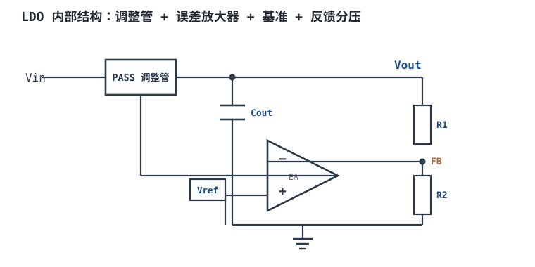
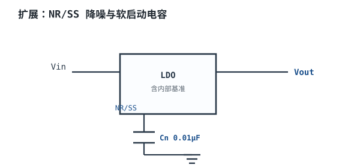
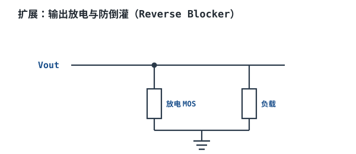
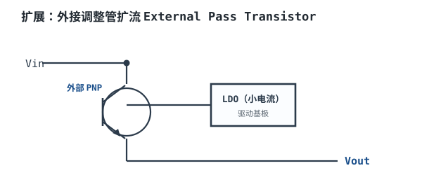
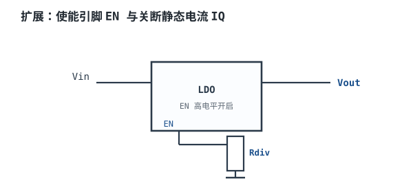
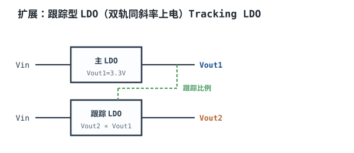

# LDO 原理、选型与功耗计算 Low-Dropout Regulator

## 1. 设计动机

::: motivation 为什么用 LDO
上一章的 7805 需要输入比输出高 2V 以上才能稳住，压差一大就发热。**LDO（Low-Dropout Regulator，低压差线性稳压器）**把这个"维持稳压所需的最小压差"做到几百毫伏甚至更低（如 200mV），于是 5V 转 3.3V 只承受 1.7V 压差、发热小得多，还能后级净化开关电源的噪声。它给模拟、ADC、射频等"干净电源"供电，是板卡上最常见的器件之一。
:::

## 2. 原理图



调整管（Pass Element）串在 Vin 和 Vout 之间，像一只"可调电阻"。误差放大器把 FB（输出经 R1/R2 分压）与内部基准 Vref 比较，动态调节调整管的导通电阻，把 Vout 拉到 $V_{out}=V_{ref}(1+R_1/R_2)$。

## 3. 静态分析（DC）

- **输出电压**：由分压设定，$V_{out}=V_{ref}(1+R_1/R_2)$。固定输出版（如 3.3V）内部已配好分压。
- **压差（Dropout Voltage, V_DO）**：调整管完全导通（进入线性区边缘）时 Vin−Vout 的最小值。BJT 型约 1~2V，PMOS 型可低至 100~300mV。
- **静态电流（Quiescent Current, I_Q）**：芯片自身消耗的电流（不经过负载），工作时 µA~mA 级，关断时可低至 nA。
- **功耗**：$P_d=(V_{in}-V_{out})I_{out}+V_{in}I_Q$，主要项是压差×负载电流。

## 4. 动态分析（AC / 瞬态）

- **PSRR（Power Supply Rejection Ratio，电源抑制比）**：LDO 把输入纹波衰减多少倍，单位 dB。$PSRR=20\log(\Delta V_{in}/\Delta V_{out})$。它是频率的函数：低频（100Hz）可达 60~80dB，高频（1MHz）掉到 20~40dB。开关电源后级要的正是它在开关频率处的 PSRR。
- **输出噪声**：内部基准与电阻热噪声经放大出现在输出，单位 µVrms（10Hz~100kHz）。
- **负载瞬态**：负载突变时输出先偏离，靠 Cout 的电荷与环路共同恢复。

```echarts
{
  "tooltip": {"trigger": "axis"},
  "legend": {"data": ["PSRR 随频率下降"], "bottom": 0, "textStyle": {"fontSize": 13}},
  "grid": {"left": 60, "right": 30, "top": 26, "bottom": 50},
  "xAxis": {"type": "log", "name": "Hz", "data": [10,100,1000,10000,100000,1000000], "axisLabel": {"fontSize": 11}},
  "yAxis": {"type": "value", "name": "PSRR dB", "min": 0, "max": 90, "axisLabel": {"fontSize": 11}},
  "series": [
    {"name": "PSRR 随频率下降", "type": "line", "showSymbol": false, "lineStyle": {"width": 2.6, "color": "#1a4f8b"},
     "data": [85, 80, 60, 45, 30, 20]}
  ]
}
```

## 5. 环路分析

LDO 是一个**电压跟随负反馈**：FB 跟踪 Vref，误差放大器驱动调整管。

- 结论：环路必须稳定。LDO 的稳定性高度依赖**输出电容的容值与 ESR**——容值太小或 ESR 太高/太低都会引入额外极点导致振荡。数据手册会给出推荐的 Cout 范围与 ESR 区间。
- **注意世代差异**：传统 BJT 调整管 LDO 常要求"ESR 落在某区间"（靠 ESR 零点补偿）；而现代**内部补偿 CMOS（PMOS）LDO 往往恰恰相反，要求低 ESR 陶瓷电容**（内部已补偿，ESR 高反而劣化 PSRR/噪声）。以所用型号手册为准，不要套用老经验。
- 环路带宽通常几十 kHz~几百 kHz，决定负载瞬态恢复速度。

::: advanced 进阶：LDO 环路极点与 ESR
调整管输出阻抗与 Cout 构成一个主极点 $f_p\approx 1/(2\pi R_o C_{out})$；Cout 的 ESR 又引入一个零点 $f_{z,ESR}=1/(2\pi ESR\cdot C_{out})$。ESR 适中时这个零点能补偿相位、提高相位裕度；ESR 太小（多颗陶瓷并联）零点过高、补偿不足；ESR 太大则极点过低、环路慢。这就是为什么 LDO 手册反复强调"Cout 推荐用 X 量级陶瓷 + 等效 ESR 在某区间"。
:::

## 6. 元件取值与工程权衡

- **压差 vs 成本**：低 VDO（100mV 级）用 PMOS 调整管，成本高；BJT 型便宜但压差大。压差越小，相同 Vin/Vout 下发热越少。
- **Cout 取值**：通常 1~10µF 陶瓷（X5R/X7R），容值与 ESR 要满足手册稳定性区间。太小会振荡。
- **IQ vs 性能**：高 PSRR、低噪声型号 IQ 较大（几百 µA）；电池待机要选"低 IQ"型号（µA 级，但 PSRR/噪声略差）。
- **散热**：压差×电流是硬约束，必须算结温（见设计示例）。

## 7. 完整设计示例

::: example 5V→3.3V/300mA LDO 选型与散热
1. **需求**：USB 5V 输入，输出 3.3V/300mA，给 MCU + SD 卡，要求干净。
2. **算功耗**：$P_d=(5-3.3)\times0.3=0.51\text{W}$。
3. **算结温**：选 SOT-23-5 封装，$\theta_{JA}\approx 250^{\circ}\text{C/W}$（无太多铜箔）。$\Delta T=0.51\times250=127^{\circ}\text{C}$，环境 25℃ 时结温 ≈152℃ > 125℃ 上限——**过热**。
4. **改进**：选带裸露焊盘（Exposed Pad）、PCB 上铺铜的封装，$\theta_{JA}$ 可降到 ~60℃/W。$\Delta T=0.51\times60=31^{\circ}\text{C}$，结温 ≈56℃，安全。
5. **选 PSRR**：前级是开关电源 5V，开关频率 ~500kHz 处 PSRR 要 >40dB，选高 PSRR 型号。
6. **选 Cout**：2×10µF X5R + 0.1µF 去耦，满足稳定性区间。
7. **验算**：压差 1.7V 远大于所选 PMOS LDO 的 VDO（~200mV），全程稳压；静态功耗 $5\times I_Q$ 可忽略。
:::

## 8. 仿真与实验

LTspice 用 LDO 行为模型或厂商免费模型：

- `.dc vin 3.5 6 0.1`：看 Vout 何时开始跌落（dropout 点）；
- `.ac lin 100 10 1000000`：看 PSRR 曲线随频率下降；
- `.tran` + 脉冲负载电流：看瞬态坑深，改 Cout 从 1µF→10µF 看坑变浅；
- 实验：电子负载 1mA↔300mA 阶跃，示波器测坑深与恢复时间。

## 扩展与变种电路

### 扩展1：NR/SS 降噪与软启动电容 Noise Reduction / Soft-Start

在 LDO 的 NR/SS 引脚接一只小电容到地，既滤除基准噪声（降低输出噪声），又设定上电软启动斜率（避免浪涌电流）。



::: example 工作原理与静态
- NR：电容对基准分压低通，把 µV 级基准噪声再压低，输出噪声可从 ~30µVrms 降到 ~10µVrms。
- SS：上电时该引脚电压缓慢爬升，Vout 跟随斜升，限制涌入 Cout 和负载的浪涌电流 $I_{inrush}=C_{out}\cdot dV/dt$。
- Cn 典型 0.01µF~0.1µF；越大噪声越低但软启动越慢。
:::

```echarts
{
  "tooltip": {"trigger": "axis"},
  "legend": {"data": ["无软启动", "有软启动"], "bottom": 0, "textStyle": {"fontSize": 12}},
  "grid": {"left": 60, "right": 30, "top": 26, "bottom": 50},
  "xAxis": {"type": "category", "name": "ms", "data": [0,1,2,3,5,8], "axisLabel": {"fontSize": 11}},
  "yAxis": {"type": "value", "name": "Vout", "min": 0, "max": 3.6, "axisLabel": {"fontSize": 11}},
  "series": [
    {"name": "无软启动", "type": "line", "step": "end", "showSymbol": false, "lineStyle": {"width": 2.4, "color": "#b5642e"},
     "data": [0, 3.3, 3.3, 3.3, 3.3, 3.3]},
    {"name": "有软启动", "type": "line", "smooth": true, "showSymbol": false, "lineStyle": {"width": 2.4, "color": "#1a4f8b"},
     "data": [0, 0.6, 1.4, 2.2, 3.3, 3.3]}
  ]
}
```

取值对比：加 Cn=0.01µF 对比不加：输出噪声更低、上电更缓；代价：启动时间略长。适用：音频/ADC 低噪声供电；不适用：要求瞬间上电的快启动场合。

::: pitfall NR 电容过大导致启动异常
- **现象**：上电时输出迟迟不到位或被时序要求判为异常。
- **原因**：软启动斜率太慢，超过 POR 看门狗等待窗口。
- **解决**：按手册选 Cn，平衡噪声与启动时间。
:::

### 扩展2：输出放电与防倒灌 Output Discharge & Reverse Blocker

LDO 关断后，输出 Cout 上的电荷若慢慢放掉，可能让后级"假活"；且当 Vin 掉得比 Vout 快时电流会倒灌进芯片。加放电 MOS 与防倒灌二极管。



::: example 工作原理与静态
- 放电 MOS：EN 拉低时导通，把 Cout 电荷快速泄到地（µs~ms 级），保证关断彻底。
- 防倒灌：在 Vin 或 Vout 串肖特基/P-MOS，防止 Vout > Vin 时电流倒灌损坏芯片。
- 静态：正常工作时放电 MOS 截止，不影响电路。
:::

取值对比：带放电功能的 LDO 对比"靠负载自然放电"：关断更快更可靠；适合对断电时序敏感的 FPGA/MCU。

::: pitfall 关断后输出余电导致误动作
- **现象**：主电源断开后，MCU 仍由 LDO 余电"半死不活"。
- **原因**：Cout 无放电路径，电压缓慢下降。
- **解决**：选带输出放电（discharge）功能的 LDO，或外加放电管。
:::

### 扩展3：外接调整管扩流 External Pass Transistor

单片 LDO 输出电流通常几百 mA~1A。要更大电流，用小 LDO 驱动一只外部大功率 PNP/NPN 调整管扩流。



::: example 工作原理与静态
- LDO 输出接外部 PNP 基极，PNP 把发射极电流（来自 Vin）放大后送到 Vout。
- LDO 只承担基极电流（$I_E/(\beta+1)$），大功耗由外部管子+散热片承担。
- 静态输出仍由 LDO 反馈精度保证。
:::

取值对比：外接扩流对比"选更大电流的单片 LDO"：成本低、散热灵活；但增加复杂度和压差（PNP Vbe）。适用：2A 以上定制电源；不适用：小电流。

::: pitfall 外部调整管振荡
- **现象**：扩流后输出高频振荡。
- **原因**：外部管子引入额外极点，破坏原 LDO 环路。
- **解决**：按应用笔记加补偿网络，或选专门支持外部调整管的 LDO。
:::

### 扩展4：使能引脚与关断静态电流 Enable & Shutdown IQ

EN 引脚让主控按需关断某路电源，整机待机时把该路 I_Q 压到 nA 级，省电池。



::: example 工作原理与静态
- EN 高电平（>V_IH）开启，低电平（<V_IL）关断。
- 关断电流（Shutdown Current）可低至 0.01µA~1µA，是电池设备待机省电关键。
- EN 若不用：上拉到 Vin（常开）或下拉（常关），不能悬空。
:::

取值对比：带 EN 的 LDO 对比"常通 LDO"：可程控关断、待机省电；EN 分压电阻取 100k~1M（兼顾误触发与功耗）。

::: pitfall EN 悬空导致误开误关
- **现象**：电源时开时关、待机电流偏大。
- **原因**：EN 高阻抗悬空，拾取噪声越过阈值。
- **解决**：EN 固定电平或经电阻驱动，绝不悬空。
:::

### 扩展5：跟踪型 LDO（双轨时序）Tracking LDO

让第二路输出按固定比例跟随第一路上电，保证多轨同时同斜率爬升，避免 I/O 先于 core 上电的闩锁（见 [电源指标时序扩展](power-specs.md)）。



::: example 工作原理与静态
- 跟踪 LDO 的反馈引脚被主路输出驱动，Vout2 = k·Vout1，两轨同斜率。
- 静态：两轨 DC 比值由外部电阻设定；上电时斜率一致。
- 省掉专门时序控制器，适合双电源（如模拟±轨、I/O+core）。
:::

取值对比：跟踪 LDO 对比"时序控制器 + 延时"：省一颗芯片、同斜率更安全；比例固定不如可编程灵活。适用：接口/I-O 与 core 同斜率上电；不适用：要求固定先后顺序的场合。

::: pitfall 跟踪比例设错导致 core 过压
- **现象**：上电瞬间 core 轨冲过头。
- **原因**：跟踪分压比选错。
- **解决**：按芯片手册比例电阻严格计算，上电前空载验证。
:::

## 9. 常见坑与故障现象

::: pitfall 常见坑
- **只算压差不算散热**：5V→3.3V/0.5A 压差 1.7V、耗散 0.85W，SOT-23-5 会烫到保护。必须按 $\theta_{JA}$ 算结温、留铜箔散热。
- **Cout 选错导致振荡**：用纯陶瓷小电容、ESR 过低，环路自激（输出叠加几 MHz 毛刺）。按手册 ESR 区间选，必要时加一颗钽/电解。
- **把 LDO 当开关电源用在大压差**：12V→3.3V/1A 压差 8.7V、耗散 8.7W，物理上扛不住。这种场合必须先用开关电源预降压。
- **EN 悬空**：待机电流偏大或误触发，见扩展4。
:::

## 10. 自测题

<details><summary>LDO：Vin=5V、Vout=3.3V、Iout=0.3A，自身耗散多少瓦？压差比 dropout=0.2V 大多少？</summary>

$P_d=(5-3.3)\times0.3=0.51\text{W}$。实际压差 1.7V，比 dropout 0.2V 大 1.5V，裕量充足、全程稳压。

</details>

<details><summary>为什么 LDO 后级净化开关噪声要看"开关频率处的 PSRR"，而不是低频 PSRR？</summary>

PSRR 随频率下降：低频 100Hz 有 80dB，但开关电源噪声集中在几百 kHz~MHz，那里 PSRR 可能只剩 20~30dB。必须保证在实际开关频率处的 PSRR 足够，否则噪声漏到后级。

</details>

<details><summary>SOT-23-5（θJA=250℃/W）上耗散 0.51W，环境 25℃，结温多少？可行吗？</summary>

ΔT = 0.51×250 = 127.5℃，结温 ≈ 25+127.5 = 152.5℃，超过常见 125℃ 上限，**不可行**。需改带裸露焊盘/铺铜封装把 θJA 降到 ~60℃/W。

</details>

## 11. 参考资料

- [ADI — Low-Dropout Linear Regulator (LDO) Application Tutorial](https://www.analog.com/en/resources/technical-articles/lowdropout-linear-regulator-ldo-application-tutorial.html)
- [TI LDO Application Notes Topical Index](https://www.ti.com/product-category/power-management/linear-ldo-regulators/overview.html)
- Pressman, Billings, Morey, *Switching Power Supply Design*, 3rd ed.
