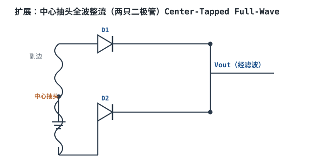
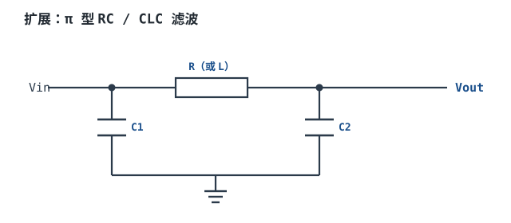
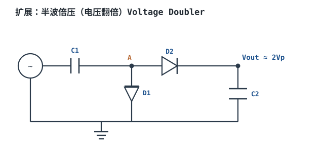

# 线性电源：变压、整流、滤波 Linear Power Supply

## 1. 设计动机

::: motivation 为什么需要线性电源
市电是 220V/50Hz 交流电，而电路板需要的是稳定的低压直流电（如 +5V、+3.3V）。把"交流高压"变成"直流低压"要走四步：**变压（降压）→ 整流（交流变单向脉动）→ 滤波（抹平纹波）→ 稳压（稳住电压）**。7805、LM317 这类经典线性稳压 IC 就是这条链路的末端。它结构简单、纹波极小、没有开关噪声，至今仍是模拟小功率电源的首选；缺点是效率低、发热大。
:::

## 2. 原理图


四个模块各司其职：T1 把市电降到合适交流值；BR1 把交流正负半周都翻成单向；Cbulk 在峰值间储能；7805（线性稳压器）把波动的直流稳定成干净的 +5V。

## 3. 静态分析（DC）

静态时把大电容看作"充满后近似电压源"，逐级算直流电位：

- **变压器副边**：标 9V 是有效值（RMS），峰值 $V_p = 9\times\sqrt{2}\approx 12.7\text{V}$。
- **整流后（满载、有电容滤波）**：电容充到接近峰值，扣掉桥堆两只二极管压降（约 2×0.7V = 1.4V），电容上**峰值**约 $12.7-1.4\approx 11.3\text{V}$；叠加上文 2.3Vpp 纹波后，**平均（直流）电压**约 $11.3-2.3/2\approx 10.2\text{V}$。
- **7805 输入输出**：$V_{in(avg)}\approx 10.2\text{V}$，$V_{out}=5\text{V}$。自身平均承受压差约 $10.2-5=5.2\text{V}$。
- **静态功耗**：$P_d=(V_{in(avg)}-V_{out})I_{out}=(10.2-5)\times0.5\approx 2.6\text{W}$（这部分全变成热，与 §7 设计示例一致）。

## 4. 动态分析（AC / 瞬态）

整流滤波后输出不是平滑直线，而是带周期性纹波的"锯齿"。桥式全波整流后，纹波频率是市电的 2 倍 = 100Hz。纹波峰峰值近似：

$$\Delta V_{pp}\approx \frac{I_{out}}{f_{ripple}\cdot C_{bulk}}$$

代入 $I=0.5\text{A}, f_{ripple}=100\text{Hz}, C=2200\mu\text{F}$：$\Delta V_{pp}=0.5/(100\times2200\mu\text{F})\approx 2.3\text{V}$。下图是整流+滤波后的电容电压（100Hz 充放电锯齿）：

```echarts
{
  "tooltip": {"trigger": "axis"},
  "legend": {"data": ["Cbulk 电压（100Hz 纹波）"], "bottom": 0, "textStyle": {"fontSize": 13}},
  "grid": {"left": 70, "right": 30, "top": 26, "bottom": 50},
  "xAxis": {"type": "category", "name": "时间 ms", "data": [0,2,4,6,8,10], "axisLabel": {"fontSize": 11}},
  "yAxis": {"type": "value", "name": "V", "min": 8.5, "max": 12, "interval": 0.5, "axisLabel": {"fontSize": 11}},
  "series": [
    {"name": "Cbulk 电压（100Hz 纹波）", "type": "line", "showSymbol": false, "lineStyle": {"width": 2.6, "color": "#1a4f8b"},
     "data": [11.3, 10.2, 9.0, 10.1, 11.3, 10.2]}
  ]
}
```

经过 7805 的高 PSRR（见 [LDO](ldo.md)），输出端这 2.3V 纹波被压到 mV 级。

## 5. 环路分析

线性稳压本身是一个串联负反馈：误差放大器采样输出、驱动串联调整管（7805 内部是一颗功率 BJT/MOS），把输出拉回设定值。

- 结论：只要输入始终比输出高过"dropout"（7805 约 2V），输出就稳定在标称值；输入纹波被反馈抑制。
- 对整流滤波级的要求：**电容上的最低电压（峰值−纹波）必须始终高于 dropout + Vout**，否则在纹波谷点稳不住。本例最低 ≈ 9.0V > 5V+2V = 7V，留有 2V 余量。

::: advanced 进阶：为什么电容越大纹波越小
电容充电电荷 $Q=I\cdot \Delta t$，电压跌落 $\Delta V=Q/C=I\Delta t/C$。全波整流每半周期（10ms）补一次电，放电时间 $\Delta t\approx 10\text{ms}$，故 $\Delta V_{pp}\approx I\cdot 0.01/C$。要纹波减半，电容翻倍——这就是大体积电解电容的由来。线性电源靠"大电容储能 + 串联管耗压"换低纹波，本质是用体积和效率换干净。
:::

## 6. 元件取值与工程权衡

- **变压器副边电压**：选太高→7805 发热大；选太低→纹波谷点不够。经验估算（仅下限起点）：副边 RMS ≈ (Vout + 2V dropout) / 1.2 再留 10% 余量；选定后**必须按纹波谷点验算**——确认"峰值 − 纹波pp"仍高于 Vout+dropout。5V/0.5A 经上述验算选 9V 副边（谷点 ≈9V > 7V），是经验甜点，不是公式直接给的唯一值。
- **滤波电容**：每 0.5A 约取 1000~2200µF；耐压要 > 空载峰值（空载时电容充到 √2×9V≈12.7V），选 16V 耐压。
- **整流二极管/桥堆**：反向耐压 > √2×Vsec ≈ 13V（留量选 50V）；平均电流 > Iout。
- **效率权衡**：线性电源效率 ≈ Vout/Vin(avg)（理想），本链路 5/10.2 ≈ 49%，一半功耗在调整管上——只适合小功率或压差小的场合。

## 7. 完整设计示例

::: example 设计 5V/0.5A 线性电源
1. **需求**：220V/50Hz 输入，输出 +5V/0.5A，纹波 < 50mV。
2. **选变压器**：副边 9V RMS。
3. **算峰值**：$V_p=9\times1.414=12.7\text{V}$，扣桥堆 1.4V → 电容峰值 11.3V。
4. **选滤波电容**：目标纹波（电容上）≤ 2.5V，$C\ge I/(f\cdot\Delta V)=0.5/(100\times2.5)=2000\mu\text{F}$，取 2200µF/16V。
5. **验算 dropout**：纹波谷 = 11.3−2.3 = 9.0V > 7805 所需 (5+2)=7V ✓。
6. **选稳压器**：7805（固定 +5V）。
7. **算发热**：$P_d=(V_{in(avg)}-5)\times0.5=(10.15-5)\times0.5\approx 2.6\text{W}$，7805 不带散热片在自然对流下结温会超限，必须加铝散热片（或降低副边电压到 7.5V）。
8. **输出纹波**：经 7805 PSRR ≈ 60dB@100Hz，输入 2.3V 纹波 → 输出约 2.3V/1000 ≈ 2.3mV，满足 <50mV。
:::

## 8. 仿真与实验

LTspice 搭链路：

- 用 `SINE` 电压源（9V 峰值已折算，或直接 220V→理想变压器 `K` 耦合电感）接桥堆（4 个 `1N4148` 或桥堆模型）；
- 输出接 `2200µF` 电容 + `7805` 行为模型（或用电阻分压+压控源模拟）；
- `.tran 50ms` 观察电容电压 100Hz 锯齿，改 C 从 470µF→2200µF 看纹波变陡；
- 把负载从 100Ω 换成 10Ω，看纹波随电流增大。

## 扩展与变种电路

### 扩展1：半波整流 Half-Wave Rectifier

只用一只二极管，交流只有正半周导通，负半周被切掉。电路最简，但纹波频率只有 50Hz（不加倍），输出差。


::: example 工作原理与静态
- 正半周：D1 导通，给 C 充电并供负载；负半周：D1 反偏截止，C 独自供负载。
- 静态输出 ≈ Vp − VD ≈ 12.7−0.7 = 12V（带载时跌向 Vout）。
- 纹波频率 = 50Hz（只有市电频率，不像全波那样加倍）。
:::

```echarts
{
  "tooltip": {"trigger": "axis"},
  "legend": {"data": ["半波整流输出"], "bottom": 0, "textStyle": {"fontSize": 13}},
  "grid": {"left": 60, "right": 30, "top": 26, "bottom": 50},
  "xAxis": {"type": "category", "name": "ms", "data": [0,5,10,15,20,25,30,35,40], "axisLabel": {"fontSize": 11}},
  "yAxis": {"type": "value", "name": "V", "min": 0, "max": 13, "axisLabel": {"fontSize": 11}},
  "series": [
    {"name": "半波整流输出", "type": "line", "showSymbol": false, "lineStyle": {"width": 2.4, "color": "#1a4f8b"},
     "data": [0, 12, 8, 5, 2, 0, 12, 8, 5]}
  ]
}
```

取值对比：同样 2200µF，半波纹波是全波的约 2 倍（放电时间 20ms vs 10ms）。半波只适合小电流、对纹波不敏感的场合；正规电源都用全波/桥堆。

::: pitfall 半波整流变压器直流偏磁
- **现象**：变压器发热、嗡叫。
- **原因**：半波单方向导通，副边电流含直流分量，使铁芯单向饱和。
- **解决**：功率场合用全波/桥堆，避免直流磁化。
:::

### 扩展2：中心抽头全波整流 Center-Tapped Full-Wave

变压器副边带中心抽头，两只二极管分别用上下两半绕组，正负半周各一只导通。比桥堆少两只二极管，但变压器要中心抽头。



::: example 工作原理与静态
- 正半周上端为正：D1 导通；负半周下端为正：D2 导通。两只二极管轮流把电流送向同一输出端。
- 静态输出 = Vp/2 − VD（每半绕组只用一半电压）。
- 纹波频率 = 100Hz（同桥堆）。
- 每只二极管反压 = 整个副边绕组峰值（≈2×半绕组峰值）。
:::

取值对比：桥堆（4 只二极管、无中心抽头变压器）对比中心抽头（2 只二极管、变压器带抽头）。中心抽头二极管少一只压降，但变压器贵；小功率双电源（±15V）常用它分出正负。

::: pitfall 中心抽头接反导致两绕组短路
- **现象**：烧二极管/保险丝。
- **原因**：两只二极管同时导通把半个绕组短路。
- **解决**：严格按同名端（打点端）接线，先用万用表测不接负载时的输出极性。
:::

### 扩展3：π 型滤波 π-Filter

在主滤波电容后再加一级"串联电阻/电感 + 并联电容"，像 π 字形，进一步压低纹波。



::: example 工作原理与静态
- 第一级 C1 先把纹波削成锯齿；串联 R（或 L）与 C2 再构成低通，纹波被二次衰减。
- RC 滤波纹波衰减 ≈ 1/(2πfRC2)；用 L 代替 R 时 LC 滤波对交流感抗大、对直流无损，更高效。
- 静态：串联 R 上有直流压降 $I\cdot R$，要计入损耗。
:::

取值对比：RC 滤波便宜但 R 耗直流功耗（$I^2R$）；LC 滤波效率高但 L 体积大。小信号模拟供电常用 RC/铁氧体磁珠 + C 做"去耦二级"。

::: pitfall RC 滤波电阻取值过大拉垮输出
- **现象**：带载后输出电压明显偏低。
- **原因**：R 上直流压降 $I\cdot R$ 被算漏。
- **解决**：按满载电流算 $I\cdot R$，或改用 DCR 很低的电感/磁珠。
:::

### 扩展4：倍压整流 Voltage Doubler

不用变压器，仅靠两只二极管两只电容就能把交流峰值翻倍，产生约 2×Vp 的高压（小电流）。



::: example 工作原理与静态
- 负半周：D1 导通，C1 充到 Vp；正半周：电源 Vp 叠加 C1 上的 Vp，经 D2 给 C2 充电到 ≈2Vp。
- 静态输出 ≈ 2×Vp（空载），带载后跌落。
- 只能输出小电流（电容泵），适合 CRT、负离子发生器等高压小电流。
:::

取值对比：倍压电路对比"变压器升压"：省掉高压变压器，但电流能力极差、纹波大。要更大倍数可多级倍压（三倍压、四倍压）。

::: pitfall 倍压输出带载即塌
- **现象**：一接负载输出电压就跌到设计值一半。
- **原因**：电容泵的输出阻抗大，负载电流把 C2 放光。
- **解决**：只用于微安级高压；要大电流仍回到变压器方案。
:::

## 9. 常见坑与故障现象

::: pitfall 常见坑
- **滤波电容耐压选低**：空载时电容充到 √2×副边，选 10V 电容在 12.7V 下会鼓包。耐压必须 > 空载峰值并留量（选 16V/25V）。
- **变压器副边选太高导致 7805 过热**：副边 12V 时 7805 压差 7V、发热 3.5W，散热片烫手。降压到 7.5~9V 副边可显著降温。
- **桥堆方向/中心抽头接反**：瞬间短路烧管。上电前先测空载输出极性。
- **电解电容极性接反**：发热甚至爆裂。长脚为正、外壳条纹为负。
:::

## 10. 自测题

<details><summary>副边 9V RMS、桥堆整流、满载，电容上直流约多少伏？纹波频率是多少？</summary>

峰值 $V_p=9\times1.414\approx12.7\text{V}$，扣桥堆两只二极管压降 1.4V，电容直流约 **11.3V**。全波整流纹波频率 = 2×50Hz = **100Hz**。

</details>

<details><summary>同样 2200µF、0.5A，为什么半波整流纹波比桥堆大一倍？</summary>

半波每 20ms 才补一次电（市电频率 50Hz），全波每 10ms 补一次（100Hz）。放电时间 Δt 大一倍，$\Delta V=I\Delta t/C$ 也就大一倍。

</details>

<details><summary>7805 输入平均 10V、输出 5V、负载 0.5A，自身耗散多少瓦？要不要散热片？</summary>

$P_d=(10-5)\times0.5=2.5\text{W}$。TO-220 不带散热片自然散热约能扛 1W 上下，2.5W 必然过热，**必须加铝散热片**（或减小输入压差）。

</details>

## 11. 参考资料

- Pressman, Billings, Morey, *Switching Power Supply Design*, 3rd ed.（线性电源与整流滤波）
- Erickson & Maksimovic, *Fundamentals of Power Electronics*, 2nd ed.
- onsemi Diode / Bridge Rectifier Application Notes
