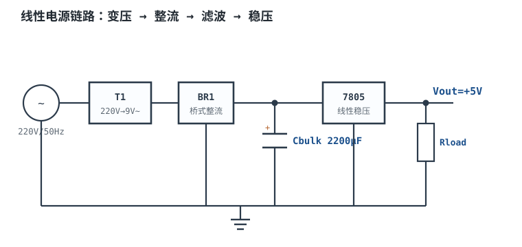
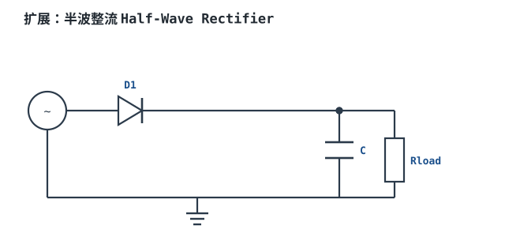

# 线性电源：变压、整流、滤波 Linear Power Supply

市电是 220V/50Hz 交流，电路板要的是 5V 或 3.3V 直流。把前者变成后者，最经典的一条路是：**变压器降压 → 整流桥翻波 → 大电容滤波 → 线性稳压器稳压**。这条链路器件少、没有开关噪声、输出纹波可以做到毫伏级，至今仍是音频、模拟前端、仪表和低功率设备的常用方案。

它的代价同样明确：**效率通常只有 30%~50%**。以 5V/1A 为例，负载拿走 5W，变压器、整流桥和 7805 加起来可能烧掉 8W 以上；多出来的能量全部变成热。理解这条链路的定量关系，就是为了在“干净”和“发烫”之间做有依据的取舍。

本章讲链路级的预算与散热；整流二极管的导通角、峰值电流与精确纹波推导，见[二极管电路：整流、滤波、限幅、钳位](../opamp/diode-circuits.md)；变压器本身的匝比、磁通、损耗与饱和，见[变压器原理](../basics/transformer.md)。本章不重复这两部分，只把“220V 进来、5V/1A 出去”这条链算完整。指标口径见[电源指标：纹波、效率、调整率与时序](power-specs.md)；需要更低噪声的后级稳压见[LDO 原理、选型与功耗计算](ldo.md)；电池充电的 CC/CV 与 USB 协商见[电池、充电管理与电量计](battery-charger.md)。

## 1. 设计动机

::: motivation 三个“能出 5V，但活不久”的现场
**现场一：9V 变压器 + 7805，不带散热片。** 输出 5V/1A，7805 平均输入约 10V，自身耗散 $(10-5)\times1=5$ W。TO-220 不带散热片结到环境热阻约 65°C/W（典型量级，以数据手册为准），环境 40°C 时结温估算 $40+5\times65=365^{\circ}\text{C}$，芯片会先进入热关断，再反复重启。**“能稳压”不等于“能长期稳压”。**

**现场二：滤波电容按 16V 耐压选。** 9V 副边空载峰值 $9\times\sqrt2=12.7$ V，小变压器空载电压还要高 10%~20%，市电 +10% 时峰值可到 15~16V。16V 电解电容长期贴边工作，寿命迅速下降；正确的耐压是 25V。

**现场三：只按 220V 算，没算 198V。** 市电 -10% 时副边只有 8.1V 有效值，整流后峰值 11.5V，减去桥堆 1.6V 只剩 9.9V；如果纹波 4.5V，谷点只有 5.4V，7805 在纹波谷点退出稳压，输出叠上 100Hz 的凹坑。**线性电源的输入不是 220V，而是 198~242V。**
:::

| 你想确认 | 先算 | 判据（工程经验值，具体以器件手册为准） |
|---|---|---|
| 变压器要多大 | 副边有效值电流，不是直流电流 | $S\ge V_{rms}I_{rms}$，再留 20%~30% |
| 副边电压选多少 | 最低市电下的纹波谷点 | 谷点 $\ge V_{out}+V_{DO}+0.5$ V |
| 滤波电容多大 | 允许纹波与最低谷点 | $C\ge I_{out}/[f_{ripple}(V_{pk}-V_{out}-V_{DO})]$ |
| 7805 会不会过热 | $P_d=(V_{in,avg}-V_{out})I_{out}$ | $T_j\le125^{\circ}\text{C}$（降额后） |
| 电容耐压够不够 | 空载最高峰值 | 耐压 $\ge1.5\times$ 空载峰值 |
| 效率大概多少 | 各级损耗相加 | 小功率工频线性电源 30%~50% |

**不做链路预算的代价，可以量化成四个数：**

1. **散热不足**：5W 耗散、65°C/W、40°C 环境，结温 365°C，热关断；加 5°C/W 散热片后总热阻约 11°C/W，结温降到 95°C。
2. **电容耐压不足**：空载 15.6V 加在 16V 电容上，寿命按每降 10°C 翻倍的规律反向折算，可能只剩几分之一。
3. **低市电失稳**：198V 时谷点 5.4V，低于 7805 的 7V 门限，输出跌出稳压区。
4. **效率误判**：只算 7805 的 $5/10=50\%$，漏掉变压器与桥堆，整机实际只有 38%，机箱温升比预期高一倍。

## 2. 定义与直观

### 2.1 四段链路各做什么

图中 Cbulk 标 2200µF，是 0.5A 级示例；本章 1A 设计按后文计算取 4700µF，图与正文的容量差异来自负载电流不同。

- **变压器 T1**：把 220V 降到安全低压，同时提供电气隔离。副边标称 9V 是**有效值（RMS）**，峰值是 $9\sqrt2=12.73$ V。
- **整流桥 BR1**：把交流正负半周都翻成同一方向。每个半周有两只二极管导通，输出峰值比副边峰值低约 $2V_F$。
- **滤波电容 Cbulk**：在整流输出接近峰值时充电，在峰值之间向负载放电。它把“半波正弦”抹成带锯齿的直流，纹波频率是市电的两倍（50Hz 市电 → 100Hz）。
- **线性稳压器 7805**：串联调整管像一个可变电阻，把波动的输入“吃”掉一部分，输出稳定 5V。输入越高、电流越大，它越热。

### 2.2 五个必须分清的量和单位

| 量 | 符号 | 单位 | 说明 |
|---|---|---|---|
| 副边有效值 | $V_{rms}$ | V | 变压器铭牌上的 9V |
| 副边峰值 | $V_{p}$ | V | $V_p=\sqrt2 V_{rms}$ |
| 整流后峰值 | $V_{pk}$ | V | $V_{pk}=V_p-2V_F$（桥式） |
| 纹波峰峰值 | $\Delta V_{pp}$ | V | 电容充放电造成的锯齿高度 |
| 整流后最低电压 | $V_{min}$ | V | $V_{min}=V_{pk}-\Delta V_{pp}$ |
| 稳压器压差 | $V_{DO}$ | V | 维持稳压所需的最小 $V_{in}-V_{out}$ |
| 平均输入电压 | $V_{in,avg}$ | V | 近似 $V_{pk}-\Delta V_{pp}/2$ |

**最容易混的是“有效值、峰值、平均值”三个口径。** 变压器铭牌写有效值，电容耐压按峰值选，7805 的功耗按平均值算，纹波按峰峰值量。用错一个，数就会差 $\sqrt2$ 或 2 倍。

### 2.3 为什么工频线性电源效率只有 30%~50%

把 5V/1A 的 5W 输出拆开看，能量在四个地方损失：

1. **变压器**：20VA 级小变压器满载效率典型 80%~88%，1A 直流负载下损耗约 1.5W；铁损固定，铜损随电流平方变。
2. **整流桥**：两只二极管串联导通，每只 0.8V，1A 时瞬时损耗 $2\times0.8\times1=1.6$ W；四个二极管轮流导通，平均总损耗仍是 1.6W。
3. **线性稳压器**：输入平均约 10V，输出 5V，压差 5V，1A 时耗散 5W；这是最大的一项。
4. **电容与布线**：ESR、接线、保险丝、采样电阻，合计零点几瓦。

总输入约 $5+1.5+1.6+5.07+0.2=13.37$ W，效率 $5/13.37=37.4\%$。**5W 输出、8W 发热**，这就是机箱里那块铝散热片存在的理由。

::: analogy 水塔与减压阀
变压器像把市政高压水降到楼顶水箱的进水压力；整流桥像单向阀，只允许水往一个方向流；滤波电容像水塔，用水高峰时放水、进水时蓄水；7805 像减压阀，把波动的塔压稳定成 5V 出水。

类比的边界：水塔放水时水位平滑下降，电容放电时电压按 $I/C$ 线性下降，还会叠 ESR 的台阶；减压阀不会因为“输入纹波谷点太低”而突然直通，7805 会。水不会发热，电会。
:::

### 2.4 半波、中心抽头与桥式：为什么正规电源用桥式

| 拓扑 | 二极管数 | 纹波频率 | 副边利用 | 典型问题 |
|---|---|---|---|---|
| 半波 | 1 | 50Hz | 只用半个周期 | 变压器直流偏磁、纹波大 |
| 中心抽头全波 | 2 | 100Hz | 两半绕组交替 | 变压器要抽头、每管反压高 |
| 桥式 | 4 | 100Hz | 全周期 | 两只二极管压降，损耗略高 |

半波整流的致命问题不是“效率低”，而是**副边电流含直流分量**：电流只往一个方向走，小变压器铁芯被单向磁化，容易饱和、发热、嗡叫。所以除了极小功率或高压小电流场合，工频电源都用全波或桥式。桥式多用两只二极管压降（约 1.6V），但变压器不用抽头、每管反压也低，是 5V/1A 这类应用的标准选择。

中心抽头全波用两只二极管，压降少一只，但变压器要中心抽头，且每只截止管承受整个绕组的峰值反压；在同样输出直流电压下，变压器体积和成本更高。小功率双电源（±15V）常用它一次分出正负两路，单路 5V 没必要。

### 2.5 纹波与压差预算：谷点决定成败

线性稳压器只在输入高于 $V_{out}+V_{DO}$ 时才能稳住。整流滤波后的电压是“峰值 + 锯齿”，所以约束写在**谷点**上：

$$V_{min}=V_{pk}-\Delta V_{pp}\ge V_{out}+V_{DO}$$

其中 $V_{min}$ 是电容电压最低点（V）；$V_{pk}$ 是整流后峰值（V）；$\Delta V_{pp}$ 是纹波峰峰值（V）；$V_{out}$ 是输出电压（V）；$V_{DO}$ 是稳压器压差（V）。

这个不等式是整条链路的设计主线：**电容越大、变压器副边越高，谷点越高，但 7805 的功耗也越大**。设计就是在这两个方向之间找平衡。

## 3. 定量关系

### 3.1 从交流有效值到整流峰值

变压器副边峰值：

$$V_{p}=\sqrt2 V_{rms}$$

桥式整流后，每个半周有两只二极管导通：

$$V_{pk}=V_{p}-2V_F$$

其中 $V_F$ 是单只二极管在当前电流下的正向压降（V），1A 级硅桥堆典型 0.8~1.0V，肖特基桥堆 0.4~0.6V（典型量级，以数据手册为准）。

**算一遍**：$V_{rms}=9$ V、$V_F=0.8$ V。

$$V_p=\sqrt2\times9=12.73\ \text{V}$$

$$V_{pk}=12.73-2\times0.8=11.13\ \text{V}$$

小变压器空载电压比额定高 10%~20%，所以空载时电容可能充到 13~15V；电容耐压要按这个最坏值选，不能按 11.13V 选。

### 3.2 滤波电容与纹波

全波整流每半个市电周期充一次电，纹波频率 $f_{ripple}=2f_{line}=100$ Hz。用“放电期间近似恒流”的上界式：

$$\Delta V_{pp}\approx\frac{I_{out}}{f_{ripple}C_{bulk}}$$

其中 $I_{out}$ 是负载直流电流（A）；$f_{ripple}$ 是纹波频率（Hz）；$C_{bulk}$ 是滤波电容（F）。这个式子是**上界**：它假设电容在整个半周都在放电，实际导通角越大，纹波越小。精确推导见[二极管电路：整流、滤波、限幅、钳位](../opamp/diode-circuits.md)，本章用它做保守预算。

反解出满足谷点约束的最小电容：

$$C_{bulk}\ge\frac{I_{out}}{f_{ripple}\left(V_{pk}-V_{out}-V_{DO}\right)}$$

**算一遍**：$I_{out}=1$ A、$V_{pk}=11.13$ V、$V_{out}=5$ V、$V_{DO}=2$ V。

$$C_{bulk}\ge\frac{1}{100\times(11.13-5-2)}=\frac{1}{413}=2.42\times10^{-3}\ \text{F}=2420\ \mu\text{F}$$

取 4700µF，则

$$\Delta V_{pp}\approx\frac{1}{100\times4700\times10^{-6}}=2.13\ \text{V}$$

$$V_{min}=11.13-2.13=9.00\ \text{V}$$

9.00V 高于 7V 门限，留 2V 余量。但这是 220V 名义值；市电 -10% 时要把 3.1 重算一遍（见典型计算）。

### 3.3 线性稳压器的功耗与效率

忽略静态电流时：

$$P_d=(V_{in,avg}-V_{out})I_{out}$$

其中 $P_d$ 是稳压器耗散（W）；$V_{in,avg}$ 是输入平均电压（V），近似 $V_{pk}-\Delta V_{pp}/2$；$V_{out}$ 是输出电压（V）；$I_{out}$ 是负载电流（A）。

稳压级效率：

$$\eta_{reg}=\frac{V_{out}I_{out}}{V_{in,avg}I_{out}}=\frac{V_{out}}{V_{in,avg}}$$

**算一遍**：$V_{pk}=11.13$ V、$\Delta V_{pp}=2.13$ V、$V_{out}=5$ V、$I_{out}=1$ A。

$$V_{in,avg}=11.13-\frac{2.13}{2}=10.07\ \text{V}$$

$$P_d=(10.07-5)\times1=5.07\ \text{W}$$

$$\eta_{reg}=\frac{5}{10.07}=49.7\%$$

**稳压级自己就烧掉一半功率**；再加上变压器和桥堆，整机效率只有 38% 左右。

### 3.4 全链路效率

把各级损耗相加：

$$\eta_{total}=\frac{P_{out}}{P_{out}+P_{xfmr}+P_{bridge}+P_{reg}+P_{other}}$$

其中 $P_{out}=V_{out}I_{out}$ 是输出功率（W）；$P_{xfmr}$ 是变压器铜损加铁损（W）；$P_{bridge}=2V_FI_{out}$ 是桥堆平均损耗（W）；$P_{reg}$ 是稳压器耗散（W）；$P_{other}$ 是电容 ESR、接线、保险丝等（W）。

**算一遍**：$P_{out}=5$ W、$P_{xfmr}=1.5$ W、$P_{bridge}=2\times0.8\times1=1.6$ W、$P_{reg}=5.07$ W、$P_{other}=0.2$ W。

$$P_{in}=5+1.5+1.6+5.07+0.2=13.37\ \text{W}$$

$$\eta_{total}=\frac{5}{13.37}=37.4\%$$

市电升到 242V 时，$P_{reg}$ 升到约 6.3W，$P_{xfmr}$ 升到约 1.8W，总效率降到约 34%；市电降到 198V 时，$P_{reg}$ 降到约 3.8W，效率升到约 43%。**30%~50% 不是一个固定数，而是一条随输入电压和负载变化的带。**

### 3.5 散热：结温与热阻

$$T_j=T_a+P_dR_{\theta ja}$$

其中 $T_j$ 是结温（°C）；$T_a$ 是环境温度（°C）；$P_d$ 是耗散（W）；$R_{\theta ja}$ 是结到环境的热阻（°C/W）。

带散热片时，热阻串联：

$$R_{\theta ja}=R_{\theta jc}+R_{\theta cs}+R_{\theta sa}$$

其中 $R_{\theta jc}$ 是结到壳（°C/W）；$R_{\theta cs}$ 是壳到散热片（°C/W，加导热垫典型 0.5~1.5）；$R_{\theta sa}$ 是散热片到环境（°C/W）。

反解允许的最大热阻：

$$R_{\theta ja,max}=\frac{T_{j,max}-T_a}{P_d}$$

**算一遍**：$P_d=6.34$ W、$T_a=40^{\circ}\text{C}$、$T_{j,max}=125^{\circ}\text{C}$。

$$R_{\theta ja,max}=\frac{125-40}{6.34}=13.4^{\circ}\text{C/W}$$

TO-220 的 $R_{\theta jc}$ 约 5°C/W，导热垫约 1°C/W，所以散热片最多 $13.4-5-1=7.4^{\circ}\text{C/W}$；选 5°C/W 的铝散热片，总热阻 11°C/W，结温 $40+6.34\times11=109.7^{\circ}\text{C}$，留 15°C 余量。

### 3.6 纹波抑制：7805 能把纹波压到多少

7805 的纹波抑制（Ripple Rejection）典型 60~80dB（100Hz，具体以数据手册为准）。按 60dB 算：

$$V_{out,ripple}=\frac{V_{in,ripple}}{10^{60/20}}=\frac{V_{in,ripple}}{1000}$$

**算一遍**：输入纹波 2.13Vpp，输出纹波 $2.13/1000=2.13$ mVpp。这远小于 50mV 的常见目标，所以线性电源的输出纹波主要不是 100Hz 纹波，而是：

- 输入纹波在稳压器带宽之外的高频分量；
- 负载瞬态引起的跌落；
- 地线、布线耦合；
- 输出电容 ESR 上的残余。

**不要因为“7805 抑制 60dB”就认为输出一定干净**；PCB 布局、输入电容位置、负载回流路径都会把纹波“绕”过去。

### 3.7 适用条件与失效边界

- **最低市电**：198V 时副边只有 8.1V 有效值，谷点必须重算；电容容值 -20% 也要算。
- **最高市电**：242V 时 7805 功耗最大，散热按这个工况选。
- **变压器调整率**：小变压器空载电压比额定高 10%~20%，电容耐压和 7805 最高输入都要按空载算。
- **电容 ESR 与纹波电流**：4700µF 电解的纹波电流额定值可能只有 1~2A，1A 直流负载下要核对；ESR 还会在纹波上叠台阶。
- **桥堆压降**：1A 时单只 0.8~1.0V，肖特基低但反向漏电大；低压输出时桥堆损耗占比很高。
- **安全**：市电侧必须有过流保护、绝缘、爬电距离和接地；变压器按 IEC 61558-1 的绝缘与温升要求选，不能只看电压电流。

## 4. 典型计算

### 4.1 220V→9V→5V/1A 完整设计

**需求与假设**：

| 项目 | 数值/假设 |
|---|---|
| 输入 | 220V ±10%，50Hz |
| 输出 | 5V/1A |
| 纹波 | 输出 ≤50mVpp |
| 环境 | 40°C |
| 变压器 | 9V 有效值，20VA，调整率按 10% 估 |
| 整流 | 桥式，$V_F=0.8$ V |
| 稳压器 | 7805，$V_{DO}=2$ V，$T_{j,max}=125^{\circ}\text{C}$ |

**第 1 步：变压器容量。** 电容滤波整流的副边电流有效值比直流电流大，典型 $I_{rms}\approx(1.5\sim1.8)I_{dc}$。取 1.7：

$$I_{rms}\approx1.7\times1=1.7\ \text{A}$$

$$S\ge V_{rms}I_{rms}=9\times1.7=15.3\ \text{VA}$$

选 20VA，留 30% 余量；20VA 变压器的满载效率典型 85%~88%，1A 直流负载下损耗约 1.5W（以实测为准）。

**第 2 步：整流峰值。** 名义 220V：

$$V_p=\sqrt2\times9=12.73\ \text{V},\qquad V_{pk}=12.73-1.6=11.13\ \text{V}$$

最低市电 198V（-10%）：

$$V_{p,low}=0.9\times12.73=11.46\ \text{V},\qquad V_{pk,low}=11.46-1.6=9.86\ \text{V}$$

最高市电 242V（+10%）：

$$V_{p,high}=1.1\times12.73=14.00\ \text{V},\qquad V_{pk,high}=14.00-1.6=12.40\ \text{V}$$

**第 3 步：滤波电容。** 用最低市电的峰值和 7V 门限反解：

$$C\ge\frac{1}{100\times(9.86-5-2)}=\frac{1}{286}=3.50\times10^{-3}\ \text{F}=3500\ \mu\text{F}$$

取 4700µF/25V。核对最低市电纹波：

$$\Delta V_{pp}=\frac{1}{100\times4700\times10^{-6}}=2.13\ \text{V}$$

$$V_{min,low}=9.86-2.13=7.73\ \text{V}$$

高于 7V 门限，余量 0.73V。若电容容值因低温或老化掉 20%（3760µF），纹波升到 2.66V，谷点 7.20V，余量只剩 0.20V；所以 4700µF 是下限，不能再小。

**第 4 步：7805 功耗。** 名义平均输入：

$$V_{in,avg}=11.13-\frac{2.13}{2}=10.07\ \text{V}$$

$$P_{d,nom}=(10.07-5)\times1=5.07\ \text{W}$$

最高市电：

$$V_{in,avg,high}=12.40-\frac{2.13}{2}=11.34\ \text{V}$$

$$P_{d,high}=(11.34-5)\times1=6.34\ \text{W}$$

最低市电：

$$V_{in,avg,low}=9.86-\frac{2.13}{2}=8.80\ \text{V}$$

$$P_{d,low}=(8.80-5)\times1=3.80\ \text{W}$$

**散热按最坏的 6.34W 算**，不能按名义 5.07W 算。

**第 5 步：散热片。** 环境 40°C、结温上限 125°C：

$$R_{\theta ja,max}=\frac{125-40}{6.34}=13.4^{\circ}\text{C/W}$$

TO-220 的 $R_{\theta jc}\approx5^{\circ}\text{C/W}$，导热垫 $R_{\theta cs}\approx1^{\circ}\text{C/W}$，散热片允许：

$$R_{\theta sa}\le13.4-5-1=7.4^{\circ}\text{C/W}$$

选 5°C/W 铝散热片：

$$T_j=40+6.34\times(5+1+5)=40+69.7=109.7^{\circ}\text{C}$$

低于 125°C，留 15°C 余量。若不加散热片，TO-220 的 $R_{\theta ja}\approx65^{\circ}\text{C/W}$：

$$T_j=40+6.34\times65=452^{\circ}\text{C}$$

远超热关断点，芯片会进入“加热—关断—冷却—重启”的循环。

**第 6 步：整机效率。** 名义工况：

$$P_{bridge}=2\times0.8\times1=1.6\ \text{W}$$

$$P_{in}=5+1.5+1.6+5.07+0.2=13.37\ \text{W}$$

$$\eta_{total}=\frac{5}{13.37}=37.4\%$$

最高市电：

$$P_{in,high}=5+1.8+1.6+6.34+0.2=14.94\ \text{W}$$

$$\eta_{total,high}=\frac{5}{14.94}=33.5\%$$

最低市电：

$$P_{in,low}=5+1.3+1.6+3.80+0.2=11.90\ \text{W}$$

$$\eta_{total,low}=\frac{5}{11.90}=42.0\%$$

**33.5%~42.0%**，正好落在“工频线性电源 30%~50%”的范围内。

**第 7 步：输出纹波。** 输入 2.13Vpp，7805 抑制 60dB：

$$V_{out,ripple}=\frac{2.13}{1000}=2.13\ \text{mVpp}$$

满足 ≤50mVpp。实际还要加输出电容 ESR、负载瞬态和地线耦合；输出端并 10µF 电解 + 0.1µF 陶瓷，就近放。

**第 8 步：保险丝与浪涌。** 最低效率 33.5% 时输入约 14.9W，220V 下电流 $14.9/220=68$ mA；选 200mA 慢熔保险丝，避免变压器合闸涌流误断。合闸涌流可达额定电流的 10~20 倍，必要时加 NTC 限流。

**设计汇总**：

| 项目 | 数值 | 验算 |
|---|---|---|
| 变压器 | 9V/20VA | $S\ge15.3$ VA |
| 滤波电容 | 4700µF/25V | 最低市电谷点 7.73V > 7V |
| 桥堆 | 2A/50V 以上 | 平均 1A，反压约 12.4V |
| 7805 功耗 | 名义 5.07W，最坏 6.34W | 按最坏算散热 |
| 散热片 | 5°C/W | $T_j=109.7^{\circ}\text{C}$ |
| 整机效率 | 33.5%~42.0% | 符合工频线性电源量级 |
| 输出纹波 | 约 2.1mVpp | 7805 抑制 60dB |

### 4.2 如果把副边换成 12V，会怎样

同样 1A、4700µF、$V_F=0.8$ V：

$$V_{pk}=12\times1.414-1.6=15.37\ \text{V}$$

$$\Delta V_{pp}=\frac{1}{100\times4700\times10^{-6}}=2.13\ \text{V}$$

$$V_{in,avg}=15.37-\frac{2.13}{2}=14.31\ \text{V}$$

$$P_d=(14.31-5)\times1=9.31\ \text{W}$$

允许热阻：

$$R_{\theta ja,max}=\frac{125-40}{9.31}=9.13^{\circ}\text{C/W}$$

扣掉 $R_{\theta jc}+R_{\theta cs}=6^{\circ}\text{C/W}$，散热片只能 $\le3.1^{\circ}\text{C/W}$，体积和成本都上去；整机效率降到约 28%。**副边从 9V 升到 12V，输出只多 3V 的“余量”，7805 的功耗却几乎翻倍。** 这就是“副边电压够用就好”的定量理由。

### 4.3 半波整流需要多大电容

半波整流的纹波频率是 50Hz，不是 100Hz。同样允许 2.85V 纹波、1A：

$$C\ge\frac{1}{50\times2.85}=7.02\times10^{-3}\ \text{F}=7020\ \mu\text{F}$$

取 10000µF，体积约是 4700µF 的两倍；而且半波整流的副边电流含直流分量，20VA 小变压器容易偏磁发热。**同样的输出，半波要用两倍电容、变压器还要降额，所以 5V/1A 不用半波。**

## 5. 工程含义

### 5.1 数量级：先有直觉，再查手册

| 项目 | 5V/0.5A | 5V/1A | 12V/1A |
|---|---|---|---|
| 副边电压 | 7.5~9V | 9~10V | 15~16V |
| 变压器容量 | 8~12VA | 15~20VA | 20~25VA |
| 滤波电容 | 2200~3300µF | 4700~6800µF | 3300~4700µF |
| 7805 功耗 | 2.5~3W | 5~6.5W | 8~10W |
| 散热片 | 10~15°C/W | 5~7°C/W | 2~3°C/W |
| 整机效率 | 40%~48% | 33%~42% | 28%~35% |

**这些是典型量级，具体以变压器、桥堆、稳压器的数据手册和实测为准。** 表的作用是让你在选变压器之前就知道“大概要多大的散热片”。

### 5.2 选型顺序：从谷点倒推

1. **定输出**：$V_{out}$、$I_{out}$、纹波、环境温度。
2. **定门限**：$V_{out}+V_{DO}+0.5$ V 的谷点余量。
3. **定副边**：按最低市电的峰值和允许纹波反推；副边越高，7805 越热。
4. **定电容**：用 $C\ge I/[f(V_{pk}-V_{out}-V_{DO})]$，再按容值公差 -20% 复算。
5. **定变压器 VA**：$I_{rms}\approx1.5\sim1.8I_{dc}$，留 20%~30%。
6. **定散热**：按最高市电、最大负载算 $P_d$，再算 $R_{\theta ja,max}$。
7. **定保护**：保险丝、NTC、桥堆耐压、电容耐压、输出短路保护。

### 5.3 线性电源什么时候仍然值得用

- **低噪声**：没有开关边沿，输出纹波可以做到 mV 级，适合音频、精密模拟、仪表。
- **简单可靠**：器件少、无软件、无 EMI 调试，小批量产品首选。
- **隔离**：工频变压器天然隔离，市电侧故障不容易窜到低压侧。
- **瞬态干净**：没有开关电源的环路带宽限制，负载瞬态可以很快（但受输出电容限制）。

不适用：大电流、大压差、电池供电、效率敏感、体积敏感。12V→5V/3A 用线性方案要烧 21W，必须改用 Buck；需要低噪声时用“Buck 预稳压 + LDO 后级”，见[LDO 原理、选型与功耗计算](ldo.md)与[开关电源原理与 Buck 降压](buck.md)。

### 5.4 安全与测试

- **市电侧**：保险丝串在火线，变压器按 IEC 61558-1 选绝缘等级与温升；原副边爬电距离、Y 电容、接地按安规要求。**不要用自耦调压器替代隔离变压器做带电调试。**
- **上电**：先空载测副边电压、电容极性、7805 输出；再带载测谷点、纹波、结温。
- **纹波**：示波器 AC 耦合、20MHz 带宽、短地针，测输出电容两端；不要用地线夹。
- **温度**：热电偶贴 7805 散热片根部，稳定 30min 后读；结温按 $T_j=T_a+P_dR_{\theta ja}$ 反算，不要用手摸。
- **效率**：输入用功率计，输出用四线法；不要用调压器面板读数代替输入功率。

## 6. 常见坑

::: pitfall 常见坑
- **现象**：电容鼓包、寿命很短。**原因**：耐压按整流后平均值选，没算空载峰值和市电 +10%；9V 副边空载可到 15~16V，16V 电容贴边工作。**解决**：耐压按空载最高峰值选，至少 25V；电容纹波电流也要核对。
- **现象**：7805 烫手、反复热关断。**原因**：副边选太高（如 12V）或没加散热片；5V/1A 时 7805 耗散 5~9W，TO-220 裸封装扛不住。**解决**：副边降到 9~10V；按最坏 $P_d$ 选散热片，$R_{\theta ja}\le13.4^{\circ}\text{C/W}$；必要时用开关预稳压。
- **现象**：市电低时输出叠 100Hz 凹坑、MCU 复位。**原因**：只按 220V 算谷点，没算 198V 和电容 -20% 公差；谷点低于 $V_{out}+V_{DO}$，7805 退出稳压。**解决**：按最低市电、最小容值重算 $V_{min}$；加大电容或提高副边；留 0.5V 以上余量。
- **现象**：整流桥发热、电容发热。**原因**：桥堆按平均电流选，忽略导通角导致的峰值电流和有效值；电容按容值选，忽略纹波电流额定值。**解决**：桥堆按 $I_{F(AV)}$ 与 $I_{FSM}$ 双口径选；电容按 100Hz 纹波电流额定值与温度修正选。
- **现象**：半波整流变压器嗡叫、发热。**原因**：半波副边电流含直流分量，铁芯单向磁化、饱和。**解决**：功率稍大就用全波/桥式；必须半波时选带气隙或降额的变压器。
- **现象**：空载电压正常，一带载输出就掉。**原因**：变压器调整率差、绕组电阻大，或滤波电容容值不足；负载电流超过变压器额定。**解决**：按 $I_{rms}$ 选 VA，留 20%~30%；测带载谷点；必要时加大电容或换低调整率变压器。
:::

## 7. 自测题

9V 有效值副边、桥式整流（每只 0.8V）、4700µF、1A。名义 220V 时峰值、纹波、谷点各是多少？198V 时谷点是多少？

名义：

$$V_p=9\times1.414=12.73\ \text{V},\qquad V_{pk}=12.73-1.6=11.13\ \text{V}$$

$$\Delta V_{pp}=\frac{1}{100\times4700\times10^{-6}}=2.13\ \text{V}$$

$$V_{min}=11.13-2.13=9.00\ \text{V}$$

198V：

$$V_{pk,low}=0.9\times12.73-1.6=9.86\ \text{V}$$

$$V_{min,low}=9.86-2.13=7.73\ \text{V}$$

高于 7V 门限，余量 0.73V；若电容 -20%，余量只剩 0.20V。

5V/1A、7805 输入平均 10.07V，功耗和稳压级效率各是多少？最高市电 242V 时呢？

名义：

$$P_d=(10.07-5)\times1=5.07\ \text{W},\qquad \eta_{reg}=\frac{5}{10.07}=49.7\%$$

最高市电：

$$V_{in,avg}=12.40-\frac{2.13}{2}=11.34\ \text{V}$$

$$P_d=(11.34-5)\times1=6.34\ \text{W},\qquad \eta_{reg}=\frac{5}{11.34}=44.1\%$$

**稳压级效率只有 44%~50%**，这是线性电源效率低的主因。

7805 最坏耗散 6.34W，环境 40°C，结温上限 125°C。允许的结到环境热阻是多少？选 5°C/W 散热片后结温多少？

$$R_{\theta ja,max}=\frac{125-40}{6.34}=13.4^{\circ}\text{C/W}$$

TO-220 的 $R_{\theta jc}\approx5$、导热垫 $R_{\theta cs}\approx1$，散热片允许 $\le7.4^{\circ}\text{C/W}$。

选 5°C/W：

$$T_j=40+6.34\times(5+1+5)=109.7^{\circ}\text{C}$$

低于 125°C，留 15°C 余量。不加散热片（65°C/W）时 $T_j=452^{\circ}\text{C}$，必然热关断。

5V/1A 线性电源，变压器损耗 1.5W、桥堆 1.6W、7805 5.07W、其他 0.2W。整机效率是多少？为什么不是 50%？

$$P_{in}=5+1.5+1.6+5.07+0.2=13.37\ \text{W}$$

$$\eta=\frac{5}{13.37}=37.4\%$$

50% 只是 7805 这一级的理想值 $5/10$；整机还要算变压器、桥堆、电容和布线损耗。**效率是整条链路的乘积，不是最后一级的比值。**

同样 1A、允许 2.85V 纹波，半波整流需要多大电容？为什么正规 5V/1A 电源不用半波？

半波纹波频率 50Hz：

$$C\ge\frac{1}{50\times2.85}=7.02\times10^{-3}\ \text{F}=7020\ \mu\text{F}$$

取 10000µF，体积约是 4700µF 的两倍；半波副边电流含直流分量，小变压器容易偏磁饱和、发热。**全波/桥式用一半电容、纹波频率翻倍、变压器不偏磁，所以正规电源用桥式。**

副边从 9V 换成 12V，5V/1A 的 7805 功耗变成多少？散热片要求怎么变？

$$V_{pk}=12\times1.414-1.6=15.37\ \text{V}$$

$$V_{in,avg}=15.37-\frac{2.13}{2}=14.31\ \text{V}$$

$$P_d=(14.31-5)\times1=9.31\ \text{W}$$

$$R_{\theta ja,max}=\frac{125-40}{9.31}=9.13^{\circ}\text{C/W}$$

扣掉 $R_{\theta jc}+R_{\theta cs}=6^{\circ}\text{C/W}$，散热片只能 $\le3.1^{\circ}\text{C/W}$；体积、成本、机箱温升都上去。**副边“够用就好”，多出来的电压全部变成热。**

## 8. 参考资料

- **IEC 61558-1:2017 *Safety of power transformers, power supplies, reactors and similar products — Part 1: General requirements and tests***：小型电源变压器的绝缘、温升与耐压试验；本章的安规与测试部分按该标准，具体限值以标准表格与认证要求为准。
- **IEC 60076-1 *Power transformers — Part 1: General***：损耗、温升、额定容量的术语；本章 VA 与 W 的区分、变压器损耗的表述参照该标准。
- **TI, LM340/LM78xx 系列数据手册**：*Electrical Characteristics* 表给 Dropout Voltage、Ripple Rejection、Output Voltage 的测试条件；本章 2.5、3.3、3.6 的 7805 参数按该表（具体型号以数据手册为准）。<https://www.ti.com/lit/ds/symlink/lm340.pdf>
- **TI, LM317 数据手册**：*Application Hints* 给线性稳压器的热设计、输出电容与调整率；本章 3.5 的散热方法与 4.1 的验证步骤参考该文。<https://www.ti.com/lit/ds/symlink/lm317.pdf>
- **Horowitz & Hill, *The Art of Electronics*, 3rd ed., Chapter 9 *Voltage Regulation and Power Conversion***：线性稳压、整流滤波、效率与热设计的工程讲法；本章 2.3 与 5.1 的量级参照该章。
- **Erickson & Maksimovic, *Fundamentals of Power Electronics*, 2nd ed., Chapter 2 *Principles of Steady-State Converter Analysis***：电容电荷平衡与纹波估算；本章 3.2 的上界式与该章的电荷平衡口径一致。
