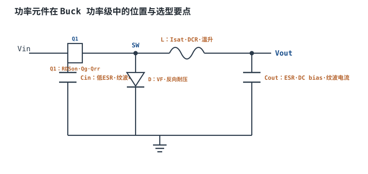
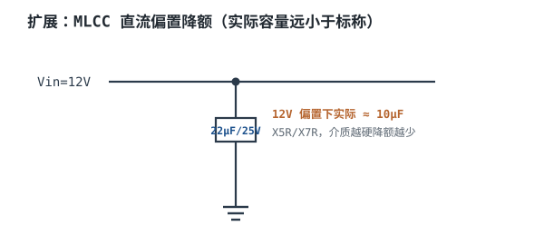
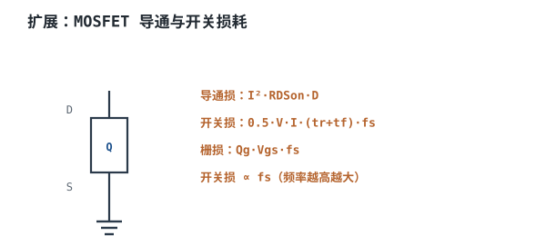

# 功率电感、电容、MOS 与二极管选型 Power Component Selection

拓扑定了、公式算了，最后落到 BOM 上的还是四个具体料号：一只电感、两组电容、两只 MOS、可能还有一只二极管。这四个东西的选型不是"按算出来的数字找最接近的型号"，而是**在六个互相冲突的维度上做取舍**：参数余量、体积、效率、温升、成本、供货。

这一章的主线是：先给一条"从需求反推参数"的链，再把电感、电容、MOS 三个器件的参数逐个拆开（每个参数约束什么、超了会怎么坏），然后把降额规则与失效模式列表，最后用一个 24V→5V/5A 的设计把全套器件选出来，包括为什么在某几个位置选了"看起来更差"的方案。

## 1. 设计动机

::: motivation 为什么选型比计算更容易出事
计算题只有一个正确答案，选型题有一堆"都能用"的答案，而**能用的答案里藏着会坏的**。

三种典型翻车方式，都不是算错，而是选错：

- **参数看错。** 电感的"3A"是 $I_{sat}$ 还是 $I_{rms,rated}$？数据手册的表格里两个都写 3A，含义完全不同——一个是磁芯饱和点，一个是温升点。按错的那个选，满载就出事。
- **条件看漏。** 电容标 22µF，但那是 0V 偏置、25°C、1kHz 下的值；实际工作在 5V 偏置、85°C、300kHz，剩 12µF。纹波直接翻倍。
- **只算一项。** MOS 只挑 $R_{DS(on)}$ 最小的，结果 $Q_g$ 大、交叠损耗高，满载结温 130°C。效率测试那天才发现。

**选型的本质是把"数据手册的条件"和"你的工作条件"对齐。** 对不齐的地方，就是余量要去的地方。
:::

把这一章要回答的问题列出来：

| 问题 | 决定什么 | 错判的后果 |
|---|---|---|
| 电感的 $I_{sat}$、$I_{rms,rated}$、DCR 各约束什么 | 会不会饱和、会不会过热 | 重载啸叫、批量烧管 |
| 电容按标称还是按偏置后的容量 | 纹波、环路、寿命 | 纹波超标、啸叫 |
| MOS 怎么在 $R_{DS(on)}$ 与 $Q_g$ 之间取舍 | 效率、结温、封装 | 高频过热、效率不达标 |
| 降额留多少 | 成本与可靠性 | 余量不足或过度设计 |
| 成本与可得性怎么排 | BOM、量产风险 | 交期 26 周、单源断供 |

## 2. 定义与直观

### 2.1 一句话定义

**选型是用器件参数去换电路指标的过程：每一个"更好"的参数都要用另一个"更差"的参数或更高的成本去换。**

这句话听起来像废话，但它是判断"这个选型对不对"的唯一标准。看到一只 $R_{DS(on)}$ 特别小的 MOS，要立刻问"它用什么换的"——答案通常是更大的芯片面积，代价是 $Q_g$、$Q_{oss}$ 更大、价格更高。看到一只 DCR 特别小的电感，要问"它用什么换的"——更大的线径或更少的匝数，代价是体积或电感量。

### 2.2 原理图：每个元件被什么约束



图里标出了五个位置的约束，逐一对应到物理量：

| 位置 | 约束参数 | 被什么决定 | 超了会怎样 |
|---|---|---|---|
| $C_{in}$ | ESR、纹波电流额定、耐压 | $I_{out}\sqrt{D(1-D)}$ | ESR 发热、容量衰减、鼓包 |
| Q1（高边） | $R_{DS(on)}$、$Q_g$、$Q_{oss}$、$V_{DS}$ | $D$、$V_{in}$、$f_{sw}$ | 交叠损耗、过压击穿 |
| D（续流） | $V_F$、$Q_{rr}$、$V_R$ | $I_{out}(1-D)$、$V_{in}$ | 反压击穿、恢复损耗 |
| L | $I_{sat}$、$I_{rms,rated}$、DCR | $I_{pk}$、$I_{rms}$ | 饱和、过热、啸叫 |
| $C_{out}$ | 有效容量、ESR、纹波电流 | $\Delta I_L$、$\Delta V$ 目标 | 纹波超标、环路失稳 |

**同步 Buck 把 D 换成低边 MOS**，此时二极管的 $V_F$ 项变成 $R_{DS(on)}$，但 $Q_{rr}$ 不会消失——它变成低边 MOS 的体二极管反向恢复电荷，仍然是高边开通瞬间的一笔损耗。

### 2.3 类比：四个守门员

把四个器件想成球门前的四个守门员，各守一个门，而且每个守门员都有"体力上限"：

- **电感**守"电流不能失控"这道门。它的体力上限是 $I_{sat}$（磁芯饱和）和 $I_{rms,rated}$（线圈温升），**先到哪个算哪个**。
- **输入电容**守"输入不能有脉冲电流"这道门。它的体力上限是纹波电流额定，超了就在内部发热。
- **输出电容**守"电压不能抖"这道门。它的体力上限是有效容量与 ESR，两者都会被直流偏置与温度削弱。
- **MOS**守"不能过热、不能被过压打穿"这道门。它的体力上限是结温和 $V_{DS}$ 额定。

类比的边界在于：真实器件之间会**互相影响**。电感量大 → 纹波小 → 输出电容压力小；MOS 开关快 → 交叠损耗小但振铃大 → 电感的绝缘与电容的耐压压力大。**守门员的体力是联动的，不能一个个单独定。**

### 2.4 选型的四个维度

工程上按这个优先级排，顺序错了会返工：

1. **能不能工作**（参数是否满足最坏工况，含降额）——不满足，后面都免谈。
2. **会不会坏**（失效模式是否被覆盖，有无单点失效风险）。
3. **买不买得到**（生命周期状态、交期、第二供应商）。
4. **贵不贵**（单价 × 数量，含贴片与测试成本）。

很多团队把顺序倒过来：先按成本选，再想办法让它工作。结果是在样机上打补丁，量产后批量失效。

## 3. 定量关系

### 3.1 从需求反推：一条链

选型不是一个一个挑，而是沿着一条链传递。以 Buck 为例，链是这样的：

$$V_{in},V_{out},I_{out},f_{sw}\ \longrightarrow\ D\ \longrightarrow\ L,\Delta I_L\ \longrightarrow\ I_{pk},I_{L,rms}\ \longrightarrow\ I_{sat},R_{DS(on)},DCR$$

$$D,\Delta I_L\ \longrightarrow\ I_{C,in,rms},I_{C,out,rms}\ \longrightarrow\ C_{in},C_{out}$$

每一环的公式在 [开关电源原理与 Buck 降压](buck.md) 里给过，这里只重申三个最容易被跳过的中间量：

$$\Delta I_L=\frac{V_{out}(1-D)}{f_{sw}L},\qquad I_{pk}=I_{out}+\frac{\Delta I_L}{2},\qquad I_{L,rms}=\sqrt{I_{out}^2+\frac{\Delta I_L^2}{12}}$$

$D$ 是占空比（无量纲），$\Delta I_L$ 是纹波电流峰峰值（A），$I_{pk}$ 是峰值（A），$I_{L,rms}$ 是有效值（A）。**这三个量必须用同一个 $L$ 算出来**，混用不同 $L$ 的中间结果是最常见的算术错误。

### 3.2 电感：三个参数，两种失效

电感是四个器件里最容易"看着够、实际不够"的一个。三个参数各管一件事：

$$I_{sat}\geq\frac{I_{pk}}{0.8},\qquad I_{rms,rated}\geq\frac{I_{L,rms}}{0.8},\qquad P_{DCR}=I_{L,rms}^2\cdot DCR(T)$$

$I_{sat}$ 是磁芯开始饱和、电感量相对初始值下降规定百分比（常见 20%~30%，不同厂商定义不同）时的直流电流（A）；$I_{rms,rated}$ 是线圈温升达到规定值（常见 40°C）时的直流电流（A）；$DCR(T)$ 是温度 $T$ 下的直流电阻（$\Omega$）。

**两个降额都取 0.8**，理由不同：

- $I_{sat}$ 的 0.8 是为了温度：铁氧体在 100°C 附近的饱和磁感应强度比 25°C 低 15%~25%，数据手册的 $I_{sat}$ 通常在室温测。满载 + 高温 + 电感自身温升，三重叠加后余量会被吃掉。
- $I_{rms,rated}$ 的 0.8 是为了热阻：额定值是"温升 40°C"，而实际环境温度可能就有 60°C，再叠 40°C 就逼近绝缘等级上限。

DCR 的铜损必须用**热态值**：

$$DCR(T)=DCR(25)\left[1+0.00393(T-25)\right]$$

铜的电阻温度系数约 $0.00393\ ^\circ\text{C}^{-1}$。100°C 时倍率 $1+0.00393\times75=1.295$，也就是比冷态高 30%。**热设计用冷态 DCR，等于把铜损低估 30%。**

### 3.3 电容：三个参数，一条正反馈

电容的三个参数里，纹波电流与 ESR 会形成正反馈：

$$P_{cap}=I_{C,rms}^2\cdot ESR\ \longrightarrow\ \Delta T\ \longrightarrow\ \text{容量衰减、ESR 上升}\ \longrightarrow\ P_{cap}\uparrow$$

$I_{C,rms}$ 是流过电容的有效值电流（A），$ESR$ 是等效串联电阻（$\Omega$）。这个正反馈是电容失效的主要路径：ESR 上升 → 同样电流下发热更多 → 更热 → ESR 再上升。

三个量必须一起看：

- **有效容量**：Class II 陶瓷（X5R/X7R）有直流偏置效应，标称 22µF/16V 在 5V 偏置下常剩 70%~85%，在接近额定电压时更差。**必须查厂商的 DC bias 曲线**，不能用标称值。
- **ESR**：陶瓷的 ESR 在 mΩ 量级，电解在几十到几百 mΩ。输出纹波里 ESR 分量是 $\Delta V_{esr}=\Delta I_L\cdot ESR$，电感纹波大时这一项可能超过容性分量。
- **纹波电流额定**：厂家给的是特定频率（常见 100kHz）、特定温度下的允许 RMS 电流，随频率与温度变化。开关频率 300kHz 以上时，可用值通常比 100kHz 的标称值高，但小封装（0603/0805）的绝对值很低。



图中这条曲线就是"按标称值设计"会翻车的地方：12V 偏置、22µF 标称、实际 10µF，纹波直接按比例翻倍。§4.1 的 5V 输出用了 16V 额定、偏置比只有 31%，衰减小得多，这就是"耐压选 2 倍以上"的实际收益。

输入电容与输出电容承受的电流完全不同，公式已在 [开关电源原理与 Buck 降压](buck.md) 与 [Boost 升压与 Buck-Boost](boost-buckboost.md) 里推导过：

$$I_{C,in,rms}=\sqrt{D(1-D)I_{out}^2+\frac{D\,\Delta I_L^2}{12}},\qquad I_{C,out,rms}=\frac{\Delta I_L}{\sqrt{12}}$$

**Buck 的输入电容压力大，Boost 的输出电容压力大**——这是选型时第一个要判断的事，装反了会把电容放错位置。

电容的选择还会反过来影响环路：有效容量决定 $f_0$，ESR 决定 $f_{ESR}$，两者都直接进补偿器。换电容必须复核相位裕度，见 [控制模式与环路补偿](smps-control-loop.md)。

### 3.4 MOS：优值 FOM 与完整损耗预算

同工艺、同电压等级下，$R_{DS(on)}$ 与 $Q_g$ 是一对矛盾：要低导通电阻就要大芯片面积，大面积的栅极电容也大。业界用一个"优值"来粗筛：

$$\text{FOM}=R_{DS(on)}\times Q_g$$

$R_{DS(on)}$ 单位 $\Omega$，$Q_g$ 单位 C，乘积单位 $\Omega\cdot\text{C}$，工程上习惯用 $\text{m}\Omega\cdot\text{nC}$。FOM 越小，同样工艺下越适合高频。

**但 FOM 只覆盖了两项损耗**：导通损耗（$\propto R_{DS(on)}$）与栅极驱动损耗（$\propto Q_g$）。它漏掉了交叠损耗与 $Q_{oss}$ 损耗，而这两项在高频、高压场合往往是主角：

$$P_{cond}=I_{rms}^2R_{DS(on)}(T_j),\qquad P_{sw}=\frac12V_{DS}I_D(t_r+t_f)f_{sw}$$

$$P_{oss}=\frac12Q_{oss}V_{DS}f_{sw},\qquad P_g=Q_gV_{GS}f_{sw},\qquad P_{rr}=Q_{rr}V_{DS}f_{sw}$$

符号与单位见 [MOSFET：参数、导通、驱动与损耗](../components/mosfet.md)，本章的口径与那一章一致。



**结论：FOM 用来从几十只候选里筛出三五只，最终选哪只必须按工作点算完整预算。** §4.2 会给出一个 FOM 相差 33% 但总损耗只差 9% 的例子。

### 3.5 二极管：三个参数与一个陷阱

异步方案里的续流二极管（或 Boost 的输出二极管）看三个参数：

- $V_F$：正向压降（V）。肖特基 0.3~0.6V，快恢复 0.8~1.2V，普通整流管 1V 以上。损耗 $P_D=I_{F,avg}V_F$。
- $Q_{rr}$：反向恢复电荷（C）。肖特基接近零，快恢复几十 nC，普通整流管几百 nC。损耗 $P_{rr}=Q_{rr}V_Rf_{sw}$。
- $V_R$：反向耐压（V）。Buck 里等于 $V_{in,max}$，Boost 里等于 $V_{out}$，反相拓扑里等于 $V_{in}+|V_{out}|$。

**陷阱在"用普通整流管做高频续流"**：1N4007 的 $Q_{rr}$ 在微秒量级，300kHz 下每次恢复都相当于一次短路，二极管自己发热、MOS 也跟着受冲击。判断标准很简单——$Q_{rr}$ 与开关周期同量级就不能用。

同步整流把这个器件换成 MOS，$V_F$ 变成 $I\cdot R_{DS(on)}$。但低边 MOS 的**体二极管**仍然会在死区导通，它的 $Q_{rr}$ 照样计入损耗。选低边管时要专门看 $Q_{rr}$ 这一栏，而不只是 $R_{DS(on)}$。

### 3.6 降额规则与失效模式

降额不是"留点余量更保险"这么含糊，每一档都有对应的物理机理：

| 器件 | 参数 | 降额规则 | 机理 |
|---|---|---|---|
| 陶瓷电容 | 直流电压 | ≤ 50% 额定 | 偏置降容 + 长期可靠性 |
| 电解电容 | 直流电压 | ≤ 80% 额定 | 氧化层击穿 |
| 电容 | 纹波电流 | ≤ 70% 额定（85°C 以上再降） | ESR 发热与寿命 |
| 电感 | 峰值电流 | ≤ 80% $I_{sat}$（高温再降） | 饱和磁感应强度随温度下降 |
| 电感 | 有效值电流 | ≤ 80% $I_{rms,rated}$ | 温升叠加环境温度 |
| MOS | $V_{DS}$ | ≤ 80% 额定（含振铃峰值） | 雪崩击穿 |
| MOS | $T_j$ | ≤ 80% 的 $T_{j,max}$（125°C 对 150°C） | 热循环与长期可靠性 |
| MOS | $V_{GS}$ | ≤ 80% 额定 | 栅氧化层击穿 |
| 二极管 | $V_R$ | ≤ 80% 额定 | 反向击穿 |
| 电阻 | 功率 | ≤ 50%~60% 额定 | 长期漂移 |

**为什么 MOS 的 $V_{DS}$ 降额要"含振铃峰值"**：开关节点在每次开通/关断时都会振铃，峰值由寄生电感与 $di/dt$ 决定：

$$V_{ring}=L_{stray}\frac{\mathrm{d}i}{\mathrm{d}t}$$

$L_{stray}$ 是开关回路的寄生电感（H），$\mathrm{d}i/\mathrm{d}t$ 是电流变化率（A/s）。§4.3 会用具体数字说明为什么 24V 输入的场合 40V 管常常不够。

四类器件的典型失效模式：

| 器件 | 失效模式 | 触发条件 | 前兆 |
|---|---|---|---|
| 电感 | 饱和 → 电流失控 → 烧 MOS | $I_{pk}>I_{sat}$（含高温跌落） | 啸叫、电流波形出现拐点 |
| 电感 | 绕组过热 → 绝缘老化 → 匝间短路 | $I_{rms}>I_{rms,rated}$、散热差 | 外壳变色、效率缓慢下降 |
| 陶瓷电容 | 介质击穿 → 短路 | $V>$ 额定、机械裂纹 | 无明显前兆，瞬间失效 |
| 陶瓷电容 | 容量衰减 → 纹波增大 | 长期高温 + 直流偏置 | 纹波逐渐变大 |
| MOS | 过压雪崩 → 击穿 | $V_{DS}>$ 额定（含振铃） | 开关波形尖峰超标 |
| MOS | 热失控 | $T_j$ 超限、SOA 越界 | 满载温升异常 |
| 二极管 | 反向恢复过热 | $Q_{rr}$ 大、$f_{sw}$ 高 | 二极管与 MOS 同时发热 |

## 4. 典型计算

### 4.1 算例一：24V→5V/5A 的全器件选型

::: example 从需求到 BOM 表
**第 0 步 · 需求。** $V_{in}=24$V（范围 21.6~26.4V），$V_{out}=5$V，$I_{out}=5$A，$f_{sw}=300$kHz，目标效率 ≥ 92%，输出纹波 ≤ 25mV，环境 40°C，同步整流。

**第 1 步 · 占空比与电感量。**

$$D_{ideal}=\frac{5}{24}=0.2083,\qquad D=\frac{5}{0.92\times24}=0.2264$$

取纹波比 30%（$\Delta I_L=1.5$A）：

$$L=\frac{V_{out}(V_{in}-V_{out})}{\Delta I_Lf_{sw}V_{in}}=\frac{5\times19}{1.5\times3\times10^{5}\times24}=\frac{95}{1.08\times10^{7}}=8.80\ \mu\text{H}$$

取标准值 **10µH**，验算：

$$\Delta I_L=\frac{19\times0.2264}{3\times10^{5}\times10\times10^{-6}}=\frac{4.302}{3.0}=1.434\ \text{A}\ (28.7\%)$$

**第 2 步 · 电流应力。**

$$I_{pk}=5+\frac{1.434}{2}=5.72\ \text{A},\qquad I_{L,rms}=\sqrt{5^2+\frac{1.434^2}{12}}=5.02\ \text{A}$$

$$I_{sat}\geq\frac{5.72}{0.8}=7.15\ \text{A},\qquad I_{rms,rated}\geq\frac{5.02}{0.8}=6.28\ \text{A}$$

**第 3 步 · 电容的电流应力。**

$$I_{C,in,rms}=\sqrt{0.2264\times0.7736\times5^2+\frac{0.2264\times1.434^2}{12}}=\sqrt{4.379+0.039}=2.10\ \text{A}$$

$$I_{C,out,rms}=\frac{1.434}{\sqrt{12}}=0.414\ \text{A}$$

$$C_{out}\geq\frac{\Delta I_L}{8f_{sw}\Delta V_{out}}=\frac{1.434}{8\times3\times10^{5}\times0.025}=23.9\ \mu\text{F}$$

**第 4 步 · 电感选型（含备选）。**

| 项 | 选定 | 备选 | 取舍 |
|---|---|---|---|
| 电感量 | 10µH | 6.8µH | 6.8µH 体积小约 30%，但纹波从 1.43A 涨到 2.11A，输出电容要多加一颗 |
| $I_{sat}$ | ≥ 8A | ≥ 6A | 8A 对应峰值占用 71.5%，高温下仍有 20% 余量；6A 只剩 4.6%，不可接受 |
| $I_{rms,rated}$ | ≥ 6.5A | ≥ 5A | 6.5A 覆盖 5.02A 的 77% |
| DCR | ≤ 12mΩ | ≤ 20mΩ | 12mΩ 铜损 0.391W；20mΩ 变 0.652W，效率降 1 个百分点 |
| 封装 | 屏蔽式 10×10×6mm | 非屏蔽 12×12 | 屏蔽抑制漏磁干扰，体积换 EMI |

选 **10µH / $I_{sat}\geq8$A / $I_{rms,rated}\geq6.5$A / DCR ≤ 12mΩ / 屏蔽式**（典型量级，以具体型号数据手册为准）。

**第 5 步 · 电容选型。**

| 位置 | 电流要求 | 选定 | 备选与理由 |
|---|---|---|---|
| $C_{in}$ | 2.10A rms，耐压 ≥ 26.4V | 2×10µF/50V X7R 1210 | 单颗 22µF/50V 1210 的纹波电流额定只有 1.4A 左右，不够 |
| $C_{out}$ | 0.414A rms，有效 ≥ 23.9µF | 3×22µF/16V X5R 1210 | 1×100µF 聚合物：ESR 15mΩ，ESR 纹波 $1.434\times0.015=21.5$mV，逼近 25mV 上限 |
| 高频旁路 | — | 1×100nF/16V C0G 0402 | 压低 MHz 段阻抗 |

$C_{out}$ 取 3×22µF，5V 偏置下按 80% 保留（16V 额定在小偏置比下衰减小）得 52.8µF：

$$\Delta V_c=\frac{1.434}{8\times3\times10^{5}\times52.8\times10^{-6}}=\frac{1.434}{126.7}=11.3\ \text{mV}$$

ESR 分量：三颗并联约 1.5mΩ，$1.434\times0.0015=2.2$mV。合计 13.5mV，对 25mV 有 1.85 倍余量。

**第 6 步 · MOS 耐压：先算振铃再选。** 开关回路的寄生电感典型 15~25nH，开通时电流从 0 升到 5.7A 用 12ns：

$$V_{ring}=L_{stray}\frac{\mathrm{d}i}{\mathrm{d}t}=25\times10^{-9}\times\frac{5.72}{12\times10^{-9}}=25\times10^{-9}\times4.77\times10^{8}=11.9\ \text{V}$$

$$V_{DS,peak}=24+11.9=35.9\ \text{V}$$

按 80% 降额，需要 $V_{DS}$ 额定 $\geq35.9/0.8=44.9$V。**40V 的管子不够**（35.9/40 = 89.8%），必须选 **60V**。这是本章最容易被跳过的一步：只按 24V 选 40V 管的方案，在示波器上会看到 36V 的尖峰，长期工作在雪崩边缘。

**第 7 步 · MOS 选型与损耗预算。** 选 60V 级 DFN 5×6：高边 $R_{DS(on)}=12$mΩ、$Q_g=15$nC、$Q_{oss}=15$nC、$t_r=12$ns、$t_f=10$ns；低边 $R_{DS(on)}=8$mΩ、$Q_g=28$nC、$Q_{oss}=25$nC、$Q_{rr}=25$nC（25°C 典型量级）。按 100°C 取 $R_{DS(on)}\times1.5$，驱动 5V，死区 25ns：

| 项目 | 代入 | 结果 |
|---|---|---|
| 高边导通 | $(0.2264\times(5^2+1.434^2/12))\times(0.012\times1.5)$ | 0.103 W |
| 高边交叠 | $0.5\times24\times5\times22\times10^{-9}\times3\times10^{5}$ | 0.396 W |
| 高边 $Q_{oss}$ | $0.5\times15\times10^{-9}\times24\times3\times10^{5}$ | 0.054 W |
| 体二极管 $Q_{rr}$ | $25\times10^{-9}\times24\times3\times10^{5}$ | 0.180 W |
| 高边栅极 | $15\times10^{-9}\times5\times3\times10^{5}$ | 0.023 W |
| 低边导通 | $(0.7736\times(5^2+1.434^2/12))\times(0.008\times1.5)$ | 0.234 W |
| 低边 $Q_{oss}$ | $0.5\times25\times10^{-9}\times24\times3\times10^{5}$ | 0.090 W |
| 低边栅极 | $28\times10^{-9}\times5\times3\times10^{5}$ | 0.042 W |
| 死区体二极管 | $0.8\times5\times2\times25\times10^{-9}\times3\times10^{5}$ | 0.060 W |
| **MOS 合计** | | **1.181 W** |

**第 8 步 · 其余损耗与效率。**

$$P_{DCR}=5.02^2\times(0.012\times1.295)=25.20\times0.01554=0.391\ \text{W}$$

输入电容 ESR 损 $2.10^2\times0.002=0.009$W，输出电容 ESR 损 $0.414^2\times0.0015<0.001$W，控制器自耗 0.03W。

$$P_{loss}=1.181+0.391+0.009+0.03=1.611\ \text{W},\qquad \eta=\frac{25}{26.611}=93.9\%$$

**第 9 步 · 结温。** 高边承担 $0.103+0.396+0.054+0.180+0.023+0.030=0.786$W，5×6 DFN 在 1 平方英寸铜箔上的 $R_{\theta ja}$ 约 40 K/W（典型量级，以封装手册为准）：

$$T_{j,HS}=40+0.786\times40=71.4\ ^\circ\text{C}$$

$$T_{j,LS}=40+(0.234+0.090+0.042+0.030)\times40=40+0.396\times40=55.8\ ^\circ\text{C}$$

两者都低于 150°C 的 80%（120°C），通过。**注意实际 $T_j$ 只有 71°C，而损耗计算用了 100°C 的 $R_{DS(on)}$（1.5 倍），所以上面是偏保守的估计**——保守的方向是对的，不必迭代。

**第 10 步 · 辅助元件。**

- 自举电容：$C_{boot}\geq Q_g/\Delta V_{boot}=15\text{nC}/0.2\text{V}=75$nF，取 **100nF/25V X7R**。
- 自举二极管：选低 $V_F$ 肖特基，反压 ≥ 26.4V，取 **40V/0.1A**。
- RC snubber（抑制第 6 步的振铃）：$R=2.2\Omega$、$C=470$pF，接在 SW 与地之间。代价是 $P_{snub}=C V_{in}^2f_{sw}=470\times10^{-12}\times24^2\times3\times10^5=0.081$W。**这笔 0.08W 换的是 60V 管能否长期可靠工作**，值得。

**第 11 步 · 最终 BOM 摘要。**

| 序号 | 器件 | 关键参数 | 数量 |
|---|---|---|---|
| 1 | 功率电感 | 10µH / $I_{sat}\geq8$A / $I_{rms}\geq6.5$A / DCR ≤ 12mΩ | 1 |
| 2 | 输入电容 | 10µF / 50V / X7R / 1210 | 2 |
| 3 | 输出电容 | 22µF / 16V / X5R / 1210 | 3 |
| 4 | 高频旁路 | 100nF / 16V / C0G / 0402 | 1 |
| 5 | 高边 MOS | 60V / 12mΩ / $Q_g$ 15nC | 1 |
| 6 | 低边 MOS | 60V / 8mΩ / $Q_{rr}$ 25nC | 1 |
| 7 | 自举电容 | 100nF / 25V / X7R / 0603 | 1 |
| 8 | 自举二极管 | 40V / 0.1A 肖特基 | 1 |
| 9 | snubber | 2.2Ω + 470pF | 1 组 |
| 10 | 控制器 | 300kHz 同步 Buck、外部补偿 | 1 |
:::

### 4.2 算例二：两只候选 MOS 的完整预算比较

同一个高边位置有两只候选，FOM 差 33%：

| 候选 | $R_{DS(on)}$@25°C | $Q_g$ | $Q_{oss}$ | $t_r+t_f$ | FOM |
|---|---|---|---|---|---|
| A | 6mΩ | 40nC | 25nC | 18ns | 240 mΩ·nC |
| B | 12mΩ | 15nC | 15nC | 22ns | 180 mΩ·nC |

按 §4.1 的工作点（$I_{rms,HS}=2.39$A、$V_{DS}=24$V、$f_{sw}=300$kHz）算四项：

| 项目 | 候选 A | 候选 B |
|---|---|---|
| 导通（$1.5R_{DS(on)}$） | $2.39^2\times0.009=0.051$W | $2.39^2\times0.018=0.103$W |
| 交叠 | $0.5\times24\times5\times18\text{n}\times300\text{k}=0.324$W | $0.5\times24\times5\times22\text{n}\times300\text{k}=0.396$W |
| $Q_{oss}$ | $0.5\times25\text{n}\times24\times300\text{k}=0.090$W | $0.5\times15\text{n}\times24\times300\text{k}=0.054$W |
| 栅极 | $40\text{n}\times5\times300\text{k}=0.060$W | $15\text{n}\times5\times300\text{k}=0.023$W |
| **合计** | **0.525 W** | **0.576 W** |

**候选 A 的 FOM 更差，总损耗反而更低 9%。** 原因是 FOM 漏掉了交叠损耗与 $Q_{oss}$，而在这两只管子上，A 的 $t_r+t_f$ 与 $Q_g$ 的乘积恰好让交叠损耗吃了亏。

把频率降到 100kHz 再看：A 的交叠 0.108W、$Q_{oss}$ 0.030W、栅极 0.020W、导通 0.051W，合计 0.209W；B 是 0.132+0.018+0.008+0.103 = 0.261W。A 仍然领先，但差距从 9% 拉大到 20%——因为频率降低后导通损耗的占比上升，A 的低 $R_{DS(on)}$ 更值钱。

**结论：FOM 只能用来把几十只筛到三五只；最终决定必须按工作点算完整预算。** 本例再叠加价格（A 贵约 20%）与封装热阻，B 在小批量时反而更划算——这就是"参数最好"不等于"选型最优"。

### 4.3 算例三：短路事件的 SOA 核算

输出短路是最严酷的工况。假设控制器的逐周期限流点在 9A（额定峰值的 155%），从电流到阈值到 MOS 关断的总延迟（比较器 + 驱动 + 关断时间）约 300ns。

**单次事件的能量：**

$$E=V_{in}\cdot I_{limit}\cdot t_{delay}=24\times9\times300\times10^{-9}=64.8\ \mu\text{J}$$

**对应的瞬时功率：** $24\times9=216$W。这个功率看起来吓人，但持续时间极短。用瞬态热阻抗 $Z_{\theta jc}$ 估算结温抬升：300ns 时 $Z_{\theta jc}$ 约 $10^{-3}$ K/W 量级（典型量级，查数据手册的瞬态热阻抗曲线）：

$$\Delta T_j=P\cdot Z_{\theta jc}=216\times10^{-3}=0.22\ \text{K}$$

**单次事件无害。** 危险的是重复触发：如果控制器进入"打嗝"模式，每 10ms 触发一次 300ns，平均功率是

$$P_{avg}=E\cdot f_{restart}=64.8\times10^{-6}\times100=6.5\ \text{mW}$$

依然可以忽略。但如果故障是**持续短路**且限流环在 300ns 内反复动作（每个周期都触发），那平均功率就变成

$$P_{avg}=24\times9\times\frac{300\text{ns}}{3.33\mu\text{s}}=24\times9\times0.09=19.4\ \text{W}$$

$T_j=40+19.4\times40=816\ ^\circ\text{C}$——远超声明的极限，管子必然炸。**所以"逐周期限流"只能挡住瞬态过流，挡不住持续短路；持续短路必须靠一次性保护（保险丝、eFuse、或控制器的打嗝关断）。**

这条结论与 [Boost 升压与 Buck-Boost](boost-buckboost.md) 里"Boost 连逐周期限流都挡不住输出短路"是同一条逻辑的两端：**限流保护的是器件，不是电路；电路级的保护必须另设。**

```echarts
{
  "tooltip": {"trigger": "axis"},
  "legend": {"data": ["导通损耗（与 f 无关）", "开关相关损耗（∝ f）"], "bottom": 0, "textStyle": {"fontSize": 12}},
  "grid": {"left": 66, "right": 30, "top": 30, "bottom": 56},
  "xAxis": {"type": "category", "name": "开关频率 kHz", "data": ["100", "200", "300", "400", "500"], "axisLabel": {"fontSize": 11}},
  "yAxis": {"type": "value", "name": "损耗 W", "min": 0, "max": 1.6, "axisLabel": {"fontSize": 11}},
  "series": [
    {"name": "导通损耗（与 f 无关）", "type": "line", "showSymbol": true, "lineStyle": {"width": 2.4, "color": "#1a4f8b"},
     "data": [0.337, 0.337, 0.337, 0.337, 0.337]},
    {"name": "开关相关损耗（∝ f）", "type": "line", "showSymbol": true, "lineStyle": {"width": 2.4, "color": "#b5642e"},
     "data": [0.281, 0.563, 0.845, 1.126, 1.408]}
  ]
}
```

两条线在约 **120kHz** 交叉：低于它导通损耗为主，高于它开关相关损耗为主。24V 输入的设计点 300kHz 已经深入右侧，所以第 6 步的耐压与第 7 步的交叠损耗才是主角——**这也是为什么 24V 输入很少把频率做到 500kHz 以上**。

## 5. 工程含义

### 5.1 数量级：拿到需求先对表

| 量 | 24V→5V/5A/300kHz 的实例 | 常见范围 |
|---|---|---|
| 电感量 | 10µH | 1~22µH（低压大电流） |
| 电感 $I_{sat}$ | 8A（峰值的 1.4 倍） | 峰值的 1.25~1.5 倍 |
| DCR | 12mΩ | 5~50mΩ |
| 输入电容 rms | 2.10A | $I_{out}\sqrt{D(1-D)}$ 的 1~1.3 倍 |
| 输出电容 | 66µF 标称 / 52.8µF 有效 | 每安培 10~30µF |
| MOS 耐压 | 60V（24V 的 2.5 倍） | 输入电压的 1.8~2.5 倍 |
| MOS $R_{DS(on)}$ | 8~12mΩ | 每安培 1.5~3mΩ |
| MOS $Q_g$ | 15~28nC | 每 10V 耐压 2.5~5nC |
| 结温 | 55~72°C | 环境 + 30~40°C |

四个"一眼不对"的信号：

- **MOS 耐压刚好等于输入电压的 1.5 倍**：没有给振铃留空间，24V 场合选 36V 或 40V 必然会看到尖峰超标。
- **电感的 $I_{sat}$ 只比 $I_{pk}$ 高 10%**：高温下必饱和。
- **输出电容全是 0603**：单颗纹波电流不够，颗数又不够，ESR 发热会集中。
- **输入电容的耐压等于输入电压**：MLCC 在接近额定电压时容量掉到 30% 以下，等于没装。

### 5.2 BOM 成本与可得性：权重怎么排

成本不能只看单价，要按"总拥有成本"排：

| 维度 | 权重 | 判断方法 |
|---|---|---|
| 功能满足 | 否决项 | 不满足最坏工况直接淘汰，不进入比价 |
| 可得性 | 高 | 生命周期状态（Active/NRND/EOL）、交期、是否有第二供应商 |
| 参数余量 | 高 | 降额后余量 < 20% 的料要专门标记 |
| 单价 | 中 | 按年用量 × 单价，注意最小包装与 MOQ |
| 贴片与测试 | 中 | 特殊封装、需要手焊、需要额外测试项都会加成本 |
| 体积 | 低~中 | 只在空间受限时上升为高权重 |

一个典型的 25W Buck 的 BOM 成本结构（数量级，实际随批量与年份变化很大）：

| 类别 | 占比 | 说明 |
|---|---|---|
| 控制器 | 25%~35% | 功能决定，降价空间小 |
| 电感 | 20%~30% | 体积与 $I_{sat}$ 决定，是成本优化重点 |
| MOS | 15%~25% | 与效率直接挂钩，降规格会掉效率 |
| 电容 | 15%~25% | 颗数多，容易被"省一颗"诱惑 |
| 阻容辅料 | 5%~10% | 单价低但项数多 |

**可得性为什么排这么高**：一颗 10µH/8A 的屏蔽电感，全球可能只有 3~5 家能做，交期在缺货周期能从 8 周涨到 40 周。设计时选了两家都能供的规格（例如允许 9.5~11µH 的窗口），量产时就有腾挪空间。反过来，把电感量卡死在 10.0µH ±5%、只认一家，是把供应链风险写进了 BOM。

### 5.3 降额清单：设计评审时逐条打勾

- [ ] 电感 $I_{sat}$ ≥ $I_{pk}/0.8$，且用高温（85~100°C）的 $I_{sat}$ 复核
- [ ] 电感 $I_{rms,rated}$ ≥ $I_{L,rms}/0.8$
- [ ] 电感 DCR 的铜损用热态值，且在效率预算内
- [ ] 电容耐压：陶瓷 ≥ 2× 工作电压，电解 ≥ 1.25× 工作电压
- [ ] 电容纹波电流 ≤ 70% 额定（85°C 以上再降）
- [ ] 电容容量用 DC bias 曲线上的工作点值，不用标称值
- [ ] MOS $V_{DS}$ ≥ 峰值电压（含振铃）/0.8
- [ ] MOS $T_j$ ≤ 80% 的 $T_{j,max}$
- [ ] MOS $V_{GS}$ 在驱动电压的 80% 以内，含振铃
- [ ] 二极管 $V_R$ ≥ 反向电压/0.8，$Q_{rr}$ 与开关周期不冲突
- [ ] 自举电容满足 $C\geq Q_g/\Delta V_{boot}$
- [ ] 每个关键器件至少有第二供应商或替代料号

### 5.4 验证：选完还要测

| 测试项 | 方法 | 判据 |
|---|---|---|
| 电感温升 | 热电偶贴外壳，满载 30 分钟 | 温升 < 40°C |
| 电容温升 | 红外或热电偶，满载 | 外壳温度 < 额定温度 − 20°C |
| MOS 结温 | 用 $V_{SD}$ 法或热像仪反推 | $T_j$ < 80% 额定 |
| 开关尖峰 | 弹簧地环测 SW 对地 | 峰值 < 80% $V_{DS}$ 额定 |
| 输入纹波电流 | 电流探头串在 $C_{in}$ 上 | RMS < 70% 额定 |
| 短路 | 电子负载恒阻拉到 0.5Ω | 保护动作、无器件损坏 |

**测试顺序有讲究**：先测温升，再测尖峰，最后才做短路。因为温升超标的板子做短路试验会直接炸，浪费样机。

## 6. 常见坑

::: pitfall 把电感的两个额定电流当成一个
- **现象**：按"3A 电感"选了一颗，满载 3A 时电感啸叫、电流波形出现拐点，几天后 MOS 击穿。
- **原因**：数据手册上的 3A 可能是 $I_{sat}$（饱和电流）也可能是 $I_{rms,rated}$（温升电流），两者相差常有一倍。按温升电流当饱和电流用，峰值一过就饱和；按饱和电流当温升电流用，长期过热。
- **解决**：两个都核对，$I_{sat}\geq I_{pk}/0.8$、$I_{rms,rated}\geq I_{L,rms}/0.8$，取较小者作为瓶颈；同时看高温下的 $I_{sat}$ 跌落（铁氧体在 100°C 附近低 15%~25%）。
:::

::: pitfall 电容按标称容量算，实际只剩一半
- **现象**：仿真纹波 10mV，实测 20mV 以上；加大电容无效，因为加的还是同规格。
- **原因**：X5R/X7R 的直流偏置效应。标称 22µF/16V 在 5V 下可能剩 80%，在 12V 偏置下只剩 50%；0603/0805 小封装更严重。
- **解决**：查厂商 DC bias 曲线取工作点容量；多颗并联分摊偏置；耐压选工作电压的 2 倍以上；把容量容差（±10%）与老化（每十年约 −5%）一起算进最坏情况。
:::

::: pitfall MOS 只按 $R_{DS(on)}$ 选
- **现象**：低频测试效率很好，把频率从 200kHz 提到 400kHz 后效率掉了 3 个点，MOS 发烫。
- **原因**：低 $R_{DS(on)}$ 的大芯片 $Q_g$、$Q_{oss}$ 都大，交叠损耗与驱动损耗随频率线性上升。只看导通电阻，等于只优化了与频率无关的那一项。
- **解决**：按工作频率算完整四项（导通、交叠、$Q_{oss}$、栅极）；用 FOM 做初筛但不用它做最终决定；高频场合优先低 $Q_g$，低频大电流场合优先低 $R_{DS(on)}$。
:::

::: pitfall MOS 耐压按输入电压乘 1.5 选，没算振铃
- **现象**：24V 输入用 40V 管（1.67 倍），样机工作正常，但老化测试后批量失效；示波器上 SW 尖峰 36V。
- **原因**：36/40 = 90%，已远超 80% 的降额线。雪崩能量在单次测试里不足以损坏，但长期反复工作在雪崩边缘会累积损伤。
- **解决**：先算 $V_{ring}=L_{stray}\cdot\mathrm{d}i/\mathrm{d}t$（本例 11.9V），再按 $(V_{in}+V_{ring})/0.8$ 选耐压；不够就升到 60V，或加 RC snubber 把振铃压下去（代价 0.08W）。
:::

::: pitfall 只算单次短路的能量，不算持续短路
- **现象**：短路测试"通过"了（保护动作、管子没坏），但现场返回的板子在输出长期短路时烧毁。
- **原因**：单次 300ns 的过流事件能量只有 64.8µJ，结温抬升 0.22K，确实无害；但持续短路时每个周期都触发限流，平均功率可达 19.4W，结温算出来 800°C 以上。
- **解决**：区分"瞬态过流"与"持续短路"两种工况；持续短路必须靠一次性保护（保险丝、eFuse、打嗝关断），逐周期限流只能保护器件不被单次事件打穿。
:::

## 7. 自测题

<details><summary>电感的 $I_{sat}$ 与 $I_{rms,rated}$ 分别约束什么？为什么两个都要满足，且都取 0.8 降额？</summary>

$I_{sat}$ 约束**峰值电流**（磁芯饱和是磁学极限），$I_{rms,rated}$ 约束**有效值电流**（温升是热学极限）。两者是独立的失效机理，先到哪个哪个就是瓶颈。降额取 0.8 的理由：$I_{sat}$ 在高温下会跌 15%~25%（数据手册通常在室温测），$I_{rms,rated}$ 的额定温升是 40°C，叠加环境温度后余量变紧。

</details>

<details><summary>24V→5V/5A、$L=10\mu$H、$f_{sw}=300$kHz、$D=0.2264$，纹波电流、峰值电流、有效值各是多少？$I_{sat}$ 至少选多大？</summary>

$\Delta I_L=19\times0.2264/(3\times10^5\times10^{-6})=1.434$A。$I_{pk}=5+1.434/2=5.72$A。$I_{L,rms}=\sqrt{5^2+1.434^2/12}=5.02$A。$I_{sat}\geq5.72/0.8=7.15$A，工程上取 8A 级。

</details>

<details><summary>Buck 的输入电容与输出电容各承受多大 RMS 电流？为什么两者差这么多？</summary>

输入电容承受方波脉冲，$I_{C,in,rms}=\sqrt{D(1-D)I_{out}^2+D\Delta I_L^2/12}$，本例 2.10A；输出电容只承担三角纹波，$I_{C,out,rms}=\Delta I_L/\sqrt{12}$，本例 0.414A，差 5.1 倍。原因是输入侧电流在开关周期里"一段有、一段无"，而输出侧电感电流的直流分量直接进了负载。

</details>

<details><summary>某高边 MOS 候选 A：$R_{DS(on)}=6$mΩ、$Q_g=40$nC；候选 B：$R_{DS(on)}=12$mΩ、$Q_g=15$nC。FOM 哪个好？按 300kHz、$V_{DS}=24$V、$I_{rms}=2.39$A 算，总损耗哪个低？</summary>

FOM：A 是 $6\times40=240$ mΩ·nC，B 是 $12\times15=180$ mΩ·nC，B 更好。但总损耗 A 是 0.051+0.324+0.090+0.060 = 0.525W，B 是 0.103+0.396+0.054+0.023 = 0.576W，**A 反而低 9%**。原因是 FOM 漏掉了交叠损耗与 $Q_{oss}$，而这两项在 300kHz 下占比很大。

</details>

<details><summary>24V 输入、开关回路寄生电感 25nH、开通时 12ns 内电流升到 5.72A，开关尖峰多少？40V 管能不能用？</summary>

$\mathrm{d}i/\mathrm{d}t=5.72/12\text{ns}=4.77\times10^8$ A/s，$V_{ring}=25\text{n}\times4.77\times10^8=11.9$V，$V_{DS,peak}=24+11.9=35.9$V。按 80% 降额需要额定 ≥ 44.9V，**40V 管不能用**（占比 89.8%），必须选 60V 或加 snubber。

</details>

<details><summary>为什么"逐周期限流能通过短路测试"却不代表短路安全？用能量与平均功率说明。</summary>

单次事件：$E=24\times9\times300\text{ns}=64.8\mu$J，结温抬升约 0.22K，无害。但持续短路时每周期都触发，占空比约 9%，平均功率 $24\times9\times0.09=19.4$W，结温算出来 800°C 以上，必然失效。逐周期限流保护的是"单次事件不击穿器件"，持续短路要靠保险丝、eFuse 或打嗝关断。

</details>

<details><summary>MLCC 标称 22µF/16V，工作在 5V 偏置下，按什么容量设计？如果只放一颗 1210，输入侧会有什么风险？</summary>

按厂商 DC bias 曲线上的工作点值（本例约 80%，即 17.6µF），不要用标称 22µF；16V 额定在 5V 偏置下衰减小，选它是合理的。输入侧只放一颗 1210 的风险是**纹波电流不够**：单颗 1210 的额定纹波电流约 1.4A，而本例需要 2.10A，超 50%，ESR 发热会导致容量衰减、寿命缩短。

</details>

## 8. 参考资料

- **TI SLVA477A** *Basic Calculation of a Buck Converter's Power Stage*：占空比、电感纹波与输入/输出电容 RMS 电流的工程式；本章 §3.1~§3.3 与该文对齐。<https://www.ti.com/lit/an/slva477a/slva477a.pdf>
- **onsemi AND9596** *Thermal Calculation for Power Devices*：结温、热阻与 SOA 的核算方法；本章 §4.3、§5.3 的热设计口径按该文整理。<https://www.onsemi.com/pub/Collateral/AND9596-D.PDF>
- **Sanjaya Maniktala** *Switching Power Supplies A–Z*（2nd ed.）：降额规则、损耗分项与电感/电容的失效机理；本章 §3.6 的失效模式表按该书整理。
- **Erickson & Maksimovic** *Fundamentals of Power Electronics*（2nd ed.）：电感伏秒平衡、电容电荷平衡与器件应力；本章 §3.1 反推链的每一步都来自该书的稳态分析。
- **Vishay AN608** *Power MOSFET Basics — Understanding Gate Charge and Using It to Assess Switching Performance*：栅极电荷、米勒平台与交叠损耗；本章 §3.4 的 $P_{sw}$、$P_g$ 口径取自该文。
- **Murata 与 TDK 功率电感产品资料**：`Characteristics` 表中的 $I_{sat}$、$I_{rms,rated}$ 定义差异、L–I 曲线；本章 §3.2 的降额规则按该类资料整理。
- **KEMET 与 TDK MLCC 产品资料**：Class II 介质的直流偏置曲线、纹波电流额定与温度特性；本章 §3.3、§6 的容量取值方法按该类资料整理。
- **Infineon OptiMOS 与 StrongIRFET 数据手册**：*Electrical Characteristics* 表中的 $R_{DS(on)}$@$V_{GS}$=10V/4.5V、$Q_g$、$Q_{oss}$、$Q_{rr}$、$R_{th(jc)}$ 与 SOA 图；本章 §4.1、§4.3 的参数取用方式与该类手册一致。<https://www.infineon.com/cms/en/product/power/mosfet/>
