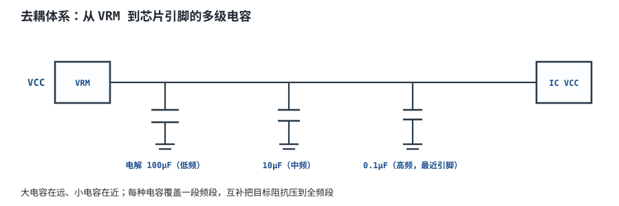
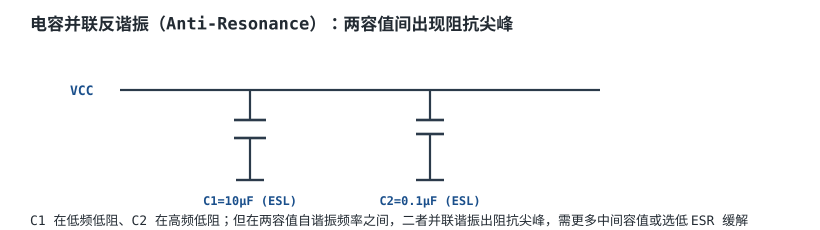
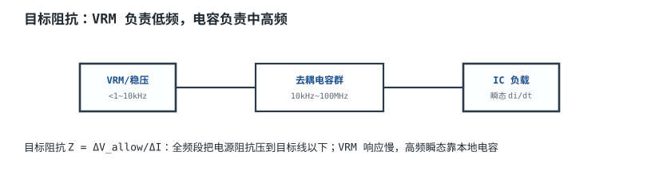

# 电源完整性与去耦体系 Power Integrity & Decoupling

一颗 1.2V/10A 的 FPGA 内核，在 10ns 内从 5A 跳到 10A。若电源分配网络（PDN）的等效电感是 2nH，瞬态压降是 $L\,di/dt=2\text{nH}\times5\text{A}/10\text{ns}=1\text{V}$——内核的 1.2V 直接掉到 0.2V，逻辑必然出错。稳压电源（VRM）再快，也来不及在 10ns 内把电流从远端送过来；真正先顶上的是芯片旁边和封装内的电容。**去耦不是“多放几颗电容”，而是从 VRM 到芯片引脚，在关心的频段内把阻抗压在目标值以下。**

这一章先用目标阻抗 $Z_{target}=\Delta V/\Delta I$ 定预算，再拆开 ESL、ESR、平面和过孔的影响，最后用一个 1.2V/10A 的 FPGA 核心电源做完整的 PDN 阻抗预算。结论会有些反直觉：**多放电容不一定更好，容值搭配不当会产生反谐振峰；电容的安装电感常常比电容本身的 ESL 更大；板级 PDN 只能管到封装引脚，更快的瞬态要靠封装/片上电容。**

## 1. 设计动机

::: motivation 三个真实的掉压现场
**现场一：只靠 VRM。** 某 FPGA 核心电源的 VRM 带宽约 100kHz，负载在 1µs 内跳 5A。VRM 的环路还没有反应过来，输出电容先被抽走电荷；如果板上只有一颗远端 470µF，走线电感 5nH，瞬态压降会被 $L\,di/dt$ 和电容 ESR 共同放大，芯片可能直接复位。**VRM 负责低频，电容负责中高频，两者不能互相替代。**

**现场二：电容离引脚 5mm。** 0.1µF 电容本身的 ESL 只有 0.4nH，但走线/过孔又加了 2nH，总电感变成 2.4nH；自谐振频率从 25MHz 掉到 10MHz，50MHz 处的单颗阻抗从 0.13Ω 升到 0.75Ω。60 颗并联后，高频阻抗可能从 2mΩ 升到 12mΩ 以上，目标阻抗刚好被吃掉。**布局不是“最后再优化”，它直接决定电容有没有用。**

**现场三：为了“更稳”加了一排 0.01µF。** 新加的电容在低频看是电容，但在它与 1µF/0.1µF 之间可能形成新的并联谐振；如果 ESR 很低，尖峰可能高过目标阻抗。加电容后没有重新扫频，纹波反而变大，EMI 也变差。**“更多电容”只有在位置、感值和阻尼都合适时才是改善。**
:::

PDN 的设计对象不是单个电容，而是**从 VRM 输出端到芯片电源/地引脚的全部导体**：VRM、体电容、陶瓷电容、电源平面、地平面、过孔、封装、片上电容。它的频域阻抗 $Z_{PDN}(f)$ 决定了给定电流频谱下的电压波动：

$$
\Delta V(f)=Z_{PDN}(f)\Delta I(f)
$$

若希望任意瞬态下压降不超过 $\Delta V_{allow}$，就要在关心的频段内满足 $|Z_{PDN}(f)|\le Z_{target}$。这就是“目标阻抗”的全部含义，也是后面所有计算的起点。

## 2. 定义与直观

**电源分配网络（Power Distribution Network, PDN）**是把稳压器输出的电能，以足够低的阻抗送到芯片电源/地引脚的整个无源网络。它既包括“送电”的路径，也包括“回流”的路径；只盯着电源走线、忽略地回流，是 PDN 设计最常见的错误。

**目标阻抗（Target Impedance）**是允许的 PDN 最大阻抗：

$$
Z_{target}=\frac{\Delta V_{allow}}{\Delta I_{max}}
$$

其中 $\Delta V_{allow}$ 是允许的电压偏差，V；$\Delta I_{max}$ 是最大瞬态电流变化，A；$Z_{target}$ 是目标阻抗，$\Omega$。这个式子的适用条件是：把 PDN 看成线性时不变网络，电流频谱已知或按最坏阶跃估算；它不给相位信息，也不区分 VRM 和电容的分工，所以后面还要按频段拆开。

用一只水箱做类比：VRM 是进水管，电容是分布在各处的小水箱，走线/过孔是细管。用水突然变大时，远处进水管来不及补水，最近的小水箱先出水；细管越细越长（电感越大），小水箱的水就越难瞬间送到。类比的边界是：电容储的是电荷，不是水；电容的电压不能突变，但电流可以；而且电容在高频会变成“电感”，不是一直越低阻抗越好。

PDN 通常按频段分工：

| 频段 | 主要角色 | 关键限制 |
|---|---|---|
| DC~几十 kHz | VRM 闭环、体电容 | 环路带宽、输出电容储能、ESR |
| 几十 kHz~几 MHz | 10µF~100µF 陶瓷/聚合物 | 电容容值、ESR、安装电感 |
| 几 MHz~几十 MHz | 0.1µF~1µF 陶瓷、平面 | ESL、过孔、平面 spreading inductance |
| 几十 MHz 以上 | 封装电容、片上电容 | 封装/芯片内部，板级 PDN 很难管到 |

这张表是“分工图”，不是“容值对应频率”的死规则。相同封装的 0.1µF 和 1µF，ESL 接近时自谐振频率只差 $\sqrt{10}\approx3.16$ 倍；真正决定高频阻抗的是**并联后的等效 ESL**，不是容值本身。

## 3. 定量关系

### 3.1 目标阻抗与瞬态电流

目标阻抗由允许压降和瞬态电流定义：

$$
Z_{target}=\frac{\Delta V_{allow}}{\Delta I}
$$

对 1.2V 核心、允许 ±5%、瞬态电流 5A：

$$
\Delta V_{allow}=1.2\times0.05=0.060\ \text{V}
$$

$$
Z_{target}=\frac{0.060}{5}=0.012\ \Omega=12\ \text{m}\Omega
$$

如果负载是满幅 10A 阶跃，同样的 60mV 允许值给出：

$$
Z_{target}=\frac{0.060}{10}=0.006\ \Omega=6\ \text{m}\Omega
$$

**同一个电源，瞬态电流假设不同，目标阻抗会差一倍。** 设计前必须明确“多大电流、在多长时间内跳变”，不能只写“10A 电源，所以按 10A 算”。本例按 50% 阶跃（5A）设计，并在 5.1 节说明满幅阶跃的后果。

### 3.2 电容阻抗、自谐振与 ESL

真实电容是“电容 + 串联电阻 ESR + 串联电感 ESL”：

$$
Z_C(f)=R_{ESR}+j\left(2\pi fL_{ESL}-\frac{1}{2\pi fC}\right)
$$

阻抗模：

$$
|Z_C(f)|=\sqrt{R_{ESR}^2+\left(2\pi fL_{ESL}-\frac{1}{2\pi fC}\right)^2}
$$

自谐振频率（Self-Resonant Frequency, SRF）是感抗与容抗相等、虚部为零的频率：

$$
f_{SR}=\frac{1}{2\pi\sqrt{L_{ESL}C}}
$$

以 0.1µF、总电感 0.8nH（含封装、焊盘、过孔）为例：

$$
f_{SR}=\frac{1}{2\pi\sqrt{0.8\times10^{-9}\times0.1\times10^{-6}}}
=\frac{1}{2\pi\times8.944\times10^{-9}}=17.79\ \text{MHz}
$$

低于 17.79MHz 呈容性，高于它呈感性。**“高于 SRF 就失效”是错的**：它仍然是一个电感，仍然给高频电流提供低阻通路；只是阻抗随频率上升，需要靠更多并联电容降低等效 ESL。真正的失效是“安装电感太大，导致 SRF 过低、在目标频段内阻抗压不下来”。一些资料把 SRF 以上说成“变成电感、失去去耦作用”，这个说法不准确；准确的说法是“去耦能力下降，但仍在并联网络中提供低感通路”。

若把总电感从 0.8nH 加到 2.8nH（例如电容离引脚 5mm，走线/过孔多 2nH）：

$$
f_{SR}=\frac{1}{2\pi\sqrt{2.8\times10^{-9}\times0.1\times10^{-6}}}=9.51\ \text{MHz}
$$

在 50MHz，单颗阻抗近似为 $2\pi fL=2\pi\times50\times10^6\times2.8\times10^{-9}=0.880\ \Omega$；60 颗并联约 $0.880/60=14.7\ \text{m}\Omega$，已经超过 12mΩ 的目标。**同样的电容，位置差 5mm，PDN 就可能从达标变成不达标。**

### 3.3 并联、反谐振与“多放不一定更好”

多颗相同电容并联，等效为：

$$
C_{eq}=NC,\qquad L_{eq}=\frac{L}{N},\qquad R_{eq}=\frac{R}{N}
$$

容值、ESL、ESR 都按 $1/N$ 缩放，所以 SRF 不变，阻抗整体降低。**同一型号、同一位置的多颗并联，通常是改善。**

问题出在不同容值/不同安装电感的组合。设大电容支路在某个频率已呈感性 $L_1$，小电容支路仍呈容性 $C_2$，两者并联会在：

$$
f_{ar}\approx\frac{1}{2\pi\sqrt{L_1C_2}}
$$

附近发生**并联反谐振（Anti-Resonance）**。在谐振点，两支路的电抗互相抵消，只剩 ESR，阻抗出现尖峰。用两支路近似，尖峰阻抗：

$$
Z_{peak}\approx\frac{(2\pi f_{ar}L_1)^2}{R_1+R_2}
$$

其中 $L_1$ 是大电容支路的等效 ESL，$C_2$ 是小电容支路的总容值，$R_1$、$R_2$ 是两支路的等效 ESR。这个式子是量级估算，真实网络有多个支路，尖峰会被其他支路阻尼；最终要用完整并联阻抗扫频或实测。

从式子里能读出三件事：

1. **ESR 不是越低越好。** 在反谐振点，ESR 是唯一的阻尼；ESR 太小，尖峰越高。低 ESR 电容在低频是优点，在反谐振点可能变成缺点。
2. **容值不是越多越好。** 加一组新容值，可能把原来的反谐振点“打散”，也可能在另一个频率制造新的尖峰；必须重新扫频。
3. **安装电感决定尖峰位置。** 同样的 0.1µF，放在 1mm 和 5mm 外，等效 ESL 不同，反谐振频率和峰值都会变。

### 3.4 平面与过孔的电感

过孔不是“理想连接”。一条直径 $d$、长度 $h$ 的过孔，近似电感：

$$
L_{via}\approx\frac{\mu_0h}{2\pi}\left[\ln\left(\frac{4h}{d}\right)+1\right]
$$

其中 $\mu_0=4\pi\times10^{-7}\ \text{H/m}$；$h$ 是过孔长度，m；$d$ 是过孔直径，m；$L_{via}$ 是 H。以 $h=1\ \text{mm}$、$d=0.3\ \text{mm}$ 为例：

$$
L_{via}\approx\frac{4\pi\times10^{-7}\times10^{-3}}{2\pi}
\left[\ln\left(\frac{4\times10^{-3}}{0.3\times10^{-3}}\right)+1\right]
$$

$$
=2\times10^{-10}\times[\ln(13.33)+1]
=2\times10^{-10}\times3.590=7.18\times10^{-10}\ \text{H}=0.718\ \text{nH}
$$

一颗电容通常要两个过孔（电源、地），并联后约 0.36nH；考虑过孔之间的互感，实际按 0.5nH 量级估算更稳。再加上电容封装 ESL 0.3~0.5nH，总电感很容易到 0.8~1.0nH。**过孔和焊盘不是“免费”的，它们经常是去耦支路里最大的电感。**

平面本身也有 spreading inductance。薄介质、宽平面的电感低；把电源/地平面紧靠在一起，可以降低平面间的回路电感，并形成一点平面电容。但平面电容的量级很小：4 层板、100mm×80mm、介质 0.1mm、$\varepsilon_r=4.2$：

$$
C_{plane}=\frac{\varepsilon_0\varepsilon_rA}{d}
=\frac{8.854\times10^{-12}\times4.2\times0.008}{0.0001}
=2.98\times10^{-9}\ \text{F}=2.98\ \text{nF}
$$

在 100MHz，它的阻抗：

$$
|Z_{plane}|=\frac{1}{2\pi fC}
=\frac{1}{2\pi\times100\times10^6\times2.98\times10^{-9}}=0.534\ \Omega
$$

相对 12mΩ 的目标，这个平面电容几乎可以忽略。**平面电容不是去耦电容的替代品；它的价值主要在低电感回流和屏蔽，不在提供大电荷。**

### 3.5 体电容、VRM 与电荷守恒

VRM 的环路带宽有限，典型在几十 kHz 到几百 kHz 量级（具体取决于拓扑、输出电容和补偿）。一些资料写“VRM 带宽 ~kHz 级”，对现代 VRM 偏保守；实际以环路实测为准，不能用一句“VRM 慢”代替频域分析。在 VRM 来得及调整之前，负载阶跃所需的电荷由输出电容提供：

$$
C_{bulk}\ge\frac{\Delta I\Delta t}{\Delta V_{allow}}
$$

其中 $\Delta I$ 是负载阶跃，A；$\Delta t$ 是 VRM 响应时间，s；$\Delta V_{allow}$ 是允许压降，V。以 5A、2µs、60mV 为例：

$$
C_{bulk}\ge\frac{5\times2\times10^{-6}}{0.060}=1.67\times10^{-4}\ \text{F}=167\ \mu\text{F}
$$

这只是“电荷够不够”，没有算 ESR 和 ESL。实际选 2×470µF（940µF）是为了同时满足电荷、ESR 纹波和环路稳定性；如果只看 167µF，可能会选出一颗 ESR 太大或 ESL 太高的电容。

### 3.6 监测带宽与“板级 PDN 的边界”

PDN 的目标阻抗通常在 100kHz~50MHz 或 100MHz 内定义。低于 VRM 穿越频率，由 VRM 闭环输出阻抗决定；高于板级有效带宽，由封装/片上电容决定。**板级仿真做到 100MHz 并不等于芯片内部 100MHz 的瞬态也被管住了。** 芯片内部的开关电流最先由片上电容和封装电容提供，板级电容要通过封装电感才能到达；封装电感通常远大于板级电容的 ESL，所以板级 PDN 对极快瞬态的帮助有限。

工程上要把“板级 PDN 目标”和“芯片/封装要求”分开：板级保证到封装引脚，封装/芯片保证到晶体管。若芯片数据手册给出 PDN 目标曲线，以它的频段和测试条件为准，不能拿板级 12mΩ 直接覆盖芯片内部要求。

## 4. 典型计算

### 4.1 需求与目标阻抗

**需求**：

| 项目 | 取值 |
|---|---|
| 核心电压 | 1.2V |
| 最大负载 | 10A |
| 允许偏差 | ±5%（60mV） |
| 瞬态假设 | 50% 阶跃，5A |
| 分析频段 | 100kHz~50MHz |
| VRM | 2 相，开关频率 500kHz，环路穿越约 100kHz |
| 封装/芯片 | 封装电容和片上电容另计，板级只保证到封装引脚 |

目标阻抗：

$$
Z_{target}=\frac{0.060}{5}=0.012\ \Omega=12\ \text{m}\Omega
$$

若按满幅 10A 阶跃，目标变为 6mΩ；本设计不满足，5.1 节会给出补救方向。

### 4.2 电容组合与等效参数

选择四组电容，全部按“总支路电感含封装、焊盘、过孔”估算。下表的 L/ESR 是典型量级，不是某一型号的保证值；实际以所选电容的数据手册和 PCB 布局为准。

| 组 | 单颗容值 | 数量 | 封装 | 单颗总电感 | 单颗 ESR | 组容值 | 组等效电感 | 组等效 ESR | 组 SRF |
|---|---|---|---|---|---|---|---|---|---|
| 体电容 | 470µF | 2 | 聚合物 | 5.0nH | 10mΩ | 940µF | 2.5nH | 5.0mΩ | 103.8kHz |
| 中频 | 10µF | 20 | 0805 | 1.2nH | 2mΩ | 200µF | 0.060nH | 0.10mΩ | 1.453MHz |
| 桥接 | 1µF | 10 | 0603 | 0.9nH | 15mΩ | 10µF | 0.090nH | 1.50mΩ | 5.305MHz |
| 高频 | 0.1µF | 60 | 0402 | 0.8nH | 5mΩ | 6µF | 0.0133nH | 0.083mΩ | 17.79MHz |

总数 $2+20+10+60=92$ 颗，四种容值。为什么要 60 颗 0.1µF？因为高频阻抗由并联 ESL 决定：60 颗的等效 ESL 是 $0.8/60=0.0133\ \text{nH}$，在 50MHz 的感抗约 $2\pi\times50\times10^6\times0.0133\times10^{-9}=4.18\ \text{m}\Omega$，低于 12mΩ。若只放 20 颗，等效 ESL 是 0.04nH，50MHz 感抗 12.6mΩ，已经超过目标。

### 4.3 反谐振估算

先算 10µF 组与 1µF 组之间的反谐振。10µF 组等效 $L_1=0.060\ \text{nH}$，1µF 组总容值 $C_2=10\ \mu\text{F}$：

$$
f_{ar1}=\frac{1}{2\pi\sqrt{0.060\times10^{-9}\times10\times10^{-6}}}
=\frac{1}{2\pi\times2.449\times10^{-8}}=6.50\ \text{MHz}
$$

$$
X_1=2\pi f_{ar1}L_1
=2\pi\times6.50\times10^6\times0.060\times10^{-9}=2.45\ \text{m}\Omega
$$

$$
Z_{peak1}\approx\frac{X_1^2}{R_1+R_2}
=\frac{(2.45\times10^{-3})^2}{0.10\times10^{-3}+1.50\times10^{-3}}
=\frac{6.00\times10^{-6}}{1.60\times10^{-3}}=3.75\ \text{m}\Omega
$$

再算 1µF 组与 0.1µF 组。$L_1=0.090\ \text{nH}$，$C_2=6\ \mu\text{F}$：

$$
f_{ar2}=\frac{1}{2\pi\sqrt{0.090\times10^{-9}\times6\times10^{-6}}}
=\frac{1}{2\pi\times2.324\times10^{-8}}=6.85\ \text{MHz}
$$

$$
X_2=2\pi\times6.85\times10^6\times0.090\times10^{-9}=3.87\ \text{m}\Omega
$$

$$
Z_{peak2}\approx\frac{X_2^2}{1.50\times10^{-3}+0.083\times10^{-3}}
=\frac{14.98\times10^{-6}}{1.583\times10^{-3}}=9.46\ \text{m}\Omega
$$

两两估算的 9.46mΩ 已经接近 12mΩ，但完整网络还有其他支路阻尼。把四组电容按复阻抗并联，逐点扫频：

$$
Y_{PDN}(f)=\sum_i\frac{N_i}{R_i+j\left(2\pi fL_i-\frac{1}{2\pi fC_i}\right)},
\qquad Z_{PDN}(f)=\frac{1}{Y_{PDN}(f)}
$$

扫频结果（100kHz~50MHz）：

| 频率 | $|Z_{PDN}|$ | 说明 |
|---|---|---|
| 100kHz | 4.06mΩ | 体电容/10µF 组主导，低于目标 |
| 1MHz | 0.42mΩ | 多组并联，阻抗谷 |
| 10MHz | 7.94mΩ | 接近反谐振峰 |
| 9.75MHz | 8.43mΩ | 全频段最坏点 |
| 50MHz | 2.75mΩ | 0.1µF 组并联 ESL 主导 |

最坏点 8.43mΩ，低于 12mΩ，余量约 30%。注意：两两估算的 9.46mΩ 比完整扫频的 8.43mΩ 更保守，这是正常的，因为多个支路在谐振点互相阻尼；**做设计时可以用两两估算做快速筛查，但最终必须用完整并联扫频或实测确认。**

### 4.4 缺少桥接电容会怎样

如果把 10 颗 1µF 拿掉，只剩体电容、10µF 和 0.1µF，扫频最坏点变成：

| 项目 | 有 1µF 桥接 | 无 1µF 桥接 |
|---|---|---|
| 最坏频率 | 9.75MHz | 7.68MHz |
| 最坏阻抗 | 8.43mΩ | 42.1mΩ |
| 是否满足 12mΩ | 是 | 否 |

原因不是“少了一点电容”，而是 10µF 组和 0.1µF 组之间缺少中间容值，反谐振峰没有被阻尼。**1µF 组在这里不是“可有可无的备胎”，而是把两个反谐振点拆开、提供阻尼的功能件。** 这也解释了为什么不能把 BOM 里的 1µF 全部换成 0.1µF 来“统一物料”。

### 4.5 加 0.01µF 反而更差

假设为了改善 50MHz 以上的阻抗，再并 20 颗 0.01µF/0201，单颗总电感按 1nH 估算（组等效 0.05nH，组容值 0.2µF，组 ESR 0.5mΩ）。重新扫频：

| 项目 | 基准（92 颗） | 加 20 颗 0.01µF（112 颗） |
|---|---|---|
| 最坏频率 | 9.75MHz | 46.4MHz |
| 最坏阻抗 | 8.43mΩ | 11.60mΩ |
| 12mΩ 余量 | 30% | 3.3% |

加了 20 颗电容，最坏阻抗反而从 8.43mΩ 升到 11.60mΩ。原因不是 0.01µF 本身“有害”，而是它在 10µF/1µF/0.1µF 之间引入了新的并联谐振路径；0.01µF 的 ESR 很低，阻尼不足，尖峰被抬高。**这就是“多放电容不一定更好”的定量例子：电容数量增加，但反谐振峰的位置和阻尼变了。** 一些资料把“并联越多阻抗越低”整体当成误区，这个表述太笼统：同一型号、同一位置的多颗并联通常会降低阻抗；真正的问题是不同容值/不同安装电感组合出的反谐振，以及低 ESR 让尖峰更高。如果这 20 颗再放远一点、安装电感更大，尖峰会更高；如果非要加，应该重新扫频、调整容值/ESR，或者把 0.01µF 放到封装内由芯片厂保证。

### 4.6 体电容与 VRM 的核算

按 5A、2µs、60mV 算，所需体电容至少 167µF；本例用 940µF，储能：

$$
E=\frac{1}{2}C V^2=\frac{1}{2}\times940\times10^{-6}\times1.2^2=6.77\times10^{-4}\ \text{J}=0.677\ \text{mJ}
$$

这个能量看起来很小，但对 1.2V 核心的 5A/2µs 瞬态，电荷量：

$$
Q=\Delta I\Delta t=5\times2\times10^{-6}=10\ \mu\text{C}
$$

从 940µF 上抽走 10µC，电压变化：

$$
\Delta V=\frac{Q}{C}=\frac{10\times10^{-6}}{940\times10^{-6}}=10.6\ \text{mV}
$$

远小于 60mV。**体电容的容值不是瓶颈，ESR/ESL 和 VRM 环路才是。** 如果体电容 ESR 是 20mΩ，5A 瞬态在 ESR 上就有 100mV，直接超过预算；所以体电容要选低 ESR 的聚合物/电解组合，并按纹波电流校核发热。

### 4.7 过孔与布局的敏感度

仍以 0.1µF 为例：

- 一颗电容用两个 1mm 过孔，单孔 0.718nH，并联 0.359nH；加封装 0.4nH，总约 0.76nH，SRF 约 18.3MHz。
- 只用一个大过孔或过孔很远，总电感 1.5nH，SRF 约 13.0MHz；50MHz 单颗阻抗 $2\pi\times50M\times1.5n=0.471\Omega$，60 颗并联 7.85mΩ，仍低于 12mΩ，但余量明显变小。
- 电容离引脚 5mm，总电感 2.8nH，50MHz 单颗 0.880Ω，60 颗并联 14.7mΩ，超过目标。

**结论：0.1µF 的容值不是关键，0.8nH 还是 2.8nH 才是关键。** 布局时优先缩短“电容—过孔—平面”的回路，而不是盲目加容值。

## 5. 工程含义

### 5.1 满幅 10A 阶跃的后果

本例按 5A 阶跃设计，目标 12mΩ。如果芯片要求满幅 10A 阶跃、压降仍不超过 60mV，目标就是 6mΩ；当前 8.43mΩ 不满足。补救方向：

1. 把 0.1µF 从 60 颗加到 100 颗以上，降低高频等效 ESL；但这会增加 BOM、布局面积和反谐振风险。
2. 降低安装电感：每个电容两个过孔、过孔尽量近、用 0201/0402 小封装、把电容放到芯片背面正下方。
3. 放宽允许压降，或让芯片厂用封装/片上电容补足。
4. 提高 VRM 带宽/增加相数，让 VRM 更早接管，但受环路稳定性限制。

**不能只说“加电容”：先看目标阻抗是否合理，再看频段，再看安装电感。** 如果目标定得比封装/板上限还低，堆电容也达不到。

### 5.2 电容选型与介质

| 类型 | 优点 | 缺点 | 适用 |
|---|---|---|---|
| X5R/X7R MLCC | 低 ESR/ESL，体积小 | DC bias 下降容，机械应力开裂 | 中高频去耦主力 |
| 聚合物/钽 | 容量大，ESR 较低 | 成本、浪涌/失效模式 | 体电容、低频 |
| 铝电解 | 容量大、便宜 | ESR/ESL 大，寿命受温度 | 板级 bulk，需降额 |
| Y5V | 容量密度高、便宜 | 温漂/DC bias 下容量暴跌 | 不推荐用于去耦 |
| 安规 Y 电容 | 跨隔离屏障 | 漏电流限制 | EMI 滤波，见[反激 Flyback 等隔离电源简介](flyback.md) |

陶瓷电容的 DC bias 效应必须按实际工作电压查曲线。0.1µF/6.3V X5R 在 3.3V 下可能只剩 50%~70%，Y5V 可能只剩很小一部分；本例 1.2V 偏置较轻，但仍建议按 -20%~-30% 容值复核。温度、老化、焊接应力也会改变实际容值，不能只看铭牌。一些资料把 0.1µF 说成“万金油、每电源引脚必放”，这只能当经验起点；实际容值/数量由目标阻抗、封装、安装电感和频段决定，不是固定配方。

### 5.3 平面、过孔与布局

- **完整地平面**：去耦回路由电源过孔、电容、地过孔、地平面组成；地平面开槽会迫使回流绕远，环路电感增大。不要在去耦电容下方开槽或分割。
- **过孔就近**：每个电容至少两个过孔，电源/地各一；过孔尽量靠近焊盘，回路面积最小。能用过孔-in-pad 的工艺时，优先考虑。
- **小电容近、大电容远**：0.1µF/1µF 放在芯片电源引脚附近，10µF/体电容可以稍远；但“远”不等于“随便放”，仍要控制回路。
- **平面紧耦合**：电源平面和地平面尽量靠近，降低 spreading inductance；薄介质还能提供一点平面电容，但不要指望它替代电容。
- **避免长走线**：从平面到电容的走线越短越好；走线电感按 0.2~0.5nH/mm 量级估算，5mm 就是 1~2.5nH，足以毁掉高频去耦。

去耦回路的接地/回流与地弹，见[地的学问与地弹](grounding.md)；负载开关、eFuse 和热插拔的软启动/电流检测，见[电源监控、POR 与负载开关](power-monitoring-loadswitch.md)；隔离电源的 Y 电容与输出纹波，见[反激 Flyback 等隔离电源简介](flyback.md)。低压 PDN 本身不直接决定人身安全，但 PE/保护接地的边界仍按[安全用电与触电防护](../basics/electrical-safety.md)执行，不能把信号地当保护地。

### 5.4 测量与验证

PDN 阻抗不能用普通万用表测。常用方法：

1. **VNA 双端口/单端口测量**：用同轴探针在电容两端或芯片电源/地引脚测量，校准到探针端面；看全频段阻抗和反谐振峰。
2. **2-port shunt-through**：适合毫欧级阻抗，能测量电容和平面；要注意探针接地环路。
3. **时域负载阶跃**：用快速 MOSFET/电子负载拉电流，测芯片引脚的电压跌落；验证目标阻抗是否转化为实际压降。
4. **近场扫描**：看 PDN 的电磁辐射热点，辅助定位反谐振/布局问题。

测量时要注意：探头地线越长，测到的“阻抗”越像探头环路电感；校准面、夹具、过孔都会影响结果。**仿真的 8.43mΩ 和实测的 8.43mΩ 不是一回事，必须留测量不确定度和生产公差。**

## 6. 常见坑

::: pitfall 常见坑
- **只算容值，不算 ESL/安装电感**：现象——电容数量不少，芯片满载仍掉压/复位。原因——0.1µF 的 ESL 只有 0.4nH，但走线+过孔加到 2.8nH，SRF 从 25MHz 掉到 9.5MHz，50MHz 阻抗升高。解决——按总环路电感算 SRF，每个电容两个过孔、就近放置，优先降低安装电感。
- **容值搭配不当，反谐振峰超目标**：现象——某些频段纹波/EMI 反而变大，扫频看到尖峰。原因——10µF 组和 0.1µF 组之间缺少 1µF 桥接，反谐振峰可达 42mΩ；加 0.01µF 又可能引入 11.6mΩ 的新峰。解决——用完整并联扫频找最坏点，保留桥接容值，必要时调整 ESR/容值，不要只看单颗电容。
- **以为“多放电容一定更低”**：现象——加了一排电容，最坏阻抗反而上升。原因——新容值引入了新的并联谐振，低 ESR 使尖峰更高；本例加 20 颗 0.01µF 后最坏点从 8.43mΩ 升到 11.60mΩ。解决——每改一次 BOM/布局就重扫频，按目标频段而不是按“数量”验收。
- **用 Y5V/高 bias 陶瓷，标称容值虚高**：现象——BOM 写 0.1µF，实际工作电压下只剩几 nF，高频去耦不足。原因——Y5V/高介电常数材料在 DC bias、温度下容量大幅下降。解决——选 X5R/X7R，按实际偏置查容量曲线，留 20%~30% 余量。
- **地平面开槽/分割，回流绕远**：现象——去耦电容就在旁边，效果却很差，EMI 变坏。原因——去耦回路的回流被槽逼着绕远，环路电感增大；地平面不完整还会让信号回流跨分割。解决——保持地平面完整，电容地端就近打过孔，不在去耦回路下方开槽；模拟/数字分区见[地的学问与地弹](grounding.md)。
- **把 VRM 带宽当成 kHz 级，或反过来只靠 VRM**：现象——瞬态掉压、环路振荡，或加了大量电容仍不稳。原因——现代 VRM 带宽可在几十 kHz 到几百 kHz，具体取决于拓扑和补偿；低频靠 VRM，高频靠电容，两者分工不清。解决——按 VRM 实际环路带宽划分频段，做负载阶跃实测，不要用一句“VRM 慢”代替频域分析。
:::

## 7. 自测题

1.2V 核心、允许 ±5%、瞬态电流 5A。目标阻抗是多少？若满幅 10A 阶跃呢？

允许压降：

$$
\Delta V=1.2\times0.05=0.060\ \text{V}
$$

5A 阶跃：

$$
Z_{target}=\frac{0.060}{5}=0.012\ \Omega=12\ \text{m}\Omega
$$

10A 阶跃：

$$
Z_{target}=\frac{0.060}{10}=0.006\ \Omega=6\ \text{m}\Omega
$$

同一个电源，瞬态电流假设不同，目标阻抗差一倍；必须先明确“多大电流、多长时间”。

0.1µF 电容，总电感 0.8nH，自谐振频率是多少？若安装电感增加到 2.8nH 呢？

0.8nH：

$$
f_{SR}=\frac{1}{2\pi\sqrt{0.8\times10^{-9}\times0.1\times10^{-6}}}=17.79\ \text{MHz}
$$

2.8nH：

$$
f_{SR}=\frac{1}{2\pi\sqrt{2.8\times10^{-9}\times0.1\times10^{-6}}}=9.51\ \text{MHz}
$$

电感增加 3.5 倍，SRF 降低到约 $1/\sqrt{3.5}=0.535$ 倍。高频阻抗随 ESL 线性上升，这就是布局比容值更关键的原因。

什么是并联反谐振？为什么“多放电容”可能让某个频段的阻抗更高？

不同容值的电容并联，在两者的 SRF 之间，大电容已呈感性、小电容仍呈容性，两支路在 $f_{ar}\approx1/(2\pi\sqrt{L_1C_2})$ 附近发生并联谐振。谐振点电抗抵消，只剩 ESR，阻抗出现尖峰。ESR 越小，阻尼越弱，尖峰越高；新增容值可能引入新的谐振路径，所以加电容后最坏阻抗可能上升。本例加 20 颗 0.01µF 后，最坏点从 8.43mΩ 升到 11.60mΩ。

5A 阶跃、VRM 响应 2µs、允许压降 60mV，体电容至少需要多少？为什么本例用了 940µF？

$$
C_{bulk}\ge\frac{\Delta I\Delta t}{\Delta V}
=\frac{5\times2\times10^{-6}}{0.060}=1.67\times10^{-4}\ \text{F}=167\ \mu\text{F}
$$

本例用 940µF，是为了同时满足 ESR 纹波、环路稳定和降额；光看 167µF 可能选到 ESR 太大的电容。5A 在 20mΩ ESR 上就产生 100mV，已经超过 60mV 预算，所以 ESR 往往比容值更先成为瓶颈。

四层板、100mm×80mm、介质 0.1mm、εr=4.2，平面电容是多少？100MHz 时阻抗多少？它能替代去耦电容吗？

$$
C_{plane}=\frac{8.854\times10^{-12}\times4.2\times0.008}{0.0001}=2.98\ \text{nF}
$$

$$
|Z_{plane}|=\frac{1}{2\pi\times100\times10^6\times2.98\times10^{-9}}=0.534\ \Omega
$$

相对 12mΩ 的目标，0.534Ω 几乎可以忽略。平面电容不能替代去耦电容；它的主要价值是低电感回流和屏蔽。

本案最坏反谐振点是多少？如果拿掉 10 颗 1µF，会变成多少？说明了什么？

完整四组并联扫频，最坏点 8.43mΩ @9.75MHz，低于 12mΩ。拿掉 1µF 桥接后，最坏点变为 42.1mΩ @7.68MHz，远超目标。说明 1µF 组不是“可有可无的备胎”，而是把 10µF 与 0.1µF 之间的反谐振峰拆开、提供阻尼的功能件；PDN 设计要按频段和阻尼看，不能只按容值总量看。

## 8. 参考资料

- **Henry W. Ott, *Electromagnetic Compatibility Engineering***：Chapter 11 “Digital Circuit Power Distribution” 讲目标阻抗、去耦电容、电源平面与地回流；本章 3.1~3.4 的 PDN 口径参考该章。
- **Howard Johnson & Martin Graham, *High Speed Digital Design***：Power Systems 一章讲安装电感、平面、过孔和高速数字电源分配；本章 3.4、5.3 的过孔/布局量级参考该章。
- **Larry D. Smith & Raymond E. Anderson, “Power Distribution System Design Methodology and Capacitor Selection for Modern CMOS Technology”, *IEEE Transactions on Advanced Packaging*, 1999**：目标阻抗、电容组合与反谐振的经典工程论文；本章 3.2、3.3、4.3 的方法论参考该文。
- **onsemi, AND8301-D *EMC Specifications and PCB Guidelines for SMPS Devices***：去耦电容布置、地平面、功率回路与开槽的影响；本章 5.3 的布局建议与该应用笔记一致。
- **Istvan Novak, *Power Distribution Network Design Methodologies***：实际电容的 ESR/ESL、反谐振、平面测量与 PDN 频域方法；本章 3.5、5.4 的测量口径参考该书。
- **Murata/TDK/AVX 等 MLCC 数据手册**：具体型号的 ESL、ESR、DC bias 与温度特性；本章的 0.8nH、5mΩ 等是典型量级，实际以所选型号的数据手册为准。
