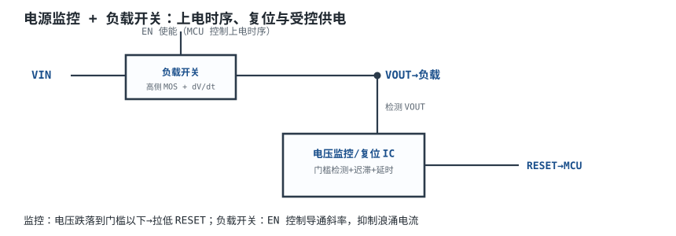
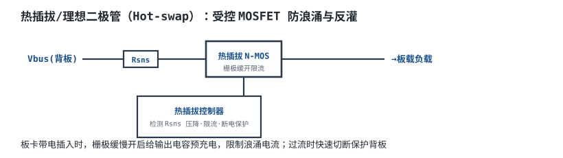
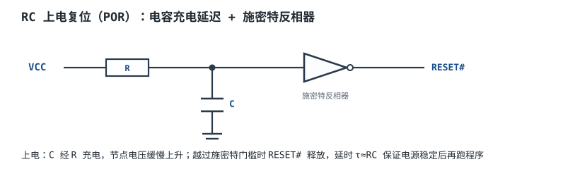

# 电源监控、POR 与负载开关 Supervisors, POR & Load Switches

电源稳了还不够。系统还要回答三个问题：**电压是否在正常范围**（掉了要复位 MCU）、**上电时序是否正确**（电源没稳不能跑程序）、**负载是否受控地上电**（大电容直接接上去会拉出几十安浪涌）。这三件事分别对应电源监控/复位（Supervisor/POR）、负载开关（Load Switch）和 eFuse/热插拔控制器（Hot-Swap Controller）。

这一章的重点不是“认识几个芯片”，而是把电流检测、软启动、浪涌限制、SOA 和故障分断能量算清楚。最后用一个 12V/5A 热插拔设计，选 eFuse、分流电阻和软启动时间，并核对故障时的能量。

## 1. 设计动机

::: motivation 三个上电现场
**场景一：1000µF 负载直接插上 12V。** 插头接触瞬间，输出电容相当于短路，浪涌电流只由回路电阻限制。若回路总电阻是 0.1Ω（连接器+线缆+电容 ESR），峰值电流 $12/0.1=120A$；即使有 0.2Ω，也有 60A。电源可能限流、连接器可能拉弧、eFuse 可能直接进入保护。**没有软启动，热插拔就是一次小短路。**

**场景二：eFuse 选了，但没算 SOA。** 有人看 eFuse 标称 5A，就直接带 1000µF 负载上电。软启动期间 eFuse 的 MOSFET 工作在线性区，电流被限在 2A，管压降从 12V 降到 0，平均耗散可能十几瓦；数据手册的 SOA 曲线如果不支持这个功率/时间，MOSFET 会过热损坏。**eFuse 的“额定电流”不等于“任何浪涌都能扛”。**

**场景三：只装 eFuse，不装保险丝。** eFuse 是半导体，失效模式可能是短路。若下游短路而 eFuse 击穿，故障能量没有后备熔断器吸收，可能烧板/起火。**eFuse 是“可控开关+保护”，不是“物理熔断器”的替代品；安全链路要有后备保护。**
:::

本章涉及三类容易混淆的器件：

| 器件 | 主要功能 | 是否限流 | 典型场景 |
|---|---|---|---|
| 负载开关（Load Switch） | 受控导通/关断，软启动 | 通常不限流，只限制 $dV/dt$ | 外设电源、USB 端口、模块上下电 |
| eFuse | 集成 MOSFET + 限流 + 热保护 + 故障指示 | 是，可编程 | 12V/5A 板卡、热插拔、工业背板 |
| 热插拔控制器（Hot-Swap Controller） | 控制外部 MOSFET，做限流/SOA/故障保护 | 是，外部 MOSFET 决定SOA | 更高功率、更大电流、需要外部 MOSFET 散热 |

电源监控/复位（Supervisor/POR）则是另一条线：它监测电压、产生复位、保证 MCU 在电源稳定前不跑程序。它和负载开关经常一起出现，但目标不同：**监控管“什么时候允许运行”，负载开关管“什么时候允许上电”。**

## 2. 定义与直观

### 2.1 电源监控、POR 与负载开关各是什么

**电源监控器（Supervisor）**：内部带基准和比较器，监测一路或多路电压；电压低于门槛 $V_{TH}$ 时输出复位，恢复后延迟 $t_{RP}$ 再释放复位。它解决“电压不够时 MCU 可能跑飞/写坏 Flash”的问题。

**上电复位（Power-On Reset, POR）**：保证上电过程中复位保持有效，直到电源稳定并经过延时。专用 supervisor 的 POR 门槛精确、带迟滞；RC+施密特触发器的 POR 便宜，但门槛和延时随温度/容差变化。

**负载开关（Load Switch）**：一只高边 MOSFET（或 P-MOS/N-MOS+电荷泵）加驱动/软启动，受 EN 控制给负载上电。它不一定限流；很多负载开关只做 $dV/dt$ 控制，短路保护靠上游 eFuse/电源。

**eFuse**：把 MOSFET、电流检测、限流、热保护、UVLO/OVP、故障指示集成在一起，可编程限流和软启动。它能在过流/短路时切断或限流，但它仍是半导体，失效模式和安全链路要单独评估。

**热插拔控制器**：用外部 MOSFET 做同样的事，但把 SOA/散热留给设计者选 MOSFET 和检流电阻；适合更大功率/更高电压。eFuse 和热插拔控制器的边界不是固定的，5A 以下常用集成 eFuse，更大功率常用控制器+外部 FET。

### 2.2 电流检测：高边、低边、分流与霍尔

电流检测的四种常见方案：

| 方案 | 位置 | 优点 | 缺点 | 适用 |
|---|---|---|---|---|
| 高边分流 | 电源正极与负载之间 | 负载地不被切断，可检测对地短路 | 共模电压高，需要高边放大器 | 12V/24V 热插拔、电池供电 |
| 低边分流 | 负载与地之间 | 共模接近 0，放大器简单 | 负载地被抬高；对地短路会绕过分流 | 电机、LED、隔离负载 |
| 霍尔/磁通门 | 导体周围磁场 | 隔离、无插入损耗 | 成本、偏移漂移、带宽 | 高压/大电流、隔离测量 |
| 电流互感器 | 交流导线 | 隔离、简单 | 只能测交流，不能测 DC | 交流电机、变压器 |

12V/5A 的热插拔，首选**高边分流**：负载地保持连续，短路电流仍经过分流电阻，eFuse 能检测到；代价是放大器要承受 12V 共模，且 CMRR 有限。低边分流虽然简单，但负载侧对地短路会绕过分流，eFuse 看不到故障，不适合作为安全断开的主检测。

**分流电阻（Shunt Resistor）**的电压和功率：

$$
V_{shunt}=I_{load}R_{shunt},\qquad P_{shunt}=I_{load}^2R_{shunt}
$$

以 5A、5mΩ 为例：

$$
V_{shunt}=5\times0.005=0.025\ \text{V}=25\ \text{mV}
$$

$$
P_{shunt}=5^2\times0.005=0.125\ \text{W}
$$

25mV 满量程很小，放大器的 offset、CMRR 和 PCB 热电动势都会变成误差；5mΩ 的功耗只有 0.125W，但若选 1mΩ，满量程只有 5mV，offset 0.1mV 就是 2% 误差。**分流电阻的选择是“信号幅度 vs 功耗”的取舍，不是越小越好。**

### 2.3 软启动、浪涌与 SOA

负载端有电容 $C_{load}$ 时，电压上升斜率决定浪涌电流：

$$
I_{inrush}=C_{load}\frac{dV}{dt}
$$

若从 0 充到 $V_{in}$ 的时间为 $t_{ss}$，平均斜率近似 $V_{in}/t_{ss}$：

$$
I_{inrush}\approx C_{load}\frac{V_{in}}{t_{ss}},
\qquad
t_{ss}\approx\frac{C_{load}V_{in}}{I_{inrush}}
$$

储能与平均耗散：

$$
E_{cap}=\frac{1}{2}C_{load}V_{in}^2,
\qquad
P_{avg}\approx\frac{E_{cap}}{t_{ss}}
$$

注意 $P_{avg}$ 是**线性充电时开关管/电阻上的平均耗散**（输入能量减去电容储能，正好等于电容储能），不是负载消耗。软启动时间越长，平均功率越低，但开关管要在这个功率下承受更久；SOA 是“功率 × 时间”的边界，不能只看峰值电流。

RC POR 的电压：

$$
V_C(t)=V_{CC}\left(1-e^{-t/RC}\right)
$$

到达门槛 $V_{TH}$ 的时间：

$$
t=-RC\ln\left(1-\frac{V_{TH}}{V_{CC}}\right)
=RC\ln\frac{V_{CC}}{V_{CC}-V_{TH}}
$$

以 $R=100\ \text{k}\Omega$、$C=1\ \mu\text{F}$、$V_{CC}=3.3\ \text{V}$、$V_{TH}=1.65\ \text{V}$ 为例：

$$
t=100\times10^3\times1\times10^{-6}\times\ln\frac{3.3}{3.3-1.65}
=0.1\times\ln2=0.0693\ \text{s}=69.3\ \text{ms}
$$

不是“RC=100ms 就延时 100ms”。门槛越低，时间越短；门槛接近 VCC，时间趋于无穷。RC POR 的精度受电容容差、门槛电压、温度和漏电流影响，不能拿它当精确 supervisor。

## 3. 定量关系

### 3.1 分流电阻与功耗

$$
V_{shunt}=IR_{shunt},\qquad P_{shunt}=I^2R_{shunt}
$$

符号：$I$ 是负载电流，A；$R_{shunt}$ 是分流电阻，$\Omega$；$V_{shunt}$ 是分流压降，V；$P_{shunt}$ 是功耗，W。

以 5A、5mΩ 为例，压降 25mV、功耗 0.125W。选 1W 电阻时，额定功率利用率 12.5%；选 0.5W 时 25%。看起来余量很大，但还要看：

- **温度降额**：电阻的额定功率通常在 70°C 或 125°C 下降额，具体看数据手册；
- **TCR**：50ppm/°C 的 5mΩ 电阻，温度升 60°C 阻值变化 $5\times50\times10^{-6}\times60=0.015\ \text{m}\Omega$，即 0.3%；
- **热电动势**：不同金属连接在温度梯度下产生 µV 级电压，25mV 满量程下 10µV 就是 0.04%；
- **Kelvin 连接**：电压检测走线必须从电阻焊盘内侧单独引出，不能和大电流走线共用，否则走线电阻/焊锡电阻直接进入测量。

### 3.2 高边放大器的共模与 CMRR

高边分流把放大器放在 12V 共模上。放大器的输出：

$$
V_{out}=G\left(V_{shunt}+V_{os}\right)+V_{cm}\cdot10^{-\text{CMRR}/20}
$$

其中 $G$ 是增益，无量纲；$V_{os}$ 是输入 offset，V；$V_{cm}$ 是共模电压，V；CMRR 是共模抑制比，dB。最后一项是共模误差的近似。

以 $G=50$、$V_{cm}=13.2\ \text{V}$、CMRR=100dB 为例：

$$
V_{cm,error}=13.2\times10^{-100/20}=13.2\times10^{-5}=0.132\ \text{mV}
$$

折算到输入（除以 $G$ 之前已经在输入侧等效）是 0.132mV；相对 25mV 满量程：

$$
\frac{0.132}{25}=0.53\%
$$

若 CMRR 只有 80dB：

$$
V_{cm,error}=13.2\times10^{-4}=1.32\ \text{mV}
$$

相对误差 5.3%。**同样一颗 5mΩ 分流电阻，CMRR 从 100dB 降到 80dB，电流测量误差可能从 0.5% 升到 5%。** 高边检测选型时，CMRR、共模范围、offset 和增益误差要一起看，不能只看“能测 5A”。

### 3.3 监测精度预算

总误差用 RSS（均方根）合成：

$$
\varepsilon_{total}=\sqrt{\varepsilon_{shunt}^2+\varepsilon_{offset}^2+\varepsilon_{gain}^2+\varepsilon_{CMRR}^2+\varepsilon_{ADC}^2}
$$

其中各项都是相对满量程的误差，%。以 5A 满量程为例：

| 误差源 | 数值 | 折算到 5A |
|---|---|---|
| 分流电阻 tolerance | 0.5% | 25mA |
| 放大器 offset | 0.1mV | $0.1/5=20\ \text{mA}$ |
| 增益误差 | 1% | 50mA |
| CMRR 100dB | 0.132mV | $0.132/5=26.4\ \text{mA}$ |
| ADC 12 位、3.3V | 0.806mV/LSB | $0.806/(50\times5)=3.22\ \text{mA}$ |

RSS：

$$
\varepsilon_{total}=\sqrt{25^2+20^2+50^2+26.4^2+3.22^2}
=\sqrt{625+400+2500+697+10.4}
=\sqrt{4232}=65.1\ \text{mA}
$$

相对 5A：

$$
\frac{65.1}{5000}=1.30\%
$$

如果 CMRR 只有 80dB，CMRR 项变成 264mA，RSS 约 271mA=5.4%。**精度预算的短板经常不是分流电阻，而是共模/offset/增益。**

### 3.4 eFuse 的导通损耗与热

eFuse 集成 MOSFET 的导通损耗：

$$
P_{cond}=I^2R_{ds(on)}
$$

以 5A、20mΩ 为例：

$$
P_{cond}=5^2\times0.02=0.50\ \text{W}
$$

结温：

$$
T_j=T_a+P_{cond}R_{\theta ja}
$$

取 $T_a=50^\circ\text{C}$、$R_{\theta ja}=50^\circ\text{C/W}$：

$$
T_j=50+0.50\times50=75^\circ\text{C}
$$

若 $R_{ds(on)}$ 在 125°C 时比 25°C 高 50%，实际损耗和结温要重新迭代；数据手册通常给 $R_{ds(on)}$ 随温度曲线，不能只用 25°C 值。

### 3.5 软启动时间、能量与 SOA

软启动期间，eFuse 的 MOSFET 工作在线性区。线性充电的电容能量：

$$
E_{cap}=\frac{1}{2}C_{load}V_{in}^2
$$

输入提供的能量是 $C_{load}V_{in}^2$，所以开关管/限流元件耗散的能量也是 $E_{cap}$。平均耗散：

$$
P_{avg}=\frac{E_{cap}}{t_{ss}}
$$

以 $C_{load}=1000\ \mu\text{F}$、$V_{in}=12\ \text{V}$ 为例：

$$
E_{cap}=\frac{1}{2}\times1000\times10^{-6}\times12^2=0.072\ \text{J}=72\ \text{mJ}
$$

若 $I_{inrush}=0.6\ \text{A}$：

$$
t_{ss}=\frac{CV}{I}=\frac{1000\times10^{-6}\times12}{0.6}=0.020\ \text{s}=20\ \text{ms}
$$

$$
P_{avg}=\frac{0.072}{0.020}=3.6\ \text{W}
$$

若把限流提高到 2A：

$$
t_{ss}=\frac{12\times10^{-3}}{2}=6\ \text{ms},
\qquad
P_{avg}=\frac{0.072}{0.006}=12\ \text{W}
$$

能量同样是 72mJ，但功率高 3.3 倍。**SOA 看的是“功率 × 时间”，12W/6ms 和 3.6W/20ms 可能落在不同安全区；软启动时间不是越长越好，要在 SOA、上电时序和散热之间折中。**

### 3.6 故障分断能量

输出短路时，eFuse 先限流到 $I_{lim}$，再在 $t_{off}$ 内关断。eFuse 承受的能量近似：

$$
E_{fault}\approx V_{in}I_{lim}t_{off}+\frac{1}{2}L_{in}I_{lim}^2
$$

第一项是限流期间 MOSFET 上的耗散，第二项是输入回路电感储能的释放。以 $V_{in}=13.2\ \text{V}$、$I_{lim}=6.5\ \text{A}$、$t_{off}=5\ \mu\text{s}$、$L_{in}=1\ \mu\text{H}$ 为例：

$$
E_{fault}=13.2\times6.5\times5\times10^{-6}
+\frac{1}{2}\times1\times10^{-6}\times6.5^2
$$

$$
=4.29\times10^{-4}+2.11\times10^{-5}
=4.50\times10^{-4}\ \text{J}=0.450\ \text{mJ}
$$

若 $t_{off}=10\ \mu\text{s}$，第一项翻倍，总能量约 0.879mJ。这个能量必须小于 eFuse 数据手册 SOA 曲线在 13.2V/5µs 下的允许值；否则要降低限流、加快关断或换更大 SOA 的器件。

注意：输出电容的 72mJ 能量在短路时主要泄放到短路点/负载侧，不全部经过 eFuse；但短路点的线缆、连接器、PCB 走线要能承受。**eFuse 的分断能量和负载电容的储能是两笔账，不能混在一起算。**

### 3.7 监控门槛、迟滞与复位延时

电源监控器的门槛 $V_{TH}$ 要满足：

$$
V_{TH}<V_{nom}(1-\text{纹波/瞬态裕量}),
\qquad
V_{TH}>V_{MCU,min}
$$

其中 $V_{MCU,min}$ 是 MCU 保证正常工作的最低电压。3.3V 系统常选 3.08V（跌 6.7%），既躲开正常纹波，又在 MCU 失控前复位；但具体门槛要看 MCU 数据手册和电源容差。

迟滞（Hysteresis）防止电压在门槛附近抖动导致反复复位：

$$
\Delta V_{hys}=V_{TH,rising}-V_{TH,falling}
$$

典型是门槛的 0.5%~2%，有的器件到 5%；不能假设所有 supervisor 都是 5%。复位延时 $t_{RP}$ 典型 100~200ms，要保证电源稳定和时钟稳定后再释放复位；延时太短会“上电跑飞”，太长会拖慢启动。

## 4. 典型计算

### 4.1 12V/5A 热插拔设计

**需求与假设**（以下 eFuse/分流参数是示例量级，最终以所选型号的数据手册为准）：

| 项目 | 取值 |
|---|---|
| 输入 | 12V 标称，10.8~13.2V |
| 负载 | 5A 连续 |
| 负载电容 | 1000µF |
| 环境 | 50°C |
| 保护 | 限流、软启动、过温、故障指示；上游有后备熔断器 |
| 分流电阻 | 5mΩ，0.5%，1W |
| eFuse | 集成 MOSFET，$R_{ds(on)}=20\ \text{m}\Omega$，限流 6.5A，SOA 按数据手册 |
| 电流检测 | 高边，增益 50，CMRR 100dB，offset 0.1mV |
| ADC | 12 位，3.3V 基准 |

**第 1 步：分流电阻。** 5A 下：

$$
V_{shunt}=5\times0.005=25\ \text{mV},
\qquad
P_{shunt}=5^2\times0.005=0.125\ \text{W}
$$

选 1W、0.5%、TCR 50ppm/°C 的 Kelvin 分流电阻，功率利用率 12.5%。若选 1mΩ，功耗降到 0.025W，但满量程只有 5mV，0.1mV offset 就是 2% 误差；所以 5mΩ 是“精度/功耗”的折中。

**第 2 步：电流检测链路。** 增益 50，5A 时输出：

$$
V_{out}=G V_{shunt}=50\times0.025=1.25\ \text{V}
$$

ADC 12 位、3.3V 的 LSB：

$$
V_{LSB}=\frac{3.3}{2^{12}}=\frac{3.3}{4096}=0.806\ \text{mV}
$$

折算到电流：

$$
I_{LSB}=\frac{V_{LSB}}{G R_{shunt}}
=\frac{0.806\times10^{-3}}{50\times0.005}=3.22\ \text{mA}
$$

满量程 5A 对应 1.25V，ADC 用到 1.25/3.3=37.9% 的码范围；如果要提高分辨率，可以把增益提到 100（输出 2.5V），但要注意放大器输出摆幅和故障过压。

**第 3 步：精度预算。** 按 3.3 节的表：

| 误差源 | 折算电流 | 相对 5A |
|---|---|---|
| 分流 0.5% | 25mA | 0.50% |
| offset 0.1mV | 20mA | 0.40% |
| 增益 1% | 50mA | 1.00% |
| CMRR 100dB | 26.4mA | 0.53% |
| ADC 量化 | 3.22mA | 0.064% |
| RSS | 65.1mA | 1.30% |

1.30% 的精度在 5A 下是 65mA。若 CMRR 只有 80dB，CMRR 项 264mA，RSS 约 271mA（5.4%），所以高边放大器的 CMRR 不能省。

**第 4 步：eFuse 导通损耗与结温。** 5A、20mΩ：

$$
P_{cond}=5^2\times0.02=0.50\ \text{W}
$$

$$
T_j=50+0.50\times50=75^\circ\text{C}
$$

若 $R_{ds(on)}$ 高温下升 50%，损耗变 0.75W，结温 87.5°C；要按数据手册的高温 $R_{ds(on)}$ 复核，并留热过载/降额余量。

**第 5 步：限流点。** 取 $I_{lim}=6.5\ \text{A}$，±10% 容差：

$$
I_{lim,min}=6.5\times0.9=5.85\ \text{A},
\qquad
I_{lim,max}=6.5\times1.1=7.15\ \text{A}
$$

最小值 5.85A 仍大于 5A 连续负载，避免正常满载误限流；最大值 7.15A 是短路/过载时的限流上限。若 eFuse 的限流精度只有 ±20%，最小值 5.2A，余量就很小，需要提高限流点或选更高精度器件。

**第 6 步：软启动。** 取 $I_{inrush}=0.6\ \text{A}$：

$$
t_{ss}=\frac{CV}{I}=\frac{1000\times10^{-6}\times12}{0.6}=20\ \text{ms}
$$

$$
E_{cap}=\frac{1}{2}\times1000\times10^{-6}\times12^2=72\ \text{mJ}
$$

$$
P_{avg}=\frac{72\times10^{-3}}{20\times10^{-3}}=3.6\ \text{W}
$$

eFuse 的 SOA 必须覆盖 3.6W/20ms（或按实际限流波形积分）。若 SOA 不够，可以：

- 降低限流/延长软启动，降低平均功率；
- 增大 eFuse 的散热铜箔/热过孔，降低热阻；
- 改用外部 MOSFET 的热插拔控制器，选更大 SOA 的管子；
- 加预充电电路，先经电阻给电容充电，再闭合主开关。

**第 7 步：故障分断能量。** 输出短路，限流 6.5A，关断时间 5µs：

$$
E_{fault}=13.2\times6.5\times5\times10^{-6}
+\frac{1}{2}\times1\times10^{-6}\times6.5^2
=0.429+0.021=0.450\ \text{mJ}
$$

若关断时间 10µs，约 0.879mJ。把这两个值对照 eFuse SOA 曲线在 13.2V 下的允许能量，并留至少 2 倍余量。**0.45mJ 看起来很小，但这是芯片内部 MOSFET 在几微秒内承受的；SOA 不够时，失效是瞬时的。**

**第 8 步：后备保护。** eFuse 上游加 8A 慢熔保险丝（或按实际线径/故障电流选），并确认：

- 保险丝的熔断 $I^2t$ 低于 PCB 走线/连接器的耐受；
- eFuse 的限流值低于保险丝的瞬时熔断值，避免正常软启动误熔断；
- 保险丝的分断能力大于短路点的预期故障电流；
- 反向极性/浪涌用 TVS/理想二极管另做，不能指望 eFuse 全包。

**设计汇总**：

| 项目 | 结果 | 判定 |
|---|---|---|
| 分流电阻 | 5mΩ/1W/0.5% | 25mV、0.125W，精度/功耗折中 |
| 电流检测 | 增益 50，CMRR 100dB | 5A→1.25V，RSS 误差 1.30% |
| eFuse | 12V/≥8A，20mΩ，6.5A 限流 | 0.50W，$T_j$ 约 75°C |
| 软启动 | 0.6A，20ms | 72mJ，平均 3.6W，需 SOA 覆盖 |
| 故障能量 | 0.450mJ（5µs） | 按 SOA 曲线留 2 倍余量 |
| 后备保护 | 8A 保险丝 + TVS | eFuse 不是物理熔断器的替代 |

### 4.2 高边 vs 低边：同一个 5A 负载

**高边方案**：5mΩ 在正极，共模 12V，需要高边放大器；负载地连续，对地短路仍能被检测。缺点：共模/CMRR、输入过压、需要电荷泵/高边驱动。

**低边方案**：5mΩ 在地回路，共模接近 0，放大器简单、便宜；但负载地被 25mV 抬高（5A×5mΩ），对地短路会绕过分流，eFuse 看不到故障。若负载是电机/LED 等允许浮地的对象，低边可以；若负载是整块板卡/通信接口，高边更合适。

**霍尔方案**：隔离、无插入损耗，但 5A 量程的霍尔 offset 漂移可能到几十 mA，精度不如 5mΩ 分流；成本也高。除非需要隔离/高压，12V/5A 不必用霍尔。

**结论**：这个热插拔设计选高边分流，不是为了“更高级”，而是为了在负载对地短路时仍能检测电流，并保持负载地连续。

### 4.3 RC POR 的延时核对

取 $R=100\ \text{k}\Omega$、$C=1\ \mu\text{F}$、$V_{CC}=3.3\ \text{V}$、$V_{TH}=1.65\ \text{V}$：

$$
t=RC\ln\frac{V_{CC}}{V_{CC}-V_{TH}}
=0.1\times\ln\frac{3.3}{1.65}
=0.1\times0.693=69.3\ \text{ms}
$$

现稿写“τ=100ms，上电后约 100ms 升到门槛”，这是不准确的：时间常数是 100ms，但到 1.65V 只需要 69.3ms；到 2.0V 需要：

$$
t=0.1\times\ln\frac{3.3}{3.3-2.0}
=0.1\times\ln2.538=0.1\times0.931=93.1\ \text{ms}
$$

到 2.5V 需要：

$$
t=0.1\times\ln\frac{3.3}{0.8}=0.1\times1.417=141.7\ \text{ms}
$$

**“RC 时间常数”不等于“复位延时”，复位延时取决于门槛和 VCC。** 而且 RC POR 的门槛/延时随温度、电容容差、漏电流变化，工业/医疗场景应使用带基准和迟滞的 supervisor。

## 5. 工程含义

### 5.1 数量级速查

| 参数 | 典型量级 | 说明 |
|---|---|---|
| 分流电阻 | 1~100mΩ | 5A 常用 5~10mΩ，取决于功耗/精度 |
| 分流压降 | 10~100mV | 太小则 offset/CMRR 误差大 |
| 高边放大器 CMRR | 80~120dB | 12V 共模下 80dB 可能不够 |
| eFuse $R_{ds(on)}$ | 10~100mΩ | 5A 常用 20~50mΩ |
| 软启动时间 | 1~100ms | 由负载电容、SOA、时序决定 |
| 限流精度 | ±10%~±20% | 选型要按最小值校核 |
| 监控门槛精度 | ±1%~±2% | RC POR 差得多 |
| 复位延时 | 50~200ms | 保证电源/时钟稳定 |

这些是量级，具体以数据手册和实际热设计为准。

### 5.2 布局与 Kelvin 连接

- **分流电阻**：大电流走线从电阻两端进出，电压检测从焊盘内侧单独引出（Kelvin），不要和大电流走线共用；检测线远离开关节点/电感。
- **电流回路**：高边分流、eFuse、负载电容的功率回路要小，减少寄生电感和浪涌振铃；eFuse 的输入/输出电容靠近引脚。
- **散热**：eFuse 的散热焊盘按数据手册铺铜、打热过孔；5A/0.5W 看起来不大，但软启动/短路时是瞬态大功率。
- **检测滤波**：分流信号加 RC 低通（如 100Ω+100nF，截止 15.9kHz），抑制开关噪声；但滤波电阻会引入 offset/共模误差，要选低 tolerance、低热电动势的电阻。
- **地**：高边检测的放大器地要接干净的地，开尔文回到分流电阻的低端；不要和大电流地共用一段。混合信号地的分区见[地的学问与地弹](grounding.md)。

### 5.3 监控、POR 与上下电时序

- **门槛**：按 MCU 最低工作电压和电源容差选，留 5%~10% 裕量；不要选得过高，正常纹波/瞬态会误复位。
- **迟滞**：至少覆盖电源纹波和负载瞬态，否则会在门槛附近反复复位；具体值查 supervisor 数据手册，不能假设固定 5%。
- **延时**：保证电源、时钟、基准都稳定后再释放复位；RC POR 只适合低成本、电源干净、门槛要求不高的场合。
- **复位输出类型**：开漏（open-drain）需要上拉电阻；推挽（push-pull）不要额外上拉，否则可能与外部驱动器争用。现稿“RESET# 悬空就用上拉”只对开漏成立，选型时要看输出级：开漏没有上拉会浮空，推挽加上拉则可能在复位时产生灌电流/争用。
- **多路时序**：FPGA/SoC 的内核、IO、辅助电源有上电顺序；用 supervisor 的 PG（Power Good）链或序列器控制，不要只靠 RC 延时“大概齐”。

### 5.4 eFuse、热插拔与安全边界

- **eFuse 不是保险丝**：半导体可能失效短路；安全链路要有后备熔断器/断路器，并按故障电流和分断能力选。
- **SOA 是硬约束**：软启动、短路、输入浪涌都要落在 SOA 内；不能只看连续电流额定。
- **反向电流**：eFuse 关断后，输出电容可能通过负载/背板反灌；需要理想二极管/ORing 或反向阻断。选型时看 eFuse 是否支持反向电流阻断。
- **热插拔**：连接器插拔时的电弧、浪涌、地弹都要考虑；长背板/多板卡并联时，输入电容和电缆电感会改变浪涌波形，必须实测。
- **安全前提**：12V 属于低压，但 5A/1000µF 的短路能量/电弧仍能烧板；eFuse 的限流/分断、保险丝的分断能力、PCB 走线的载流/热、连接器的额定值要一起核对。涉及市电/电池的场合，按[安全用电与触电防护](../basics/electrical-safety.md)和相应产品标准做隔离、熔断和防火。

热插拔/负载开关的地弹与回流，见[地的学问与地弹](grounding.md)；负载端 PDN 的目标阻抗与去耦，见[电源完整性与去耦体系](power-integrity-decoupling.md)；输入级隔离电源的 Y 电容、RCD 和软启动边界，见[反激 Flyback 等隔离电源简介](flyback.md)。三章的分工是：反激管“隔离与传能”，PDN 管“瞬态阻抗”，本章管“受控上电与故障分断”。

## 6. 常见坑

::: pitfall 常见坑
- **高边放大器共模范围/CMRR 不够**：现象——小电流准，大电流/高输入电压时误差大，甚至输出饱和。原因——共模 13.2V 超出放大器范围，或 CMRR 只有 80dB，1.32mV 共模误差在 25mV 满量程上是 5.3%。解决——选共模范围覆盖 18V 以上、CMRR≥100dB 的高边放大器，做全共模范围校准。
- **分流电阻太小，忽略 offset/噪声**：现象——5A 量程误差几%，小电流完全不准。原因——1mΩ 在 5A 下只有 5mV，0.1mV offset 就是 2%，PCB 热电动势/噪声更明显。解决——按“满量程 25~50mV”选分流，做 Kelvin 连接，必要时用低 offset/斩波放大器。
- **没有软启动，浪涌拉垮电源/烧连接器**：现象——插入瞬间 12V 掉压、eFuse 跳闸、连接器打火。原因——1000µF 直接上电，浪涌只由回路电阻限制，峰值可达几十~上百安。解决——设 $dV/dt$ 或限流软启动，按 $I=C\,dV/dt$ 和 SOA 核算；必要时加预充电。
- **只装 eFuse，不装后备熔断器**：现象——eFuse 击穿后下游继续短路，PCB 烧毁。原因——eFuse 是半导体，失效模式可能是短路；它不是物理熔断器。解决——上游加合适额定/分断能力的保险丝，核对 $I^2t$ 与 eFuse 限流配合；加 TVS/反向保护。
- **RC POR 把时间常数当复位延时**：现象——上电复位时间比设计短/长，MCU 跑飞或启动慢。原因——$t=RC\ln(V_{CC}/(V_{CC}-V_{TH}))$，100kΩ/1µF 到 1.65V 是 69.3ms，不是 100ms；门槛/容差/温度都会变。解决——按门槛算时间，工业/医疗用带基准和迟滞的 supervisor，不用 RC 凑。
- **忽略软启动 SOA/热**：现象——eFuse 在带大电容上电时过热/损坏，正常满载却没事。原因——软启动期间 MOSFET 在线性区，3.6W/20ms 或 12W/6ms 的 SOA 可能不够；结温/热阻没算。解决——按 SOA 曲线核算功率×时间，增加散热铜箔/热过孔，降低限流或延长软启动，必要时改用外部 MOSFET 控制器。
:::

## 7. 自测题

5A 负载、5mΩ 分流电阻。分流压降和功耗是多少？为什么不能选 1mΩ？

$$
V=IR=5\times0.005=0.025\ \text{V}=25\ \text{mV}
$$

$$
P=I^2R=25\times0.005=0.125\ \text{W}
$$

1mΩ 时压降只有 5mV、功耗 0.025W；但 0.1mV offset 就是 2% 误差，PCB 热电动势/噪声也更难处理。分流电阻的选择是“信号幅度 vs 功耗”，不是越小越好。

高边 5mΩ、增益 50、CMRR 100dB、共模 13.2V。CMRR 折算到输入的误差是多少？相对 25mV 满量程多少？

$$
V_{cm,error}=13.2\times10^{-100/20}=13.2\times10^{-5}=0.132\ \text{mV}
$$

相对 25mV：

$$
\frac{0.132}{25}=0.53\%
$$

若 CMRR 只有 80dB，误差 1.32mV，相对 5.3%。所以高边检测不能只看增益/量程，CMRR 是精度预算的重要一项。

1000µF 从 0 充到 12V，限流 0.6A。软启动时间、电容储能、平均耗散各是多少？

$$
t=\frac{CV}{I}=\frac{1000\times10^{-6}\times12}{0.6}=0.020\ \text{s}=20\ \text{ms}
$$

$$
E=\frac{1}{2}CV^2=\frac{1}{2}\times1000\times10^{-6}\times144=0.072\ \text{J}=72\ \text{mJ}
$$

$$
P_{avg}=\frac{E}{t}=\frac{0.072}{0.020}=3.6\ \text{W}
$$

能量固定为 72mJ；把限流提高到 2A，时间 6ms，平均功率 12W。SOA 要看功率×时间，不能只看电流。

12V 短路、限流 6.5A、关断 5µs、输入电感 1µH。eFuse 分断能量约多少？

$$
E=VI_{lim}t_{off}+\frac{1}{2}LI_{lim}^2
$$

$$
=13.2\times6.5\times5\times10^{-6}
+\frac{1}{2}\times1\times10^{-6}\times6.5^2
$$

$$
=0.429\times10^{-3}+0.021\times10^{-3}
=0.450\ \text{mJ}
$$

若关断 10µs，约 0.879mJ。这个能量要小于 eFuse SOA 在 13.2V 下的允许值，并留 2 倍余量。

高边分流和低边分流各有什么优缺点？12V/5A 热插拔为什么选高边？

高边：负载地连续，对地短路仍经过分流，eFuse 能检测；缺点是共模 12V、需要高边放大器/驱动，CMRR 和共模范围要求高。低边：共模接近 0，放大器简单便宜；但负载地被抬高，对地短路会绕过分流，故障检测不到。12V/5A 板卡热插拔选高边，是为了保持负载地连续并覆盖对地短路；若负载允许浮地、只关心过流，低边也可以。

100kΩ、1µF、VCC=3.3V、门槛 1.65V。RC POR 的延时是多少？为什么不是 100ms？

$$
t=RC\ln\frac{V_{CC}}{V_{CC}-V_{TH}}
=0.1\times\ln\frac{3.3}{1.65}
=0.1\times0.693=69.3\ \text{ms}
$$

时间常数是 100ms，但电容充到 1.65V 只需要 69.3ms；复位延时由门槛和 VCC 共同决定。到 2.0V 要 93.1ms，到 2.5V 要 141.7ms。RC POR 的门槛/延时随温度、容差变化，不能当精确 supervisor。

## 8. 参考资料

- **TI, *Load Switch Basics*, Application Report SLVA652A**：负载开关的软启动、导通电阻、反向电流、输入/输出电容与选型；本章 2.1、3.5、5.4 的负载开关口径参考该报告。
- **onsemi, AND90303/D *Smart Fuse Layout***：eFuse/智能开关的布局、散热、检流与热插拔设计；本章 4.1、5.2 的 eFuse 布局与热设计参考该应用笔记。
- **Analog Devices, MT-068 *Difference and Current Sense Amplifiers***：高边/低边电流检测、差分放大器、共模范围与 CMRR；本章 2.2、3.2、4.2 的检测链路参考该教程。
- **Vishay, WSLF/WSLP 电流检测电阻数据手册**：分流电阻的功率降额、TCR、热电动势与 Kelvin 连接；本章 3.1、4.1 的 5mΩ/1W 选型是典型量级，具体以所选型号为准。
- **GB 4943.1-2022《音视频、信息技术和通信技术设备 第1部分：安全要求》**：电流限制、断开、故障条件与安全边界；本章 4.1、5.4 的后备保护与安全前提按该标准，具体条款按设备类别查。
- **IEC 62368-1:2018** *Audio/video, information and communication technology equipment — Part 1: Safety requirements*：与 GB 4943.1-2022 对应的国际安全口径；本章用于交叉核对，不替代具体产品认证。
- **Horowitz & Hill, *The Art of Electronics*（3rd ed.）**：Chapter 9 “Voltage Regulation and Power Conversion” 讲限流、负载开关、电源保护与热设计；本章 2.3、5.3 的工程直觉参考该章。
