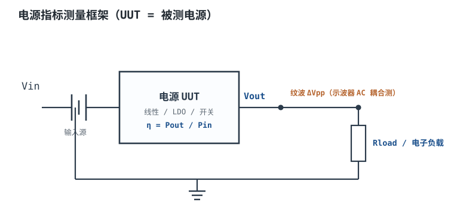
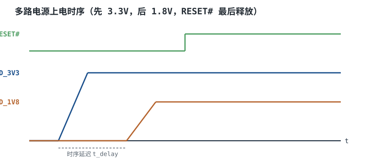

# 电源指标：纹波、效率、调整率与时序 Power Supply Specifications

“5V/2A”是一句广告，不是一条设计输入。它没有说电压允许偏离多少、纹波在什么带宽下测、2A 能连续跑多久、轻载时效率掉到多少、负载从 0.5A 跳到 1.5A 时输出会跌多深、几路电源谁先上电。把这些条件写清楚，才叫**电源规格书（Power Supply Specification）**；写不清楚，样机在实验台上一切正常，量产时却会在低温、满载、插拔和轻载待机这四个角落同时翻车。

本章建立一把通用的尺子：无论后级是线性稳压、LDO 还是开关电源，评价它的都是同一组指标。后面讲[线性电源：变压、整流、滤波](linear-supply.md)、[LDO 原理、选型与功耗计算](ldo.md)、[开关电源原理与 Buck 降压](buck.md)时，都会回到这把尺子上来。电池供电设备还要把轻载效率、静态电流与充电管理一起看，见[电池、充电管理与电量计](battery-charger.md)。

## 1. 设计动机

::: motivation 四个“标称能过、量产不过”的现场
**现场一：5V/2A 适配器带 12 位 ADC，读数随负载跳。** 空载时用万用表量是 5.02V，接上 1.5A 负载后示波器看到 120mVpp 的开关纹波。12 位、5V 量程的 1 LSB 是 $5/4096=1.22$ mV，120mVpp 相当于约 98 个 LSB 的干扰。设计者只看了“5V/2A”，没有规定纹波和测量带宽。

**现场二：效率 90% 的电源，电池待机只有三天。** 规格书写“效率 90%”，但那是 12V 输入、50% 负载、25°C 的典型值。设备 99% 时间在 5mA 轻载，此时固定损耗和静态电流占主导，效率可能只有 30%~50%；再用 20mA 的空载输入电流去算，2000mAh 电池的理论待机时间只有 $2/0.02=100$ 小时。**轻载效率与静态电流必须单独写。**

**现场三：负载阶跃把 FPGA 核电压打掉。** 电源 DC 负载调整率只有 10mV/A，看起来很好；但负载在 1µs 内从 0.5A 跳到 1.5A 时，输出先跌 180mV 再花 80µs 恢复。FPGA 的 0.9V 核电压容差只有 ±3%（±27mV），这一跌直接触发复位。**瞬态指标不能用 DC 调整率代替。**

**现场四：1.8V 先于 3.3V 上电，接口倒灌。** 两块板子单独测都正常，插在一起后 I/O 引脚向未上电的核倒灌，芯片发烫。原因是两路电源的上电顺序和 PG（Power Good）释放时机没有写进规格书，只靠两颗 LDO 的 EN 引脚“大概同时”上电。
:::

| 你想确认 | 先问规格书 | 判据（工程经验值，具体以器件手册为准） |
|---|---|---|
| 电压准不准 | 全温、全输入、全负载下的精度 | 数字负载 ±3%~±5%，模拟/ADC ±1%~±2% |
| 纹波干不干净 | 峰峰值还是 RMS、测量带宽 | 数字 ≤1% $V_{out}$；ADC 折算到 ≤1/2 LSB |
| 省不省电 | 额定、轻载、空载三个点 | 开关电源满载 ≥85%~90%，轻载 ≥70%~80% |
| 带载硬不硬 | 负载调整率与输出阻抗 | 数字 ≤1% $V_{out}$；精密模拟 ≤0.1% |
| 输入波动抗不抗 | 线性调整率 | ≤0.1%~0.5% $V_{out}$ 在全输入范围 |
| 突变扛不扛 | 阶跃幅度、边沿、跌落、恢复时间 | 跌落 ≤±3%~±5%，恢复 ≤50~100µs |
| 几路谁先上 | 上电顺序、PG 阈值与延迟 | 按芯片手册，I/O 先于 core，PG 最后释放 |

**不做规格书的代价，可以量化成四个数：**

1. **纹波预算缺失**：120mVpp 对 12 位 ADC 是 98 个 LSB；如果目标是 1/2 LSB，纹波要压到 0.61mVpp 以下，差 196 倍。
2. **轻载效率缺失**：5mA 负载、5V 输出只有 25mW，若空载损耗 50mW，效率只有 $25/(25+50)=33.3\%$。
3. **瞬态预算缺失**：1A 阶跃、ESR 5mΩ、输出电容 47µF、环路带宽 50kHz，仅电容放电就跌 $1/(2\pi\times50\times10^3\times47\times10^{-6})=67.7$ mV，还没算 ESR 和环路过冲。
4. **时序缺失**：PG 早释放 1ms，后级 MCU 可能在 3.3V 只爬到 2.4V 时就开始读 Flash，读到的是随机数。

## 2. 定义与直观

### 2.1 纹波的两个口径：峰峰值与 RMS

**纹波（Ripple）**是开关动作在输出上留下的周期性波动；**噪声（Noise）**是叠加在上面的宽带毛刺。工程上常写成“纹波与噪声”，单位用 mVpp（峰峰值）或 mVrms（有效值）。两者不能混用：

- 峰峰值 $V_{pp}$ 描述最坏瞬时偏差，适合做**容差与 ADC 满量程预算**；
- 有效值 $V_{rms}$ 描述能量，适合做**热与信噪比预算**；
- 同一个波形，两个数可以差 3~5 倍。50mVpp 的三角波只有 $50/(2\sqrt3)=14.4$ mVrms；50mVpp 的正弦波是 $50/(2\sqrt2)=17.7$ mVrms。

**测量带宽**是纹波指标的半个定义。示波器开 20MHz 带宽限制，会把开关边沿的高频振铃和空间噪声滤掉，读数是“低频纹波”；开全带宽，读数是“纹波加高频噪声”。两个数都真实，但用途不同：

- 做电源环路与输出电容设计，看 20MHz 带宽内的低频纹波；
- 做 EMI、射频与高速 ADC 设计，要看全带宽，甚至用频谱仪看单频分量；
- 无论哪种，都必须用**短地针/同轴适配器**，不能用地线夹；长地线像环形天线，能把纹波读数抬高几倍。



### 2.2 效率、轻载与静态电流

**效率（Efficiency）**是有功输出与有功输入之比：

$$\eta=\frac{P_{out}}{P_{in}}=\frac{V_{out}I_{out}}{V_{in}I_{in}}$$

符号与单位：$V_{out}$、$V_{in}$ 是输出、输入电压（V）；$I_{out}$、$I_{in}$ 是输出、输入电流（A）；$P_{out}$、$P_{in}$ 是有功功率（W）；$\eta$ 无量纲，常用百分数。

效率不是一个常数，而是一条随负载、输入电压、温度变化的曲线。原因写在损耗分解里：

$$P_{in}=P_{out}+P_{fixed}+kI_{out}^2$$

其中 $P_{fixed}$ 是与负载无关的固定损耗（W），包括静态电流、开关损耗、驱动损耗、磁芯损耗；$k$ 是等效导通系数（$\Omega$），把 MOS 导通、电感 DCR、采样电阻等归并成一项；$kI_{out}^2$ 是随负载平方增长的导通损耗（W）。

- **满载**：$kI_{out}^2$ 占主导，效率接近最高；
- **轻载**：$P_{fixed}$ 占主导，效率迅速下降；
- **空载**：$P_{out}=0$，效率没有定义，只能看**空载输入功率** $P_{no-load}=V_{in}I_{in,no-load}$。

**静态电流（Quiescent Current，$I_Q$）**是芯片自身消耗、不流向负载的电流。对 LDO，$I_Q$ 直接从输入流到地；对开关电源，$I_Q$ 还包括控制器的待机电流。电池设备要同时看**工作静态电流**与**关断电流**：前者决定待机时间，后者决定“关机后多久把电池耗光”。

### 2.3 调整率与输出阻抗

**线性调整率（Line Regulation）**：负载固定，输入电压在全范围变化时输出的漂移。

$$\text{Line Reg}=\frac{\Delta V_{out}}{\Delta V_{in}}$$

单位常用 mV/V 或 %/V。$\Delta V_{out}$ 是输出变化（V），$\Delta V_{in}$ 是输入变化（V）。它描述电源“抗输入波动”的能力。

**负载调整率（Load Regulation）**：输入固定，负载电流从规定的最小值变到最大值时输出的漂移。

$$\text{Load Reg}=\frac{\Delta V_{out}}{\Delta I_{out}}=R_{out}$$

单位常用 mV/A 或 %/A。$\Delta I_{out}$ 是负载电流变化（A）；$R_{out}$ 是电源的直流输出阻抗（$\Omega$）。**负载调整率越小，输出越“硬”。**

注意“从空载到满载”与“从 10% 到 100%”是两种测试条件，读数不同；规格书必须写清楚起点和终点。空载时部分电源进入跳周期或打嗝模式，输出会偏高，不能作为负载调整率的唯一起点。

### 2.4 瞬态的四个数：过冲、跌落、恢复、振铃

**负载瞬态响应（Load Transient Response）**是负载电流阶跃时输出的动态偏差。四个数必须一起写：

1. **阶跃幅度** $\Delta I$（A）与**边沿速率**（A/µs）：1A/µs 与 0.1A/µs 是两种完全不同的考验；
2. **跌落/过冲** $\Delta V_{under}$、$\Delta V_{over}$（mV）：输出最低/最高点与稳态值的差；
3. **恢复时间** $t_s$（µs）：从阶跃发生到输出重新进入 ±1%（或 ±3%）误差带的时间；
4. **振铃频率与幅度**：恢复过程中是否出现持续振荡，反映相位裕度。

只看“跌落 100mV”不够：如果恢复要 500µs，后级可能在恢复期间已经复位；如果振铃持续，说明环路相位裕度不足。**瞬态指标必须带负载阶跃条件、输出电容条件和测量带宽。**

### 2.5 时序与 PG：电源也要“排队”

多轨系统里，**上电顺序（Power-Up Sequencing）**和 **PG（Power Good）**是硬指标：

- **顺序**：通常 I/O 轨先于 core 轨，避免 I/O 引脚通过 ESD 二极管向未上电的 core 倒灌；也有芯片要求 core 先于 I/O，必须按具体手册。
- **斜率**：每轨的上升时间（如 0.5~5ms）和单调性；斜率太陡会有浪涌，太慢会超过后级 POR 的等待窗口。
- **延迟**：前轨进入窗口后，后轨延迟 $t_d$ 再启动；$t_d$ 由时序控制器、EN 引脚 RC 或 LDO 的 PG 引脚设定。
- **PG 阈值与延迟**：PG 在输出电压进入规定窗口并保持 $t_{PG}$ 后释放；输出跌出窗口后，PG 要在 $t_{fall}$ 内拉低。PG 是开漏输出，需要上拉电阻。
- **复位释放**：所有轨都稳定后，复位 IC 再延迟 $t_{rst}$ 释放 RESET，让 MCU 在电源稳定后才启动。



```echarts
{
  "tooltip": {"trigger": "axis"},
  "legend": {"data": ["VDD_3V3", "VDD_1V8", "RESET#"], "bottom": 0, "textStyle": {"fontSize": 12}},
  "grid": {"left": 60, "right": 30, "top": 26, "bottom": 50},
  "xAxis": {"type": "category", "name": "时间 ms", "data": [0,2,4,6,8,10,12,16,20], "axisLabel": {"fontSize": 11}},
  "yAxis": {"type": "value", "name": "电压 V", "min": 0, "max": 3.6, "axisLabel": {"fontSize": 11}},
  "series": [
    {"name": "VDD_3V3", "type": "line", "step": "end", "showSymbol": false, "lineStyle": {"width": 2.4, "color": "#1a4f8b"},
     "data": [0, 0.8, 2.0, 3.3, 3.3, 3.3, 3.3, 3.3, 3.3]},
    {"name": "VDD_1V8", "type": "line", "step": "end", "showSymbol": false, "lineStyle": {"width": 2.4, "color": "#b5642e"},
     "data": [0, 0, 0, 0.3, 0.9, 1.8, 1.8, 1.8, 1.8]},
    {"name": "RESET#", "type": "line", "step": "end", "showSymbol": false, "lineStyle": {"width": 2.4, "color": "#4f9e63"},
     "data": [0, 0, 0, 0, 0, 0.1, 0.1, 3.3, 3.3]}
  ]
}
```

### 2.6 精度预算：±2% 不是全部

数据手册首页的“±2%”通常是 25°C、标称输入、50% 负载下的**初始精度**。真实输出的总误差要把五项加起来：

$$\Delta V_{out,total}=\Delta V_{init}+\Delta V_{line}+\Delta V_{load}+\Delta V_{temp}+\Delta V_{ripple}+\Delta V_{age}$$

其中 $\Delta V_{init}$ 是初始精度（V）；$\Delta V_{line}$ 是线性调整率引起的偏差（V）；$\Delta V_{load}$ 是负载调整率引起的偏差（V）；$\Delta V_{temp}$ 是全温漂移（V）；$\Delta V_{ripple}$ 是纹波峰值（V）；$\Delta V_{age}$ 是长期漂移（V）。最坏情况直接相加；如果各项独立且随机，可用均方根：

$$\Delta V_{out,RSS}=\sqrt{\Delta V_{init}^2+\Delta V_{line}^2+\Delta V_{load}^2+\Delta V_{temp}^2+\Delta V_{ripple}^2+\Delta V_{age}^2}$$

**两种算法给出的数差 2~3 倍**，规格书必须说明用哪一种。安全相关、量产判据用最坏相加；统计良率分析可以用 RSS。

::: analogy 电源规格书像体检报告
“5V/2A”只相当于身高和体重；纹波、效率、调整率、瞬态、时序才是血压、血糖、心电图。身高体重正常的人也可能有高血压；标称电压电流正常的电源，也可能在负载阶跃时把后级打复位。

类比的边界：体检报告有统一的参考区间，电源的“正常”取决于后级负载——同样的 50mVpp，对 12 位 ADC 可能超标，对继电器可能完全无所谓。**指标必须相对于负载来定，不能脱离应用谈好坏。**
:::

## 3. 定量关系

### 3.1 纹波的估算式

以最常见的 Buck 为例，电感电流在开关周期内是三角波，峰峰值为

$$\Delta I_L=\frac{V_{out}(V_{in}-V_{out})}{L f_{sw}V_{in}}$$

其中 $\Delta I_L$ 是电感电流纹波（A）；$V_{out}$、$V_{in}$ 是输出、输入电压（V）；$L$ 是电感量（H）；$f_{sw}$ 是开关频率（Hz）。

输出电容把这股三角波积分成电压纹波。忽略 ESR 时：

$$\Delta V_{C}=\frac{\Delta I_L}{8 f_{sw}C_{out}}$$

其中 $\Delta V_{C}$ 是电容上的纹波（V）；$C_{out}$ 是输出电容（F）。考虑 ESR 后，纹波近似为

$$\Delta V_{pp}\approx \Delta I_L\left(ESR+\frac{1}{8 f_{sw}C_{out}}\right)$$

其中 $ESR$ 是输出电容的等效串联电阻（$\Omega$）。这个式子的适用条件是 CCM、三角波电流、电容容值不随直流偏置大幅下降；陶瓷电容在直流偏置下容值会掉 20%~60%，要按实际偏置后的容值算。

**算一遍**：$V_{in}=12$ V、$V_{out}=5$ V、$L=4.7\,\mu$H、$f_{sw}=500$ kHz、$C_{out}=47\,\mu$F、$ESR=5$ m$\Omega$。

$$\Delta I_L=\frac{5(12-5)}{4.7\times10^{-6}\times500\times10^3\times12}=\frac{35}{28.2}=1.241\ \text{A}$$

$$\Delta V_{C}=\frac{1.241}{8\times500\times10^3\times47\times10^{-6}}=\frac{1.241}{188}=6.60\ \text{mV}$$

$$\Delta V_{ESR}=1.241\times0.005=6.21\ \text{mV}$$

$$\Delta V_{pp}\approx6.60+6.21=12.8\ \text{mV}$$

对 5V 输出来说，这是 $12.8/5000=0.26\%$，满足“数字负载 ≤1%”的常见目标。若把 $C_{out}$ 减到 22µF，电容项变成 14.1mV，总纹波约 20.3mV；若 ESR 从 5mΩ 涨到 50mΩ，ESR 项变成 62mV，直接超标。**纹波是电容容值与 ESR 的共同结果，不能只看容值。**

如果后级还有一级 LDO，输出纹波还要除以它的 PSRR（也就是乘衰减倍数）：

$$V_{out,ripple}=\frac{V_{in,ripple}}{10^{PSRR(\text{dB})/20}}$$

其中 $V_{in,ripple}$ 是 LDO 输入纹波（V）；$PSRR(\text{dB})$ 是工作频率处的电源抑制比（dB）；$V_{out,ripple}$ 是 LDO 输出纹波（V）。PSRR 随频率下降，必须按开关频率查，详见[LDO 原理、选型与功耗计算](ldo.md)。

### 3.2 效率的损耗分解

把效率写成损耗的函数：

$$\eta=\frac{P_{out}}{P_{out}+P_{fixed}+kI_{out}^2}$$

符号与单位同上。这个式子能解释三个常见现象：

1. **轻载效率低**：$I_{out}$ 小，$kI_{out}^2$ 可以忽略，$P_{fixed}$ 不变，效率被固定损耗拖低；
2. **满载效率有峰值**：$kI_{out}^2$ 随负载平方增长，超过某点后效率反而下降；
3. **不同输入电压效率不同**：$P_{fixed}$ 中的开关损耗随 $V_{in}$ 上升，$k$ 中的导通损耗随 $V_{in}$ 变化，所以规格书必须写测试输入电压。

**算一遍**：5V 输出，$P_{fixed}=0.15$ W，$k=0.25\,\Omega$。

- 2A：$P_{out}=10$ W，$kI^2=0.25\times4=1.0$ W，$\eta=10/(10+0.15+1.0)=89.7\%$；
- 0.2A：$P_{out}=1$ W，$kI^2=0.01$ W，$\eta=1/(1+0.15+0.01)=86.2\%$；
- 20mA：$P_{out}=0.1$ W，$kI^2=0.0001$ W，$\eta=0.1/(0.1+0.15+0.0001)=40.0\%$。

**满载 89.7%、20mA 时 40.0%**，这就是“效率 90%”这句话必须带负载条件的原因。

**空载输入功率**：

$$P_{no-load}=V_{in}I_{in,no-load}$$

若 5V 输入、空载输入电流 20mA，则 $P_{no-load}=5\times0.02=0.1$ W。对 2000mAh、3.7V 的电池（能量 $2\times3.7=7.4$ Wh），理论上只能撑 $7.4/0.1=74$ 小时；实际还要加后级待机电流与电池自放电。

### 3.3 调整率的定义式

$$\text{Line Reg}=\frac{\Delta V_{out}}{\Delta V_{in}},\qquad \text{Load Reg}=\frac{\Delta V_{out}}{\Delta I_{out}}$$

换算成百分数：

$$\text{Line Reg}(\%)=\frac{\Delta V_{out}}{V_{out,nom}}\times100\%,\qquad \text{Load Reg}(\%)=\frac{\Delta V_{out}}{V_{out,nom}}\times100\%$$

注意百分数的分母是**标称输出电压**，不是变化量。5V 输出变化 20mV，负载调整率是 $20/5000=0.4\%$，不是 $20/20=100\%$。

**算一遍**：$V_{in}$ 从 10.8V 升到 13.2V，$V_{out}$ 从 5.000V 漂到 5.008V。

$$\text{Line Reg}=\frac{8\ \text{mV}}{2.4\ \text{V}}=3.33\ \text{mV/V}=0.067\%/\text{V}$$

负载从 0.1A 升到 2A，输出从 5.010V 掉到 4.990V：

$$\text{Load Reg}=\frac{20\ \text{mV}}{1.9\ \text{A}}=10.5\ \text{mV/A}=0.21\%$$

### 3.4 瞬态的估算式

负载阶跃瞬间，环路还来不及响应，输出电容先供电。一阶估算：

$$\Delta V_{under}\approx\Delta I\left(ESR+\frac{1}{2\pi f_cC_{out}}\right)$$

其中 $\Delta I$ 是负载阶跃（A）；$f_c$ 是环路穿越频率（Hz）；$C_{out}$ 是输出电容（F）；$ESR$ 是电容等效串联电阻（$\Omega$）。第一项是 ESR 上的瞬时跳变，第二项是环路响应时间 $1/(2\pi f_c)$ 内电容放电造成的跌落。

恢复时间的一阶估算：

$$t_s\approx\frac{4}{2\pi f_c}$$

即约 4 个环路时间常数。实际值受相位裕度、压摆率、电感电流斜率限制，必须以实测为准。

**算一遍**：$\Delta I=1$ A、$ESR=5$ m$\Omega$、$C_{out}=220\,\mu$F、$f_c=50$ kHz。

$$\Delta V_{under}\approx1\times\left(0.005+\frac{1}{2\pi\times50\times10^3\times220\times10^{-6}}\right)$$

$$=0.005+\frac{1}{69.1}=0.005+0.0145=19.5\ \text{mV}$$

$$t_s\approx\frac{4}{2\pi\times50\times10^3}=12.7\ \mu\text{s}$$

**这个估算偏乐观**：它假设环路立即以最大能力恢复，且电容容值不随偏置下降。实测跌落通常是估算值的 2~5 倍，所以规格书要留 3 倍以上余量。

### 3.5 时序的延时式

用 RC 给 EN 引脚做延时，延时时间由电容充电到阈值决定：

$$t_d=-RC\ln\left(1-\frac{V_{th}}{V_{in}}\right)$$

其中 $R$、$C$ 是延时网络的电阻（$\Omega$）与电容（F）；$V_{th}$ 是 EN 引脚的阈值电压（V）；$V_{in}$ 是充电电源电压（V）。

**算一遍**：$R=100$ k$\Omega$、$C=1\,\mu$F、$V_{in}=3.3$ V、$V_{th}=1.2$ V。

$$t_d=-10^5\times10^{-6}\ln\left(1-\frac{1.2}{3.3}\right)=-0.1\ln(0.6364)=0.0452\ \text{s}=45.2\ \text{ms}$$

RC 延时的缺点是阈值随温度、器件分散变化，精度可能 ±30%；关键时序要用带基准的 supervisor 或时序控制器，不要用 RC 硬凑。

**PG 的释放与拉低**也要给时间：PG 在输出进入窗口并保持 $t_{PG}$ 后释放；输出跌出窗口后，PG 在 $t_{fall}$ 内拉低。$t_{PG}$ 典型 1~10ms，$t_{fall}$ 典型 1~10µs，具体以手册为准。

### 3.6 精度预算的合成

最坏情况相加：

$$\Delta V_{WC}=\sum_{i=1}^{n}\Delta V_i$$

均方根合成：

$$\Delta V_{RSS}=\sqrt{\sum_{i=1}^{n}\Delta V_i^2}$$

**算一遍**：5V 输出，初始 ±1%（±50mV）、线性调整率 10mV、负载调整率 20mV、全温 30mV、纹波 15mV、老化 10mV。

$$\Delta V_{WC}=50+10+20+30+15+10=135\ \text{mV}=2.70\%$$

$$\Delta V_{RSS}=\sqrt{50^2+10^2+20^2+30^2+15^2+10^2}=\sqrt{4225}=65.0\ \text{mV}=1.30\%$$

**最坏 2.70%、RSS 1.30%**。如果规格书写“±3%”，最坏情况刚好卡边，量产必然有不良；工程上应把最坏值压到规格的 70% 以内，或把初始精度从 ±1% 收紧到 ±0.5%。

## 4. 典型计算

### 4.1 给 5V/2A 供电写一份可验收的规格书

**需求**：输入 12V（10.8~13.2V），输出 5V/2A，环境 -20~70°C，后级是数字负载加 12 位 ADC，要求纹波不影响 ADC 的 1/2 LSB。

先把“六项指标”写成可验收的数字，再给测试方法。下表就是这份规格书的核心：

| 序号 | 指标 | 验收值 | 测试条件 | 测试方法 |
|---|---|---|---|---|
| 1 | 输出电压精度 | 4.85~5.15V（±3%） | 全输入、0~2A、-20/25/70°C | 四线法在输出连接器处测，预热 30min |
| 2 | 输出纹波 | ≤50mVpp，且 ≤15mVrms | 2A 负载，20MHz 带宽，AC 耦合 | 同轴适配器或弹簧地针，10µF+0.1µF 就近去耦 |
| 3 | 效率 | ≥90% @1A，≥85% @0.2A，空载 ≤100mW | 12V 输入，25°C | 功率计同时读 $V_{in}I_{in}$ 与 $V_{out}I_{out}$ |
| 4 | 线性调整率 | ≤10mV（0.2%） | 0.1~2A 固定，$V_{in}$ 10.8~13.2V | 四线法，每点稳定 1s 后读 |
| 5 | 负载调整率 | ≤20mV（0.4%） | 12V 输入，0.1~2A | 四线法，开尔文接输出电容端 |
| 6 | 负载瞬态 | 跌落/过冲 ≤150mV，恢复 ≤50µs | 0.5↔1.5A，1A/µs，10 次 | 电子负载动态模式，示波器 AC 耦合测 |
| 7 | 时序与 PG | 5V 建立后 5ms 再使能 3.3V；PG 在 4.75~5.25V 内保持 1ms 后释放；跌出窗口 10µs 内拉低 | 常温，满载与空载各测 | 逻辑分析仪四通道，记录 5V、3.3V、PG、RESET |

**为什么是这些数：**

- **±3%**：12 位 ADC 的 1 LSB 是 1.22mV，±3% 是 ±150mV，看似很松；但精度预算的最坏值是 135mV，已经接近 ±3% 的 90%。如果后级是精密模拟，±3% 不够，要 ±1%。
- **50mVpp**：对 12 位 ADC 的 1/2 LSB（0.61mV）仍然太大，所以 5V 轨不能直接给 ADC 供电；ADC 前面还要加 LDO 或基准。50mVpp 是数字负载的合理目标，不是 ADC 的目标。
- **90%/85%**：12V 转 5V 的 Buck 在 1A 时典型 90%~93%，0.2A 时 85%~90%；写 90%/85% 是可达的，但要留测量不确定度。
- **20mV 负载调整率**：对应 10mΩ 输出阻抗，2A 时 20mV；对 5V 是 0.4%。
- **150mV/50µs 瞬态**：对 5V 是 ±3%，与精度预算一致；1A/µs 是常见的负载边沿，不是极限。
- **时序**：5V 先于 3.3V，符合“I/O 轨先于 core 轨”的常见要求；PG 的 1ms 保持是去抖，10µs 拉低是故障响应。

### 4.2 六项指标的验算

**第 1 步：纹波。** 用 3.1 的算例，$L=4.7\,\mu$H、$f_{sw}=500$ kHz、$C_{out}=47\,\mu$F、$ESR=5$ m$\Omega$，得到 12.8mVpp，小于 50mVpp，有 3.9 倍余量。若电容在 5V 偏置下容值掉到 30µF，电容项变成 10.3mV，总纹波 16.5mV，仍满足。

**第 2 步：效率。** 2A 时 $P_{out}=10$ W；按 3.2 的模型，$P_{fixed}=0.15$ W、$k=0.25\,\Omega$，总损耗 1.15W，$\eta=89.7\%$。1A 时 $P_{out}=5$ W，$kI^2=0.25$ W，$\eta=5/(5+0.15+0.25)=92.6\%$，满足 ≥90%。0.2A 时 $\eta=86.2\%$，满足 ≥85%。空载 20mA 输入电流对应 0.1W，刚好卡在 ≤100mW 的边界，量产要选空载电流更低的型号或加使能关断。

**第 3 步：线性调整率。** 假设控制器的线路增益使 $V_{in}$ 变化 2.4V 时输出变化 8mV，则 3.33mV/V，小于 10mV 的验收值。注意这个数是在 1A 负载下测的；空载时可能更差，因为部分电源进入跳周期。

**第 4 步：负载调整率。** 输出阻抗 10mΩ，0.1A 到 2A 变化 1.9A，$\Delta V=10\,\text{m}\Omega\times1.9=19$ mV，小于 20mV，刚好满足。这里用的是 DC 输出阻抗，不含瞬态。

**第 5 步：瞬态。** 用 3.4 的估算，1A 阶跃、$ESR=5$ m$\Omega$、$C_{out}=220\,\mu$F、$f_c=50$ kHz，得到 19.5mV 跌落、12.7µs 恢复，远小于 150mV/50µs。但这是理想估算；实际要按 3~5 倍留余量，即 60~100mV，仍在 150mV 内。若实测超过 150mV，优先加输出电容或提高 $f_c$，而不是只加 ESR。

**第 6 步：精度预算。** 用 3.6 的算例，最坏 135mV=2.70%，RSS 65mV=1.30%，都在 ±3% 内。**最坏值离上限只有 15mV**，所以量产要控制初始精度和温度漂移，不能把“典型值”当“最大值”。

### 4.3 测试方法与不确定度

同一块电源，不同的测法能差出 2~3 倍。规格书必须把测法写死：

- **电压**：四线开尔文，电压采样点放在输出连接器或负载端，不要放在电源板边缘；线损 0.1Ω、2A 就是 200mV，足以吃掉全部精度预算。
- **纹波**：示波器 AC 耦合、20MHz 带宽限制、1:1 或 10:1 探头配弹簧地针；探头地环面积越小越好。用长地线夹，读数可能从 20mV 变到 100mV。
- **效率**：输入输出同时采样，功率计或两台六位半表；不要用电源面板读数代替输入功率，面板精度通常只有 1%。
- **瞬态**：电子负载动态模式，上升/下降沿按规格设置；示波器用 AC 耦合、20MHz 带宽，测输出电容端；同时记录负载电流波形，确认边沿真的达到 1A/µs。
- **时序**：逻辑分析仪采样率 ≥10MSa/s，四通道同时记录 5V、3.3V、PG、RESET；PG 是开漏，要接实际上拉电阻，不能悬空。
- **温度**：高低温箱稳定 30min 后再测；温度对电解电容 ESR、陶瓷电容容值、基准漂移都有影响。

**不确定度**：六位半表直流电压 0.01% 读数 + 0.005% 量程；电流用 0.1%  shunt；示波器垂直 2% + 探头 3%；电子负载电流 1%。纹波 50mVpp 的测量不确定度可能 5~10mV，所以验收限值要留 20% 余量。

## 5. 工程含义

### 5.1 数量级：先有直觉，再查手册

| 负载类型 | 纹波目标 | 精度目标 | 瞬态目标 | 典型供电 |
|---|---|---|---|---|
| 数字逻辑/MCU | ≤1% $V_{out}$（50mVpp @5V） | ±3%~±5% | ±5%，100µs | Buck、LDO |
| FPGA/SoC core | ≤0.5%~1% | ±2%~±3% | ±3%，50µs | 多相 Buck |
| 12 位 ADC 模拟 | ≤1/2 LSB（0.61mV @5V） | ±0.1%~±1% | ±1 LSB | LDO/基准 |
| 射频/时钟 | ≤1mVrms，低频 | ±1% | 低噪声 | 低噪声 LDO |
| 继电器/LED | ≤5%~10% | ±10% | 不重要 | 便宜 Buck/线性 |

**这些是典型量级，具体以器件手册和系统预算为准。** 表的作用是让你在画原理图之前就知道“大概要做到多少”，而不是替代计算。

### 5.2 为什么“标称 5V/2A”不能直接当设计输入

| 标称值 | 它没说的 | 设计必须补的 |
|---|---|---|
| 5V | 容差、纹波、调整率、温度 | 4.75~5.25V、50mVpp、±3% 全温 |
| 2A | 连续/峰值、占空比、降额 | 2A 连续 @70°C，3A 峰值 1ms，降额 80% |
| 效率 90% | 测试输入、负载点、温度 | 12V/1A/25°C，轻载与空载另列 |
| 纹波 50mV | 带宽、探头、输出电容 | 20MHz、同轴/弹簧地、10µF+0.1µF |
| 25°C | 工作温度、温升 | -20~70°C，按最坏结温算 |
| “保护” | 过流点、短路、过温 | OCP 3A、短路自恢复、OTP 125°C |

**标称值是名字，不是边界。** 设计输入必须是“最坏组合”：最低输入、最大负载、最高温度、最差电容偏置、最慢环路。把这张表填完，才算真正读懂了“5V/2A”。

### 5.3 选型与布局的实际影响

- **纹波与电容**：先算 $\Delta I_L$，再选 $C_{out}$ 与 ESR；陶瓷电容按直流偏置降额后的容值算，电解/聚合物按 ESR 与纹波电流算。
- **效率与电感**：电感 DCR 每 10mΩ，2A 时损耗 40mW；开关频率每翻一倍，开关损耗上升、电感可减小，效率与体积互换。
- **瞬态与环路**：$f_c$ 越高，恢复越快，但相位裕度越难保；输出电容的 ESR 零点可以帮助老式 PNP LDO，也可能让现代 PMOS LDO 变差。
- **时序与 PG**：PG 上拉电阻 10k~100k，太小费电、太大边沿慢；PG 走线远离 SW 节点，避免误触发。
- **布局**：输入电容—开关管—电感—输出电容的功率回路面积最小；FB 走线从输出电容正端开尔文接回，远离电感和 SW 节点；纹波测量点就在输出电容两端，不要从远处“飞线”。

## 6. 常见坑

::: pitfall 常见坑
- **现象**：示波器测到 120mVpp 纹波，换一块板只有 30mVpp。**原因**：探头用地线夹，长地线拾取空间噪声和开关边沿振铃；或带宽开到全带宽，把高频噪声也算进纹波。**解决**：用弹簧地针/同轴适配器，探头就近靠输出电容；按规格开 20MHz 带宽限制；同时报告带宽与探头方式。
- **现象**：规格书写“效率 90%”，电池待机却只有几天。**原因**：90% 是 50% 负载、25°C 的典型值；轻载时固定损耗和 $I_Q$ 占主导，效率掉到 30%~50%。**解决**：分别规定满载、10% 负载、空载输入功率；电池设备再规定关断电流；按实际负载曲线核算待机时间。
- **现象**：纹波预算按 RMS 算，ADC 却出现大误差。**原因**：把 50mVpp 当成 50mVrms，或反过来；三角波与正弦波的换算系数不同。**解决**：规格书同时写 $V_{pp}$ 与 $V_{rms}$，并注明波形与带宽；ADC 预算用峰峰值，热预算用有效值。
- **现象**：DC 负载调整率 10mV/A 很好，负载一跳就复位。**原因**：只测了 DC 调整率，没有规定瞬态幅度、边沿、跌落和恢复时间；DC 输出阻抗不等于动态阻抗。**解决**：按实际负载 di/dt 写瞬态指标；用电子负载动态模式测；输出电容与环路一起优化。
- **现象**：两路电源同时上电，芯片发烫或复位。**原因**：没有规定上电顺序与 PG 释放时机；EN 引脚 RC 延时受温度、分散影响，实际先后不确定。**解决**：用时序控制器或带 PG 的 supervisor；规定每轨的延迟、斜率、PG 阈值与复位延迟；上电前用逻辑分析仪验证。
- **现象**：实验室 25°C 全过，-20°C 或 70°C 超标。**原因**：电解电容 ESR 低温升高、陶瓷电容高温降容、基准温漂、环路增益随温度变；规格书只写了 25°C。**解决**：按全温区最坏值做精度预算；高低温箱实测；电容按温度特性降额。
:::

## 7. 自测题

<details><summary>5V 输出的纹波是 50mVpp 的三角波，它的有效值是多少？如果波形是正弦呢？</summary>

三角波：

$$V_{rms}=\frac{V_{pp}}{2\sqrt3}=\frac{50}{3.464}=14.4\ \text{mVrms}$$

正弦波：

$$V_{rms}=\frac{V_{pp}}{2\sqrt2}=\frac{50}{2.828}=17.7\ \text{mVrms}$$

**同样 50mVpp，正弦的有效值比三角波高 23%**。所以规格书必须同时写波形与口径，不能只写“50mV”。

</details>

<details><summary>5V 输出、$P_{fixed}=0.15$W、$k=0.25\Omega$。负载 2A、0.2A、20mA 时效率各是多少？</summary>

2A：$P_{out}=10$W，$kI^2=1.0$W，$\eta=10/(10+0.15+1.0)=89.7\%$。

0.2A：$P_{out}=1$W，$kI^2=0.01$W，$\eta=1/(1+0.15+0.01)=86.2\%$。

20mA：$P_{out}=0.1$W，$kI^2=0.0001$W，$\eta=0.1/(0.1+0.15+0.0001)=40.0\%$。

**轻载效率由固定损耗决定**，所以“90% 效率”必须带负载点。

</details>

<details><summary>$V_{in}$ 从 10.8V 升到 13.2V，$V_{out}$ 从 5.000V 变到 5.008V。线性调整率是多少 mV/V、多少 %/V？</summary>

$$\Delta V_{in}=13.2-10.8=2.4\ \text{V},\qquad \Delta V_{out}=8\ \text{mV}$$

$$\text{Line Reg}=\frac{8}{2.4}=3.33\ \text{mV/V}$$

折合相对标称输出的总变化：

$$\frac{8}{5000}\times100\%=0.16\%$$

按每伏输入折合：

$$\frac{0.16\%}{2.4}=0.067\%/\text{V}$$

注意“总变化 0.16%”和“每伏 0.067%/V”是两个口径，规格书要写清楚。

</details>

<details><summary>1A 负载阶跃、ESR=5mΩ、$C_{out}=220\mu$F、$f_c=50$kHz。估算跌落与恢复时间；为什么实测可能更大？</summary>

$$\Delta V_{under}\approx1\times\left(0.005+\frac{1}{2\pi\times50\times10^3\times220\times10^{-6}}\right)=19.5\ \text{mV}$$

$$t_s\approx\frac{4}{2\pi\times50\times10^3}=12.7\ \mu\text{s}$$

实测更大的原因：估算假设环路立即以最大能力恢复、电容容值不随偏置下降、ESR 不随频率变；实际还有电感电流斜率限制、相位裕度不足、负载边沿寄生、探头带宽。工程上按 3~5 倍留余量。

</details>

<details><summary>5V 输出，初始 ±1%、线性 10mV、负载 20mV、全温 30mV、纹波 15mV、老化 10mV。最坏相加与 RSS 各是多少？</summary>

最坏相加：

$$\Delta V_{WC}=50+10+20+30+15+10=135\ \text{mV}=2.70\%$$

RSS：

$$\Delta V_{RSS}=\sqrt{50^2+10^2+20^2+30^2+15^2+10^2}=\sqrt{4225}=65.0\ \text{mV}=1.30\%$$

最坏值是 RSS 的 2.08 倍。**安全与量产判据用最坏相加，统计良率分析才用 RSS。**

</details>

<details><summary>为什么“标称 5V/2A”不能直接当设计输入？至少列出四个缺失条件。</summary>

缺：① 电压容差与全温漂移；② 纹波的测量带宽与峰峰值/RMS 口径；③ 2A 是连续还是峰值、环境温度与降额；④ 效率的测试输入、负载点与轻载/空载指标；⑤ 负载瞬态的幅度、边沿、跌落与恢复时间；⑥ 多轨上电顺序、PG 阈值与复位延迟。

**标称值只给了名字，没给边界。** 设计输入必须是“最低输入 + 最大负载 + 最高温度 + 最差电容偏置 + 最慢环路”的组合。

</details>

## 8. 参考资料

- **TI, SLVA477B *Basic Calculation of a Buck Converter's Power Stage***：Section 4 *Output Voltage Ripple* 给电感电流纹波与输出电容纹波的估算式；本章 3.1 的公式与该文口径一致。<https://www.ti.com/lit/an/slva477b/slva477b.pdf>
- **TI, LM317 数据手册**：*Electrical Characteristics* 表给 Line Regulation 与 Load Regulation 的测试条件（$V_{in}-V_{out}$、负载电流、温度）；本章 2.3 与 3.3 的定义按该表。<https://www.ti.com/lit/ds/symlink/lm317.pdf>
- **Analog Devices, MT-043 *Op Amp Power Supply Rejection Ratio (PSRR) and Supply Voltages***：PSRR 的 dB 定义、正负电源分别给值与频率特性；本章 3.1 的纹波抑制与 PSRR 换算按该文。<https://www.analog.com/media/en/training-seminars/tutorials/MT-043.pdf>
- **Analog Devices, MT-101 *Decoupling Techniques***：电源去耦、纹波测量与噪声路径；本章 2.1 的测量带宽与 4.3 的测试方法参考该文。<https://www.analog.com/media/en/training-seminars/tutorials/MT-101.pdf>
- **Erickson & Maksimovic, *Fundamentals of Power Electronics*, 2nd ed., Chapter 2 *Principles of Steady-State Converter Analysis***：电感伏秒平衡与电容电荷平衡，是本章 3.1 纹波公式的来源。
- **Horowitz & Hill, *The Art of Electronics*, 3rd ed., Chapter 9 *Voltage Regulation and Power Conversion***：线性稳压、开关电源、效率与热设计的工程讲法；本章 2.2 与 5.1 的量级参照该章。
