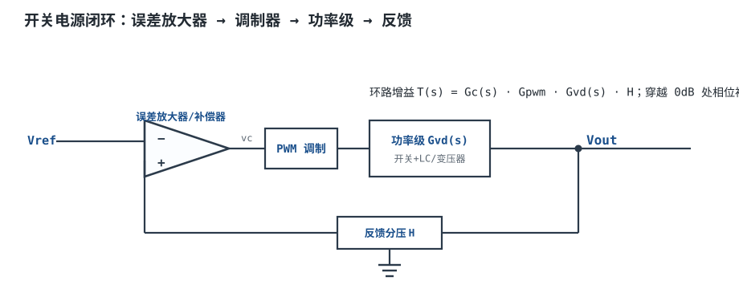
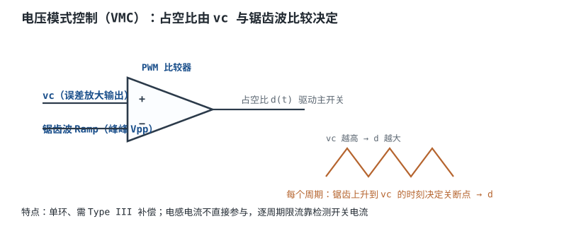
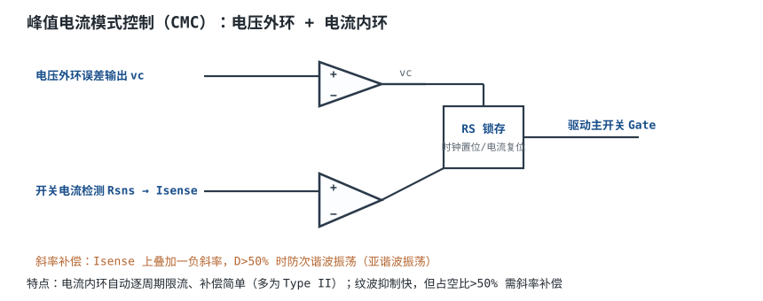
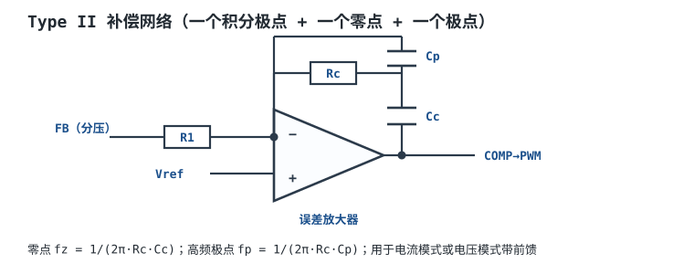
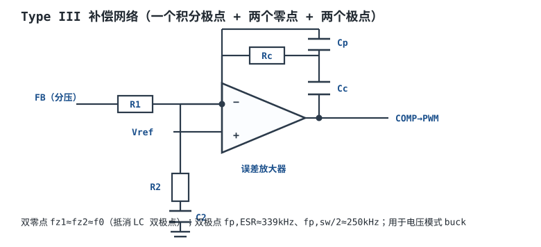

# 控制模式与环路补偿 Control Modes & Loop Compensation

Buck、Boost、反激这些拓扑决定了"能量怎么流"，但**输出电压稳不稳、响应快不快、会不会啸叫振荡**，是由**控制环路（Control Loop）**决定的。前几章把功率级搭好了，这一章解决最后也是最难的一环：怎么把输出电压"闭合"地控住，并保证它稳定。

## 1. 设计动机

::: motivation 为什么需要环路补偿
开关电源的输出要在输入电压变化、负载轻重变化时都稳住，靠的是负反馈：把输出电压分压后与一个精密基准比较，用误差去调占空比。

但功率级里有电感和电容，本身就是一个带双极点的二阶系统，会引入很大的相位滞后。如果直接把误差放大器接上去不做任何"补偿"，环路在高频处相位可能滞后接近 180°，负反馈瞬间变成正反馈——输出不再是平稳的直流，而是叠加几 MHz 的高频振荡、啸叫、输出乱跳，严重时烧管。

**环路补偿（Loop Compensation）就是人为地给误差放大器加上零点和极点，把环路增益 $T(s)$ 的伯德图"掰"成在穿越频率处仍有足够相位裕度的形状。** 这是开关电源从"能工作"到"稳定可靠"的关键一步。
:::

## 2. 原理图

开关电源的闭环本质是一个单位负反馈系统。下图给出通用结构：输出 $V_{out}$ 经分压 $H$ 取样，与基准 $V_{ref}$ 在误差放大器里比较，放大后的误差 $v_c$ 送去 PWM 调制器产生占空比，驱动功率级。



## 3. 静态分析（DC）

直流稳态下，环路负反馈使误差放大器两个输入端电位近似相等（虚短），于是：

$$V_{FB}=V_{ref}\qquad\Longrightarrow\qquad V_{out}=V_{ref}\left(1+\frac{R_1}{R_2}\right)$$

- 反馈分压支路电流要远大于 FB 引脚偏置电流（工程上 $I_{R12}\ge 100\times I_{FB}$，典型取 $\mu$A 级以上），否则分压比被芯片偏置电流拉偏。
- 下电阻 $R_2=V_{ref}/I_{R12}$，上电阻 $R_1=R_2(V_{out}/V_{ref}-1)$。
- 占空比直流值由拓扑决定：Buck 为 $D\approx V_{out}/(\eta V_{in})$。

以 12V→3.3V、$V_{ref}=0.8\text{V}$ 为例：$R_2=80\text{k}\Omega$ 时（取 $I_{R12}=10\mu\text{A}$），$R_1=80\text{k}\times(3.3/0.8-1)=250\text{k}\Omega$；工程上更常取 $R_1=100\text{k}\Omega$、$R_2=R_1\cdot V_{ref}/(V_{out}-V_{ref})=100\text{k}\times0.8/2.5=32\text{k}\Omega$。

## 4. 动态分析（AC / 瞬态）

环路分析的核心是**功率级的控制到输出传递函数** $G_{vd}(s)$（占空比 $\hat{d}$ 到输出 $\hat{v}_{out}$）。

**Buck 在 CCM（连续导通模式）下：**

$$G_{vd}(s)=V_{in}\cdot\frac{1}{1+s\frac{L}{R}+s^{2}LC}=V_{in}\cdot\frac{1}{1-\left(\frac{f}{f_0}\right)^{2}+s\frac{1}{Q\omega_0}}$$

其中：
- **LC 双极点** $f_0=\dfrac{1}{2\pi\sqrt{LC}}$，相位在此处快速下降约 180°；
- 品质因数 $Q=R\sqrt{C/L}$，$Q$ 越大（负载越轻），$f_0$ 处增益尖峰越高、相位跌落越陡；
- 输出电容 ESR 引入一个**右半平面零点之外的左半平面零点** $f_{ESR}=\dfrac{1}{2\pi\cdot ESR\cdot C}$，它把相位重新抬起来。

代入一个典型 Buck：$V_{in}=12\text{V}$、$V_{out}=3.3\text{V}$、$I_{out}=3\text{A}$、$f_{sw}=500\text{kHz}$、$L=10\mu\text{H}$、$C_{out}=47\mu\text{F}$、$ESR=10\text{m}\Omega$：

- 负载 $R=3.3/3=1.1\Omega$；
- $f_0=\dfrac{1}{2\pi\sqrt{10\mu\text{H}\times47\mu\text{F}}}=7.3\text{kHz}$；
- $Q=1.1\sqrt{47/10}=2.38$（$f_0$ 处有约 $20\log Q\approx7.5\text{dB}$ 的尖峰）；
- $f_{ESR}=\dfrac{1}{2\pi\times0.01\times47\mu\text{F}}=339\text{kHz}$。

PWM 调制器的小信号增益近似为常数 $G_{pwm}=1/V_{pp}$（$V_{pp}$ 为锯齿波峰峰值）。把它和反馈系数 $H=V_{ref}/V_{out}=0.8/3.3=0.242$ 串起来，就得到除补偿器外的"前向通路"频响。下面是补偿后环路增益的伯德图：

```echarts
{
  "tooltip": {"trigger": "axis"},
  "legend": {"data": ["环路增益 |T| (dB)", "环路相位 (°)"], "bottom": 0, "textStyle": {"fontSize": 13}},
  "grid": {"left": 56, "right": 60, "top": 30, "bottom": 56},
  "xAxis": {"type": "category", "name": "频率 Hz", "data": ["100","300","1k","3k","7k","10k","20k","50k","100k","340k","1M"], "axisLabel": {"fontSize": 11}},
  "yAxis": [
    {"type": "value", "name": "dB", "min": -40, "max": 70, "axisLabel": {"fontSize": 11}},
    {"type": "value", "name": "相位", "min": -200, "max": -60, "axisLabel": {"fontSize": 11}}
  ],
  "series": [
    {"name": "环路增益 |T| (dB)", "type": "line", "smooth": true, "showSymbol": false, "lineStyle": {"width": 2.6, "color": "#1a4f8b"},
     "data": [60,50,40,28,16,10,0,-12,-22,-30,-38]},
    {"name": "环路相位 (°)", "type": "line", "smooth": true, "showSymbol": false, "yAxisIndex": 1, "lineStyle": {"width": 2.2, "color": "#b5642e"},
     "data": [-90,-95,-110,-140,-165,-140,-128,-135,-160,-150,-165]}
  ]
}
```

穿越频率 $f_c=20\text{kHz}$（$|T|$ 过 0dB 处），此处相位约 $-128^{\circ}$，故**相位裕度** $PM=180^{\circ}-128^{\circ}=52^{\circ}$，满足 $>45^{\circ}$ 的稳定判据。

## 5. 环路分析

**控制模式分两大类：**

| 模式 | 取样对象 | 特点 | 常用补偿 |
|---|---|---|---|
| 电压模式控制 VMC | 仅输出电压 | 单环、占空比直接调；功率级是双极点，需 Type III | Type III |
| 峰值电流模式 CMC | 输出电压 + 电感电流 | 双环、自动逐周期限流、功率级近似单极点；占空比>50% 需斜率补偿 | Type II |

**环路增益** $T(s)=G_c(s)\cdot G_{pwm}\cdot G_{vd}(s)\cdot H$，其中 $G_c(s)$ 是误差放大器/补偿器的传递函数。稳定性判据：

- $|T|$ 穿越 0dB 时，**相位裕度 $PM>45^{\circ}$**（工程甜点 $45^{\circ}\sim60^{\circ}$），增益裕度 $GM>6\text{dB}$；
- 穿越频率 $f_c$ 一般取 $f_{sw}/10\sim f_{sw}/5$，过高会被开关噪声干扰，过低则瞬态响应慢；
- 穿越处斜率最好为 $-20\text{dB/dec}$（保证相位不会陡跌）。

::: advanced 进阶：环路增益推导与补偿器算例
**断开环路求 $T(s)$**：在误差放大器输出（COMP）处注入小正弦信号，保留直流工作点，测沿环路绕一圈回来的信号幅度与相位之比。

**电压模式 Buck 的 $T(s)$**：
$$T(s)=\underbrace{G_c(s)}_{\text{补偿器}}\cdot\underbrace{\frac{1}{V_{pp}}}_{G_{pwm}}\cdot\underbrace{V_{in}\frac{1}{1+sL/R+s^{2}LC}}_{G_{vd}}\cdot\underbrace{\frac{V_{ref}}{V_{out}}}_{H}$$

**Type III 补偿器**用于 VMC：在 LC 双极点 $f_0$ 处放两个零点把相位顶上去（抵消双极点带来的 −180° 滞后），在 ESR 零点 $f_{ESR}$ 和 $f_{sw}/2$ 处放两个极点压高频噪声：
- $f_{z1}=f_{z2}\approx f_0=7.3\text{kHz}$；
- $f_{p,ESR}\approx f_{ESR}=339\text{kHz}$；
- $f_{p,sw/2}\approx f_{sw}/2=250\text{kHz}$。

**Type II 补偿器 R/C 算例（电流模式 Buck，同上参数）**：CMC 下功率级近似单极点 $f_p=\dfrac{1}{2\pi R C_{out}}=\dfrac{1}{2\pi\times1.1\times47\mu\text{F}}=3.1\text{kHz}$。取穿越 $f_c=20\text{kHz}$。
- 把零点放在 $f_z=f_p=3.1\text{kHz}$ 提相位；高频极点放在 $f_p=f_{ESR}=339\text{kHz}$ 抵消 ESR 零点。
- 选反馈电阻 $R_c=100\text{k}\Omega$：
  $$C_c=\frac{1}{2\pi R_c f_z}=\frac{1}{2\pi\times100\text{k}\times3.1\text{k}}=513\text{pF}\approx560\text{pF}$$
  $$C_p=\frac{1}{2\pi R_c f_p}=\frac{1}{2\pi\times100\text{k}\times339\text{k}}=4.7\text{pF}$$
- 这组值（$R_c=100\text{k}\Omega,\ C_c=560\text{pF},\ C_p=4.7\text{pF}$）即为 Type II 的起始取值，实际靠仿真/实测在 $f_c=20\text{kHz}$ 处把 $PM$ 调到 $45^{\circ}\sim60^{\circ}$。

若 $PM<45^{\circ}$（振荡/高频啸叫）：把 $f_z$ 提前一点（加大 $C_c$）或降低 $f_c$；若 $PM$ 太大（>70°、瞬态慢吞吞）：减小 $C_c$ 让零点后移、$f_c$ 上提。
:::

## 6. 元件取值与工程权衡

- **穿越频率**：$f_{sw}/10$ 是稳妥起点。想瞬态快就上提 $f_c$，但要留出对开关噪声的余量。
- **$Q$ 与 $C_{out}$**：加大 $C_{out}$ 或降低 $L$ 可压低 $f_0$ 处的增益尖峰，补偿更好做，但体积大、瞬态变慢。
- **补偿电容数量级**：零点电容几百 pF~nF，高频极点电容几 pF~几十 pF（注意 PCB 寄生电容会让几 pF 的取值漂移，常用 4.7pF 实测微调）。
- **内置补偿 vs 外置补偿**：现代 IC 常"内部补偿"并固定推荐 $L/C$，换用不同 $L/C$ 会破坏稳定性；外置补偿灵活但要自己算。

## 7. 完整设计示例

::: example 12V→3.3V/3A Buck 的环路补偿
1. **需求**：$V_{in}=12\text{V}$，$V_{out}=3.3\text{V}$，$I_{out}=3\text{A}$，$f_{sw}=500\text{kHz}$，要求 PM>45°。
2. **功率级**：选 $L=10\mu\text{H}$、$C_{out}=47\mu\text{F}$（X5R 陶瓷，低 ESR），算得 $f_0=7.3\text{kHz}$、$Q=2.38$、$f_{ESR}=339\text{kHz}$。
3. **选模式**：用峰值电流模式（自带逐周期限流），功率级退化为单极点 $f_p=3.1\text{kHz}$，补偿用 Type II。
4. **反馈分压**：$V_{ref}=0.8\text{V}$，取 $R_1=100\text{k}\Omega$，$R_2=32\text{k}\Omega$。
5. **补偿取值**：$f_c=20\text{kHz}$，$f_z=3.1\text{kHz}$，$f_p=339\text{kHz}$；$R_c=100\text{k}\Omega$、$C_c=560\text{pF}$、$C_p=4.7\text{pF}$。
6. **验算**：穿越处相位约 −128°，$PM\approx52^{\circ}>45^{\circ}$，稳定。
:::

## 8. 仿真与实验

LTspice 中用 AC 扫描验证：在误差放大器输出（COMP）注入交流小信号，用`.ac lin 1000 10Hz 1MHz`扫出环路增益伯德图，读 0dB 穿越频率与该处相位，算出 PM。实际板上可用"注入变压器 + 网络分析仪"或"负载瞬态扰动观察收敛"两种方法：

- 瞬态法：让负载电流阶跃（如 0.5A→2.5A），用示波器看 $V_{out}$ 恢复波形。平稳单脉冲收敛 = 稳定；带 1~2 个轻微振铃 = PM 适中；持续振荡不收敛 = 相位裕度不足，需加 $C_c$。
- 若测出 $f_c$ 远低于设计值且 PM 过大，说明补偿太"保守"，可减小 $C_c$ 提高响应速度。

## 扩展与变种电路

### 扩展1：电压模式控制（VMC）Voltage-Mode Control

只有一个电压外环，误差放大器输出 $v_c$ 直接与固定频率锯齿波比较决定占空比。



::: example 工作原理
- $v_c$ 越高，锯齿波上升到 $v_c$ 越晚（或越早），占空比随之变化。
- 功率级是完整的 LC 双极点，相位跌落大，**必须用 Type III 补偿**才能在 $f_c$ 处补回相位。
- 优点：噪声裕度好、驱动简单；缺点：输入电压扰动要等输出变化后才纠正（无输入前馈），逐周期限流需另设。
:::

取值对比：VMC 用 Type III（双零点双极点，元件 5 个），CMC 用 Type II（3 个）；VMC 在 $f_{sw}$ 高、输入范围宽时仍常用。适用：大占空比、噪声敏感、需精确占空比；不适用：轻载要求快限流的场合。

::: pitfall VMC 在 CCM 双极点处补不好就振荡
- **现象**：空载或轻载时输出叠加高频振铃、效率异常。
- **原因**：$Q$ 随负载变轻而增大，$f_0$ 处相位跌落更陡，固定补偿 PM 不够。
- **解决**：零点对准 $f_0$，或降低 $Q$（加大 $C_{out}$），或改用电流模式。
:::

### 扩展2：峰值电流模式控制（CMC）Peak Current-Mode Control

在电压外环里再套一个电流内环：每个周期时钟置位开关，电感电流上升到由 $v_c$ 设定的阈值时复位开关。



::: example 工作原理
- 电流内环把电感"拉直"成一个受控电流源，功率级从双极点退化为近似单极点，**Type II 即可稳定**。
- 天然逐周期限流、自动均流（多相并联方便）、瞬态响应快。
- 代价：占空比 $D>50\%$ 时会出现**次谐波振荡（亚谐波振荡）**，必须叠加**斜率补偿（Slope Compensation）**。
:::

取值对比：CMC 补偿元件少、限流免费；VMC 无需斜率补偿。适用：多路输出、需均流、快响应；不适用：占空比>50% 又忘记加斜率补偿（必振）。

::: pitfall D>50% 不加斜率补偿导致次谐波振荡
- **现象**：电感电流每个周期摆幅交替一大一小（分频振荡），输出纹波拍频。
- **原因**：开环电流环在 D>50% 时固有不稳定。
- **解决**：在电流检测信号上叠加从时钟产生的负斜率补偿斜坡，斜率约 $0.5\times$ 电感下降斜率。
:::

### 扩展3：Type II 补偿网络

一个积分极点（低频高增益、压低 DC 误差）+ 一个零点（提相位）+ 一个高频极点（压开关噪声）。



::: example R/C 计算
- 零点 $f_z=1/(2\pi R_c C_c)$ 对准功率级主极点；高频极点 $f_p=1/(2\pi R_c C_p)$ 对准 ESR 零点。
- 例：$R_c=100\text{k}\Omega$、$f_z=3.1\text{kHz}\Rightarrow C_c=560\text{pF}$；$f_p=339\text{kHz}\Rightarrow C_p=4.7\text{pF}$。
- 中频增益决定穿越频率，靠 $R_c/R_1$ 调节。
:::

取值对比：Type II 3 个元件，用于 CMC；Type III 5 个元件用于 VMC。适用：电流模式、输入前馈的电压模式；不适用：CCM Buck 的纯电压模式（相位不够）。

::: pitfall 高频极点电容取 4.7pF 被 PCB 寄生吃掉
- **现象**：高频极点位置比设计值偏低、$f_c$ 上不去。
- **原因**：COMP 走线与相邻网络寄生电容（~2-5pF）与 $C_p$ 并联。
- **解决**：$C_p$ 不宜小于几 pF，或按实测频率反推取值、COMP 走线包地。
:::

### 扩展4：Type III 补偿网络

在 Type II 基础上再增加一个零点、一个极点，专门给 VMC Buck 的 LC 双极点"补相位"。



::: example R/C 计算与相位提升
- 两个零点 $f_{z1}=f_{z2}\approx f_0$，在双极点处把相位从 −180° 顶回接近 −90°；
- $f_{p,ESR}\approx f_{ESR}$ 消掉 ESR 零点带来的相位提前；$f_{p,sw/2}\approx f_{sw}/2$ 压高频。
- 元件：$R_1,R_2$ 为反馈分压，$R_c,C_c$ 给零点，$R_2,C_2$ 给第二个零点/极点，$C_p$ 给高频极点。
:::

取值对比：Type III 补偿能力强但元件多、对寄生敏感。适用：CCM 电压模式 Buck/Boost；不适用：CMC（用 Type II 即可，Type III 反而过补偿）。

::: pitfall Type III 零点没对准 f0 导致 PM 不足
- **现象**：$f_c$ 处相位仍 −150° 以下，输出振铃。
- **原因**：零点放在了错误频率，没抵消 LC 双极点的相位滞后。
- **解决**：先准确算出 $f_0=1/(2\pi\sqrt{LC})$，把两个零点放在它附近 ±30% 内。
:::

## 9. 常见坑与故障现象

::: pitfall 常见坑
- **输出高频啸叫/振铃**：相位裕度不足。表现为轻载或满载时叠加几百 kHz~MHz 振荡、电感发声。原因是补偿网络零点/极点没对准功率级极点。解决：按 $f_0$ 重排零点，加大 $C_c$ 提前零点，或降低 $f_c$。
- **瞬态恢复慢、电压掉得深**：补偿过于保守（PM>70°、$f_c$ 太低）。解决：减小 $C_c$、提高 $f_c$，但勿超过 $f_{sw}/5$。
- **换了电感/电容就不稳**：内置补偿 IC 的补偿是按推荐 $L/C$ 整定的，自己换了更大电感或陶瓷电容（DC bias 后容量暴跌）会破坏极点位置。解决：严格用 IC 推荐的 $L/C$ 组合。
- **D>50% 电流模式振荡**：忘记斜率补偿。解决：外加或选内置斜率补偿的控制器。
:::

## 10. 自测题

<details><summary>为什么功率级 LC 双极点会让环路不稳定？补偿器用什么去抵消它？</summary>
LC 双极点在 $f_0$ 附近带来约 −180° 的相位滞后，若它正好落在穿越频率附近，环路相位裕度被吃光，负反馈变正反馈。补偿器用一对**零点（Type III）**放在 $f_0$ 附近，提供相位超前，把 $f_c$ 处的相位"抬回"，保证 $PM>45^{\circ}$。
</details>

<details><summary>一个 CMC Buck 的 $R=1.1\Omega$、$C_{out}=47\mu\text{F}$，主极点频率是多少？零点应放在哪？</summary>
主极点 $f_p=\dfrac{1}{2\pi R C_{out}}=\dfrac{1}{2\pi\times1.1\times47\mu\text{F}}\approx3.1\text{kHz}$。Type II 补偿的零点放在 $f_z\approx3.1\text{kHz}$ 以提升该处相位。
</details>

<details><summary>相位裕度 PM=30° 和 PM=60° 的环路，负载阶跃恢复波形有何不同？</summary>
PM=30° 偏小，阶跃后会多次振铃才收敛；PM=60° 接近最优，阶跃后 1~2 次轻微振铃即平稳。PM 太小振荡，太大则恢复慢。
</details>

<details><summary>VMC 与 CMC 在补偿器选型上的主要区别是什么？</summary>
VMC 功率级是 LC 双极点、相位跌落大，需 **Type III** 双零点双极点补偿；CMC 有电流内环把电感拉直成单极点，**Type II** 即可，但占空比>50% 需斜率补偿。
</details>

## 11. 参考资料

- TI Application Report **SLVA477A**《Basic Calculation of a Buck Converter's Power Stage》
- Erickson & Maksimovic, *Fundamentals of Power Electronics* (2nd ed.)——平均开关模型与小信号建模
- Pressman/Billings/Morey, *Switching Power Supply Design* (3rd ed.)——Type II/III 补偿设计
- Sanjaya Maniktala, *Switching Power Supplies A–Z* (2nd ed.)——环路补偿工程近似与算例
