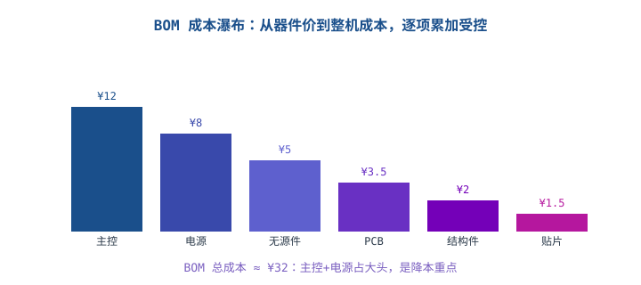
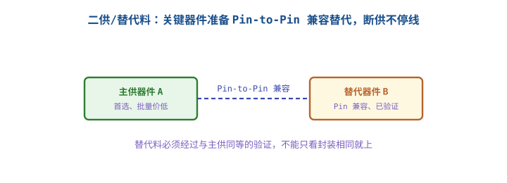

# BOM、版本、文档与成本控制

## 1. 硬件交付不只是一张原理图

::: motivation 没有 BOM 和版本，量产一定乱
画板软件里点"PCB 完成"只是开始。量产需要一张**准确的 BOM（物料清单）**告诉工厂贴什么料、一个**受控的版本号**区分改了哪版、一套**文档**让别人能复现。BOM 错一个料号、版本不记录，产线就贴错件、售后查不到是哪版板。
:::

## 2. BOM 与成本控制

BOM 应包含：位号、型号、封装、厂家/料号、**二供料号**、数量、单价、备注（是否安规件）。

成本控制要点：
- **大头优先**：主控、电源、结构件占成本 70%+，降本先动这几项，别在 0.01 元电阻上纠结。
- **标准料**：优先 E96 标准值、通用封装，减少采购品种。
- **批量价**：量大时与供应商谈阶梯价；关键料锁价锁货期。

## 3. 版本与文档管理

- **版本号**：原理图/PCB 每次改板升版本（Rev A/B/C），记录改了什么、为什么改。
- **ECN（工程变更通知）**：量产后改 BOM/PCB 必须走变更流程，评估影响、通知相关方。
- **文档包**：Gerber、坐标文件、BOM、贴片图、测试说明，一次性给工厂。

## 4. 示例（含计算）

::: example 降本分析
BOM 总成本 ¥32，其中主控 ¥12、电源 ¥8。
- 换替代主控从 ¥12→¥10，整机降 ¥2（6%）。
- 在 0402 电阻上省 0.001 元，整板省不到 ¥0.1。
- 结论：降本盯大头；但前提是替代料经过验证（见扩展）。
:::

## 5. 上手操作清单

- [ ] BOM 每个料有唯一厂家料号 + 二供。
- [ ] 安规件在 BOM 里标注，不可随意替换。
- [ ] 每次改板升版本、记变更原因。
- [ ] 量产变更走 ECN，不私下改。

## 扩展与变种电路

### 扩展1：二供与替代料 Alternate/Second Source

关键器件只靠一家供应商，断供或涨价就全线停摆；准备 Pin-to-Pin 兼容的第二供应商。

::: example 二供管理
- 关键 IC、电源、连接器准备二供，BOM 里列出主/替两个料号。
- 替代料必须**与主供同等验证**：电气参数、封装、温度特性一致，上过实际板。
- 不能只看封装相同就上——同封装不同参数的片子上去可能不工作。
- 定量：高风险料（独家、长货期）强制二供；通用电阻电容可免。
:::

对比"只用最便宜的一家"：短期便宜，断供时停产损失远大于省下的钱。

::: pitfall 替代料只看封装不验证
- **现象**：换了"同封装"片子，板子批量不良。
- **原因**：同封装但电气参数/工艺不同，没验证就上。
- **解决**：替代料上板前做完整验证，确认一致再进 BOM。
:::

## 6. 常见坑与故障现象

::: pitfall 常见坑
- **BOM 料号错误/过时**：产线贴错件。BOM 与原理图同步维护、冻结版本。
- **改板不升版本**：返修时分不清是哪版板。每次改必升版本并记录。
- **降本动小料不动大头**：在几分钱电阻上抠，主控电源却没谈价。成本抓大头。
- **替代料不验证就上**：同封装不同参数，批量翻车。
:::

## 7. 自测题

BOM 总成本 ¥32，主控 ¥12、电源 ¥8、其余 ¥12，降本应优先动哪里？

优先动主控和电源（合计 ¥20，占 62%）。这两项谈批量价或换替代料，每降 10% 整机省 ¥2；在电阻电容上抠几分钱对整机成本影响极小。

为什么关键器件要准备二供？替代料能只看封装相同吗？

二供防断供/涨价导致全线停产。但替代料不能只看封装，必须与主供同等电气验证，因为同封装不同参数的片子可能不工作。验证通过后才能进 BOM。

量产后发现 BOM 里一个料要换，直接改可以吗？

不可以。必须走 ECN（工程变更通知）流程：评估对已生产批次、认证、库存的影响，通知相关方，受控切换。私下改会导致批次混乱、认证失效。

## 8. 参考资料

- kitspace/awesome-electronics（制造、BOM、分销资源索引）
- KiCad 符号/封装库组织（BOM 生成与库管理实践）
