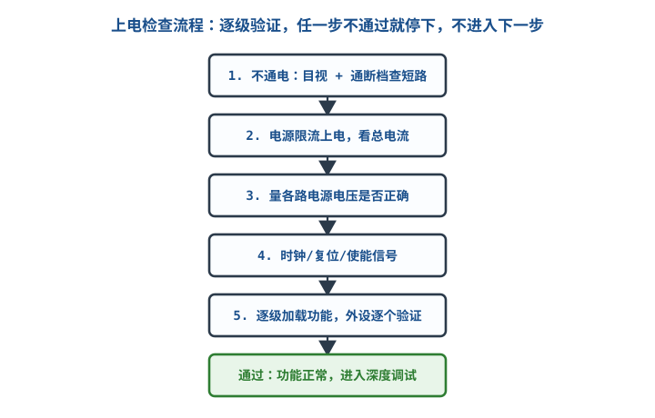
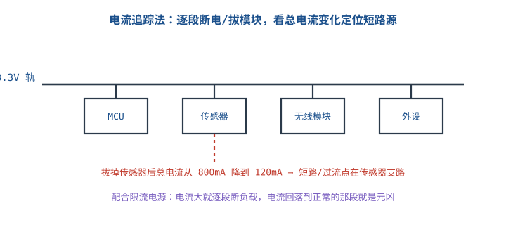
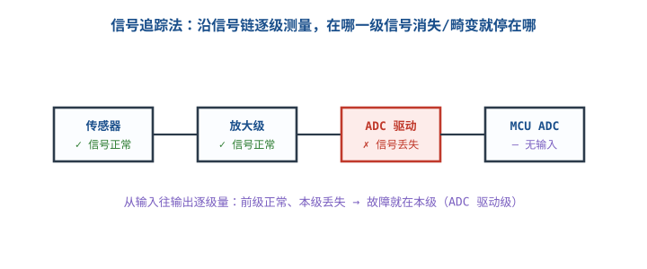

# 硬件调试方法论与上电检查

## 1. 调试不是瞎试，是有方法的

::: motivation 最怕"一边猜一边改"
新手遇到板子不工作，习惯是：拔插一下、换个元件、再上电看看——这种"穷举试错"浪费时间还可能烧板。成熟的做法是**分级上电、逐级验证、分而治之**：先确认最基础的电源和时钟，再往下走；任何一级不通过就停下来查，不带着问题进入下一级。
:::

核心心法（源自 Agans 调试九法则的硬件版）：**理解系统 → 让它复现 → 别空想、去测量 → 分而治之 → 一次只改一个变量。**

## 2. 上电检查标准流程

主图是新板第一次上电的五级检查，每一级都是下一级的前提：

定量判据：
- **不通电查短路**：通断档量电源对地，正常应高阻（OL）；接近 0Ω 就是短路，**绝不许上电**。
- **限流上电**：电流限到预期 1.5~2 倍。若一上电电流顶到限流点（如限 200mA 却立刻 200mA），说明仍有短路，断电查。
- **量电压**：每路电源与设计值偏差应在 ±5% 内（LDO ±2%）；偏差大先查电源再查负载。

## 3. 两大定位方法

### 电流追踪法（查短路/过流）
板子电流异常大时，逐段断开负载或拔模块，看总电流回落在哪一段。

### 信号追踪法（查信号链丢失）
从输入往输出逐级测量，前一级正常、本级丢失，故障就在本级。

## 4. 完整调试示例

::: example 一块新 MCU 板"不跑程序"
1. **不通电**：通断档量 3.3V 对地 → OL，无短路。
2. **限流上电**：限 200mA，实测静态 35mA，正常。
3. **量电压**：3.3V 实测 3.29V ✓；1.8V 内核实测 0V ✗。
4. 停在这一级：内核 LDO 输出 0V。量 LDO 输入有 3.3V、输出 0V → LDO 使能脚悬空（应为高）。
5. 给使能脚上拉 → 内核 1.8V 出来，程序跑起来。
:::

这就是"分级不通过就停下"的价值：没去瞎猜软件，而是定位到了硬件使能脚。

## 5. 上手操作清单

- [ ] 永远先不通电查短路，再限流上电。
- [ ] 一次只改一个变量，改完就验证，别同时动好几处。
- [ ] 用测量代替猜测："我觉得是……"不如拿表/示波器量一下。
- [ ] 让 bug 可复现：偶发问题先找稳定复现条件。

## 扩展与变种电路

### 扩展1：电流追踪与逐段断电 Current Trace / Divide

当总电流异常但不知哪个模块吃电时，用限流电源配合逐段断电。

::: example 操作与判据
- 限流电源设到略高于预期总电流，记录满载电流。
- 逐个断开/拔下模块（或吹掉电源磁珠），每断一个记一次总电流。
- 例：断传感器支路后电流从 800mA→120mA，落差 680mA 全在传感器——该支路有短路或反向插入的器件。
- 定量：正常每路静态电流应与设计估算吻合；某支路远大于估算即异常。
:::

对比"整块板瞎量"：逐段断电把故障空间一刀切成两半，是二分法的硬件版。

::: pitfall 不断电就拔模块拉电弧
- **现象**：带电拔排针时打火、模块瞬间烧。
- **原因**：带电插拔产生浪涌，尤其大电容/感性负载。
- **解决**：调试拆模块前先断电或限流到很小；连接器设计时注意先断后通顺序。
:::

### 扩展2：信号链逐级追踪 Signal Tracing

信号不正常时，沿信号链从输入到输出逐级测，缩小故障级。

::: example 操作与判据
- 输入已知信号（信号发生器喂标准波形）。
- 示波器/万用表从传感器输出量起，逐级往后：哪一级输出不对，故障就在这一级与其输入之间。
- 例：传感器输出 0.5V ✓、放大级输出 5V ✓、ADC 驱动输出 0V ✗ → 查驱动级供电/输入耦合。
- 定量：每级增益/电平均应符合设计值；偏离即异常。
:::

对比"从输出往回猜"：正向逐级测逻辑清晰，每步都有定量判据，不靠猜。

::: pitfall 探头负载改变高阻节点
- **现象**：一接示波器信号就变，拿掉探头又正常。
- **原因**：高阻节点被探头电容/电阻拉偏。
- **解决**：用 10X 探头、高阻缓冲，或先估算探头负载效应。
:::

## 6. 常见坑与故障现象

::: pitfall 常见坑
- **不查短路直接上电**：烧板。第一次必须通断档 + 限流。
- **一次改多个地方**：不知道哪个改动起效，bug 还在。一次只改一个变量。
- **带着问题进入下一级**：电压还不对就去调软件，永远调不好。逐级通过再往下。
- **空想不测量**："我觉得是晶振没起振"——拿示波器量一下 CLK 有没有跳变再说。
:::

## 7. 自测题

新板第一次上电前，万用表要先做哪件事？

不通电、用通断档量电源对地是否短路。接近 0Ω 说明短路，绝不能上电；OL（高阻）才继续。然后电源限流上电。

板子总电流 800mA 远超预期 150mA，用什么方法快速定位？

电流追踪法：限流电源配合逐段断开负载/拔模块，记录每段电流。电流回落到正常值的那一段即为过流/短路支路，重点查该支路。

信号链"传感器→放大→ADC"，怎么用逐级测量定位故障级？

从传感器输出开始逐级往后量：传感器输出正常、放大级正常、到 ADC 驱动输出丢失，说明故障就在 ADC 驱动级。前级都对、本级不对，就是本级问题。

## 8. 参考资料

- SparkFun Learn – [How to Use a Multimeter](https://learn.sparkfun.com/tutorials/how-to-use-a-multimeter/all)
- David J. Agans, *Debugging: The 9 Indispensable Rules for Finding Even the Most Elusive Software and Hardware Problems*（调试九法则）
