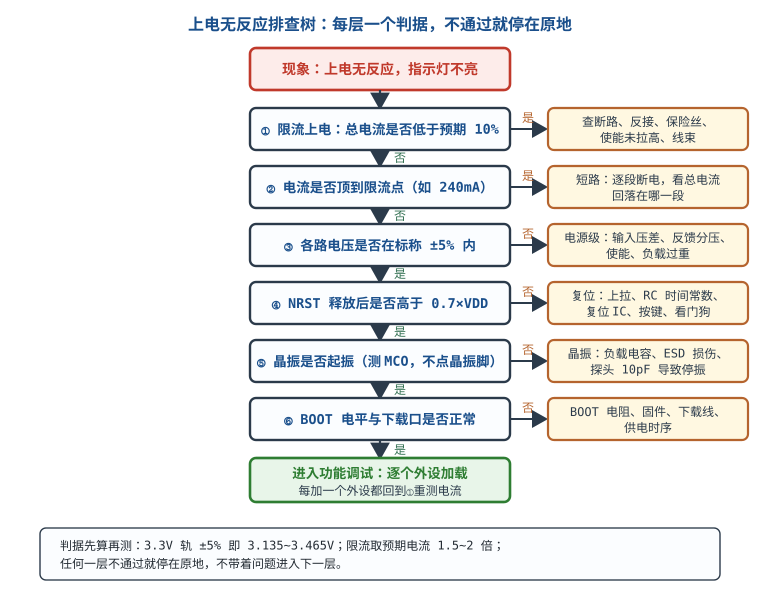

# 硬件调试方法论与上电检查

一块新板子不工作，新手的第一个动作往往是换芯片、重烧固件、再拔插一次；老手的第一个动作是拿表。这两者的差别不在经验多少，而在**有没有把"测量"变成纪律**：动手之前先有一个可证伪的假设，测量之前先有一个数值判据，每次只改一个变量，改完就记录。这一章不讲某一个具体故障怎么修，它讲的是把"从现象到根因"这件事拆成可以照着执行的步骤——二分收缩、故障树、单变量、记录与复现，最后用一棵完整的"上电无反应"排查树和一个"通信偶发丢包"的定位过程把方法走满一遍。

## 1 设计动机：为什么"先测量后猜"必须写成纪律

::: motivation 三个代价很高的"猜"
**场景一：差 0.25V 的电压，猜了三次。** 3.3V 轨实测 3.05V，比标称低 7.6%，已经超出 ±5% 判据。按"猜"的顺序换 LDO、换输出电容、减小负载，每次拆焊 15 分钟加复测 5 分钟，共 60 分钟，故障依旧；最后量 LDO 输入只有 3.55V，压差 0.50V 已经贴着 dropout，10 分钟就定位到"输入欠压"而不是"输出不够"。

**场景二：同时改三处，等于没改。** 上拉电阻、滤波电容、固件延时一起改，故障消失了，但不知道是哪一处起效。两周后换元件批次，同样的现象回来，还得从头来。一次只改一处，三次实验各 10 分钟，换来三条确定的因果关系。

**场景三：偶发故障不记录，等于没遇到。** 设备每天随机死机一次，现场不记录温度、电压、复位原因，两周没有进展；加一张记录表后三天拿到六次现场数据，发现复位原因寄存器全部指向"电源跌落"，定位到负载开关的软启动不足。
:::

这三种浪费有一个共同点：**故障空间没有被测量切开，而是被猜测搅乱了。** 调试的成本几乎全部来自"问题空间有多大"和"每次尝试能排除多少"，而不来自"元件有多难换"。两个数的对比很直白：

| 方法 | 候选原因数 | 平均尝试次数 | 结论可信度 | 可复用性 |
|---|---|---|---|---|
| 穷举换件 | 约 10 个可疑点 | 5 次（平均撞到一半） | 低：换好了也不知道为什么 | 无，下次重来 |
| 二分测量 | 1000 个节点 | $\lceil\log_2 1000\rceil=10$ 次 | 高：每一步都有判据 | 高，方法可迁移 |
| 同时改多处 | 4 个变量 | $2^4=16$ 种组合 | 极低：起效的可能是交互作用 | 负，制造新问题 |

不按方法走，会摔在这四个具体的坑上，每个坑都能用数字说清：

1. **把"偶发"当"玄学"。** 复现概率 $p=1\%$ 时，测 20 次全部正常的概率是 $0.99^{20}=0.818$——八成以上什么都没证明。要 95% 把握看到至少一次，需要测 298 次。
2. **一次改多个变量。** 4 个二值变量有 $2^4=16$ 种组合，靠试完所有组合找根因，时间成本是单变量法的 4 倍以上，而且交互作用还会骗人。
3. **没有数值判据。** "看起来正常"不是判据。3.3V 轨的 ±5% 判据是 3.135~3.465V，实测 3.10V 已经超差，却被"差不多"放过，后面所有结论都建在流沙上。
4. **不带电检查直接上电。** 一次电源对地短路，电流只受电源限流能力约束，轻则烧稳压器，重则烧板。先做通断检查只花两分钟。

所以"先测量后猜"不是态度问题，是**效率问题**：它把"我猜是它"换成"我量到它不是它"，每一次否定都在真实地缩小故障空间。

## 2 定义与直观：调试是"收缩故障空间"的过程

**调试（debugging）**可以定义成一个受约束的搜索过程：给定一个可观测的异常现象，用测量把候选原因集合 $S$ 反复切分，直到 $|S|=1$，并且这个唯一元素能被一条可重复的测量证据支持。定义里有四个条件，缺一个方法就退化成瞎试：

| 条件 | 反例 | 具体要求 |
|---|---|---|
| 现象可观测、可复现 | "有时候不太对" | 写成"3.3V 轨纹波 120mVpp、开关频率处峰尖"这样的客观描述 |
| 假设可证伪 | "可能是干扰" | 假设必须预测"如果成立，在某个点应测到某个范围内的值" |
| 测量有判据 | "电压正常" | 判据必须带数字和单位，如 $3.135\sim3.465\ \text{V}$ |
| 改动单变量 | 同时换电容和固件 | 一次只动一处，动完立即复测同一判据 |

::: analogy 调试是"在一千米的线上找断点"
一根 1000 米长的电缆中间断了，你没有 X 光机。最笨的办法是从一头开始每米测一次，最多 1000 次；聪明的办法是在 500 米处测一次——通，则断点在 500~1000 米；不通，则在 0~500 米。每测一次，嫌疑长度减半，$\lceil\log_2 1000\rceil=10$ 次就能把范围压到 1 米以内。

类比的边界有两个。**第一，电信号不是"通/不通"两种状态**：电压偏低、纹波偏大、时序临界都是"中间态"，所以真实的判据往往不是二值，而是带容差窗口的比较——窗内通过、窗外失败，判据本身要先用噪声水平验证过。**第二，二分要求每一刀都切在"能区分"的地方**：如果你在 500 米处测的是另一根线，这一刀就白切了。硬件调试里"切错组合"的典型是：怀疑电源却去量信号，怀疑地却去换芯片。
:::

上电检查之所以要分成五级，是因为每一级都是下一级的前提：短路没排除就上电，可能直接烧；电流异常就量电压，读数没有意义；电压不对就查时钟，时钟可能根本起不来；时钟没起振就去调固件，等于在沙地上盖楼。**"任一级不通过就停下"这条纪律，比任何一条具体判据都值钱。**

先建立一张"从现象反推故障类型"的对照表，它决定你第一次拿表该往哪儿放：

| 现象 | 首选测量 | 典型根因方向 | 判据（典型量级，以设计值为准） |
|---|---|---|---|
| 上电完全不启动，指示灯不亮 | 限流电源看总电流 | 短路、反接、保险丝、使能未拉高、线束 | 电流低于预期 10% 或顶到限流点 |
| 有电流但不运行 | 各路电压 → 复位 → 时钟 | 欠压、复位未释放、晶振不起振、BOOT 错 | 电压 ±5%、NRST 高于 $0.7V_{DD}$、时钟有跳变 |
| 间歇重启/死机 | 电源瞬态、复位原因寄存器、温度 | 负载阶跃跌落、看门狗、焊点热胀冷缩、EMC | 跌落幅度与复位阈值比较 |
| 发热异常 | 红外/热电偶、各路电流、效率 | 短路、驱动直通、损耗过大、散热不良 | 温升超过设计结温余量 |
| 精度差/漂移 | 基准、地电位、源阻抗、建立时间 | 基准噪声、地环路、采样建立不足、温漂 | 误差折合 LSB 或 ppm |
| 通信误码/丢包 | 差分眼图、共模电压、终端匹配 | 反射、共模超范围、地环路、时钟偏差 | 眼高/眼宽、共模在 $-7\sim+12\ \text{V}$ 内 |

这张表不是决策树，它只回答"第一刀往哪切"。真正的树要针对具体系统画，见 §4.1。

## 3 定量关系：判据、二分收敛与复现样本数

### 3.1 二分的收敛速度

设候选原因（或候选节点）有 $N$ 个，每次测量能把范围切成两半，需要的测量次数是：

$$n=\left\lceil\log_2 N\right\rceil$$

- $n$：测量次数（次）；
- $N$：候选数（个），量纲为 1；
- $\lceil\cdot\rceil$：向上取整。

代入 $N=1000$：$\log_2 1000=9.966$，向上取整得 $n=10$ 次。与穷举的 1000 次相比，效率比是 $1000/10=100$ 倍。这个式子还给出一个工程含义：**候选空间每扩大 10 倍，只需要多做约 3.3 次测量**（$\log_2 10=3.32$）。所以"系统复杂"不该成为不测量的理由，真正拖慢调试的是"切不中"。

适用条件：每次测量的判别可靠性要足够高。若单次测量有 30% 概率误判，二分树会被污染，实际次数迅速接近随机搜索——这就是为什么判据要先经过噪声验证（§3.3）。

### 3.2 先验概率：先测最可能坏的那一支

二分假设两支概率相等。真实系统里各支的失效率差别很大，此时"先测哪一支"会影响期望次数。设第 $i$ 类原因的先验概率为 $p_i$，顺序测试的期望测量次数是：

$$E[n]=\sum_{i=1}^{k} i\cdot p_{(i)}$$

其中 $p_{(1)}\ge p_{(2)}\ge\cdots\ge p_{(k)}$ 是按概率从大到小排序后的先验。信息论给出的下界是熵：

$$H=-\sum_{i=1}^{k}p_i\log_2 p_i$$

以四类原因为例：电源 40%、固件 25%、时钟 20%、复位 15%。

先测电源、再固件、再时钟、再复位：

$$E[n]=1\times0.40+2\times0.25+3\times0.20+4\times0.15=0.40+0.50+0.60+0.60=2.10\ \text{次}$$

若反过来先测复位：$1\times0.15+2\times0.20+3\times0.25+4\times0.40=2.90$ 次。两种顺序差 0.8 次测量，按每次 20 分钟算就是 16 分钟。熵下界是：

$$H=-(0.40\log_2 0.40+0.25\log_2 0.25+0.20\log_2 0.20+0.15\log_2 0.15)=1.90\ \text{bit}$$

即任何策略平均都至少要 1.90 次测量，顺序测试的 2.10 次已经很接近。**结论：把历史故障率统计出来，按概率从高到低排测量顺序，是唯一能在不增加仪器的情况下缩短调试时间的办法。**

### 3.3 判据必须比噪声高出一截

测量系统本身有噪声。要区分两个电平，差值至少要达到噪声有效值的 3 倍，否则读数在判据附近来回跳：

$$\Delta V_{min}\ge 3V_{n,rms}$$

以 12 位 ADC、3.3V 基准为例，1 LSB 是：

$$V_{LSB}=\frac{3.3}{2^{12}}=\frac{3.3}{4096}=8.06\times10^{-4}\ \text{V}=806\ \mu\text{V}$$

要用测量判断"是否偏差 1 LSB"，测量系统噪声必须满足 $V_{n,rms}\le 806/3=269\ \mu\text{V}$。普通示波器在最灵敏档的底噪常在百微伏到毫伏量级，长地线引入的噪声更大——所以"示波器上看不出来"经常是测量分辨率不够，不是电路没问题。

反过来，如果一条判据的余量本来就只有噪声的 2 倍，正确的动作不是"多测几次取平均"，而是先改善测量（换探头、缩短地线、加带宽限制、用差分探头），否则你只是在测仪器。

### 3.4 偶发故障要测多少次

设单次试验能复现故障的概率为 $p$，要做 $n$ 次独立试验才有 $C$ 的把握至少看到一次：

$$n=\frac{\ln(1-C)}{\ln(1-p)}$$

- $C$：置信水平（0~1），无量纲；
- $p$：单次复现概率（0~1），无量纲；
- $n$：试验次数（次）。

代入 $p=0.01$、$C=0.95$：$n=\ln(0.05)/\ln(0.99)=(-2.996)/(-0.01005)=298$ 次，取整 299 次。要 99% 把握：$n=\ln(0.01)/\ln(0.99)=458$ 次。这就是"偶发故障不能靠碰"的定量理由。

反向用法更常用：做了 $n$ 次试验一次都没复现，故障率的 95% 置信上限约为

$$p_{max}\approx\frac{3}{n}$$

$n=300$ 时精确值是 $1-0.05^{1/300}=0.993\%$，近似式给 $3/300=1\%$，两者相差 0.7%，工程上够用。**所以"连续 300 次没复现"才勉强能说故障率低于 1%，而"测了 20 次没复现"什么也说明不了。**

### 3.5 单变量原则与组合爆炸

若同时改动 $k$ 个二值变量（改/不改），要覆盖所有组合需要 $2^k$ 次实验：

$$N_{comb}=2^{k}$$

$k=4$ 时 $N_{comb}=16$，$k=5$ 时 32。一次只改一个变量时只需 $k$ 次实验，且每次的结论都是确定的——代价是无法发现"只有两个变量同时改才出现"的交互作用。工程做法是：**先单变量扫描找到主效应，再对两个可疑变量做 $2\times2$ 的四组交叉验证**，这比一上来做全因子实验省一个数量级。

### 3.6 时间常数：什么时候"等一等"就够了

指数建立过程的判据是时间常数 $\tau=RC$：

$$V(t)=V_\infty\left(1-e^{-t/\tau}\right)$$

$t=\tau$ 时到 63.2%，$t=5\tau$ 时到 $1-e^{-5}=99.33\%$。所以"等 5 个时间常数"是通用判据：$R=10\ \text{k}\Omega$、$C=100\ \text{nF}$ 时 $\tau=10^4\times10^{-7}=1\ \text{ms}$，等 5ms 再读数。需要 12 位精度时判据更严：$\ln(2^{13})=9.01$，要等 9 个 $\tau$ 才能把建立误差压到 1 LSB 以下。这一条在电源软启动、基准建立、采样保持的测量里反复用到。

## 4 典型计算：两棵完整的排查树

### 4.1 完整故障树：上电无反应

"上电无反应"是最常见也最容易乱猜的现象。把它画成树，每个节点都带判据，就能保证不漏支路、不跳级：

树的六个节点与判据：

| 节点 | 测量点 | 期望/判据 | 不通过时的下一步 |
|---|---|---|---|
| ① 总电流 | 限流电源读数 | 预期 120mA，限流设 180~240mA（1.5~2 倍）；低于 12mA 或顶到限流都异常 | 低于 12mA 查断路/反接/使能；顶限流查短路 |
| ② 各路电压 | 每路电源输出 | 3.3V 轨 3.135~3.465V（±5%）；内核 1.8V 轨 1.71~1.89V | 查电源级：输入压差、反馈分压、负载过重 |
| ③ 复位 | NRST/复位 IC 输出 | 释放后高于 $0.7V_{DD}=2.31\ \text{V}$；低电平低于 $0.3V_{DD}=0.99\ \text{V}$ | 查上拉、RC、复位 IC、按键、看门狗 |
| ④ 时钟 | 晶振引脚或 MCO 输出 | 有稳定跳变，频偏在晶振标称范围内（典型 ±20~50ppm） | 查负载电容、晶振、焊接；**别用探头直接点晶振引脚** |
| ⑤ BOOT/固件 | BOOT 引脚、串口/SWD | BOOT 电平符合启动模式；下载口能识别 | 查 BOOT 电阻、固件、下载线、供电时序 |
| ⑥ 功能加载 | 逐个外设 | 每加一个外设总电流与功能都对 | 回到①重测，定位加载瞬间的异常 |

**完整走查一遍。** 一块 12V 供电、3.3V 与 1.8V 双轨的 MCU 板，"上电无反应"：

1. **不通电目视 + 通断**：3.3V 对地 OL（高阻），无短路，允许上电。
2. **限流上电**：限流设 240mA，实测静态 35mA。预期 120mA 是带外设满载的值，空载 35mA 在合理范围，节点①通过。
3. **量电压**：3.3V 实测 3.29V（判据 3.135~3.465V，通过）；1.8V 实测 0.00V，节点②不通过——**停在这里，不往下走**。
4. **查电源级**：1.8V 由内部 LDO 产生，量其输入 3.3V 正常、输出 0V、使能脚 0.40V。使能阈值典型 1.2V（以数据手册为准），0.40V 远低于阈值，判定"使能未拉高"。
5. **根因**：使能脚在原理图上悬空，设计意图是靠内部上拉，但该脚高阻，板上并联的 100kΩ 下拉与漏电流形成分压，实测被拉到 0.40V。
6. **修复**：使能脚加 10kΩ 上拉到 3.3V，上拉电流 $3.3/10^4=0.33\ \text{mA}$，远大于该脚漏电流（典型 µA 级），分压被压住。复测 1.8V 出来，程序运行，节点③④⑤依次通过。

这个例子的价值不在"使能脚要上拉"，而在**第 3 步停下来**：如果这时去怀疑固件、去重烧程序，会浪费几小时，而且 1.8V 缺失这个硬证据一直摆在那里。

### 4.2 完整算例：通信偶发丢包的系统化定位

**现象（客观化后的记录）**：

| 项目 | 记录 |
|---|---|
| 链路 | RS-485 半双工，115200bps、8N1，电缆 50m 双绞屏蔽 |
| 丢包率 | 约 1 帧 / 4200 帧（连续 10 万帧统计，24 帧丢失） |
| 时间相关性 | 全部落在电机启停后 300ms 窗口内；静置时 0 丢失 |
| 数据相关性 | 与帧长、内容、校验方式无关，丢帧位置随机 |
| 单板相关性 | 换从站板仍复现，换主站板仍复现 |
| 温度相关性 | $-10\sim+45\ ^\circ\text{C}$ 无差异 |

**第一步，把现象变成可算的判据。** 位时间与帧长先算出来：

$$t_{bit}=\frac{1}{115200}=8.68\ \mu\text{s},\qquad t_{frame}=80\times8.68\ \mu\text{s}=694\ \mu\text{s}$$

（8 字节数据加帧头帧尾按 80 位估。）丢包率换成误码率：

$$\text{BER}=\frac{1/4200}{80}=2.98\times10^{-6}$$

**第二步，先算三个"可以排除"的项，别急着拆机。**

*反射*：电缆 50m，双绞线传播速度约 $0.66c=1.98\times10^8\ \text{m/s}$，单程延迟

$$t_d=\frac{50}{1.98\times10^8}=253\ \text{ns},\qquad 2t_d=505\ \text{ns}$$

往返 505ns 只占位时间 8.68µs 的 5.8%，且两端各有 120Ω 终端（$\Gamma=(120-120)/(120+120)=0$），反射不成立。若把速率提到 1Mbps（位时间 1µs），往返延迟就占半个位，那时终端与线长才会变成主因——**同一个链路，速率不同，结论不同。**

*共模超范围*：RS-485 接收器共模范围是 $-7\sim+12\ \text{V}$（TIA-485 要求，具体芯片以数据手册为准）。差分探头同时测 A、B 对地：静止时共模 4.2V，电机启停瞬间峰值 6.8V，仍在范围内，排除。

*幅度不足*：带 60Ω 负载（两个 120Ω 并联）测差分幅度 2.4V，接收器阈值 ±200mV，余量 $2.4-0.2=2.2\ \text{V}$，排除。

**第三步，抓现场。** 用差分探头、单次触发、触发条件设为"差分幅度小于 1.0V"，同时用电流探头夹电机线做时间基准。抓到的波形是：差分信号上叠加一个宽约 40ns、幅度 0.9~1.1V 的负向尖峰，出现时刻与电机换向尖峰同步。**这与"随机位置的整帧丢失"吻合**：尖峰落在空闲期会被 UART 误判为起始位，收完一帧发现校验错，整帧丢弃。

**第四步，给假设排顺序（先验）。** 尖峰的来源有三个候选：① 屏蔽层两端接地形成地环路，电机共模电流经屏蔽层耦合；② 信号线与电机线并行捆扎，容性/感性串扰；③ 收发器电源去耦不足。按"改动成本 × 先验概率"排序，先验证①（改接地只需拆一端屏蔽）。

**第五步，改一个变量。** 断开屏蔽层远端接地（改为单端接地），复测 2 万帧，仍有 3 帧丢失——①不是全部原因，但它把丢包率从 1/4200 降到 1/6700，说明共模路径确实存在。**保留这个改动，再动下一个变量**：在接收端加共模扼流圈（100µH，典型量级）。

**第六步，根因的定量核算。** 共模瞬变经"线对—屏蔽层"的不对称电容转成差模电流。设不对称电容 $\Delta C=1\ \text{nF}$、共模电压变化率 $dv/dt=15\ \text{V}/\mu\text{s}$：

$$i_{cm}=\Delta C\frac{dv}{dt}=1\times10^{-9}\times15\times10^{6}=15\ \text{mA}$$

这 15mA 流过终端等效电阻 $60\ \Omega$，产生差模电压：

$$V_{dm}=15\times10^{-3}\times60=0.90\ \text{V}$$

与实测 0.9~1.1V 吻合。**根因是"屏蔽层两端接地 + 线对不对称电容"共同构成的共模—差模转换，不是收发器坏了，也不是协议有问题。**

加 100µH 共模扼流圈后，在尖峰的主要频率分量（约 $1/(2\pi\times40\ \text{ns})\approx4\ \text{MHz}$）上，扼流圈阻抗为：

$$Z_{cm}=2\pi fL=2\pi\times4\times10^{6}\times100\times10^{-6}=2513\ \Omega$$

共模电流被分压到：

$$i'_{cm}=15\ \text{mA}\times\frac{60}{2513+60}=0.35\ \text{mA}$$

转换出的差模噪声：

$$V'_{dm}=0.35\times10^{-3}\times60=21\ \text{mV}$$

21mV 只有接收器阈值 200mV 的 10.5%，判据通过。

**第七步，修复与验证。** 三项措施一起上（屏蔽单端接地、共模扼流圈、隔离收发器），验证判据是"连续 $10^6$ 帧零丢失 + 1000 次电机启停零丢失"。实测 $10^6$ 帧 0 丢失，按 §3.4 的近似，此时真实丢包率的 95% 上限约 $3/10^6=3\times10^{-6}$，比修复前的 $2.4\times10^{-4}$ 低两个数量级，结论成立。

**第八步，防再发。** 把"屏蔽层单端接地""电机线与信号线分开走线""RS-485 接口预留共模扼流圈位置"写进接口设计规范；把"电机启停 + 连续 10 万帧"加入出厂测试项。

## 5 工程含义：判据数量级、仪器与被测的相互影响

### 5.1 常用判据的数量级

| 量 | 判据（典型量级） | 说明 |
|---|---|---|
| 电源电压 | 标称 ±5%（LDO 常按 ±2%） | 先看电源再看负载 |
| 总电流 | 预期值的 1.5~2 倍设限流 | 顶到限流即视为异常 |
| 复位释放电平 | 高于 $0.7V_{DD}$ | 低电平低于 $0.3V_{DD}$ |
| 时钟频偏 | 晶振标称 ±20~50ppm | 用频率计或 MCO 输出测 |
| 纹波 | 开关频率处峰峰值，与设计值比 | 测量带宽要够，别用长地线 |
| 温升 | 结温留 20~30 °C 余量 | 用热阻算，别用手摸 |
| 通信眼高 | 大于接收阈值 3 倍 | 阈值 ±200mV 时眼高 ≥600mV |
| 数字时序 | 建立/保持各留 20% 余量 | 见[时序分析与亚稳态](../digital/timing-analysis-metastability.md) |

### 5.2 仪器会改变被测电路

测量不是"旁观"，探头本身就是负载。10X 无源探头典型输入阻抗 $10\ \text{M}\Omega\parallel10\ \text{pF}$（典型量级，以探头手册为准）。10pF 在 1MHz 的容抗：

$$X_C=\frac{1}{2\pi fC}=\frac{1}{2\pi\times10^{6}\times10\times10^{-12}}=15.9\ \text{k}\Omega$$

若被测节点是 100kΩ 的高阻节点、信号源内阻也是 100kΩ，探头的 15.9kΩ 并在节点上，读数只剩：

$$\frac{13.7}{100+13.7}=12.1\%$$

也就是说，**探头一碰，节点电压掉到原来的八分之一**。这类"一测就变、拿开就正常"的现象，根因往往在探头而不在电路。

带宽判据同样要算。信号上升时间 $t_r=10\ \text{ns}$ 时，边沿的拐点频率：

$$f_{knee}\approx\frac{0.35}{t_r}=\frac{0.35}{10\times10^{-9}}=35\ \text{MHz}$$

示波器带宽至少取 3 倍，即 105MHz；要看清过冲与振铃，取 5 倍即 175MHz。**用 100MHz 的机器去看 10ns 边沿，看到的过冲是仪器自己的。** 探头的接地方式比带宽更容易出错：长地线夹引入几十 nH，与被测环路一起振铃，测出来的"毛刺"可能是探头回路自己的谐振，详见[示波器：探头、触发、带宽与接地](oscilloscope.md)。

### 5.3 记录与复现：把"经验"变成"数据"

一张合格的调试记录至少包含：时间、环境温度、供电电压、总电流、各路关键电压、现象描述、本次改动、改动后的测量结果。记录的作用有三个：

1. **防止重复劳动**：换人接手时不用重新问一遍"你试过什么"。
2. **建立先验**：十次故障里有六次是电源，下一次就先测电源——这正是 §3.2 的概率排序。
3. **支持统计结论**：§3.4 的样本数公式要有"试验了多少次"才能用，没有记录就没有分母。

复现的三要素是：**条件（温度/电压/负载/时序）、触发（什么动作之后出现）、频率（多少次出现一次）**。三者缺一，修好了也无法证明修好了。

### 5.4 时间账

一次打样加贴片按天算，一小时测量按小时算。板子回来之前先在[LTspice 仿真入门](ltspice.md)里把工作点和环路跑一遍，回来之后按本章的五级流程走一遍，能把"上电即烧"和"调了三天发现是电源"这两类事故压到很低。真正省时间的不是更贵的仪器，而是**每次只改一个变量、每次都有判据**这两条纪律。

## 6 常见坑

::: pitfall 不查短路直接上电
- **现象**：一按开关电源就进入限流、冒烟，或稳压器瞬间发烫。
- **原因**：电源对地存在短路（焊接桥连、器件反接、电容击穿），上电电流只受电源能力限制。
- **解决**：上电前用通断档量每路电源对地，OL 才允许上电；首次上电必须限流到预期电流的 1.5~2 倍，手不离开关。
:::

::: pitfall 一次改多个变量
- **现象**：改完故障消失，过几天又出现；或者改完故障变了但不知道哪一步起效。
- **原因**：多个改动叠加，无法区分主效应与交互作用；$k$ 个变量有 $2^k$ 种组合。
- **解决**：一次只改一处，改完立即复测同一判据并记录；需要验证交互作用时再做 $2\times2$ 交叉实验。
:::

::: pitfall 带着问题进入下一级
- **现象**：1.8V 内核电压是 0V，却去重烧固件、换晶振，几小时没有进展。
- **原因**：跳过了"逐级通过"的纪律，把上层现象当成根因。
- **解决**：五级流程任何一级不通过就停下，先把这一级的判据测绿；本级没绿之前不碰下一级。
:::

::: pitfall 空想不测量
- **现象**："我觉得是晶振没起振""可能是干扰"，讨论半天没有数据。
- **原因**：假设没有变成可证伪的预测，测量没有目标。
- **解决**：把假设写成"如果成立，在 X 点应测到 Y 范围内的值"，然后去测；测不到就换假设，别换说法。
:::

::: pitfall 探头负载改变高阻节点
- **现象**：一接示波器信号就变，拿开探头又正常；高阻分压点读数总比计算值低。
- **原因**：探头 10pF 在 1MHz 的容抗只有 15.9kΩ，并在 100kΩ 节点上把信号拉掉约 88%。
- **解决**：用 10X 探头并先估算负载效应；高阻节点用高阻缓冲/有源探头；必要时先算后测。
:::

::: pitfall 偶发故障测几次就宣布修好
- **现象**：改了某处，测 20 次没再出现，出货后批量复发。
- **原因**：$p=1\%$ 时 20 次全过的概率是 81.8%，样本量根本不足以证明改善。
- **解决**：按 $n=\ln(1-C)/\ln(1-p)$ 定样本数（95% 把握、1% 复现率需 299 次）；验证要覆盖原触发条件（温度、负载、启停）。
:::

## 7 自测题

候选原因有 1000 个节点，二分测量需要几次？为什么"系统复杂"不是不测量的理由？

$$n=\lceil\log_2 1000\rceil=\lceil9.966\rceil=10\ \text{次}$$

候选空间每扩大 10 倍只多约 3.3 次测量（$\log_2 10=3.32$）。真正拖慢调试的是"切不中"（判据不可靠、测错组合），不是候选数量。

四类故障先验概率为电源 40%、固件 25%、时钟 20%、复位 15%，按这个顺序测的期望次数是多少？反过来呢？

按概率从大到小：$1\times0.40+2\times0.25+3\times0.20+4\times0.15=2.10$ 次。

反过来（复位先测）：$1\times0.15+2\times0.20+3\times0.25+4\times0.40=2.90$ 次。

差 0.8 次测量。信息熵下界 $H=1.90$ bit，说明顺序测试已接近最优。

某偶发故障单次复现概率 1%，要 95% 把握看到一次需要测多少次？测了 300 次没复现，能说明故障率低于多少？

$$n=\frac{\ln(1-0.95)}{\ln(1-0.01)}=\frac{-2.996}{-0.01005}=298\ \text{次}$$

取 299 次。测 300 次无复现时，95% 置信上限约 $3/300=1\%$（精确值 $1-0.05^{1/300}=0.99\%$），即"故障率低于 1%"。

"上电无反应"的五级检查中，1.8V 实测 0V、3.3V 正常，下一步该做什么？不该做什么？

下一步：停在电压这一级，量 1.8V 电源的输入、输出、使能/反馈脚，判断是电源级本身还是负载问题（如使能未拉高、反馈分压开路、负载短路）。

不该做：不要跳去重烧固件、换晶振、查通信——1.8V 缺失是硬证据，本级没绿之前上层现象没有解释力。

RS-485 链路 115200bps、50m 电缆，反射是不是丢包的合理嫌疑？换成 1Mbps 呢？

50m 双绞线单程延迟 $50/(0.66\times3\times10^8)=253\ \text{ns}$，往返 505ns，占 115200bps 位时间 8.68µs 的 5.8%，且两端 120Ω 终端使反射系数为 0，反射不成立。

换成 1Mbps 时位时间只有 1µs，往返延迟占半个位，终端与线长立刻变成主因。

用 10X 探头（10MΩ∥10pF）测一个 100kΩ 源内阻的高阻节点，1MHz 下读数会偏多少？怎么避免误判？

探头容抗 $X_C=1/(2\pi\times10^6\times10\times10^{-12})=15.9\ \text{k}\Omega$，与节点并联后分压：

$$\frac{13.7}{100+13.7}=12.1\%$$

读数只剩约 12%。避免办法：先估算负载效应，或改用高阻缓冲/有源探头；低频直流测量可忽略，高频必须算。

## 8 参考资料

- **David J. Agans, *Debugging — The 9 Indispensable Rules***：规则 2「复现问题」、规则 3「别猜，去看」、规则 5「一次只改一个变量」、规则 7「先查最近改过的东西」；本章 §1、§5.3 的纪律来自这四条。
- **Henry W. Ott, *Electromagnetic Compatibility Engineering*, Chapter 3 *Grounding***：共阻耦合、地环路与接地拓扑；本章 §4.2 的共模—差模转换分析沿用该章的耦合模型，定量细节见[地的学问与地弹](../power/grounding.md)。
- **Analog Devices, MT-031 *Grounding Data Converters and Solving the Mystery of "AGND" and "DGND"***：混合信号系统的地噪声测量方法与判据；本章 §5.2 的"测量先看地"口径与之一致。
- **IEC 61000-4-4:2012, *Electrical fast transient/burst immunity test***：快速瞬变脉冲群的波形、耦合方式与试验等级；本章 §4.2 的"间歇故障要在原触发条件下复现"按该标准的试验思路设计。
- **Tektronix, *ABCs of Probes Primer*, Probe Loading 章节**：10X 探头的输入阻抗、寄生电容与负载效应；本章 §5.2 的 15.9kΩ 容抗算例按该文口径。
- 器件侧的判据（复位阈值、使能阈值、通信共模范围）以各器件数据手册为准；本章给出的数值均为典型量级，设计时需用实际型号手册复核。焊点与装配类的间歇故障排查见[故障排查案例库](troubleshooting-cases.md)，仿真侧的预验证见[LTspice 仿真入门](ltspice.md)，上电前的焊点检查见[焊接：直插、贴片、拆焊与飞线](soldering.md)。
