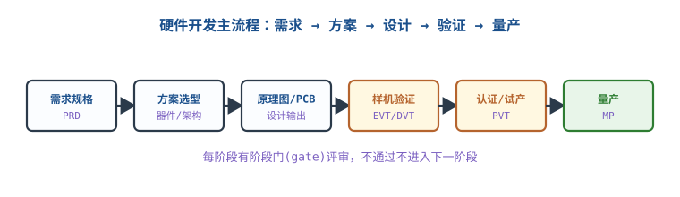
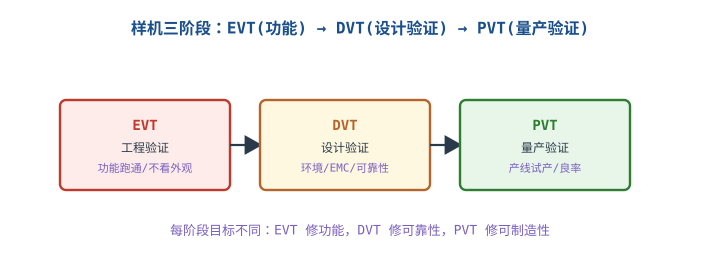

# 硬件开发流程：需求到量产

## 1. 为什么要有流程

::: motivation 硬件不像软件能随时改
软件改一行代码就能发版；硬件改一次 PCB 要打样、焊接、验证，周期几周、成本几千块。**所以硬件开发必须分阶段、设阶段门**：前一阶段目标没达成，不进入下一阶段，避免把设计错误带到昂贵的后期。
:::

## 2. 主流程与阶段门

1. **需求规格（PRD）**：输入/输出、性能、成本、体积、可靠性要求写成可验证条目。
2. **方案选型**：选主控、电源架构、关键器件，评估 BOM 成本与供货。
3. **原理图/PCB 设计**：输出可制造的设计文件（Gerber/BOM/坐标）。
4. **样机验证**：EVT/DVT/PVT 三轮（见扩展）。
5. **认证与试产**：安规/EMC 认证、产线试产。
6. **量产（MP）**：稳定 BOM、受控变更。

**阶段门（Gate）**：每阶段结束评审，指标达标才放行；不达标就在本阶段修，不带着问题往下走。

## 3. 各阶段输出物检查清单

- [ ] 需求：每条都可测量、可验收。
- [ ] 方案：关键器件有二供、有样品。
- [ ] 设计：原理图自查表、DFM（可制造性）过一遍。
- [ ] 样机：测试报告覆盖全部需求条目。
- [ ] 量产：BOM 冻结、生产文件齐、良率达标。

## 4. 示例（含判据）

::: example 一个产品的阶段门判据
- EVT 门：所有功能跑通，不管外观和温度 → 过。
- DVT 门：高低温循环 −20~60°C 正常、EMC 预测试过、连续工作 48h 不死机 → 过。
- PVT 门：产线试产 50 台，一次良率 ≥ 95%、测试工装覆盖 → 过，转量产。
:::

## 扩展与变种电路

### 扩展1：EVT / DVT / PVT 三轮样机 Three Prototype Phases

样机不是"打一次板就完事"，而是按目标分三轮，每轮解决不同问题。

::: example 三轮目标
- **EVT（工程验证）**：把板子点亮、功能跑通。手工焊接、飞线都接受，重点是"电路对不对"。
- **DVT（设计验证）**：功能稳定后考环境、EMC、可靠性。高低温、振动、老化；这轮改的是设计缺陷。
- **PVT（量产验证）**：用产线工装小批量试产，考可制造性、良率、测试覆盖率；改的是工艺和测试。
- 定量：典型消费产品 EVT→DVT→PVT 各 1~3 轮打样，总计 3~6 个月。
:::

对比"一次打样赌量产"：没分阶段直接量产，设计/工艺问题在产线爆发，损失巨大。

::: pitfall EVT 阶段就追求外观/良率
- **现象**：EVT 还没点亮就纠结外壳丝印、贴片良率。
- **原因**：阶段目标错位，EVT 该修功能。
- **解决**：每轮只盯该轮目标，别提前优化下一轮的事。
:::

## 5. 常见坑与故障现象

::: pitfall 常见坑
- **需求不可验证**："反应快""稳定"没法验收，后期扯皮。写成具体指标（<10ms、MTBF>）。
- **不设阶段门硬往下走**：设计错误带到 DVT/量产，返工成本翻十倍。
- **关键器件不二供**：量产时单一供应商缺货/涨价，全线停摆。
- **DFM 不提前做**：设计完才发现焊盘点太小、无法贴片，改板重来。
:::

## 6. 自测题

EVT、DVT、PVT 各自的主要目标是什么？

EVT 修功能（点亮、跑通）；DVT 修可靠性（环境、EMC、老化）；PVT 修可制造性（产线良率、测试覆盖）。每轮目标不同，别错位。

为什么硬件要设"阶段门"而不像软件快速迭代？

硬件改一次 PCB 要打样焊接验证，周期数周、成本高。阶段门确保前一阶段目标达标才进入下一阶段，把设计错误尽早拦截，避免带到昂贵的量产阶段。

PVT 阶段一次良率只有 80%，能不能直接转量产？

不能。良率低说明可制造性/测试还有问题，量产会大量报废。应在 PVT 分析不良、改工艺/工装，直到良率达标（如 ≥95%）再转量产。

## 7. 参考资料

- kitspace/awesome-electronics（硬件开发与制造资源索引）
- nhivp/Awesome-Embedded（嵌入式开发流程与工具链）
