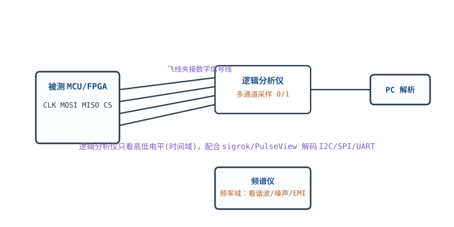
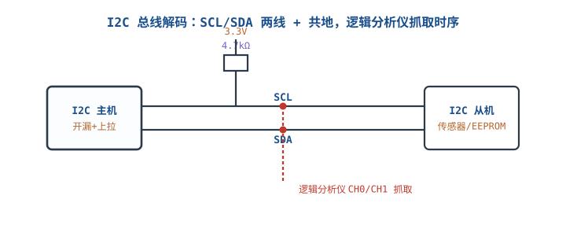
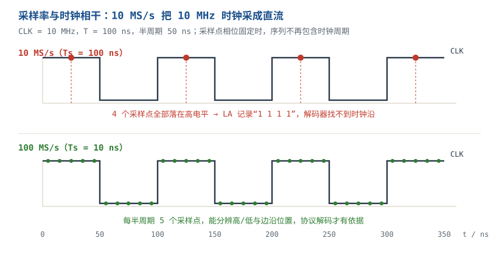

# 逻辑分析仪、频谱仪与网络分析仪 Logic Analyzer, Spectrum & Network Analyzer

示波器能看 2~4 路模拟波形，但面对 8 根 SPI、10 根并口、几十根地址线，屏幕放不下；面对 EMI 谐波、电源噪声、RF 匹配，时间域也看不出所以然。**逻辑分析仪（Logic Analyzer，LA）把多路数字信号变成 0/1 并自动解码协议；频谱分析仪（Spectrum Analyzer）把信号拆到频率域；网络分析仪（Vector Network Analyzer，VNA）测网络的 S 参数。** 三者补的是"多通道数字时序""频率成分""阻抗与传输"三块盲区。

这三类仪器有一个共同陷阱：**设置错了，屏幕仍然给你一条漂亮、稳定、可解释的曲线。** 采样率不够时，LA 把 10 MHz 时钟采成直流；RBW 太宽时，频谱仪把两根相邻谱线合并成一根；不校准 VNA 时，测到的是电缆和接头，不是 DUT。本章按"分工 → 采样/阈值 → RBW/扫描 → 近场 EMI → 完整算例"展开，每个设置都给可复算的判据。

本章符号：$f_{clk}$ 是时钟频率（Hz）；$f_s$ 是采样率（Sa/s）；$T_h$ 是时钟半周期（s）；$M$ 是每通道存储深度（点）；$RBW$ 是分辨率带宽（Hz）；$VBW$ 是视频带宽（Hz）；$T_{sw}$ 是扫描时间（s）；$SPAN$ 是扫频跨度（Hz）；$DANL$ 是显示平均噪声电平（dBm/Hz）。文中阈值、RBW、DANL、近场读数等均为典型量级或数量级示例，具体以数据手册/标准为准。

## 1 设计动机

::: motivation 三个现场
**现场一：10 MHz SPI，LA 设 10 MS/s，解码全 0。** 采样间隔 $T_s=1/10\ \text{MS/s}=100\ \text{ns}$，正好等于 SPI 时钟周期；每个周期都采到同一相位。若相位落在高电平，LA 看到一条恒高线，协议解码器找不到时钟沿，自然解不出数据。工程师以为是 SPI 模式设错，其实是采样率与时钟"相干"了。

**现场二：1.8 V FPGA IO，LA 阈值设 1.4 V，偶发误码。** 1.8 V LVCMOS 的 $V_{IH}$ 典型只有 1.26 V 左右；一个被负载拉低到 1.3 V 的合法高电平，在 1.4 V 阈值下被读成低。常温、轻载时正常，一加负载就出错，查协议层永远查不到。

**现场三：频谱仪 RBW 100 kHz，两根相距 100 kHz 的谐波合并成一根。** 屏幕上只有一个峰，工程师以为只有一个干扰源；把 RBW 降到 10 kHz 才看到双峰。代价是扫描时间从 25 ms 涨到 2.5 s。**RBW 是"频率分辨率"与"测量速度"的直接交换。**
:::

| 你想确认 | 先算 | 判据（工程经验值） |
|---|---|---|
| LA 能不能解出协议 | $f_s\ge2Nf_{clk}$ | 每半周期至少 4~5 个样本 |
| 能不能抓到窄毛刺 | $f_s\ge1/t_{glitch}$ | 毛刺宽度内至少 1 个样本 |
| 存储够不够抓一帧 | $M\ge f_sT_{frame}$ | 留 20% 余量 |
| 阈值对不对 | $V_{th}\approx(V_{IH}+V_{IL})/2$ | 1.8 V 系统约 0.9 V |
| 两根谱线分不分得开 | $RBW\le\Delta f/2$ | 要看到凹陷，RBW 取间隔的 1/2 以下 |
| 扫描要多久 | $T_{sw}\approx k\,SPAN/RBW^2$ | $k$ 取 2~3，以仪器手册为准 |
| 底噪够不够低 | $P_n=DANL+10\log_{10}RBW$ | 比被测谱线低 10 dB 以上 |
| VNA 数值可不可信 | 校准 + 参考面 | 测前做 SOLT，校准件与被测接头匹配 |

**不算会摔在哪**，四个带数字的代价：

1. **采样率与时钟相干。** 10 MHz 时钟用 10 MS/s 采，可能看到恒高/恒低，解码完全失败；用 40 MS/s 只有 2 个样本/半周期，相位稍偏就误判。
2. **阈值吃掉噪声裕量。** 1.8 V IO 的合法高电平可能低到 1.26 V；阈值 1.4 V 时，1.3 V 就被判成 0。这不是"偶发"，是设计上必然。
3. **RBW 太宽合并谱线。** 100 kHz 间距的两根线用 100 kHz RBW 看，只剩一个峰；EMI 整改会把两个源当成一个源，方向全错。
4. **扫描太快幅度失真。** 扫描时间低于 $k\,SPAN/RBW^2$ 时，滤波器来不及建立，幅度读低、频率偏移；屏幕上的"超标"或"合格"都不可信。

## 2 定义与直观

### 2.1 四种"看"的分工

| 仪器 | 看什么 | 通道/维度 | 典型用途 | 不擅长 |
|---|---|---|---|---|
| 示波器 | 模拟电压 vs 时间 | 2~4 通道，8~12 位 | 边沿、振铃、纹波、SI | 多通道协议、长捕获 |
| 逻辑分析仪 | 0/1 vs 时间 | 8~100+ 通道，1 位 | SPI/I2C/并口解码、时序 | 模拟质量、边沿形状 |
| 频谱仪 | 幅度 vs 频率 | 单通道，dBm | 谐波、杂散、EMI、噪声 | 时间关系、协议 |
| VNA | S 参数 vs 频率 | 1/2/4 端口 | 匹配、插损、回损、电缆 | 大信号、时域协议 |

**LA 与示波器不是替代关系。** 示波器回答"这个边沿有没有过冲、上升时间多少、是不是信号完整性坏了"；LA 回答"这 8 根线在 1 ms 内发了什么字节、哪一帧没 ACK"。正确顺序通常是：示波器确认物理层（电平、边沿、时钟质量），LA 抓协议层（帧、字节、时序关系）。如果物理层已经烂了，LA 解出来的字节也没有意义。

### 2.2 LA 的工作模型：比较器 + 采样 + 存储 + 解码

LA 的每个通道只有一个比较器：输入电压高于阈值记 1，低于阈值记 0。它不记录模拟幅度，所以看不到 1.3 V 和 1.7 V 的差别，只看到"高/低"。然后按采样率 $f_s$ 对比较器输出采样，存进存储深度 $M$，最后由软件按协议规则解码。

四个参数决定它能不能用：

- **阈值**：必须落在被测 IO 的 $V_{IL}$ 与 $V_{IH}$ 之间，通常取摆幅中点。
- **采样率**：必须足够高，既满足奈奎斯特，又要在每个数据有效窗口内采到点。
- **存储深度**：决定一次能抓多久；$T=M/f_s$。
- **通道数**：SPI 要 4 根（CLK/MOSI/MISO/CS），I2C 要 2 根（SCL/SDA），并口要 8~32 根。

### 2.3 频谱仪的工作模型：扫描 + 滤波 + 检波

传统扫频式频谱仪的本振（LO）在跨度 $SPAN$ 内扫过，混频后通过中频滤波器；滤波器的带宽就是 **RBW**。RBW 越窄，越能分开相邻谱线，但滤波器建立时间越长，扫描越慢。检波器把中频包络变成幅度：峰值检波取最大值，平均检波取平均，准峰值（QP）检波按脉冲重复频率加权。

现代 FFT 频谱仪用数字滤波/FFT，但 RBW、VBW、扫描时间、DANL 的物理含义仍然成立。**"RBW 是频率分辨率，VBW 是幅度平滑"** 是最容易混淆的一对：RBW 决定能不能分开两根线，VBW 决定显示曲线有多"毛"。

### 2.4 VNA 的工作模型：扫频 + S 参数

VNA 给被测网络加已知的入射波，测反射波和传输波，得到 S 参数。S11 是输入反射系数，S21 是正向传输系数。它不是"万用表式的通断测试"，而是"在每一个频率点上测复数比值"。测之前必须校准，把电缆、接头、夹具的误差从参考面移走；否则测到的是"电缆 + DUT"。

::: analogy LA 像高速连拍，频谱仪像三棱镜
LA 像一台只记录"黑/白"的高速相机：它不关心灰度，只关心每一帧是黑还是白；帧率不够，快速翻页的书就会拍成同一页。频谱仪像三棱镜：把一束混合光拆成不同颜色，棱镜的分辨率（RBW）越细，越能看清相邻的两条谱线；但拆得越细，扫描越慢。

类比的边界：相机拍的是空间，LA 采的是时间；三棱镜是空间色散，频谱仪是频率扫描。更重要的是，仪器不会告诉你"拍错了"——LA 的恒高线、频谱仪的单峰都长得很正常，必须靠参数判据识别。
:::

## 3 定量关系

### 3.1 LA 采样率：每半周期至少几个样本

设时钟频率 $f_{clk}$，占空比 50%，半周期：

$$T_h=\frac{1}{2f_{clk}}$$

要在每个半周期内采到 $N$ 个样本，采样率必须：

$$f_s\ge\frac{N}{T_h}=2Nf_{clk}$$

**10 MHz SPI 算例：**

- $N=2$：$f_s\ge4\times10\ \text{MHz}=40\ \text{MS/s}$，每个半周期 2 个样本，只能勉强判高低。
- $N=5$：$f_s\ge10\times10\ \text{MHz}=100\ \text{MS/s}$，每个半周期 5 个样本，能稳定解码并看到一定细节。
- $N=10$：$f_s\ge200\ \text{MS/s}$，能抓更窄的毛刺，但存储消耗翻倍。

**为什么 $f_s=f_{clk}$ 会看到直流？** 采样间隔 $T_s=1/f_s$ 恰好等于时钟周期 $T=1/f_{clk}$，每个周期都在同一相位采样。若相位落在高电平，得到全 1；落在低电平，得到全 0；落在边沿，得到抖动。**这不是奈奎斯特"刚好"的问题，而是相干采样把信号变成了直流。**

**奈奎斯特的另一个约束：** 10 MHz 方波的 5 次谐波是 50 MHz，要保留它至少需要 $f_s>100\ \text{MS/s}$。这和 $N=5$ 的结论一致；若只想解协议、不关心边沿形状，40 MS/s 也可能工作，但余量很小。

### 3.2 数据有效窗口与解码可靠性

SPI 解码器通常在时钟的有效沿采样数据。数据必须在时钟沿前后保持稳定：

$$T_{valid}=T_{clk}-t_{su}-t_{h}$$

其中 $T_{clk}=1/f_{clk}$ 是时钟周期，$t_{su}$ 是建立时间，$t_h$ 是保持时间。采样间隔必须小于 $T_{valid}$，否则可能采到跳变沿：

$$T_s=\frac{1}{f_s}<T_{valid}$$

**10 MHz SPI、$t_{su}=5\ \text{ns}$、$t_h=5\ \text{ns}$：**

$$T_{valid}=100-5-5=90\ \text{ns}$$

40 MS/s 时 $T_s=25\ \text{ns}$，90 ns 窗口内有 3~4 个样本，理论上够；但时钟抖动、占空比变化、探头地弹会让有效窗口缩小，实际建议 100 MS/s（$T_s=10\ \text{ns}$，9 个样本）。

### 3.3 存储深度：抓一帧要多少点

记录长度：

$$T_{record}=\frac{M}{f_s}$$

反过来，抓一帧所需存储：

$$M\ge f_sT_{frame}$$

**10 MHz SPI、1000 字节算例。** 每字节 8 位，位时间 $1/10\ \text{MHz}=100\ \text{ns}$：

$$T_{byte}=8\times100\ \text{ns}=800\ \text{ns}$$

若每字节之间 CS 拉高 1 µs：

$$T_{frame}=800\ \text{ns}+1\ \mu\text{s}=1.8\ \mu\text{s}$$

1000 字节：

$$T_{capture}=1000\times1.8\ \mu\text{s}=1.8\ \text{ms}$$

100 MS/s 下：

$$M=100\ \text{MS/s}\times1.8\ \text{ms}=180\ \text{k}\ \text{点/通道}$$

4 通道合计 720 k 点，8 通道合计 1.44 M 点。**注意"每通道存储"与"总存储共享"的区别：** 标称"1 M 点"若是每通道，8 通道够；若是共享，8 通道每通道只有 125 k 点，不够 180 k。这是选型时最容易看错的一行。

### 3.4 阈值：不是"设一个中间值"这么简单

LA 阈值应落在被测逻辑的 $V_{IL}$ 与 $V_{IH}$ 之间：

$$V_{IL}<V_{th}<V_{IH}$$

工程上取摆幅中点：

$$V_{th}\approx\frac{V_{DD}}{2}$$

3.3 V CMOS：$V_{th}\approx1.65\ \text{V}$；1.8 V CMOS：$V_{th}\approx0.9\ \text{V}$（$V_{IH}$ 以具体器件数据手册为准）。常见误区是把 3.3 V 系统的 1.5 V 阈值直接套到 1.8 V 系统：1.5 V 高于 1.8 V IO 的 $V_{IH}$（典型 1.26 V），一个合法的 1.3 V 高电平会被判成 0。

**阈值还要看噪声裕量。** 若高电平最低 1.26 V、阈值 0.9 V，高电平裕量 0.36 V；若阈值 1.4 V，裕量变成负数——不是"偶尔错"，是"必然错"。阈值精度、比较器迟滞、地弹都会吃掉裕量，所以实际取中点而不是贴着 $V_{IH}$。

**探头与地线。** LA 的输入不是理想比较器：典型输入阻抗约 100 kΩ 并 10 pF，飞线地线约 100 nH。10 MHz 时 10 pF 的容抗约 1.59 kΩ、100 nH 的感抗约 6.28 Ω，影响通常可忽略；到 100 MHz，容抗降到 159 Ω、感抗升到 62.8 Ω，探头会加载节点，地线也会产生地弹。高速协议要用短地线、低电容探头，地线就近接被测地，不要用长鳄鱼夹。

### 3.5 频谱仪：RBW、VBW 与扫描时间

**分辨率。** 两根相距 $\Delta f$ 的谱线，要分开（看到凹陷）通常要求：

$$RBW\le\frac{\Delta f}{2}$$

只要求"看出是一个宽峰"可以放宽到 $RBW\le\Delta f$，但定量幅度会偏。

**扫描时间。** 扫频式频谱仪的经验关系：

$$T_{sw}\approx k\frac{SPAN}{RBW^2}$$

其中 $k$ 是滤波器形状因子，典型 2~3，具体以仪器手册为准。这个式子说明：**RBW 缩小 10 倍，扫描时间增加 100 倍。**

**算例：$SPAN=100\ \text{MHz}$、$k=2.5$。**

- $RBW=100\ \text{kHz}$：$T_{sw}=2.5\times10^8/(10^5)^2=2.5\times10^8/10^{10}=0.025\ \text{s}=25\ \text{ms}$。
- $RBW=10\ \text{kHz}$：$T_{sw}=2.5\times10^8/10^8=2.5\ \text{s}$。
- $RBW=1\ \text{kHz}$：$T_{sw}=2.5\times10^8/10^6=250\ \text{s}$。

**底噪。** 显示平均噪声电平（DANL）通常以 dBm/Hz 给出；在 RBW 内的噪声功率：

$$P_n=DANL+10\log_{10}(RBW)$$

若 $DANL=-150\ \text{dBm/Hz}$：

- $RBW=100\ \text{kHz}$：$P_n=-150+50=-100\ \text{dBm}$。
- $RBW=10\ \text{kHz}$：$P_n=-150+40=-110\ \text{dBm}$。
- $RBW=1\ \text{kHz}$：$P_n=-150+30=-120\ \text{dBm}$。

**RBW 缩小 10 倍，底噪降 10 dB，但扫描时间涨 100 倍。** 这就是"看得细"与"扫得快"的交换。

**VBW。** 视频带宽是检波后的低通，作用是把噪声曲线平滑，不改变频率分辨率。VBW 通常取 RBW 的 1/10~1/1；VBW 太宽，曲线毛刺大，峰值读数偏高；VBW 太窄，扫描变慢，窄脉冲可能被平滑掉。扫描时间还要满足视频滤波器的建立：

$$T_{sw}\ge\max\left(k\frac{SPAN}{RBW^2},\ \frac{3}{VBW}\right)$$

例如 RBW=10 kHz、VBW=1 kHz 时，$3/VBW=3\ \text{ms}$；对 100 MHz 跨度，$k\,SPAN/RBW^2=2.5\ \text{s}$ 仍占主导。**先定 RBW，再定 VBW，最后核对扫描时间。**

### 3.6 检波器与 EMI 预测试

- **峰值检波（Peak）**：取每个频点上的最大值，最保守，适合找最坏情况。
- **平均检波（Average）**：取平均，适合看连续噪声/宽带信号。
- **准峰值检波（QP）**：按脉冲重复频率加权，模拟广播/通信受脉冲干扰的严重程度；CISPR 传导/辐射测试用 QP。

CISPR 16-1-1 规定 30 MHz~1 GHz 频段的 EMI 接收机使用 **120 kHz RBW** 和 QP 检波器。预测试时可以先用峰值检波 + 较宽 RBW 快速扫描，发现可疑点后再用 120 kHz RBW + QP 细测；直接用 QP 扫全频段会非常慢。

### 3.7 近场探头与 EMI 排查

近场探头是一个小环（H 场）或短棒（E 场），输出正比于局部场强。它不校准绝对场强，只用来"找源、比较、定位"。近场/远场的边界：

$$r_{near}=\frac{\lambda}{2\pi}=\frac{c}{2\pi f}$$

100 MHz 时 $\lambda=3\ \text{m}$，$r_{near}=0.477\ \text{m}$；探头在 5 mm~50 mm 处测量，稳稳在近场。近场探头看到的幅度随距离、方向、环路面积强烈变化，**不能拿近场读数直接判断辐射是否超标**；它的价值是"拔掉哪个器件/哪根线，峰值掉下来"。

EMI 排查顺序：

1. 频谱仪接近场探头，$SPAN$ 覆盖 30 MHz~1 GHz，RBW 100~120 kHz，峰值检波，Max Hold。
2. 探头沿板子、电缆、连接器扫描，记录峰值位置与频率。
3. 对可疑频率，用示波器看时域波形/周期，判断是开关电源基频、时钟谐波还是数据总线。
4. 改动（加磁珠、改布局、加屏蔽、调 slew rate）后重复扫描，比较峰值变化。
5. 正式测试按 CISPR 16-1-1 的 RBW/QP/天线/场地要求做，近场结果只作定位。

### 3.8 VNA：S 参数与校准

反射系数：

$$\Gamma=\frac{Z_L-Z_0}{Z_L+Z_0}$$

回波损耗：

$$RL=-20\log_{10}|\Gamma|$$

电压驻波比：

$$VSWR=\frac{1+|\Gamma|}{1-|\Gamma|}$$

**算例：S11 = −20 dB。**

$$|\Gamma|=10^{-20/20}=0.1$$

$$VSWR=\frac{1+0.1}{1-0.1}=1.222$$

失配损耗：

$$L_{mismatch}=-10\log_{10}(1-|\Gamma|^2)=-10\log_{10}(0.99)=0.044\ \text{dB}$$

−20 dB 回波损耗在工程上算"匹配不错"，但并不是"无反射"；对高精度功率测量，0.044 dB 也要计入。测之前做 SOLT（Short-Open-Load-Thru）校准，把参考面移到 DUT 端口；校准件、电缆、接头要跟测量频段匹配。

## 4 典型计算

### 4.1 完整算例：10 MHz SPI 的 LA 选型

**需求**：抓 1000 字节 SPI 通信，时钟 10 MHz，8 位/字节，CS 每字节拉高 1 µs；判断一台"8 通道、100 MS/s、每通道 1 M 点"的 LA 是否够。

**第一步：最小采样率。** 每半周期 5 个样本：

$$f_s\ge2Nf_{clk}=2\times5\times10\ \text{MHz}=100\ \text{MS/s}$$

绝对下限（每半周期 2 个样本）是 40 MS/s，但解码余量小；100 MS/s 同时覆盖 5 次谐波（50 MHz）的奈奎斯特要求。

**第二步：一帧时间。**

$$T_{byte}=8\times\frac{1}{10\ \text{MHz}}=800\ \text{ns}$$

$$T_{frame}=800\ \text{ns}+1\ \mu\text{s}=1.8\ \mu\text{s}$$

**第三步：1000 字节总时间。**

$$T_{capture}=1000\times1.8\ \mu\text{s}=1.8\ \text{ms}$$

**第四步：每通道存储。**

$$M=100\ \text{MS/s}\times1.8\ \text{ms}=180\ \text{k}\ \text{点}$$

**第五步：判断。**

- 若"1 M 点"是**每通道**：1 M > 180 k，够，余量 5.5 倍。
- 若"1 M 点"是**总存储共享**：8 通道每通道 125 k < 180 k，不够；要么减通道、要么降采样率到 50 MS/s（每半周期 2.5 个样本，解码风险上升）、要么用触发只抓出问题的那一帧。
- 若要把 100 ms 的长窗口一次抓完：$M=100\ \text{MS/s}\times100\ \text{ms}=10\ \text{M}$ 点/通道，1 M 点差 10 倍；这时应改用触发/分段存储，或把采样率降到 10 MS/s（但会回到"相干采样看到直流"的风险）。

**第六步：阈值与接线。** 3.3 V SPI 阈值设 1.65 V；1.8 V SPI 设 0.9 V。地线用短夹，CLK 与 MOSI 的飞线尽量等长；CS 用单独通道，确认极性（低有效）。解码器设 SPI 模式 0（CPOL=0，CPHA=0）或按实际波形选模式，先拿已知字节验证。

### 4.2 算例：采样率与时钟相干，看到直流

**场景**：10 MHz SPI，LA 采样率误设 10 MS/s。

$$T_s=\frac{1}{10\ \text{MS/s}}=100\ \text{ns}=T_{clk}$$

每个时钟周期采一个点，且相位固定。若第一个点在时钟高电平中间，之后每个点都在高电平中间，LA 记录全 1；若第一个点在低电平，记录全 0。**解码器没有时钟沿可抓，输出全 0 或全 1。** 把采样率改成 40 MS/s：

$$T_s=25\ \text{ns},\qquad \frac{T_h}{T_s}=\frac{50}{25}=2$$

每个半周期 2 个样本；若相位刚好落在边沿附近，仍可能采到跳变。100 MS/s 时每半周期 5 个样本，才稳定。

### 4.3 算例：RBW 与两根谱线

**场景**：两根干扰谱线相距 100 kHz，$SPAN=100\ \text{MHz}$，$k=2.5$。

- $RBW=100\ \text{kHz}$：$RBW=\Delta f$，两根线刚好相邻，屏幕上大概率合成一个宽峰；$T_{sw}=25\ \text{ms}$。
- $RBW=50\ \text{kHz}$：$RBW=\Delta f/2$，能看到凹陷；$T_{sw}=2.5\times10^8/(5\times10^4)^2=0.1\ \text{s}=100\ \text{ms}$。
- $RBW=10\ \text{kHz}$：分得很开；$T_{sw}=2.5\ \text{s}$。

**底噪对比：** $DANL=-150\ \text{dBm/Hz}$ 时，100 kHz 底噪 −100 dBm，10 kHz 底噪 −110 dBm。窄 RBW 既分开谱线，又降低底噪，但扫描时间从 25 ms 涨到 2.5 s。**先问"要分辨什么"，再选 RBW；不要一上来就用 1 kHz。**

### 4.4 算例：近场探头找 100 MHz 谐波

**场景**：一块板在 100 MHz 附近有辐射嫌疑，近场探头在 5 mm 处收到约 −60 dBm 的谱线；频谱仪 $DANL=-150\ \text{dBm/Hz}$，RBW 120 kHz。

**底噪：**

$$P_n=-150+10\log_{10}(120\times10^3)=-150+50.8=-99.2\ \text{dBm}$$

**信噪比：**

$$SNR=-60-(-99.2)=39.2\ \text{dB}$$

39 dB 足够在 Max Hold 上稳定看到峰值，也能比较改动前后的变化。若谱线只有 −95 dBm，SNR 只有 4.2 dB，必须加前置放大器或减小 RBW（但扫描变慢）。**近场读数的绝对值不可信，信噪比和相对变化才可信。**

**近场/远场判断：** 100 MHz 的 $\lambda=3\ \text{m}$，$r_{near}=0.477\ \text{m}$；5 mm 测量在近场，测的是局部电流/场的分布，不是远场辐射方向图。

### 4.5 算例：I2C 上拉 4.7 kΩ 在 Fast-mode 下太慢

**场景**：I2C Fast-mode（400 kHz），总线电容 $C_b=100\ \text{pF}$，上拉 $R_p=4.7\ \text{k}\Omega$。I2C 上升时间按 30%~70% 定义：

$$t_r\approx0.847R_pC_b=0.847\times4700\times100\times10^{-12}=398\ \text{ns}$$

Fast-mode 的最大上升时间是 300 ns，398 ns 超标。把上拉改成 3.3 kΩ：

$$t_r=0.847\times3300\times100\times10^{-12}=279.5\ \text{ns}$$

满足 300 ns。但上拉越小，低电平灌电流越大：

$$I_{OL}=\frac{V_{DD}}{R_p}=\frac{3.3}{3300}=1\ \text{mA}$$

在大多数 I2C 器件的 3 mA 灌电流能力内；若总线电容更大或电压更低，要重新算。**"4.7 kΩ 上拉"不是万能值：标准模式 100 kHz 通常够，Fast-mode 400 kHz 要按 $0.847RC$ 核对。**

### 4.6 算例：VNA 的 S11 与驻波比

**场景**：某连接器在 500 MHz 处 S11 = −8 dB。

$$|\Gamma|=10^{-8/20}=0.398$$

$$VSWR=\frac{1+0.398}{1-0.398}=2.32$$

失配损耗：

$$-10\log_{10}(1-0.398^2)=0.75\ \text{dB}$$

−8 dB 回波损耗对应 VSWR 2.32，已经是不小的失配；如果这条链路要传大功率或做精密测量，0.75 dB 的失配损耗必须计入。**S11 曲线"看起来平滑"不代表匹配好，要看数值和参考面。**

## 5 工程含义

### 5.1 仪器选择矩阵

| 任务 | 首选 | 关键设置 | 不要用 |
|---|---|---|---|
| 看边沿/过冲/纹波 | 示波器 | 带宽、探头、触发 | LA（看不到模拟幅度） |
| 解 SPI/I2C/并口 | LA | 采样率、阈值、存储 | 示波器硬数（通道不够） |
| 找谐波/杂散/EMI | 频谱仪 | RBW、VBW、检波器、衰减 | 示波器 FFT（动态范围/带宽有限） |
| 调天线/匹配/电缆 | VNA | 校准、参考面、IFBW | 万用表通断（只测直流） |
| 物理层 + 协议层 | 示波器 + LA | 先示波器后 LA | 只抓协议不看电平 |

### 5.2 LA 选型的四个数

1. **采样率**：至少 $2Nf_{clk}$，$N$ 取 4~5；要抓毛刺时按 $f_s\ge1/t_{glitch}$。
2. **存储深度**：$M\ge f_sT_{capture}$；注意"每通道"与"共享"。
3. **阈值范围**：要覆盖 1.8 V/3.3 V/5 V；阈值可调，最好每通道独立。
4. **通道数**：SPI 4 根、I2C 2 根、并口 8~32 根；留 2 根给 CS/复位/中断。

### 5.3 频谱仪选型的四个数

1. **频率范围**：覆盖被测基频与至少 5 次谐波；EMI 预测试 30 MHz~1 GHz（或更高）。
2. **RBW 范围**：要能到 1 kHz 以下看近邻谱线，也要能到 1 MHz 快速扫描。
3. **DANL**：比最小被测信号低 10 dB 以上；不够时加前置放大器（注意增益压缩）。
4. **输入功率上限**：先加衰减器，别把大信号直接灌进前端；烧前端是不可逆的。

### 5.4 近场 EMI 排查的边界

- 近场探头测的是局部场，不是远场辐射；不能直接判定"过/不过"。
- 探头方向、距离、电缆走向都会改变读数；比较时保持几何一致。
- 板子上的共模电流、电缆天线效应、缝隙泄漏，靠近场探头逐点定位；找到源后，用示波器确认时域周期。
- 正式认证要按 CISPR/FCC 的场地、天线、RBW、QP 要求做；近场只是"预诊断"。

### 5.5 VNA 的校准与参考面

- 校准件要与被测接头类型、频段匹配；用错校准件比不校准更糟。
- 校准后不要动电缆/接头；动了就重校。
- 测差分/多端口时用相应端口数和校准方法；单端 S11 不能直接代替差分 Sdd11。
- 测有源电路时注意 VNA 的源功率，避免压缩/损坏 DUT。

### 5.6 协议解码的可信度

- 先确认物理层：电平、边沿、时钟频率、占空比；物理层不对，解码结果没有意义。
- 选对协议模式：SPI 的 CPOL/CPHA、I2C 的地址位宽、UART 的波特率/校验。
- 用已知数据验证：先发一个已知字节/寄存器读，确认解码字节与预期一致。
- 偶发错误用触发：在 CS 下降沿/特定地址触发，只抓出错的那一帧；不要盲抓几十秒。

## 6 常见坑

::: pitfall 坑一：LA 采样率与时钟相干，看到的是一条直线
- **现象**：10 MHz SPI 在 LA 上 CLK 不跳变，解码全 0/全 1；换一台 LA 又正常。
- **原因**：采样率恰为 10 MS/s，$T_s=T_{clk}$，每个周期采到同一相位，信号被采成直流。
- **解决**：采样率取时钟的 10 倍以上（10 MHz 时钟用 100 MS/s）；或把采样率设成非整数倍，破坏相干。
:::

::: pitfall 坑二：阈值按 3.3 V 经验设 1.5 V，1.8 V IO 误码
- **现象**：1.8 V FPGA 的 SPI 偶尔解码错，轻载正常、重载出错。
- **原因**：1.8 V 的 $V_{IH}$ 典型约 1.26 V；阈值 1.4~1.5 V 时，被拉低的合法高电平被判成 0。
- **解决**：阈值设摆幅中点，1.8 V 系统约 0.9 V；用示波器确认高电平最低值，留够噪声裕量。
:::

::: pitfall 坑三：只看采样率，不看存储深度
- **现象**：LA 标称 100 MS/s，抓 100 ms 通信只抓到开头一小段，后面全是空白/循环。
- **原因**：$M=f_sT$，100 MS/s×100 ms=10 M 点/通道；1 M 点只能抓 10 ms。
- **解决**：先算 $T_{capture}$ 和 $M$；用触发/分段存储抓偶发帧，或降低采样率并确认解码余量。
:::

::: pitfall 坑四：RBW 太宽，两根谱线当成一根
- **现象**：EMI 扫描只看到一个峰，整改一个源后峰值不降；换窄 RBW 发现是双峰。
- **原因**：RBW=100 kHz，两根线相距 100 kHz，滤波器无法分开；幅度是两者叠加。
- **解决**：按 $RBW\le\Delta f/2$ 选，100 kHz 间距用 ≤50 kHz；同时核对扫描时间是否足够。
:::

::: pitfall 坑五：频谱仪不加衰减，烧前端
- **现象**：接上大功率信号/天线后频谱仪读数异常、底噪抬高，甚至前端损坏。
- **原因**：输入超过最大安全功率；前端混频器/衰减器不可逆损坏。
- **解决**：先加 20~30 dB 衰减器，确认功率在范围内再逐步减小；测未知信号先用手持/低灵敏度档。
:::

::: pitfall 坑六：VNA 不校准就测，数值全错
- **现象**：S11 曲线奇怪，换一根电缆就变；同一 DUT 两次测量不一致。
- **原因**：电缆、接头、夹具的损耗/反射没有从参考面剔除。
- **解决**：按频段和接头做 SOLT 校准，校准后不动电缆；把参考面移到 DUT 端口再测。
:::

## 7 自测题

10 MHz SPI，每半周期要 5 个样本，LA 采样率至少多少？为什么 10 MS/s 会看到直流？

$f_s\ge2Nf_{clk}=2\times5\times10\ \text{MHz}=100\ \text{MS/s}$。10 MS/s 时 $T_s=100\ \text{ns}=T_{clk}$，每个周期同一相位采样，信号被采成直流；解码器找不到时钟沿。

10 MHz SPI、1000 字节、每字节 CS 间隙 1 µs，100 MS/s 下每通道需要多少存储？

每字节 8×100 ns=800 ns，加 1 µs 间隙为 1.8 µs；1000 字节 1.8 ms；$M=100\ \text{MS/s}\times1.8\ \text{ms}=180\ \text{k}$ 点/通道。8 通道共享 1 M 点时每通道只有 125 k，不够。

1.8 V IO 的 LA 阈值应设多少？设 1.4 V 为什么会错？

摆幅中点约 0.9 V。1.8 V LVCMOS 的 $V_{IH}$ 典型约 1.26 V；阈值 1.4 V 高于 $V_{IH}$，一个合法的 1.3 V 高电平会被判成 0。阈值应落在 $V_{IL}$ 与 $V_{IH}$ 之间，并留噪声裕量。

100 MHz 跨度、RBW 从 100 kHz 降到 10 kHz，扫描时间和底噪各怎么变？

$T_{sw}\approx k\,SPAN/RBW^2$：100 kHz 时 25 ms，10 kHz 时 2.5 s，慢 100 倍。底噪 $DANL+10\log_{10}RBW$：从 −100 dBm 降到 −110 dBm，低 10 dB。分辨率提高、速度变慢，是直接交换。

两根谱线相距 100 kHz，要看到凹陷，RBW 应取多少？

按 $RBW\le\Delta f/2$，取 ≤50 kHz；实际用 30 kHz 更稳妥。RBW=100 kHz 时两根线会合并成一个宽峰，容易把两个干扰源当成一个。

S11 = −20 dB，反射系数、VSWR 和失配损耗各是多少？

$|\Gamma|=10^{-20/20}=0.1$；$VSWR=(1+0.1)/(1-0.1)=1.222$；失配损耗 $-10\log_{10}(1-0.01)=0.044\ \text{dB}$。−20 dB 是较好的匹配，但不是无反射。

## 8 参考资料

- NXP, *UM10204 I2C-bus specification and user manual*, Rev. 6：开漏总线、上拉电阻、Fast-mode 上升时间与总线电容。
- Motorola, *SPI Block Guide V03.06*：SPI 时钟极性/相位、位采样与主从时序。
- Keysight, *Spectrum Analysis Basics*, Application Note 150 (5952-0292)：RBW、VBW、扫描时间、DANL 与检波器。
- CISPR 16-1-1:2019：30 MHz~1 GHz EMI 接收机的 120 kHz RBW、准峰值检波器与测试场地要求。
- sigrok/PulseView 文档：采样率、阈值、存储深度与协议解码器配置。

相关章节：[示波器：探头、触发、带宽与接地](oscilloscope.md)、[万用表使用与测量技巧](multimeter.md)、[信号发生器、电子负载与稳压电源](signal-generator-load.md)、[EMI 与 EMC](../pcb/emi-emc.md)、[I2C 与 SPI](../mcu/i2c-spi.md)、[时序分析、亚稳态与建立保持时间](../digital/timing-analysis-metastability.md)、[接地与地环路](../power/grounding.md)。
